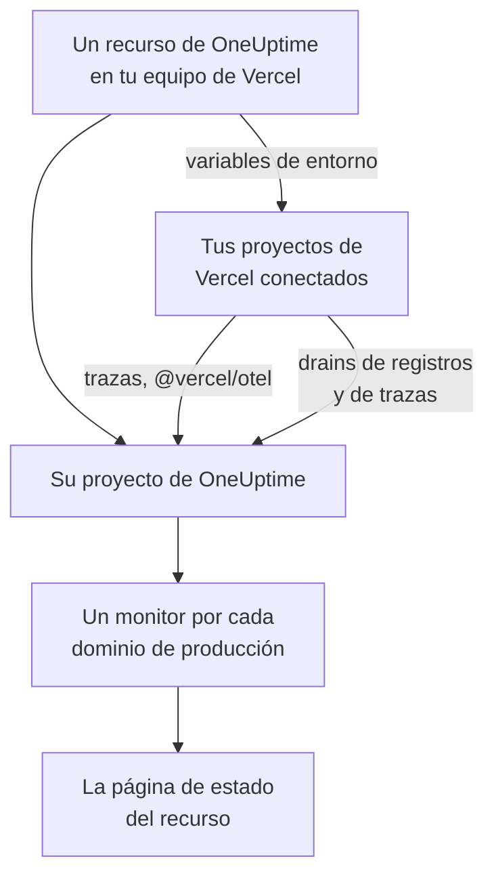

# Vercel

Añade OneUptime a tu equipo de Vercel desde el [Vercel Marketplace](https://vercel.com/marketplace). Inicias sesión con tu cuenta de Vercel y pagas en tu factura de Vercel, y tus proyectos de Vercel obtienen en OneUptime trazas, registros, monitoreo de disponibilidad y una página de estado, sin configurar nada a mano.

:::cards
- [Añadir OneUptime a tu equipo de Vercel](#añadir-oneuptime-a-tu-equipo-de-vercel): Un recurso, un plan y tus proyectos, en el panel de Vercel.
- [Enviar trazas con @vercel/otel](#enviar-trazas-con-vercelotel): Las variables de entorno ya están ahí.
- [Enviar registros y trazas con drains](#enviar-registros-y-trazas-con-drains): Los registros y spans del propio Vercel, en Pro y Enterprise.
- [Planes y facturación](#planes-y-facturación): Los planes de OneUptime, en tu factura de Vercel.
:::

## Cómo funciona

Cada recurso de OneUptime que añades en Vercel es un proyecto de OneUptime propio. Vercel da a cada proyecto de Vercel que conectas al recurso las variables de entorno de este, que envían las trazas del proyecto a OneUptime. Los drains envían los registros y spans de Vercel, y el dominio de producción de cada proyecto conectado recibe un monitor de disponibilidad en la página de estado del recurso.



La integración es para OneUptime Cloud (`oneuptime.com`). Un OneUptime autoalojado no se puede añadir desde el Vercel Marketplace: consulta [OneUptime autoalojado](#oneuptime-autoalojado).

## Antes de empezar

- **Un equipo de Vercel**, con cualquier plan. Los drains de registros y de trazas necesitan el plan Pro o Enterprise de Vercel; las trazas de `@vercel/otel` funcionan con todos los planes.
- **Una dirección de correo electrónico verificada** en tu cuenta de Vercel. OneUptime inicia tu sesión con ella, y con ella crea tu cuenta de OneUptime si no tienes una.
- **Un método de pago en Vercel**, para todos los planes: los monitores y la telemetría se facturan según el uso, también en el plan Free. Consulta [Planes y facturación](#planes-y-facturación).

## Añadir OneUptime a tu equipo de Vercel

:::steps
### Abrir OneUptime en el Vercel Marketplace

En el panel de Vercel, abre **Integrations**, luego **Browse Marketplace**, y busca OneUptime en **Observability**. Haz clic en **Install** y acepta las condiciones de OneUptime.

### Elegir un plan

Elige **Free**, **Growth** o **Scale**. Son los planes del propio OneUptime, a los precios de [oneuptime.com/pricing](https://oneuptime.com/pricing).

### Nombrar el recurso y elegir sus ajustes

Ponle al recurso el nombre de lo que vigila, por ejemplo `storefront`: su proyecto de OneUptime y su página de estado llevan su nombre. Dos ajustes empiezan activados:

- **Monitor production domains**: un monitor de sitio web para el dominio de producción de cada proyecto de Vercel que conectes.
- **Create a status page**: una página de estado pública para el recurso, que muestra esos monitores.

### Conectar tus proyectos

Elige los proyectos de Vercel que envían a este recurso, y los entornos que reciben sus variables de entorno. No le pongas a la conexión un prefijo personalizado: `@vercel/otel` lee las variables por sus propios nombres.
:::

El recurso está listo en unos segundos. Haz clic en **Open in OneUptime** para ver su proyecto.

## Qué te da cada recurso

| Qué | Dónde encontrarlo |
| --- | --- |
| Un proyecto de OneUptime, con el nombre del recurso | Es tuyo. Tus compañeros de equipo se unen a él cuando lo abren desde Vercel. |
| Una clave de ingesta llamada `Vercel` | **Ajustes del proyecto → Telemetría y APM → Claves de ingesta** |
| Variables de entorno en cada proyecto de Vercel conectado | **Settings → Environment Variables** del proyecto, en Vercel |
| Un monitor de sitio web por cada proyecto conectado | **Monitores**, con el nombre del proyecto de Vercel |
| Una página de estado pública | **Páginas de estado**, con el nombre del recurso |

Las variables de entorno son las mismas en todos los proyectos conectados:

| Variable | Valor |
| --- | --- |
| `OTEL_EXPORTER_OTLP_ENDPOINT` | `https://oneuptime.com/otlp` |
| `OTEL_EXPORTER_OTLP_HEADERS` | `x-oneuptime-token=` seguido de la clave de ingesta del recurso |
| `OTEL_EXPORTER_OTLP_PROTOCOL` | `http/protobuf` |
| `ONEUPTIME_TELEMETRY_INGESTION_KEY` | Solo la clave de ingesta, que es lo que envían los drains |

Un despliegue recibe las variables cuando se compila: vuelve a desplegar después de conectar un proyecto.

## Enviar trazas con @vercel/otel

`@vercel/otel` es el paquete de OpenTelemetry de Vercel para Next.js y los demás frameworks que ejecuta Vercel. Lee las variables `OTEL_EXPORTER_OTLP_*`, así que un proyecto conectado al recurso solo necesita el paquete.

:::steps
### Instalar el paquete

```bash
npm install @vercel/otel @opentelemetry/api @opentelemetry/api-logs
```

### Registrarlo

Crea `instrumentation.ts` en la raíz del proyecto, o en `src` si el proyecto tiene esa carpeta, y ponle nombre al servicio:

```ts title="instrumentation.ts"
import { registerOTel } from "@vercel/otel";

export function register(): void {
  registerOTel({ serviceName: "storefront" });
}
```

### Desplegar

Despliega el proyecto. Sus trazas aparecen en **Trazas**, con el nombre del servicio.
:::

En los planes Pro y Enterprise de Vercel, añade también un drain de trazas: Vercel envía entonces a OneUptime sus propios spans de cada solicitud, junto con los de tu aplicación, y `@vercel/otel` se los deja al drain, así que nada llega dos veces.

## Enviar registros y trazas con drains

Un drain envía a OneUptime lo que Vercel registra sobre tus proyectos: un drain de registros, sus registros de compilación, de funciones, de edge y de solicitudes, y un drain de trazas, sus spans. Los drains necesitan el plan Pro o Enterprise de Vercel, y Vercel cobra los datos que envían en tu factura de Vercel.

:::steps
### Añadir un drain

En Vercel, abre **Team Settings → Drains** y haz clic en **Add Drain**. Elige **Logs** o **Traces**, y luego OneUptime en **Native Integrations**.

### Elegir los proyectos

Elige los proyectos y, para los registros, las fuentes y los entornos. El drain envía con la clave de ingesta del recurso: no hay nada que escribir.
:::

Cada proyecto de Vercel es un servicio en OneUptime, con el nombre del proyecto. Un registro conserva su hora, su nivel y su mensaje, y los datos de su solicitud con los nombres de OpenTelemetry:

| Campo de Vercel | En OneUptime |
| --- | --- |
| `projectName` | El servicio, `service.name` |
| `timestamp`, `level`, `message` | La hora, la gravedad y el cuerpo del registro |
| `deploymentId`, `environment` | `vercel.deployment.id`, `deployment.environment.name` |
| `proxy.method`, `proxy.path`, `proxy.statusCode` | `http.request.method`, `url.path`, `vercel.proxy.status_code` |
| `traceId`, `spanId` | La traza del registro, vinculada a la traza en **Trazas** |
| Cualquier otro campo | Un atributo bajo `vercel.`, como `vercel.source` |

## Monitores de disponibilidad y la página de estado

Cuando conectas un proyecto de Vercel, OneUptime crea un monitor de sitio web para su dominio de producción, que se comprueba desde las sondas de OneUptime, y lo añade a la página de estado del recurso. Un proyecto conectado antes de su primer despliegue de producción aún no tiene dominio: su monitor se crea en ese despliegue. Desconectar el proyecto elimina su monitor.

Cada monitor es un monitor activo, se factura como cualquier otro y funciona como uno que hayas creado tú: consulta [Monitor de sitio web](/docs/monitor/website-monitor). Para que no se cree ninguno, desactiva **Monitor production domains** en los ajustes del recurso en Vercel. Al volver a activarlo se crean los monitores que aún faltan.

## Abrir OneUptime desde Vercel

Haz clic en **Open in OneUptime** en el recurso, o en cualquiera de sus enlaces en Vercel, e inicias sesión en OneUptime con la dirección de correo electrónico de tu cuenta de Vercel. La primera vez te unes al proyecto del recurso: como administrador si eres propietario o miembro del equipo de Vercel, y como miembro si tienes uno de sus roles de solo lectura.

Si ya existe una cuenta de OneUptime con esa dirección, inicias sesión en esa cuenta. Si tiene activada la autenticación de dos factores, o pertenece a un administrador de OneUptime, inicias sesión con su contraseña en su lugar. Entras en el proyecto de todos modos.

## Planes y facturación

| | Cómo funciona |
| --- | --- |
| Planes | **Free**, **Growth** y **Scale**, a los precios de oneuptime.com: el precio del plan por usuario, los monitores activos a $1 por monitor y mes, y la telemetría por GB. |
| Dónde pagas | En tu factura de Vercel, una vez al mes, por cada recurso. Vercel muestra en el recurso el uso del mes hasta el momento, actualizado cada hora. |
| Pruebas | No se cobra nada mientras dura la prueba del plan: ni sus usuarios, ni sus monitores, ni su telemetría. |
| Cambiar de plan | En Vercel, en el recurso, o en OneUptime en **Ajustes del proyecto → Facturación y facturas → Facturación**. Un cambio en cualquiera de los dos sitios vale para ambos. |
| Facturas sin pagar | Vercel reintenta el pago durante 15 días. Después, el proyecto deja de estar disponible hasta que se pague la factura: sus datos se conservan, y no se elimina nada. |

En la factura, cada recurso tiene una línea para sus usuarios, sus monitores activos, su telemetría y las recargas de saldo que haya, en unidades de uso de $0.01.

## Quitar OneUptime

| Tú | Qué pasa |
| --- | --- |
| Eliminas un recurso en Vercel | Su proyecto se elimina, después de facturar su uso hasta ese momento. Los proyectos de Vercel conectados pierden las variables de entorno del recurso en su siguiente despliegue. |
| Desinstalas OneUptime del equipo | Se elimina el proyecto de cada recurso, y se envía la factura final. |
| Eliminas el proyecto en OneUptime | El recurso también se elimina en Vercel. |

> [!CAUTION]
> Eliminar un proyecto elimina para siempre sus monitores, su página de estado, sus incidentes y su telemetría. Exporta antes todo lo que quieras conservar.

## OneUptime autoalojado

Un OneUptime autoalojado no se puede añadir desde el Vercel Marketplace, que solo aprovisiona OneUptime Cloud. Tus proyectos de Vercel pueden enviarle datos de todos modos:

- **Trazas**: en **Settings → Environment Variables** del proyecto de Vercel, define las variables de [Qué te da cada recurso](#qué-te-da-cada-recurso), con `https://YOUR-ONEUPTIME-HOST/otlp` como endpoint y una clave de ingesta de tu proyecto.
- **Registros**: añade un drain de registros personalizado en **Team Settings → Drains**, hacia `https://YOUR-ONEUPTIME-HOST/telemetry/vercel/v1/logs`, en JSON o NDJSON. Añade el encabezado `x-oneuptime-token` con tu clave de ingesta, y pon esa misma clave como secreto de firma del drain: OneUptime solo acepta las entregas que Vercel firmó con ella.

El mismo drain personalizado funciona en OneUptime Cloud, con `oneuptime.com` como host.

## Solución de problemas

:::details No llega ninguna traza
- Vuelve a desplegar el proyecto: un despliegue compilado antes de conectar el proyecto no tiene las variables `OTEL_EXPORTER_OTLP_*`.
- Comprueba los nombres de las variables en **Settings → Environment Variables** del proyecto. Una conexión creada con un prefijo personalizado les cambia el nombre, y `@vercel/otel` ya no las lee: vuelve a conectar el proyecto sin prefijo.
- Comprueba que `instrumentation.ts` llama a `registerOTel` y, en Next.js 14 y anteriores, que `experimental.instrumentationHook` está activado en `next.config.js`.
:::

:::details Vercel muestra el drain con errores
Vercel muestra la respuesta de OneUptime a las entregas del drain:

- `403` con `x-vercel-signature` en el mensaje: Vercel no firmó la entrega con la clave que envía. En un drain personalizado, comprueba su encabezado `x-oneuptime-token` y pon esa misma clave como su secreto de firma.
- `401`: OneUptime no conoce ningún proyecto con la clave que envía el drain: se eliminó, o se escribió mal en los dos sitios. Usa una clave de **Ajustes del proyecto → Telemetría y APM → Claves de ingesta**.
- `422`: la clave se desactivó. Vuelve a activarla en la misma página, o usa otra.
:::

:::details Un proyecto conectado no tiene monitor
- **Monitor production domains** está desactivado en los ajustes del recurso en Vercel.
- El proyecto aún no tiene dominio de producción: su monitor se crea en su primer despliegue de producción.
- El proyecto ya tiene tantos monitores activos como permite su plan: pasa a un plan superior, y luego desactiva y vuelve a activar **Monitor production domains**.
:::

:::details Vercel pide verificar tu dirección de correo electrónico
OneUptime necesita una dirección de correo electrónico que Vercel haya verificado, y una cuenta de OneUptime existente con esa dirección también necesita tener verificada su propia dirección. Verifica la dirección y luego añade el recurso o vuelve a abrir OneUptime.
:::

## Próximos pasos

:::cards
- [Explorador de trazas](/docs/telemetry/traces-explorer): Encuentra una solicitud lenta y sus spans.
- [Explorador de registros](/docs/telemetry/logs-explorer): Busca en tus registros de Vercel.
- [Páginas de estado](/docs/status-pages/index): Aplica tu marca a la página de estado del recurso y añade suscriptores.
- [Claves de ingesta](/docs/telemetry/ingestion-keys): Rota o desactiva la clave del recurso.
:::
