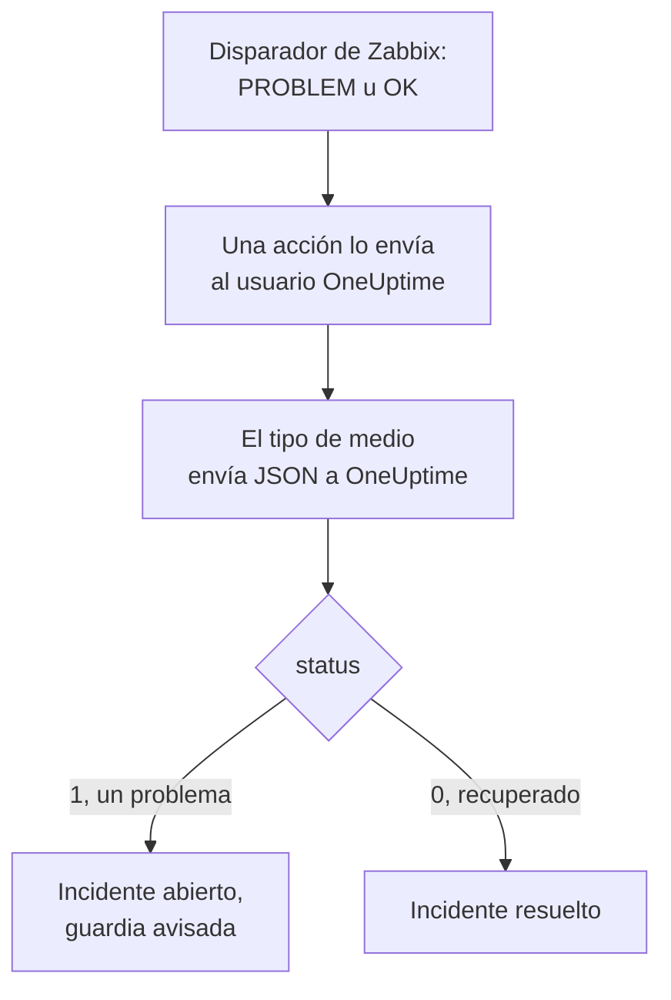

# Zabbix

Envía los problemas de [Zabbix](https://www.zabbix.com) a OneUptime, para que cada problema se convierta en un incidente que avisa a tu equipo de guardia y se resuelve cuando Zabbix se recupera. Zabbix envía cada problema mediante un tipo de medio webhook, así que no hay nada que instalar en ninguno de los dos lados.

:::cards
- [Elegir cómo recibe OneUptime los problemas](#elegir-cómo-recibe-oneuptime-los-problemas): Un monitor de solicitudes entrantes o un flujo de trabajo propio.
- [Recibir problemas con un monitor](#recibir-problemas-con-un-monitor): Un incidente por problema, resuelto con la recuperación.
- [Configurar Zabbix](#configurar-zabbix): Un tipo de medio, un usuario y una acción.
- [Solución de problemas](#solución-de-problemas): Cuando los problemas no llegan o los incidentes siguen abiertos.
:::

## Cómo funciona



Zabbix envía un problema a un usuario, a través de los medios de ese usuario. Aquí el medio es un tipo de medio webhook llamado **OneUptime**: su script envía a OneUptime un pequeño documento JSON con el ID de evento, el nombre, el host, la gravedad y el estado del problema. El estado es `1` para un problema y `0` para su recuperación.

## Antes de empezar

- Un servidor Zabbix que administres. Esta guía está escrita para Zabbix 6.0 LTS y 7.0 LTS. Los tipos de medio webhook funcionan igual desde Zabbix 5.0.
- Un servidor Zabbix que pueda llegar a tu OneUptime por HTTPS.
- En OneUptime, permiso para crear monitores, o flujos de trabajo si eliges esa vía.

## Elegir cómo recibe OneUptime los problemas

Configura OneUptime primero: te da la URL a la que envía Zabbix.

| Forma | Úsala cuando |
| --- | --- |
| Un monitor de solicitudes entrantes (recomendado) | Quieres que cada problema de Zabbix sea un incidente que avisa a la guardia y se resuelve cuando Zabbix se recupera. No hay nada que construir. |
| Un flujo de trabajo con un disparador Webhook | Necesitas una lógica propia: filtrar los problemas, darles otra forma o llamar antes a otros sistemas. Un flujo de trabajo no resuelve el incidente por sí solo con la recuperación. |

Ambos reciben el mismo JSON del mismo tipo de medio, así que puedes empezar con uno y cambiar más adelante modificando una sola URL en Zabbix.

## Recibir problemas con un monitor

Un [monitor de solicitudes entrantes](/docs/monitor/incoming-request-monitor) te da una URL, y sus criterios deciden qué hace cada solicitud.

:::steps
### Crear el monitor

Ve a **Monitores** y haz clic en **Crear monitor**. Elige **Solicitud entrante** en **Tipo de monitor**, ponle el nombre `Zabbix` y haz clic en **Siguiente**.

### Declarar un incidente por cada problema

En el paso **Criterios**, abre el primer criterio, el que marca el monitor como fuera de línea. Pon su filtro en **Cuerpo de la solicitud**, **Contiene**, `"status":"1"`. Este criterio ya declara un incidente cuando su filtro coincide. Completa el incidente:

- **Título del incidente**: `Zabbix: {{requestBody.name}} on {{requestBody.host}}`.
- **Gravedad**: la gravedad de incidente que deben tener los problemas de Zabbix.
- **Políticas de guardia**, en **De guardia**: las políticas a las que avisar.
- **Resolver incidente automáticamente**, en **Más campos**: déjalo activado, como viene. Sin él, las recuperaciones se ignoran y los incidentes siguen abiertos.

### Abrir un incidente por problema

En el mismo criterio, abre **Ajustes** y activa **Agrupa incidentes y alertas por un campo de la carga útil**. Rellénalo como se indica abajo, para que cada problema tenga su propio incidente y su recuperación lo resuelva:

| Campo | Valor |
| --- | --- |
| **Abrir un incidente separado para cada…** | `requestBody.event_id` |
| **Campo que indica la recuperación** | `requestBody.status` |
| **Valor que significa recuperado** | `0` |

### Volver a poner el monitor en línea

Abre el segundo criterio, el que marca el monitor como en línea, y pon su filtro en **Cuerpo de la solicitud**, **Contiene**, `"status":"0"`.

### Copiar la URL

Haz clic en **Crear monitor**. La página **Vista general** del monitor muestra su **URL de latido**. Cópiala para Zabbix:

```text
https://oneuptime.com/heartbeat/<secret key>
```

Una instalación autoalojada tiene su propio host en lugar de `oneuptime.com`.
:::

El monitor lee el JSON de la solicitud tal como está escrito: `"status":"1"`, sin espacios. Consulta [Recibir alertas de otro sistema](/docs/monitor/incoming-request-monitor#recibir-alertas-de-otro-sistema) para saber qué hace cada ajuste.

## Recibir problemas con un flujo de trabajo

Usa un [flujo de trabajo](/docs/workflows/index) cuando necesites pasos propios entre Zabbix y el incidente.

:::steps
### Crear el flujo de trabajo

Ve a **Flujos de trabajo**, haz clic en **Crear flujo de trabajo** y luego en **Empezar desde cero**. Ponle el nombre `Zabbix problems` y haz clic en **Crear flujo de trabajo**.

### Añadir el disparador Webhook

Haz clic en el bloque discontinuo **Elige qué inicia este flujo de trabajo** y elige **Webhook**. Haz clic en el disparador, luego en **Copiar URL**, y guarda la URL para Zabbix.

### Comprobar que es un problema

Haz clic en **Añadir componente**, añade un bloque **If / Else** y conecta a él el punto **Out** del disparador. Pon **Value to check** en `{{local.components.webhook-1.returnValues.request-body.status}}`, **Comparison** en **is equal to** y **Compare with** en `1`.

### Declarar el incidente

Añade un bloque **Create One Incident** y conecta a él el lado **Yes** del bloque **If / Else**. En **Incident Template**, elige una plantilla que fije la gravedad y las políticas de guardia a las que avisar (consulta [Plantillas de incidentes](/docs/incidents/settings#plantillas-de-incidente)). En **JSON Object**, pon lo que viene de Zabbix:

```json
{
  "title": "Zabbix: {{local.components.webhook-1.returnValues.request-body.name}}",
  "description": "Host: {{local.components.webhook-1.returnValues.request-body.host}}\nSeverity: {{local.components.webhook-1.returnValues.request-body.severity}}\nZabbix event: {{local.components.webhook-1.returnValues.request-body.event_id}}"
}
```

Sin plantilla, **JSON Object** también necesita `incidentSeverityId`, el ID de una de las gravedades de incidente del proyecto.

### Activarlo

Activa **Habilitado** en la parte superior del **Constructor**. Un flujo de trabajo desactivado responde a Zabbix con `400`.
:::

Una recuperación toma el lado **No** del bloque **If / Else**, donde no hay nada conectado, así que la ejecución termina ahí. Para resolver los incidentes con la recuperación, usa el monitor.

## Configurar Zabbix

Zabbix necesita tres cosas: un tipo de medio que envíe a OneUptime, un usuario al que enviarlo y una acción que envíe los problemas a ese usuario.

:::steps
### Crear el tipo de medio OneUptime

1. Ve a **Alerts → Media types**, o a **Administration → Media types** en Zabbix 6.0, y haz clic en **Create media type**.
2. Pon **Name** en `OneUptime` y **Type** en **Webhook**.
3. Añade estos **Parameters**. Cada uno lleva una [macro](https://www.zabbix.com/documentation/current/en/manual/appendix/macros/supported_by_location) de Zabbix a la solicitud:

   | Nombre | Valor |
   | --- | --- |
   | `url` | `{ALERT.SENDTO}` |
   | `event_id` | `{EVENT.ID}` |
   | `event_name` | `{EVENT.NAME}` |
   | `event_value` | `{EVENT.VALUE}` |
   | `event_severity` | `{EVENT.SEVERITY}` |
   | `host` | `{HOST.NAME}` |
   | `event_date` | `{EVENT.DATE}` |
   | `event_time` | `{EVENT.TIME}` |

4. Pega esto en **Script**:

   ```javascript
   var params = JSON.parse(value);
   var request = new HttpRequest();
   request.addHeader("Content-Type: application/json");

   var payload = {
     source: "zabbix",
     event_id: params.event_id,
     name: params.event_name,
     host: params.host,
     severity: params.event_severity,
     // "1" for a problem, "0" for its recovery.
     status: params.event_value,
     date: params.event_date,
     time: params.event_time,
   };

   var response = request.post(params.url, JSON.stringify(payload));

   if (request.getStatus() < 200 || request.getStatus() >= 300) {
     throw (
       "OneUptime responded with HTTP " + request.getStatus() + ": " + response
     );
   }

   return "OK";
   ```

5. En la pestaña **Message templates**, añade una plantilla para **Problem** y otra para **Problem recovery**. Deja su texto vacío: el script construye la solicitud. Zabbix solo usa un tipo de medio para los tipos de evento para los que tiene una plantilla.
6. Haz clic en **Add**.

### Crear un usuario que reciba los problemas

1. Ve a **Users → Users**, o a **Administration → Users** en Zabbix 6.0, y haz clic en **Create user**. Ponle el nombre `OneUptime` y dale un grupo de usuarios y un rol que pueda recibir notificaciones, como **User role**.
2. En la pestaña **Media**, haz clic en **Add**. Pon **Type** en `OneUptime` y **Send to** en la URL que copiaste de OneUptime. Deja **When active** y las gravedades como están, o desmarca las gravedades que OneUptime no deba recibir.
3. Haz clic en **Add** y luego otra vez en **Add** para guardar el usuario.

### Enviar los problemas a OneUptime con una acción

1. Ve a **Alerts → Actions → Trigger actions**, o a **Configuration → Actions** en Zabbix 6.0, y haz clic en **Create action**. Ponle el nombre `Notify OneUptime`.
2. En **Conditions**, acótala si quieres, por ejemplo con **Trigger severity is greater than or equals Warning**. Sin condiciones, se envía cada problema.
3. En la pestaña **Operations**, añade una operación que envíe al usuario `OneUptime` a través del tipo de medio `OneUptime`.
4. Añade la misma operación en **Recovery operations**, para que también se envíen las recuperaciones.
5. Haz clic en **Add** y comprueba que la acción está habilitada.
:::

## Probarlo

1. En Zabbix, abre **Alerts → Media types** y haz clic en **Test** junto a `OneUptime`. Introduce la URL que copiaste y valores de ejemplo como `event_id` `12345`, `event_name` `Test problem`, `host` `web-1` y `event_value` `1`. Haz clic en **Test**: Zabbix muestra la respuesta del script, `OK`, o el error que lanzó.
2. En OneUptime, abre el monitor y comprueba que se abrió un incidente, o abre **Registros → Ejecuciones** del flujo de trabajo y revisa la ejecución.
3. Prueba otra vez con `event_value` `0` y el mismo `event_id`. Con el monitor, el incidente se resuelve.

Después deja que se dispare un disparador real, por ejemplo bajando un umbral un momento, y observa cómo llega el problema.

## Asignar las gravedades de Zabbix

Zabbix envía su gravedad como texto: `Not classified`, `Information`, `Warning`, `Average`, `High` o `Disaster`.

- **Con el monitor**, haz clic en **Añadir criterios** para cada grupo de gravedades y arrastra el nuevo criterio por encima del primero: los criterios se comprueban desde arriba, y decide el primero que coincide. Dale a cada uno dos filtros, `"status":"1"` y una gravedad como `"severity":"Disaster"`, con **Condición de coincidencia** en **Todos**. Dale a cada uno un incidente con su propia **Gravedad** y **Resolver incidente automáticamente**, y los mismos ajustes de agrupación.
- **Con el flujo de trabajo**, añade un bloque [Switch / Case](/docs/workflows/components#switch-case) sobre `{{local.components.webhook-1.returnValues.request-body.severity}}`, con un caso por gravedad, y un bloque **Create One Incident**, con su propia plantilla, después de cada caso.

## Solución de problemas

:::details No llega nada a OneUptime
- En Zabbix, abre **Reports → Action log** y comprueba que la acción envió el problema, y qué volvió.
- Desde el servidor Zabbix, envía tú mismo una solicitud: `curl -i -X POST <url> -H 'Content-Type: application/json' -d '{"status":"1","event_id":"1","name":"Test","host":"test"}'`.
- El monitor responde `200` de inmediato, antes de comprobar nada, incluso con una clave secreta incorrecta. Revisa la cronología del monitor para ver si llegan las solicitudes.
- Un flujo de trabajo desactivado responde `400`. Activa **Habilitado** en la parte superior de su **Constructor**.
:::

:::details Zabbix informa de un error del script
Abre el tipo de medio y usa **Test**: Zabbix muestra el resultado del script o el error que lanzó. El script lanza cualquier respuesta de OneUptime distinta de `2xx` junto con su estado, así que revisa primero la URL.
:::

:::details Los incidentes se abren pero nunca se resuelven
- La acción necesita **Recovery operations**, o Zabbix nunca envía la recuperación.
- El incidente del criterio necesita **Resolver incidente automáticamente**, en **Más campos**.
- **Campo que indica la recuperación** debe ser `requestBody.status`, y **Valor que significa recuperado** exactamente `0`.
- Un flujo de trabajo no resuelve los incidentes con la recuperación. Usa el monitor.
:::

:::details El incidente muestra una referencia en lugar de un valor
Una referencia a un campo que la solicitud no tiene se deja tal como está escrita, llaves incluidas, en lugar de vaciarse. Comprueba que Zabbix envía `Content-Type: application/json` y que los nombres de campo que usas (`name`, `host`, `severity`, `status`, `event_id`) coinciden con la carga útil del script. Para un flujo de trabajo, abre la ejecución en **Registros → Ejecuciones** y compárala con lo que recibió el disparador. Consulta [Trampas](/docs/workflows/variables#trampas-habituales).
:::

:::details Cada problema llega dos veces
Probablemente la acción tiene dos operaciones que envían al mismo usuario, como un primer paso y un paso de escalado. Revisa las **Operations** de la acción.
:::

## Seguridad

- **Trata la URL como una contraseña.** Quien la tenga puede abrir incidentes. Si se filtra, restablécela: **Restablecer clave secreta de solicitud entrante** en la página **Ajustes** del monitor, o **Restablecer URL** en el disparador **Webhook** del flujo de trabajo. Después actualiza **Send to** en el medio del usuario de Zabbix.
- **Envía solo lo que necesita un incidente.** Usa las condiciones de la acción, o las gravedades del medio del usuario, para dejar en Zabbix los problemas de baja gravedad.
- **¿Autoalojado?** Deja que tu servidor Zabbix llegue a tu OneUptime por HTTPS a través de tu cortafuegos.

## Próximos pasos

:::cards
- [Monitor de solicitudes entrantes](/docs/monitor/incoming-request-monitor): Cada ajuste del monitor que recibe los problemas de Zabbix.
- [Reglas de escalado](/docs/on-call/escalation-rules): Decide a quién avisa una política de guardia, y cuándo.
- [Disparadores de flujo de trabajo](/docs/workflows/triggers#webhook): Cómo funciona la URL de webhook de un flujo de trabajo.
- [Descripción general de integraciones](/docs/integrations/index): Las otras herramientas que puedes conectar.
:::
