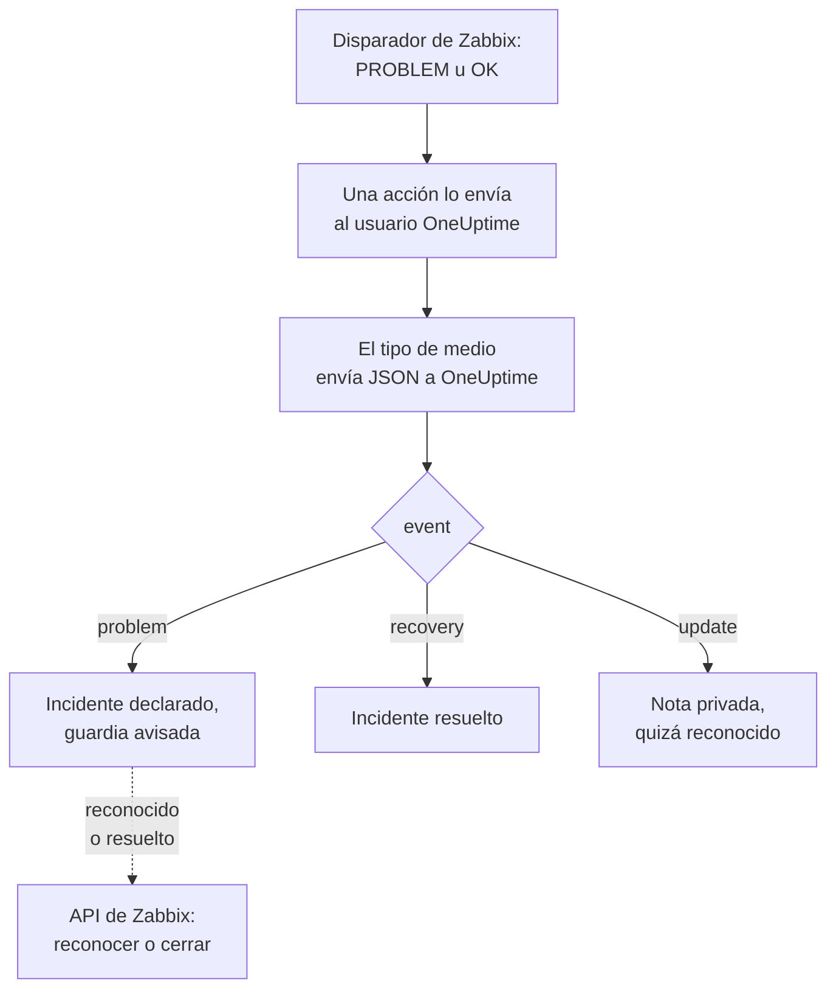

# Zabbix

Envía los problemas de [Zabbix](https://www.zabbix.com) a OneUptime, para que cada problema se convierta en un incidente que avisa a tu equipo de guardia y se resuelve cuando Zabbix se recupera. Las plantillas de flujo de trabajo listas para usar mantienen ambos lados sincronizados: lo que las personas hacen en Zabbix se anota en el incidente, y reconocer o resolver el incidente reconoce o cierra el problema en Zabbix. Zabbix envía cada problema mediante un tipo de medio webhook, así que no hay nada que instalar en ninguno de los dos lados.

:::cards
- [Elegir cómo recibe OneUptime los problemas](#elegir-cómo-recibe-oneuptime-los-problemas): Plantillas de flujo de trabajo o un monitor de solicitudes entrantes.
- [Empezar con las plantillas](#empezar-con-las-plantillas): Seis plantillas, qué hacen y qué piden.
- [Configurar Zabbix](#configurar-zabbix): Un tipo de medio, un usuario y una acción.
- [Solución de problemas](#solución-de-problemas): Cuando los problemas no llegan o los incidentes siguen abiertos.
:::

## Cómo funciona



Zabbix envía un problema a un usuario, a través de los medios de ese usuario. Aquí el medio es un tipo de medio webhook llamado **OneUptime**: su script envía a OneUptime un pequeño documento JSON por cada problema, por su recuperación y por cada actualización que alguien le hace en Zabbix, con el ID de evento, el nombre, el host y la gravedad del problema. Con el ID de evento, OneUptime encuentra el incidente que abrió un problema.

## Antes de empezar

- Un servidor Zabbix que administres. Esta guía está escrita para Zabbix 6.0 LTS y 7.0 LTS. Los tipos de medio webhook funcionan igual desde Zabbix 5.0. Las plantillas que llaman a la API de Zabbix necesitan Zabbix 6.4 o posterior, o [un cambio en Zabbix 6.0](#en-zabbix-60).
- Un servidor Zabbix que pueda llegar a tu OneUptime por HTTPS y, para las plantillas que llaman a Zabbix, un OneUptime que pueda llegar a Zabbix.
- En OneUptime, permiso para crear flujos de trabajo, o monitores si eliges esa vía. En OneUptime Cloud, los flujos de trabajo necesitan el plan **Growth** o superior.

## Elegir cómo recibe OneUptime los problemas

Configura OneUptime primero: te da la URL a la que envía Zabbix.

| Forma | Úsala cuando |
| --- | --- |
| Las plantillas de flujo de trabajo (recomendado) | Quieres cada problema como un incidente o una alerta con su gravedad de Zabbix, con aviso a la guardia para High y Disaster, resuelto en la recuperación, con lo que las personas hacen en Zabbix anotado en él, y Zabbix reconocido o cerrado desde OneUptime. |
| Un monitor de solicitudes entrantes | Quieres incidentes sin flujo de trabajo, en cualquier plan, y un monitor cuyo estado sigue a Zabbix. Nada vuelve a Zabbix. |

Ambos reciben el mismo JSON del mismo tipo de medio, así que puedes empezar con uno y cambiar más adelante modificando una sola URL en Zabbix.

## Empezar con las plantillas

El diálogo **Crear un flujo de trabajo** tiene seis plantillas de Zabbix, en **Zabbix** de su lista de categorías: tres para incidentes y luego las mismas tres para alertas.

| Plantilla | Qué hace | Qué pide |
| --- | --- | --- |
| **Incidentes** | | |
| Declare an incident for each Zabbix problem | El flujo de trabajo al que Zabbix envía cada evento. Declara un incidente por cada problema, avisa a la guardia para High y Disaster, anota las actualizaciones hechas en Zabbix y resuelve el incidente en la recuperación. | Zabbix URL |
| Acknowledge or close the Zabbix problem with the incident | Cuando el incidente se reconoce, reconoce su problema. Cuando se resuelve, cierra el problema, o lo reconoce donde Zabbix no permite cerrarlo a mano. | Zabbix URL, Zabbix API Token |
| Copy incident private notes to the Zabbix problem | Añade cada nota privada del incidente a su problema como mensaje. | Zabbix URL, Zabbix API Token |
| **Alertas** | | |
| Create an alert for each Zabbix problem | Lo mismo que para incidentes, con una alerta por cada problema. | Zabbix URL |
| Acknowledge or close the Zabbix problem with the alert | Lo mismo que para incidentes, según el estado de la alerta. | Zabbix URL, Zabbix API Token |
| Copy alert private notes to the Zabbix problem | Añade cada nota privada de la alerta a su problema como mensaje. | Zabbix URL, Zabbix API Token |

Empieza con **Declare an incident for each Zabbix problem**, o con **Create an alert for each Zabbix problem** para alertas: el incidente o la alerta que abre guarda el ID de evento del problema en su campo personalizado `zabbixEventId`, y las otras dos plantillas encuentran el problema con él.

### Qué piden las plantillas

- **Zabbix URL**: la dirección en la que abres Zabbix, como `https://zabbix.example.com`, o `https://example.com/zabbix` cuando Zabbix funciona bajo una ruta. Los enlaces a un problema van allí, y las plantillas que llaman a Zabbix envían sus solicitudes a su `api_jsonrpc.php`. El campo rechaza la dirección de una página dentro de Zabbix.
- **Zabbix API Token**: un token de API del usuario de Zabbix con el que actúa el flujo de trabajo. [Crear el token de API](#crear-el-token-de-api) muestra cómo. Se guarda como variable secreta y solo se envía a Zabbix: en la cabecera `Authorization`, o en el cuerpo de la solicitud en Zabbix 6.0.

### Recibir problemas con la plantilla

:::steps
1. Ve a **Flujos de trabajo** y haz clic en **Crear flujo de trabajo**. En **O empieza con una plantilla**, elige **Zabbix** en la lista de categorías, haz clic en **Declare an incident for each Zabbix problem** y luego en **Usar esta plantilla**.
2. Rellena **Zabbix URL**. En **Who to page for High and Disaster problems**, elige las políticas de guardia a las que avisar, o ninguna para no avisar a nadie, y haz clic en **Crear flujo de trabajo**. El flujo de trabajo se abre en el **Constructor**, desactivado.
3. Haz clic en el disparador **Webhook**, luego en **Copiar URL**, y guarda la URL para Zabbix.
4. Activa **Habilitado** en la parte superior del **Constructor**. Un flujo de trabajo desactivado responde a Zabbix con `400`.
:::

Después [configura Zabbix](#configurar-zabbix) para que envíe sus problemas a esa URL.

### Qué hace el flujo de trabajo

Tras el disparador **Webhook**, el paso **Check With JavaScript** `read-event-1` lee el `event` que envía el tipo de medio, e **Incident From Another Tool**, o **Alert From Another Tool** en la plantilla de alertas, hace lo que significa, por el ID de evento del problema:

| Evento | Qué hace el flujo de trabajo |
| --- | --- |
| `problem` | Declara un incidente titulado `Zabbix: <problem> on <host>`, con la gravedad a la que corresponde la gravedad de Zabbix, fuera de tus páginas de estado. Su descripción enlaza el problema en Zabbix y muestra el host, la gravedad, cuándo empezó, sus datos operativos y sus etiquetas. Para un problema High o Disaster, avisa a la política de guardia que elegiste. Un problema que Zabbix envía otra vez, con el mismo ID de evento, no abre un segundo incidente. |
| `recovery` | Resuelve el incidente del problema, salvo que ya esté resuelto. El motivo queda en su línea de tiempo. |
| `update` | Añade al incidente, como nota privada, lo que se hizo en Zabbix: quién lo hizo, qué hizo y qué escribió. Cuando la actualización reconoció el problema, también reconoce el incidente, con lo que la guardia deja de escalarlo. |

Todo lo demás, como una solicitud de otra herramienta, se deja tal cual: `read-event-1` toma **No**, y los **Pasos** de la ejecución dicen por qué. Un paso que falla hace fallar la ejecución, y su entrada en **Pasos** dice por qué.

### Gravedades

En un proyecto nuevo, la plantilla asigna las seis gravedades de Zabbix a estas gravedades de incidente y de alerta:

| Gravedad de Zabbix | Incidente | Alerta | Guardia |
| --- | --- | --- | --- |
| Disaster | Critical Incident | High | Avisada |
| High | Critical Incident | High | Avisada |
| Average | Major Incident | Low | No avisada |
| Warning | Major Incident | Low | No avisada |
| Information | Minor Incident | Low | No avisada |
| Not classified | Minor Incident | Low | No avisada |

Con gravedades propias, Disaster y High van a tu más grave, Average y Warning a la del medio, e Information y Not classified a tu menos grave. Zabbix numera sus gravedades del 0 (Not classified) al 5 (Disaster), y la plantilla lee el número, así que renombrar una gravedad en Zabbix no cambia nada.

- Para asignar una gravedad a una de las tuyas por su nombre, edita `SEVERITY_BY_NAME` en el paso `read-event-1`, como `{ 2: 'Minor Incident' }` para Warning.
- Para avisar también con los problemas Average, pon **Compare with** del paso `if-page-1` **If / Else** a `3`.

### Enviar reconocimientos y notas de vuelta a Zabbix

:::steps
1. [Crea el token de API](#crear-el-token-de-api).
2. Crea un flujo de trabajo a partir de **Acknowledge or close the Zabbix problem with the incident**. Rellena **Zabbix URL** y **Zabbix API Token**, haz clic en **Crear flujo de trabajo** y activa **Habilitado**.
3. Si también quieres las notas en Zabbix, haz lo mismo con **Copy incident private notes to the Zabbix problem**.
:::

La plantilla de estado pregunta primero a Zabbix por el problema, así que un problema que Zabbix ya reconoció o resolvió se deja tal cual. Para cerrar un problema, su disparador necesita **Allow manual close** en Zabbix. Sin eso, el problema se reconoce en su lugar, con un mensaje que dice que el incidente se resolvió, y Zabbix lo cierra cuando se recupera. Los incidentes que no abrió ningún problema de Zabbix, y los marcados como **Incidente privado**, nunca se envían a Zabbix.

### Crear el token de API

:::steps
1. Usa el usuario `OneUptime` que [recibe los problemas](#crear-un-usuario-que-reciba-los-problemas). Zabbix no le envía a un usuario sus propias actualizaciones, así que con el token de este usuario, los reconocimientos y mensajes de OneUptime nunca vuelven a OneUptime como actualizaciones.
2. Revisa el rol del usuario en **Users → User roles**. Necesita **Access to API** activado, y **Acknowledge problems**, **Add problem comments** y **Close problems** permitidos. El **User role** los permite salvo que alguien lo haya cambiado.
3. Revisa el grupo del usuario en **Users → User groups**. El permiso **Read** sobre los grupos de hosts basta para reconocer problemas y añadir mensajes. Para cerrar problemas, necesita **Read-write**.
4. Ve a **Users → API tokens** y haz clic en **Create API token**. Elige el usuario `OneUptime`, desmarca **Set expiration date and time** o apunta la fecha, y haz clic en **Add**.
5. Copia el **Auth token**: Zabbix lo muestra solo una vez. Pégalo en **Zabbix API Token**.
:::

### En Zabbix 6.0

Zabbix 6.0 lee el token de API del cuerpo de la solicitud, no de su cabecera `Authorization`. En el paso **Update Zabbix Problem** de cada plantilla que llama a Zabbix, activa **Zabbix 6.0**, en **Más campos**. Zabbix 7.2 y posteriores rechazan un token en el cuerpo, así que desactívalo de nuevo cuando actualices.

## Recibir problemas con un monitor

Un [monitor de solicitudes entrantes](/docs/monitor/incoming-request-monitor) te da una URL, y sus criterios deciden qué hace cada solicitud.

:::steps
### Crear el monitor

Ve a **Monitores** y haz clic en **Crear monitor**. Elige **Solicitud entrante** en **Tipo de monitor**, ponle el nombre `Zabbix` y haz clic en **Siguiente**.

### Declarar un incidente por cada problema

En el paso **Criterios**, abre el primer criterio, el que marca el monitor como fuera de línea. Pon su filtro en **Cuerpo de la solicitud**, **Contiene**, `"status":"1"`. Este criterio ya declara un incidente cuando su filtro coincide. Completa el incidente:

- **Título del incidente**: `Zabbix: {{requestBody.name}} on {{requestBody.host}}`.
- **Gravedad**: la gravedad de incidente que deben tener los problemas de Zabbix.
- **Políticas de guardia**, en **De guardia**: las políticas a las que avisar.
- **Resolver incidente automáticamente**, en **Más campos**: déjalo activado, como viene. Sin él, las recuperaciones se ignoran y los incidentes siguen abiertos.

### Abrir un incidente por problema

En el mismo criterio, abre **Ajustes** y activa **Agrupa incidentes y alertas por un campo de la carga útil**. Rellénalo como se indica abajo, para que cada problema tenga su propio incidente y su recuperación lo resuelva:

| Campo | Valor |
| --- | --- |
| **Abrir un incidente separado para cada…** | `requestBody.event_id` |
| **Campo que indica la recuperación** | `requestBody.status` |
| **Valor que significa recuperado** | `0` |

### Volver a poner el monitor en línea

Abre el segundo criterio, el que marca el monitor como en línea, y pon su filtro en **Cuerpo de la solicitud**, **Contiene**, `"status":"0"`.

### Copiar la URL

Haz clic en **Crear monitor**. La página **Vista general** del monitor muestra su **URL de latido**. Cópiala para Zabbix:

```text
https://oneuptime.com/heartbeat/<secret key>
```

Una instalación autoalojada tiene su propio host en lugar de `oneuptime.com`.
:::

El monitor lee el JSON de la solicitud tal como está escrito: `"status":"1"`, sin espacios. Consulta [Recibir alertas de otro sistema](/docs/monitor/incoming-request-monitor#recibir-alertas-de-otro-sistema) para saber qué hace cada ajuste. Una actualización hecha en Zabbix también se envía con `"status":"1"`, que el monitor lee otra vez como el problema, sin abrir un segundo incidente.

## Configurar Zabbix

Zabbix necesita tres cosas: un tipo de medio que envíe a OneUptime, un usuario al que enviarlo y una acción que envíe los problemas a ese usuario.

:::steps
### Crear el tipo de medio OneUptime

1. Ve a **Alerts → Media types**, o a **Administration → Media types** en Zabbix 6.0, y haz clic en **Create media type**.
2. Pon **Name** en `OneUptime` y **Type** en **Webhook**.
3. Añade estos **Parameters**. Cada uno lleva una [macro](https://www.zabbix.com/documentation/current/en/manual/appendix/macros/supported_by_location) de Zabbix a la solicitud:

   | Nombre | Valor |
   | --- | --- |
   | `url` | `{ALERT.SENDTO}` |
   | `event_id` | `{EVENT.ID}` |
   | `event_name` | `{EVENT.NAME}` |
   | `event_value` | `{EVENT.VALUE}` |
   | `event_severity` | `{EVENT.SEVERITY}` |
   | `event_nseverity` | `{EVENT.NSEVERITY}` |
   | `host` | `{HOST.NAME}` |
   | `event_date` | `{EVENT.DATE}` |
   | `event_time` | `{EVENT.TIME}` |
   | `event_opdata` | `{EVENT.OPDATA}` |
   | `event_tags` | `{EVENT.TAGSJSON}` |
   | `trigger_id` | `{TRIGGER.ID}` |
   | `event_update_status` | `{EVENT.UPDATE.STATUS}` |
   | `event_update_action` | `{EVENT.UPDATE.ACTION}` |
   | `event_update_message` | `{EVENT.UPDATE.MESSAGE}` |
   | `event_update_user` | `{USER.FULLNAME}` |

4. Pega esto en **Script**:

   ```javascript
   var params = JSON.parse(value);

   // Zabbix leaves a macro it has no value for as it is written, such as
   // {EVENT.UPDATE.MESSAGE} on a problem: it is sent as nothing.
   function given(text) {
     var written = String(text === undefined || text === null ? "" : text);
     return /^\{[A-Z0-9_.]+\}$/.test(written) || written === "*UNKNOWN*"
       ? ""
       : written;
   }

   var isUpdate = given(params.event_update_status) === "1";
   var payload = {
     source: "zabbix",
     // "problem", "recovery" or "update".
     event: isUpdate
       ? "update"
       : params.event_value === "0"
         ? "recovery"
         : "problem",
     event_id: params.event_id,
     name: params.event_name,
     host: params.host,
     severity: params.event_severity,
     // 0 Not classified, 1 Information, 2 Warning, 3 Average, 4 High, 5 Disaster.
     severity_number: params.event_nseverity,
     // "1" for a problem, "0" for its recovery.
     status: params.event_value,
     date: params.event_date,
     time: params.event_time,
     opdata: given(params.event_opdata),
     tags: [],
     trigger_id: params.trigger_id,
   };

   try {
     var tags = JSON.parse(given(params.event_tags) || "[]");
     payload.tags = Array.isArray(tags) ? tags : [];
   } catch (error) {
     payload.tags = [];
   }

   if (isUpdate) {
     payload.update = {
       action: given(params.event_update_action),
       message: given(params.event_update_message),
       user: given(params.event_update_user),
     };
   }

   var request = new HttpRequest();
   request.addHeader("Content-Type: application/json");

   var response = request.post(params.url, JSON.stringify(payload));

   if (request.getStatus() < 200 || request.getStatus() >= 300) {
     throw (
       "OneUptime responded with HTTP " + request.getStatus() + ": " + response
     );
   }

   return "OK";
   ```

5. En la pestaña **Message templates**, añade una plantilla para **Problem**, otra para **Problem recovery** y otra para **Problem update**. Deja su texto vacío: el script construye la solicitud. Zabbix solo usa un tipo de medio para los tipos de evento para los que tiene una plantilla.
6. Haz clic en **Add**.

### Crear un usuario que reciba los problemas

1. Ve a **Users → Users**, o a **Administration → Users** en Zabbix 6.0, y haz clic en **Create user**. Ponle el nombre `OneUptime` y dale un grupo de usuarios y un rol que pueda recibir notificaciones, como **User role**.
2. En la pestaña **Media**, haz clic en **Add**. Pon **Type** en `OneUptime` y **Send to** en la URL que copiaste de OneUptime. Deja **When active** y las gravedades como están, o desmarca las gravedades que OneUptime no deba recibir.
3. Haz clic en **Add** y luego otra vez en **Add** para guardar el usuario.

### Enviar los problemas a OneUptime con una acción

1. Ve a **Alerts → Actions → Trigger actions**, o a **Configuration → Actions** en Zabbix 6.0, y haz clic en **Create action**. Ponle el nombre `Notify OneUptime`.
2. En **Conditions**, acótala si quieres, por ejemplo con **Trigger severity is greater than or equals Warning**. Sin condiciones, se envía cada problema.
3. En la pestaña **Operations**, añade una operación que envíe al usuario `OneUptime` a través del tipo de medio `OneUptime`.
4. Añade la misma operación en **Recovery operations**, para que también se envíen las recuperaciones, y en **Update operations**, para que se envíen los reconocimientos y comentarios hechos en Zabbix.
5. Haz clic en **Add** y comprueba que la acción está habilitada.
:::

Para enviar unos problemas a la plantilla de incidentes y otros a la de alertas, dale al usuario `OneUptime` dos medios de tipo `OneUptime`: cada uno envía a la URL de un flujo de trabajo, con las gravedades que debe recibir.

## Probarlo

1. En Zabbix, abre **Alerts → Media types** y haz clic en **Test** junto a `OneUptime`. Introduce la URL que copiaste y valores de ejemplo como `event_id` `12345`, `event_name` `Test problem`, `host` `web-1`, `event_nseverity` `4` y `event_value` `1`. Haz clic en **Test**: Zabbix muestra la respuesta del script, `OK`, o el error que lanzó.
2. En OneUptime, abre **Registros → Ejecuciones** del flujo de trabajo y revisa la ejecución, o abre el monitor y comprueba que se abrió un incidente.
3. Prueba otra vez con `event_value` `0` y el mismo `event_id`. El incidente se resuelve.

Después deja que se dispare un disparador real, por ejemplo bajando un umbral un momento, y observa cómo llega el problema. Para probar una actualización, reconoce el problema en Zabbix con un mensaje: el incidente recibe una nota privada y queda reconocido.

## Asignar las gravedades de Zabbix

Zabbix envía su gravedad como texto: `Not classified`, `Information`, `Warning`, `Average`, `High` o `Disaster`.

- **Con las plantillas**, las gravedades se asignan por ti: consulta [Gravedades](#gravedades).
- **Con el monitor**, haz clic en **Añadir criterios** para cada grupo de gravedades y arrastra el nuevo criterio por encima del primero: los criterios se comprueban desde arriba, y decide el primero que coincide. Dale a cada uno dos filtros, `"status":"1"` y una gravedad como `"severity":"Disaster"`, con **Condición de coincidencia** en **Todos**. Dale a cada uno un incidente con su propia **Gravedad** y **Resolver incidente automáticamente**, y los mismos ajustes de agrupación.

## Solución de problemas

:::details No llega nada a OneUptime
- En Zabbix, abre **Reports → Action log** y comprueba que la acción envió el problema, y qué volvió.
- Desde el servidor Zabbix, envía tú mismo una solicitud: `curl -i -X POST <url> -H 'Content-Type: application/json' -d '{"source":"zabbix","event":"problem","event_id":"1","name":"Test","host":"test","severity_number":"4","status":"1"}'`.
- El monitor responde `200` de inmediato, antes de comprobar nada, incluso con una clave secreta incorrecta. Revisa la cronología del monitor para ver si llegan las solicitudes.
- Un flujo de trabajo desactivado responde `400`. Activa **Habilitado** en la parte superior de su **Constructor**.
:::

:::details Zabbix informa de un error del script
Abre el tipo de medio y usa **Test**: Zabbix muestra el resultado del script o el error que lanzó. El script lanza cualquier respuesta de OneUptime distinta de `2xx` junto con su estado, así que revisa primero la URL.
:::

:::details Los incidentes se abren pero nunca se resuelven
- La acción necesita **Recovery operations**, o Zabbix nunca envía la recuperación.
- Con la plantilla, abre **Registros → Ejecuciones** del flujo de trabajo y la ejecución de la recuperación: su último paso dice por qué. Una recuperación de un problema que no abrió ningún incidente no cambia nada.
- Con el monitor, el incidente del criterio necesita **Resolver incidente automáticamente**, en **Más campos**. **Campo que indica la recuperación** debe ser `requestBody.status`, y **Valor que significa recuperado** exactamente `0`.
:::

:::details Zabbix no se reconoce ni se cierra
Abre la ejecución de la plantilla de estado en **Registros → Ejecuciones**: su último paso dice qué respondió Zabbix.

- `Not authorized`: el token de API es incorrecto, caducó o está desactivado, o Zabbix es anterior a 6.4 (consulta [En Zabbix 6.0](#en-zabbix-60)).
- `Cannot close problem: trigger does not allow manual closing`: activa **Allow manual close** en el disparador. La plantilla ya reconoce esos problemas en lugar de cerrarlos.
- `No permissions to referred object or it does not exist!`: el usuario ve el problema, pero necesita el permiso **Read-write** para cerrarlo.
- `Zabbix has no problem with event ID`: el usuario no ve el host del problema. Da a su grupo de usuarios el permiso **Read** sobre el grupo de hosts.
:::

:::details El incidente muestra una referencia en lugar de un valor
Una referencia a un campo que la solicitud no tiene se deja tal como está escrita, llaves incluidas, en lugar de vaciarse. Comprueba que Zabbix envía `Content-Type: application/json` y que los nombres de campo que usas (`name`, `host`, `severity`, `status`, `event_id`) coinciden con la carga útil del script. Para un flujo de trabajo, abre la ejecución en **Registros → Ejecuciones** y compárala con lo que recibió el disparador. Consulta [Trampas](/docs/workflows/variables#trampas-habituales).
:::

:::details Cada problema llega dos veces
Probablemente la acción tiene dos operaciones que envían al mismo usuario, como un primer paso y un paso de escalado. La plantilla abre un incidente por ID de evento llegue lo que llegue, pero cada entrega es una ejecución. Revisa las **Operations** de la acción.
:::

## Seguridad

- **Trata la URL como una contraseña.** Quien la tenga puede abrir incidentes. Si se filtra, restablécela: **Restablecer URL** en el disparador **Webhook** del flujo de trabajo, o **Restablecer clave secreta de solicitud entrante** en la página **Ajustes** del monitor. Después actualiza **Send to** en el medio del usuario de Zabbix.
- **Los enlaces van a tu Zabbix.** La plantilla enlaza un problema en el sitio que nombra su **Zabbix URL**, diga lo que diga una solicitud, y escribe lo que envió Zabbix como texto.
- **Limita el token de API a lo que hace el flujo de trabajo.** Es una variable secreta, ocultada en los registros de ejecución y enviada solo a Zabbix, en la cabecera `Authorization` salvo que **Zabbix 6.0** esté activado. Da a su usuario un rol con nada más que las acciones de arriba, y borra el token en **Users → API tokens** si se filtra.
- **Envía solo lo que necesita un incidente.** Usa las condiciones de la acción, o las gravedades del medio del usuario, para dejar en Zabbix los problemas de baja gravedad.
- **¿Autoalojado?** Deja que tu servidor Zabbix llegue a tu OneUptime por HTTPS a través de tu cortafuegos. Para llamar a un Zabbix en una red privada, el flujo de trabajo necesita [acceso de red saliente](/docs/workflows/configuration#acceso-de-red-saliente).

## Próximos pasos

:::cards
- [Plantillas de flujo de trabajo](/docs/workflows/authoring): Crea un flujo de trabajo a partir de una plantilla y cámbialo en el Constructor.
- [Monitor de solicitudes entrantes](/docs/monitor/incoming-request-monitor): Cada ajuste del monitor que recibe los problemas de Zabbix.
- [Reglas de escalado](/docs/on-call/escalation-rules): Decide a quién avisa una política de guardia, y cuándo.
- [Descripción general de integraciones](/docs/integrations/index): Las otras herramientas que puedes conectar.
:::
