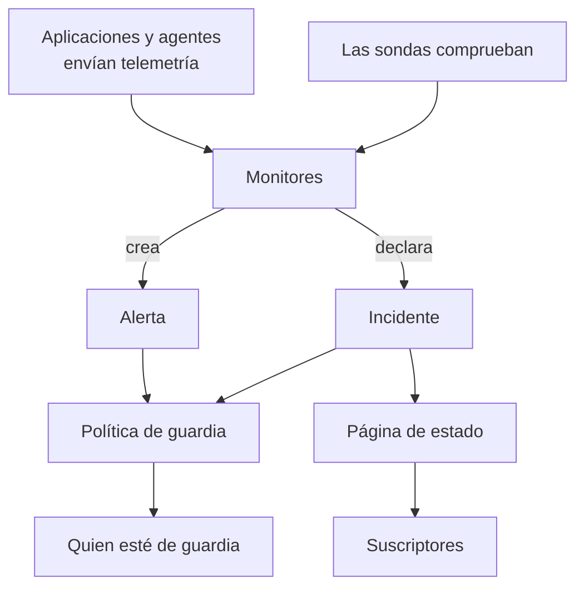
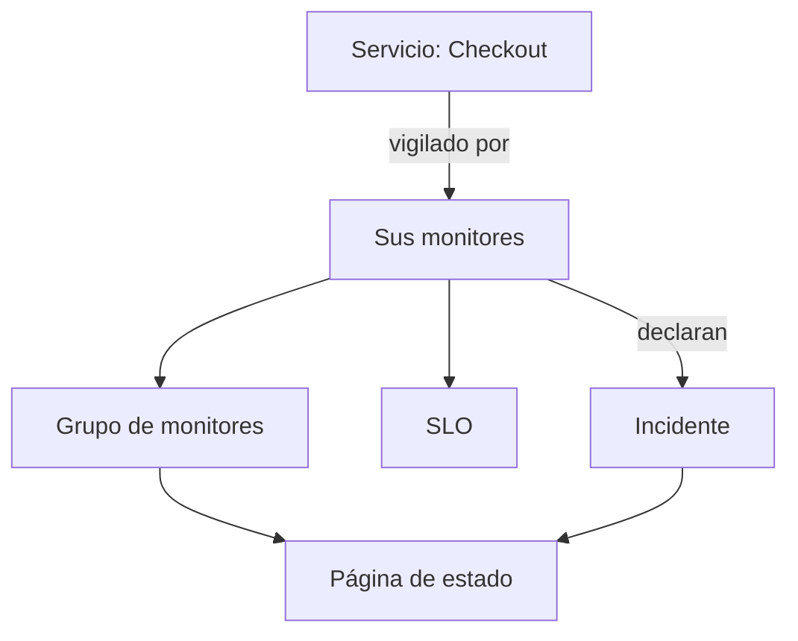

# Conceptos básicos

OneUptime tiene muchos productos, pero se apoyan en un puñado de ideas: proyectos, monitores, incidentes y alertas, guardias, páginas de estado y telemetría. A su alrededor están lo que vigilas, lo que instalas y las reglas que actúan por ti. Esta página explica cada una en unas pocas frases, muestra cómo se relacionan y enlaza con las páginas que las tratan a fondo. Léela una vez, y todas las demás páginas de la documentación se leerán con más facilidad. Para consultar una palabra concreta, ve al [Glosario](/docs/introduction/glossary); para elegir entre dos cosas que se parecen, consulta [¿Cuál uso?](/docs/introduction/which-one).

:::cards
- [Proyectos y personas](#proyectos-y-personas): Dónde vive todo, y quién puede hacer qué.
- [Monitores y sondas](#monitores-y-sondas): Cómo detecta OneUptime que algo va mal.
- [Incidentes y alertas](#incidentes-y-alertas): El registro con el que trabaja tu equipo.
- [Guardia](#guardia): A quién se avisa, cómo, y quién va después.
:::

## Cómo se relacionan las piezas

Un problema recorre OneUptime en una sola dirección. Las sondas y tu propia telemetría alimentan a los monitores. Los criterios de un monitor deciden cuándo algo va mal y qué se abre: un incidente, una alerta o ambos. Las políticas de guardia avisan a las personas sobre ellos, y las páginas de estado informan a tus clientes de los incidentes.

## Proyectos y personas

Un **proyecto** lo contiene todo: monitores, incidentes, políticas de guardia, páginas de estado, telemetría y ajustes. La mayoría de las empresas necesitan uno, y algunas tienen uno por entorno o por unidad de negocio. Nada de lo que creas en un proyecto es visible en otro.

Tu **cuenta** es independiente de tus proyectos. Una cuenta, con un correo y una contraseña, puede pertenecer a tantos proyectos como quieras; cambia de uno a otro con el selector de proyectos de arriba a la izquierda. Consulta [Su cuenta](/docs/introduction/your-account).

Las personas están en un proyecto a través de **equipos**, y los permisos de un equipo deciden lo que pueden hacer sus miembros. Cada proyecto nuevo empieza con tres equipos: Owners, contigo dentro, Admin y Members. En OneUptime Cloud, cada proyecto tiene su propio plan.

:::cards
- [Usuarios, equipos y permisos](/docs/permissions/index): Invitar a personas y decidir lo que pueden hacer.
:::

## Monitores y sondas

Un **monitor** comprueba una cosa que ejecutas y decide si funciona. La mayoría de los monitores los comprueban **sondas**: máquinas que ejecutan la comprobación según una programación, como pedir una página, llamar a una API, hacer ping a un host o consultar una base de datos. OneUptime Cloud ejecuta sondas en varias regiones, una instalación autoalojada ejecuta las suyas, y puedes añadir sondas personalizadas dentro de tu red. Otros monitores leen en cambio lo que envías: la telemetría de tus aplicaciones, o los datos que informa un agente desde tus servidores, tus clústeres de Kubernetes y el resto de tu infraestructura.

Los **criterios** de un monitor deciden qué significa cada resultado. Se evalúan en orden, y el primero que coincide puede cambiar el estado del monitor, declarar un incidente, crear una alerta o las tres cosas. Cada proyecto nuevo tiene tres estados de monitor: **Operativo**, **Degradado** y **Sin conexión**.

:::cards
- [Crear un monitor](/docs/monitor/create-monitor): Elegir un tipo, decir qué comprobar y con qué frecuencia.
- [Sondas personalizadas](/docs/probe/custom-probe): Comprobar lo que solo tu propia red puede alcanzar.
:::

## Lo que vigilas

Un monitor comprueba una sola cosa. Alrededor de tus monitores, OneUptime lleva un registro de lo que ejecutas, y te encuentras estos registros en el menú:

- Un **grupo de monitores** reúne varios monitores en un solo estado, para que una página de estado pueda mostrar como una sola fila algo formado por muchas partes, como Checkout.
- Un **servicio** es una aplicación o un microservicio que ejecutas. OneUptime lo añade la primera vez que llega su telemetría, y reúne en una sola página sus registros, trazas, métricas, excepciones e incidentes.
- **Hosts**, los clústeres de **Kubernetes** y el resto de **Infraestructura** son las máquinas y plataformas que ejecutas, y los rellenan los agentes que instalas.
- **Inventario** es una sola lista de todo ello: servicios, hosts, clústeres, dispositivos, recursos en la nube y las cosas que no envían ninguna telemetría.

Todo confluye donde aparece un problema. Los monitores de un servicio pueden agruparse en un grupo de monitores, un SLO los mide, y cuando uno falla declara un incidente. El incidente incluye el servicio entre los recursos a los que afecta, y la página de estado muestra el grupo y el incidente.

:::cards
- [Grupos de monitores](/docs/monitor/monitor-groups): Reunir varios monitores en un solo estado.
- [Servicios](/docs/telemetry/services): Cada aplicación que ejecutas, con una página para cada una.
- [Visión general del inventario](/docs/inventory/overview): Todo lo que OneUptime sabe de tu infraestructura.
:::

## Objetivos de fiabilidad

Un **SLO** (objetivo de nivel de servicio) es un objetivo de fiabilidad para lo que monitorizas, como estar disponible el 99,9 % del tiempo durante 30 días. OneUptime lo mide a partir de sus monitores cada 5 minutos. El tiempo de inactividad que permite el objetivo es su presupuesto de errores: con mucho margen puedes arriesgarte, y con poco frenas e inviertes en estabilidad.

:::cards
- [Visión general de los SLO](/docs/slo/introduction): Fijar un objetivo y ver cuánto queda del presupuesto.
:::

## Incidentes y alertas

Ambos registran un problema, y ambos pueden avisar a quien esté de guardia. Lo que los distingue es a quién afecta el problema.

| | Incidente | Alerta |
| --- | --- | --- |
| **Qué es** | Un problema que afecta a tus usuarios, como una caída o una ralentización | Un problema que tu equipo debe revisar antes de que afecte a los usuarios |
| **En las páginas de estado** | Puede aparecer, y avisa a los suscriptores | Nunca |
| **Estados iniciales** | **Identificado**, **Reconocido**, **Resuelto** | **Identificado**, **Reconocido**, **Resuelto** |
| **Gravedades iniciales** | Critical Incident, Major Incident, Minor Incident | **Alta**, **Baja** |

Reconocerlo indica que alguien se está ocupando, y evita que sus políticas de guardia avisen al siguiente nivel. Resolverlo lo cierra. Puedes añadir tus propios estados y gravedades, y vincular alertas al incidente del que resultaron formar parte.

Un **episodio** agrupa incidentes relacionados, o alertas relacionadas, para que tu equipo los trabaje como uno solo. Las reglas de agrupación deciden qué va junto.

:::cards
- [Visión general de los incidentes](/docs/incidents/index): Cómo se declaran, se trabajan y se resuelven los incidentes.
- [Visión general de las alertas](/docs/alerts/index): De dónde vienen las alertas y cómo las agrupan los episodios.
- [Alertas vinculadas](/docs/incidents/linked-alerts): Vincular las alertas que generó una caída con su incidente.
:::

## Guardia

Una **política de guardia** decide a quién se avisa sobre un incidente o una alerta, y quién va después si nadie responde. Sus **reglas de escalado** son sus niveles: cada una avisa a sus personas y luego espera a que alguien lo reconozca antes de avisar al siguiente nivel. Un nivel puede avisar a personas, a equipos o a una **programación de guardia**, una rotación que sabe en todo momento quién está de guardia.

Cómo se localiza a cada persona lo decide ella. En los **Ajustes de usuario**, cada uno guarda las formas en que OneUptime puede localizarle, como correo, SMS, llamadas, notificaciones push, Slack o Microsoft Teams, y cuáles usar cuando le avisan.

:::cards
- [Visión general de las guardias](/docs/on-call/index): Cómo llega un aviso a alguien y dónde está cada pieza.
- [Reglas de escalado](/docs/on-call/escalation-rules): Avisar a las personas nivel a nivel hasta que alguien responda.
- [Programaciones de guardia](/docs/on-call/schedules): Rotaciones, capas y relevos.
- [Cómo te contacta OneUptime](/docs/notifications/index): Los métodos, reglas y ajustes que deciden cómo se contacta a cada persona.
:::

## Páginas de estado y mantenimiento

Una **página de estado** muestra a tus clientes si tus servicios funcionan. Tú eliges qué monitores muestra, con nombres que tus clientes entienden. Mientras un incidente en uno de esos monitores está activo, la página lo muestra, y sus **suscriptores** reciben aviso por correo, SMS, Slack, Microsoft Teams o webhook. Una página de estado puede ser pública, o privada para las personas que dejes entrar.

El **mantenimiento programado** anuncia con antelación los trabajos previstos. Un evento pasa por **Programado**, **En curso**, **Finalizado** y **Completado**, y las páginas de estado en las que lo muestras informan de él a visitantes y suscriptores.

:::cards
- [Visión general de las páginas de estado](/docs/status-pages/index): Crear una página de estado y decidir qué muestra.
- [Suscriptores y anuncios](/docs/status-pages/subscribers): A quién se avisa, y cuándo.
- [Visión general del mantenimiento programado](/docs/scheduled-maintenance/index): Cómo transcurre un evento, y qué pone en pausa.
:::

## Telemetría

La **telemetría** es lo que tus sistemas envían a OneUptime: registros, métricas, trazas, excepciones y perfiles. Las aplicaciones la envían con OpenTelemetry, y los agentes de OneUptime la envían desde hosts, clústeres de Kubernetes, hosts de Docker y el resto de tu infraestructura. Cada emisor usa una **clave de ingesta**, creada en **Ajustes del proyecto → Telemetría y APM → Claves de ingesta**. Buscas en la telemetría, la representas en paneles y la vigilas con monitores de telemetría, que abren incidentes y alertas como cualquier otro monitor. En el menú, **Registros**, **Métricas**, **Trazas**, **Perfiles** y **Excepciones** abren cada uno un tipo; **IA / LLM** sigue las conversaciones de tu IA, **Observabilidad de datos** vigila las tablas de tus bases de datos y **Topología** traza cómo se conecta todo.

:::cards
- [OpenTelemetry](/docs/telemetry/open-telemetry): Enviar registros, métricas y trazas desde tus aplicaciones.
- [Monitor de registros](/docs/monitor/logs-monitor): Enterarte cuando aparece un patrón en tus registros.
:::

## Seguridad

**Eventos de seguridad** guarda los eventos de seguridad de tus registros, de tus herramientas de seguridad y de cualquier otra cosa que envíes. Sus reglas de detección convierten lo que encuentran en casos de seguridad, que tu equipo trabaja en una cola y a los que responden los playbooks. **Seguridad de datos** encuentra los datos sensibles de tus buckets, bases de datos y telemetría, y qué falla en cómo se guardan.

:::cards
- [Primeros pasos con la seguridad](/docs/telemetry/security-getting-started): Encontrar amenazas en los datos que ya tienes.
- [Vista general de Seguridad de datos](/docs/data-security/index): Encontrar tus datos sensibles y corregir cómo se guardan.
:::

## Lo que instalas, y las claves

La mayor parte de OneUptime no requiere instalar nada. Solo instalas algo para llegar a lo que OneUptime no puede ver desde fuera, y cada pieza se conecta hacia OneUptime con una clave:

- Una sonda personalizada ejecuta las comprobaciones de los monitores dentro de tu red, con su propio ID de sonda y su clave.
- El **OpenTelemetry Collector**, el agente de Kubernetes y el agente de Docker envían telemetría con una **clave de ingesta**. El agente de infraestructura que hay detrás de un monitor de servidor / VM envía con la clave secreta de ese monitor.
- Un **Runner** ejecuta pasos de runbook dentro de tu infraestructura, con su propio Runner ID y su clave.

Una clave de ingesta solo envía telemetría hacia dentro. Una **clave de API** es el otro tipo: permite a un script, la CLI, Terraform o un asistente de IA leer y cambiar tu proyecto, con los permisos que le des. Ninguna de las dos sirve en lugar de la otra.

:::cards
- [¿Cuál uso?](/docs/introduction/which-one#sonda-agente-colector-o-runner): Qué instalar, y la clave que usa cada uno.
- [Claves de ingesta](/docs/telemetry/ingestion-keys): Crear, acotar y rotar las claves que envían telemetría.
:::

## Automatización e IA

- Los **Flujos de trabajo** ejecutan acciones cuando ocurre algo, como publicar en Slack cuando se declara un incidente.
- Los **Runbooks** convierten un procedimiento de respuesta en pasos que tu equipo puede ejecutar, a mano o automáticamente.
- **OneUptime AI** investiga los nuevos incidentes y alertas y publica lo que ha encontrado en su cronología, y **Preguntar a la IA** responde preguntas sobre tu proyecto. Un proyecto nuevo empieza con la IA activada; el interruptor **Habilitar IA** en **Ajustes del proyecto → IA → Funciones de IA** la desactiva por completo.

:::cards
- [Visión general de los flujos de trabajo](/docs/workflows/index): Automatizar acciones con disparadores y componentes.
- [AI SRE](/docs/ai/ai-sre): Cómo investiga OneUptime AI los incidentes y las alertas.
:::

## Etiquetas y propietarios

Las **etiquetas** son marcas que pones a monitores, incidentes, páginas de estado y la mayoría de los demás recursos, para filtrarlos y agruparlos. Los permisos de un equipo pueden limitarse a los recursos con ciertas etiquetas. Los **propietarios** son las personas y los equipos responsables de un recurso: reciben aviso cuando le pasa algo. Las reglas de etiquetas y de propietarios añaden por ti etiquetas y propietarios a los recursos nuevos.

:::cards
- [Reglas de etiquetas y propietarios](/docs/configuration/label-and-owner-rules): Etiquetar los recursos nuevos y darles propietarios automáticamente.
:::

## Los tipos de regla

Muchas cosas en OneUptime se llaman regla. Cada una toma una decisión por ti cuando llega algo nuevo, y se agrupan en unas pocas familias. La mayoría están en **Reglas**, en los menús laterales de **Incidentes** y **Alertas**.

| Qué decide | Reglas |
| --- | --- |
| A quién se avisa | Las **Reglas de guardia** eligen las políticas de guardia que ejecuta un incidente o una alerta nuevos, y las **Reglas de escalado** de una política avisan nivel a nivel |
| Quién es su propietario, y cómo se etiqueta | **Reglas del propietario**, **Reglas de etiquetas** y **Reglas de privacidad** |
| Qué va junto | Las **Reglas de agrupación** abren episodios y añaden elementos a ellos |
| Qué se ejecuta sobre ello | Las **Reglas de runbook** inician runbooks, y las **Reglas de IA** deciden qué investiga y corrige OneUptime AI |
| Cuándo hacer seguimiento | Las **Reglas de SLA** controlan los tiempos de respuesta y de resolución, y las **Reglas de recordatorio** avisan a los propietarios mientras sigue abierto |

Las reglas propias de un monitor son sus criterios. Las reglas de guardia de **Ajustes de usuario** son otra cosa distinta: cada persona tiene las suyas, y deciden cómo le llega un aviso a esa persona.

:::cards
- [Configuración y automatización de incidentes](/docs/incidents/settings#reglas-que-se-ejecutan-al-crear-un-incidente): Las reglas que se ejecutan cuando se crea un incidente, en orden.
- [Cómo contactarme](/docs/notifications/on-call-rules): Cómo te llega un aviso.
:::

## Próximos pasos

:::cards
- [Inicio rápido](/docs/introduction/quickstart): Poner estas ideas en práctica en quince minutos.
- [Glosario](/docs/introduction/glossary): Cada palabra que usa OneUptime, en una o dos frases.
- [¿Cuál uso?](/docs/introduction/which-one): Incidente o alerta, flujo de trabajo o runbook, y las demás cosas que se parecen.
- [Visión general de los incidentes](/docs/incidents/index): Qué pasa después de que un monitor declara un incidente.
:::
