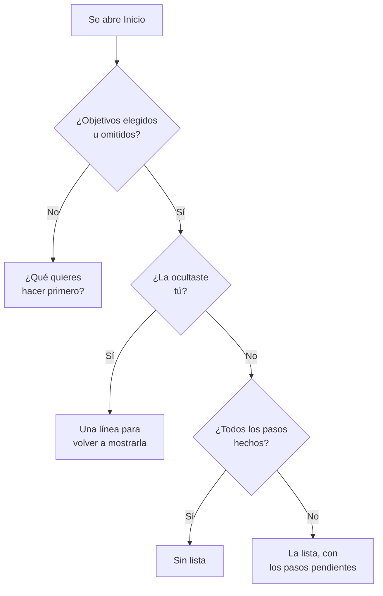

# Página de inicio y atajos

Inicio es la primera página que ves en un proyecto. Te dice de un vistazo si algo te necesita ahora mismo, y guía a un proyecto nuevo por su primera configuración. Esta página explica qué muestra Inicio, cómo encontrar cualquier producto, página o acción en el panel, y los atajos de teclado que te ahorran viajes por los menús.

:::cards
- [Qué muestra Inicio](#qué-muestra-inicio): Si algo va mal, qué te necesita, qué contiene el proyecto y todos los productos.
- [Orientarse](#orientarse): El menú Productos y las barras de la parte superior de cada página.
- [Buscar](#buscar-una-página-un-ajuste-o-una-acción): Encontrar cualquier página, ajuste o acción escribiendo su nombre.
- [Atajos de teclado](#atajos-de-teclado): Ir a Inicio, a Monitores o a Incidentes con dos teclas.
:::

## Qué muestra Inicio

Abre **Inicio** en la barra superior, o pulsa `g` y luego `h` desde cualquier sitio. Inicio es la vista general de tu proyecto, una sola página sin menú lateral. De arriba abajo, muestra:

1. Un cuadro de búsqueda, con **Declarar incidente** y **Crear** al lado.
2. Una línea que dice si algo va mal, sobre cinco números que cuentan lo que necesita atención.
3. **Te damos la bienvenida a OneUptime 👋**, una lista para un proyecto nuevo, hasta que esté completa.
4. **Requiere atención**, cada problema abierto ahora mismo, por su nombre.
5. **Tu proyecto**, de qué se compone el proyecto, y **Próximos mantenimientos** cuando hay alguno programado.
6. **Explora OneUptime**, todos los productos, una categoría cada vez.

### Buscar y crear

El cuadro de búsqueda abre la búsqueda, igual que `Mod` + `K`: escribe el nombre de cualquier página, monitor, incidente, alerta, página de estado o política de guardia. Consulta la sección [Buscar](#buscar-una-página-un-ajuste-o-una-acción). **Declarar incidente** abre el formulario para declarar un incidente. **Crear** ofrece **Crear monitor**, **Programar mantenimiento** y **Crear anuncio**. Cada uno solo se muestra a quien tiene permiso para usarlo.

### El titular

La línea superior nombra lo más urgente que hay abierto, en un color acorde:

| Cuándo | Inicio dice |
| --- | --- |
| Hay un incidente abierto | Cuántos incidentes están activos, en rojo |
| No hay ningún incidente abierto, pero hay alertas abiertas, monitores no operativos o SLO en riesgo | Cuántos problemas requieren atención, en ámbar |
| No hay ningún problema y hay un mantenimiento en curso | Cuántos eventos de mantenimiento están en curso |
| Hay monitores funcionando y no hay nada abierto | **Todos los sistemas están operativos** |
| El proyecto aún no tiene monitores | **Aún no se monitoriza nada** |

Al lado, Inicio indica cuándo cargó el proyecto por última vez, y **Actualizar** lo vuelve a cargar. Cuando vuelves a una pestaña de Inicio después de un minuto o más, se actualiza sola.

Mientras todavía no se monitoriza nada, la línea termina con el botón **Crea tu primer monitor**, que abre la configuración guiada **Saber cuándo cae mi sitio web o mi API**. Solo lo ven las personas que pueden crear monitores.

### Los cinco números

Cada número cuenta algo, dice si eso te necesita y abre la lista que hay detrás, en el producto al que pertenece.

| Número | Qué cuenta | Cuando el número es cero | Abre |
| --- | --- | --- | --- |
| **Incidentes activos** | Incidentes que no están resueltos | **Todo en orden** | **Incidentes → Incidentes activos** |
| **Alertas activas** | Alertas que no están resueltas | **Todo en orden** | **Alertas → Alertas activas** |
| **Monitores no operativos** | Monitores cuyo estado no es uno operativo. Los monitores archivados, y los que tienen el monitoreo desactivado, no cuentan. | **Todos operativos** | **Monitores → No operativo** |
| **Mantenimiento en curso** | Eventos de mantenimiento programado en curso | **Ninguno en curso** | **Mantenimiento programado → Eventos de mantenimiento en curso** |
| **SLO en riesgo** | SLO activados que están en riesgo o han agotado su presupuesto de error | **Presupuestos en buen estado** | **SLO** |

Un número mayor que cero muestra **Requiere atención**, o **En curso** y **Presupuesto agotándose** para el mantenimiento y los SLO. Mientras algún SLO esté en riesgo, **SLO en riesgo** abre la lista **SLO** filtrada a esos SLO. Un proyecto sin monitores ve **Aún no hay monitores**, y uno sin SLO ve **Aún no hay SLO**: un proyecto vacío no es lo mismo que uno sano. Esos dos abren entonces las listas **Monitores** y **SLO**, donde creas uno.

### La lista de bienvenida

La primera vez que un propietario o un administrador del proyecto abre Inicio en un proyecto nuevo, la tarjeta pregunta **¿Qué quieres hacer primero?** Marca uno o más objetivos, como **Saber cuándo cae mi sitio web o mi API** o **Solo estoy mirando**, y haz clic en **Continuar**: la lista contendrá los pasos que necesitan esos objetivos. **Omitir** da los cuatro pasos que recibe todo proyecto. Para responder de nuevo más tarde, haz clic en **Cambiar** en la lista. A un proyecto que ya usa monitores, telemetría o guardias no se le pregunta.

Cada paso se marca solo cuando la cosa funciona, no cuando existe un registro, y todas las personas que configuran el proyecto ven la misma lista, en cada dispositivo:

| Paso | Completado cuando | Abre |
| --- | --- | --- |
| **Importa desde tu herramienta actual** | Termina una importación desde otra herramienta. | **Importar desde otra herramienta** |
| **Crea tu primer monitor** | Llega su primera comprobación. | La configuración guiada **Saber cuándo cae mi sitio web o mi API**, o la lista **Monitores** para quien no puede crear monitores. |
| **Conecta un servidor o un clúster** | Llegan sus primeras métricas. | **Hosts** |
| **Envía tus primeros logs, métricas o trazas** | Llegan los primeros logs, métricas, trazas, excepciones o perfiles del proyecto. | La configuración guiada **Envía registros, métricas y trazas, y recibe alertas** |
| **Configura una política de guardia** | Se confirma un aviso de prueba, un aviso llega a alguien, o una regla de guardia ejecuta una política que puede llegar a alguien. | La configuración guiada **Avisar a la persona adecuada cuando algo falle** |
| **Publica una página de estado** | Una página de estado muestra un monitor. | La configuración guiada **Publica una página de estado**, o la lista **Páginas de estado** para quien no puede crear páginas de estado. |
| **Invita a tu equipo** | Alguien acepta tu invitación. | **Usuarios** |

El paso que toca primero está marcado con **Siguiente paso**. En el plan Free de OneUptime Cloud, que incluye una persona, **Invita a tu equipo** indica que necesita el plan Growth y abre **Facturación**. En un servidor autoalojado que aún no puede enviar correos, los administradores del servidor ven primero **Este servidor aún no puede enviar correos electrónicos**, que abre el panel de administración.

Una configuración guiada hace todo el trabajo en una sola página, paso a paso, y termina con lo que configuró y qué hacer después. Para volver a abrirla más tarde, busca su nombre.

Bajo los pasos, **Cómo funciona OneUptime** muestra los cuatro productos principales en el orden en que un problema pasa por ellos: **Monitores**, **Incidentes y alertas**, **Guardia** y **Páginas de estado**. Haz clic en uno para abrirlo. Debajo dice qué alimenta ese ciclo, la telemetría y la infraestructura, y enlaza a [Conceptos básicos](/docs/introduction/core-concepts) y [Glosario](/docs/introduction/glossary).

La lista desaparece para todos cuando todos los pasos están hechos. Para ocultarla antes, haz clic en **Ocultar**: se oculta solo para ti, en cada dispositivo, y queda una línea con **Mostrarlo** y **Cómo funciona OneUptime**. Las personas invitadas al proyecto como miembros no ven la lista. **Cómo funciona OneUptime** sigue a un clic, en cualquier proyecto: ábrelo desde **Ayuda** o con el botón junto a **Explora OneUptime**.

### Requiere atención

**Requiere atención** lista, por su nombre, lo que cuentan los números: los incidentes abiertos, las alertas abiertas, los monitores no operativos, los SLO en riesgo y los mantenimientos en curso, primero lo más urgente. Cada fila muestra su gravedad o su estado, dice cuándo empezó un incidente o una alerta y cuándo termina un mantenimiento, y abre el elemento. De cada tipo se muestran hasta cinco, con **Ver todo** para el resto, que abre la misma lista que su número. Cuando no hay nada abierto, dice **Nada requiere tu atención**.

### Salud de la configuración

Cuando algo en la configuración del proyecto impediría avisar a las personas, **Requiere atención** termina con **Configuración**: cuántas cosas conviene revisar. Abre **Salud de la configuración**, que lista lo que está mal configurado, lo más grave primero, bajo **Los avisos no llegarán**, **Conviene corregir** y **Sugerencias**: un monitor que no avisa a nadie, una política de guardia que nada ejecuta, una persona a la que no se puede avisar, los SMS desactivados, una programación de guardia sin nadie de guardia, una página de estado que no muestra ningún monitor. Cada hallazgo dice en una frase qué está mal, con el botón que abre su corrección, y los hallazgos de un monitor son los cortes que nombra su tarjeta **Cuando falla**. Un hallazgo que tu equipo deja así a propósito se puede descartar con un motivo, para todos, y restaurar desde **Descartado**. La búsqueda encuentra la página como **Salud de la configuración**, y Preguntar a la IA responde a "¿está bien mi configuración?" a partir de ella.

### Tu proyecto

**Tu proyecto** cuenta los **Monitores**, las **Páginas de estado**, las **Políticas de guardia**, los **SLO**, los **Servicios**, los **Paneles** y los **Flujos de trabajo** del proyecto, sin contar los archivados. Cada fila abre su lista. Un tipo del que el proyecto no tiene ninguno muestra **Configurar** en lugar de un número.

**Próximos mantenimientos** lista las tres próximas ventanas de mantenimiento programado, la más cercana primero. No aparece cuando no hay nada programado.

### Explora OneUptime

**Explora OneUptime** muestra los productos del menú **Productos** una categoría cada vez, empezando por los esenciales. Cada producto dice para qué sirve y se abre al hacer clic en él. Los productos que tu proyecto oculta no aparecen.

## Orientarse

Todo en OneUptime está bajo **Productos** en la barra superior. El menú presenta sus grupos como las filas de una sola lista, y siempre se abre con el primero de ellos, los esenciales, desplegado: Monitores, Incidentes, Alertas, Guardia, Páginas de estado, Mantenimiento programado y SLO. Cada uno de los demás grupos (Observabilidad, Seguridad, IA, Código, Recursos, Infraestructura, Nube, Paneles y automatización y Ajustes) está plegado en una fila de la misma lista. Cada fila nombra los productos del grupo y dice cuántos son. Haz clic en una fila para desplegarla o plegarla, o llega a ella con las flechas y pulsa **Intro**.

- **La búsqueda lo encuentra todo.** Escribe en el cuadro de búsqueda del menú para encontrar cualquier producto por su nombre, por lo que hace o por una palabra conocida como `k8s` o `RUM`. La búsqueda mira también dentro de los grupos plegados.
- **Empiezas donde estás.** El grupo de la página en la que estás se despliega solo, y los productos que abriste hace poco aparecen arriba.
- **Tus elecciones se mantienen.** El menú recuerda, en tu navegador, qué otros grupos desplegaste o plegaste. Los esenciales vuelven a estar desplegados cada vez que abres el menú, aunque los hayas plegado.
- **En un teléfono**, el botón del menú lista los productos de la misma manera: los esenciales desplegados arriba, y cada uno de los demás grupos como una fila que se abre con un toque.
- **Productos que el proyecto no usa.** Un propietario o administrador del proyecto puede ocultarlos en **Ajustes del proyecto → Básico → Productos**. Un producto oculto pasa a **Más productos**, la última fila del menú: la búsqueda lo sigue encontrando, sus páginas siguen funcionando y sus datos siguen llegando. Cuando uno empieza a recibir datos, Inicio se lo dice a quienes pueden volver a mostrarlo.
- **Fijar.** Mantén un producto en la barra superior, junto a **Inicio** y **Productos**: pulsa la chincheta de su tarjeta en el menú, o **Fijar** junto al título de su página. Puedes fijar cinco, y te acompañan en cada navegador. En un teléfono, tus productos fijados aparecen primero en el menú.
- **Lo que se usa.** En cada grupo salvo los esenciales y Ajustes, los productos que usa tu proyecto aparecen primero, y uno que aún no has configurado dice **Sin configurar**. En OneUptime Cloud, un producto que tu plan no incluye nombra el plan que lo incluye.

### Las barras superiores

Dos barras recorren la parte superior de cada página.

| Dónde | Qué hay |
| --- | --- |
| Arriba a la izquierda | El selector de proyectos: cambiar a otro de tus proyectos, o crear uno nuevo. |
| Arriba a la derecha | **Buscar** y **Preguntar a la IA**, la campana de notificaciones con lo que te necesita ahora (incidentes y alertas activos, las políticas de guardia en las que estás de turno, invitaciones pendientes), **Ayuda**, y tu foto, que abre el menú de tu [cuenta](/docs/introduction/your-account). |
| Debajo | **Inicio** y **Productos** a la izquierda, **Ajustes de usuario** a la derecha: cómo te localiza OneUptime en este proyecto. |

**Ayuda** empieza por lo que te ayuda a aprender: **Inicio rápido**, **Cómo funciona OneUptime**, **Glosario** y esta documentación (**Documentación**). Debajo están la lista **Atajos de teclado** y el soporte por correo y en Slack. En una tableta o en una ventana estrecha, **Preguntar a la IA** se quita para ganar espacio: está entre las acciones de **Buscar**. En un teléfono, **Buscar** y **Ayuda** pasan a la lista del botón de menú, arriba del todo y abajo del todo; la campana y tu foto se quedan.

Una palabra con una línea de puntos debajo, como **Sondas** en el formulario de un monitor nuevo, dice qué significa cuando la señalas, llegas a ella con Tab o la tocas. Su **Leer más** abre la palabra en el [Glosario](/docs/introduction/glossary).

### Páginas y listas

Sobre el título de cada página, una ruta como *Proyecto › Docker › Ajustes › Reglas del propietario* dice dónde está la página. Cada paso antes del último abre su página.

- **Las listas se mantienen al día solas.** Cuando se crea, se reconoce o se resuelve un incidente o una alerta en cualquier lugar, las listas de incidentes, alertas y episodios lo muestran en segundos, sin recargar. Mientras estás a mitad de algo en una lista, como filas marcadas o un diálogo abierto, la lista espera y se pone al día cuando terminas.
- **En un teléfono, los chips de filtro se pliegan** tras **Filtro**, para que la lista empiece más arriba. Los chips que fijaste siguen a la vista, con **Borrar todo**. Pulsa **Filtro** para ver todos los chips, y otra vez para plegarlos.
- La opción **Columnas** del menú **⋯** de una lista elige qué columnas muestra la lista y en qué orden, y las guarda para ti en este navegador. Un propietario o un administrador del proyecto también puede marcar ahí **Mostrar estas columnas a todos en este proyecto**: quien no haya elegido sus propias columnas para esa lista las ve, y **Restablecer los valores predeterminados del proyecto** devuelve las tuyas a ellas.
- La opción **Filas compactas**, en el mismo menú, dibuja más bajas las filas de todas las listas, así que una lista larga muestra alrededor de una quinta parte más. La elección se guarda en este navegador.
- **En un teléfono, o en una tarjeta demasiado estrecha para sus filas, una lista se muestra como tarjetas, una por fila.** La banda sobre ellas dice en qué orden están, como **Ordenado por Nombre**: púlsala para elegir la columna por la que se ordenan, y **Ascendente** o **Descendente**.
- **Las páginas de un incidente empiezan por su número.** Su encabezado, su paso en la ruta y la pestaña del navegador dicen `INC-42 Checkout is down`, y también los diálogos que lo nombran, así que los incidentes con el mismo título se distinguen. Las alertas, los eventos de mantenimiento programado y los episodios hacen lo mismo.

## Buscar una página, un ajuste o una acción

Pulsa **Cmd+K** (Mac) o **Ctrl+K** (Windows y Linux), o haz clic en el icono de búsqueda de la barra superior, y empieza a escribir. La búsqueda encuentra:

- **Cada página de los menús**, por el nombre que le da el menú: Claves de API, Zona de peligro, Programaciones de guardia, Gravedad del incidente, tus propios Métodos de notificación. Cada resultado dice dónde está, por ejemplo *Ajustes del proyecto › Avanzado*, de modo que las páginas con el mismo nombre (Campos personalizados en Incidentes, Alertas y Monitores) se distinguen fácilmente.
- **Los ajustes de una página**, por el nombre que muestra su tarjeta o su interruptor: *Requerir SSO para iniciar sesión* encuentra SSO, y *Configuraciones de SMTP personalizado* encuentra Canales de notificación. Escribe el nombre en inglés o en tu idioma.
- **Acciones**, por lo que quieres hacer: Declarar incidente, Crear monitor o Eliminar proyecto, que abre la Zona de peligro. Una acción que cambia algo solo se ofrece a quien tiene permiso para hacerla.
- **Tus monitores, incidentes, alertas, páginas de estado y políticas de guardia**, por su nombre, y los incidentes y las alertas también por su número, como `INC-42`. Cada resultado de un incidente o una alerta empieza por su número, así que dos con el mismo título se distinguen.
- **La documentación**, en un grupo *Documentación* debajo de todo lo demás: las páginas y secciones cuyas palabras coinciden con lo que escribes, en tu idioma, aunque haya una errata. Cada una se abre en una pestaña nueva, para que no pierdas tu sitio.

La búsqueda lee lo que escribes como lo quieres decir:

- Las mayúsculas, los acentos, los espacios y los guiones no importan: *on-call*, *on call* y *oncall* encuentran las mismas páginas, y las palabras pueden ir en cualquier orden.
- Conoce otras palabras para muchas páginas, en inglés: *pager* o *escalation* para Políticas de guardia, *rota* para Programaciones de guardia, *2fa* para la autenticación de dos factores, *delete project* para la Zona de peligro.
- Añade el nombre del producto para acotar una búsqueda: *incident custom fields* encuentra la página Campos personalizados de Incidentes.
- Una pequeña errata, como *incidnet*, sigue encontrando lo que querías cuando nada coincide tal cual.

Con el cuadro de búsqueda vacío, la búsqueda lista las páginas que abriste hace poco, las acciones y los productos.

## Atajos de teclado

Pulsa `?` en cualquier parte del panel para ver todos los atajos, o abre **Ayuda** y elige **Atajos de teclado**. En un Mac, `Mod` es la tecla Comando; en Windows y Linux, es Ctrl.

| Teclas | Qué hacen |
| --- | --- |
| `Mod` + `K` | Abrir la paleta de comandos: buscar cualquier página, ajuste o acción. |
| `Mod` + `I` | Preguntar a la IA sobre lo que estás viendo. |
| `/` | Buscar en la lista de esta página. |
| `?` | Mostrar los atajos de teclado. |
| `Esc` | Cerrar un cuadro de diálogo o un panel. |

### Ir a un producto

Pulsa `g` y luego una letra para ir directamente a un producto. Pulsa la letra en el segundo y medio siguiente a `g`.

| Teclas | Va a |
| --- | --- |
| `g` luego `h` | Inicio |
| `g` luego `m` | Monitores |
| `g` luego `i` | Incidentes |
| `g` luego `a` | Alertas |
| `g` luego `o` | Guardia |
| `g` luego `s` | Páginas de estado |
| `g` luego `e` | Mantenimiento programado |
| `g` luego `d` | Paneles |
| `g` luego `l` | Registros |
| `g` luego `t` | Trazas |

Los atajos no te estorban. `?`, `/` y `g` no hacen nada mientras escribes en un campo, y nada te saca de la página mientras hay un cuadro de diálogo abierto, así que una tecla pulsada sin querer no puede hacerte perder un formulario a medio rellenar. Cualquier otro producto está a una búsqueda de distancia con `Mod` + `K`.

## Próximos pasos

:::cards
- [Inicio rápido](/docs/introduction/quickstart): Recorrer la lista de bienvenida, paso a paso.
- [Su cuenta](/docs/introduction/your-account): Tu perfil, la seguridad de tu inicio de sesión, el idioma y el tema.
- [Preguntar a la IA](/docs/ai/ask-ai): Lo que la IA puede responder y hacer por ti.
- [Conceptos básicos](/docs/introduction/core-concepts): Qué son los monitores, los incidentes, las alertas y las guardias.
:::
