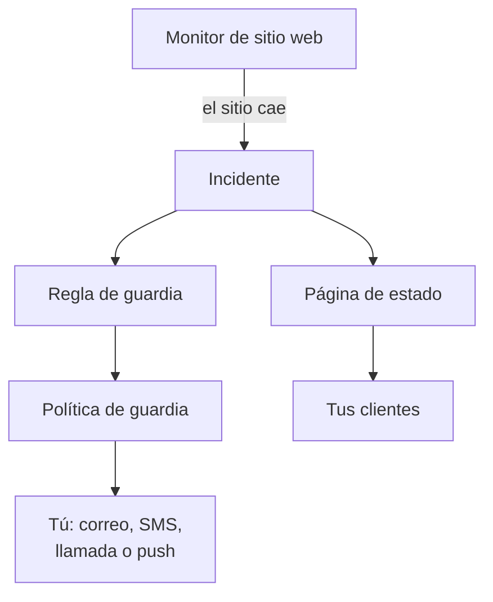

# Inicio rápido

Esta guía te lleva de una cuenta nueva a una configuración que funciona en unos quince minutos: un monitor que comprueba tu sitio web cada cinco minutos, una política de guardia que te avisa cuando el sitio cae y una página de estado que informa a tus clientes. Sigue la lista **Te damos la bienvenida a OneUptime 👋** de la página de inicio de tu proyecto, y las configuraciones guiadas que abren sus pasos.

¿Vienes de otra herramienta? Primero [importa tu configuración](/docs/introduction/getting-started#si-vienes-de-otra-herramienta): tus monitores, tus programaciones de guardia y tus páginas de estado vienen contigo.

## Antes de empezar

- **Una cuenta.** En OneUptime Cloud, regístrate en [oneuptime.com](https://oneuptime.com/accounts/register) y abre el enlace del correo que recibirás. En tu propia instalación, ábrela en el navegador y regístrate: la primera cuenta se convierte en el administrador principal. Para instalar una, consulta [Docker Compose](/docs/installation/docker-compose).
- **Un sitio web que vigilar.** Cualquier dirección que responda por HTTP o HTTPS, como la página de inicio de tu empresa.

## Crear un proyecto

En OneUptime todo vive en un proyecto: tus monitores, incidentes, políticas de guardia, páginas de estado y las personas que trabajan en ellos.

:::steps
### Empezar un proyecto nuevo

La primera vez que inicias sesión, OneUptime muestra **No hay proyectos**. Haz clic en **Crear nuevo proyecto**. Si alguien ya te invitó a un proyecto, acepta la invitación en esa misma página.

### Ponerle nombre

Escribe un **Nombre del proyecto**, por ejemplo el nombre de tu empresa. En OneUptime Cloud, elige también un plan justo debajo: Free ya está elegido, y los planes de pago empiezan con una prueba gratuita.

### Crearlo

Haz clic en **Crear proyecto**. Se abre la página de inicio de tu proyecto, con la lista **Te damos la bienvenida a OneUptime 👋** arriba. Primero pregunta **¿Qué quieres hacer primero?**: marca **Saber cuándo cae mi sitio web o mi API**, **Avisar a la persona adecuada cuando algo falle** y **Informar a mis clientes con una página de estado**, y haz clic en **Continuar**.
:::

## Monitorizar tu sitio web

:::steps
### Abrir la configuración del sitio web

En la lista, haz clic en **Crea tu primer monitor**. Se abre la configuración guiada **Saber cuándo cae mi sitio web o mi API**, que comprueba tu sitio, elige a quién se avisa y envía una prueba, en una sola página. Quien no puede crear monitores ve en su lugar la lista **Monitores**.

### Escribir la dirección

En **¿Qué debemos comprobar?**, escribe la dirección completa de tu sitio en **Dirección del sitio web o de la API**, por ejemplo `https://example.com`, y haz clic en **Empezar a comprobar**. Las sondas la comprueban de inmediato y luego cada 5 minutos: cuando el sitio no responde, o responde con un error, el monitor pasa a **Sin conexión** y declara un incidente. Haz clic en **Continuar**.

En el plan Free de OneUptime Cloud, los monitores se cobran según su uso, así que el proyecto necesita un método de pago antes de poder comprobar tu sitio: sin él, el paso te pide [añadir un método de pago](/docs/configuration/billing#métodos-de-pago).

### Elegir a quién se avisa

En **¿A quién hay que avisar?**, ya estás en **A quién se avisa**. Haz clic en **Guardar y continuar**: así se crea `Default on-call policy`, que te avisa con cada nuevo incidente y cada nueva alerta del proyecto, por correo para empezar. Para avisar también a miembros del equipo que ya están en el proyecto, haz clic antes en **Añadir miembros del equipo**.

### Enviarte una prueba

En **Envía una prueba**, haz clic en **Enviarme un aviso de prueba**, elige una **Gravedad** y haz clic en **Enviar aviso de prueba**. Abre el enlace del correo, que dice TEST, y confirma el aviso allí. Después haz clic en **Hecho** en el diálogo, y en **Continuar**: la configuración termina con un resumen de lo que ha configurado.
:::

Para fijar tú mismo cada opción, o para comprobar algo que no sea un sitio web, abre **Monitores** desde el menú **Productos** y haz clic en **Crear monitor**. [Crear un monitor](/docs/monitor/create-monitor) describe el formulario y cada tipo de monitor.

Para comprobar también una API, y saber qué hacer cuando la primera comprobación no vuelve nunca, sigue [Saber cuándo tu sitio web o tu API deja de funcionar](/docs/guides/website-down).

## Recibir un aviso cuando caiga

La configuración del sitio web ya creó `Default on-call policy`, que te avisa por correo con cada nuevo incidente y cada nueva alerta, así que la lista marca **Configura una política de guardia** como hecho. Su configuración guiada añade aun así tu teléfono, las personas a las que se avisa contigo y lo que pasa cuando nadie responde.

:::steps
### Abrir la configuración de guardia

Pulsa `Ctrl+K` (`Cmd+K` en un Mac), escribe `get paged` y elige **Avisar a la persona adecuada cuando algo falle**. Mientras la lista no haya marcado **Configura una política de guardia**, ese paso abre la misma configuración guiada.

### Elegir cómo se te localiza

En **¿Cómo debemos localizarte?**, tu correo de inicio de sesión ya aparece. Para las notificaciones push, instala la app OneUptime On-Call desde la App Store o Google Play, inicia sesión y haz clic en **Volver a comprobar**. Para recibir también SMS y llamadas, haz clic en **Activar SMS y llamadas**, escribe tu número en **Tu número de teléfono** y haz clic en **Envíame un código por SMS**: en OneUptime Cloud, los SMS y las llamadas se pagan con el saldo del proyecto, así que el paso te pide añadir saldo primero. Haz clic en **Continuar**.

### Elegir a quién más se avisa

En **¿Quién más está de guardia?**, deja `Default on-call policy` en **Política de guardia**. Para avisar a miembros del equipo contigo, añádelos en **Añadir a la primera regla de escalado**. Haz clic en **Guardar y continuar**.

### Decidir qué pasa si nadie responde

En **¿Y si nadie responde?**, elige **Volver a avisar a las mismas personas** mientras seas la única persona del proyecto. Cuando haya miembros del equipo, **Avisar a otra persona** avisa a la persona que elijas en **Avisados después**. En OneUptime Cloud, solo los planes de pago ofrecen esa opción. Haz clic en **Guardar y continuar**.

### Enviar un aviso de prueba

En **Enviar un aviso de prueba**, haz clic en **Probar esta política**, elige una **Gravedad** y haz clic en **Enviar aviso de prueba**. Confirma el aviso desde el correo, el SMS o la llamada, después haz clic en **Hecho** en el diálogo, y en **Continuar**. La configuración termina en **Los avisos están configurados**.
:::

> [!NOTE]
> Los SMS y las llamadas están desactivados en un proyecto nuevo. Un propietario del proyecto, un Billing Admin o alguien con Manage Billing los activa en la tarjeta **Canales de notificación**, en **Ajustes del proyecto → Notificaciones → Canales de notificación**.

Dos reglas de guardia activan la política: una con cada nuevo incidente y otra con cada nueva alerta. Para ver la primera, abre **Incidentes** desde el menú **Productos**, despliega **Reglas** en el menú lateral y elige **Reglas de guardia**: coincide con **Todos los incidentes**. Para activar la política solo con algunos incidentes, como los críticos, edita ahí la regla, o haz clic en **Crear Regla de guardia de incidentes** para añadir una propia.

Para crear en su lugar una política campo a campo, abre **Guardia** desde el menú **Productos** y haz clic en **Crear Política de guardia**. Para más niveles, rotaciones y cuánto espera cada nivel, consulta [Reglas de escalado](/docs/on-call/escalation-rules) y [Programaciones de guardia](/docs/on-call/schedules).

Para cada pantalla de la configuración, y qué hacer cuando un aviso no llega, sigue [Recibir avisos por llamada, SMS o push](/docs/guides/paging).

## Publicar una página de estado

:::steps
### Abrir la configuración de la página de estado

En la lista, haz clic en **Publica una página de estado**. Se abre la configuración guiada **Publica una página de estado**, que pone nombre a la página, coloca tu monitor en ella y muestra lo que ven tus clientes. Quien no puede crear páginas de estado ve en su lugar la lista **Páginas de estado**. El resumen de la configuración del sitio web abre la misma configuración, como **Mostrarlo en una página de estado**.

### Ponerle nombre y elegir tu monitor

En **Ponle nombre y elige qué muestra**, deja el **Nombre de la página de estado** que sugiere, o escribe el tuyo. En **Qué muestra**, marca tu monitor de sitio web, y haz clic en **Crear la página de estado**. Desde este momento la página es pública en su enlace: cualquiera que tenga su dirección puede abrirla.

### Abrir la página

En **Esto es lo que ven tus clientes**, abre la dirección que aparece en **Enlace público**: tu sitio web aparece como operativo. De vuelta en la configuración, haz clic en **Se ve bien**. La configuración termina con un resumen de lo que puedes hacer a continuación.
:::

Para crear en su lugar una página a mano, abre **Páginas de estado** desde el menú **Productos** y haz clic en **Crear página de estado**; luego añade tu monitor con **Añadir monitores** en su **Vista general**. Para dar a la página tu propio logotipo y tus colores, consulta [Marca y dominios de la página de estado](/docs/status-pages/branding-and-domains).

Para poner la página de estado en tu propio dominio, por HTTPS, sigue [Publicar una página de estado](/docs/guides/status-page).

## Invitar a tu equipo

En la lista, haz clic en **Invita a tu equipo**, o abre **Usuarios** desde el menú **Productos**, en **Ajustes**. Haz clic en **Invitar usuario**, escribe su **Correo electrónico** y elige un **Equipo**: de entrada está elegido el equipo de miembros. Haz clic en **Invitar**. OneUptime le envía la invitación por correo, y el equipo decide lo que puede hacer. Consulta [Usuarios, equipos y permisos](/docs/permissions/index).

## Probarlo

Declara un incidente de prueba para ver funcionar toda la cadena.

:::steps
### Declarar un incidente de prueba

Abre **Incidentes** y haz clic en **Declarar incidente**. Escribe un **Título**, por ejemplo `Test incident`, elige una **Gravedad del incidente** y haz clic en **Siguiente**. En **Monitores**, elige tu monitor de sitio web, para que el incidente aparezca en tu página de estado. Haz clic en **Siguiente** hasta llegar al resumen y, después, en **Declarar incidente**.

### Ver lo que pasa

En uno o dos minutos, tu política de guardia te avisa y el incidente aparece en tu página de estado.

### Resolverlo

En la página del incidente, haz clic en **Resolver**. Los avisos se detienen y el incidente sale de tu página de estado.
:::

> [!WARNING]
> Cualquiera que abra tu página de estado ve el incidente de prueba hasta que lo resuelvas. Haz la prueba antes de compartir la dirección de la página.

## Solución de problemas

:::details No me avisaron
Abre el incidente y elige **Ejecuciones de guardia** en su menú lateral: ahí ves si tu política se ejecutó y a quién avisó. Si no se ejecutó, comprueba que tu regla de guardia está activada y nombra la política. Si se ejecutó, comprueba que tus métodos en **Ajustes de usuario → Métodos de notificación** están verificados.
:::

:::details El incidente no aparece en mi página de estado
Una página de estado muestra un incidente cuando uno de los monitores del incidente está en la página. Comprueba que el incidente incluye tu monitor entre sus recursos afectados, y que el monitor está en la página de estado.
:::

:::details El monitor dice que está sin conexión, pero mi sitio funciona
Abre el monitor y revisa lo que recibieron las sondas. Consulta la sección de solución de problemas de [Monitor de sitio web](/docs/monitor/website-monitor).
:::

## Próximos pasos

:::cards
- [Conceptos básicos](/docs/introduction/core-concepts): Las ideas detrás de lo que acabas de configurar.
- [Glosario](/docs/introduction/glossary): Cada palabra que has encontrado por el camino, en una o dos frases.
- [Programaciones de guardia](/docs/on-call/schedules): Repartir la guardia con tu equipo.
- [Marca y dominios de la página de estado](/docs/status-pages/branding-and-domains): Hacer tuya la página de estado.
- [OpenTelemetry](/docs/telemetry/open-telemetry): Enviar registros, métricas y trazas desde tus aplicaciones.
:::
