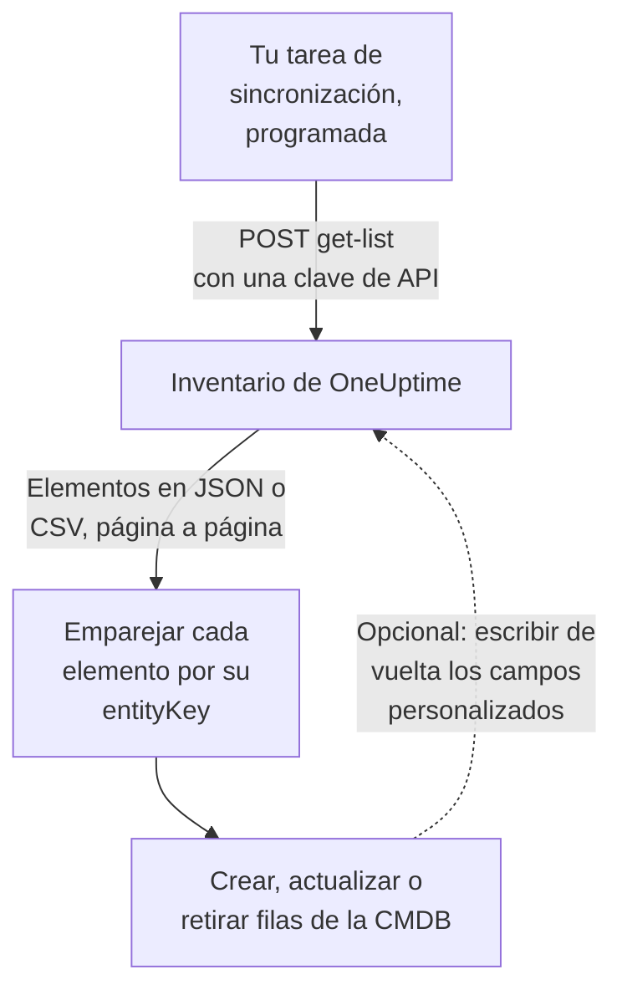

# Exportar a una CMDB

Si ya tienes una CMDB o un registro de activos, OneUptime no pretende sustituirlo. Lo que tiene y a una CMDB suele faltarle es una imagen de lo que de verdad está en marcha, al día sin que nadie la mantenga: descubierta a partir de la telemetría y de los sondeos que ya vigilan tu red y tus cuentas en la nube. Esta página es la receta para llevar esa imagen a tu propio sistema de registro.

:::cards
- [Cómo funciona una sincronización](#cómo-funciona-una-sincronización): Una tarea programada que lee la lista y empareja por una clave estable.
- [Obtener el catálogo](#obtener-el-catálogo): La solicitud, página a página, en JSON o CSV.
- [Detalles del activo](#detalles-del-activo): Los mismos datos y claves para hosts y dispositivos de red.
- [Escribir de vuelta](#escribir-de-vuelta): Llevar tus etiquetas de activo a OneUptime y añadir lo que no puede ver.
:::

## Cómo funciona una sincronización

Una sincronización es una tarea que ejecutas de forma programada. Lee la lista del inventario mediante la API REST con una clave de API, empareja cada elemento con una fila de tu CMDB por su clave de identidad y crea, actualiza o retira filas para que coincidan. También puede escribir valores de vuelta en los campos personalizados de los elementos.



## Qué puedes obtener

Tres recursos REST, cada uno con los endpoints estándar de la [API de OneUptime](/docs/api-reference/api-reference):

| Recurso | Endpoint | Qué contiene |
| --- | --- | --- |
| Elemento de inventario | `/api/inventory-item` | Una fila por cada cosa de la infraestructura |
| Definiciones de campos personalizados | `/api/inventory-item-custom-field` | El vocabulario de campos propio de tu proyecto |
| Relaciones | `/api/inventory-item-relationship` | Los enlaces dirigidos entre elementos |

Las columnas útiles de un elemento de inventario:

| Columna | Significado |
| --- | --- |
| `_id` | El ID de OneUptime: úsalo como tu referencia externa |
| `entityType` | `host`, `k8s.pod`, `network.device`, `appliance`, … |
| `entityKey` | Un hash de identidad estable. Sobrevive a los cambios de nombre, así que es la mejor clave para emparejar |
| `displayName` | El nombre que leen las personas |
| `source` | `discovered`, `inventory` o `manual` |
| `description` | Texto libre |
| `identifyingAttributes` | Los atributos que hacen que el elemento sea lo que es, y que nunca cambian |
| `descriptiveAttributes` | Todo lo demás que se observó en él: consulta [Detalles del activo](#detalles-del-activo), [Atributos de activo de los hosts](#atributos-de-activo-de-los-hosts) y [Atributos de activo de los dispositivos de red](#atributos-de-activo-de-los-dispositivos-de-red) más abajo |
| `customFields` | Tus propios campos, indexados por nombre de campo |
| `resourceType` / `resourceId` | Un puntero al registro más completo de OneUptime, cuando lo hay |
| `firstSeenAt` / `lastSeenAt` | Cuándo se observó por primera y por última vez |
| `isArchived` | Si se ha sacado de la lista activa |

## Antes de empezar

Una sincronización necesita una clave de API que pueda leer el inventario. En OneUptime Cloud, las claves de API necesitan el plan **Growth** o superior.

:::steps
### Crear una clave de API

Abre **Ajustes del proyecto → Avanzado → Claves de API** y haz clic en **Crear Clave de API**. Dale un **Nombre** y, en **Acceso**, elige **Visor** para leer todo el proyecto, o **Elegir los permisos más tarde** para darle solo lo que necesita una sincronización.

### Darle solo lo que necesita

Una exportación de solo lectura necesita un único permiso, **Read Telemetry Service**: el inventario comparte los permisos de telemetría en lugar de tener los suyos. En la página de la clave, haz clic en **Añadir permiso** y elígelo. Para escribir valores de vuelta, añade también **Edit Telemetry Service**.

### Copiar la clave

Copia la **Clave de API** desde la página de la clave y ponla a disposición de tu tarea:

```bash
export ONEUPTIME_API_KEY="your-api-key"
```
:::

La clave se envía en la cabecera `ApiKey` de cada solicitud y lee el inventario de su propio proyecto, así que una solicitud no nombra ningún proyecto.

## Obtener el catálogo

Haz un `POST` al endpoint de lista con las columnas que quieras. `select` es obligatorio: la API solo devuelve lo que pides.

```bash
curl -X POST 'https://oneuptime.com/api/inventory-item/get-list' \
  -H "ApiKey: $ONEUPTIME_API_KEY" \
  -H 'Content-Type: application/json' \
  -d '{
    "query": { "isArchived": false },
    "select": {
      "_id": true,
      "entityType": true,
      "entityKey": true,
      "displayName": true,
      "source": true,
      "customFields": true,
      "descriptiveAttributes": true,
      "lastSeenAt": true
    },
    "sort": { "displayName": "ASC" },
    "limit": 100,
    "skip": 0
  }'
```

En una instalación autoalojada, usa tu propia dirección de OneUptime en lugar de `https://oneuptime.com`. La respuesta es `{ "data": [...], "count": ... }`, donde `count` es cuántos elementos coinciden en total. Pagina aumentando `skip` en tu `limit` hasta tenerlos todos; `limit` llega hasta 10 000. Las fechas y los ID que no son `_id` vuelven envueltos, como `{ "_type": "DateTime", "value": "..." }` y `{ "_type": "ObjectID", "value": "..." }`: léelos de `value`.

### Solo los dispositivos de red

Filtra la lista por `entityType`:

```bash
curl -X POST 'https://oneuptime.com/api/inventory-item/get-list' \
  -H "ApiKey: $ONEUPTIME_API_KEY" \
  -H 'Content-Type: application/json' \
  -d '{
    "query": { "entityType": "network.device", "isArchived": false },
    "select": { "_id": true, "entityKey": true, "displayName": true, "customFields": true },
    "limit": 100,
    "skip": 0
  }'
```

Los `descriptiveAttributes` de cada dispositivo de red llevan su nombre de host, dirección IP, número de serie, dirección MAC, marca, modelo, firmware, sistema operativo, rol, sitio y ubicación: consulta [Atributos de activo de los dispositivos de red](#atributos-de-activo-de-los-dispositivos-de-red) más abajo. Lo demás que sabe el sondeo, como las interfaces y los vecinos, está en el propio registro Network Device: sigue `resourceId` hasta `/api/network-device/:id/get-item`, u obtén `/api/network-device/get-list` directamente.

### En CSV

Cualquier endpoint de lista responde en CSV en lugar de JSON con `?output-type=csv`:

```bash
curl -X POST 'https://oneuptime.com/api/inventory-item/get-list?output-type=csv' \
  -H "ApiKey: $ONEUPTIME_API_KEY" \
  -H 'Content-Type: application/json' \
  -d '{ "query": {}, "select": { "displayName": true, "entityType": true, "customFields": true }, "limit": 500, "skip": 0 }' \
  -o inventory.csv
```

La lista **Todos los elementos** del panel exporta de la misma forma, con las columnas de campos personalizados que tengas activadas. Cada [detalle del activo](#detalles-del-activo) también es una columna allí: **Nombre de host**, **Dirección IP**, **Número de serie**, **Modelo** y el resto empiezan ocultas, así que actívalas desde el selector de columnas, y la exportación lleva una columna por dato, sea la fila un host o un dispositivo de red.

## Detalles del activo

Los hosts y los dispositivos de red se describen con los mismos datos, guardados con las mismas claves. Una columna de la CMDB contiene el número de serie tanto si la fila es un servidor como un switch, y la tarjeta **Detalles del activo** de un elemento en el panel muestra cada dato en el mismo orden para ambos. Un dato que nada ha informado aparece como **Desconocido** en lugar de omitirse, para que se vea el hueco.

| Dato | Clave | En un host | En un dispositivo de red |
| --- | --- | --- | --- |
| Nombre de host | `host.name` | El nombre del host. Es la identidad del host, así que está en `identifyingAttributes` | El nombre propio del dispositivo: su `sysName` de SNMP, si no el nombre NetBIOS o DNS que encontró el descubrimiento. Nunca su dirección IP |
| Dirección IP | `host.ip` | Cada dirección que informa el recolector | La dirección que sondea OneUptime, cuando es una dirección IP; si no, la dirección a la que su sonda resolvió ese nombre DNS |
| Dirección MAC | `host.mac` | Detectada | Escrita en el dispositivo, o aprendida de la tabla ARP de un router recorrido |
| Número de serie | `host.serial_number` | Estampado | ENTITY-MIB |
| Fabricante | `device.manufacturer` | Estampado | ENTITY-MIB, si no lo que nombran `sysDescr` o `sysObjectID` |
| Modelo | `device.model.name` | Estampado | ENTITY-MIB, si no lo que nombra `sysDescr` |
| Versión de firmware | `device.firmware.version` | Estampada | ENTITY-MIB, si no lo que nombra `sysDescr` |
| Sistema operativo | `os.name` | `os.description` (o `os.type`) | Lo que nombra `sysDescr`: Cisco IOS, Junos OS, Arista EOS, Linux |
| Versión del SO | `os.version` | Detectada | ENTITY-MIB, si no lo que nombra `sysDescr` |
| Tipo de dispositivo | `device.type` | Estampado. Si no, la tarjeta lo clasifica por su sistema operativo y su nombre (Servidor, Cortafuegos, ...) | Su rol: el que asignaste, si no el que le da el mapa de topología |
| Ubicación | `device.location` | Estampada. Si no, la tarjeta muestra su zona de la nube | `sysLocation`. La tarjeta muestra primero su sitio |

La [tabla de hosts](#atributos-de-activo-de-los-hosts) y la [tabla de dispositivos de red](#atributos-de-activo-de-los-dispositivos-de-red) de abajo dicen en detalle de dónde viene cada valor.

## Atributos de activo de los hosts

`descriptiveAttributes` en un host lleva los datos de activo que suele querer una fila de CMDB, indexados por su nombre de atributo de OpenTelemetry:

| Campo | Clave | ¿Se recoge por defecto? |
| --- | --- | --- |
| Direcciones IP | `host.ip` | Sí: separadas por comas cuando la máquina tiene varias |
| Direcciones MAC | `host.mac` | Sí: separadas por comas, una por interfaz activa, como `AC-DE-48-23-45-67` |
| Arquitectura | `host.arch` | Sí |
| ID de la máquina | `host.id` | Sí: el GUID de la máquina en Windows, `/etc/machine-id` en Linux |
| Sistema operativo | `os.type`, `os.description`, `os.version` | Sí |
| Ubicación en la nube | `cloud.provider`, `cloud.region`, `cloud.availability_zone` | Solo con un detector de nube |
| Número de serie | `host.serial_number` | Necesita un paso de configuración |
| Marca | `device.manufacturer` | Necesita un paso de configuración |
| Modelo | `device.model.name` | Necesita un paso de configuración |
| Versión de firmware (BIOS o UEFI) | `device.firmware.version` | Necesita un paso de configuración |
| Nombre del sistema operativo | `os.name` | Solo de los SDK que lo informan: si no, `os.description` nombra el sistema |
| Tipo de dispositivo | `device.type` | Opcional: estámpalo de la misma forma (`Hypervisor`, `Workstation`) |
| Ubicación | `device.location` | Opcional: estámpala de la misma forma (`Frankfurt DC, Rack B4`) |

Todo lo marcado con Sí viene del procesador `resourcedetection` del recolector, y ya está en la configuración que OneUptime genera para ti.

Las claves `cloud.*` necesitan un detector de nube en ese procesador: `detectors: [system, env, ec2]`, o `gcp` o `azure` para los demás. La configuración incluida solo ejecuta `[system, env]`, así que esas tres se quedan vacías hasta que añadas uno.

El número de serie, la marca, el modelo y el firmware no tienen detector de recursos: viven en el firmware de la máquina, se leen mediante WMI en Windows y DMI en Linux, y por eso se estampan en el recurso una vez, al aprovisionar la máquina. Un tipo de dispositivo o una ubicación que quieras en la fila se estampa de la misma forma. [Atributos de inventario](/docs/telemetry/host-otel-collector#atributos-de-inventario-ip-mac-número-de-serie-fabricante-modelo-firmware) tiene el fragmento exacto para cada sistema operativo. `host.manufacturer`, `host.model.name`, `host.firmware.version` y `host.bios.version` se aceptan como otras grafías y se guardan con las claves `device.*` (y `device.serial_number` con `host.serial_number`), así que una sincronización solo lee una clave por dato.

`host.id` merece un vistazo como clave de emparejamiento si tu CMDB ya usa un identificador de hardware: a diferencia de `entityKey`, es el ID propio de la máquina, así que coincide con lo que informa una herramienta de gestión de endpoints para el mismo equipo.

Los atributos se añaden y nunca se vacían: uno que deja de informarse se queda en la fila, así que un valor que tu sincronización ya leyó nunca desaparece en silencio.

## Atributos de activo de los dispositivos de red

Un dispositivo de red (`entityType: network.device`) se replica desde su registro Network Device, y sus `descriptiveAttributes` usan las mismas claves que un host para los mismos datos, así que una columna de la CMDB contiene el número de serie tanto si la fila es un servidor como un switch:

| Campo | Clave | De dónde viene |
| --- | --- | --- |
| Nombre de host | `host.name` | El nombre propio del dispositivo: su `sysName` de SNMP, si no el nombre NetBIOS o DNS inverso que encontró el descubrimiento. Se omite cuando solo lo nombra su dirección IP |
| Dirección IP | `host.ip` | La dirección que sondea OneUptime, cuando es una dirección IP. Para un dispositivo sondeado por un nombre DNS, la dirección a la que su sonda resolvió ese nombre la última vez |
| Nombre DNS | `net.device.dns_name` | El nombre DNS inverso encontrado en el descubrimiento, o el nombre DNS que sondea OneUptime |
| Dirección MAC | `host.mac` | Escrita en el dispositivo, o aprendida de la tabla ARP de un router recorrido |
| Marca | `device.manufacturer` | ENTITY-MIB `entPhysicalMfgName`, si no el fabricante que nombra `sysDescr`, si no el proveedor del `sysObjectID` |
| Modelo | `device.model.name` | ENTITY-MIB `entPhysicalModelName`, si no el modelo que nombra `sysDescr` |
| Número de serie | `host.serial_number` | ENTITY-MIB `entPhysicalSerialNum` |
| Versión de firmware | `device.firmware.version` | ENTITY-MIB `entPhysicalFirmwareRev`, si no el firmware que nombra `sysDescr` en los dispositivos Ubiquiti, HPE y Aruba |
| Sistema operativo | `os.name` | El sistema operativo que nombra `sysDescr` |
| Versión del software o del SO | `os.version` | ENTITY-MIB `entPhysicalSoftwareRev`, si no la versión que nombra `sysDescr` |
| Descripción del sistema | `os.description` | `sysDescr` |
| Tipo de dispositivo | `device.type` | El rol que asignaste al dispositivo, si no el rol con el que lo clasifica el mapa de topología, con el nombre que le da tu proyecto |
| Ubicación | `device.location` | `sysLocation`, salvo que sea el valor por defecto de un agente, como «Sitting on the Dock of the Bay» de Net-SNMP |
| Sitio | `oneuptime.site.name` | El Network Site al que está asignado el dispositivo |
| Dirección sondeada | `net.device.hostname` | La dirección que sondea OneUptime: una dirección IP o un nombre DNS. Se mantiene para las sincronizaciones escritas antes de que existieran `host.name` y `host.ip` |

Las filas de ENTITY-MIB se completan tras el primer recorrido SNMP del dispositivo. Un dispositivo que no se recorre, porque se monitoriza solo por ping o aún no se ha sondeado, obtiene igualmente su nombre, marca, sistema operativo y ubicación de lo que leyó por SNMP el último escaneo de descubrimiento de su dirección, y su dirección MAC de la tabla ARP de un router recorrido. Un dispositivo que no implementa ENTITY-MIB no tiene número de serie ni firmware que informar. Su `sysDescr` sigue nombrando el modelo y el sistema operativo en muchas plataformas: un Cisco Meraki MX informa `Meraki MX85`, que rellena la marca y el modelo. Una plataforma cuyo `sysDescr` no tiene una forma conocida no añade nada, en lugar de adivinar.

Un dispositivo Meraki toma del panel de Meraki lo que su propio sondeo deja vacío, cuando una [conexión de Meraki](/docs/monitor/network-traffic#cisco-meraki-sin-netflow) lee su organización: su número de serie, modelo, firmware y marca, su dirección MAC, su nombre, su dirección de gestión, la dirección postal en la que está registrado y su tipo. Un dispositivo es uno de los dispositivos de la organización cuando tiene el número de serie o la dirección MAC del dispositivo Meraki, o cuando OneUptime lo sondea en la dirección de gestión del dispositivo Meraki y tiene el mismo nombre. Un valor guardado en el dispositivo, y lo que lee su propio sondeo, van primero.

Un valor guardado en el dispositivo, escrito a mano o fijado a través de la API, nunca se sustituye por lo que lee el descubrimiento. Entre un valor que leyó el propio recorrido del dispositivo y uno que leyó un escaneo, se usa el más reciente. Lo que lee un escaneo solo se usa cuando el escaneo encontró la misma máquina en la dirección: cuando el nombre del sistema, el `sysObjectID` o el nombre NetBIOS que leyó contradice el del dispositivo, no se usa nada de lo que leyó allí. La tarjeta **Detalles del activo** del elemento indica de dónde vino cada valor y cuándo.

El nombre de host nunca es la dirección IP. Un dispositivo al que solo nombra su dirección tiene `host.ip` y ningún `host.name`. Cuando su recorrido SNMP informa un nombre de sistema, `host.name` llega en la siguiente pasada.

Estos valores se copian del registro Network Device cada quince minutos y **sustituyen** a los valores anteriores en lugar de sumarse a ellos, así que un valor borrado en el dispositivo (una dirección MAC quitada, por ejemplo) también sale del elemento del inventario.

No hay versión de *actualización disponible*: SNMP no tiene un objeto estándar para ello, así que OneUptime registra la versión que ejecuta el dispositivo.

## Emparejar elementos con filas de la CMDB

Empareja por `entityKey`, no por `displayName`. Es un hash de los atributos identificativos del elemento, así que sobrevive a los cambios de nombre y de etiquetas: un host al que se le cambia la etiqueta conserva la misma clave mientras cambia su nombre visible. `_id` es igual de estable, y es la clave externa más sencilla si solo hablas con un proyecto.

Las fechas de `customFields` son cadenas ISO-8601 en UTC, y la exportación CSV las escribe así en lugar de en la forma más amigable que muestra el panel, para que se importen sin sorpresas al analizarlas.

## Mantenerlo al día

No hay un flujo de cambios. Consulta el endpoint de lista con el intervalo que te convenga y compara por `entityKey`. `lastSeenAt` indica cuándo se observó un elemento por última vez, que suele ser la forma más barata de detectar lo que se ha quedado sin actividad desde tu última ejecución.

Para volver a leer un dispositivo de red ahora, sin esperar a su próximo sondeo ni a la próxima copia, pulsa **Actualizar** en la tarjeta **Detalles del activo** de su elemento, o envía `POST /api/network-device/{id}/refresh` con una clave que tenga **Edit Network Device**. Su sonda lo consulta en menos de un minuto, su conexión de Meraki vuelve a leer la organización y su elemento se copia en cuanto llega la nueva lectura.

Un elemento que desaparece entre ejecuciones o bien caducó (un elemento descubierto que siguió en silencio más allá de su ventana), o bien se eliminó su registro de origen. Un elemento replicado que lleva valores de campos personalizados se archiva en lugar de eliminarse cuando desaparece su registro, así que consulta con `"isArchived": true` para ver lo que se retiró sin perder los datos de activo asociados.

## Escribir de vuelta

Los mismos endpoints aceptan escrituras, así que una sincronización puede llevar valores a `customFields`: por ejemplo, la etiqueta de activo que ya gestiona tu CMDB, estampada en el elemento de OneUptime correspondiente. La clave necesita **Edit Telemetry Service** para ello.

También puedes añadir elementos para cosas que OneUptime no puede ver, con `POST /api/inventory-item`, un `entityType` de `external.service`, `external.database` o `appliance`, y un `displayName`. OneUptime calcula la clave de identidad por ti, y esos elementos nunca caducan. La clave necesita **Create Telemetry Service** para eso.

## Solución de problemas

:::details Cada solicitud se rechaza con 402 Payment Required
En OneUptime Cloud, las claves de API solo funcionan mientras el proyecto está en el plan **Growth** o superior. No se elimina nada: la clave vuelve a funcionar tal cual en cuanto el proyecto vuelve al plan. Consulta [Claves de API y SCIM por debajo de su plan](/docs/api-reference/api-reference#claves-de-api-y-scim-por-debajo-de-su-plan).
:::

:::details Cada solicitud responde 422 You do not have permissions
La clave no tiene ningún permiso que lea el inventario. Una clave creada con **Elegir los permisos más tarde** no puede hacer nada hasta que recibe uno: añade **Read Telemetry Service** en su página, como en [Antes de empezar](#antes-de-empezar).
:::

:::details La lista vuelve sin las columnas que necesito
La lista solo devuelve las columnas que nombra `select`, y `_id`. Añade a `select` cada columna que leas, incluidas `descriptiveAttributes` y `customFields`.
:::

:::details Falta un elemento que esperaba
Los elementos archivados se omiten cuando envías `"isArchived": false`. Un elemento descubierto se elimina cuando lleva en silencio más tiempo que su ventana, y uno replicado se va con su registro. Pide `"isArchived": true` para ver los archivados.
:::

## Próximos pasos

:::cards
- [Visión general del inventario](/docs/inventory/overview): De dónde vienen los elementos y cuánto tiempo se queda cada uno.
- [Campos personalizados del inventario](/docs/inventory/custom-fields): Definir los campos que tu sincronización lee y escribe.
- [Referencia de la API de OneUptime](/docs/api-reference/api-reference): Solicitudes, códigos de estado y las reglas que sigue cada escritura.
:::
