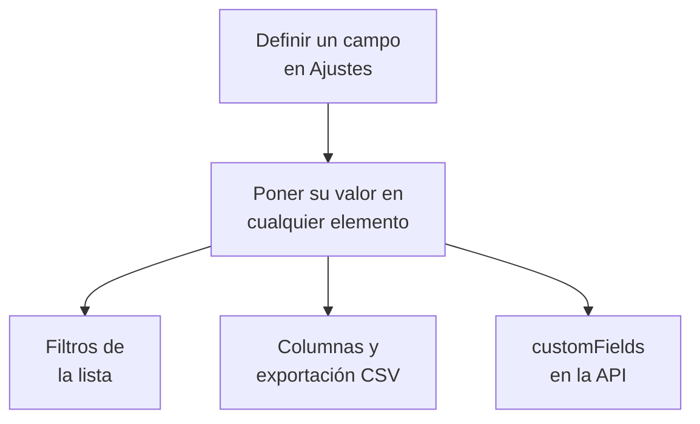

# Campos personalizados del inventario

OneUptime descubre lo que hay en tu infraestructura. Los campos personalizados registran lo que ninguna vigilancia puede decirle: el número de serie de la etiqueta, la fecha en que vence la garantía, qué equipo es dueño de algo, si está en servicio o en un cajón de repuestos. Define los campos una vez para el proyecto y luego rellénalos en cada elemento.

:::cards
- [Cómo funcionan los campos personalizados](#cómo-funcionan-los-campos-personalizados): Un vocabulario, en cada elemento, sea cual sea su origen.
- [Definir los campos](#definir-los-campos): Crear un campo, elegir su tipo, enumerar las opciones de un desplegable.
- [Filtrar la lista](#filtrar-la-lista): Encontrar lo que vence el próximo trimestre en dos clics.
- [Notas y límites](#notas-y-límites): Cambios de nombre, duplicados, fechas y campos eliminados.
:::

## Cómo funcionan los campos personalizados

Un campo se define una vez para el proyecto, y cada elemento puede llevar un valor para él: los que OneUptime descubrió, los que replica y los que añadiste a mano. Un campo se convierte en un filtro sobre la lista, en una columna opcional y en una columna de la exportación CSV. La API lee y escribe los mismos valores, en `customFields` de cada elemento.

> [!NOTE]
> En OneUptime Cloud, los campos personalizados forman parte del plan **Growth** y superiores. Por debajo, los campos no se pueden definir, enumerar ni cambiar: la API responde `402 Payment Required`, y la lista no muestra filtros ni columnas de campos personalizados.

## Definir los campos

:::steps
### Abrir la página de campos personalizados

Ve a **Productos → Recursos → Inventario**, abre **Ajustes** en el menú lateral y luego **Campos personalizados**.

### Crear un campo

Haz clic en **Crear Campo personalizado de elemento de inventario**. Dale un **Nombre del campo**, una **Descripción del campo** opcional y un **Tipo de campo** de la tabla de abajo.

### Enumerar las opciones de un desplegable

Para un tipo desplegable, añade sus opciones en **Opciones del menú desplegable**. Cada opción puede llevar un color, que se usa igual en la celda de la tabla y en el filtro: elige uno de los colores con nombre, **Sin color**, o **Color personalizado** para un código de color exacto. Arrastra una opción por su asa para cambiar su posición en la lista.
:::

| Tipo | Úsalo para |
| --- | --- |
| **Texto** | Número de serie, etiqueta de activo, posición en el rack, número de orden de compra |
| **Número** | Coste, unidad de rack, número de puertos |
| **Booleano** | Con soporte, dentro del alcance PCI |
| **Desplegable (selección única)** | Estado del ciclo de vida, entorno, criticidad: una respuesta de una lista fija |
| **Desplegable (selección múltiple)** | Ámbitos de cumplimiento, etiquetas: varias respuestas de una lista fija |
| **Fecha** | Fecha de compra, vencimiento de la garantía, fecha de fin de vida |
| **Fecha y hora** | Última auditoría el, retirado del servicio el |
| **Texto largo** | Instrucciones de acceso, notas: varias líneas de texto sin formato |
| **Texto enriquecido (Markdown)** | Notas con formato y enlaces, escritas en el editor Markdown |
| **Archivo** | Un certificado de garantía, una orden de compra firmada, una foto de la etiqueta del rack: un archivo |
| **Varios archivos** | Manuales, facturas y fotos: hasta 10 archivos |

## Un vocabulario de activos de ejemplo

Un registro típico de activos de hardware se traslada directamente a estos campos:

| Nombre del campo | Tipo | Ejemplo |
| --- | --- | --- |
| `Serial Number` | Texto | `FDO24160ABC` |
| `Asset Tag` | Texto | `IT-004821` |
| `Purchase Date` | Fecha | 2024-03-11 |
| `Warranty Expiry` | Fecha | 2027-03-10 |
| `Lifecycle Status` | Desplegable | En servicio, Repuesto, En reparación, Retirado |
| `Assigned Site` | Desplegable | Centro de datos de Londres, Centro de datos de Fráncfort, Sede central |
| `Owner Team` | Desplegable | Red, Plataforma, Seguridad |
| `Cost Centre` | Texto | `CC-4410` |

Pon los valores en la página **Campos personalizados** de un elemento. Cualquier elemento los acepta, sea cual sea su origen, así que los switches que OneUptime descubrió y los dispositivos de red que replica llevan el mismo vocabulario de activos que los appliances que añadiste a mano.

## Filtrar la lista

Cada campo personalizado se convierte en un filtro sobre la lista **Todos los elementos**, y el filtro ofrece las comparaciones que corresponden a su tipo:

| Tipo de campo | Comparaciones |
| --- | --- |
| **Texto**, **Texto largo**, **Texto enriquecido (Markdown)** | es, no es, contiene, no contiene, comienza con, termina con, está vacío, no está vacío |
| **Número** | es, no es, es mayor que, es mayor o igual que, es menor que, es menor o igual que, está vacío, no está vacío |
| **Booleano**, **Desplegable (selección única)**, **Desplegable (selección múltiple)** | es, no es, está vacío, no está vacío |
| **Fecha**, **Fecha y hora** | es, es antes de, es después de, está entre, está vacío, no está vacío |
| **Archivo**, **Varios archivos** | es |

Un chip de **Archivo** o **Varios archivos** pregunta una sola cosa: si el campo **Tiene archivos** o está **Sin archivos**.

Los filtros se combinan con Y, así que «Warranty Expiry es antes de 2026-10-01 Y Lifecycle Status es En servicio» es una sola vista de la lista. Esa es la pregunta que un registro de activos existe para responder, y la razón para usar los tipos de fecha en lugar de una fecha en un campo de texto: un campo de texto guarda `2026-10-01` sin problema y luego no puede decirte qué vence el próximo trimestre.

Las columnas de campos personalizados empiezan ocultas: actívalas desde el selector de columnas. No se pueden ordenar, porque los valores viven juntos en una sola columna JSON por la que la lista no puede ordenar.

## Notas y límites

- Los valores se guardan en cada elemento con el nombre del campo. Cambiar el nombre de un campo no mueve los valores ya guardados con el nombre anterior. Los campos personalizados de incidentes son la excepción: cambiar el nombre de uno mueve sus valores (consulta [Cambiar el nombre de un campo](/docs/incidents/settings#renombrar-un-campo)).
- Las opciones de un desplegable se pueden añadir, renombrar, arrastrar a un nuevo orden y quitar después de que los elementos tengan valores. Renombrar una opción la cambia en cada elemento que la tiene; una opción quitada sigue en los elementos que la tienen, mostrada como que ya no es una opción, salvo que elijas otra para ellos (consulta [Cambiar las opciones de un desplegable](/docs/incidents/settings#cambiar-las-opciones-de-un-desplegable)).
- Nada hace único un valor. Dos elementos pueden llevar el mismo número de serie, y nada te lo impide.
- Las fechas se guardan como marcas de tiempo ISO-8601 en UTC y se muestran en tu propia zona horaria.
- Eliminar un campo lo quita de la lista y de la barra de filtros. Los valores ya escritos se quedan en los elementos.
- Un campo de tipo **Archivo** o **Varios archivos** admite archivos de hasta 10 MB cada uno, de los tipos que se enumeran en [Campos de archivo](/docs/incidents/settings#campos-de-archivo), subidos en el proyecto. Solo quien puede ver el elemento puede descargarlos, y un archivo se elimina en cuanto nada lo conserva.

## Próximos pasos

:::cards
- [Visión general del inventario](/docs/inventory/overview): De dónde vienen los elementos y qué muestra cada página.
- [Exportar a una CMDB](/docs/inventory/cmdb-sync): Llevar los elementos y sus campos personalizados a otro sistema.
- [Campos personalizados de incidentes](/docs/incidents/settings#campos-personalizados): Los mismos tipos de campo en los incidentes, con algunos extras.
:::
