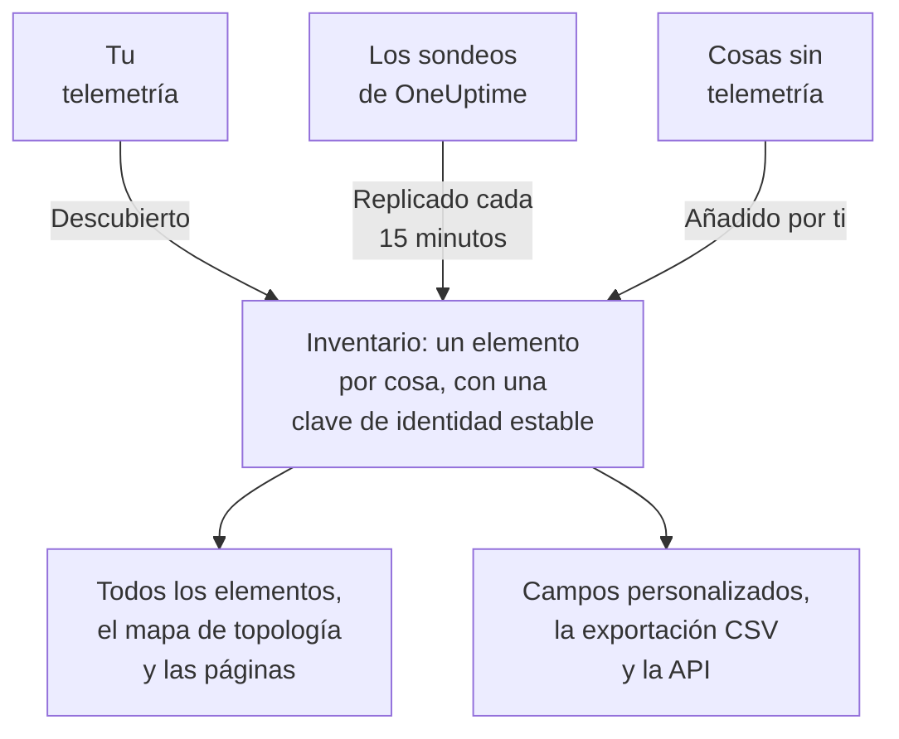

# Visión general del inventario

El inventario es una sola lista de todo lo que OneUptime sabe de tu infraestructura: servicios, hosts, objetos de Kubernetes, máquinas virtuales, dispositivos de red, recursos en la nube, dispositivos IoT, funciones serverless y las cosas que no envían ninguna telemetría. Casi todo se rellena solo a partir de lo que OneUptime ya vigila. Tú añades lo que vigilar no puede decirle: para qué sirve algo, de quién es, cuándo vence su garantía.

:::cards
- [Cómo llegan los elementos al inventario](#cómo-llegan-los-elementos-al-inventario): Descubiertos, replicados o añadidos por ti.
- [Orientarse](#orientarse): Las páginas del inventario y las páginas propias de cada elemento.
- [Añadir algo a mano](#añadir-algo-a-mano): Una API de terceros, una base de datos externa o un appliance.
- [Archivar en lugar de eliminar](#archivar-en-lugar-de-eliminar): La forma de ordenar la lista que perdura.
:::

## Cómo llegan los elementos al inventario

OneUptime ya vigila tu infraestructura para monitorizarla, así que el catálogo se construye a partir de lo que observa y no de lo que alguien recordó escribir. Cada elemento tiene un origen, y el origen decide de quién es el elemento: si puedes editarlo y si puede desaparecer por sí solo.

| Origen | En la API | De dónde viene | Cuánto tiempo se queda |
| --- | --- | --- | --- |
| **Descubierto** | `discovered` | Atributos de recurso de OpenTelemetry, leídos al llegar la telemetría: un servicio, host, objeto de Kubernetes o máquina virtual que envía telemetría. | Se vuelve a registrar con cada lote. Se elimina cuando lleva más tiempo en silencio que la ventana de su tipo (ver más abajo). |
| **Replicado** | `inventory` | Un registro que mantiene un sondeo de OneUptime: dispositivos de red, recursos en la nube, dispositivos IoT, funciones serverless, aplicaciones RUM, hosts Docker y hosts Podman. Se copia cada 15 minutos. | Mientras exista su registro. Elimina el registro y el elemento se va con él. |
| **Añadido por ti** | `manual` | Añadido por ti, para algo que OneUptime no puede ver: una API de terceros, una base de datos gestionada por un proveedor, un appliance en un rack. | Hasta que lo elimines. Nada lo hace caducar. |

Un elemento descubierto o replicado no se puede renombrar ni cambiar de tipo: su origen sobrescribiría el cambio en su siguiente pasada. La página **Ajustes** del elemento indica dónde hacer en su lugar un cambio duradero. Lo que siempre puedes añadir a cualquier elemento, sea cual sea su origen, son valores de campos personalizados: consulta [Campos personalizados del inventario](/docs/inventory/custom-fields).

### Cuánto tiempo se queda un elemento silencioso

Un elemento descubierto tiene latido. Cada vez que llega telemetría para él, su hora de última vez visto avanza, y la columna **Estado** de la lista indica lo reciente que es. Los elementos replicados y los que añadiste no tienen latido, así que su estado se queda en blanco en lugar de alarmar.

| Estado | Qué significa |
| --- | --- |
| **En vivo** | Visto en los últimos 30 minutos. |
| **Recientes** | Visto durante el último día. |
| **Obsoleto** | Sin ver desde hace más de un día. La página **Sin actividad** los muestra. |

Cada tres horas, OneUptime elimina los elementos descubiertos que llevan más tiempo en silencio que la ventana de su tipo, también los archivados, y sus valores de campos personalizados se van con ellos. Los elementos replicados y los que añadiste nunca se eliminan de esta forma.

| Tipo de elemento | Se elimina tras este tiempo sin telemetría |
| --- | --- |
| Pods, despliegues, invitados de Proxmox y máquinas virtuales de VMware | 1 día |
| Nodos y espacios de nombres de Kubernetes, nodos de Proxmox, hosts, clústeres y almacenes de datos de VMware, y las bases de datos y servicios remotos a los que llaman tus trazas | 7 días |
| Servicios, hosts, clústeres de Kubernetes, Proxmox y Ceph, cabinas de almacenamiento, vCenters y clústeres de Docker Swarm | 30 días |

Una relación que OneUptime descubrió se elimina cuando no se ha vuelto a ver durante 30 días.

## Orientarse

Abre **Productos → Recursos → Inventario**. Su menú lateral tiene estas páginas. **Por origen**, **Ajustes**, **Ayuda** y **Avanzado** empiezan plegados: haz clic en el título de una sección para abrirla.

| Página | Qué encontrarás |
| --- | --- |
| **Vista general** | Cuántos elementos tienes, qué son, cuántos se han quedado sin actividad y qué se añadió más recientemente. |
| **Todos los elementos** | Todos los elementos. Busca por nombre, descripción o clave de identidad, filtra la lista por tipo, origen, estado o campo personalizado, y añade un elemento a mano. |
| **Mapa de topología** | Cómo se conectan los elementos: los servicios, a qué llaman y los hosts, pods y dispositivos en los que se ejecutan. |
| **Sin actividad** | Los elementos descubiertos que no han enviado telemetría desde hace más de un día. |
| **Por origen** | Los elementos de un origen: **Descubierto**, **Replicado** o **Añadido por ti**. |
| **Ajustes → Campos personalizados** | Los campos que tu proyecto mantiene en cada elemento. |
| **Ayuda → Documentación** | Una guía breve del inventario, con los tipos de elemento que reconoce. |
| **Avanzado → Archivado** | Los elementos que archivaste. Desarchívalos desde aquí. |

Abre un elemento y su propio menú lateral tiene su **Vista general** (su tipo, origen y estado, y cada atributo observado en él), sus **Conexiones** y sus **Campos personalizados**; sus **Registros**, **Trazas**, **Métricas**, **Perfiles de rendimiento** y **Excepciones**; y sus **Incidentes**, **Alertas** y **Mantenimiento programado**. En **Avanzado** están sus **Ajustes**, sus **Registros de auditoría** y **Eliminar elemento**. Las páginas de telemetría muestran lo que envió el propio elemento. Los incidentes, alertas y eventos de mantenimiento son los del servicio, host o clúster de Kubernetes que representa el elemento; en cualquier otro elemento, esas páginas indican qué recurso consultar en su lugar.

### Detalles del activo

Un host o un dispositivo de red tiene una tarjeta **Detalles del activo** que describe ambos de la misma manera: nombre de host, dirección IP, dirección MAC, número de serie, fabricante, modelo, versión de firmware, sistema operativo, versión del sistema operativo, tipo de dispositivo y ubicación. Un dato que nada ha informado aparece como **Desconocido**, y la tarjeta explica cómo se completan los desconocidos.

- Los datos de un host vienen de los atributos de recurso de su telemetría: sus direcciones IP y MAC, su arquitectura y su sistema operativo de serie, y su número de serie, marca, modelo y firmware una vez que los estampas.
- Los datos de un dispositivo de red vienen de su sondeo SNMP, su rol y su sitio. Lo que su sondeo no ha leído viene del descubrimiento: el último escaneo de su dirección, la tabla ARP de un router o la consulta DNS de su sonda. Un dispositivo sin ENTITY-MIB, como un Meraki MX, obtiene igualmente su marca y modelo de su descripción del sistema. Su dirección IP nunca se muestra como su nombre de host.
- Un dispositivo Meraki también toma del panel de Meraki lo que su sondeo deja vacío, entre ello su número de serie, modelo y firmware, cuando una [conexión de Meraki](/docs/monitor/network-traffic#cisco-meraki-sin-netflow) lee su organización.

La tarjeta indica de dónde vino cada dato y cuándo. La fuente que comparten la mayoría de los datos, como el recolector de un host, el propio sondeo SNMP de un dispositivo de red o el escaneo de descubrimiento que lo leyó, se nombra una sola vez, debajo de los datos. Cualquier otra fuente, como la tabla ARP de un router o un valor guardado en el dispositivo, se nombra bajo su dato. Un valor guardado en un dispositivo de red nunca se sustituye por lo que lee el descubrimiento, y cuando los dos difieren, la tarjeta muestra ambos.

La tarjeta de un dispositivo de red tiene un botón **Actualizar** para quien puede editar dispositivos de red. Vuelve a leer el dispositivo ahora: su sonda lo consulta en menos de un minuto y su conexión de Meraki vuelve a leer la organización. La tarjeta indica cuándo ha llegado la nueva lectura, o que la sonda no pudo alcanzar el dispositivo, y el elemento se copia del dispositivo en cuanto llega la lectura.

Los mismos datos son columnas de la lista **Todos los elementos**, ocultas hasta que las activas, y entran en su exportación CSV. [Exportar a una CMDB](/docs/inventory/cmdb-sync#detalles-del-activo) enumera sus claves.

### Conexiones

La página **Conexiones** de un elemento enumera sus vecinos en ambas direcciones, agrupados en **Llamadas**, **Llamado por**, **Se ejecuta en** y **Relacionado**. Cada grupo muestra su total (un grupo con más de 100 000 conexiones muestra «100 000+»), y **Mostrar más** recorre el resto, así que un clúster, un espacio de nombres o un nodo muy concurrido muestra todas sus conexiones y no solo las primeras. La página no se limita a un intervalo de tiempo: incluye las relaciones añadidas a mano mediante la API y los vecinos archivados. Un vecino que ya no está en el inventario se muestra por su clave.

## Añadir algo a mano

Añade un elemento para algo que OneUptime nunca verá por sí mismo, de modo que una dependencia termine en algo real y esa cosa pueda llevar tus campos personalizados.

:::steps
### Abrir Todos los elementos

Ve a **Productos → Recursos → Inventario** y luego a **Todos los elementos**.

### Añadir el elemento

Haz clic en **Añadir Elemento**. Elige su **Tipo**, dale un **Nombre** y, si quieres, una **Descripción**. El nombre y el tipo juntos son la identidad del elemento, así que dos elementos del mismo tipo no pueden compartir nombre.

### Rellenar sus campos personalizados

Abre el nuevo elemento. Su origen indica **Añadido por ti**, y su página **Campos personalizados** acepta los valores que sigue tu proyecto.
:::

Puedes añadir tres tipos a mano:

- `external.service` (**Servicio externo**): una API de terceros o una dependencia de software como servicio.
- `external.database` (**Base de datos externa**): una base de datos que no es un servidor que OneUptime pueda modelar. Un servidor de base de datos, autoalojado o gestionado, de PostgreSQL a Snowflake, va en su lugar en **Bases de datos → Crear Base de datos** ([Bases de datos](/docs/telemetry/databases)): ese registro se une a las trazas, los contenedores y las métricas del motor que nombran la misma dirección, algo que un elemento del inventario nunca hace, y añadir el mismo servidor de las dos formas deja dos registros sin relación.
- `appliance` (**Appliance**): hardware o software sin agente.

La restricción evita duplicados. Un elemento hecho a mano de un tipo que OneUptime puede observar, como un host, se identificaría por el nombre que escribiste, mientras que el elemento descubierto de la misma máquina se identifica por los atributos que informa. Los dos nunca se unirían, así que el mismo host aparecería dos veces en tu lista para siempre.

## Archivar en lugar de eliminar

Archivar saca un elemento de la lista mientras conserva su identidad, su historial y sus valores de campos personalizados. Dice: ya he visto esto y no lo quiero en mi lista. Un elemento archivado sigue recogiendo telemetría.

| Origen | Archivar | Eliminar |
| --- | --- | --- |
| **Descubierto** | Sigue archivado. | Vuelve con el siguiente lote de su telemetría. |
| **Replicado** | Sigue archivado. | Vuelve con la siguiente copia. Elimina en su lugar el registro original. |
| **Añadido por ti** | Sigue archivado. | Desaparece para siempre. |

Para archivar elementos, selecciónalos en **Todos los elementos** y archívalos de una vez, o abre un elemento y usa la tarjeta **Archivar** de su página **Ajustes**. Los elementos archivados están en **Inventario → Avanzado → Archivado**, donde puedes seleccionarlos y desarchivarlos.

> [!NOTE]
> Cuando un dispositivo replicado se quita de su registro de origen, OneUptime también elimina su elemento, salvo que el elemento lleve valores de campos personalizados que introdujiste. Esos valores son la única copia y no se puede deshacer, así que el elemento se archiva en lugar de eliminarse. Lo encontrarás en **Avanzado → Archivado** con todo lo que escribiste intacto.

## Relaciones y topología

OneUptime enlaza los elementos con relaciones dirigidas a medida que las observa. **Inventario → Mapa de topología** las dibuja, y la página **Conexiones** de un elemento enumera las suyas. Consulta [Topología](/docs/telemetry/topology).

| Relación | Por ejemplo |
| --- | --- |
| `runs-on` | Un pod se ejecuta en un nodo; una máquina virtual se ejecuta en su host. |
| `member-of` | Un pod, nodo o espacio de nombres es miembro de un clúster. |
| `hosted-on` | Un servicio está alojado en un host. |
| `part-of` | Un pod forma parte de su despliegue. |
| `depends-on` | Un servicio llama a otro, según los spans que pasan de uno a otro. |

## Próximos pasos

:::cards
- [Campos personalizados del inventario](/docs/inventory/custom-fields): Registrar números de serie, fechas de garantía, propietarios y estado del ciclo de vida.
- [Exportar a una CMDB](/docs/inventory/cmdb-sync): Llevar el catálogo a tu propio sistema de registro.
- [Bases de datos](/docs/telemetry/databases): Monitorizar los servidores de bases de datos que usan tus servicios.
:::
