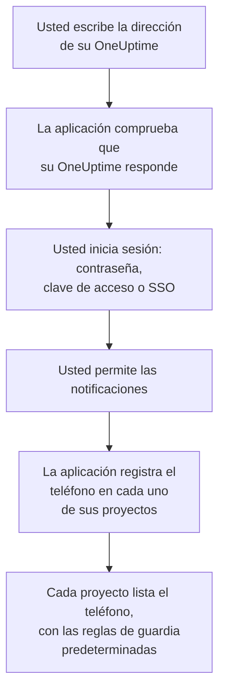
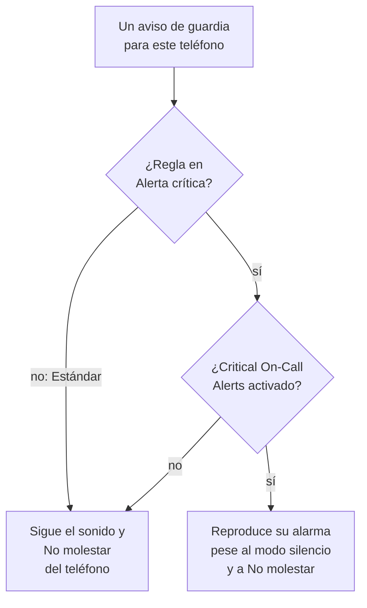

# Instalación en Android

Instale **OneUptime On-Call** en un teléfono o tableta Android, conéctela a su OneUptime e inicie sesión. Después envíese una notificación de prueba, y deje que los avisos de guardia urgentes suenen pese al modo silencio y a No molestar.

:::cards
- [Instalar la aplicación](#instalar-la-aplicación): Desde Google Play, o el APK en un teléfono sin Google Play.
- [Iniciar sesión](#iniciar-sesión): La dirección de su OneUptime, y después su cuenta.
- [Comprobar que los avisos llegan al teléfono](#comprobar-que-los-avisos-llegan-al-teléfono): Encontrar el teléfono en el panel y probarlo.
- [Sonar pese al modo silencio](#sonar-pese-al-modo-silencio): Las alertas críticas y el sonido de alarma.
- [Solución de problemas](#solución-de-problemas): Problemas de inicio de sesión, notificaciones e instalación.
:::

## Antes de empezar

- Un teléfono o tableta con Android 7.0 o posterior.
- Una cuenta en un proyecto de OneUptime. Para recibir avisos, también debe estar de guardia: consulte [Reglas de escalado](/docs/on-call/escalation-rules).
- La dirección de su OneUptime: `https://oneuptime.com` en OneUptime Cloud, o la suya, por ejemplo `https://oneuptime.example.com`. La aplicación solo se conecta por HTTPS.

## Instalar la aplicación

:::tabs
@tab Google Play
1. En el teléfono, abra [OneUptime On-Call en Google Play](https://play.google.com/store/apps/details?id=com.oneuptime.oncall), o busque OneUptime On-Call en Google Play.
2. Toque **Instalar** y después **Abrir**.

Google Play mantiene la aplicación actualizada.
@tab APK
Para un teléfono sin Google Play. El APK se compila a partir del mismo código para cada versión de OneUptime y se adjunta a esa versión en GitHub.

1. En el teléfono, abra [el APK más reciente](https://github.com/OneUptime/oneuptime/releases/latest/download/oneuptime-on-call-android-app.apk).
2. Abra el archivo descargado. Si Android lo pide, permita que su navegador instale aplicaciones desconocidas, y después toque **Instalar**.
3. Abra OneUptime On-Call desde sus aplicaciones.

Un APK no se actualiza solo: instale de vez en cuando el más reciente encima. Su inicio de sesión y sus ajustes se conservan.
:::

## Iniciar sesión

:::steps
### Escribir la dirección de su OneUptime
Abra la aplicación. En **Connect your workspace**, mantenga `https://oneuptime.com` para OneUptime Cloud, o escriba la dirección de su propio OneUptime, y toque **Connect**. La aplicación continúa en cuanto `https://<your-oneuptime>/api/status` responde.

### Iniciar sesión en su cuenta
Use la forma en que inicia sesión su cuenta:

- Su correo electrónico y su contraseña, y después **Sign In**. **Forgot password?** le envía por correo un enlace para establecer una nueva.
- **Sign in with a passkey**, una vez que haya añadido una en el panel: consulte [Añadir una clave de acceso](/docs/introduction/your-account#añadir-una-llave-de-acceso). Su navegador se abre para confirmarla y después le devuelve a la aplicación.
- **Sign in with SSO**, si su organización usa inicio de sesión único. Elija su proveedor, o escriba su correo de trabajo y toque **Continue**. Se abre un navegador seguro, y vuelve a la aplicación en cuanto ha iniciado sesión.

Con la autenticación en dos factores activada, escriba el código de seis dígitos de su aplicación de autenticación, o uno de sus códigos de respaldo. Una llave de seguridad no se puede usar en la aplicación. Si su administrador exige la autenticación en dos factores y usted aún no la ha configurado, la aplicación configura primero con usted una aplicación de autenticación.

### Permitir las notificaciones
Cuando Android pregunte si OneUptime On-Call puede enviar notificaciones, toque **Permitir**. Android 13 y posteriores lo preguntan; las versiones anteriores las permiten mientras usted no las desactive.

Después, la aplicación registra el teléfono en cada uno de sus proyectos. Cada proyecto lo lista entre sus dispositivos push, con las reglas de guardia predeterminadas, para que sus avisos le lleguen a partir de ahora.
:::

La aplicación muestra un proyecto a la vez: toque el nombre del proyecto en la parte superior de una pantalla para cambiar. Un proyecto que exige inicio de sesión único aparece como **SSO Required** en **Settings → Manage Projects** hasta que toque allí **Authenticate with SSO**.

## Comprobar que los avisos llegan al teléfono

:::steps
### Encontrar el teléfono en el panel
En el panel, abra **Ajustes de usuario → Métodos de notificación** y la pestaña **Push Notifications**. El teléfono aparece en **Dispositivos de notificaciones push** con el nombre de su modelo. Cada proyecto mantiene su propia lista.

### Enviar una prueba
Haga clic en **Notificación de prueba** en la fila del teléfono. Llega una notificación al teléfono; tóquela para abrir la aplicación.
:::

Sus reglas de guardia deciden qué avisos van al teléfono, y con qué rapidez: consulte **Ajustes de usuario → Reglas de guardia**. Un teléfono nuevo recibe las mismas reglas predeterminadas que cualquier otro método que añada.

## Sonar pese al modo silencio

De forma predeterminada, un aviso de guardia sigue los ajustes de sonido del teléfono: un teléfono silenciado se queda callado, y No molestar retiene el aviso. Las alertas críticas hacen que los avisos de guardia suenen pese a ambos. Están desactivadas hasta que las active, teléfono por teléfono.

:::steps
### Activar Critical On-Call Alerts
En la aplicación, abra **Settings** y active **Critical On-Call Alerts** en **Notifications**.

### Permitir el acceso a No molestar
Android abre su lista **Acceso a No molestar**. Active el acceso para OneUptime On-Call y vuelva a la aplicación: comprueba el acceso e indica bajo el interruptor si los avisos sonarán.

### Elegir un sonido de alarma
Toque **Alarm sound** bajo el interruptor. Además del sonido propio del teléfono, ofrece Klaxon, Siren, Digital alarm, Smoke alarm y Rising alarm, que empieza suave y va subiendo. Toque reproducir junto a un sonido para escucharlo. Un aviso crítico suena con el volumen de alarma del teléfono, así que manténgalo alto.
:::

Solo suenan de todos modos los avisos de guardia, y solo los de reglas de guardia en **Alerta crítica**, el valor predeterminado. Una regla en **Estándar** sigue los ajustes del teléfono diga lo que diga el interruptor, así que puede despertarle un incidente crítico y avisarle en silencio de uno menor. Envíe una **Notificación de prueba** con el teléfono silenciado para oír lo que hará un aviso.

## Evitar que los avisos lleguen tarde

OneUptime envía los avisos de guardia con prioridad alta, que Android entrega incluso a un teléfono inactivo desde hace horas. Un teléfono que restringe el uso de batería de la aplicación aún puede retenerlos:

- Abra **Ajustes → Aplicaciones → OneUptime On-Call → Batería** y elija **Sin restricciones**. Algunos teléfonos lo llaman **Uso de batería de la aplicación**.
- Compruebe que las notificaciones de la aplicación están activadas, en **Ajustes → Aplicaciones → OneUptime On-Call → Notificaciones**.
- Deje OneUptime On-Call fuera de cualquier lista de ahorro de batería o de aplicaciones en suspensión que tenga su teléfono.

## Bloquear la aplicación

Active **Biometrics Login** en **Settings** dentro de la aplicación, y le pedirá su huella, su cara o el bloqueo de pantalla del teléfono cada vez que se inicie. El interruptor aparece cuando el teléfono tiene configurado el desbloqueo con huella o con cara. **Appearance**, en la misma pantalla, elige el aspecto claro u oscuro, o sigue al teléfono.

## Actualizar, cerrar sesión o desinstalar

- **Actualizar.** Google Play actualiza la aplicación. Con el APK, instale encima el más reciente. La versión de la aplicación aparece al final de su pantalla **Settings**.
- **Cerrar sesión.** **Settings → Log Out** cierra su sesión y quita el teléfono de sus dispositivos push en cada proyecto, junto con sus reglas de guardia. Si vuelve a iniciar sesión, vuelve con las reglas predeterminadas.
- **Desinstalar.** Quite la aplicación como cualquier otra. Si seguía con la sesión iniciada, el teléfono sigue en su lista hasta que falla un push hacia él: OneUptime lo marca entonces como **No recibe notificaciones**. Elimine esa entrada con **Eliminar**: si reinstala la aplicación e inicia sesión, el teléfono se añade como una entrada nueva, con las reglas predeterminadas.

## Solución de problemas

:::details «Could not connect to the server»
La aplicación no pudo llegar a `https://<your-oneuptime>/api/status`. Compruebe la dirección, incluido `https://`. Si su OneUptime está en una red privada, conecte antes el teléfono a ella, por ejemplo a través de su VPN. Abra esa dirección en el navegador del teléfono: muestra `{"status":"ok"}` cuando el teléfono puede llegar a OneUptime.
:::

:::details No llegan notificaciones
- Compruebe en los ajustes de Android que las notificaciones de la aplicación están activadas, y que No molestar está desactivado o las alertas críticas activadas.
- Compruebe que el teléfono aparece en **Push Notifications** en **Ajustes de usuario → Métodos de notificación**, y envíele una **Notificación de prueba**.
- Si el teléfono está marcado como **No recibe notificaciones**, abra la aplicación con la sesión iniciada. Vuelve a registrar el teléfono; consulte [Cuando un teléfono tiene que volver a registrarse](/docs/mobile-desktop-apps/faq-troubleshooting#cuando-un-teléfono-tiene-que-volver-a-registrarse).
- Compruebe sus reglas de guardia en **Ajustes de usuario → Reglas de guardia**.
- En un OneUptime autoalojado, compruebe que su servidor llega a su relé push: consulte [Notificaciones push](/docs/self-hosted/push-notifications#acceso-de-red).
:::

:::details Las alertas críticas no suenan con No molestar
Abra **Settings** en la aplicación: la línea bajo **Critical On-Call Alerts** dice qué falta. Lo habitual es que no se permitiera el acceso a No molestar: permítalo en **Ajustes → Notificaciones → Acceso a No molestar** y vuelva a la aplicación. Si eligió un sonido de alarma, el canal de notificación de ese sonido también debe poder saltarse No molestar.
:::

:::details «Aplicación no instalada» al instalar el APK
OneUptime On-Call ya está en el teléfono desde otra fuente, como Google Play, y Android no instala una encima de la otra. Desinstálela, instale el APK y vuelva a iniciar sesión.
:::

:::details No hay interruptor Biometrics Login
El interruptor aparece cuando el desbloqueo con huella o con cara está configurado en los ajustes de Android.
:::

## Próximos pasos

:::cards
- [Preguntas frecuentes y solución de problemas](/docs/mobile-desktop-apps/faq-troubleshooting): Qué hacer cuando un teléfono deja de recibir avisos.
- [Instalación en iOS](/docs/mobile-desktop-apps/ios-installation): La misma aplicación en un iPhone o iPad.
- [Reglas de escalado](/docs/on-call/escalation-rules): Decidir a quién se avisa, y cuándo.
- [Notificaciones push](/docs/self-hosted/push-notifications): Cómo un OneUptime autoalojado envía los avisos a los teléfonos.
:::
