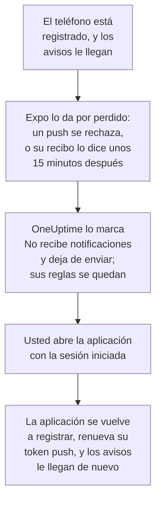

# Preguntas frecuentes y solución de problemas

Respuestas a preguntas frecuentes sobre las aplicaciones móvil y de escritorio de OneUptime, y soluciones a lo que falla más a menudo: el inicio de sesión, las notificaciones que no llegan y un teléfono que tiene que volver a registrarse.

:::cards
- [Preguntas sobre la aplicación móvil](#preguntas-sobre-la-aplicación-móvil): Dispositivos, proyectos, autoalojamiento y seguridad.
- [Preguntas sobre la aplicación de escritorio](#preguntas-sobre-la-aplicación-de-escritorio): Qué es la aplicación de escritorio, y qué no puede hacer.
- [Cuando un teléfono tiene que volver a registrarse](#cuando-un-teléfono-tiene-que-volver-a-registrarse): Por qué un teléfono deja de recibir avisos, y cómo vuelve.
- [Solución de problemas](#solución-de-problemas): Problemas de inicio de sesión, notificaciones e instalación.
:::

## Preguntas sobre la aplicación móvil

:::details ¿La aplicación es gratuita?
Sí. OneUptime On-Call es gratuita en el App Store, en Google Play y como APK en GitHub. Inicia sesión con su cuenta de OneUptime.
:::

:::details ¿En qué teléfonos y tabletas funciona?
En iPhones y iPads con iOS o iPadOS 16.4 o posterior, y en teléfonos y tabletas Android con Android 7.0 o posterior.
:::

:::details ¿Funciona con un OneUptime autoalojado?
Sí. Escriba la dirección `https://` de su OneUptime cuando se inicie la aplicación, o toque **Change Server** en la pantalla de inicio de sesión. De forma predeterminada, su servidor envía los avisos a los teléfonos a través del relé push de OneUptime, así que no necesita cuenta de Apple, Google ni Expo: consulte [Notificaciones push](/docs/self-hosted/push-notifications).
:::

:::details ¿Puedo usarla con varios proyectos?
Sí. La aplicación registra el teléfono en cada proyecto del que usted es miembro, así que cada proyecto puede avisarle. Muestra un proyecto a la vez: toque el nombre del proyecto en la parte superior de una pantalla para cambiar.
:::

:::details ¿Puedo iniciar sesión en más de un teléfono?
Sí. Cada teléfono o tableta es un dispositivo push propio, con sus propias reglas de guardia y su propio ajuste de alertas críticas.
:::

:::details ¿Qué puedo hacer en la aplicación?
- **Home**: lo que requiere atención en el proyecto: incidentes y alertas activos, casos de seguridad abiertos si su rol le permite verlos, monitores con problemas y eventos agrupados.
- **Monitors**: todos los monitores, filtrados por estado, con sus detalles.
- **Inbox**: incidentes y alertas, y los episodios que los agrupan. Abra uno para usar **Acknowledge**, **Resolve** o **Add Note**. Si su rol le permite ver los casos de seguridad del proyecto, **Security** lista los abiertos: abra uno para usar **Approve** o **Reject** en un paso de playbook que espera aprobación, hacerse cargo del caso con **Assign to me** o usar **Close case**.
- **On-Call**: si está de guardia y hasta cuándo, quién más lo está, los avisos que le enviaron, y **Cover for me**, que pasa sus avisos a un compañero durante un tiempo.
- **Settings**: sus proyectos y el inicio de sesión único, la apariencia, las alertas críticas y el sonido de alarma, **Biometrics Login**, su feed de calendario de guardias y **Log Out**.

Todo lo demás está en el panel.
:::

:::details ¿Puedo reconocer un aviso desde la notificación?
No. Toque la notificación: la aplicación abre el incidente, la alerta, el episodio o el caso de seguridad del que se trata, en el proyecto correcto, y lo reconoce allí. Si la aplicación está bloqueada o usted no ha iniciado sesión, abre el aviso en cuanto entra.
:::

:::details ¿Mi inicio de sesión está seguro en el teléfono?
La aplicación habla con su OneUptime solo por HTTPS. Su inicio de sesión se guarda en el almacenamiento propio de la aplicación en el teléfono, y **Log Out** lo borra y también cierra la sesión en el servidor. Active **Biometrics Login** para que la aplicación pida su cara, su huella o su código cada vez que se inicie.
:::

:::details ¿La aplicación funciona sin conexión?
No. Sin conexión muestra **No internet connection** en la parte superior de la pantalla, y continúa en cuanto vuelve la conexión.
:::

## Preguntas sobre la aplicación de escritorio

:::details ¿Qué es la aplicación de escritorio?
El panel de OneUptime, instalado desde su navegador como una aplicación: una ventana propia, un icono en el menú Inicio, el Dock o su lanzador, y notificaciones. Hace todo lo que hace el panel, porque es el panel.
:::

:::details ¿Por qué no está en ninguna tienda de aplicaciones?
No lo necesita. La aplicación carga el panel desde su OneUptime cada vez que se abre, así que siempre es la versión que ejecuta su OneUptime, en Windows, macOS y Linux por igual, sin nada que actualizar.
:::

:::details ¿Puede despertarme como el teléfono?
No. Los navegadores no pueden saltarse No molestar ni un modo de concentración, así que una notificación de escritorio no suena más de lo que permite el equipo. Para los avisos que deben despertarle, use la aplicación móvil con alertas críticas.
:::

:::details ¿Funciona sin conexión?
No. Necesita una conexión con su OneUptime, como el panel en una pestaña del navegador.
:::

## Cuando un teléfono tiene que volver a registrarse

OneUptime envía los avisos de un teléfono a través de Expo, que los entrega a Apple o Google. Cuando Expo dice que el teléfono ya no está localizable, OneUptime deja de enviarle nada, hasta que la aplicación lo vuelve a registrar.

Expo da un teléfono por perdido cuando se quitó la aplicación de él, o cuando su token push ya no es válido. El teléfono no se borra: **Ajustes de usuario → Métodos de notificación**, en la pestaña **Push Notifications**, lo muestra como **No recibe notificaciones**, y la cronología de guardia de un aviso que no le llegó dice por qué. Sus otros teléfonos y métodos de notificación reciben avisos como siempre.

La aplicación registra el teléfono cada vez que se inicia, cuando inicia sesión, y cuando vuelve a ella, como mucho una vez cada cinco minutos. Al registrarse vuelve a pedir el token push a Expo, lo que lo renueva, y el teléfono vuelve a recibir avisos con las reglas que tenía.

| Qué pasó | Qué hacer | Qué hace OneUptime |
| --- | --- | --- |
| La aplicación sigue instalada | Ábrala con la sesión iniciada | El teléfono vuelve a recibir notificaciones, con sus reglas |
| Reinstaló la aplicación en un iPhone o iPad | Instálela e inicie sesión | Normalmente vuelve la misma entrada, con sus reglas |
| Reinstaló la aplicación en Android | Instálela, inicie sesión y elimine la entrada antigua | Una entrada nueva con las reglas predeterminadas; la antigua sigue marcada |
| Un teléfono nuevo, configurado desde una copia de seguridad del antiguo | Abra la aplicación en el teléfono nuevo | Si la entrada del teléfono antiguo está marcada, el nuevo la toma, con sus reglas; si no, el teléfono nuevo recibe una entrada propia |
| Un teléfono nuevo, configurado desde cero | Inicie sesión y elimine la entrada antigua | Una entrada nueva con las reglas predeterminadas |
| Cerró la sesión en la aplicación | Vuelva a iniciar sesión | Cerrar sesión quitó el teléfono y sus reglas; vuelve con las reglas predeterminadas |

Un navegador también puede dejar de recibir notificaciones, cuando caduca su suscripción push. El panel la renueva cuando puede; si el navegador sigue marcado, vuelva a registrarlo con **Registrar dispositivo** en ese navegador.

## Solución de problemas

### Inicio de sesión

:::details «Could not connect to the server»
La aplicación no pudo llegar a `https://<your-oneuptime>/api/status`. Compruebe la dirección, incluido `https://`: la aplicación no se conecta por HTTP simple. Si su OneUptime está en una red privada, conecte antes el teléfono a ella, por ejemplo a través de su VPN. Abierta en el navegador del teléfono, esa dirección muestra `{"status":"ok"}` cuando el teléfono puede llegar a OneUptime.
:::

:::details «No SSO configuration found for the email»
Ninguno de los proyectos de los que es miembro ese correo tiene configurado el inicio de sesión único, o el correo no tiene cuenta en este OneUptime. Compruebe el correo, o inicie sesión con su contraseña. Los proveedores que su administrador configuró para toda la instalación aparecen antes del campo de correo.
:::

:::details Una llave de seguridad es su único segundo factor
La aplicación no puede usar una llave de seguridad. Inicie sesión con uno de sus códigos de respaldo, o añada una aplicación de autenticación a su cuenta en el panel: consulte [Activar la autenticación en dos factores](/docs/introduction/your-account#activar-la-autenticación-de-dos-factores).
:::

:::details El inicio de sesión con clave de acceso falla
Las claves de acceso necesitan que la dirección de su OneUptime empiece por `https://`, y una clave de acceso añadida para ese OneUptime: consulte [Añadir una clave de acceso](/docs/introduction/your-account#añadir-una-llave-de-acceso). Para usar otro servidor, toque **Change Server** en la pantalla de inicio de sesión.
:::

### Notificaciones

:::details No hay notificaciones en el teléfono
- Compruebe que el teléfono permite las notificaciones de OneUptime On-Call, y que No molestar o un modo de concentración no las retiene.
- En **Ajustes de usuario → Métodos de notificación**, pestaña **Push Notifications**, compruebe que el teléfono aparece, y envíele una **Notificación de prueba**.
- Si está marcado como **No recibe notificaciones**, abra la aplicación con la sesión iniciada: consulte [Cuando un teléfono tiene que volver a registrarse](#cuando-un-teléfono-tiene-que-volver-a-registrarse).
- Compruebe sus reglas de guardia en **Ajustes de usuario → Reglas de guardia**: deciden qué avisos llegan a qué método.
- En un OneUptime autoalojado, compruebe que el servidor llega a su relé push: consulte [Notificaciones push](/docs/self-hosted/push-notifications#acceso-de-red).
:::

:::details Los avisos llegan tarde en Android
Ponga el uso de batería de la aplicación en **Sin restricciones** en los ajustes de Android para OneUptime On-Call, y deje la aplicación fuera de cualquier lista de ahorro de batería: consulte [Evitar que los avisos lleguen tarde](/docs/mobile-desktop-apps/android-installation#evitar-que-los-avisos-lleguen-tarde).
:::

:::details Las alertas críticas no suenan pese al modo silencio
Abra **Settings** en la aplicación: la línea bajo **Critical On-Call Alerts** dice qué falta en ese teléfono. Después compruebe en **Ajustes de usuario → Reglas de guardia** que la regla de guardia que envió el aviso está en **Alerta crítica**, no en **Estándar**. Cada teléfono tiene su propio interruptor.
:::

### Aplicación de escritorio

:::details No hay icono de instalación en la barra de direcciones
Instale desde una página del panel después de iniciar sesión, por `https://`, en Edge o Chrome, o en Safari en macOS Sonoma 14 o posterior. Si el icono no aparece, el menú del navegador también la instala: consulte [Instalación en Windows](/docs/mobile-desktop-apps/windows-installation#instalar-la-aplicación).
:::

:::details No hay notificaciones de escritorio
Registre el navegador en **Ajustes de usuario → Métodos de notificación**, pestaña **Push Notifications**, con **Registrar dispositivo**, permita las notificaciones cuando se le pida, y revise los ajustes de notificaciones del propio equipo. Un OneUptime autoalojado necesita sus claves VAPID para las notificaciones del navegador.
:::

## Obtener ayuda

Si algo de aquí no coincide con lo que ve, [abra un issue en GitHub](https://github.com/OneUptime/oneuptime/issues) con la versión de su aplicación, al final de su pantalla **Settings**, y la plataforma que usa.

## Próximos pasos

:::cards
- [Visión general de las aplicaciones](/docs/mobile-desktop-apps/index): Qué aplicación usar, y cómo llegan a OneUptime.
- [Instalación en Android](/docs/mobile-desktop-apps/android-installation): Instalar y configurar la aplicación en Android.
- [Instalación en iOS](/docs/mobile-desktop-apps/ios-installation): Instalar y configurar la aplicación en un iPhone o iPad.
- [Notificaciones push](/docs/self-hosted/push-notifications): Cómo un OneUptime autoalojado envía los avisos, y los errores de Expo.
:::
