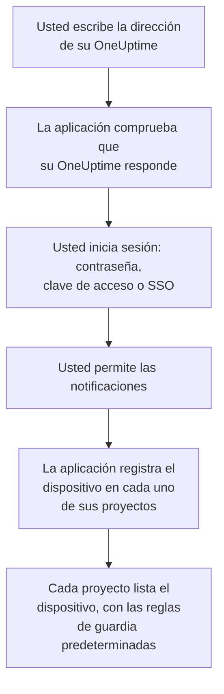

# Instalación en iOS

Instale **OneUptime On-Call** desde el App Store en un iPhone o iPad, conéctela a su OneUptime e inicie sesión. Después envíese una notificación de prueba, y deje que los avisos de guardia urgentes suenen pese al modo silencio y a los modos de concentración.

:::cards
- [Instalar la aplicación](#instalar-la-aplicación): Desde el App Store.
- [Iniciar sesión](#iniciar-sesión): La dirección de su OneUptime, y después su cuenta.
- [Comprobar que los avisos llegan al dispositivo](#comprobar-que-los-avisos-llegan-al-dispositivo): Encontrarlo en el panel y probarlo.
- [Sonar pese al modo silencio](#sonar-pese-al-modo-silencio): Las alertas críticas, el sonido de alarma y su volumen.
- [Solución de problemas](#solución-de-problemas): Problemas de inicio de sesión, notificaciones y alertas críticas.
:::

## Antes de empezar

- Un iPhone o iPad con iOS 16.4 o posterior, o iPadOS 16.4 o posterior.
- Una cuenta en un proyecto de OneUptime. Para recibir avisos, también debe estar de guardia: consulte [Reglas de escalado](/docs/on-call/escalation-rules).
- La dirección de su OneUptime: `https://oneuptime.com` en OneUptime Cloud, o la suya, por ejemplo `https://oneuptime.example.com`. La aplicación solo se conecta por HTTPS.

## Instalar la aplicación

1. En el iPhone o iPad, abra [OneUptime On-Call en el App Store](https://apps.apple.com/us/app/oneuptime-on-call/id6759615391), o busque OneUptime On-Call en el App Store.
2. Toque **Obtener** y confirme con Face ID, Touch ID o la contraseña de su cuenta de Apple.
3. Toque **Abrir**, o abra OneUptime On-Call desde la pantalla de inicio.

El App Store mantiene la aplicación actualizada mientras **Actualizaciones de apps** esté activado, en **Ajustes → App Store**.

## Iniciar sesión



:::steps
### Escribir la dirección de su OneUptime
Abra la aplicación. En **Connect your workspace**, mantenga `https://oneuptime.com` para OneUptime Cloud, o escriba la dirección de su propio OneUptime, y toque **Connect**. La aplicación continúa en cuanto `https://<your-oneuptime>/api/status` responde.

### Iniciar sesión en su cuenta
Use la forma en que inicia sesión su cuenta:

- Su correo electrónico y su contraseña, y después **Sign In**. **Forgot password?** le envía por correo un enlace para establecer una nueva.
- **Sign in with a passkey**, una vez que haya añadido una en el panel: consulte [Añadir una clave de acceso](/docs/introduction/your-account#añadir-una-llave-de-acceso). Se abre una hoja del navegador para confirmarla y después le devuelve a la aplicación.
- **Sign in with SSO**, si su organización usa inicio de sesión único. Elija su proveedor, o escriba su correo de trabajo y toque **Continue**. Se abre un navegador seguro, y vuelve a la aplicación en cuanto ha iniciado sesión.

Con la autenticación en dos factores activada, escriba el código de seis dígitos de su aplicación de autenticación, o uno de sus códigos de respaldo. Una llave de seguridad no se puede usar en la aplicación. Si su administrador exige la autenticación en dos factores y usted aún no la ha configurado, la aplicación configura primero con usted una aplicación de autenticación.

### Permitir las notificaciones
Cuando iOS pregunte si OneUptime On-Call puede enviarle notificaciones, toque **Permitir**.

Después, la aplicación registra el iPhone o iPad en cada uno de sus proyectos. Cada proyecto lo lista entre sus dispositivos push, con las reglas de guardia predeterminadas, para que sus avisos le lleguen a partir de ahora.
:::

La aplicación muestra un proyecto a la vez: toque el nombre del proyecto en la parte superior de una pantalla para cambiar. Un proyecto que exige inicio de sesión único aparece como **SSO Required** en **Settings → Manage Projects** hasta que toque allí **Authenticate with SSO**.

## Comprobar que los avisos llegan al dispositivo

:::steps
### Encontrar el dispositivo en el panel
En el panel, abra **Ajustes de usuario → Métodos de notificación** y la pestaña **Push Notifications**. El iPhone o iPad aparece en **Dispositivos de notificaciones push** con el nombre de su modelo. Cada proyecto mantiene su propia lista.

### Enviar una prueba
Haga clic en **Notificación de prueba** en la fila del dispositivo. Llega una notificación al dispositivo; tóquela para abrir la aplicación.
:::

Sus reglas de guardia deciden qué avisos van al dispositivo, y con qué rapidez: consulte **Ajustes de usuario → Reglas de guardia**. Un dispositivo nuevo recibe las mismas reglas predeterminadas que cualquier otro método que añada.

## Sonar pese al modo silencio

De forma predeterminada, un aviso de guardia sigue los ajustes de sonido del dispositivo: el modo silencio lo deja callado, y un modo de concentración como No molestar lo retiene. Las alertas críticas hacen que los avisos de guardia suenen pese a ambos. Están desactivadas hasta que las active, dispositivo por dispositivo.

```mermaid title="Si un aviso de guardia suena de todos modos en un iPhone o iPad"
flowchart TB
    Page["Un aviso de guardia<br/>para este dispositivo"]
    Rule{"¿Regla en<br/>Alerta crítica?"}
    Device{"¿Critical On-Call<br/>Alerts activado?"}
    Quiet["Sigue el sonido y la<br/>concentración del<br/>dispositivo"]
    Loud["Reproduce su alarma,<br/>a su volumen, pese<br/>al modo silencio y<br/>la concentración"]
    Page --> Rule
    Rule -->|"no: Estándar"| Quiet
    Rule -->|"sí"| Device
    Device -->|"no"| Quiet
    Device -->|"sí"| Loud
```

:::steps
### Activar Critical On-Call Alerts
En la aplicación, abra **Settings** y active **Critical On-Call Alerts** en **Notifications**.

### Permitir las alertas críticas
Cuando iOS pregunte si OneUptime On-Call puede enviar alertas críticas, toque **Permitir**. iOS añade entonces un interruptor **Alertas críticas** para la aplicación en **Ajustes → Notificaciones → OneUptime On-Call**, donde podrá cambiar de opinión más adelante. La línea bajo el interruptor de la aplicación indica si los avisos sonarán.

### Elegir un sonido de alarma y su volumen
Toque **Alarm sound** bajo el interruptor. Además del sonido de alerta crítica propio del dispositivo, ofrece Klaxon, Siren, Digital alarm, Smoke alarm y Rising alarm, que empieza suave y va subiendo. Toque reproducir junto a un sonido para escucharlo. Después elija el volumen al que suena un aviso: 25 %, 50 %, 75 % o 100 %, el valor predeterminado.
:::

Solo suenan de todos modos los avisos de guardia, y solo los de reglas de guardia en **Alerta crítica**, el valor predeterminado. Una regla en **Estándar** sigue los ajustes del dispositivo diga lo que diga el interruptor, así que puede despertarle un incidente crítico y avisarle en silencio de uno menor. Envíe una **Notificación de prueba** con el dispositivo en silencio para oír lo que hará un aviso. La vista previa de la pantalla **Alarm sound** suena al volumen del timbre, y no suena en silencio; un aviso real suena pese al modo silencio con el volumen que eligió.

> [!NOTE]
> Las alertas críticas necesitan OneUptime On-Call 1.5.0 o posterior del App Store. Las versiones anteriores se compilaron sin el permiso de Apple para alertas críticas, así que iOS nunca les ofreció el interruptor.

## Evitar que los avisos se retengan

Sin alertas críticas, un modo de concentración o un resumen pueden retener los avisos:

- **Concentración.** Añada OneUptime On-Call a las apps que permite cada modo de concentración, en **Ajustes → Concentración**.
- **Resumen programado.** Deje OneUptime On-Call fuera de él, en **Ajustes → Notificaciones → Resumen programado**: una notificación del resumen espera a la siguiente hora del resumen.
- **Notificaciones.** Mantenga activado **Permitir notificaciones**, en **Ajustes → Notificaciones → OneUptime On-Call**.

## Bloquear la aplicación

Active **Biometrics Login** en **Settings** dentro de la aplicación, y le pedirá Face ID, Touch ID o su código cada vez que se inicie. El interruptor aparece cuando Face ID o Touch ID están configurados en el dispositivo. **Appearance**, en la misma pantalla, elige el aspecto claro u oscuro, o sigue al dispositivo.

## Actualizar, cerrar sesión o eliminar la aplicación

- **Actualizar.** El App Store actualiza la aplicación; también puede actualizarla desde su cuenta en el App Store. La versión de la aplicación aparece al final de su pantalla **Settings**.
- **Cerrar sesión.** **Settings → Log Out** cierra su sesión y quita el dispositivo de sus dispositivos push en cada proyecto, junto con sus reglas de guardia. Si vuelve a iniciar sesión, vuelve con las reglas predeterminadas.
- **Eliminar.** Mantenga pulsado el icono de la aplicación y toque **Eliminar app** y luego **Eliminar app** otra vez para confirmar. Si seguía con la sesión iniciada, el dispositivo sigue en su lista hasta que falla un push hacia él: OneUptime lo marca entonces como **No recibe notificaciones**. Si reinstala la aplicación e inicia sesión, esa entrada suele volver, con sus reglas; si ya no usa el dispositivo, elimine la entrada con **Eliminar**.

## Solución de problemas

:::details «Could not connect to the server»
La aplicación no pudo llegar a `https://<your-oneuptime>/api/status`. Compruebe la dirección, incluido `https://`. Si su OneUptime está en una red privada, conecte antes el dispositivo a ella, por ejemplo a través de su VPN. Abra esa dirección en Safari en el dispositivo: muestra `{"status":"ok"}` cuando el dispositivo puede llegar a OneUptime.
:::

:::details No llegan notificaciones
- Compruebe que **Permitir notificaciones** está activado en **Ajustes → Notificaciones → OneUptime On-Call**, y que ningún modo de concentración retiene los avisos.
- Compruebe que el dispositivo aparece en **Push Notifications** en **Ajustes de usuario → Métodos de notificación**, y envíele una **Notificación de prueba**.
- Si el dispositivo está marcado como **No recibe notificaciones**, abra la aplicación con la sesión iniciada. Vuelve a registrar el dispositivo; consulte [Cuando un teléfono tiene que volver a registrarse](/docs/mobile-desktop-apps/faq-troubleshooting#cuando-un-teléfono-tiene-que-volver-a-registrarse).
- Compruebe sus reglas de guardia en **Ajustes de usuario → Reglas de guardia**.
- En un OneUptime autoalojado, compruebe que su servidor llega a su relé push: consulte [Notificaciones push](/docs/self-hosted/push-notifications#acceso-de-red).
:::

:::details No hay interruptor Alertas críticas en los Ajustes de iOS
Active primero **Critical On-Call Alerts** en la aplicación: iOS solo añade su interruptor después de que la aplicación haya pedido las alertas críticas. Si la aplicación dice que esta versión no puede recibir alertas críticas, actualice OneUptime On-Call desde el App Store.
:::

:::details Las alertas críticas no suenan
Abra **Settings** en la aplicación: la línea bajo **Critical On-Call Alerts** dice qué falta. Compruebe que **Alertas críticas** está activado en **Ajustes → Notificaciones → OneUptime On-Call**, y que el volumen de la pantalla **Alarm sound** de la aplicación no está bajo.
:::

:::details No hay interruptor Biometrics Login
El interruptor aparece cuando Face ID o Touch ID están configurados en **Ajustes → Face ID y código** o **Ajustes → Touch ID y código**.
:::

## Próximos pasos

:::cards
- [Preguntas frecuentes y solución de problemas](/docs/mobile-desktop-apps/faq-troubleshooting): Qué hacer cuando un teléfono deja de recibir avisos.
- [Instalación en Android](/docs/mobile-desktop-apps/android-installation): La misma aplicación en Android.
- [Reglas de escalado](/docs/on-call/escalation-rules): Decidir a quién se avisa, y cuándo.
- [Notificaciones push](/docs/self-hosted/push-notifications): Cómo un OneUptime autoalojado envía los avisos a los teléfonos.
:::
