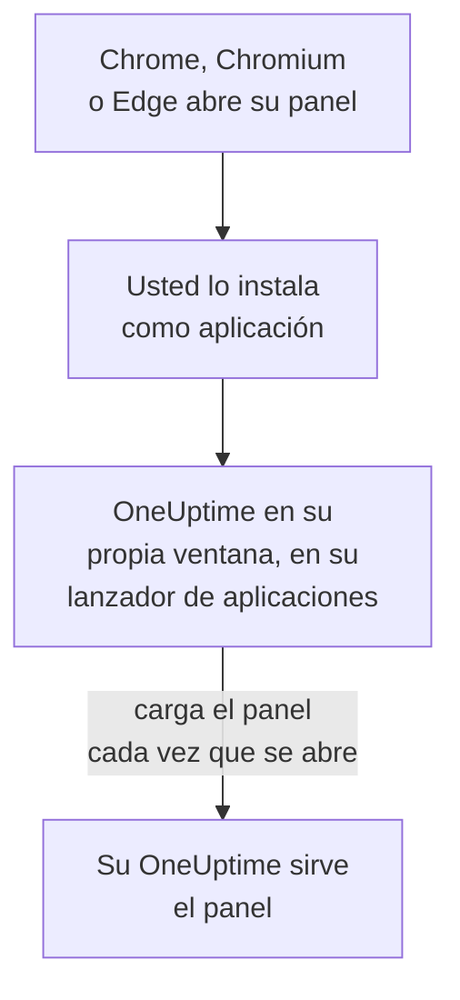

# Instalación en Linux

El panel de OneUptime se instala en Linux como una aplicación, desde Google Chrome, Chromium o Microsoft Edge. Se abre en su propia ventana, con su propia entrada en el lanzador de aplicaciones de su escritorio, y puede mostrar notificaciones. No hay nada que descargar: la aplicación es el panel de su OneUptime, y está al día en cuanto lo está su OneUptime.

:::cards
- [Instalar la aplicación](#instalar-la-aplicación): Desde Chrome, Chromium o Edge.
- [Abrirla desde su lanzador](#abrirla-desde-su-lanzador): Como cualquier otra aplicación de escritorio.
- [Recibir notificaciones en este equipo](#recibir-notificaciones-en-este-equipo): Registrar el navegador para las notificaciones push.
- [Solución de problemas](#solución-de-problemas): Sin icono de instalación, sin notificaciones, sin entrada en el lanzador.
:::

## Cómo funciona la aplicación de escritorio

La aplicación instalada comparte el inicio de sesión, los ajustes y el permiso de notificaciones de su navegador. Cierre el navegador y la aplicación sigue funcionando en su propia ventana.

## Antes de empezar

- Un escritorio Linux con un Google Chrome, Chromium o Microsoft Edge reciente.
- La dirección de su OneUptime, por HTTPS: `https://oneuptime.com` en OneUptime Cloud, o la suya, por ejemplo `https://oneuptime.example.com`.
- Una cuenta con la que pueda iniciar sesión en el panel.

## Instalar la aplicación

:::tabs
@tab Chrome
1. Abra su OneUptime en Chrome o Chromium e inicie sesión.
2. En cualquier página del panel, haga clic en el icono de instalación a la derecha de la barra de direcciones y después en **Instalar**. O abra **⋮ → Enviar, guardar y compartir → Instalar página como aplicación…**.
3. Chrome abre OneUptime en su propia ventana y lo añade a su lanzador de aplicaciones.
@tab Edge
1. Abra su OneUptime en Edge e inicie sesión.
2. En cualquier página del panel, haga clic en el icono de instalación a la derecha de la barra de direcciones y después en **Instalar**. O abra **Configuración y más (…) → Más herramientas → Aplicaciones → Instalar este sitio como una aplicación**.
3. Edge abre OneUptime en su propia ventana y lo añade a su lanzador de aplicaciones.
:::

Instale desde una página del panel, después de iniciar sesión: la página de inicio de sesión no es la aplicación.

## Abrirla desde su lanzador

El navegador añade una entrada de escritorio para la aplicación, un archivo `.desktop` en `~/.local/share/applications`, para que OneUptime aparezca en GNOME, KDE Plasma y otros lanzadores. Ánclela allí a su dock o panel, como cualquier otra aplicación.

## Recibir notificaciones en este equipo

La aplicación muestra notificaciones a través de su navegador, una vez que registra el navegador para las notificaciones push en cada proyecto del que quiera recibirlas.

:::steps
### Abrir sus dispositivos push
En la aplicación, abra **Ajustes de usuario → Métodos de notificación** y la pestaña **Push Notifications**.

### Registrar este navegador
Haga clic en **Registrar dispositivo**, mantenga el valor sugerido en **Nombre del dispositivo**, por ejemplo `Chrome on Linux`, o cámbielo, y vuelva a hacer clic en **Registrar dispositivo**. Cuando el navegador pregunte si OneUptime puede mostrar notificaciones, elija **Permitir**.

### Enviar una prueba
En el cuadro de diálogo **Browser Registered**, haga clic en **Send Test Notification**. Su escritorio la muestra a través de su servicio de notificaciones; si no aparece nada, consulte [Solución de problemas](#solución-de-problemas).
:::

Un navegador no puede sonar pese al No molestar de su escritorio. Para los avisos que deben despertarle, use la aplicación móvil con alertas críticas: consulte [Instalación en Android](/docs/mobile-desktop-apps/android-installation#sonar-pese-al-modo-silencio).

En un OneUptime autoalojado, las notificaciones del navegador necesitan las claves VAPID del servidor: consulte [Notificaciones push](/docs/self-hosted/push-notifications#configuración-autoalojada).

## Actualizaciones

No hay nada que actualizar. La aplicación carga el panel desde su OneUptime cada vez que se abre, así que cambia cuando se actualiza su OneUptime. Si una ventana lleva abierta desde la actualización, recárguela con Ctrl+R.

## Desinstalar

:::tabs
@tab Chrome
En la ventana de la aplicación, abra el menú **⋮**, elija la opción que desinstala la aplicación y después **Quitar**.
@tab Edge
Abra `edge://apps` en Edge, elija **Detalles** en OneUptime y después **Desinstalar**.
:::

Desinstalar la aplicación no da de baja su navegador: sigue recibiendo notificaciones. Para detenerlas, elimine el navegador en **Ajustes de usuario → Métodos de notificación**, en la pestaña **Push Notifications**, con **Eliminar**.

## Solución de problemas

:::details No hay icono de instalación en la barra de direcciones
Abra una página del panel después de iniciar sesión, no la página de inicio de sesión, y compruebe que la dirección empieza por `https://`: los navegadores solo instalan aplicaciones de sitios seguros. Si el icono sigue sin aparecer, use el menú del navegador como arriba. Otros navegadores quizá no instalen sitios como aplicaciones; use Chrome, Chromium o Edge.
:::

:::details No aparecen notificaciones
- En **Ajustes de usuario → Métodos de notificación**, pestaña **Push Notifications**, compruebe que este navegador aparece, y envíele una **Notificación de prueba**.
- Compruebe que el No molestar de su escritorio está desactivado y que sus ajustes de notificaciones permiten el navegador.
- Si el navegador bloquea las notificaciones de OneUptime, haga clic en el icono a la izquierda de la barra de direcciones, permita las notificaciones del sitio y vuelva a registrar el navegador.
- En un OneUptime autoalojado, el cuadro de diálogo **Registrar dispositivo** indica cuándo el servidor no tiene claves VAPID.
:::

:::details La aplicación no está en el lanzador
Ábrala desde el navegador: `chrome://apps` en Chrome o Chromium, `edge://apps` en Edge. Un lanzador que solo lee las entradas de escritorio al iniciar sesión la muestra después de cerrar sesión y volver a entrar.
:::

## Próximos pasos

:::cards
- [Instalación en Android](/docs/mobile-desktop-apps/android-installation): Recibir los avisos en su teléfono, con alertas críticas.
- [Instalación en Windows](/docs/mobile-desktop-apps/windows-installation): La misma aplicación en Windows.
- [Preguntas frecuentes y solución de problemas](/docs/mobile-desktop-apps/faq-troubleshooting): Respuestas sobre las dos aplicaciones.
- [Su cuenta](/docs/introduction/your-account): Cómo le contacta OneUptime en cada proyecto.
:::
