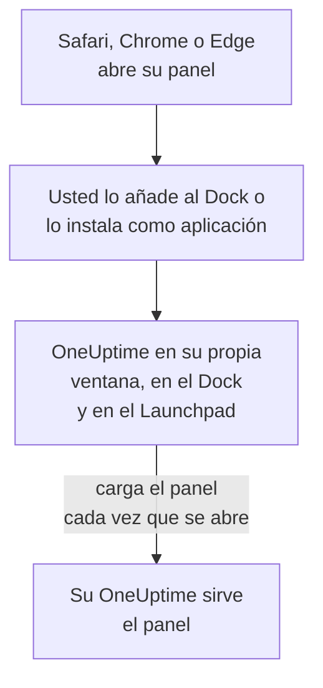

# Instalación en macOS

El panel de OneUptime se instala en un Mac como una aplicación: añádalo al Dock desde Safari, o instálelo desde Google Chrome o Microsoft Edge. Se abre en su propia ventana, con su propio icono en el Dock y en el Launchpad, y puede mostrar notificaciones. No hay nada que descargar: la aplicación es el panel de su OneUptime, y está al día en cuanto lo está su OneUptime.

:::cards
- [Instalar la aplicación](#instalar-la-aplicación): Desde Safari, Chrome o Edge.
- [Mantenerla en el Dock](#mantenerla-en-el-dock): Abrirla con un clic, o al iniciar sesión.
- [Recibir notificaciones en este Mac](#recibir-notificaciones-en-este-mac): Registrar la aplicación para las notificaciones push.
- [Solución de problemas](#solución-de-problemas): Sin Añadir al Dock, sin notificaciones, volver a iniciar sesión.
:::

## Cómo funciona la aplicación de escritorio

Una app web de Safari tiene su propio inicio de sesión, sus cookies y sus ajustes, aparte de Safari. Una aplicación instalada desde Chrome o Edge los comparte con ese navegador.

## Antes de empezar

- macOS Sonoma 14 o posterior para Safari. Chrome y Edge instalan aplicaciones en cualquier macOS donde funcionen.
- La dirección de su OneUptime, por HTTPS: `https://oneuptime.com` en OneUptime Cloud, o la suya, por ejemplo `https://oneuptime.example.com`.
- Una cuenta con la que pueda iniciar sesión en el panel.

## Instalar la aplicación

:::tabs
@tab Safari
1. Abra su OneUptime en Safari e inicie sesión.
2. En cualquier página del panel, elija **Archivo → Añadir al Dock**, o haga clic en el botón Compartir de la barra de herramientas y después en **Añadir al Dock**.
3. Mantenga el nombre o cámbielo, y haga clic en **Añadir**.
4. Abra OneUptime desde el Dock e inicie sesión una vez más: la app web no comparte el inicio de sesión de Safari.
@tab Chrome
1. Abra su OneUptime en Chrome e inicie sesión.
2. En cualquier página del panel, haga clic en el icono de instalación a la derecha de la barra de direcciones y después en **Instalar**. O abra **⋮ → Enviar, guardar y compartir → Instalar página como aplicación…**.
3. Chrome abre OneUptime en su propia ventana y lo añade al Launchpad.
@tab Edge
1. Abra su OneUptime en Edge e inicie sesión.
2. En cualquier página del panel, haga clic en el icono de instalación a la derecha de la barra de direcciones y después en **Instalar**. O abra **Configuración y más (…) → Más herramientas → Aplicaciones → Instalar este sitio como una aplicación**.
3. Edge abre OneUptime en su propia ventana y lo añade al Launchpad.
:::

Instale desde una página del panel, después de iniciar sesión: la página de inicio de sesión no es la aplicación. Safari guarda la app web en la carpeta Aplicaciones de su carpeta de inicio.

## Mantenerla en el Dock

- **Dock.** Con la aplicación abierta, haga clic con la tecla Control pulsada en su icono del Dock y elija **Opciones → Mantener en el Dock**. Una app web de Safari ya está en el Dock.
- **Abrir al iniciar sesión.** Haga clic con la tecla Control pulsada en el icono del Dock y elija **Opciones → Abrir al iniciar sesión**.
- **Spotlight.** Pulse Comando + Espacio y escriba OneUptime.

## Recibir notificaciones en este Mac

La aplicación muestra notificaciones una vez que la registra para las notificaciones push, en cada proyecto del que quiera recibirlas. Registre la app web de Safari desde dentro de la app web: es un navegador por sí misma. Una aplicación instalada desde Chrome o Edge se registra con su navegador.

:::steps
### Abrir sus dispositivos push
En la aplicación, abra **Ajustes de usuario → Métodos de notificación** y la pestaña **Push Notifications**.

### Registrar esta aplicación
Haga clic en **Registrar dispositivo**, mantenga el valor sugerido en **Nombre del dispositivo**, por ejemplo `Safari on macOS`, o cámbielo, y vuelva a hacer clic en **Registrar dispositivo**. Cuando macOS o el navegador pregunten si OneUptime puede enviar notificaciones, elija **Permitir**.

### Enviar una prueba
En el cuadro de diálogo **Browser Registered**, haga clic en **Send Test Notification**. Si no aparece nada, revise los ajustes de notificaciones del Mac: consulte [Solución de problemas](#solución-de-problemas).
:::

Un navegador no puede sonar pese a un modo de concentración como No molestar. Para los avisos que deben despertarle, use la aplicación móvil con alertas críticas: consulte [Instalación en iOS](/docs/mobile-desktop-apps/ios-installation#sonar-pese-al-modo-silencio).

En un OneUptime autoalojado, las notificaciones del navegador necesitan las claves VAPID del servidor: consulte [Notificaciones push](/docs/self-hosted/push-notifications#configuración-autoalojada).

## Actualizaciones

No hay nada que actualizar. La aplicación carga el panel desde su OneUptime cada vez que se abre, así que cambia cuando se actualiza su OneUptime. Si una ventana lleva abierta desde la actualización, recárguela con Comando + R.

## Desinstalar

:::tabs
@tab Safari
En el Finder, abra su carpeta de inicio, después su carpeta Aplicaciones, y arrastre OneUptime a la Papelera.
@tab Chrome
En la ventana de la aplicación, abra el menú **⋮**, elija la opción que desinstala la aplicación y después **Quitar**.
@tab Edge
Abra `edge://apps` en Edge, elija **Detalles** en OneUptime y después **Desinstalar**.
:::

Desinstalar la aplicación no la da de baja: su navegador sigue recibiendo notificaciones. Para detenerlas, elimínela en **Ajustes de usuario → Métodos de notificación**, en la pestaña **Push Notifications**, con **Eliminar**.

## Solución de problemas

:::details No hay Añadir al Dock en Safari
Safari añade apps web al Dock a partir de macOS Sonoma 14. Actualice macOS, o instale la aplicación desde Chrome o Edge.
:::

:::details No aparecen notificaciones
- En **Ajustes de usuario → Métodos de notificación**, pestaña **Push Notifications**, compruebe que la aplicación o su navegador aparece, y envíele una **Notificación de prueba**.
- En el Mac, abra **Ajustes del Sistema → Notificaciones** y compruebe que OneUptime, o el navegador desde el que se instaló, puede enviar notificaciones, y que ningún modo de concentración las retiene.
- Si el navegador bloquea las notificaciones de OneUptime, permítalas en sus ajustes para el sitio y vuelva a registrar.
- En un OneUptime autoalojado, el cuadro de diálogo **Registrar dispositivo** indica cuándo el servidor no tiene claves VAPID.
:::

:::details La aplicación le pide volver a iniciar sesión
Una app web de Safari tiene su propio inicio de sesión: inicie sesión dentro de la aplicación. Una aplicación instalada desde Chrome o Edge comparte el inicio de sesión de su navegador, así que cerrar sesión en el navegador, o borrar sus cookies, también cierra su sesión.
:::

## Próximos pasos

:::cards
- [Instalación en iOS](/docs/mobile-desktop-apps/ios-installation): Recibir los avisos en su iPhone, con alertas críticas.
- [Instalación en Windows](/docs/mobile-desktop-apps/windows-installation): La misma aplicación en Windows.
- [Preguntas frecuentes y solución de problemas](/docs/mobile-desktop-apps/faq-troubleshooting): Respuestas sobre las dos aplicaciones.
- [Su cuenta](/docs/introduction/your-account): Cómo le contacta OneUptime en cada proyecto.
:::
