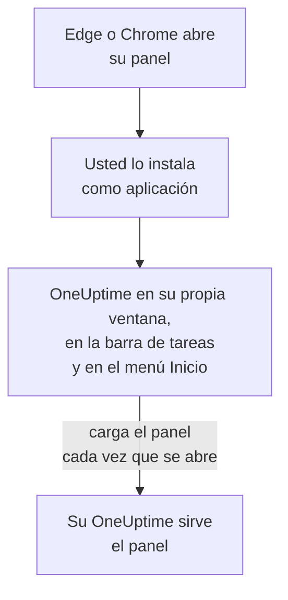

# Instalación en Windows

El panel de OneUptime se instala en Windows como una aplicación, desde Microsoft Edge o Google Chrome. Se abre en su propia ventana, con su propio icono en la barra de tareas y en el menú Inicio, y puede mostrar notificaciones. No hay nada que descargar: la aplicación es el panel de su OneUptime, y está al día en cuanto lo está su OneUptime.

:::cards
- [Instalar la aplicación](#instalar-la-aplicación): Desde Edge o Chrome, en unos pocos clics.
- [Anclarla e iniciarla con Windows](#anclarla-e-iniciarla-con-windows): Tenerla a un clic.
- [Recibir notificaciones en este equipo](#recibir-notificaciones-en-este-equipo): Registrar el navegador para las notificaciones push.
- [Solución de problemas](#solución-de-problemas): Sin icono de instalación, sin notificaciones, volver a iniciar sesión.
:::

## Cómo funciona la aplicación de escritorio

La aplicación instalada comparte el inicio de sesión, los ajustes y el permiso de notificaciones de su navegador. Cierre el navegador y la aplicación sigue funcionando en su propia ventana.

## Antes de empezar

- Windows 10 o Windows 11, con un Microsoft Edge o Google Chrome reciente.
- La dirección de su OneUptime, por HTTPS: `https://oneuptime.com` en OneUptime Cloud, o la suya, por ejemplo `https://oneuptime.example.com`.
- Una cuenta con la que pueda iniciar sesión en el panel.

## Instalar la aplicación

:::tabs
@tab Edge
1. Abra su OneUptime en Edge e inicie sesión.
2. En cualquier página del panel, haga clic en el icono de instalación a la derecha de la barra de direcciones y después en **Instalar**. O abra **Configuración y más (…) → Más herramientas → Aplicaciones → Instalar este sitio como una aplicación**.
3. Edge abre OneUptime en su propia ventana, y puede ofrecerle anclarlo a la barra de tareas o a Inicio.
@tab Chrome
1. Abra su OneUptime en Chrome e inicie sesión.
2. En cualquier página del panel, haga clic en el icono de instalación a la derecha de la barra de direcciones y después en **Instalar**. O abra **⋮ → Enviar, guardar y compartir → Instalar página como aplicación…**.
3. Chrome abre OneUptime en su propia ventana y lo añade al menú Inicio.
:::

Instale desde una página del panel, después de iniciar sesión: la página de inicio de sesión no es la aplicación. Busque OneUptime en el menú Inicio para abrirla más tarde.

## Anclarla e iniciarla con Windows

- **Barra de tareas.** Con la aplicación abierta, haga clic con el botón derecho en su icono de la barra de tareas y elija **Anclar a la barra de tareas**.
- **Iniciar con Windows.** En Edge, abra `edge://apps`, elija **Detalles** en OneUptime y active **Inicio automático al iniciar sesión en el dispositivo**. La misma página ancla la aplicación a la barra de tareas o a Inicio, o pone un acceso directo en el escritorio.

## Recibir notificaciones en este equipo

La aplicación muestra notificaciones a través de su navegador, una vez que registra el navegador para las notificaciones push en cada proyecto del que quiera recibirlas.

:::steps
### Abrir sus dispositivos push
En la aplicación, abra **Ajustes de usuario → Métodos de notificación** y la pestaña **Push Notifications**.

### Registrar este navegador
Haga clic en **Registrar dispositivo**, mantenga el valor sugerido en **Nombre del dispositivo**, por ejemplo `Edge on Windows`, o cámbielo, y vuelva a hacer clic en **Registrar dispositivo**. Cuando el navegador pregunte si OneUptime puede mostrar notificaciones, elija **Permitir**.

### Enviar una prueba
En el cuadro de diálogo **Browser Registered**, haga clic en **Send Test Notification**. Si no aparece nada, revise los ajustes de notificaciones de Windows: consulte [Solución de problemas](#solución-de-problemas).
:::

Un navegador no suena más fuerte de lo que Windows le permite: no puede saltarse No molestar. Para los avisos que deben despertarle, use la aplicación móvil con alertas críticas: consulte [Instalación en Android](/docs/mobile-desktop-apps/android-installation#sonar-pese-al-modo-silencio) o [Instalación en iOS](/docs/mobile-desktop-apps/ios-installation#sonar-pese-al-modo-silencio).

En un OneUptime autoalojado, las notificaciones del navegador necesitan las claves VAPID del servidor: consulte [Notificaciones push](/docs/self-hosted/push-notifications#configuración-autoalojada).

## Actualizaciones

No hay nada que actualizar. La aplicación carga el panel desde su OneUptime cada vez que se abre, así que cambia cuando se actualiza su OneUptime. Si una ventana lleva abierta desde la actualización, recárguela con Ctrl+R.

## Desinstalar

:::tabs
@tab Edge
Abra `edge://apps`, elija **Detalles** en OneUptime y después **Desinstalar**.
@tab Chrome
En la ventana de la aplicación, abra el menú **⋮**, elija la opción que desinstala la aplicación y después **Quitar**.
:::

Windows también lista la aplicación en **Configuración → Aplicaciones → Aplicaciones instaladas**, donde **Desinstalar** también la quita.

Desinstalar la aplicación no da de baja su navegador: sigue recibiendo notificaciones. Para detenerlas, elimine el navegador en **Ajustes de usuario → Métodos de notificación**, en la pestaña **Push Notifications**, con **Eliminar**.

## Solución de problemas

:::details No hay icono de instalación en la barra de direcciones
Abra una página del panel después de iniciar sesión, no la página de inicio de sesión, y compruebe que la dirección empieza por `https://`: los navegadores solo instalan aplicaciones de sitios seguros. Si el icono sigue sin aparecer, use el menú del navegador como arriba. Otros navegadores quizá no instalen sitios como aplicaciones; use Edge o Chrome.
:::

:::details No aparecen notificaciones
- En **Ajustes de usuario → Métodos de notificación**, pestaña **Push Notifications**, compruebe que este navegador aparece, y envíele una **Notificación de prueba**.
- En Windows, abra **Configuración → Sistema → Notificaciones**: las notificaciones deben estar activadas, también para el navegador, y No molestar desactivado. Windows 10 llama a la página «Notificaciones y acciones».
- Si el navegador bloquea las notificaciones de OneUptime, haga clic en el icono a la izquierda de la barra de direcciones, permita las notificaciones del sitio y vuelva a registrar el navegador.
- En un OneUptime autoalojado, el cuadro de diálogo **Registrar dispositivo** indica cuándo el servidor no tiene claves VAPID.
:::

:::details La aplicación le pide volver a iniciar sesión
La aplicación comparte el inicio de sesión de su navegador. Cerrar sesión en el navegador, o borrar sus cookies, también cierra la sesión de la aplicación.
:::

## Próximos pasos

:::cards
- [Instalación en macOS](/docs/mobile-desktop-apps/macos-installation): La misma aplicación en un Mac.
- [Instalación en Android](/docs/mobile-desktop-apps/android-installation): Recibir los avisos en su teléfono.
- [Preguntas frecuentes y solución de problemas](/docs/mobile-desktop-apps/faq-troubleshooting): Respuestas sobre las dos aplicaciones.
- [Su cuenta](/docs/introduction/your-account): Cómo le contacta OneUptime en cada proyecto.
:::
