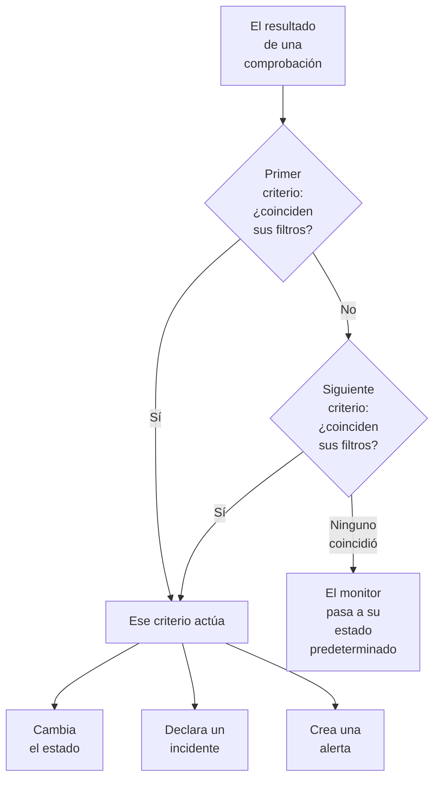
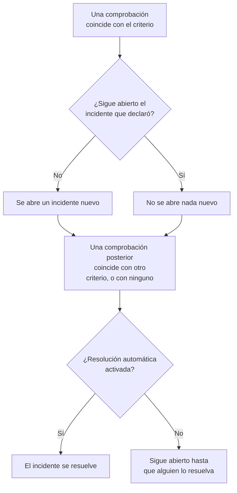

# Criterios y estados

Los criterios de un monitor deciden qué significa cada comprobación: si el monitor está en línea o caído, y si OneUptime declara un incidente o crea una alerta. Los estados son la lista de su proyecto con lo que puede ser un monitor, de **Operativo** a **Sin conexión**. Esta página explica ambos para cada tipo de monitor; la página de cada tipo enumera los filtros que ofrece.

:::cards
- [Cómo deciden los criterios](#cómo-deciden-los-criterios): De arriba abajo, y gana la primera coincidencia.
- [Qué contiene un criterio](#qué-contiene-un-criterio): Filtros, una condición de coincidencia, acciones y ajustes.
- [Juzgar una ventana de comprobaciones](#juzgar-una-ventana-de-comprobaciones): Contar comprobaciones fallidas, detectar inestabilidad, leer un percentil.
- [Cambiar los criterios de un monitor](#cambiar-los-criterios-de-un-monitor): Editar, añadir, reordenar y probar criterios.
- [Estados del monitor](#estados-del-monitor): Los estados predefinidos y los estados propios.
:::

## Cómo deciden los criterios

Cada vez que se comprueba un monitor, sus criterios juzgan el resultado de arriba abajo de la lista. El primer criterio cuyos filtros coinciden decide qué ocurre, y los criterios que están debajo no se examinan en esa comprobación. Si ninguno coincide, el monitor pasa a su **Estado de monitor predeterminado**. En cambio, conserva su estado mientras un criterio que lo devuelve aún no haya coincidido: consulte [Cuándo se recupera un criterio](#cuándo-se-recupera-un-criterio).

El orden forma parte de la regla. Un monitor nuevo enumera sus criterios del peor caso al mejor: sin conexión, después una advertencia si su tipo la tiene (un certificado o un dominio que caduca pronto) y después en línea. Un criterio sano y amplio, como **En línea** en **Verdadero**, coincide con casi todas las comprobaciones, así que va el último: por encima de los demás, coincidiría primero cada vez y los demás nunca actuarían.

Un criterio que coincide pero no cambia ningún estado sigue decidiendo la comprobación: el monitor conserva su estado, y los criterios de debajo esperan a la siguiente comprobación. El **Estado de monitor predeterminado** solo se aplica cuando ningún criterio coincide. En un monitor nuevo es **Operativo**; cámbielo en **Más campos**, debajo de los criterios.

> [!NOTE]
> Un monitor que abre un incidente o una alerta por host, contenedor, disco o interfaz juzga todos los criterios en cada comprobación, de modo que dos hosts pueden coincidir con dos criterios distintos a la vez. Es un monitor cuya consulta tiene un **Agrupar por**, como un monitor de métricas o de registros, o un criterio que indica `*` para cada disco o interfaz. También lo es un monitor de métricas que vigila una expresión PromQL: cada serie que devuelve la expresión se juzga por separado. Un monitor de solicitudes entrantes que agrupa incidentes por un campo de la carga útil sigue deteniéndose en la primera coincidencia.
>
> Un monitor así sigue teniendo un solo estado, que fija el primer criterio que coincide. Un criterio que solo lo devuelve a su **Estado de monitor predeterminado**, sin abrir ningún incidente ni alerta, espera a los hosts que cumplieron un criterio que fija otro estado: coincide cuando cada uno de ellos lo cumple, hagan lo que hagan los demás hosts. Hasta entonces el monitor mantiene su estado, aunque no coincida ningún criterio, mientras los incidentes y alertas de cada host se siguen resolviendo por separado.

## Qué contiene un criterio

Abra un criterio: tiene un nombre y tres secciones, cada una de las cuales se pliega en un resumen de una línea.

| Parte | Qué contiene |
| --- | --- |
| **Nombre del criterio** | El nombre en la lista de criterios y en la causa raíz de cada incidente y alerta que abre el criterio. **Añadir criterios** da a un criterio nuevo el nombre de sus filtros, y el nombre los sigue hasta que usted escriba uno propio. |
| **Filtros** | Lo que debe mostrar la comprobación, como uno o varios filtros. Los monitores de Kubernetes y de métricas los llaman **Reglas de alerta**. |
| **Acciones** | Lo que ocurre cuando los filtros coinciden: cambiar el estado, crear una alerta, declarar un incidente o cualquier combinación. |
| **Ajustes** | **Habilitar este criterio**, una **Descripción** opcional, cuándo se recupera y cuándo se evalúa y, en los monitores de solicitudes entrantes, **Agrupa incidentes y alertas por un campo de la carga útil**. |

### Filtros

Un filtro lee un dato de la comprobación y lo compara: un **Tipo de filtro** (qué se lee, como **Código de estado de respuesta**), una **Condición de filtro** (cómo se compara, como **Mayor que**) y un **Valor**. Los monitores que comparan métricas, como los de Kubernetes y de métricas, piden en su lugar una **Condición** y un **Umbral**. Cada tipo de monitor ofrece sus propios tipos de filtro, enumerados en su página, por ejemplo [Monitor de sitio web](/docs/monitor/website-monitor#criterios-de-monitoreo).

A partir de dos filtros aparece debajo la **Condición de coincidencia**: **Todos** significa que todos los filtros deben coincidir, **Cualquiera** que basta con uno. Un criterio nuevo empieza en **Todos**.

Los filtros que miden cada comprobación, como **En línea**, **Código de estado de respuesta** y **Tiempo de respuesta (en ms)**, ofrecen **Evaluar estos criterios durante un periodo de tiempo**. Juzga una ventana de comprobaciones recientes en lugar de solo la última, y empieza con los últimos 5 minutos y **Todos los valores**, que solo coincide cuando todas las comprobaciones de la ventana han coincidido. La ventana puede durar hasta 24 horas y contar las comprobaciones, como explica [Juzgar una ventana de comprobaciones](#juzgar-una-ventana-de-comprobaciones). Consulte [Evaluar durante un periodo de tiempo](/docs/monitor/website-monitor#evaluar-durante-un-periodo-de-tiempo).

### Acciones

Cada acción es un interruptor en **Acciones**:

| Interruptor | Qué hace |
| --- | --- |
| **Cuando los filtros coinciden, cambiar el estado del monitor.** | Pasa el monitor al estado elegido en **Cambiar estado del monitor a**. |
| **Cuando los filtros coinciden, crear una alerta.** | Crea las alertas configuradas en **Crear alerta**. Una alerta avisa a su equipo y nunca aparece en una página de estado. |
| **Cuando los filtros coinciden, declarar un incidente.** | Declara los incidentes configurados en **Crear incidente**. Sus páginas de estado pueden mostrarlos. |

Un incidente o una alerta pide un título, una **Gravedad** y, plegados, una descripción, propietarios, etiquetas y políticas de guardia. Los títulos y las descripciones pueden incluir valores de la comprobación, como `{{monitorName}}`: consulte [Plantillas de incidentes y alertas](/docs/monitor/incident-alert-templating). Para avisar a alguien cuando el criterio coincide, elija una política en **Guardia**: consulte [Políticas de guardia](/docs/on-call/policies).

### Ajustes

**Habilitar este criterio** está activado en todo criterio nuevo. Desactívelo para conservar un criterio sin usarlo: se omite en cada comprobación, no cambia ningún estado, no abre nada y su cabecera muestra **Deshabilitado**.

**Agrupa incidentes y alertas por un campo de la carga útil** abre un incidente por cada valor encontrado en una solicitud entrante, de modo que una sola dirección de webhook puede mantener varios incidentes abiertos. Consulte [Activar la agrupación de incidentes](/docs/monitor/incoming-request-monitor#activar-la-agrupación-de-incidentes).

**Recuperarse solo cuando se cumpla una condición propia** y **Evaluar este criterio solo ciertos días y a ciertas horas** están desactivados en un criterio nuevo. Consulte [Cuándo se recupera un criterio](#cuándo-se-recupera-un-criterio) y [Solo ciertos días y a ciertas horas](#solo-ciertos-días-y-a-ciertas-horas).

## Juzgar una ventana de comprobaciones

Con **Evaluar estos criterios durante un periodo de tiempo** marcado, **Evaluar** indica cómo se juzgan las comprobaciones de la ventana, y **En el último período de** cuánto dura la ventana, de 2 minutos a 24 horas. La condición propia del filtro, como **En línea** en **Falso**, indica lo que debe mostrar cada comprobación.

| Evaluar | Coincide cuando |
| --- | --- |
| **Todos los valores** | Todas las comprobaciones de la ventana cumplieron la condición. |
| **Cualquier valor** | Al menos una comprobación de la ventana cumplió la condición. |
| **Promedio**, **Suma**, **Valor máximo**, **Valor mínimo** | Esa cifra de los valores de la ventana cumple la condición, como un tiempo de respuesta medio superior a 300 ms. |
| **Percentil** | El percentil elegido en **Percentil**, de p50 a p99, cumple la condición: p95 por encima de 300 ms significa que el 5 % más lento de las comprobaciones supera los 300 ms. |
| **Recuento** | El número de comprobaciones que cumplieron la condición se compara como se define en **Comprobaciones que coinciden**: **Mayor que** 30, por ejemplo. |
| **Porcentaje** | Su proporción entre las comprobaciones de la ventana se compara como se define en **Proporción de comprobaciones que coinciden**: **Mayor que** 10 %, por ejemplo. |
| **Cambios de estado** | Las veces que las comprobaciones pasaron de cumplir la condición a no cumplirla, o al revés, se comparan como se define en **Veces que cambió**. Un dispositivo que se cae y vuelve cambia dos veces. |

Una frase bajo la configuración de la ventana repite el filtro tal como está configurado: «Comprobar si "En línea" es falso en más de 30 comprobaciones del último período de 8 horas».

- **Cada sonda por separado.** **Recuento**, **Porcentaje** y **Cambios de estado** cuentan las comprobaciones de la sonda que hizo la comprobación, así que un monitor comprobado desde tres sondas no cuenta tres veces más rápido, y luego sus sondas deben coincidir como en cualquier criterio.
- **Una ventana que aún no está llena.** Hasta que las comprobaciones lleguen al inicio de la ventana, un monitor recién iniciado tiene menos comprobaciones de las que tendrá. **Recuento** y **Cambios de estado** coinciden pronto cuando ya superan **Mayor que** o **Mayor o igual que**, ya que más comprobaciones solo los aumentan; todo lo demás espera a una ventana llena.
- **Una ventana sin comprobaciones.** Mientras la ventana no tenga comprobaciones, o aún no esté llena, decide **Si no hay datos**: **Ignore** espera, **Disparador** coincide, y **Treat As Zero** la juzga como si las comprobaciones que faltan no hubieran cumplido la condición.

Los promedios y percentiles leen los valores de las comprobaciones de todas las sondas, como siempre ha hecho **Promedio**. **Recuento**, **Porcentaje** y **Cambios de estado** se ofrecen para cada filtro al que se le ofrece una ventana: en los monitores Website, API, Ping, IP y Port, para la CPU, la memoria, los discos y la carga de un servidor, para **Dispositivo SNMP en línea** y el tiempo de respuesta de un dispositivo de red, y en los monitores DNS, NTP, de base de datos, de página de estado externa y de estado de sondas. **En línea** de un monitor de servidor no se cuenta: se juzga por el tiempo desde el último informe del servidor. Los monitores de métricas y otros de telemetría juzgan en cambio el intervalo de tiempo de su consulta, con la agregación propia de la consulta, que también lee percentiles.

### Ejemplo: un punto de acceso caído y otro inestable

Un monitor Ping comprueba un punto de acceso de una oficina cada minuto. Antes de que las ventanas pudieran contar comprobaciones, un punto de acceso que se caía una y otra vez parecía uno caído, o nada en absoluto. Estos tres criterios, en este orden, distinguen los dos casos:

| Criterio | Filtro | Evaluar | Cambia el estado a |
| --- | --- | --- | --- |
| El punto de acceso está caído | **En línea** es **Falso** | **Todos los valores**, **En el último período de** 5 minutos | **Sin conexión**, y declara un incidente de caída |
| El punto de acceso es inestable | **En línea** es **Falso** | **Cambios de estado**, **Mayor que** 5, **En el último período de** 1 hora | **Degradado**, y declara un incidente de inestabilidad |
| El punto de acceso está en línea | **En línea** es **Verdadero** | No durante un período | **Operativo** |

Para el segundo, active **Recuperarse solo cuando se cumpla una condición propia** con **Cambios de estado**, **Menor o igual que** 1, **En el último período de** 1 hora: el incidente de inestabilidad sigue abierto hasta que el punto de acceso lleve una hora estable, en lugar de cerrarse el primer minuto en que responde. Para alertar cuando falle más de 30 pings en 8 horas, configure en cambio el segundo criterio con **Recuento**, **Mayor que** 30, **En el último período de** 8 horas.

## Cuándo se recupera un criterio

Un criterio deja de actuar en cuanto sus filtros dejan de coincidir: en esa comprobación se resuelven su incidente y su alerta, cuando **Resolver incidente automáticamente** y **Resolver alerta automáticamente** están activados, y el monitor pasa al siguiente criterio que coincida.

**Recuperarse solo cuando se cumpla una condición propia** mantiene el criterio en vigor después de que sus filtros dejen de coincidir, hasta que coincidan los filtros de **Se recupera cuando**. Empiezan como lo opuesto de los filtros del criterio, durante los últimos 10 minutos, y pueden usar todo lo que ofrece un filtro, como una ventana que cuenta comprobaciones. Un criterio está en vigor mientras el monitor tiene el estado que define o está abierto un incidente o una alerta que declaró. Mientras se mantiene, cuenta como una coincidencia en su lugar de la lista: un criterio por encima que coincida sigue tomando el control.

Cuando ningún criterio coincide, un monitor que un criterio sacó de su **Estado de monitor predeterminado** conserva el estado que tiene, siempre que también tenga un criterio que solo lo devuelva a ese estado y no abra nada. Ese es el margen de recuperación: las plantillas se disparan por encima del 90 % y vuelven al 81 % o menos, así que con el 89 % el monitor se queda donde está. Sus incidentes y alertas se siguen resolviendo cuando su propio criterio deja de coincidir. Un monitor sin un criterio así pasa a su **Estado de monitor predeterminado**, como siempre.

## Solo ciertos días y a ciertas horas

**Evaluar este criterio solo ciertos días y a ciertas horas** define los días, **Hora de inicio** y **Hora de finalización**, y **Zona horaria**, que empieza siendo la suya. Fuera de esas horas el criterio se omite como un criterio desactivado: no coincide con nada, así que lo que abrió se resuelve, y el registro de evaluación indica que estaba fuera de sus horas. Las horas se leen en el reloj de esa zona horaria, así que las 08:00 siguen siendo las 08:00 tras el cambio de hora, y las horas que terminan antes de empezar continúan hasta la mañana siguiente.

## Cuándo se abren y se cierran incidentes y alertas

Un criterio que declara incidentes abre uno cuando coincide. Cuando el monitor se recupera, el incidente se cierra solo si el criterio así lo indica.

- **Uno cada vez.** Mientras siga abierto un incidente que declaró un criterio, ese mismo criterio no declara otro al volver a coincidir. Las alertas funcionan igual. Un monitor que agrupa por host o por campo de la carga útil mantiene uno abierto por host o por valor, y un criterio de monitor de correo entrante con **Abrir un incidente nuevo por cada correo** abre uno por cada correo.
- **El cierre.** En una comprobación posterior en la que coincide otro criterio, o ninguno, se resuelve un incidente cuyo criterio tiene activado **Resolver incidente automáticamente**, y también una alerta con **Resolver alerta automáticamente**. Ambos están en **Más campos** dentro del incidente o la alerta, y los criterios con los que empieza un monitor nuevo los tienen activados.
- **Varias sondas.** Un monitor comprobado por más de una sonda solo cambia cuando sus sondas coinciden. Consulte [Cómo se evalúan los criterios](/docs/monitor/create-monitor#cómo-se-evalúan-los-criterios).
- **Un monitor padre caído.** En la página **Configuración → Dependencias** de un monitor, **Depende de los monitores** indica los monitores de los que depende. Mientras uno de ellos esté en un estado de **Suprimir cuando el estado del padre sea** (cualquier estado sin conexión, si se deja vacío), el monitor no abre incidentes ni alertas. Su estado sigue cambiando, y lo que está abierto se sigue resolviendo.
- **El mantenimiento programado.** Un monitor incluido en un evento de mantenimiento en curso no se comprueba, así que sus criterios no se ejecutan. Consulte [Visión general del mantenimiento programado](/docs/scheduled-maintenance/index).

Para ver cómo se juzgó una comprobación, abra la **Vista general** del monitor: la tarjeta **Resumen del monitor** muestra qué criterio coincidió y qué hizo cada uno, incluido un incidente que se omitió porque ya había uno abierto.

## Quién recibe aviso cuando falla

**Cuando falla** dice en pocas frases qué pasa cuando el monitor falla y a quién se avisa: el estado que establece, el incidente o la alerta que abre, quién recibe un correo y a quién avisa, por su nombre. Cada cosa que impediría avisar a alguien aparece en su propia línea, con un enlace a la página que la corrige. Está en la **Vista general** de un monitor, debajo de sus criterios en su página **Criterios**, en el paso de criterios de **Crear monitor** para el monitor que estás configurando, y en la configuración guiada de sitios web.

Calcula la cadena como lo hace un incidente o una alerta real: con las reglas del propietario, las reglas de privacidad, las reglas de etiquetas y las reglas de guardia de tu proyecto, la regla de incidentes de alertas que convierte una alerta en un incidente, y a quién alcanza ahora mismo la primera regla de escalamiento de cada política de guardia. Una regla de guardia que pregunta quién es el propietario de una alerta (**Propietario de la alerta**) se compara con los propietarios que tendrá la alerta: las personas y equipos que indican sus criterios, los propietarios del dispositivo de red que vigila el monitor y los que añaden las reglas del propietario. Una variable del título que solo rellena una comprobación se muestra tal como está escrita. **Mostrar la cadena** la abre fila por fila:

| Fila | Qué dice |
| --- | --- |
| **Estado** | El estado que establecen los criterios. |
| **Abre** | El incidente o la alerta, su gravedad entre paréntesis y su título. |
| **Correos** | A quién llega su correo de creación: sus propietarios, los que añaden las reglas del propietario, o los Propietarios del proyecto si no tiene ninguno. A quien el aviso de guardia alcanza primero no se le envía además el correo como propietario. |
| **Reglas del propietario** | Las reglas del propietario que añaden sus propietarios. |
| **Privado** | Por qué es privado: una regla de privacidad o los criterios. Un incidente privado no aparece en ninguna página de estado ni avisa a ningún suscriptor, y solo sus propietarios, los Propietarios del proyecto y los Administradores del proyecto pueden verlo. |
| **Reglas de etiquetas** | Las reglas de etiquetas cuyas etiquetas cambian qué reglas de guardia se activan. |
| **Reglas de guardia** | Las reglas de guardia que coinciden con él. Para una regla que compara quién es el propietario de una alerta, indica qué propietario hace que coincida. |
| **Política de guardia** | Cada política que activan esas reglas: a quién alcanza ahora mismo su primera regla de escalamiento y por qué medio, y a quién no alcanza, y por qué. |
| **Páginas de estado** | Las páginas de estado que lo muestran, cada una con el grupo de monitores a través del cual muestra el monitor. |
| **Regla de incidentes** | Para una alerta: la regla de incidentes de alertas que declara un incidente a partir de ella, de inmediato o cuando la alerta ha seguido abierta, y ese incidente, descrito como cualquier incidente. |

### Qué impide avisar a alguien

| Qué lo impide | Enlace |
| --- | --- |
| Ningún criterio cambia el estado ni abre un incidente o una alerta. | **Abrir criterios** |
| No se avisa a nadie: ninguna regla de guardia coincide, o el proyecto aún no tiene una política de guardia. | **Configurar avisos de guardia** |
| El monitor abre alertas, y solo los incidentes tienen reglas de guardia. | **Configurar avisos de guardia** |
| Una política de guardia no tiene reglas de escalamiento. | **Abrir política de guardia** |
| Una política de guardia no alcanza a nadie ahora mismo. | **Abrir política de guardia** |
| No se puede localizar a alguien a quien avisa una política: se dio de baja, no tiene ningún método verificado, o no tiene ninguna regla para la gravedad en un proyecto sin alternativa. | **Abrir preparación** |
| Los SMS, las llamadas, WhatsApp o Telegram están desactivados en el proyecto. | **Abrir canales de notificación** |
| Al proyecto no le queda saldo para SMS y llamadas (OneUptime Cloud). | **Abrir facturación** |
| El servidor aún no puede enviar correos ni SMS, ni hacer llamadas. | **Abrir el Panel de administración**, para los administradores del servidor |

Una alerta que una regla de incidentes de alertas convierte en un incidente que avisa a alguien no es una interrupción: se comprueban las políticas del incidente.

Los propietarios que no reciben correo aparecen después de las interrupciones, cada uno con el motivo y el lugar donde se indican: alguien que no es miembro del proyecto, un equipo sin nadie que lo sea (**Abrir equipo**), o un equipo de otro proyecto, indicado en los criterios (**Abrir criterios**), en el dispositivo de red que vigila el monitor (**Abrir dispositivo de red**) o por una regla del propietario (**Abrir reglas del propietario**). El correo se envía igualmente, a los propietarios a los que llega o a los Propietarios del proyecto, así que no son interrupciones. La salud de la configuración también los muestra, como algo que conviene corregir.

### Volver a comprobar, y lo que puedes ver

La respuesta tiene como mucho un minuto, y **Volver a comprobar** la vuelve a calcular. Si una nueva comprobación falla, la tarjeta conserva la última respuesta y explica debajo por qué.

La tarjeta solo nombra lo que puedes leer. Una política de guardia, una regla, una página de estado o un grupo de monitores que no puedes ver conserva su lugar sin su nombre, y un incidente o una alerta privados que no podrás ver solo dicen que se abren y que son privados.

## Qué conserva un incidente o una alerta de la comprobación

Un incidente o una alerta que abre un monitor conserva la comprobación que lo abrió, para que pueda ver el porqué mucho después de que se borren los registros del propio monitor. Bajo su causa raíz, la sección **Detalles de la evaluación** nombra el criterio que coincidió y, para cada filtro que coincidió, qué encontró la comprobación. **Mostrar detalles** añade el resto de las pruebas, los filtros que no coincidieron y la propia comprobación: la solicitud, cuándo se ejecutó, desde qué sonda y qué se recibió. Lo que encontró un filtro puede ser:

- **El campo.** Dónde coincidió un filtro **Cuerpo de la respuesta** en un cuerpo JSON, como `checks[1].status`, o el encabezado en el que coincidió un filtro **Valor del encabezado de respuesta**.
- **Los valores.** Lo que contenía cada valor que lee una **Expresión de JavaScript** cuando se evaluó, como `responseBody.status = "down"`.
- **Un extracto.** Un fragmento corto de la respuesta alrededor de la coincidencia, con la coincidencia marcada: nunca el cuerpo entero.

Los secretos y los datos personales se enmascaran antes de conservar nada: encabezados como `Authorization`, `Cookie` y `Set-Cookie`, campos cuyo nombre dice `password`, `token`, `key`, `session` o `email`, y texto que parece un token bearer, un JWT, un número de tarjeta o una dirección de correo electrónico. La URL de la solicitud es la configurada en el monitor, así que `{{monitorSecrets.NAME}}` sigue siendo un nombre, y un valor secreto de la consulta se enmascara. Los **Registros de monitoreo** del monitor, y cualquier valor que cite una causa raíz, se enmascaran de la misma forma. Un incidente o una alerta abiertos a mano, o antes de que se conservaran los detalles de la evaluación, no los tienen.

> [!TIP]
> Cuando las respuestas de un monitor de sitio web o de API sean sensibles en sí mismas, desactive **Conservar el contenido de la respuesta** en la tarjeta **Contenido de la respuesta** de su página **Avanzado → Ajustes**. Sus registros de monitoreo, incidentes y alertas conservarán entonces qué filtros coincidieron, el código de estado y el tiempo de respuesta, y ninguna parte de la respuesta. Un monitor de solicitudes entrantes tiene el mismo interruptor para las solicitudes que recibe: **Conservar el contenido de la solicitud**, en la tarjeta **Contenido de la solicitud**. El interruptor se aplica a las comprobaciones que se ejecuten, y a los incidentes y alertas que se abran, después de cambiarlo. La última solicitud en la vista general de un monitor de solicitudes entrantes sigue el interruptor al instante.

## Cuánto tarda cada comprobación

El resumen de evaluación de cada comprobación, en **Ver resumen** dentro de los **Registros de monitoreo** del monitor y, para la última comprobación, en su **Vista general**, indica cuándo se evaluó la comprobación, cuánto tardó su evaluación y, en un monitor que juzga cada host, contenedor o grupo por separado, cuántas series evaluó. El tiempo va desde que OneUptime empezó a leer los datos que la comprobación juzga hasta que escribió su registro: la lectura de los datos, la evaluación de los criterios y la apertura de incidentes y alertas.

Cuando una evaluación tarda demasiado para su monitor, su resumen le avisa. Demasiado es más de una décima parte del tiempo entre las comprobaciones del monitor, nunca menos de 5 segundos y nunca más de un minuto:

| Monitor comprobado | Avisa a partir de |
| --- | --- |
| Cada minuto | 6 segundos |
| Cada 5 minutos | 30 segundos |
| Cada 10 minutos o con menos frecuencia | 1 minuto |
| Al llegar sus resultados, como solicitudes y correos entrantes | 5 segundos |

Una décima parte deja a un monitor margen para crecer diez veces antes de que sus comprobaciones se solapen y se retrasen, así que usted se entera pronto. Por debajo de 5 segundos, una comprobación está bien por grande que sea: evaluar 16.000 series lleva unos 2,5 segundos. Por encima de un minuto, ocupa un worker y las bases de datos que lee durante todo ese tiempo, sea cual sea su intervalo. Para acelerarla, acote los filtros de sus consultas, agrupe por menos atributos o compruébela con menos frecuencia.

## Cambiar los criterios de un monitor

:::steps
### Abrir la página de criterios

Vaya a **Monitores** y abra el monitor. Despliegue **Configuración** en su menú lateral y haga clic en **Criterios**. La tarjeta **Criterios** muestra cada criterio, qué comprueba y qué hace.

### Hacer clic en Editar criterios de monitoreo

El editor muestra cada criterio desplegado. Haga clic en la cabecera de un criterio para plegarlo en una línea: su nombre, cuántos filtros tiene y qué hace.

### Añadir, cambiar o reordenar criterios

**Añadir criterios** añade uno al final, desplegado y con el nombre de su filtro. Arrastre un criterio por el asa de su izquierda para moverlo: gana la primera coincidencia, así que ponga el peor caso primero. **Eliminar criterios** quita uno; un monitor conserva al menos un criterio.

### Guardar los criterios

Haga clic en **Guardar cambios**. La siguiente comprobación se juzga con los nuevos criterios.

### Probar el monitor

En un monitor que comprueban sondas, haga clic en **Probar monitor** en la tarjeta: la prueba empieza en una sonda que comprueba el monitor. Si quiere, elija otra en **Seleccionar sonda** y luego haga clic en **Ejecutar prueba**. **Resultado de la prueba del monitor** muestra lo que encontró la comprobación. También dice qué criterio cumple la respuesta y qué vendría después: el estado, el incidente o la alerta, y a quién se avisa.
:::

Un monitor manual no tiene criterios: usted fija su estado. Consulte [Actualizar el estado](/docs/monitor/manual-monitor#actualizar-el-estado).

## Estados del monitor

Un monitor siempre está en uno de los estados de su proyecto. Un proyecto nuevo tiene tres, del más sano al peor:

| Estado | Posición | Color | Qué hace OneUptime con él |
| --- | --- | --- | --- |
| **Operativo** | 1 | Verde | Los monitores nuevos empiezan en él, y es el **Estado de monitor predeterminado** de un monitor nuevo. Predefinido. |
| **Degradado** | 2 | Amarillo | Nada por sí mismo: un criterio suyo lleva un monitor hasta aquí. |
| **Sin conexión** | 3 | Rojo | El criterio sin conexión de un monitor nuevo lo lleva aquí, y OneUptime trata un monitor en este estado como caído. Predefinido. |

La lista es un orden. Donde los monitores se muestran juntos, gana el estado más bajo de la lista: un grupo de monitores, un grupo de una página de estado y el estado general de una página de estado muestran cada uno el peor estado de sus monitores.

### Dónde cuenta un estado

| Dónde | Qué decide el estado |
| --- | --- |
| La lista **Monitores** | El estado actual de cada monitor. **No operativo** enumera los monitores en cualquier estado salvo el operativo, con un contador rojo al lado. Los monitores con el monitoreo desactivado quedan fuera: nada los comprueba, y **Deshabilitado** los enumera. **Deshabilitado** está bajo **Todos los monitores** en el menú lateral, con un contador gris: desactivar el monitoreo es una decisión, no un fallo. Junto a **No operativo**, bajo **Atención requerida**, **Sondas desconectadas** enumera los monitores cuyas sondas habilitadas están todas desconectadas, y **Ninguna sonda habilitada** los monitores que ninguna sonda habilitada comprueba: sus sondas están todas deshabilitadas, o no tienen ninguna. |
| Páginas de estado | El color de cada fila y su disponibilidad: solo cuentan en contra los estados de **Cuenta como tiempo de inactividad** de la página. Una página de estado nueva empieza con todos los estados salvo el operativo. Consulte [Elegir qué se muestra en la página](/docs/status-pages/index#elegir-qué-se-muestra-en-la-página). |
| Grupos de monitores | El estado del grupo: el peor de sus monitores. Consulte [Grupos de monitores](/docs/monitor/monitor-groups). |
| SLO | El tiempo de inactividad que cuenta un SLO, según su propia lista de estados. Consulte [Qué estados cuentan como tiempo de inactividad](/docs/slo/introduction#qué-estados-cuentan-como-tiempo-de-inactividad). |
| Dependencias | Si un monitor padre retiene los incidentes y alertas de sus monitores dependientes: por defecto, mientras está en un estado sin conexión. |

Un estado que añada más adelante no se añade a la lista **Cuenta como tiempo de inactividad** de una página de estado existente: añádalo allí usted mismo.

### Añadir un estado propio

:::steps
### Abrir Estado del monitor

Vaya a **Monitores → Ajustes → Estado del monitor**. **Ajustes** aparece plegado en el menú lateral: despliéguelo primero. La tarjeta **Estados del monitor** enumera los estados del más sano al peor.

### Crear el estado

Haga clic en **Crear Estado del monitor** y rellene **Nombre**, **Descripción** y **Color**. El nuevo estado se coloca justo encima del estado sin conexión, para que una caída siga contando como lo peor.

### Ponerlo en su sitio

Arrastre el estado por su asa. Un estado más abajo en la lista cuenta como peor que todos los estados de encima.

### Usarlo en un criterio

Un estado no hace nada hasta que un criterio lleva monitores a él. Elíjalo en **Cambiar estado del monitor a** en el criterio que debe fijarlo.
:::

Los estados operativo y sin conexión están marcados como **Predefinido**: puede cambiarles el nombre y el color, pero no eliminarlos. En OneUptime Cloud, crear o cambiar un estado requiere el plan Growth. Gestionar los estados requiere el rol Propietario del proyecto, Administrador del proyecto o Administrador de monitores, o un rol personalizado con el permiso de estado de monitor correspondiente.

### La cronología de estados

Cada cambio de estado queda en la **Cronología de estados** del monitor: cuándo empezó, cuánto duró y **Ver causa** para el criterio que lo fijó. **Crear Evento de estado del monitor** añade un estado a mano. En un monitor que comprueban sondas, la siguiente comprobación que coincide con un criterio con estado vuelve a fijar ese estado.

Un cambio de estado solo avisa a los propietarios del monitor si han activado **Estado del monitor cambiado** en sus ajustes de notificación: empieza desactivado. Un monitor que vuelve a su **Estado de monitor predeterminado** porque ningún criterio coincidió no avisa a nadie. Consulte [Qué está activado para un nuevo miembro](/docs/notifications/notification-settings#qué-está-activado-para-un-miembro-nuevo).

## Archivar un estado de monitor

Archive un estado que su equipo ya no deba usar, en lugar de eliminarlo. Archivar no cambia ningún monitor: un monitor en ese estado sigue en él hasta que su estado cambie, y su cronología de estados lo sigue mostrando.

- **Archivar** está en el menú **⋯** de la fila. Primero pide confirmación y enumera los criterios de monitor, plantillas y páginas de estado configurados para usar el estado: lo siguen usando hasta que los cambie.
- **Nadie puede volver a elegirlo.** Un criterio, el menú de estado de un monitor, el estado de monitor de un incidente o de un evento de mantenimiento y los estados de caída de una página de estado lo omiten. La API, Terraform y MCP lo rechazan.
- **Los estados archivados se listan aparte**, en la sección plegada **Estados de monitor archivados** bajo la tabla. **Desarchivar** devuelve uno tal como estaba.
- **Los estados integrados no se pueden archivar.** Los monitores nuevos empiezan en el estado operativo, y OneUptime considera caído un monitor en el estado fuera de línea. Su **Archivar** está bloqueado, con el motivo.

## Solución de problemas

:::details El sitio está caído, pero el monitor sigue Operativo
Un criterio más arriba en la lista coincidió primero. Abra **Configuración → Criterios** y revise el orden: el criterio sano va el último. Compruebe también que el criterio sin conexión tiene activado **Habilitar este criterio**, y que su acción **Cuando los filtros coinciden, cambiar el estado del monitor.** está activada con un estado elegido.
:::

:::details No se abrió ningún incidente cuando el monitor cayó
Revise el criterio que coincidió: **Cuando los filtros coinciden, declarar un incidente.** debe estar activado. No se declara un incidente mientras siga abierto el incidente del mismo criterio, mientras esté caído un monitor padre de **Depende de los monitores** o mientras el monitor esté en mantenimiento programado. La tarjeta **Resumen del monitor** de la **Vista general** del monitor indica cuál fue.
:::

:::details El incidente sigue abierto después de que el monitor se recuperara
Abra el criterio del incidente y despliegue **Más campos** en su incidente: **Resolver incidente automáticamente** debe estar activado. Un incidente de un criterio que haya eliminado después no lo resuelve el monitor: resuélvalo a mano.
:::

:::details El botón de eliminar de Sin conexión está bloqueado
**Operativo** y **Sin conexión** son predefinidos: OneUptime lleva monitores a ellos, así que se pueden renombrar pero no eliminar. Elimine en su lugar un estado propio, o renombre el predefinido.
:::

## Próximos pasos

:::cards
- [Crear un monitor](/docs/monitor/create-monitor): Los tres pasos de un monitor nuevo.
- [Plantillas de incidentes y alertas](/docs/monitor/incident-alert-templating): Llevar valores de la comprobación a títulos y descripciones.
- [Grupos de monitores](/docs/monitor/monitor-groups): Reunir varios monitores en un solo estado.
- [Visión general de los incidentes](/docs/incidents/index): Qué ocurre después de que un criterio declara un incidente.
:::
