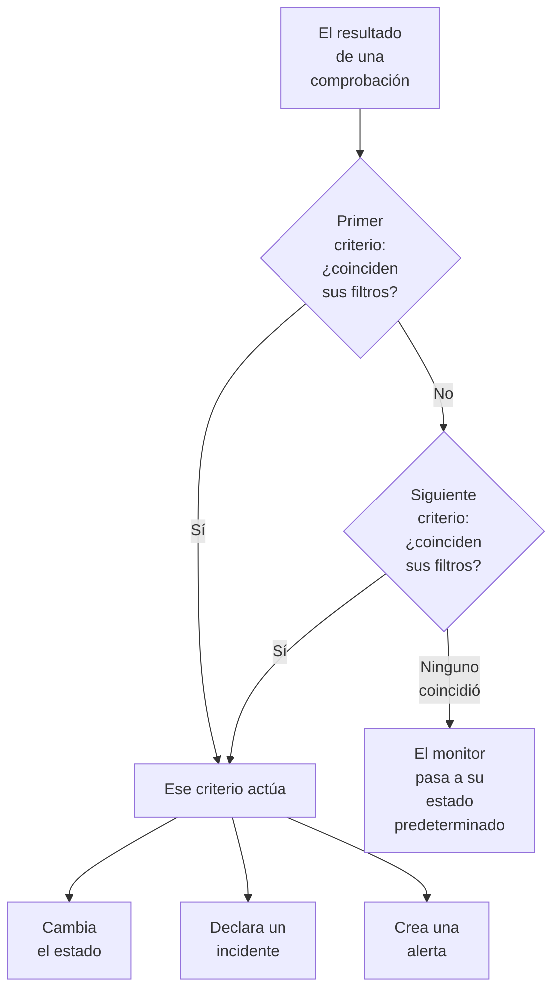
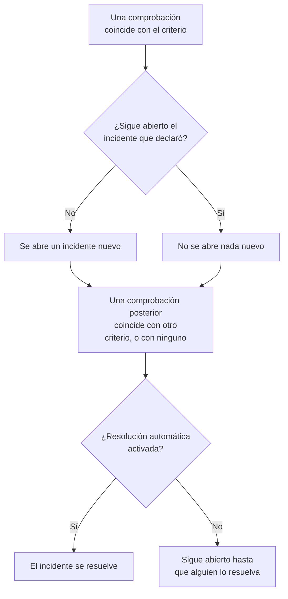

# Criterios y estados de monitores

Los criterios de un monitor deciden qué significa cada comprobación: si el monitor está en línea o caído, y si OneUptime declara un incidente o crea una alerta. Los estados son la lista de su proyecto con lo que puede ser un monitor, de **Operativo** a **Sin conexión**. Esta página explica ambos para cada tipo de monitor; la página de cada tipo enumera los filtros que ofrece.

:::cards
- [Cómo deciden los criterios](#cómo-deciden-los-criterios): De arriba abajo, y gana la primera coincidencia.
- [Qué contiene un criterio](#qué-contiene-un-criterio): Filtros, una condición de coincidencia, acciones y ajustes.
- [Cambiar los criterios de un monitor](#cambiar-los-criterios-de-un-monitor): Editar, añadir, reordenar y probar criterios.
- [Estados del monitor](#estados-del-monitor): Los estados predefinidos y los estados propios.
:::

## Cómo deciden los criterios

Cada vez que se comprueba un monitor, sus criterios juzgan el resultado de arriba abajo de la lista. El primer criterio cuyos filtros coinciden decide qué ocurre, y los criterios que están debajo no se examinan en esa comprobación. Si ninguno coincide, el monitor pasa a su **Estado de monitor predeterminado**.

El orden forma parte de la regla. Un monitor nuevo enumera sus criterios del peor caso al mejor: sin conexión, después una advertencia si su tipo la tiene (un certificado o un dominio que caduca pronto) y después en línea. Un criterio sano y amplio, como **Is Online** en **Verdadero**, coincide con casi todas las comprobaciones, así que va el último: por encima de los demás, coincidiría primero cada vez y los demás nunca actuarían.

Un criterio que coincide pero no cambia ningún estado sigue decidiendo la comprobación: el monitor conserva su estado, y los criterios de debajo esperan a la siguiente comprobación. El **Estado de monitor predeterminado** solo se aplica cuando ningún criterio coincide. En un monitor nuevo es **Operativo**; cámbielo en **Más campos**, debajo de los criterios.

> [!NOTE]
> Un monitor que abre un incidente o una alerta por host, contenedor, disco o interfaz juzga todos los criterios en cada comprobación, de modo que dos hosts pueden coincidir con dos criterios distintos a la vez. Es un monitor cuya consulta tiene un **Agrupar por**, como un monitor de métricas o de registros, o un criterio que indica `*` para cada disco o interfaz. Un monitor de solicitudes entrantes que agrupa incidentes por un campo de la carga útil sigue deteniéndose en la primera coincidencia.

## Qué contiene un criterio

Abra un criterio: tiene un nombre y tres secciones, cada una de las cuales se pliega en un resumen de una línea.

| Parte | Qué contiene |
| --- | --- |
| **Nombre del criterio** | El nombre en la lista de criterios y en la causa raíz de cada incidente y alerta que abre el criterio. **Añadir criterios** da a un criterio nuevo el nombre de sus filtros, y el nombre los sigue hasta que usted escriba uno propio. |
| **Filtros** | Lo que debe mostrar la comprobación, como uno o varios filtros. Los monitores de Kubernetes y de métricas los llaman **Reglas de alerta**. |
| **Acciones** | Lo que ocurre cuando los filtros coinciden: cambiar el estado, crear una alerta, declarar un incidente o cualquier combinación. |
| **Ajustes** | **Habilitar este criterio**, una **Descripción** opcional y, en los monitores de solicitudes entrantes, **Agrupa incidentes y alertas por un campo de la carga útil**. |

### Filtros

Un filtro lee un dato de la comprobación y lo compara: un **Tipo de filtro** (qué se lee, como **Código de estado de respuesta**), una **Condición de filtro** (cómo se compara, como **Mayor que**) y un **Valor**. Los monitores que comparan métricas, como los de Kubernetes y de métricas, piden en su lugar una **Condición** y un **Umbral**. Cada tipo de monitor ofrece sus propios tipos de filtro, enumerados en su página, por ejemplo [Monitor de sitio web](/docs/monitor/website-monitor#criterios-de-monitoreo).

A partir de dos filtros aparece debajo la **Condición de coincidencia**: **Todos** significa que todos los filtros deben coincidir, **Cualquiera** que basta con uno. Un criterio nuevo empieza en **Todos**.

Los filtros que miden cada comprobación, como **Is Online**, **Código de estado de respuesta** y **Tiempo de respuesta (en ms)**, ofrecen **Evaluar estos criterios durante un periodo de tiempo**. Juzga una ventana de comprobaciones recientes en lugar de solo la última, y empieza con los últimos 5 minutos y **All Values**, que solo coincide cuando todas las comprobaciones de la ventana han coincidido. Consulte [Evaluar durante un periodo de tiempo](/docs/monitor/website-monitor#evaluar-durante-un-periodo-de-tiempo).

### Acciones

Cada acción es un interruptor en **Acciones**:

| Interruptor | Qué hace |
| --- | --- |
| **Cuando los filtros coinciden, cambiar el estado del monitor.** | Pasa el monitor al estado elegido en **Cambiar estado del monitor a**. |
| **Cuando los filtros coinciden, crear una alerta.** | Crea las alertas configuradas en **Crear alerta**. Una alerta avisa a su equipo y nunca aparece en una página de estado. |
| **Cuando los filtros coinciden, declarar un incidente.** | Declara los incidentes configurados en **Crear incidente**. Sus páginas de estado pueden mostrarlos. |

Un incidente o una alerta pide un título, una **Gravedad** y, plegados, una descripción, propietarios, etiquetas y políticas de guardia. Los títulos y las descripciones pueden incluir valores de la comprobación, como `{{monitorName}}`: consulte [Plantillas de incidentes y alertas](/docs/monitor/incident-alert-templating). Para avisar a alguien cuando el criterio coincide, elija una política en **De guardia**: consulte [Políticas de guardia](/docs/on-call/policies).

### Ajustes

**Habilitar este criterio** está activado en todo criterio nuevo. Desactívelo para conservar un criterio sin usarlo: se omite en cada comprobación, no cambia ningún estado, no abre nada y su cabecera muestra **Deshabilitado**.

**Agrupa incidentes y alertas por un campo de la carga útil** abre un incidente por cada valor encontrado en una solicitud entrante, de modo que una sola dirección de webhook puede mantener varios incidentes abiertos. Consulte [Activar la agrupación de incidentes](/docs/monitor/incoming-request-monitor#activar-la-agrupación-de-incidentes).

## Cuándo se abren y se cierran incidentes y alertas

Un criterio que declara incidentes abre uno cuando coincide. Cuando el monitor se recupera, el incidente se cierra solo si el criterio así lo indica.

- **Uno cada vez.** Mientras siga abierto un incidente que declaró un criterio, ese mismo criterio no declara otro al volver a coincidir. Las alertas funcionan igual. Un monitor que agrupa por host o por campo de la carga útil mantiene uno abierto por host o por valor, y un criterio de monitor de correo entrante con **Abrir un incidente nuevo por cada correo** abre uno por cada correo.
- **El cierre.** En una comprobación posterior en la que coincide otro criterio, o ninguno, se resuelve un incidente cuyo criterio tiene activado **Resolver incidente automáticamente**, y también una alerta con **Resolver alerta automáticamente**. Ambos están en **Más campos** dentro del incidente o la alerta, y los criterios con los que empieza un monitor nuevo los tienen activados.
- **Varias sondas.** Un monitor comprobado por más de una sonda solo cambia cuando sus sondas coinciden. Consulte [Cómo se evalúan los criterios](/docs/monitor/create-monitor#cómo-se-evalúan-los-criterios).
- **Un monitor padre caído.** En la página **Configuración → Dependencias** de un monitor, **Depende de los monitores** indica los monitores de los que depende. Mientras uno de ellos esté en un estado de **Suprimir cuando el estado del padre sea** (cualquier estado sin conexión, si se deja vacío), el monitor no abre incidentes ni alertas. Su estado sigue cambiando, y lo que está abierto se sigue resolviendo.
- **El mantenimiento programado.** Un monitor incluido en un evento de mantenimiento en curso no se comprueba, así que sus criterios no se ejecutan. Consulte [Visión general del mantenimiento programado](/docs/scheduled-maintenance/index).

Para ver cómo se juzgó una comprobación, abra la **Vista general** del monitor: la tarjeta **Resumen del monitor** muestra qué criterio coincidió y qué hizo cada uno, incluido un incidente que se omitió porque ya había uno abierto.

## Cambiar los criterios de un monitor

:::steps
### Abrir la página de criterios

Vaya a **Monitores** y abra el monitor. Despliegue **Configuración** en su menú lateral y haga clic en **Criterios**. La tarjeta **Criterios de monitoreo** muestra cada criterio, qué comprueba y qué hace.

### Hacer clic en Editar criterios de monitoreo

El editor muestra cada criterio desplegado. Haga clic en la cabecera de un criterio para plegarlo en una línea: su nombre, cuántos filtros tiene y qué hace.

### Añadir, cambiar o reordenar criterios

**Añadir criterios** añade uno al final, desplegado y con el nombre de su filtro. Arrastre un criterio por el asa de su izquierda para moverlo: gana la primera coincidencia, así que ponga el peor caso primero. **Eliminar criterios** quita uno; un monitor conserva al menos un criterio.

### Guardar los criterios

Haga clic en **Guardar cambios**. La siguiente comprobación se juzga con los nuevos criterios.

### Probar el monitor

En un monitor que comprueban sondas, haga clic en **Probar monitor** en la tarjeta, elija una sonda en **Seleccionar sonda** y haga clic en **Ejecutar prueba**. **Resultado de la prueba del monitor** muestra lo que encontró la comprobación.
:::

Un monitor manual no tiene criterios: usted fija su estado. Consulte [Actualizar el estado](/docs/monitor/manual-monitor#actualizar-el-estado).

## Estados del monitor

Un monitor siempre está en uno de los estados de su proyecto. Un proyecto nuevo tiene tres, del más sano al peor:

| Estado | Posición | Color | Qué hace OneUptime con él |
| --- | --- | --- | --- |
| **Operativo** | 1 | Verde | Los monitores nuevos empiezan en él, y es el **Estado de monitor predeterminado** de un monitor nuevo. Predefinido. |
| **Degradado** | 2 | Amarillo | Nada por sí mismo: un criterio suyo lleva un monitor hasta aquí. |
| **Sin conexión** | 3 | Rojo | El criterio sin conexión de un monitor nuevo lo lleva aquí, y OneUptime trata un monitor en este estado como caído. Predefinido. |

La lista es un orden. Donde los monitores se muestran juntos, gana el estado más bajo de la lista: un grupo de monitores, un grupo de una página de estado y el estado general de una página de estado muestran cada uno el peor estado de sus monitores.

### Dónde cuenta un estado

| Dónde | Qué decide el estado |
| --- | --- |
| La lista **Monitores** | El estado actual de cada monitor. **No operativo** enumera los monitores en cualquier estado salvo el operativo, con un contador rojo al lado. |
| Páginas de estado | El color de cada fila y su disponibilidad: solo cuentan en contra los estados de **Cuenta como tiempo de inactividad** de la página. Una página de estado nueva empieza con todos los estados salvo el operativo. Consulte [Elegir qué se muestra en la página](/docs/status-pages/index#elegir-qué-se-muestra-en-la-página). |
| Grupos de monitores | El estado del grupo: el peor de sus monitores. Consulte [Grupos de monitores](/docs/monitor/monitor-groups). |
| SLO | El tiempo de inactividad que cuenta un SLO, según su propia lista de estados. Consulte [Qué estados cuentan como tiempo de inactividad](/docs/slo/introduction#qué-estados-cuentan-como-tiempo-de-inactividad). |
| Dependencias | Si un monitor padre retiene los incidentes y alertas de sus monitores dependientes: por defecto, mientras está en un estado sin conexión. |

Un estado que añada más adelante no se añade a la lista **Cuenta como tiempo de inactividad** de una página de estado existente: añádalo allí usted mismo.

### Añadir un estado propio

:::steps
### Abrir Estado del monitor

Vaya a **Monitores → Ajustes → Estado del monitor**. **Ajustes** aparece plegado en el menú lateral: despliéguelo primero. La tarjeta **Estados del monitor** enumera los estados del más sano al peor.

### Crear el estado

Haga clic en **Crear Estado del monitor** y rellene **Nombre**, **Descripción** y **Color**. El nuevo estado se coloca justo encima del estado sin conexión, para que una caída siga contando como lo peor.

### Ponerlo en su sitio

Arrastre el estado por su asa. Un estado más abajo en la lista cuenta como peor que todos los estados de encima.

### Usarlo en un criterio

Un estado no hace nada hasta que un criterio lleva monitores a él. Elíjalo en **Cambiar estado del monitor a** en el criterio que debe fijarlo.
:::

Los estados operativo y sin conexión están marcados como **Predefinido**: puede cambiarles el nombre y el color, pero no eliminarlos. En OneUptime Cloud, crear o cambiar un estado requiere el plan Growth. Gestionar los estados requiere el rol Project Owner, Project Admin o Monitor Admin, o un rol personalizado con el permiso de estado de monitor correspondiente.

### La cronología de estados

Cada cambio de estado queda en la **Cronología de estados** del monitor: cuándo empezó, cuánto duró y **Ver causa** para el criterio que lo fijó. **Crear Evento de estado del monitor** añade un estado a mano. En un monitor que comprueban sondas, la siguiente comprobación que coincide con un criterio con estado vuelve a fijar ese estado.

Un cambio de estado solo avisa a los propietarios del monitor si han activado **Estado del monitor cambiado** en sus ajustes de notificación: empieza desactivado. Un monitor que vuelve a su **Estado de monitor predeterminado** porque ningún criterio coincidió no avisa a nadie. Consulte [Qué está activado para un nuevo miembro](/docs/notifications/notification-settings#qué-está-activado-para-un-miembro-nuevo).

## Archivar un estado de monitor

Archive un estado que su equipo ya no deba usar, en lugar de eliminarlo. Archivar no cambia ningún monitor: un monitor en ese estado sigue en él hasta que su estado cambie, y su cronología de estados lo sigue mostrando.

- **Archivar** está en el menú **⋯** de la fila. Primero pide confirmación y enumera los criterios de monitor, plantillas y páginas de estado configurados para usar el estado: lo siguen usando hasta que los cambie.
- **Nadie puede volver a elegirlo.** Un criterio, el menú de estado de un monitor, el estado de monitor de un incidente o de un evento de mantenimiento y los estados de caída de una página de estado lo omiten. La API, Terraform y MCP lo rechazan.
- **Los estados archivados se listan aparte**, en la sección plegada **Estados de monitor archivados** bajo la tabla. **Desarchivar** devuelve uno tal como estaba.
- **Los estados integrados no se pueden archivar.** Los monitores nuevos empiezan en el estado operativo, y OneUptime considera caído un monitor en el estado fuera de línea. Su **Archivar** está bloqueado, con el motivo.

## Solución de problemas

:::details El sitio está caído, pero el monitor sigue Operativo
Un criterio más arriba en la lista coincidió primero. Abra **Configuración → Criterios** y revise el orden: el criterio sano va el último. Compruebe también que el criterio sin conexión tiene activado **Habilitar este criterio**, y que su acción **Cuando los filtros coinciden, cambiar el estado del monitor.** está activada con un estado elegido.
:::

:::details No se abrió ningún incidente cuando el monitor cayó
Revise el criterio que coincidió: **Cuando los filtros coinciden, declarar un incidente.** debe estar activado. No se declara un incidente mientras siga abierto el incidente del mismo criterio, mientras esté caído un monitor padre de **Depende de los monitores** o mientras el monitor esté en mantenimiento programado. La tarjeta **Resumen del monitor** de la **Vista general** del monitor indica cuál fue.
:::

:::details El incidente sigue abierto después de que el monitor se recuperara
Abra el criterio del incidente y despliegue **Más campos** en su incidente: **Resolver incidente automáticamente** debe estar activado. Un incidente de un criterio que haya eliminado después no lo resuelve el monitor: resuélvalo a mano.
:::

:::details El botón de eliminar de Sin conexión está bloqueado
**Operativo** y **Sin conexión** son predefinidos: OneUptime lleva monitores a ellos, así que se pueden renombrar pero no eliminar. Elimine en su lugar un estado propio, o renombre el predefinido.
:::

## Próximos pasos

:::cards
- [Crear un monitor](/docs/monitor/create-monitor): Los tres pasos de un monitor nuevo.
- [Plantillas de incidentes y alertas](/docs/monitor/incident-alert-templating): Llevar valores de la comprobación a títulos y descripciones.
- [Grupos de monitores](/docs/monitor/monitor-groups): Reunir varios monitores en un solo estado.
- [Visión general de los incidentes](/docs/incidents/index): Qué ocurre después de que un criterio declara un incidente.
:::
