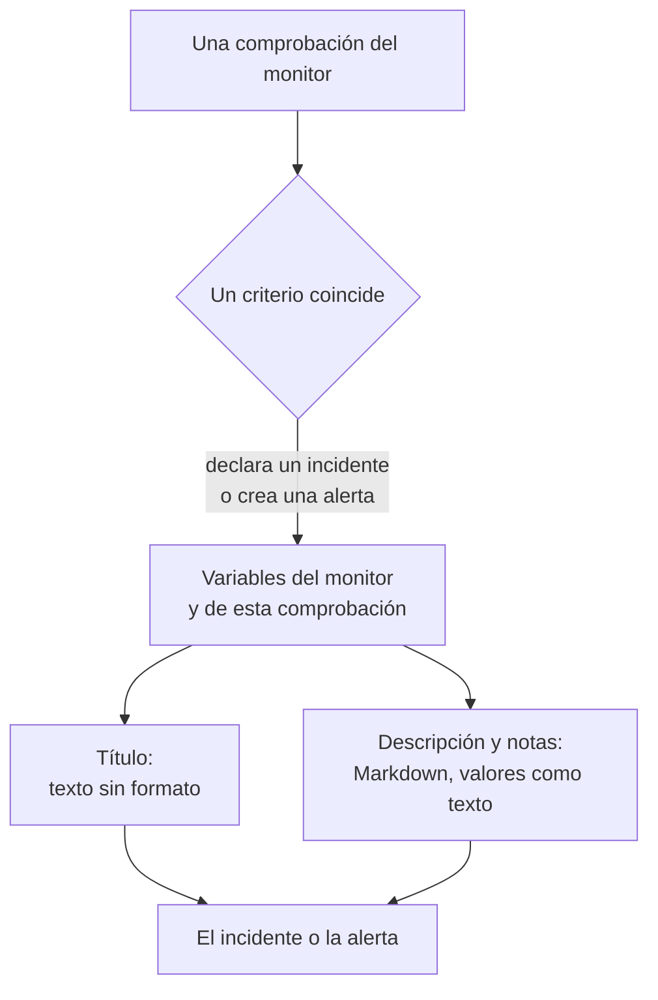

# Plantillas de incidentes y alertas

Cuando los criterios de un monitor declaran un incidente o crean una alerta, rellenan el título, la descripción y las notas de remediación a partir de una plantilla que usted escribe. Ponga en ellas marcadores `{{variable}}`, como `{{monitorName}}` o `{{responseStatusCode}}`, y cada incidente dirá qué salió mal, con los valores de la comprobación que lo abrió.

:::cards
- [Dónde se escribe una plantilla](#dónde-se-escribe-una-plantilla): El título, la descripción y las notas de remediación del incidente o la alerta de un criterio.
- [Uso básico](#uso-básico): Marcadores, rutas dentro de objetos y listas.
- [Variables de todos los monitores](#variables-de-todos-los-monitores): El nombre del monitor y el recurso que superó el umbral.
- [Variables por tipo de monitor](#variables-por-tipo-de-monitor): Lo que informa cada tipo de comprobación.
:::

## Cómo funcionan las plantillas

Una plantilla se rellena una sola vez, cuando el criterio crea el incidente o la alerta. OneUptime reúne las variables del monitor y de la comprobación que coincidió, coloca cada valor donde está su marcador y guarda el resultado. Cambiar la plantilla después cambia los incidentes y las alertas que se creen a partir de entonces, no los que ya están abiertos.



- **El título es texto sin formato.** Dondequiera que se muestre, se lee exactamente como lo generó la plantilla.
- **La descripción y las notas de remediación son Markdown.** El Markdown que usted escribe se representa, y cada valor que envió el sistema monitorizado se coloca como texto, de modo que nada en él puede añadir un enlace, una imagen o una mención. Consulte [Valores en descripciones y notas de remediación](#valores-en-descripciones-y-notas-de-remediación).
- **Un monitor agrupado rellena cada incidente para su propia serie.** Un monitor que abre un incidente por host, pod o dispositivo rellena cada plantilla con los valores de esa serie, y añade el nombre de la serie al título cuando su plantilla aún no lo menciona.

## Dónde se escribe una plantilla

:::steps
### Abrir los criterios del monitor

Vaya a **Monitores**, abra el monitor y haga clic en **Criterios** en su menú lateral. Haga clic en **Editar criterios de monitoreo**.

### Activar el incidente o la alerta

En un criterio, bajo **Acciones**, active **Cuando los filtros coinciden, declarar un incidente.** o **Cuando los filtros coinciden, crear una alerta.** El formulario del incidente o de la alerta se abre debajo.

### Escribir el título

Escriba el título en **Título del incidente** o **Título de la alerta**, por ejemplo `{{monitorName}} is down`. **Más información sobre las plantillas dinámicas**, a su lado, abre **Variables de plantilla dinámicas**: cada variable que tiene el tipo de este monitor, con lo que contiene. Haga clic en una variable para copiarla.

### Escribir la descripción y las notas de remediación

Abra **Descripción** para **Descripción del incidente** o **Descripción de la alerta**, y **Más campos** para **Notas de remediación**. Estos editores ofrecen ellos mismos las variables: **Variables de plantilla** las lista bajo el editor, **Insertar variable** en su barra de herramientas abre la misma lista, y escribir `{{` la abre en el cursor.

### Guardar los criterios

Haga clic en **Guardar cambios**. El próximo incidente o la próxima alerta que cree este criterio usará las nuevas plantillas.
:::

## Uso básico

Un marcador es el nombre de una variable entre llaves dobles. Cuando se crea el incidente, OneUptime lo sustituye por el valor de la variable y deja el texto que lo rodea tal como lo escribió.

```text title="Title template"
{{monitorName}} returned {{responseStatusCode}} in {{responseTimeInMs}} ms
```

Si el monitor se llama `Checkout API`, el código de estado de la respuesta es `502` y la respuesta tardó `842` milisegundos, el incidente se titula:

```text title="Title as created"
Checkout API returned 502 in 842 ms
```

### Rutas dentro de objetos y listas

Una variable que contiene un objeto o una lista se lee con una ruta, igual que en las [expresiones JavaScript](/docs/monitor/javascript-expression):

| Escriba | Para leer | Ejemplo |
| --- | --- | --- |
| `{{object.field}}` | Un campo de un objeto, a cualquier profundidad | `{{responseBody.error.message}}` |
| `{{list[0]}}` o `{{list.0}}` | Un elemento de una lista, contando desde 0 | `{{diskMetrics[0].usagePercent}}` |
| `{{list[last]}}` | El último elemento de una lista | `{{processes[last].name}}` |
| `{{object}}` | El objeto o la lista completos, como JSON | `{{responseBody}}` |

Un nombre de campo puede contener un guion, como en `{{responseHeaders.content-type}}`. Un índice negativo, como `[-1]`, no lee nada: use `[last]`.

### Cuando falta un valor

Un marcador cuya ruta no lleva a ninguna parte queda en el texto tal como lo escribió, con llaves y todo: si la respuesta no tiene un campo `error`, `{{responseBody.error.id}}` aparece tal cual en el título. Lo mismo ocurre con una variable que esta comprobación no informó, como `failureCause` en una comprobación que no falló. Un valor que la comprobación informó como texto vacío se sustituye por nada.

Para escribir una plantilla que funcione tanto si el monitor está agrupado como si no, use las variables de [recurso afectado](#recurso-afectado): siempre existen y están vacías cuando el monitor no está agrupado.

### Valores en descripciones y notas de remediación

Una descripción y unas notas de remediación son Markdown: se muestran en la página del incidente o de la alerta, en el correo electrónico y en sus canales de Slack y Microsoft Teams. Los valores que una plantilla coloca ahí son lo que envió el sistema monitorizado - un cuerpo o una cabecera de respuesta, una solicitud o un correo entrante, las etiquetas de un dispositivo o de una serie -, así que cada uno se coloca como texto. Se lee exactamente como se envió, dondequiera que lo ponga la plantilla, y un enlace, una imagen, una etiqueta HTML o una mención de Slack como `<!channel>` que contenga se muestra como texto en lugar de actuar. Una dirección web suelta en un valor sí se convierte en enlace, uno que muestra adónde lleva. El Markdown que usted escribe en la propia plantilla se representa tal como lo escribió.

Un valor puede tener cualquier tamaño - un cuerpo de respuesta o un registro de muchos megabytes - y la notificación sale igualmente con él. Cada canal transporta lo que admite, y una descripción demasiado larga para él se corta, en un salto de línea si lo hay, y termina con «… (truncated — see OneUptime for the full text)»:

- **Correo electrónico**: cada descripción, nota o causa raíz transporta hasta unos 256 KB del texto del correo, y la nota al final de uno más largo enlaza al incidente o la alerta. Un correo completo - su texto y sus capturas de pantalla - se mantiene por debajo de 3 MB, que aceptan todos los servidores de correo y Microsoft Graph: una captura que no cabe junto al texto se omite, con una nota en su lugar.
- **La página del incidente o de la alerta** lo muestra todo. Una descripción de más de 128 KB que tardaría en maquetarse se muestra como texto sin formato, línea a línea.
- **Slack** transporta como máximo lo que Slack muestra de un mensaje (unos 30 000 caracteres). **Microsoft Teams** transporta unos 40 000 caracteres en un mensaje de la aplicación OneUptime, y unos 12 000 a través de un webhook entrante (suscriptores de páginas de estado, flujos de trabajo) - medidos al enviar el mensaje, así que una tabla cuenta como el HTML en que se convierte.
- **SMS, llamadas telefónicas, notificaciones push, WhatsApp y Telegram** transportan lo que admiten sus proveedores: consulte [Cómo avisan los niveles a las personas](/docs/on-call/escalation-rules#cómo-avisan-los-niveles-a-las-personas).

Cada canal representa el texto en un tiempo que crece con su longitud. Una parte que a un renderizador le llevaría muchísimo más tiempo - una línea de más de 64 KB, un párrafo largo de líneas simples, un párrafo lleno de `*`, `_` o `[` que nunca se cierran, citas o listas anidadas más de dieciséis niveles y, en la página del incidente o de la alerta, una tabla o lista de más de mil líneas - se lee como texto sin formato donde está, y el resto de la descripción se representa como de costumbre.

## Uso avanzado

### Recorrer una lista

`{{#each path}}` repite el texto hasta `{{/each}}` una vez por cada elemento de la lista en `path`:

```text title="Loop syntax"
{{#each arrayPath}}
  ...text with {{field}} placeholders for each item...
{{/each}}
```

Dentro del bucle:

- `{{field}}` y `{{field.nested}}` leen el elemento actual. Un nombre que el elemento no tiene se busca en el elemento que lo contiene y luego en las variables de toda la plantilla.
- `{{@index}}` es la posición del elemento, contando desde 0.
- `{{this}}` es el propio elemento, para una lista de valores simples como cadenas.
- Un bucle sobre una ruta que no es una lista, o sobre una lista vacía, no escribe nada.
- Los bucles se anidan: un `{{#each}}` dentro de otro lee la lista interior de cada elemento exterior.

Por ejemplo, un [monitor de solicitudes entrantes](/docs/monitor/incoming-request-monitor) que recibe esta notificación de alerta:

```json title="Request body"
{
  "receiver": "payments",
  "alerts": [
    { "status": "firing", "labels": { "alertname": "HighLatency" } },
    { "status": "resolved", "labels": { "alertname": "DiskFull" } }
  ]
}
```

y tiene esta plantilla de descripción:

```text title="Description template"
Alerts for {{requestBody.receiver}}:
{{#each requestBody.alerts}}
- {{@index}}: {{labels.alertname}} ({{status}})
{{/each}}
```

crea un incidente cuya descripción dice lo siguiente. Cada elemento conserva los saltos de línea que lo rodean, así que una línea en blanco separa los elementos, y la descripción sigue mostrando una sola lista:

```text title="Description as created"
Alerts for payments:

- 0: HighLatency (firing)

- 1: DiskFull (resolved)
```

### Valores de un monitor agrupado

Un monitor basado en métricas con atributos en **Agrupar por** abre un incidente por serie, y el valor de cada atributo es una variable con el nombre del atributo. Agrupar por `host.name` da `{{host.name}}`, y agrupar por `resource.k8s.pod.name` da `{{resource.k8s.pod.name}}`. `{{seriesLabels}}` los contiene todos, como un objeto.

Un [monitor de registros](/docs/monitor/logs-monitor) agrupado funciona igual: el valor de cada atributo de agrupación es una variable bajo su clave.

## Variables de todos los monitores

### Monitor

| Variable | Qué contiene | Ejemplo |
| --- | --- | --- |
| `monitorName` | El nombre del monitor. | `Checkout API` |
| `monitorId` | El ID del monitor. | `a0f78958-da0a-4775-9fd9-c9fc63d3456f` |
| `monitorType` | El tipo del monitor. | `Website`, `Synthetic Monitor` |

### Recurso afectado

Estas variables describen la serie para la que un monitor agrupado abrió el incidente: un pod, un contenedor, un host, un disco. Están vacías en un monitor no agrupado, así que una plantilla puede usarlas en cualquier monitor.

| Variable | Qué contiene |
| --- | --- |
| `seriesResourceSuffix` | La identidad de la serie, empezando por un separador, para ponerla al final de un título. |
| `seriesResourceSummary` | La misma identidad sin el separador, para ponerla en una frase. |
| `seriesResourceBlock` | Cada etiqueta de la serie, como una lista Markdown. Ideal en una descripción. |
| `seriesDebugCommands` | Comandos de solo lectura para este recurso concreto, como `kubectl` o `docker`, como una lista Markdown. |

## Variables por tipo de monitor

### Monitores de sitios web y API

| Variable | Qué contiene | Tipo |
| --- | --- | --- |
| `responseBody` | El cuerpo de la respuesta: un objeto cuando es JSON y, si no, el texto. | `JSON` o `string` |
| `responseHeaders` | Las cabeceras de la respuesta, por nombre en minúsculas. | `Dictionary<string>` |
| `responseStatusCode` | El código de estado HTTP. | `number` |
| `responseTimeInMs` | El tiempo de respuesta, en milisegundos. | `number` |
| `isOnline` | Si el monitor consideró la respuesta como en línea. | `boolean` |

### Monitores de solicitudes entrantes

| Variable | Qué contiene | Tipo |
| --- | --- | --- |
| `requestBody` | El cuerpo de la solicitud: un objeto cuando es JSON. | `JSON` o `string` |
| `requestHeaders` | Las cabeceras de la solicitud, por nombre en minúsculas. | `Dictionary<string>` |
| `requestMethod` | El método HTTP, como `POST`. | `string` |
| `incomingRequestReceivedAt` | Cuándo se recibió la solicitud, como marca de tiempo ISO 8601. | `string` |

Cuando el criterio tiene activado **Agrupa incidentes y alertas por un campo de la carga útil**, la clave de agrupación también es una variable, con el nombre del **último segmento** de la ruta de agrupación: agrupar por `requestBody.alerts[*].labels.alertname` da `{{alertname}}`, y agrupar por `requestBody.alerts[*].fingerprint` da `{{fingerprint}}`. El `requestBody` completo sigue estando a su lado.

> [!NOTE]
> `[*]` solo funciona en los campos de ruta de agrupación. En una plantilla no lee nada, así que el marcador queda tal como se escribió. `{{requestBody.alerts[0].annotations.summary}}` siempre lee la primera alerta de la carga útil, no aquella para la que se abrió el incidente: use la variable de agrupación y los campos compartidos de la carga útil, como `commonLabels` y `commonAnnotations`. Consulte [Monitor de solicitudes entrantes](/docs/monitor/incoming-request-monitor).

### Monitores de correos entrantes

| Variable | Qué contiene | Tipo |
| --- | --- | --- |
| `emailSubject` | El asunto del correo. | `string` |
| `emailFrom` | La dirección de correo del remitente. | `string` |
| `emailTo` | A quién se envió el correo, con la dirección del propio monitor enmascarada. | `string` |
| `emailBody` | El cuerpo del correo en texto sin formato. | `string` |
| `emailReceivedAt` | Cuándo se recibió el correo, como marca de tiempo ISO 8601 en UTC. | `string` |

En un título, cada una se corta a una línea de 150 caracteres como máximo. Las descripciones y las notas de remediación reciben el valor completo. Consulte [Monitor de correos entrantes](/docs/monitor/incoming-email-monitor#variables-de-plantilla).

### Monitores de ping, IP y puerto

| Variable | Qué contiene | Tipo |
| --- | --- | --- |
| `isOnline` | Si el destino respondió. | `boolean` |
| `responseTimeInMs` | El tiempo de respuesta, en milisegundos. Para un puerto, la consulta DNS y la conexión TCP juntas. | `number` |
| `failureCause` | Por qué falló la comprobación, cuando falló. | `string` |
| `isTimeout` | Si la comprobación agotó el tiempo de espera. | `boolean` |

### Monitores NTP

| Variable | Qué contiene | Tipo |
| --- | --- | --- |
| `isOnline` | Si el servidor de hora respondió a la solicitud de la sonda. | `boolean` |
| `isSynchronized` | Si respondió con un estrato de 1 a 15, sin la alarma de segundo intercalar y con marcas de tiempo reales. | `boolean` |
| `stratum` | El estrato que informó el servidor: 1 para un servidor primario, 16 cuando no está sincronizado, 0 para un kiss-o'-death. | `number` |
| `clockOffsetInMs` | Cuánto se aleja el reloj del servidor del de la sonda, en milisegundos. Positivo significa que el servidor va adelantado. | `number` |
| `referenceId` | Con qué se sincroniza el servidor: una fuente como `GPS` en el estrato 1, o la dirección de su servidor superior. | `string` |
| `leapIndicator` | De 0 a 2 cuando todo va bien, 3 cuando el servidor dice que su reloj no está sincronizado. | `number` |
| `kissCode` | Con el estrato 0, el código de cuatro letras que el servidor envió en lugar de la hora, como `RATE`. | `string` |
| `responseTimeInMs` | El tiempo desde la solicitud hasta la respuesta, en milisegundos. | `number` |
| `roundTripDelayInMs` | El viaje de ida y vuelta por la red del intercambio, sin el tiempo de procesamiento del propio servidor. | `number` |
| `rootDelayInMs` | El viaje de ida y vuelta desde el servidor hasta su reloj de referencia, en milisegundos. | `number` |
| `rootDispersionInMs` | La estimación del propio servidor de su error máximo, en milisegundos. | `number` |
| `serverTime` | El reloj del servidor cuando envió la respuesta, como marca de tiempo ISO 8601. | `string` |
| `referenceTime` | Cuándo se ajustó o corrigió por última vez el reloj del servidor, como marca de tiempo ISO 8601. | `string` |
| `serverAddress` | La dirección a la que fue la solicitud. | `string` |
| `port` | El puerto UDP al que fue la solicitud. | `number` |
| `failureCause` | Por qué el servidor no respondió, o por qué no está sincronizado. | `string` |
| `isTimeout` | Si el servidor no respondió a tiempo. | `boolean` |

### Monitores de certificados SSL

| Variable | Qué contiene | Tipo |
| --- | --- | --- |
| `isOnline` | Si la comprobación del certificado tuvo éxito. | `boolean` |
| `isSelfSigned` | Si el certificado está autofirmado. | `boolean` |
| `createdAt` | Cuándo se emitió el certificado, como marca de tiempo ISO 8601. | `string` |
| `expiresAt` | Cuándo caduca el certificado, como marca de tiempo ISO 8601. | `string` |
| `commonName` | El nombre común (CN) del certificado. | `string` |
| `organizationalUnit` | Su unidad organizativa (OU). | `string` |
| `organization` | Su organización (O). | `string` |
| `locality` | Su localidad (L). | `string` |
| `state` | Su estado o provincia (ST). | `string` |
| `country` | Su país (C). | `string` |
| `serialNumber` | Su número de serie. | `string` |
| `fingerprint` | Su huella SHA-1. | `string` |
| `fingerprint256` | Su huella SHA-256. | `string` |
| `failureCause` | Por qué falló la comprobación, cuando falló. | `string` |

### Monitores DNS

| Variable | Qué contiene | Tipo |
| --- | --- | --- |
| `isOnline` | Si la consulta obtuvo respuesta. | `boolean` |
| `responseTimeInMs` | El tiempo de la consulta, en milisegundos. | `number` |
| `isTimeout` | Si la consulta agotó el tiempo de espera. | `boolean` |
| `isDnssecValid` | El resultado de la validación DNSSEC. | `boolean` |
| `records` | Los registros devueltos, cada uno como `{type, value, ttl}`. | `Array<Object>` |
| `recordValues` | Solo los valores de los registros. | `Array<string>` |
| `failureCause` | Por qué falló la consulta, cuando falló. | `string` |

### Monitores DNSSEC

| Variable | Qué contiene | Tipo |
| --- | --- | --- |
| `isOnline` | Si la comprobación terminó. | `boolean` |
| `domainName` | La zona comprobada. | `string` |
| `isZoneSigned` | Si la zona tiene registros DNSKEY. | `boolean` |
| `isParentDsPresent` | Si la zona padre tiene registros DS para ella. | `boolean` |
| `isChainValid` | Si la cadena de confianza se valida. | `boolean` |
| `resolverConsensusAd` | Si todos los resolutores devolvieron el indicador AD. | `boolean` |
| `isNameserverConsistent` | Si todos los servidores de nombres autoritativos devolvieron el mismo número de serie SOA. | `boolean` |
| `earliestSignatureExpiration` | Cuándo caduca la primera firma RRSIG, como marca de tiempo ISO 8601. | `string` |
| `daysUntilSignatureExpiry` | Los días que faltan para que caduque esa firma. | `number` |
| `dnskeyCount` | El número de registros DNSKEY. | `number` |
| `dsRecordCount` | El número de registros DS en la zona padre. | `number` |
| `rrsigCount` | El número de registros RRSIG vistos. | `number` |
| `responseTimeInMs` | Cuánto tardó la comprobación, en milisegundos. | `number` |
| `failureCause` | Por qué falló la comprobación, cuando falló. | `string` |

### Monitores de dominio

| Variable | Qué contiene | Tipo |
| --- | --- | --- |
| `isOnline` | Si la consulta del registro tuvo éxito. | `boolean` |
| `domainName` | El dominio consultado. | `string` |
| `lookupMethod` | El protocolo que respondió: RDAP o WHOIS. | `string` |
| `registrar` | El registrador. | `string` |
| `createdDate` | Cuándo se registró el dominio. | `string` |
| `updatedDate` | Cuándo cambió el registro por última vez. | `string` |
| `expiresDate` | Cuándo caduca el registro. | `string` |
| `nameServers` | Los servidores de nombres del dominio. | `Array<string>` |
| `domainStatus` | Los códigos de estado del registro, como `clientTransferProhibited`. | `Array<string>` |
| `dnssec` | El estado DNSSEC del registro. | `string` |
| `responseTimeInMs` | Cuánto tardó la consulta, en milisegundos. | `number` |
| `failureCause` | Por qué falló la consulta, cuando falló. | `string` |

### Monitores de servidor / VM

| Variable | Qué contiene | Tipo |
| --- | --- | --- |
| `hostname` | El nombre de host del servidor. | `string` |
| `requestReceivedAt` | Cuándo se recibió el informe del servidor, como marca de tiempo ISO 8601. | `string` |
| `cpuUsagePercent` | CPU en uso, de 0 a 100. | `number` |
| `cpuCores` | El número de núcleos de CPU. | `number` |
| `memoryUsagePercent` | Memoria en uso, de 0 a 100. | `number` |
| `memoryFreePercent` | Memoria libre, de 0 a 100. | `number` |
| `memoryTotalBytes` | Memoria total, en bytes. | `number` |
| `diskMetrics` | Una entrada por cada disco montado. | `Array<Object>` |
| `diskMetrics[].diskPath` | El punto de montaje del disco. | `string` |
| `diskMetrics[].usagePercent` | Espacio en uso en el disco, de 0 a 100. | `number` |
| `diskMetrics[].freePercent` | Espacio libre en el disco, de 0 a 100. | `number` |
| `diskMetrics[].totalBytes` | El tamaño del disco, en bytes. | `number` |
| `processes` | Los procesos en ejecución que informó el agente. | `Array<Object>` |
| `processes[].pid` | El ID del proceso. | `number` |
| `processes[].name` | El nombre del proceso. | `string` |
| `processes[].command` | El comando con el que se inició el proceso. | `string` |
| `failureCause` | Por qué falló la comprobación, cuando falló. | `string` |

### Monitores sintéticos

Un monitor sintético ejecuta su script una vez por cada navegador y tamaño de pantalla que tiene configurados, como Chromium en una pantalla de escritorio y Firefox en una móvil. `syntheticResponses` contiene una entrada por ejecución: lea una ejecución por su posición, como en `{{syntheticResponses[0].browserType}}`, o todas con `{{#each syntheticResponses}}`.

| Variable | Qué contiene | Tipo |
| --- | --- | --- |
| `failureCause` | Por qué falló la comprobación, cuando falló. | `string` |
| `syntheticResponses` | Una entrada por cada navegador y tamaño de pantalla en que se ejecutó el script. | `Array<Object>` |
| `syntheticResponses[].executionTimeInMs` | Cuánto tardó la ejecución, en milisegundos. | `number` |
| `syntheticResponses[].result` | Lo que devolvió el script. | `string`, `number`, `boolean` o `JSON` |
| `syntheticResponses[].scriptError` | El error con el que terminó la ejecución, si lo hubo. | `string` |
| `syntheticResponses[].logMessages` | Lo que registró la ejecución. | `Array<string>` |
| `syntheticResponses[].screenshots` | Las capturas de pantalla que tomó la ejecución, por nombre, cada una como texto base64. Consulte [Mostrar una captura de pantalla](#mostrar-una-captura-de-pantalla). | `Object` |
| `syntheticResponses[].browserType` | El navegador de la ejecución. | `string` |
| `syntheticResponses[].screenSizeType` | El tamaño de pantalla de la ejecución. | `string` |

#### Mostrar una captura de pantalla

Cada entrada de `screenshots` es una captura de pantalla que tomó el script, con el nombre que el script le dio (`screenshots["login-page"] = await page.screenshot()`), como texto base64. Para mostrar una en la descripción o en las notas de remediación de un incidente o una alerta, escriba una imagen a su alrededor:

```text title="Description template"
{{syntheticResponses[0].scriptError}}


```

La captura aparece entonces en la página del incidente o de la alerta, en las páginas de estado que muestran el incidente, en las notificaciones por correo sobre él y en los mensajes de Slack y Microsoft Teams sobre él. En un correo se adjunta y se muestra en el cuerpo, que Gmail, Outlook y Apple Mail muestran, de modo que quien esté de guardia puede ver cómo se veía la página sin abrir OneUptime.

- Se muestran capturas PNG, JPEG, GIF y WebP. `image/png` también funciona para una captura JPEG (`page.screenshot({ type: "jpeg" })`).
- Un correo transporta como máximo 2 MB de imágenes, y como máximo 20. Una imagen que no cabe se sustituye por una nota con su texto alternativo, así que dé a cada imagen un texto alternativo. Una captura JPEG es mucho más pequeña que una PNG, y una captura de la ejecución que falló suele decir más que todas las capturas de todas las ejecuciones.
- En Slack y Microsoft Teams la captura se muestra donde la pone la descripción: una imagen en una línea propia ocupa el lugar de esa línea, y una imagen en medio de una frase, una lista o una tabla deja allí su texto alternativo y se muestra después. Slack muestra capturas PNG, JPEG y GIF, como máximo 10 y 10 MB por mensaje; la aplicación OneUptime sube cada una a su espacio de trabajo de Slack, de forma privada, y la muestra en el mensaje. Teams muestra capturas PNG, JPEG y GIF de hasta 1 MB cada una dentro de la tarjeta del mensaje, como máximo 10 y 2 MB por mensaje.
- Subir a Slack requiere el permiso `files:write` de la aplicación. Si su espacio de trabajo conectó Slack antes de que OneUptime lo pidiera, vuelva a conectar Slack en **Ajustes del proyecto → Espacio de trabajo → Slack** (en un servidor autoalojado, añada primero el permiso a su aplicación de Slack - consulte [Integración con Slack](/docs/self-hosted/slack-integration#imágenes-en-los-mensajes)).
- Una captura que un chat no puede mostrar - una WebP, una que supere esos límites, una que Slack o Teams rechacen, o cualquier captura en un mensaje enviado a través de un webhook entrante - se muestra como su texto alternativo, o «[image]» cuando no lo tiene, así que dé a cada imagen un texto alternativo. El base64 de la imagen nunca llega al chat.
- Solo se muestra una imagen que usted escribe en la plantilla. Una imagen dentro de un valor que informó la página o el script monitorizado - un mensaje de error, una línea de registro - se sigue mostrando como texto (consulte [Valores en descripciones y notas de remediación](#valores-en-descripciones-y-notas-de-remediación)).
- OneUptime AI lee el texto que rodea una captura, no la captura. Lo que una investigación, un postmortem o una nota redactados, el paso de IA de un runbook o el paso de IA de un flujo de trabajo entregan al modelo lleva una nota breve en lugar de la imagen, como `[image omitted: PNG, 340 KB]`: un modelo lee texto, no imágenes, y el base64 de una captura serían cientos de miles de tokens en cada llamada. La actividad de la investigación indica lo que se omitió.

Para mostrar la captura de cada ejecución fallida, ponga la imagen dentro de un bucle. Aquí el script guarda cada captura como `screenshots["failure"]`:

```text title="Description template"
### What the page looked like
{{#each syntheticResponses}}
**{{browserType}} / {{screenSizeType}}**: {{scriptError}}


{{/each}}
```

### Monitores de código JavaScript personalizado

| Variable | Qué contiene | Tipo |
| --- | --- | --- |
| `result` | Lo que devolvió el script. Lea un campo con una ruta, como en `{{result.status}}`. | `string`, `number`, `boolean` o `JSON` |
| `executionTimeInMs` | Cuánto tiempo se ejecutó el script, en milisegundos. | `number` |
| `scriptError` | El error con el que terminó el script, si lo hubo. | `string` |
| `logMessages` | Lo que registró el script con `console.log`. | `Array<string>` |
| `failureCause` | Por qué falló la comprobación, cuando falló. | `string` |

### Monitores de dispositivos de red

| Variable | Qué contiene | Tipo |
| --- | --- | --- |
| `isOnline` | Si el dispositivo es alcanzable, por ping **o** SNMP. Se establece en cada sondeo. | `boolean` |
| `responseTimeInMs` | El tiempo de respuesta del **recorrido** SNMP, en milisegundos. Nunca el ida y vuelta del ping. | `number` |
| `failureCause` | Por qué falló el recorrido SNMP, cuando falló. | `string` |
| `isTimeout` | Si el recorrido SNMP agotó el tiempo de espera. | `boolean` |
| `oidResponses` | Los OID consultados, cada uno como `{oid, name, value, type}`. | `Array<Object>` |
| `{{OID_NAME}}` | El valor de un OID con nombre, por su nombre, como en `{{sysUpTime}}`. | `string` o `number` |
| `sysName` | El nombre del dispositivo, del grupo de sistema SNMP. | `string` |
| `sysDescr` | La descripción del dispositivo, del grupo de sistema SNMP. | `string` |
| `sysObjectId` | El OID de empresa registrado del fabricante: la huella del dispositivo. | `string` |
| `sysLocation` | La ubicación del dispositivo, del grupo de sistema SNMP. | `string` |
| `downInterfaces` | Interfaces activas administrativamente pero caídas operativamente, cada una como `{name, alias, interfaceIndex}`. Requiere la monitorización de interfaces. | `Array<Object>` |
| `interfacesTotal` | El número de interfaces recorridas. | `number` |
| `interfacesUp` | Interfaces activas administrativa y operativamente. | `number` |
| `interfacesDown` | Interfaces activas administrativamente pero caídas operativamente. | `number` |
| `interfaceWalkFailure` | El error, cuando falló el recorrido de interfaces. | `string` |
| `tables` | Las tablas SNMP del dispositivo, por clave: `rowCount`, `rows`, `unhealthyRowCount` y `unhealthyRows` de cada una, como en `{{tables.ipsec_tunnels.unhealthyRowCount}}`. | `Object` |
| `snmpTable` | La tabla SNMP de la que trata una alerta por fila. | `string` |
| `snmpTableRow` | La fila de la que trata una alerta por fila: un túnel, una radio, un vecino. | `string` |
| `trapOid` | El OID del trap. Solo cuando un trap SNMP disparó la comprobación. | `string` |
| `trapSourceIp` | La dirección de la que vino el trap. Solo cuando un trap SNMP disparó la comprobación. | `string` |
| `trapVarbinds` | Los varbinds del trap, cada uno como `{oid, value}`. Solo cuando un trap SNMP disparó la comprobación. | `Array<Object>` |

Un dispositivo de red recibe un ping en cada sondeo y solo se recorre por SNMP cuando tiene credenciales, así que **`isOnline` es la única variable de las anteriores que rellena un dispositivo solo con ping**: todas las demás vienen del recorrido SNMP y, sin él, quedan tal como se escribieron. Empiece con `{{isOnline}}` y el nombre del dispositivo en las plantillas que puedan usarse para dispositivos sin credenciales. Consulte [Monitor de dispositivos de red](/docs/monitor/network-device-monitor#what-a-poll-actually-does) para saber qué recoge cada tipo de sondeo.

### Monitores de salud de bases de datos

| Variable | Qué contiene | Tipo |
| --- | --- | --- |
| `isOnline` | Si la sonda pudo conectarse y ejecutar la consulta base. Las métricas que faltan nunca lo vuelven falso. | `boolean` |
| `responseTimeInMs` | El tiempo para conectarse y ejecutar la consulta base, en milisegundos. | `number` |
| `failureCause` | Por qué falló la comprobación, cuando falló. | `string` |
| `connectionError` | El error de conexión, sin credenciales ni la cadena de conexión. | `string` |
| `engineVersion` | La versión que informó el servidor de base de datos. | `string` |
| `collectedGroups` | Los grupos de métricas que produjeron valores en esta comprobación. | `Array<string>` |
| `unavailableGroups` | Los grupos que no pudieron recogerse, cada uno como `{group, reason, message, remediation}`. | `Array<Object>` |
| `collectionIssueSummary` | Una línea sobre cada grupo no disponible, lista para un título. Vacía cuando se recogió todo. | `string` |
| `metrics` | Los valores recogidos, por nombre de serie. | `Object` |

Los nombres de serie en `metrics` contienen puntos, como `oneuptime.monitor.database.connections.used.percent`, y una ruta lee cada punto como un paso dentro de un objeto, así que una plantilla no puede extraer un solo valor de `metrics`. Coloque `{{metrics}}` completo, como JSON, o use `{{collectionIssueSummary}}`. Una métrica que no se recogió falta en `metrics`; no vale cero. Para actuar sobre un valor, compárelo en el criterio con una [expresión JavaScript](/docs/monitor/javascript-expression).

### Monitores de páginas de estado externas

| Variable | Qué contiene | Tipo |
| --- | --- | --- |
| `overallStatus` | El estado general de la página de estado, como `major_outage`. | `string` |
| `activeIncidentCount` | El número de incidentes abiertos en la página de estado. | `number` |
| `componentStatuses` | Sus componentes, cada uno como `{name, status, description, groupName}`. | `Array<Object>` |
| `provider` | El tipo de página de estado: Atlassian Statuspage, incident.io, RSS o Atom. | `string` |
| `componentGroup` | El grupo de componentes que vigila el monitor, si vigila uno. | `string` |
| `componentName` | El componente que vigila el monitor, si vigila uno. | `string` |
| `isOnline` | Si la página de estado respondió. | `boolean` |
| `responseTimeInMs` | Cuánto tardó en responder la página de estado, en milisegundos. | `number` |
| `failureCause` | Por qué falló la comprobación, cuando falló. | `string` |

### Monitores de métricas e infraestructura

Los monitores Metrics, Kubernetes, Docker, Host, Podman, Docker Swarm, Proxmox, VMware, Ceph y Storage Array tienen una variable propia:

| Variable | Qué contiene | Tipo |
| --- | --- | --- |
| `metricName` | El nombre de la métrica que lee la primera consulta del monitor, como `container.cpu.time`. | `string` |

Agrupados, también tienen el valor de cada atributo de **Agrupar por**, y `seriesLabels`: consulte [Valores de un monitor agrupado](#valores-de-un-monitor-agrupado). Un monitor IoT Device no tiene `metricName`, pero uno agrupado, como lo están sus plantillas, tiene `{{device.id}}`.

### Otros tipos de monitor

Los monitores Logs, Traces, Exceptions, Security Events, AI / LLM y SQL Query no tienen variables propias. Use las [variables de todos los monitores](#variables-de-todos-los-monitores) y, en un monitor Logs agrupado, los [valores del grupo](#valores-de-un-monitor-agrupado).

## Ejemplos

### Una API lenta

```text title="Title"
{{monitorName}} is slow: {{responseTimeInMs}} ms
```

```text title="Description"
### API error
Status: **{{responseStatusCode}}**
Latency: **{{responseTimeInMs}} ms**
Message: `{{responseBody.error.message}}`
```

### Un certificado a punto de caducar

```text title="Title"
Certificate for {{commonName}} expires {{expiresAt}}
```

### Un servidor que se queda sin espacio

```text title="Description"
### {{hostname}}
CPU: **{{cpuUsagePercent}}%**
Memory: **{{memoryUsagePercent}}%**

**Disks:**
{{#each diskMetrics}}
- {{diskPath}}: {{usagePercent}}% used ({{freePercent}}% free)
{{/each}}

**Processes:**
{{#each processes}}
- [{{pid}}] {{name}}: {{command}}
{{/each}}
```

### Una comprobación de ping, IP o puerto que falló

```text title="Description"
{{monitorName}} could not be reached: {{failureCause}}
Timed out: {{isTimeout}}
Response time: {{responseTimeInMs}} ms
```

### Cada ejecución de un monitor sintético

```text title="Description"
### Synthetic monitor results
{{#each syntheticResponses}}
- **{{browserType}} / {{screenSizeType}}**: {{result}} in {{executionTimeInMs}} ms
  - Script error: {{scriptError}}
  - First log line: {{logMessages[0]}}
{{/each}}
```

### Una comprobación de código personalizado

```text title="Description"
The script ran for {{executionTimeInMs}} ms and returned {{result}}.
Last log line: {{logMessages[last]}}
```

### Un dispositivo de red

Estos ejemplos suponen que el dispositivo tiene credenciales SNMP: en un dispositivo solo con ping, todo salvo `{{isOnline}}` queda tal como se escribió.

```text title="Title"
{{sysName}}: {{interfacesDown}} interfaces down
```

```text title="Description"
### {{sysName}} ({{sysLocation}})
Online: {{isOnline}}
SNMP walk: {{responseTimeInMs}} ms

{{#each downInterfaces}}
- {{name}} ({{alias}}) is down
{{/each}}
```

### Alertas de Alertmanager o Grafana

```text title="Title"
[{{requestBody.status}}] {{requestBody.receiver}}
```

```text title="Description"
### Alerts from {{requestBody.receiver}}
{{#each requestBody.alerts}}
**Alert {{@index}}**: {{labels.alertname}}
- Status: {{status}}
- Summary: {{annotations.summary}}
- Source: {{generatorURL}}
{{/each}}
```

## Solución de problemas

:::details El título muestra el marcador, con llaves y todo
La ruta no lleva a ningún valor en esta comprobación. Compruebe el nombre de la variable y sus mayúsculas con las tablas anteriores, o abra **Más información sobre las plantillas dinámicas** en el criterio: lista las variables del tipo de este monitor. Una ruta dentro del cuerpo de una respuesta o de una solicitud tiene que coincidir con el cuerpo tal como se envió, y `[*]` y los índices negativos como `[-1]` no leen nada: use `[0]` o `[last]`.
:::

:::details Un valor se muestra como JSON
La ruta se detiene en un objeto o una lista, así que se coloca entero como JSON. Añada a la ruta el campo que quiere, como en `{{responseBody.error.message}}`, o recorra una lista con `{{#each}}`.
:::

:::details Un bucle no escribe nada
La ruta tras `#each` no es una lista en esta comprobación, o la lista está vacía. Compruebe la ruta con la carga útil, y que cada `{{#each}}` tenga su `{{/each}}`.
:::

:::details El Markdown de un valor se muestra como texto
Es intencionado: un valor que envió el sistema monitorizado se coloca como texto, para que nunca pueda añadir un enlace, una imagen o una mención a la descripción. Escriba el formato en la plantilla, alrededor del valor. Consulte [Valores en descripciones y notas de remediación](#valores-en-descripciones-y-notas-de-remediación).
:::

:::details Una captura no se muestra en Slack, Microsoft Teams o el correo
Compruebe el formato y el tamaño de la imagen con [Mostrar una captura de pantalla](#mostrar-una-captura-de-pantalla). En Slack, la aplicación OneUptime necesita el permiso `files:write`: vuelva a conectar Slack en **Ajustes del proyecto → Espacio de trabajo → Slack** si su espacio de trabajo lo conectó antes de que OneUptime lo pidiera.
:::

## Próximos pasos

:::cards
- [Expresiones JavaScript](/docs/monitor/javascript-expression): Los mismos marcadores, en las condiciones de un criterio.
- [Declarar un incidente](/docs/incidents/declaring-incidents): Qué ocurre después de que un criterio declara uno.
- [Monitor sintético](/docs/monitor/synthetic-monitor): Tome las capturas que una descripción puede mostrar.
- [Monitor de solicitudes entrantes](/docs/monitor/incoming-request-monitor): Convierta webhooks en incidentes con el nombre de cada alerta.
:::
