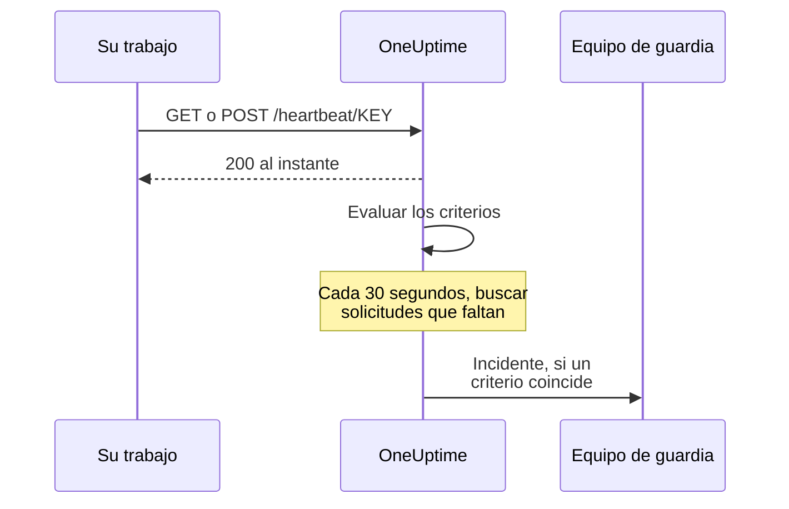

# Monitor de solicitudes entrantes

Un monitor de solicitudes entrantes le da una URL a la que otros sistemas envían solicitudes HTTP. OneUptime evalúa cada solicitud con sus criterios y puede cambiar el estado del monitor, declarar incidentes y avisar a su equipo de guardia.

Cubre dos trabajos distintos:

- **Monitoreo por latido** — un trabajo cron, un worker o un dispositivo llama a la URL de forma programada, y OneUptime abre un incidente cuando las llamadas dejan de llegar.
- **Recibir alertas de otro sistema** — Prometheus Alertmanager, Grafana o cualquier cosa capaz de enviar JSON por POST envía sus alertas, y OneUptime convierte cada una en un incidente con escalado de guardia y resolución automática al recuperarse.

Ambos usan el mismo tipo de monitor. Lo que los separa son los criterios que configura.

:::cards
- [Crear el monitor](#crear-un-monitor-de-solicitudes-entrantes): Obtenga una URL de latido en pocos pasos.
- [Enviar un latido](#enviar-un-latido): Desde curl, cron, Node.js, Python o Go.
- [Alertar cuando cesan las llamadas](#marcar-sin-conexión-si-no-hay-latido-en-10-minutos-un-interruptor-de-hombre-muerto): Convierta el monitor en un interruptor de hombre muerto.
- [Recibir alertas](#recibir-alertas-de-otro-sistema): Un incidente por cada alerta de Alertmanager o Grafana.
- [Suscribirse a SNS o Event Grid](#suscribirse-a-amazon-sns-o-azure-event-grid): Confirme la suscripción con un clic.
:::

## Cómo funciona

Nada comprueba su sistema desde fuera: su sistema llama a la URL del monitor, OneUptime responde al instante y luego evalúa la solicitud con los criterios del monitor. Un criterio que busca solicitudes que *dejaron* de llegar también se vuelve a comprobar en segundo plano cada 30 segundos, para que el silencio también pueda abrir un incidente.



Úselo para:

- Monitorear trabajos cron y tareas programadas
- Verificar que los workers en segundo plano están en marcha
- Monitorear servicios detrás de cortafuegos a los que no se puede llegar desde fuera
- Recibir alertas de Prometheus Alertmanager, Grafana y otros sistemas de alertas
- Seguir las señales de latido de cualquier sistema capaz de usar HTTP

## Crear un monitor de solicitudes entrantes

:::steps
### Empezar un monitor nuevo

Vaya a **Monitores** y haga clic en **Crear monitor**.

### Elegir Solicitud entrante

En **Tipo de monitor**, elija **Solicitud entrante**: es uno de los tipos habituales de la parte superior. Introduzca un **Nombre** y haga clic en **Siguiente**.

### Revisar los criterios

El paso **Criterios** empieza con [los criterios predeterminados](#lo-que-obtiene-de-entrada). Para un latido, haga clic en **Añadir criterios** y dé al nuevo criterio un filtro **Solicitud entrante** / **No recibido en minutos** que cambie el estado a sin conexión y declare un incidente, con **Resolver incidente automáticamente** activado. Después, arrástrelo al principio de la lista; consulte [Criterios de ejemplo](#criterios-de-ejemplo) para saber por qué.

### Crear el monitor

Haga clic en **Crear monitor**. El monitor se abre en su página **Vista general**, donde la tarjeta **Envía el primer latido** muestra la **URL de latido** con un botón para copiar y un comando `curl` de ejemplo.

### Enviar la primera solicitud

Configure su servicio para que envíe solicitudes a esa URL (consulte [Enviar un latido](#enviar-un-latido)). Cuando llega la primera solicitud, la tarjeta deja paso al historial del monitor, y una tarjeta **URL de latido** muestra la URL y cuándo llegó la última solicitud.
:::

> [!NOTE]
> La URL contiene la clave secreta del monitor, así que solo pueden verla las personas que pueden editar monitores. Puede volver a encontrarla en cualquier momento en la página **Documentación** del monitor, en la sección **Configuración** de su menú lateral.

## La URL de solicitud

Su monitor tiene una URL única con este formato:

```text
https://oneuptime.com/heartbeat/YOUR_SECRET_KEY
```

Sustituya `https://oneuptime.com` por la URL de su instancia de OneUptime si la aloja usted mismo.

Envíe solicitudes **GET** o **POST** a esta URL. HEAD se acepta y se trata como GET; PUT, PATCH y DELETE devuelven 404. La clave secreta de la ruta es la credencial: no hace falta ninguna cabecera ni token, salvo que el proyecto [exija un secreto en cada solicitud](#exigir-un-secreto-en-cada-solicitud). Las cadenas de consulta se ignoran: envíe lo que deban leer los criterios en el cuerpo o en las cabeceras.

> [!WARNING]
> Cualquiera que conozca esta URL puede marcar el monitor como sano, así que trátela como un secreto. Si se filtra, abra la página **Ajustes** del monitor y haga clic en **Restablecer clave secreta de solicitud entrante**, y después actualice cada emisor. La vista general del monitor muestra la última solicitud tal como la guardan sus registros: con los secretos y los datos personales enmascarados, y sin cabeceras ni cuerpo cuando **Conservar el contenido de la solicitud** está desactivado. El enmascaramiento detecta los nombres y patrones que conoce, así que no envíe claves de API ni tokens a este endpoint.

> [!IMPORTANT]
> OneUptime responde `200` con un objeto JSON vacío (`{}`) al instante y procesa la solicitud en una cola. Esa respuesta se escribe antes de cualquier validación, así que un `200` **no** confirma que la solicitud se aceptó: una clave secreta incorrecta, un monitor eliminado y un monitor desactivado también devuelven `200`. Revise la cronología del monitor para confirmar que las solicitudes llegan. Un proyecto que exige un secreto en cada solicitud responde `401` a una solicitud sin ninguno, y un servicio que comprueba la URL antes de entregar nada recibe la respuesta que espera: consulte [Servicios que comprueban primero la URL](#servicios-que-comprueban-primero-la-url).

### Enviar un cuerpo de solicitud

Si quiere acceder a campos dentro del cuerpo (`{{requestBody.status}}` en un título de incidente, una ruta JSON en la agrupación de incidentes o un criterio de expresión JavaScript), envíe `Content-Type: application/json`. Es el formato que esta documentación da por supuesto en todo momento. El cuerpo debe ser un objeto o un array JSON: un JSON mal formado, o un valor suelto como `"error"`, se rechaza con un `500`.

| Tipo de contenido | Qué ven los criterios y las plantillas |
| --- | --- |
| `application/json` | El JSON analizado. |
| `application/x-www-form-urlencoded` | El formulario analizado. Las claves entre corchetes se anidan (`alerts[0][status]=firing`), y cada valor es una cadena. |
| `text/plain` | El JSON analizado, cuando el texto es un objeto o un array JSON: así envía Amazon SNS sus mensajes. Cualquier otro texto es el propio texto, así que `backup failed: error 42` deja el monitor fuera de línea con los criterios predeterminados. |
| `application/cloudevents+json`, u otro tipo `+json` | El JSON analizado: así entrega Azure Event Grid los CloudEvents. |
| Cualquier otro, o ninguno | Un cuerpo vacío (`{}`), así que ninguna referencia a `requestBody` se resuelve, y una plantilla la deja tal cual. |

Se aceptan cuerpos de hasta 50 MB; uno más grande se rechaza con un `413`. No comprima el cuerpo con `Content-Encoding: gzip`: no se guarda como JSON, y las rutas dentro de él no se resolverán.

### Enviar un latido

Cada ejemplo envía una solicitud. Sustituya `YOUR_SECRET_KEY` por la clave de la URL de su monitor.

:::tabs
@tab curl
```bash
# Simple GET request
curl https://oneuptime.com/heartbeat/YOUR_SECRET_KEY

# POST request with a JSON body
curl -X POST https://oneuptime.com/heartbeat/YOUR_SECRET_KEY \
  -H "Content-Type: application/json" \
  -d '{"status": "healthy", "version": "1.2.3"}'
```
@tab Cron
```bash
# Send a heartbeat every 5 minutes
*/5 * * * * curl -fsS https://oneuptime.com/heartbeat/YOUR_SECRET_KEY > /dev/null

# Or ping only when the job succeeds, so a failed run counts as a missed heartbeat
0 2 * * * /usr/local/bin/backup.sh && curl -fsS https://oneuptime.com/heartbeat/YOUR_SECRET_KEY > /dev/null
```
@tab Node.js
```javascript title="heartbeat.mjs"
// Node.js 18 or later: fetch is built in. Run with `node heartbeat.mjs`.
const response = await fetch(
  "https://oneuptime.com/heartbeat/YOUR_SECRET_KEY",
  {
    method: "POST",
    headers: { "Content-Type": "application/json" },
    body: JSON.stringify({ status: "healthy", version: "1.2.3" }),
  },
);

console.log(response.status); // 200
```
@tab Python
```python title="heartbeat.py"
# Python 3, standard library only. Run with `python3 heartbeat.py`.
import json
import urllib.request

request = urllib.request.Request(
    "https://oneuptime.com/heartbeat/YOUR_SECRET_KEY",
    data=json.dumps({"status": "healthy", "version": "1.2.3"}).encode(),
    headers={"Content-Type": "application/json"},
    method="POST",
)

with urllib.request.urlopen(request, timeout=10) as response:
    print(response.status)  # 200
```
@tab Go
```go title="heartbeat.go"
// Run with `go run heartbeat.go`.
package main

import (
	"bytes"
	"fmt"
	"net/http"
)

func main() {
	body := []byte(`{"status": "healthy", "version": "1.2.3"}`)

	resp, err := http.Post(
		"https://oneuptime.com/heartbeat/YOUR_SECRET_KEY",
		"application/json",
		bytes.NewReader(body),
	)
	if err != nil {
		panic(err)
	}
	defer resp.Body.Close()

	fmt.Println(resp.StatusCode) // 200
}
```
@tab PowerShell
```powershell
# Windows PowerShell 5.1 or PowerShell 7
Invoke-RestMethod -Method Post `
  -Uri "https://oneuptime.com/heartbeat/YOUR_SECRET_KEY" `
  -ContentType "application/json" `
  -Body '{"status": "healthy", "version": "1.2.3"}'
```
:::

## Exigir un secreto en cada solicitud

Cualquiera que tenga la URL de un monitor puede enviarle solicitudes. Un Propietario del proyecto o Administrador del proyecto puede hacer que cada monitor de solicitudes entrantes del proyecto exija además uno de los secretos propios del proyecto, sin importar quién configuró el monitor: active **Exigir un secreto en cada solicitud**. Una solicitud sin ninguno se rechaza con `401` y el motivo, antes de contar como latido, de guardarse como la última solicitud del monitor o de llegar a ningún criterio. Una solicitud con uno sigue hacia los criterios propios del monitor, como antes.

Los Propietarios del proyecto y los Administradores del proyecto gestionan los secretos y el interruptor, y también un rol personalizado con los permisos Create, Read, Edit y Delete Incoming Request Secret: Read muestra los valores de los secretos, y Edit además activa y desactiva el interruptor.

:::steps
### Cree un secreto

Vaya a **Monitores → Ajustes → Secretos de solicitud entrante** y cree un secreto. Dele un nombre y OneUptime genera el valor; cópielo de la lista.

### Envíelo desde cada remitente

Envíe el secreto en la cabecera `X-OneUptime-Secret`, o como token Bearer en la cabecera `Authorization`, según lo que su remitente pueda establecer. Un remitente que no puede establecer una cabecera propia puede firmar cada solicitud con el secreto en su lugar: consulte [Firmar las solicitudes con el secreto](#firmar-las-solicitudes-con-el-secreto).

### Encuentre los remitentes que faltan

En cuanto el proyecto tiene un secreto, OneUptime comprueba cada solicitud, todavía sin rechazar ninguna. **Solicitudes sin secreto**, en la misma página, enumera cada monitor de solicitudes entrantes que recibió una solicitud sin un secreto válido en las últimas 24 horas, y por qué: no se envió ninguno, o se envió uno incorrecto. Corrija esos remitentes. Un monitor cuyos remitentes estén corregidos muestra en **Última con secreto** una hora posterior a la de **Última sin secreto**, y sale de la lista en menos de 24 horas.

### Active el requisito

Active **Exigir un secreto en cada solicitud**. No se puede activar mientras el proyecto no tenga ningún secreto, para que ningún remitente sea rechazado por error. Antes de activarse, indica cuántos monitores de solicitudes entrantes recibieron una solicitud sin un secreto válido en las últimas 24 horas, si los hay: sus remitentes se rechazan desde entonces.
:::

```bash
curl -X POST https://oneuptime.com/heartbeat/YOUR_SECRET_KEY \
  -H "X-OneUptime-Secret: YOUR_PROJECT_SECRET"

# Or as a bearer token
curl -X POST https://oneuptime.com/heartbeat/YOUR_SECRET_KEY \
  -H "Authorization: Bearer YOUR_PROJECT_SECRET"
```

OneUptime nunca guarda el secreto: quita la cabecera de la solicitud y enmascara un token Bearer que sea uno de los secretos del proyecto antes de guardar nada.

Una dirección que envía a un monitor más de 10 secretos incorrectos distintos en 15 minutos se rechaza después con `429` con cualquier secreto que envíe, correcto o no, hasta la hora que indica su cabecera `Retry-After`, como mucho 15 minutos. Los remitentes en otras direcciones no se ven afectados, y un remitente que sigue enviando un secreto antiguo sigue recibiendo el `401` que dice qué está mal.

> [!TIP]
> Para reemplazar un secreto sin rechazar a nadie, cree un segundo, pase sus remitentes a él y luego elimine el antiguo cuando su **Último uso** deje de cambiar. Se acepta cualquiera de los secretos del proyecto salvo que esté limitado a otros monitores, y el último que cubre un monitor no se puede eliminar mientras el requisito esté activo.

### Firmar las solicitudes con el secreto

Un remitente puede firmar cada solicitud con el secreto en lugar de enviarlo, lo que es más seguro: no viaja nada secreto, y una solicitud que alguien capture no se puede volver a enviar más tarde. Prefiéralo siempre que un remitente pueda firmar. OneUptime comprueba estas firmas, cada una un HMAC-SHA256 en hexadecimal con el secreto como clave:

| Remitente | Cabecera | Qué se firma |
| --- | --- | --- |
| Su propio código | `X-OneUptime-Signature: t=<time>,v1=<signature>` | `<time>.<body>` |
| Webhooks de GitHub | `X-Hub-Signature-256` | El cuerpo |
| Slack | `X-Slack-Signature`, con `X-Slack-Request-Timestamp` | `v0:<time>:<body>` |
| Stripe | `Stripe-Signature` | `<time>.<body>` |

`<time>` es el momento en que se firmó la solicitud, en segundos desde 1970. Se rechaza una firma a más de 5 minutos del reloj de OneUptime, y también una solicitud firmada enviada por segunda vez; la firma de GitHub no lleva hora, así que OneUptime recuerda cada una durante un día. Para GitHub, dé al webhook uno de los secretos del proyecto como su secreto. Slack y Stripe crean su propio secreto de firma: cree el secreto del proyecto con ese valor, en **Más campos**.

```bash
body='{"status":"healthy"}'
t=$(date +%s)
sig=$(printf '%s.%s' "$t" "$body" | openssl dgst -sha256 -hmac "YOUR_PROJECT_SECRET" | sed 's/^.* //')

curl -X POST https://oneuptime.com/heartbeat/YOUR_SECRET_KEY \
  -H "Content-Type: application/json" \
  -H "X-OneUptime-Signature: t=$t,v1=$sig" \
  -d "$body"
```

No se acepta un secreto en la cadena de consulta de la URL: los proxies y los registros de acceso guardan las URL completas, junto a la clave propia del monitor. El ingress de solicitudes entrantes de una sonda reenvía el cuerpo de una solicitud firmada tal como llegó, así que su firma también vale por ese camino.

### Limitar un secreto a algunos monitores

Cada monitor de solicitudes entrantes del proyecto acepta un secreto a menos que usted lo limite, como hace un proyecto cuyos inquilinos envían cada uno su propio secreto: en **Más campos**, elija **Monitores específicos** o **Monitores con etiquetas**. Cualquier otro monitor lo rechaza con `401`, como rechaza un secreto incorrecto, y **Solicitudes sin secreto** da como motivo **Secreto no válido para este monitor**. Mientras el requisito esté activo, el proyecto conserva al menos un secreto que cubre un monitor.

## Criterios de monitoreo

Puede configurar criterios para decidir cuándo su servicio se considera en línea, degradado o sin conexión. Cada filtro de criterio tiene un **Tipo de filtro** (qué se mira), una **Condición de filtro** (cómo se compara) y un **Valor**.

### Lo que obtiene de entrada

Un monitor de solicitudes entrantes nuevo se crea con dos criterios que leen el cuerpo de la solicitud:

| Criterio | Tipo de filtro | Condición de filtro | Valor | Efecto |
| -------- | ------------ | ---------------- | ------- | -------------------------------------------- |
| Sin conexión | Cuerpo de la solicitud | Contiene | `error` | Marca el monitor sin conexión, abre un incidente |
| En línea | Cuerpo de la solicitud | No contiene | `error` | Marca el monitor en línea |

Esto sirve para el caso habitual en que el emisor informa de su propio estado en la carga útil: una solicitud cuyo cuerpo menciona `error` deja el monitor sin conexión, y la siguiente solicitud sin esa palabra lo devuelve a en línea y resuelve el incidente. Una solicitud sin ningún cuerpo cuenta como «no contiene `error`», así que una simple llamada de latido mantiene el monitor en línea.

Cambie el valor por lo que su emisor envía de verdad (`"status":"firing"`, `FAILED`, etc.): la coincidencia es una búsqueda de subcadena que distingue mayúsculas y minúsculas sobre todo el cuerpo, claves incluidas, así que `{"error":null}` también coincide con `error`.

> [!NOTE]
> Estos criterios predeterminados **no** son un interruptor de hombre muerto: nada aquí se activa cuando dejan de llegar solicitudes. Si quiere que se le avise del silencio, añada un criterio **Solicitud entrante** / **No recibido en minutos** como se describe más abajo.

### Tipos de filtro disponibles

| Tipo de filtro | Comprueba | Notas |
| --------------------- | ------------------------------------------------------ | -------------------------------------------------------------------------------------------- |
| Solicitud entrante | Si se recibió una solicitud dentro de una ventana de tiempo | La única comprobación que puede activarse cuando no llega nada |
| Cuerpo de la solicitud | El cuerpo de la solicitud | Coincidencia de subcadena. Los cuerpos de objeto se comparan como JSON compacto |
| Encabezado de la solicitud | Los nombres de las cabeceras de la solicitud | Coincidencia exacta con un nombre de cabecera completo, sin distinguir mayúsculas y minúsculas |
| Valor del encabezado de la solicitud | Los valores de las cabeceras de la solicitud | Coincidencia exacta con un valor de cabecera completo, sin distinguir mayúsculas y minúsculas |
| Expresión de JavaScript | Cualquier expresión sobre `requestBody` y `requestHeaders` | La opción más flexible; consulte [Expresiones JavaScript](/docs/monitor/javascript-expression) |

### Condiciones de filtro

Cada tipo de filtro ofrece sus propias condiciones:

| Tipo de filtro | Condiciones |
| --- | --- |
| **Solicitud entrante** | **Recibido en minutos**: se recibió una solicitud dentro del número de minutos indicado. **No recibido en minutos**: no se recibió ninguna solicitud dentro del número de minutos indicado. |
| **Cuerpo de la solicitud**, **Encabezado de la solicitud**, **Valor del encabezado de la solicitud** | **Contiene** y **No contiene** |
| **Expresión de JavaScript** | **Se evalúa como verdadero** |

> [!NOTE]
> Los nombres y valores de las cabeceras se comparan en minúsculas, con el nombre o el valor completo, no con una subcadena: `application/json` no coincide con `application/json; charset=utf-8`. Solo **Cuerpo de la solicitud** busca subcadenas. Las cabeceras que añade su proxy o el balanceador de carga de OneUptime (`x-forwarded-for`, `x-real-ip`) también se guardan.

Los cuerpos de objeto se comparan como JSON compacto sin espacios, así que un filtro **Cuerpo de la solicitud** / **Contiene** debe escribirse `"status":"firing"`: copiar `"status": "firing"` de una carga útil con formato nunca coincidirá.

### Criterios de ejemplo

#### Marcar sin conexión si no hay latido en 10 minutos (un interruptor de hombre muerto)

| Campo | Valor |
| --- | --- |
| **Tipo de filtro** | Solicitud entrante |
| **Condición de filtro** | No recibido en minutos |
| **Valor** | `10` |

#### Marcar como degradado según el contenido del cuerpo de la solicitud

| Campo | Valor |
| --- | --- |
| **Tipo de filtro** | Cuerpo de la solicitud |
| **Condición de filtro** | Contiene |
| **Valor** | `"status":"degraded"` |

> [!IMPORTANT]
> Coloque el interruptor de hombre muerto **por encima** de los criterios predeterminados. Los criterios se comprueban desde arriba, y el primero que coincide decide. La comprobación en segundo plano vuelve a leer la última solicitud, así que el criterio en línea predeterminado —"Cuerpo de la solicitud No contiene `error`"— sigue coincidiendo con ella, y un criterio que esté debajo nunca llega a evaluarse. **Añadir criterios** añade un criterio al final: arrástrelo hacia arriba.

> [!WARNING]
> Un monitor solo se vuelve a evaluar en segundo plano si al menos uno de sus criterios comprueba **Solicitud entrante**. Un monitor cuyos criterios solo comprueban el cuerpo de la solicitud, Encabezado de la solicitud o una expresión JavaScript se evalúa cuando llega una solicitud y en ningún otro momento, así que nunca puede quedar sin conexión por sí solo. Si quiere una alarma por latido ausente, necesita un criterio **Solicitud entrante**.

La comprobación en segundo plano cuenta minutos completos y se activa cuando ha pasado *más* que el valor: "No recibido en minutos: 10" se activa unos 11 minutos después de la última solicitud (la comprobación se ejecuta cada 30 segundos). Un monitor que nunca ha recibido una solicitud se trata como si su hora de creación fuera la última solicitud, así que el mismo criterio en un monitor recién creado se activa unos 11 minutos después de crearlo, aunque el emisor nunca se haya conectado. Solo cuentan los minutos en los que OneUptime estaba recibiendo: los minutos en los que el propio OneUptime se reinicia, se actualiza o se pone al día no cuentan, como explica [Cuando OneUptime no recibe datos](/docs/monitor/when-oneuptime-is-not-receiving).

## Recibir alertas de otro sistema

Alertmanager, Grafana y herramientas similares envían por POST un documento JSON que describe una o varias alertas. De forma predeterminada, un criterio abre **un** incidente, así que una carga útil con cinco alertas produciría un único incidente. La agrupación de incidentes cambia eso: extrae un valor de la carga útil y abre un **incidente separado por cada valor distinto**, que pueden estar abiertos todos a la vez.

```mermaid title="Agrupación de incidentes: un incidente por alerta de la carga útil"
flowchart TB
    payload["Carga útil del webhook"] --> keys["Una clave por alerta"]
    keys --> state{"¿Alerta resuelta?"}
    state -->|No| open["Abrir o mantener su incidente"]
    state -->|Sí| resolve["Resolver su incidente"]
```

### Activar la agrupación de incidentes

:::steps
1. Abra el criterio y despliegue **Ajustes**.
2. Active **Agrupa incidentes y alertas por un campo de la carga útil**.
3. Rellene **Abrir un incidente separado para cada…**. Para que cada incidente se resuelva solo, rellene también el campo y el valor de **Auto-resolve each incident when…** (más abajo). Después, guarde el monitor.
:::

| Campo | Ejemplo | Qué hace |
| ---------------------------------- | ---------------------------------------- | ---------------------------------------------------------------------- |
| Abrir un incidente separado para cada… | `requestBody.alerts[*].labels.alertname` | La ruta cuyos valores distintos separan los incidentes |
| Campo que indica la recuperación | `requestBody.alerts[*].status` | La ruta que se comprueba para decidir que una alerta se ha recuperado |
| Valor que significa recuperado | `resolved` | El valor exacto que marca la recuperación |
| Máximo de incidentes por solicitud | `100` (predeterminado) | Límite de seguridad para que un campo con muchos valores no pueda abrir incidentes sin límite |

La agrupación pertenece al criterio en el que está activada. Los demás criterios del monitor no agrupan: cuando uno de ellos coincide con una solicitud, abre su incidente y su alerta como lo haría en un monitor en el que ningún criterio agrupa.

### Sintaxis de las rutas

Las rutas deben empezar por el prefijo literal `requestBody.`. Una ruta sin él —`alerts[*].labels.alertname`— no encuentra ningún valor en ninguna solicitud. La envoltura `{{ }}` es opcional: `requestBody.status` y `{{requestBody.status}}` se comportan igual.

- `[*]` se despliega sobre un array: un incidente por valor **distinto**. Dos elementos que dan el mismo valor se funden en un solo incidente, y su estado (activo/resuelto) se toma del **primer** elemento que coincide. **Solo el primer `[*]` de una ruta es un comodín**; `requestBody.groups[*].alerts[*].name` no coincide con nada.
- `[0]` y `[last]` seleccionan un único elemento, y pueden ir después de un `[*]`.
- Los valores de objeto y de array, las cadenas vacías y los valores nulos se omiten. `0` y `false` son claves válidas.
- El cuerpo debe ser un objeto JSON; una carga útil cuyo nivel superior es un array no se agrupa.

### Solicitudes sin el campo

Una solicitud que coincide con un criterio agrupado pero no tiene valor en su ruta —el campo falta o está vacío, contiene un objeto o una lista, o el cuerpo no es un objeto JSON— sigue abriendo el incidente y la alerta de ese criterio: uno para todo el monitor, como lo haría el criterio sin agrupación. Lo mismo hace un criterio agrupado que coincide porque las solicitudes dejaron de llegar. Un título que nombra la variable de agrupación, como `{{alertname}}`, la muestra tal como está escrita, porque no hay ningún valor que poner.

Ese incidente se resuelve, si **Resolver incidente automáticamente** está activado, cuando una solicitud posterior sin el campo informa de que se ha recuperado, o cuando una solicitud posterior coincide con otro criterio. Esa recuperación no abre nada nuevo.

Cuando algunos elementos de un array tienen un valor y otros no, cada valor abre su propio incidente, y los elementos sin valor no abren nada propio.

La tarjeta **Resumen del monitor** de la **Vista general** del monitor muestra lo que hizo cada solicitud, incluido cuándo un criterio la trató para todo el monitor o no abrió nada nuevo.

### La resolución depende de los eventos

Un webhook solo describe lo que hay en esa carga útil, así que OneUptime nunca resuelve un incidente porque su clave haya dejado de aparecer. Un incidente solo se resuelve cuando una carga útil dice explícitamente que esa clave se ha recuperado. Deben cumplirse las dos cosas:

1. **Campo que indica la recuperación** y **Valor que significa recuperado** están definidos y coinciden con la carga útil. La comparación es exacta y distingue mayúsculas y minúsculas: `Resolved` no coincide con `resolved`.
2. El incidente del criterio tiene activado **Resolver incidente automáticamente**, en **Más campos** del formulario del incidente. Sin ello, los eventos de recuperación que coinciden se ignoran y los incidentes siguen abiertos. (Lo mismo vale para las alertas y **Resolver alerta automáticamente**.) El criterio predeterminado de sin conexión lo tiene activado desde el principio; un incidente que añade usted mismo a un criterio empieza con la opción desactivada.

Una alerta que añade usted mismo a un criterio también empieza con **Resolver alerta automáticamente** desactivado, así que una recuperación deja la alerta abierta hasta que se active. **Auto-resolve each incident when…** indica qué incidentes y alertas del criterio resuelve una recuperación, y nombra cada uno que dejaría abierto, con un botón que activa su opción. La tarjeta **Resumen del monitor** de la **Vista general** del monitor nombra cada incidente y alerta que una recuperación dejó abiertos, y por qué.

**Máximo de incidentes por solicitud** limita la extracción, no solo la creación. Las claves que superan el límite también son invisibles para la recuperación, así que, en una carga útil con más claves distintas que el límite, una alerta que informe `resolved` por encima de él no cerrará su incidente.

> [!NOTE]
> Un monitor con un criterio que agrupa por un campo de la carga evalúa cada solicitud que recibe, una a la vez y en el orden en que llegaron, así que una ráfaga de alertas y recuperaciones abre y resuelve el incidente y la alerta de cada valor. Hasta 1.000 solicitudes, o 16 MB de ellas, esperan a ser evaluadas; pasado eso, se omiten las más antiguas en espera, y la tarjeta **Resumen del monitor** dice cuántas. Un monitor sin agrupación evalúa solo la más reciente de las solicitudes que lo esperan.

> [!NOTE]
> Si **Campo que indica la recuperación** contiene `[*]` pero **Abrir un incidente separado para cada…** no, una solicitud solo se ha recuperado cuando todos los elementos de ese array lo dicen. Con `requestBody.alerts[*].status` y `resolved`, un incidente agrupado por `requestBody.groupLabels.alertname` se resuelve cuando todas las alertas de una solicitud están resueltas, y sigue abierto mientras alguna siga activa.

> [!WARNING]
> Una ruta de recuperación sin `[*]` se evalúa sobre toda la carga útil, así que un `status: resolved` a nivel de la carga útil resuelve todas las claves de esa carga útil, incluidas las alertas cuyo propio estado sigue activo.

### Poner nombre a los incidentes

La clave de agrupación se expone a las plantillas de incidentes y alertas como una variable que lleva el nombre del **último segmento de la ruta**:

| Ruta | Variable |
| ---------------------------------------- | ----------------- |
| `requestBody.alerts[*].labels.alertname` | `{{alertname}}`   |
| `requestBody.alerts[*].fingerprint`      | `{{fingerprint}}` |
| `requestBody.commonLabels.severity`      | `{{severity}}`    |

La carga útil completa está disponible junto a ella, así que funcionan tanto un título de incidente `{{alertname}}` como una descripción que haga referencia a `{{requestBody.commonAnnotations.summary}}`. Consulte [Plantillas de incidentes y alertas](/docs/monitor/incident-alert-templating).

> [!WARNING]
> El nombre de la variable forma parte de la identidad que usa OneUptime para emparejar un evento de recuperación con un incidente abierto. Cambiar la ruta de agrupación por otra con un último segmento distinto deja huérfanos todos los incidentes abiertos con la ruta anterior: ya no se pueden resolver automáticamente y hay que cerrarlos a mano.

`[*]` funciona **solo** en los dos campos de ruta de agrupación. En cualquier otro lugar no se resuelve, y un marcador sin resolver se imprime **tal cual** en lugar de vaciarse: un título `{{requestBody.alerts[*].labels.alertname}}` se muestra con las llaves. Un título `{{requestBody.alerts[0].annotations.summary}}` sí se resuelve, pero siempre lee la primera alerta de la carga útil, no la que abrió este incidente. Prefiera la variable de agrupación más los campos compartidos `commonAnnotations` de la carga útil.

### Ejemplo completo

Para una configuración completa de Alertmanager, consulte [Prometheus Alertmanager](/docs/integrations/prometheus-alertmanager). Para Grafana, consulte [Grafana](/docs/integrations/grafana).

## Servicios que comprueban primero la URL

Algunos servicios comprueban un endpoint nuevo antes de entregarle nada: le envían una solicitud y solo entregan cuando responde como esperan. OneUptime responde a estas comprobaciones por sí mismo, así que basta con pegar la **URL de latido** del monitor en el servicio.

| Servicio | La comprobación | Qué responde OneUptime |
| --- | --- | --- |
| Azure Event Grid, esquema Event Grid | Un `SubscriptionValidationEvent` | Su `validationCode`, como `validationResponse` |
| Azure Event Grid, esquema CloudEvents | Una solicitud `OPTIONS` que nombra su origen | `WebHook-Allowed-Origin`, con ese origen |
| API de eventos de Slack | Una solicitud `url_verification` | Su `challenge` |
| Notificaciones de cambios de Microsoft Graph | Un `POST` con un `validationToken` | El token, como `text/plain` |
| Event hooks de Okta | Un `GET` con `X-Okta-Verification-Challenge` | El desafío, como `verification` |

Una comprobación solo se responde en la URL propia de un monitor, y solo cuando la solicitud cuenta: en un proyecto que exige un secreto en cada solicitud, una comprobación que no envía ninguno se rechaza con `401`, como cualquier solicitud, así que el servicio debe enviar el secreto en un encabezado. La respuesta contiene lo que el servicio envió para que se le devuelva, y nada más de la solicitud, y solo cuando tiene la forma que el servicio le da.

Una comprobación llega al monitor como cualquier solicitud, así que sus criterios la evalúan y aparece en la **Vista general** del monitor; la comprobación de CloudEvents se responde y nada más. El ingress de solicitudes entrantes de una sonda responde a una comprobación como a cualquier solicitud, con `{}`, así que envíe estos servicios a la URL propia de OneUptime.

## Suscribirse a Amazon SNS o Azure Event Grid

Amazon SNS no envía nada a un endpoint nuevo hasta que alguien confirma la suscripción abriendo un enlace que le envía. Azure Event Grid también envía un enlace así, a un endpoint que no responde a su comprobación, y OneUptime la responde. Cuando llega un enlace que aún hay que abrir, la tarjeta **Resumen del monitor** de la **Vista general** del monitor muestra qué espera el servicio, el tema y un botón que abre el enlace en una pestaña nueva.

| Servicio | La solicitud | Botón | Validez del enlace |
| --- | --- | --- | --- |
| Amazon SNS | `SubscriptionConfirmation`, para una nueva suscripción HTTPS | **Confirmar suscripción** | Dos días |
| Amazon SNS | `UnsubscribeConfirmation`, cuando se elimina la suscripción | **Restaurar suscripción** | Dos días |
| Azure Event Grid | `SubscriptionValidationEvent`, para una nueva suscripción de eventos por webhook | **Validar suscripción** | 10 minutos |

El botón se mantiene hasta que llega la próxima solicitud del monitor, incluso después de abrir el enlace. Cuando vence el plazo del enlace, la tarjeta indica en su lugar cómo obtener uno nuevo. Si han llegado solicitudes más recientes, abra **Registros de monitoreo** y haga clic en **Ver resumen** en la fila de la solicitud.

El enlace, y el token que contiene, se guardan sin enmascarar dondequiera que se guarde la solicitud: sus detalles, sus registros y los incidentes y alertas que abre. Lo único que puede hacer el enlace es iniciar las entregas a este monitor. Solo cuenta un enlace a la dirección propia del servicio: cualquier otro se enmascara como de costumbre y no recibe botón.

### Amazon SNS

:::steps
1. En la consola de Amazon SNS, abra el tema y elija **Create subscription**. Elija `HTTPS` como protocolo y pegue la **URL de latido** del monitor como endpoint.
2. Abra la **Vista general** del monitor y haga clic en **Confirmar suscripción** en la tarjeta **Resumen del monitor**. En la consola de SNS, el estado de la suscripción pasa de **Pending confirmation** a confirmada.
:::

SNS envía sus mensajes como JSON etiquetado como `text/plain`, y el monitor los lee como JSON, así que los criterios, las plantillas y la agrupación de incidentes pueden usar sus campos, como `{{requestBody.Subject}}` y `{{requestBody.Message}}`. El JSON propio de una notificación, como el de una alarma de CloudWatch, llega como texto en `Message`.

Si la tarjeta dice que el enlace ya no se puede abrir, seleccione la suscripción en la consola de SNS y elija **Request confirmation**. SNS elimina una suscripción que no se confirma en 48 horas; si eso ocurre, vuelva a crear la suscripción.

### Azure Event Grid

:::steps
1. En el portal de Azure, abra el recurso cuyos eventos quiere recibir y añada una suscripción de eventos. Elija **Event Grid Schema** o **Cloud Event Schema v1.0** como esquema de eventos, **Web Hook** como tipo de endpoint y la **URL de latido** del monitor como endpoint.
2. Cree la suscripción de eventos. OneUptime responde a la comprobación de Event Grid, así que la suscripción se valida al crearse y sus eventos empiezan a llegar.
:::

Event Grid valida un endpoint que le devuelve un código, o cuyo propietario abre el enlace que envía. OneUptime devuelve el código, así que la tarjeta **Resumen del monitor** ofrece **Validar suscripción** solo para una validación que OneUptime no respondió: ábrala en un plazo de 10 minutos. El enlace apunta a Event Grid en el puerto 553, que un firewall situado delante de su navegador debe permitir. Si antes pasan 10 minutos, la suscripción de eventos falla: vuelva a crearla.

## Buenas prácticas

1. **Ajuste bien la ventana de tiempo**: si su trabajo cron se ejecuta cada 5 minutos, ponga el umbral de "No recibido en minutos" en 10–15 minutos para admitir retrasos ocasionales, y ponga ese criterio el primero.
2. **Incluya datos útiles**: envíe información de estado en el cuerpo de la solicitud para poder definir criterios detallados.
3. **Use POST con `Content-Type: application/json`**: todo lo que lee dentro del cuerpo depende de ello.
4. **No mezcle los dos trabajos en un mismo monitor**: un monitor que recibe alertas por eventos no tiene un ritmo regular, así que un criterio "No recibido en minutos" en él oscilaría. Use un monitor aparte para el interruptor de hombre muerto.
5. **Vigile al vigilante**: asegúrese de que el servicio que envía las solicitudes gestiona bien los errores, para que las solicitudes fallidas no pasen desapercibidas.

## Solución de problemas

:::details Mi emisor recibe un 200, pero no aparece nada en el monitor
El `200` se envía antes de validar la solicitud, así que no demuestra que se haya aceptado. Compruebe que la clave secreta de la URL coincide con la **URL de latido** del monitor, y que el monitor no está desactivado. Después, mire la cronología del monitor para ver si llegan solicitudes.
:::

:::details Mi remitente recibe un 401
El proyecto exige un secreto en cada solicitud, y la solicitud no envió ninguno, o envió uno que no es del proyecto: la respuesta indica cuál de los dos. Envíe uno de los secretos del proyecto en la cabecera `X-OneUptime-Secret` o como token Bearer, como muestra [Exigir un secreto en cada solicitud](#exigir-un-secreto-en-cada-solicitud). Una solicitud rechazada nunca llega al monitor. También recibe `401` con uno de los secretos del proyecto limitado a otros monitores, y una solicitud firmada cuya firma tiene más de 5 minutos, ya se envió antes, o se hizo con otro secreto o sobre un cuerpo que cambió por el camino.
:::

:::details Mi remitente recibe un 429
Su dirección envió a un monitor más de 10 secretos o firmas incorrectos distintos en 15 minutos, así que cada solicitud con un secreto que envía a ese monitor se rechaza hasta la hora de su cabecera `Retry-After`. Un remitente que firma con un secreto incorrecto genera una firma incorrecta nueva cada vez y llega aquí enseguida: dele un secreto que el monitor acepte, como muestra [Exigir un secreto en cada solicitud](#exigir-un-secreto-en-cada-solicitud), y sus solicitudes se aceptan cuando pase el tiempo.
:::

:::details El monitor dejó de recibir solicitudes desde que se exige un secreto
Sus remitentes no envían ningún secreto, o envían uno incorrecto, así que cada solicitud que envían se rechaza. Una línea bajo la **URL de latido** del monitor indica cuándo llegó la última solicitud rechazada, y **Solicitudes sin secreto** enumera cada monitor que recibió una en las últimas 24 horas, y por qué. Envíe uno de los secretos del proyecto desde esos remitentes, como muestra [Exigir un secreto en cada solicitud](#exigir-un-secreto-en-cada-solicitud).
:::

:::details El monitor nunca queda sin conexión cuando cesan los latidos
Solo un criterio **Solicitud entrante** (**No recibido en minutos**) puede notar el silencio. Añada uno si no lo hay, y arrástrelo por encima de los criterios predeterminados: el criterio en línea predeterminado coincide con la última solicitud en cada comprobación en segundo plano, y el primer criterio que coincide decide.
:::

:::details Un filtro Cuerpo de la solicitud nunca coincide
Envíe `Content-Type: application/json`, y escriba el valor como JSON compacto: `"status":"firing"`, sin espacio después de los dos puntos. Sin un tipo de contenido JSON, de formulario o `text/plain`, el cuerpo está vacío y un filtro sobre él nunca coincide.
:::

:::details Un servicio dice que la URL no respondió a su comprobación
Dé al servicio la **URL de latido** del monitor, en el propio OneUptime y no en una sonda. Si el proyecto exige un secreto en cada solicitud, la comprobación se rechaza con `401` a menos que el servicio envíe el secreto. Después pida al servicio que vuelva a comprobar la URL: se responde al instante.
:::

:::details Un filtro Encabezado de la solicitud nunca coincide
Los nombres y valores de las cabeceras se comparan completos. Indique el valor entero, como `application/json; charset=utf-8`, en lugar de una parte.
:::

:::details Amazon SNS dice que la suscripción está pendiente de confirmación
Haga clic en **Confirmar suscripción** en la tarjeta **Resumen del monitor** de la **Vista general** del monitor. Si han llegado solicitudes más recientes, abra **Registros de monitoreo** y haga clic en **Ver resumen** en la fila de la confirmación. Con **Conservar el contenido de la solicitud** desactivado, el monitor no guarda ningún cuerpo, y por tanto tampoco ningún enlace: actívelo en los **Ajustes** del monitor, y la última solicitud vuelve a mostrarse con su enlace.
:::

:::details El emisor recibe un 500
La solicitud dice `Content-Type: application/json` pero su cuerpo no es un objeto ni un array JSON. Envíe JSON válido, o un tipo de contenido distinto.
:::

## Próximos pasos

:::cards
- [Prometheus Alertmanager](/docs/integrations/prometheus-alertmanager): Una configuración completa de alertas entrantes.
- [Grafana](/docs/integrations/grafana): Lo mismo, para las alertas de Grafana.
- [Plantillas de incidentes y alertas](/docs/monitor/incident-alert-templating): Todas las variables disponibles en títulos y descripciones.
- [Expresiones JavaScript](/docs/monitor/javascript-expression): Sintaxis de las expresiones y reglas de comillas.
:::
