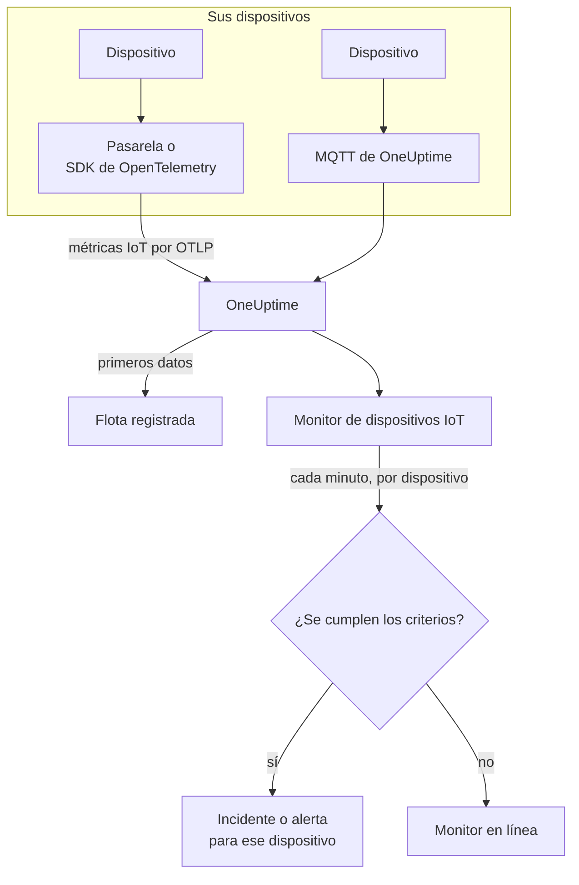

# Monitor de dispositivos IoT

Un monitor de dispositivos IoT vigila una flota de dispositivos y le avisa cuando un dispositivo se desconecta, su batería se agota, su señal se debilita, se sobrecalienta o su CPU sigue ocupada. Lee las métricas `iot_*` que sus dispositivos envían a OneUptime, por OpenTelemetry o MQTT, así que nada se comprueba desde fuera y no interviene ninguna sonda.

:::cards
- [Crear el monitor](#crear-un-monitor-de-dispositivos-iot): Seis pasos en el panel.
- [Plantillas](#plantillas-de-alerta-predefinidas): Cinco alertas listas para usar, un incidente por dispositivo.
- [Detección de desconexión](#detección-de-desconexión): Cómo se detecta un dispositivo caído o en silencio.
- [Métricas](#métricas-recogidas): Las series `iot_*` que lee el monitor.
:::

## Cómo funciona

Sus dispositivos, o la pasarela con la que se comunican, envían sus lecturas a OneUptime: por OpenTelemetry, o directamente al endpoint MQTT de OneUptime. Cada lectura lleva el nombre de la flota, `iot.fleet.name`, y el ID propio del dispositivo, `device.id`. Los primeros datos registran la flota.

Un monitor de dispositivos IoT está ligado a una flota. Cada minuto ejecuta su consulta sobre las métricas de esa flota y compara el resultado con sus criterios. Las plantillas agrupan por `device.id`, así que 30 sensores desconectados abren 30 incidentes, cada uno con el nombre de su dispositivo, y cada uno se resuelve solo cuando su dispositivo se recupera.



## Antes de empezar

- **Haga que sus dispositivos envíen datos.** La [guía de dispositivos IoT](/docs/telemetry/iot-devices) muestra cómo enviar métricas con un SDK o un Collector de OpenTelemetry, o por MQTT.
- **Compruebe que la flota está registrada.** Aparece en **Productos → Infraestructura → IoT → Todas las flotas**, con el nombre del `iot.fleet.name` que envían los dispositivos.
- **Registre los dispositivos que espera**, en el **Registro de dispositivos** de la flota, para que se le avise cuando uno se quede en silencio: consulte [Detección de desconexión](#detección-de-desconexión).

## Crear un monitor de dispositivos IoT

:::steps
### Empezar un monitor nuevo

Vaya a **Monitores** y haga clic en **Crear monitor**.

### Elegir Dispositivo IoT

En **Tipo de monitor**, haga clic en **Más tipos de monitor** y elija **Dispositivo IoT** en **Infraestructura**, o escriba `iot` en el cuadro de búsqueda. Introduzca un **Nombre** - se usa en los títulos de incidentes y alertas - y haga clic en **Siguiente**.

### Elegir la flota

En **Configuración del monitor de IoT**, elija la flota en **Flota IoT**. Cada flota que ha enviado datos está en la lista.

### Elegir qué vigilar

Elija una de las tres pestañas:

- **Quick Setup** - haga clic en una [plantilla](#plantillas-de-alerta-predefinidas). Establece la métrica, la agregación, el intervalo de tiempo, una agrupación por `device.id` y los umbrales, y sustituye los criterios de abajo por los suyos. Aún puede cambiar el **Intervalo de tiempo**.
- **Custom Metric** - elija una métrica en **Métrica de IoT** y luego establezca **Agregación** e **Intervalo de tiempo**. Los [filtros](#configuración-del-monitor) la acotan a un dispositivo o a un tipo de dispositivo. Una métrica personalizada no se agrupa: juzga la flota en su conjunto.
- **Avanzado** - construya usted mismo consultas y fórmulas en **Seleccionar métricas**, también sobre nombres de métricas propios, por ejemplo la memoria en uso como porcentaje del tamaño de memoria de un dispositivo. Use **Agrupar por** `device.id` para juzgar cada dispositivo por separado.

### Revisar los criterios

Abra cada criterio en **Criterios del monitor** y revise su **Seleccionar variable de métrica**, **Agregación**, **Condición** y **Umbral**. Una plantilla los rellena. Con **Custom Metric** o **Avanzado**, el monitor empieza con los [criterios predeterminados](#criterios-predeterminados), que solo detectan una métrica que cae a cero, así que establezca su propio umbral.

### Crear el monitor

Haga clic en **Crear monitor**. OneUptime abre la página del monitor y lo evalúa cada minuto. Los incidentes y alertas que genera llegan a sus políticas de guardia, Slack, Microsoft Teams, correo electrónico, SMS y webhooks como los de cualquier otro monitor.
:::

> [!TIP]
> Para configurar varias plantillas a la vez, abra la flota desde **Productos → Infraestructura → IoT** y vaya a **Recomendaciones**. Elija las plantillas que quiera, decida a quién se avisa, y OneUptime crea un monitor por plantilla.

## Configuración del monitor

| Campo | Pestaña | Qué hace |
| --- | --- | --- |
| **Flota IoT** | Todas | Obligatorio. Limita cada consulta a `resource.iot.fleet.name`. |
| **Ámbito del recurso** | Custom Metric, Avanzado | Opcional. **Dispositivo** o **Flota**: una coincidencia exacta con el atributo `iot.scope`. Elegir una métrica lo establece en **Dispositivo**. |
| **ID del dispositivo** | Custom Metric, Avanzado | Opcional. Un dispositivo, por su `device.id`, como `sensor-001`. |
| **Tipo de dispositivo** | Custom Metric, Avanzado | Opcional. Los dispositivos que informan este `iot.device.type`, como `sensor` o `gateway`. |
| **Métrica de IoT** | Custom Metric | Una métrica del [catálogo](#métricas-recogidas). |
| **Agregación** | Custom Metric | Cómo se combinan las muestras: **Promedio**, **Máximo**, **Mínimo**, **Suma** o **Recuento**. Empieza en la agregación habitual de la métrica. |
| **Intervalo de tiempo** | Todas | La ventana móvil que lee la consulta, de **Past 1 Minute** a **Past 365 Days**. Un monitor nuevo empieza en **Past 1 Minute**; las plantillas fijan la suya. |
| **Seleccionar métricas** | Avanzado | El constructor de consultas: **Métrica**, **Agregar por**, **Filtrar por atributos**, **Agrupar por**, además de **Añadir métrica** y **Añadir fórmula** para combinar consultas. |

Los filtros actúan juntos: con un **ID del dispositivo** y un **Tipo de dispositivo**, un dispositivo de otro tipo no coincide con nada.

## Plantillas de alerta predefinidas

**Quick Setup** ofrece 5 plantillas. Cada una construye un monitor completo: la consulta de la métrica, una agrupación por `device.id`, un criterio que dispara y otro que recupera. Los umbrales son puntos de partida que puede editar.

Un criterio solo dispara cuando la condición se cumple en cada minuto de su ventana - salvo **Device Offline**, que dispara con la primera lectura por debajo de 1. Un criterio de umbral se recupera un 10 % más allá de su umbral, así que un valor que oscila en la línea no parpadea.

| Plantilla | Categoría | Gravedad | Vigila | Dispara cuando | Se recupera cuando |
| --- | --- | --- | --- | --- | --- |
| Device Offline | Disponibilidad | Crítico | `iot_device_up`, Min por `device.id`, últimos 30 minutos | Alguna lectura está por debajo de 1, o un dispositivo registrado no envía nada en toda la ventana | Vuelve a 1 |
| Low Battery | Energía | Advertencia | `iot_battery_percent`, Avg por `device.id`, últimos 5 minutos | Por debajo del 20 % | En el 22 % o más |
| Weak Signal | Conectividad | Advertencia | `iot_signal_strength_dbm`, Avg por `device.id`, últimos 5 minutos | Por debajo de -100 dBm | En -90 dBm o más |
| High Temperature | Entorno | Crítico | `iot_temperature_celsius`, Max por `device.id`, últimos 5 minutos | Por encima de 70 °C | En 63 °C o menos |
| High CPU Usage | Sistema | Advertencia | `iot_cpu_usage_ratio`, Avg por `device.id`, últimos 5 minutos | Por encima de 0.9 (el 90 % de su CPU) | En 0.81 o menos |

**Gravedad** es la etiqueta que muestra el selector. El incidente y la alerta que crea una plantilla empiezan en la gravedad de incidente y de alerta más alta de su proyecto; cámbielas en el criterio.

- **Device Offline lee 30 minutos** para que un dispositivo que informa cada pocos minutos no se considere desconectado entre dos informes. Un dispositivo que informa con menos frecuencia que cada 15 minutos aproximadamente necesita una ventana más larga.
- **High Temperature usa Max** en cada minuto, para que una lectura caliente no quede oculta por otras más frescas del mismo minuto. Aun así tiene que mantenerse caliente en cada minuto de la ventana.
- **High CPU Usage compara un ratio:** `iot_cpu_usage_ratio` va de 0 a 1, así que 0.9 es el 90 %.

## Detección de desconexión

**Device Offline** dispara cuando un dispositivo informa `iot_device_up = 0`. Un dispositivo caído o en silencio lo dispara de tres formas:

| Cómo | Qué ocurre |
| --- | --- |
| **La pasarela lo informa** | La pasarela o el colector envía `iot_device_up = 0` para un dispositivo al que ya no puede llegar. |
| **MQTT Last Will** | Un dispositivo conectado al endpoint MQTT de OneUptime registra un Last Will en su topic `status`. Cuando el dispositivo cae, el broker envía `iot_device_up = 0` por él en el momento en que se corta la sesión: sin sondeo, sin esperar a un informe perdido. Consulte [Enviar métricas por MQTT](/docs/telemetry/iot-devices#envío-de-métricas-mediante-mqtt). |
| **El dispositivo está registrado** | Un dispositivo del **Registro de dispositivos** de la flota se espera. Cuando no envía nada en toda la ventana, el monitor lo trata como si informara `0`, así que recibe su propio incidente, que se resuelve solo cuando el dispositivo vuelve a informar. |

Un dispositivo registrado también se mantiene como desconectado en el inventario de la flota, mientras que uno no registrado se elimina tras 15 minutos de silencio. La detección del silencio necesita la política de datos ausentes **Treat As Zero** en el criterio de `iot_device_up`, que tienen los monitores Device Offline creados desde la plantilla. Un monitor Device Offline creado antes de que existiera el registro de dispositivos necesita que se establezca a mano, o debe volver a crearse desde la plantilla.

> [!NOTE]
> Un dispositivo no registrado que se queda en silencio, sin Last Will ni informe de la pasarela, solo deja de enviar datos, y un monitor agrupado por dispositivo no puede señalarlo. Registre sus dispositivos, o dé a un dispositivo crítico un monitor propio (**Custom Metric**, con su **ID del dispositivo**) y establezca **Si no hay datos** en **Disparador**. La detección del silencio también necesita que al menos otro dispositivo de la flota siga informando: una flota que se apaga por completo, por ejemplo durante una caída de la pasarela, genera un incidente para el monitor, no uno por dispositivo.

## Métricas recogidas

Cada serie lleva la etiqueta `device.id` del dispositivo, y los atributos `iot.scope`, `iot.device.type` y `iot.device.kind`.

| Métrica | Unidad | Descripción |
| --- | --- | --- |
| `iot_device_up` | — | 1 cuando el dispositivo funciona, 0 cuando está caído o desconectado. |
| `iot_battery_percent` | `%` | Carga de batería restante, de 0 a 100. Un nivel que baja significa que el dispositivo pronto dejará de informar. |
| `iot_signal_strength_dbm` | `dBm` | Intensidad de la señal inalámbrica. Más cerca de 0 es más fuerte; una señal débil precede a las conexiones perdidas. |
| `iot_temperature_celsius` | `°C` | La temperatura del dispositivo. Una lectura alta puede indicar un hardware sobrecalentado o un problema a su alrededor. |
| `iot_cpu_usage_ratio` | `ratio` | CPU en uso, de 0 a 1, donde 1 es uso total. |
| `iot_memory_usage_bytes` | `bytes` | Memoria en uso. Compárela con el tamaño de memoria del dispositivo para ver la presión de memoria. |
| `iot_uptime_seconds` | `s` | Cuánto tiempo lleva funcionando el dispositivo. Vuelve a cero cuando se reinicia. |

## Criterios de monitorización

Un criterio compara una de las consultas o fórmulas del monitor con un umbral. Los criterios de un monitor de dispositivos IoT ofrecen un único **Tipo de filtro**, **Metric Value**: cada regla comprueba el valor de la métrica, con estos campos.

| Campo | Qué hace |
| --- | --- |
| **Tipo de filtro** | Siempre **Metric Value**, la única comprobación que ofrece este monitor. |
| **Seleccionar variable de métrica** | La consulta o fórmula que se comprueba, por su nombre de variable. |
| **Agregación** | Cómo se convierten los valores de la ventana en una sola respuesta: **Promedio**, **Suma**, **Maximum Value**, **Minimum Value**, **All Values** (todos los valores deben coincidir) o **Any Value** (basta con uno). |
| **Condición** | **Greater Than**, **Less Than**, **Greater Than Or Equal To**, **Less Than Or Equal To** o **Equal To** — o una condición de anomalía: **Anomalously High**, **Anomalously Low** o **Anomalous**. |
| **Umbral** | El valor con el que se compara. Junto a él hay una lista de unidades cuando la métrica tiene unidad. No se muestra para las condiciones de anomalía. |
| **Sensibilidad** | Solo condiciones de anomalía. **Bajo** (4σ), **Medio** (3σ, el predeterminado) o **Alto** (2σ). |
| **Ventana de referencia** | Solo condiciones de anomalía. 14 días (el predeterminado), 28, 60 o 90 días de historial. |
| **Si no hay datos** | En **Más campos**. Qué ocurre cuando una serie no tiene muestras en la ventana: **Ignore** (el predeterminado) la omite, **Treat As Zero** la lee como `0`, y **Disparador** hace que el criterio coincida. |

Las condiciones de anomalía comparan cada valor con la misma hora de la semana en la referencia. Permanecen en estado «Learning», y no generan nada, hasta que la ventana de referencia tiene historial suficiente.

### Criterios predeterminados

Un monitor que no construye a partir de una plantilla empieza con dos criterios:

| Orden | Criterio | Coincide cuando | Entonces |
| --- | --- | --- | --- |
| 1 | Check if _monitor name_ is offline | Algún valor de la primera consulta es `0` | Marca el monitor como **Sin conexión** y declara el incidente «_monitor name_ is offline», que se resuelve solo cuando el monitor se recupera. |
| 2 | Check if _monitor name_ is online | Algún valor está por encima de `0` | Marca el monitor como **Operativo**. |

> [!IMPORTANT]
> El silencio no coincide con ninguno de los dos criterios: una flota que deja de enviar datos deja el monitor como estaba. Para que se le avise cuando se detienen los datos, establezca **Si no hay datos** en **Disparador** en un criterio. El tiempo en que el propio OneUptime no estaba recibiendo nunca cuenta como falta de datos: una comprobación cuya ventana lo contiene espera en su lugar, como explica [Cuando OneUptime no recibe datos](/docs/monitor/when-oneuptime-is-not-receiving).

## Terraform

El [proveedor de Terraform de OneUptime](/docs/terraform/monitor-steps) lleva la configuración de un paso de monitor de dispositivos IoT en el atributo `iot_monitor`: el JSON sin procesar de la configuración `iotMonitor` (`fleetIdentifier`, `resourceFilters`, `metricViewConfig`, `rollingTime`), escrito con `jsonencode()`:

```hcl title="main.tf"
monitor_steps = [{
  iot_monitor = jsonencode({
    fleetIdentifier = "building-a-sensors"
    resourceFilters = {}
    rollingTime     = "Past 5 Minutes"
    metricViewConfig = {
      queryConfigs = [{
        metricAliasData = { metricVariable = "battery_percent", title = "Battery", description = "", legend = "" }
        metricQueryData = {
          filterData = {
            metricName     = "iot_battery_percent"
            attributes     = {}
            aggegationType = "Avg"
            aggregateBy    = {}
          }
          groupByAttributeKeys = ["device.id"]
        }
      }]
      formulaConfigs = []
    }
  })
  criteria = [ /* ... */ ]
}]
```

`fleetIdentifier` es el `iot.fleet.name` de la flota, no su ID de OneUptime.

## Solución de problemas

:::details La flota no está en la lista Flota IoT
Las flotas se registran solas a partir de los datos de los dispositivos. Compruebe que los dispositivos envían `iot.fleet.name`, y siga la [guía de dispositivos IoT](/docs/telemetry/iot-devices) para confirmar que llegan datos.
:::

:::details Se dispara un incidente para toda la flota en lugar de uno por dispositivo
La consulta no está agrupada. Los monitores con **Custom Metric** juzgan la flota en su conjunto; use una plantilla, o **Avanzado** con **Agrupar por** `device.id`.
:::

:::details Un dispositivo cayó pero Device Offline no disparó
El dispositivo no envió ningún Last Will y ninguna pasarela lo informó, así que solo se quedó en silencio. Regístrelo en el **Registro de dispositivos** de la flota, y compruebe que **Si no hay datos** del criterio de `iot_device_up` está en **Treat As Zero**. Consulte [Detección de desconexión](#detección-de-desconexión).
:::

:::details Device Offline dispara para dispositivos que están bien
Informan con menos frecuencia de la que cubre la ventana de 30 minutos, así que algunas ventanas no contienen nada de ellos. Alargue el **Intervalo de tiempo**, o haga que los dispositivos informen más a menudo. En el endpoint MQTT por WebSocket, mantenga el keepalive de MQTT por debajo de 5 minutos: OneUptime cierra las conexiones WebSocket inactivas tras 300 segundos, lo que envía el Last Will.
:::

:::details Una plantilla no muestra datos
Las plantillas leen exactamente los nombres de métricas `iot_*`, y agrupan por la etiqueta `device.id`. Compare lo que envían sus dispositivos, en la página **Métricas** de la flota, con las [convenciones de métricas](/docs/telemetry/iot-devices#convenciones-de-métricas).
:::

## Próximos pasos

:::cards
- [Dispositivos IoT](/docs/telemetry/iot-devices): Enviar métricas de dispositivos por OpenTelemetry o MQTT.
- [Monitor de métricas](/docs/monitor/metrics-monitor): Alertar sobre cualquier métrica, no solo las de IoT.
- [Plantillas de incidentes y alertas](/docs/monitor/incident-alert-templating): Poner el ID del dispositivo en los títulos de los incidentes.
:::
