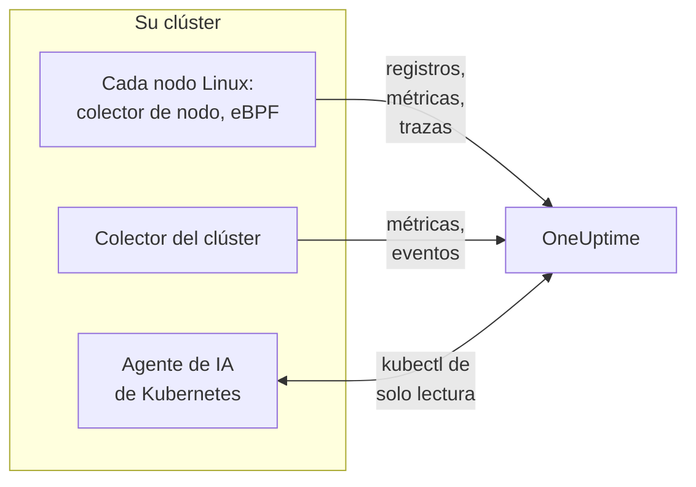

# Agente de Kubernetes (instalación con Helm)

El agente de Kubernetes de OneUptime es un chart de Helm que recoge las métricas, los eventos y los registros de pods de su clúster, las trazas de aplicación capturadas con eBPF y las métricas del sistema operativo de cada nodo, y los envía a OneUptime. Un solo `helm install` lo deja funcionando, sin cambios de código en sus aplicaciones. Los [monitores de Kubernetes](/docs/monitor/kubernetes-monitor) alertan sobre lo que envía.

:::cards
- [Instalar el agente](#instalar-el-agente): Cuatro pasos con Helm.
- [Elegir un preset](#elegir-un-preset): Clústeres estándar, GKE Autopilot o EKS Fargate.
- [Opciones comunes](#opciones-comunes): Los ajustes que cambian la mayoría de los clústeres.
- [Solución de problemas](#solución-de-problemas): Un script de diagnóstico y los problemas habituales.
:::

## Qué instala el chart

El chart ejecuta algunas cargas de trabajo en su propio namespace. Cada una envía lo que recoge a su URL de OneUptime por OTLP, con la clave de ingesta que le proporcione.



| Carga de trabajo | Tipo | Qué hace | Activado por defecto |
| --- | --- | --- | --- |
| Colector del clúster | Deployment | Métricas del clúster, eventos de Kubernetes y las especificaciones completas de pods, nodos y cargas de trabajo, desde la API de Kubernetes. | Sí |
| Colector de nodo | DaemonSet | Registros de pods desde `/var/log/pods`, métricas de kubelet y cAdvisor, y las métricas del sistema operativo del nodo. | Sí |
| Instrumentación eBPF (OBI) | DaemonSet | Trazas HTTP, gRPC, SQL y Redis y métricas de solicitudes de cada pod, y el mapa de servicios. | Sí |
| Agente de IA de Kubernetes | Deployment | Permite que OneUptime AI ejecute `kubectl` de solo lectura mientras investiga un incidente o una alerta de este clúster. | Sí |
| Lector de registros | Deployment | Registros de pods a través de la API de Kubernetes, donde el colector de nodo no puede leerlos. | Con los presets `gke-autopilot` y `eks-fargate` |
| Perfilador eBPF | DaemonSet | Flame graphs de CPU continuos de cada proceso. | No |
| kube-state-metrics | Deployment | Fases de los pods, motivos de espera de los contenedores y cuotas de recursos. | No |

Todas las imágenes del agente son solo para Linux, así que cada carga de trabajo queda fijada a nodos Linux.

## Antes de empezar

- **Una clave de ingesta.** Cree una en OneUptime en **Ajustes del proyecto → Telemetría y APM → Claves de ingesta**. El agente la envía como la cabecera `x-oneuptime-token`, así que una clave de API de proyecto no sirve aquí.
- **Helm 3** y acceso con `kubectl` al clúster. Las actualizaciones usan `--reset-then-reuse-values`, que requiere Helm 3.14 o posterior.
- **Un nombre para el clúster**, único en su proyecto. El chart se niega a instalarse sin uno: dos clústeres con el mismo nombre aparecerían como uno solo.
- **HTTPS saliente** desde el clúster hacia su URL de OneUptime.

## Instalar el agente

:::steps
### Añadir el repositorio de Helm

```bash
helm repo add oneuptime https://helm-chart.oneuptime.com
helm repo update
```

### Instalar el chart

Sustituya la URL por su URL de OneUptime, y los dos marcadores por su clave de ingesta y el nombre del clúster:

```bash
helm install oneuptime-agent oneuptime/kubernetes-agent \
  --namespace oneuptime-kubernetes-agent \
  --create-namespace \
  --set oneuptime.url=https://oneuptime.com \
  --set oneuptime.apiKey=<YOUR_API_KEY> \
  --set clusterName=<A_UNIQUE_NAME_FOR_THIS_CLUSTER>
```

Esto usa el preset `standard`. En GKE Autopilot o EKS Fargate, [elija su preset](#elegir-un-preset) en su lugar.

### Comprobar que los pods se ejecutan

```bash
kubectl get pods -n oneuptime-kubernetes-agent
```

Cada pod debería llegar a `Running` en uno o dos minutos.

### Encontrar el clúster en OneUptime

Abra **Productos → Infraestructura → Kubernetes → Todos los clústeres**. El clúster aparece con su nombre en pocos minutos, y se van rellenando sus nodos, pods y cargas de trabajo.
:::

## Elegir un preset

Algunas plataformas de Kubernetes no permiten que una carga de trabajo monte un volumen `hostPath` ni que ejecute un DaemonSet, que es lo que usa el colector de nodo. El ajuste `preset` elige lo que funciona en la suya:

| Preset | Para | Registros de pods | En cada nodo |
| --- | --- | --- | --- |
| `standard` (predeterminado) | Autogestionado, **EKS on EC2**, **GKE Standard**, **AKS**, minikube, kind, k3s | El colector de nodo lee `/var/log/pods` | Métricas de kubelet, cAdvisor y del sistema operativo |
| `gke-autopilot` | **GKE Autopilot** | El lector de registros los lee a través de la API de Kubernetes | Métricas de kubelet y cAdvisor, sin `hostPath` |
| `eks-fargate` | **EKS Fargate** | El lector de registros los lee a través de la API de Kubernetes | Nada: Fargate no ejecuta DaemonSets |

Si no está seguro, deje `preset` sin definir para obtener `standard`. Si la instalación falla con un error de Pod Security que menciona `hostPath`, instale de nuevo con `gke-autopilot`, o con `eks-fargate` en EKS Fargate.

GKE Autopilot y EKS Fargate también rechazan los pods privilegiados, que la instrumentación eBPF necesita, así que desactívela allí con `--set ebpf.enabled=false`:

:::tabs
@tab Standard
```bash
helm install oneuptime-agent oneuptime/kubernetes-agent \
  --namespace oneuptime-kubernetes-agent --create-namespace \
  --set oneuptime.url=https://oneuptime.com \
  --set oneuptime.apiKey=<YOUR_API_KEY> \
  --set clusterName=prod
```
@tab GKE Autopilot
```bash
helm install oneuptime-agent oneuptime/kubernetes-agent \
  --namespace oneuptime-kubernetes-agent --create-namespace \
  --set oneuptime.url=https://oneuptime.com \
  --set oneuptime.apiKey=<YOUR_API_KEY> \
  --set clusterName=prod-gke-autopilot \
  --set preset=gke-autopilot \
  --set ebpf.enabled=false
```
@tab EKS Fargate
```bash
helm install oneuptime-agent oneuptime/kubernetes-agent \
  --namespace oneuptime-kubernetes-agent --create-namespace \
  --set oneuptime.url=https://oneuptime.com \
  --set oneuptime.apiKey=<YOUR_API_KEY> \
  --set clusterName=prod-eks-fargate \
  --set preset=eks-fargate \
  --set ebpf.enabled=false
```
:::

## Etiquetar el clúster

Las etiquetas que pasa en la instalación se asocian al clúster, y a los servicios y hosts que informa este agente. `--set oneuptime.labels.<key>=<value>` se convierte en una etiqueta de proyecto llamada `<key>:<value>`:

```bash
helm install oneuptime-agent oneuptime/kubernetes-agent \
  --namespace oneuptime-kubernetes-agent \
  --create-namespace \
  --set oneuptime.url=https://oneuptime.com \
  --set oneuptime.apiKey=<YOUR_API_KEY> \
  --set clusterName=prod \
  --set oneuptime.labels.team=payments \
  --set oneuptime.labels.env=production \
  --set oneuptime.labels.region=us-east-1
```

O manténgalas en un archivo de valores:

```yaml title="values.yaml"
oneuptime:
  url: https://oneuptime.com
  apiKey: <YOUR_API_KEY>
  labels:
    team: payments
    env: production
    region: us-east-1
clusterName: prod
```

```bash
helm install oneuptime-agent oneuptime/kubernetes-agent \
  --namespace oneuptime-kubernetes-agent --create-namespace \
  -f values.yaml
```

Cada registro que envía este agente - registros, métricas, trazas y perfiles - lleva entonces `team:payments`, `env:production` y `region:us-east-1`. Cada etiqueta es un atributo de recurso `oneuptime.label.<key>=<value>`, y OneUptime convierte en etiqueta cada atributo que empieza por `oneuptime.label.`. Las etiquetas se comparan sin distinguir mayúsculas de minúsculas, así que una etiqueta `Production` existente se reutiliza, no se duplica. El agente nunca elimina una etiqueta que usted añadió en OneUptime.

## Registros de pods

`preset` establece `logs.mode`, que también puede establecer usted mismo:

| `logs.mode` | Cómo se leen los registros | Ventajas | Tenga en cuenta |
| --- | --- | --- | --- |
| `daemonset` | Un colector de nodo por nodo sigue los archivos de `/var/log/pods`. | La menor sobrecarga, escala con los nodos, ninguna carga sobre el servidor de API de Kubernetes, sigue la rotación de registros. | Necesita `hostPath` y DaemonSets. |
| `api` | Un lector de registros transmite el registro de cada contenedor desde la API de Kubernetes, como hace `kubectl logs -f`. | Funciona donde `hostPath` está bloqueado o se aplica el Pod Security Standard `restricted`. | Cada flujo de contenedor es una conexión de larga duración con el servidor de API. Una réplica gestiona unos pocos miles de contenedores. |
| `disabled` | Nada. | Para aplicaciones que ya envían sus registros de otra forma. | |

Para desactivar la recogida de registros, establezca `--set logs.enabled=false` y envíe los registros de la aplicación con los SDK de [OpenTelemetry](/docs/telemetry/open-telemetry) en su lugar. Las métricas no se ven afectadas: el colector de nodo sigue en marcha.

### Clústeres con varios sistemas operativos (grupos de nodos Windows)

Los nodos Windows nunca ejecutan un pod del agente. Los datos a nivel de clúster sobre ellos y sus pods siguen llegando, porque vienen de la API de Kubernetes: condiciones de los nodos, fases de los pods, eventos de Kubernetes y kube-state-metrics. Lo que les falta a los nodos Windows es lo que se recoge en el nodo: métricas del sistema operativo, métricas de kubelet y cAdvisor, trazas eBPF, perfiles y, en el modo de registros `daemonset`, los registros de pods.

Para recoger también los registros de los pods de nodos Windows, active el modo híbrido:

```bash
helm upgrade oneuptime-agent oneuptime/kubernetes-agent \
  --namespace oneuptime-kubernetes-agent --reset-then-reuse-values \
  --set logs.windowsPods.enabled=true
```

El lector de registros se ejecuta entonces junto a los colectores de nodo, solo para los pods de nodos Windows. Los pods Linux conservan la lectura de archivos, más barata, y los dos se reparten los pods según el sistema operativo del nodo, así que ninguna línea de registro se envía dos veces.

- **Versión de la imagen del lector.** El reparto solo para Windows está integrado en la imagen `kubernetes-log-tailer`. Una imagen más antigua lo ignora y sigue *todos* los pods, enviando dos veces los registros de cada pod Linux. No fije `logs.api.image.tag` en una versión anterior a la publicación del chart y, si un nodo pudiera tener en caché una imagen `release` antigua, añada `--set logs.api.image.pullPolicy=Always` a la actualización.
- **Filtrado por severidad.** Con `filters.logs.minSeverity` establecido, una línea sin severidad reconocible se descarta en el camino del colector de nodo pero se conserva en el del lector de registros - consulte [Filtrado por severidad de logs](/docs/telemetry/kubernetes-agent#filtrado-por-severidad-de-logs). Así, los pods Windows pueden enviar más líneas sin nivel que los pods Linux.

## Trazas de aplicación con eBPF

El chart ejecuta [OpenTelemetry eBPF Instrumentation (OBI)](https://opentelemetry.io/docs/zero-code/obi/) en cada nodo. OBI carga programas eBPF en el kernel de Linux y observa el tráfico de red de cada pod, de modo que puede reconstruir las llamadas HTTP y HTTPS, gRPC, y SQL y Redis sin ningún cambio en sus aplicaciones: sin SDK, sin sidecar. Las envía a OneUptime como trazas y métricas de solicitudes.

Sus servicios aparecen en **Productos → Trazas** y en el mapa de servicios en uno o dos minutos, con `k8s.cluster.name` establecido al nombre del clúster, para que pueda filtrar por clúster.

### Cuándo desactivar eBPF

eBPF está activado por defecto. Desactívelo con `--set ebpf.enabled=false` cuando:

- El clúster es **GKE Autopilot** o **EKS Fargate**. Rechazan los pods privilegiados, y OBI debe ser privilegiado para cargar sus programas.
- Los nodos ejecutan un kernel anterior a **Linux 5.8** sin BTF. Debian 11, Ubuntu 20.10, Fedora 34, RHEL 9 y posteriores sirven.
- Sus aplicaciones ya envían trazas con un SDK de OpenTelemetry, y no las quiere por duplicado.

### Qué envía eBPF

OBI envía varios tipos de señal. Cada uno puede desactivarse con `--set ebpf.features.<key>=false`:

| Ajuste | Predeterminado | Qué añade |
| --- | --- | --- |
| `ebpf.features.httpMetrics` | activado | Métricas de solicitudes HTTP y gRPC por servicio: tasa de solicitudes, histogramas de latencia y errores. |
| `ebpf.features.spanMetrics` | activado | Métricas de spans: llamadas y duración por servicio, ruta u operación, tipo de span y estado - `traces.span.metrics.calls` y `traces.span.metrics.duration` (segundos). |
| `ebpf.features.serviceGraph` | activado | La tasa y la latencia de cada llamada de un servicio a otro, que dibujan el mapa de servicios. |
| `ebpf.features.networkMetrics` | activado | Bytes y paquetes entre cada par de pods, por TCP y UDP, con sus nombres de Kubernetes. Muestra cada par de pods que se comunican, incluso por protocolos que OBI no puede leer. |
| `ebpf.features.networkInterZoneMetrics` | desactivado | Lo mismo entre zonas. Duplica el número de series: actívelo solo si planifica por zona. |
| `ebpf.features.tcpStats` | activado | Estadísticas TCP por nodo: tiempos de ida y vuelta, conexiones fallidas y retransmisiones. |

### Enlazar trazas entre servicios

OBI también puede llevar la traza a través de una llamada: cuando el pod A llama al pod B por HTTP o gRPC, el span del lado de B se une a la traza de A, sin SDK en ninguna de las dos aplicaciones. **Está desactivado por defecto.** Actívelo con `--set ebpf.contextPropagation=true`, después de leer la advertencia de abajo.

| Opción | Predeterminado | Qué hace |
| --- | --- | --- |
| `ebpf.contextPropagation` | desactivado | Escribe un `traceparent` W3C en el tráfico saliente, para que los spans se enlacen entre servicios. |
| `ebpf.contextPropagationMode` | `headers` | Cómo: `headers` (cabeceras de solicitud HTTP/1.1, lo más acotado), `tcp` (una opción TCP, a través de Linux Traffic Control) o `all` (ambos). Solo se lee cuando `contextPropagation` está activado. |
| `ebpf.trackRequestHeaders` | activado | Sigue las cabeceras de solicitud en el kernel, para que el lado receptor encuentre el `traceparent` también en servidores HTTP simples. Solo tiene efecto cuando `contextPropagation` está activado. |

> [!WARNING]
> Todos los modos de propagación modifican tráfico que ya está en curso. Para HTTP simple, OBI amplía la solicitud saliente en el kernel para que quepa la cabecera; para TLS y TCP sin procesar añade una opción TCP desde un hook de Traffic Control, reescribiendo el paquete y su suma de comprobación. Si la contabilidad de bytes de la conexión no se corrige entonces con exactitud, el flujo se **desincroniza**: las transferencias a través de un proxy como nginx se cuelgan a mitad, en cuanto una respuesta supera unos 64 KB, hasta que la conexión agota su tiempo de espera. Las solicitudes pequeñas siguen funcionando, así que parece un fallo de la aplicación o del proxy. Ninguna versión del kernel hace desaparecer la reescritura. Las trazas, las métricas de solicitudes y el mapa de servicios funcionan sin ella; un SDK de OpenTelemetry en sus servicios enlaza las trazas sin ninguna reescritura en el kernel. Si la activa, pruébela primero en un clúster que no sea de producción y compruebe las transferencias grandes a través de su proxy.

### Enlazar registros con trazas

**Desactivado por defecto.** Cuando está activado, OBI adjunta una sonda a la llamada al sistema `write()` de cada proceso que instrumenta, y:

- Una **línea de registro JSON** recibe los campos `trace_id` y `span_id` (se conservan los campos que la línea ya tiene). El colector de nodo los mueve a los campos de traza propios del registro, así que los registros de un span están a un clic en OneUptime, igual que la traza de una línea de registro.
- **Cualquier otra línea de registro** se recoge sin cambios, sin el enlace.

```bash
helm upgrade oneuptime-agent oneuptime/kubernetes-agent \
  --namespace oneuptime-kubernetes-agent --reset-then-reuse-values \
  --set ebpf.logToTraceCorrelation=true
```

| Opción | Predeterminado | Qué hace |
| --- | --- | --- |
| `ebpf.logToTraceCorrelation` | `false` | Activa el enriquecedor de registros de OBI y el traslado de `trace_id` del colector de nodo. |
| `ebpf.logEnricher.services` | `[{service: [{exe_path: "*"}]}]` | Qué procesos toca el enriquecedor. Cada entrada es un selector [GlobAttributes](https://opentelemetry.io/docs/zero-code/obi/configure/options/#service-discovery) de OBI, con campos como `exe_path`, `languages`, `k8s_pod_labels`, `k8s_pod_annotations`, `open_ports` y `cmd_args`. |

#### Agentes APM que fallan con él

El enriquecedor reescribe el búfer de salida de la aplicación **dentro del proceso**: cuando un proceso seleccionado llama a `write()`, OBI borra los bytes originales y escribe una copia enriquecida. Los agentes APM que se cargan mediante `LD_PRELOAD` y envuelven `write()` ellos mismos no lo soportan:

| Agente APM | Biblioteca | Qué ocurre |
| --- | --- | --- |
| Dynatrace OneAgent | `liboneagentproc.so` | La aplicación falla con SIGSEGV (código de salida 139). El propio `write()` del watchdog de Dynatrace se bloquea más allá de su límite de 10 segundos y el OneAgent se reinicia en bucle. |
| New Relic | `libnewrelic*.so` | El mismo tipo de fallo. |
| AppDynamics | `libappdynamics*.so` | El mismo tipo de fallo. |
| Datadog | `libdd*.so` | El mismo tipo de fallo. |
| Instana | `libinstana*.so` | El mismo tipo de fallo. |

**Las aplicaciones .NET son las más expuestas:** el agente .NET de Dynatrace siempre se carga mediante `LD_PRELOAD`, y el registro de consola de Microsoft.Extensions.Logging no usa búfer, así que cada línea toma ese camino. Las aplicaciones Python y Go no suelen verse afectadas.

Para usarlo junto a uno de estos agentes, apunte `logEnricher.services` solo a los pods que no lo tienen. El enriquecedor no puede excluir, así que liste los que hay que enriquecer:

```yaml title="values.yaml"
ebpf:
  logToTraceCorrelation: true
  logEnricher:
    services:
      # Enrich only pods with the apm-agent=none label
      - service:
          - k8s_pod_labels:
              apm-agent: "none"
```

O elija por runtime. La carga de Dynatrace mediante `LD_PRELOAD` apunta a .NET, así que enriquecer solo Python, Go, Ruby y Node.js lo evita:

```yaml title="values.yaml"
ebpf:
  logToTraceCorrelation: true
  logEnricher:
    services:
      - service:
          - languages: "python,go,ruby,nodejs"
```

#### Los registros deben ser JSON y sin búfer

- **Solo las líneas JSON reciben un `trace_id`.** Cambie el logger a un formato JSON: `structlog`, `pino`, `winston`, `serilog`, `logback-json`, klog `--logging-format=json` y similares.
- **La salida con búfer rompe el enlace**, porque entonces el `write()` ocurre en otro hilo distinto del de la solicitud. En **Python**, establezca `PYTHONUNBUFFERED=1`. En **.NET**, llame a `Console.SetOut(new StreamWriter(Console.OpenStandardOutput()) { AutoFlush = true })` al arrancar; `AddConsole()` de Microsoft.Extensions.Logging y los sinks asíncronos de Serilog no funcionan, el `WriteTo.Console()` simple de Serilog sí.
- Greenlet, gevent, Tornado y otros runtimes asíncronos personalizados no están cubiertos.

### Ajustar eBPF

| Opción | Predeterminado | Qué hace |
| --- | --- | --- |
| `ebpf.enabled` | `true` | Ejecuta el DaemonSet de eBPF. `false` lo omite. |
| `ebpf.image.tag` | `v0.14.0` | La imagen de OBI. OBI es anterior a la 1.0: fije una versión que haya probado y vuelva a probar antes de cambiarla. |
| `ebpf.autoTargetExe` | `*` | Globs de los ejecutables que se instrumentan, separados por comas. Acótelo, como en `*/python,*/java`, para instrumentar menos runtimes. |
| `ebpf.excludeExePaths` | Shells, fontanería del clúster, sidecars de service mesh, agentes CNI, navegadores, ClickHouse, colectores y el propio OBI | Globs de los ejecutables que se omiten, separados por comas. Un glob amplio también omite sus propios binarios. |
| `ebpf.logLevel` | `info` | `debug`, `info`, `warn` o `error`. |
| `ebpf.printTraces` | `false` | Imprime también los spans en el registro de OBI, para comprobar lo que captura. |
| `ebpf.resources.*` | `100m` de CPU y `512Mi` de memoria solicitados, límites de `2000m` y `2Gi` | Auméntelos para nodos con mucho tráfico o muchos procesos de corta duración. |

Para comprobar que OBI se ejecuta y ve tráfico:

```bash
kubectl get pods -n oneuptime-kubernetes-agent -l component=ebpf-instrument
kubectl logs -n oneuptime-kubernetes-agent -l component=ebpf-instrument --tail=200
```

## Perfilado continuo de CPU

El [OpenTelemetry eBPF Profiler](https://github.com/open-telemetry/opentelemetry-ebpf-profiler) también puede ejecutarse en cada nodo, como la imagen `otel/opentelemetry-collector-ebpf-profiler`. Muestrea lo que ejecuta cada proceso, 19 veces por segundo, en Go, Java, .NET, Python, Ruby, Node.js, PHP, Perl, C, C++ y Rust, y envía los perfiles a OneUptime. Aparecen en **Productos → Perfiles de rendimiento**, y como flame graph en cada span de traza.

**El perfilado está desactivado por defecto:** cuesta más CPU y memoria por nodo que la instrumentación eBPF. Actívelo con `--set profiling.enabled=true`.

Con la instrumentación eBPF también activada (lo predeterminado), cada muestra lleva la traza a la que pertenece, así que un span tiene su propio flame graph. Para ello, el chart pide a OBI que mantenga disponible el contexto de traza en curso (`OTEL_EBPF_BPF_POPULATE_TRACE_CONTEXT=true`), lo que cuesta un poco a las aplicaciones instrumentadas en cada cambio de contexto asíncrono. Establezca `profiling.obiProcessContext=false` para tener flame graphs sin el enlace a los spans.

El perfilado necesita **Linux 5.10** o posterior, y un pod privilegiado con los ID de proceso del nodo: no puede ejecutarse en GKE Autopilot ni en EKS Fargate. En nodos que son a su vez contenedores, como kind o k3d, no distingue los procesos, y casi ninguna muestra se enlaza a un span.

| Opción | Predeterminado | Qué hace |
| --- | --- | --- |
| `profiling.enabled` | `false` | Ejecuta el DaemonSet del perfilador. |
| `profiling.image.tag` | `0.152.0` | La imagen del perfilador. Es anterior a la 1.0: fije una versión que haya probado. |
| `profiling.samplesPerSecond` | `19` | Cuántas muestras por segundo. 19 evita alinearse con las frecuencias de temporizador habituales. |
| `profiling.offCpuThreshold` | `0` | Un valor mayor que 0 y hasta 1 perfila también el tiempo pasado fuera de la CPU, lo que muestra la contención de bloqueos y la E/S bloqueante, con un coste adicional. |
| `profiling.tracers` | `""` (todos los runtimes) | Los trazadores de lenguaje que se cargan, separados por comas, como `go,python`. |
| `profiling.obiProcessContext` | `true` | Enlaza las muestras con las trazas de OBI, y hace que OBI mantenga disponible el contexto de traza para ello. |

## Otras recogidas de datos

| Opción | Predeterminado | Qué añade |
| --- | --- | --- |
| `hostMetrics.enabled` | activado | Las métricas del sistema operativo de cada nodo desde `/proc` y `/sys`: colas de E/S de disco, inodos del sistema de archivos, errores de interfaces de red, paginación y carga media. Se ejecuta en el colector de nodo, sin pods adicionales. |
| `kubeletstats.utilizationMetrics.enabled` | activado | La CPU y la memoria de contenedores y pods como porcentaje de su solicitud y su límite, que leen los monitores de saturación de CPU y memoria. Siempre 0 para un pod sin solicitud ni límite. |
| `kubeletstats.volumeMetrics.enabled` | activado | El espacio libre y total de cada PVC (`k8s.volume.available`, `k8s.volume.capacity`), que lee el monitor PVC Low Disk Space. Una serie por PVC y por pod. |
| `cadvisor.enabled` | activado | La limitación de CPU y los cierres por OOM desde el `/metrics/cadvisor` de cada kubelet: `container_cpu_cfs_throttled_seconds_total`, `container_cpu_cfs_periods_total` y `container_oom_events_total`, y nada más. |
| `kubeStateMetrics.enabled` | desactivado | Fases de los pods (Pending, Terminating), pods que no pueden programarse, motivos de espera de los contenedores (CrashLoopBackOff, ImagePullBackOff) y uso de cuotas de recursos, desde kube-state-metrics. `kubeStateMetrics.mode: bundled` (lo predeterminado) ejecuta un pequeño kube-state-metrics por usted; `external` lee uno que ya ejecuta, en `kubeStateMetrics.endpoint`. |
| `auditLogs.enabled` | desactivado | El registro de auditoría de Kubernetes, `/var/log/kubernetes/audit.log`: cada solicitud a la API, de quién y sobre qué. Solo clústeres autogestionados: los gestionados (EKS, GKE, AKS, DOKS) lo envían al proveedor de la nube. |
| `csi.enabled` | desactivado | Las métricas de los controladores de almacenamiento CSI, de los pods etiquetados `app=csi-driver` o `app.kubernetes.io/component=csi-driver`: tiempos de conexión y desconexión de volúmenes, fallos de aprovisionamiento, IOPS. |
| `coreDns.enabled` | desactivado | Las métricas de CoreDNS en `:9153/metrics`: tasa de consultas, latencia, aciertos de caché y errores. |
| `controlPlane.enabled` | desactivado | etcd, el servidor de API, el planificador y el gestor de controladores. Solo clústeres autogestionados: los gestionados no los exponen. |
| `cost.enabled` | desactivado | Cuánto cuesta cada carga de trabajo. Consulte [Observabilidad de costos de Kubernetes](/docs/telemetry/kubernetes-cost). |

## Opciones comunes

| Opción | Predeterminado | Qué hace |
| --- | --- | --- |
| `oneuptime.url` | (obligatorio) | Su URL de OneUptime. |
| `oneuptime.apiKey` | (obligatorio) | La clave de ingesta, de **Ajustes del proyecto → Telemetría y APM → Claves de ingesta**. Se envía como la cabecera `x-oneuptime-token`; una clave de API de proyecto no sirve. |
| `clusterName` | (obligatorio) | El nombre del clúster, único en el proyecto. Cada registro lo lleva como `k8s.cluster.name`. |
| `preset` | (vacío: `standard`) | `standard`, `gke-autopilot` o `eks-fargate`. Consulte [Elegir un preset](#elegir-un-preset). |
| `oneuptime.labels` | `{}` | Etiquetas para cada registro de este agente. Consulte [Etiquetar el clúster](#etiquetar-el-clúster). |
| `namespaceFilters.rules` | Deja `kube-system` fuera de `podLogs` y `ebpfDiscovery` | Reglas que incluyen o excluyen namespaces, para `podLogs`, `ebpfDiscovery`, `metrics` y `traces`. Los patrones pueden usar `*`, y excluir siempre gana. |
| `filters.logs.minSeverity` | `""` | Descarta las líneas de registro de pods por debajo de este nivel: `TRACE`, `DEBUG`, `INFO`, `WARN`, `ERROR` o `FATAL`. |
| `filters.metrics.exclude` | `[]` | Nombres de métricas que se descartan. |
| `sampling.traces.percentage` | `100` | La parte de las trazas que se conserva, de 0 a 100. Las trazas se conservan o descartan completas. |
| `logs.enabled` | `true` | Recoge los registros de pods. |
| `logs.mode` | (según `preset`) | `daemonset`, `api` o `disabled`. Prevalece sobre el preset. |
| `logs.windowsPods.enabled` | `false` | Sigue también los pods de nodos Windows. Consulte [Clústeres con varios sistemas operativos](#clústeres-con-varios-sistemas-operativos-grupos-de-nodos-windows). |
| `logs.api.replicas` | `1` | Réplicas del lector de registros, en modo `api`. |
| `ebpf.enabled` | `true` | Trazas eBPF y métricas de solicitudes. Consulte [Trazas de aplicación con eBPF](#trazas-de-aplicación-con-ebpf). |
| `profiling.enabled` | `false` | Flame graphs de CPU. Consulte [Perfilado continuo de CPU](#perfilado-continuo-de-cpu). |
| `kubeStateMetrics.enabled` | `false` | El estado del clúster desde kube-state-metrics. |
| `aiAgent.enabled` | `true` | El agente de IA de Kubernetes. Consulte [Agente de IA de Kubernetes](/docs/telemetry/kubernetes-agent) para saber qué puede hacer. |

El [`values.yaml`](https://github.com/OneUptime/oneuptime/blob/master/HelmChart/Public/kubernetes-agent/values.yaml) del chart lista y explica cada opción, y [Agente de Kubernetes](/docs/telemetry/kubernetes-agent) cubre el filtrado, el muestreo y cómo reducir el volumen de datos.

## Actualización

```bash
helm repo update
helm upgrade oneuptime-agent oneuptime/kubernetes-agent \
  --namespace oneuptime-kubernetes-agent \
  --reset-then-reuse-values
```

`--reset-then-reuse-values` (Helm 3.14 y posterior) conserva los valores que usted estableció - el preset, el nombre del clúster, los filtros - y toma todos los demás valores del nuevo chart. Añada cualquier `--set` nuevo después de él. Con Helm 3.13 o anterior, actualice en su lugar con los valores que estableció:

```bash
helm repo update
helm get values oneuptime-agent --namespace oneuptime-kubernetes-agent -o yaml > values.yaml && \
  helm upgrade oneuptime-agent oneuptime/kubernetes-agent \
  --namespace oneuptime-kubernetes-agent -f values.yaml
```

No actualice con `--reuse-values`: conserva también los valores predeterminados del chart desde el que actualiza, así que los valores predeterminados de un chart más nuevo, su imagen de eBPF entre ellos, nunca se aplican. Cuando una release funciona con los valores predeterminados de un chart antiguo, las notas que Helm imprime tras la instalación o la actualización terminan con una advertencia y el comando que lo corrige.

> [!WARNING]
> **Las métricas de spans de eBPF tienen nombres nuevos.** `ebpf.features.spanMetrics` envía ahora `traces.span.metrics.calls` y `traces.span.metrics.duration` (segundos) en lugar de `traces_spanmetrics_calls_total` y `traces_spanmetrics_latency`: las mismas series, con los nombres que mantiene OBI (que dejó obsoletos los antiguos). Un panel, un gráfico o un monitor de métricas sobre un nombre antiguo no recibe datos nuevos tras la actualización, sin ningún error - páselo al nombre nuevo, y actualice cualquier entrada de `filters.metrics` que nombre uno antiguo.

## Desinstalación

```bash
helm uninstall oneuptime-agent --namespace oneuptime-kubernetes-agent
kubectl delete namespace oneuptime-kubernetes-agent
```

## Solución de problemas

:::details El clúster aparece como Disconnected, o no llegan datos
Ejecute el script de diagnóstico del chart. Comprueba los pods, la clave de ingesta y la salida del clúster, pregunta a OneUptime si la clave se acepta e imprime un único veredicto. Solo lee, y no cambia nada:

```bash
curl -fsSL https://raw.githubusercontent.com/OneUptime/oneuptime/master/HelmChart/Public/kubernetes-agent/troubleshoot.sh \
  | bash -s -- -n oneuptime-kubernetes-agent
```

La causa habitual, sobre todo tras una reinstalación, es una clave de ingesta incorrecta o revocada: OneUptime la rechaza, y el colector descarta cada lote mientras sus pods siguen en `Running`.
:::

:::details La instalación falla con «hostPath volumes are not allowed»
El clúster bloquea `hostPath`. Cambie a un preset que lea los registros a través de la API de Kubernetes, y desactive eBPF:

```bash
helm upgrade oneuptime-agent oneuptime/kubernetes-agent \
  --namespace oneuptime-kubernetes-agent \
  --reset-then-reuse-values \
  --set preset=gke-autopilot \
  --set ebpf.enabled=false
```

En EKS Fargate, use `--set preset=eks-fargate`.
:::

:::details Pods del agente atascados en ImagePullBackOff en nodos Windows
Los charts antiguos programaban los DaemonSets del agente en nodos Windows, donde sus imágenes Linux nunca pueden descargarse. Ejecute `helm upgrade`: el chart actual fija cada carga de trabajo a nodos Linux, y los pods atascados desaparecen. Para recoger los registros de los pods de nodos Windows, consulte [Clústeres con varios sistemas operativos](#clústeres-con-varios-sistemas-operativos-grupos-de-nodos-windows).
:::

:::details No llegan registros a OneUptime
Compruebe los pods del agente y sus registros:

```bash
kubectl get pods -n oneuptime-kubernetes-agent
kubectl logs -n oneuptime-kubernetes-agent -l app.kubernetes.io/part-of=oneuptime --tail=200
```

En modo `api`, el lector de registros responde en `/healthz`, puerto 13133, con el estado de sus exportaciones: acceda a él con `kubectl port-forward`.
:::

:::details Los pods de eBPF están en CrashLoopBackOff, o no arrancan
Lea el registro de OBI:

```bash
kubectl logs -n oneuptime-kubernetes-agent -l component=ebpf-instrument --tail=200
```

- **El kernel es demasiado antiguo, o no tiene BTF.** OBI necesita Linux 5.8 o posterior con BTF; compruébelo con `uname -r` en un nodo. Si no puede actualizarlo, desactive eBPF con `--set ebpf.enabled=false`.
- **Se rechazan los pods privilegiados.** Algunos clústeres los rechazan incluso fuera de Autopilot y Fargate. Desactive eBPF.
- **OBI se ejecuta, pero no llegan trazas.** Establezca `--set ebpf.printTraces=true` y vuelva a leer el registro de OBI. Si aparecen spans ahí, la exportación a OneUptime falla: compruebe la URL y la clave de ingesta. Si no aparecen, puede que el tráfico esté cifrado por una biblioteca TLS que OBI no puede leer, como una enlazada estáticamente.
:::

:::details Las transferencias grandes se cuelgan tras activar el enlace de trazas
Es `ebpf.contextPropagation` reescribiendo el tráfico: consulte la advertencia en [Enlazar trazas entre servicios](#enlazar-trazas-entre-servicios). Desactívelo con `--set ebpf.contextPropagation=false`.
:::

:::details Las aplicaciones fallan con el código de salida 139 tras activar el enlace de registros
Un agente APM que se carga mediante `LD_PRELOAD` está en los mismos pods: consulte [Agentes APM que fallan con él](#agentes-apm-que-fallan-con-él). Desactive `ebpf.logToTraceCorrelation`, o apunte `ebpf.logEnricher.services` a pods sin ese agente.
:::

:::details Un solo lector de registros no basta para el clúster (modo api)
Reparta los namespaces entre varias releases, cada una instalada con sus propias reglas de namespaces:

```bash
helm install oneuptime-agent-ns-a oneuptime/kubernetes-agent \
  --set preset=gke-autopilot \
  --set-json 'namespaceFilters.rules=[{"action":"include","namespaces":["app-a","app-b"],"scopes":["podLogs"]}]' \
  ...
```

Aumentar `logs.api.replicas` añade lectores, pero cada uno lee todos los namespaces permitidos, así que igualmente tiene que repartir los namespaces para evitar duplicados.
:::

## Próximos pasos

:::cards
- [Monitor de Kubernetes](/docs/monitor/kubernetes-monitor): Alertar sobre lo que envía el agente.
- [Agente de Kubernetes](/docs/telemetry/kubernetes-agent): Filtrado, muestreo, el agente de IA y cómo reducir el volumen de datos.
- [Observabilidad de costos de Kubernetes](/docs/telemetry/kubernetes-cost): Ver cuánto cuesta cada carga de trabajo.
- [Monitor de trazas](/docs/monitor/traces-monitor): Alertar sobre las trazas que captura eBPF.
:::
