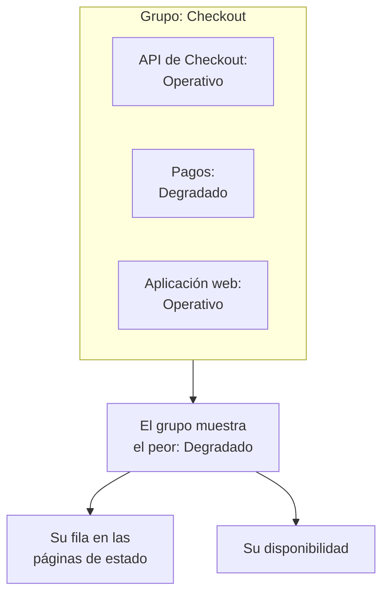

# Grupos de monitores

Un grupo de monitores reúne varios monitores en un solo estado. Agrupe los monitores que juntos forman un servicio, como Checkout: su API, su servicio de pagos y su aplicación web. El grupo muestra el peor estado entre ellos, tiene su propia disponibilidad, y una página de estado puede mostrar todo el grupo como una sola fila.

:::cards
- [Cómo se calcula el estado de un grupo](#cómo-se-calcula-el-estado-de-un-grupo): El peor estado entre sus monitores.
- [Activar los grupos de monitores](#activar-los-grupos-de-monitores): Un interruptor en los ajustes del proyecto.
- [Crear un grupo de monitores](#crear-un-grupo-de-monitores): Póngale nombre y añádale sus monitores.
- [Mostrar un grupo en una página de estado](#mostrar-un-grupo-en-una-página-de-estado): Una fila para todo el grupo.
:::

## Cómo se calcula el estado de un grupo

Un grupo parte de su estado operativo y toma el peor estado entre sus monitores: el que está más abajo en la lista de estados de monitor de su proyecto. Un monitor que pasa a **Degradado** deja todo el grupo **Degradado**; uno que pasa a **Sin conexión** lo deja **Sin conexión**.

- **Los monitores archivados no cuentan.** Un monitor archivado no se comprueba, así que su estado está congelado; el grupo lo deja fuera.
- **Un grupo vacío está operativo.** Un grupo sin monitores, o solo con monitores archivados, muestra su estado operativo.
- **El orden lo decide usted.** Cuál es el peor estado sigue el orden de **Monitores → Ajustes → Estado del monitor**. Consulte [Estados del monitor](/docs/monitor/criteria-and-statuses#estados-del-monitor).

Un grupo de monitores no es un grupo de una página de estado. Un grupo de una página de estado es un encabezado en una página de estado que contiene filas. Un grupo de monitores es una fila que representa varios monitores, y cualquier página de estado puede mostrarlo.

## Antes de empezar

- **Su plan.** En OneUptime Cloud, los grupos de monitores requieren el plan Scale.
- **El interruptor.** Los grupos de monitores están ocultos hasta que **Grupos de monitores** se activa para el proyecto (véase más abajo). Activarlo requiere el rol Project Owner, o un rol personalizado con el permiso Edit Project o Manage Billing.
- **Su rol.** Crear, cambiar y eliminar grupos requiere el rol Project Owner, Project Admin, Project Member, Monitor Admin o Monitor Member, o un rol personalizado con los permisos de grupo de monitores correspondientes. Un Viewer puede ver los grupos, pero no cambiarlos.

## Activar los grupos de monitores

:::steps
### Abrir los feature flags

Vaya a **Ajustes del proyecto → Avanzado → Feature flags**. **Avanzado** aparece plegado en el menú lateral: despliéguelo primero.

### Activar el interruptor

Active el interruptor **Grupos de monitores**. Se guarda al instante: **Grupos de monitores** aparece en el menú lateral de **Monitores**, y la entrada **Monitores** de cada página de estado pasa a llamarse **Recursos**, donde puede añadir un grupo.
:::

Desactivar de nuevo el interruptor oculta **Grupos de monitores** del menú. No elimina ningún grupo.

## Crear un grupo de monitores

:::steps
### Abrir Grupos de monitores

Vaya a **Monitores → Grupos de monitores**. La tarjeta **Grupos de monitores** enumera cada grupo con su **Estado actual**, sus etiquetas y sus propietarios.

### Crear el grupo

Haga clic en **Crear Grupo de monitores**, escriba un **Nombre** y, si quiere, una **Descripción**, y haga clic en **Crear Grupo de monitores** al final del formulario. El grupo empieza sin monitores.

### Añadir sus monitores

Abra el grupo: mientras no tenga ningún monitor, su **Vista general** ofrece **Añadir monitores**. Más adelante, haga clic en **Monitores** en su menú lateral y luego en **Añadir monitores**. Elija todos los monitores del grupo en **Monitores** y haga clic en **Añadir monitores**.

### Comprobar su estado

Haga clic en **Vista general**. **Estado actual** muestra el estado actual del grupo, y **Gráfico de tiempo de actividad** muestra sus últimos 90 días, una barra por día.
:::

Para sacar un monitor del grupo, haga clic en **Eliminar** en su fila de **Monitores en el grupo**. El monitor en sí no cambia. Un monitor puede pertenecer a más de un grupo.

## Las páginas de un grupo

Abra un grupo para ver sus páginas en el menú lateral:

| Página | Qué muestra |
| --- | --- |
| **Vista general** | **Detalles del grupo de monitores**, **Estado actual** y **Gráfico de tiempo de actividad** con el porcentaje de disponibilidad del grupo en los últimos 90 días. Un grupo sin monitores ofrece **Añadir monitores** en lugar del gráfico. |
| **Monitores** | **Monitores en el grupo**, con **Añadir monitores** y **Eliminar**. |
| **Incidentes** | Los incidentes en cualquier monitor del grupo. |
| **Alertas** | Las alertas en cualquier monitor del grupo. |
| **Propietarios** | Las personas y los equipos responsables del grupo. Está en **Avanzado**, que empieza plegado. |
| **Registros de auditoría** | Quién cambió el grupo y cuándo, también en **Avanzado**. |
| **Eliminar grupo** | Elimina el grupo, también en **Avanzado**. |

La disponibilidad de la **Vista general** cuenta como tiempo de inactividad cualquier estado salvo el operativo. Una página de estado solo cuenta los estados de su propia lista **Cuenta como tiempo de inactividad**: consulte [Elegir qué se muestra en la página](/docs/status-pages/index#elegir-qué-se-muestra-en-la-página).

La lista **Grupos de monitores** puede filtrar grupos por propietario y etiqueta, fijar etiquetas y propietarios en muchos grupos a la vez, y exportar o importar grupos como JSON.

## Mostrar un grupo en una página de estado

:::steps
### Abrir los recursos de la página de estado

Vaya a **Páginas de estado**, abra la página y haga clic en **Recursos** en su menú lateral.

### Cambiar el diálogo a un grupo

Haga clic en **Añadir monitor**. Debajo del desplegable de monitores, haga clic en **Añade un grupo de monitores en su lugar.** El desplegable pasa a ser **Grupo de monitores**.

### Elegir el grupo y añadirlo

Elija el grupo. **Nombre para mostrar**, el nombre que leen los visitantes, toma el nombre del grupo hasta que usted escriba uno propio. Haga clic en **Añadir monitor**: la fila aparece en la página con el estado del grupo.
:::

En la página de estado, la fila representa a cada monitor del grupo:

- **Su estado.** Es el del grupo: el peor de sus monitores.
- **Sus incidentes.** Un incidente en cualquier monitor del grupo aparece en la página, con el grupo entre los recursos afectados.
- **Sus suscriptores.** Un suscriptor que elige el grupo recibe avisos de cada monitor que contiene. Consulte [Dejar que los suscriptores elijan recursos y tipos de evento](/docs/status-pages/subscribers#dejar-que-los-suscriptores-elijan-recursos-y-tipos-de-eventos).

Para el resto de opciones de la fila, como su disponibilidad y su gráfico de historial, consulte [Recursos y grupos de la página de estado](/docs/status-pages/resources-and-groups).

> [!WARNING]
> Al eliminar un grupo de monitores también se elimina su fila de todas las páginas de estado que lo muestran. Los monitores del grupo, y sus incidentes, no se eliminan.

## API y Terraform

Un grupo es `/api/monitor-group`, y cada monitor que contiene es una fila de `/api/monitor-group-resource` que une un `monitorGroupId` con un `monitorId`. En Terraform son `oneuptime_monitor_group` y `oneuptime_monitor_group_resource`: consulte [Grupo de monitores](/docs/terraform/examples#grupo-de-monitores).

## Solución de problemas

:::details Grupos de monitores no aparece en el menú Monitores
El interruptor **Grupos de monitores** está desactivado. Actívelo en **Ajustes del proyecto → Avanzado → Feature flags**. En OneUptime Cloud, los grupos también requieren el plan Scale.
:::

:::details El grupo muestra Sin conexión, pero la mayoría de sus monitores funcionan
Es la regla: el grupo muestra su peor monitor. Abra **Monitores** en el grupo para encontrar el monitor caído, o quite un monitor que no pertenezca al grupo.
:::

:::details Una página de estado no puede añadir el grupo
**Añade un grupo de monitores en su lugar.** solo aparece en el diálogo mientras el interruptor **Grupos de monitores** esté activado para el proyecto.
:::

## Próximos pasos

:::cards
- [Criterios y estados de monitores](/docs/monitor/criteria-and-statuses): Qué fija el estado de cada monitor.
- [Recursos y grupos de la página de estado](/docs/status-pages/resources-and-groups): Organizar las filas de una página de estado.
- [Suscriptores y anuncios](/docs/status-pages/subscribers): Informar a los clientes de los incidentes de un grupo.
:::
