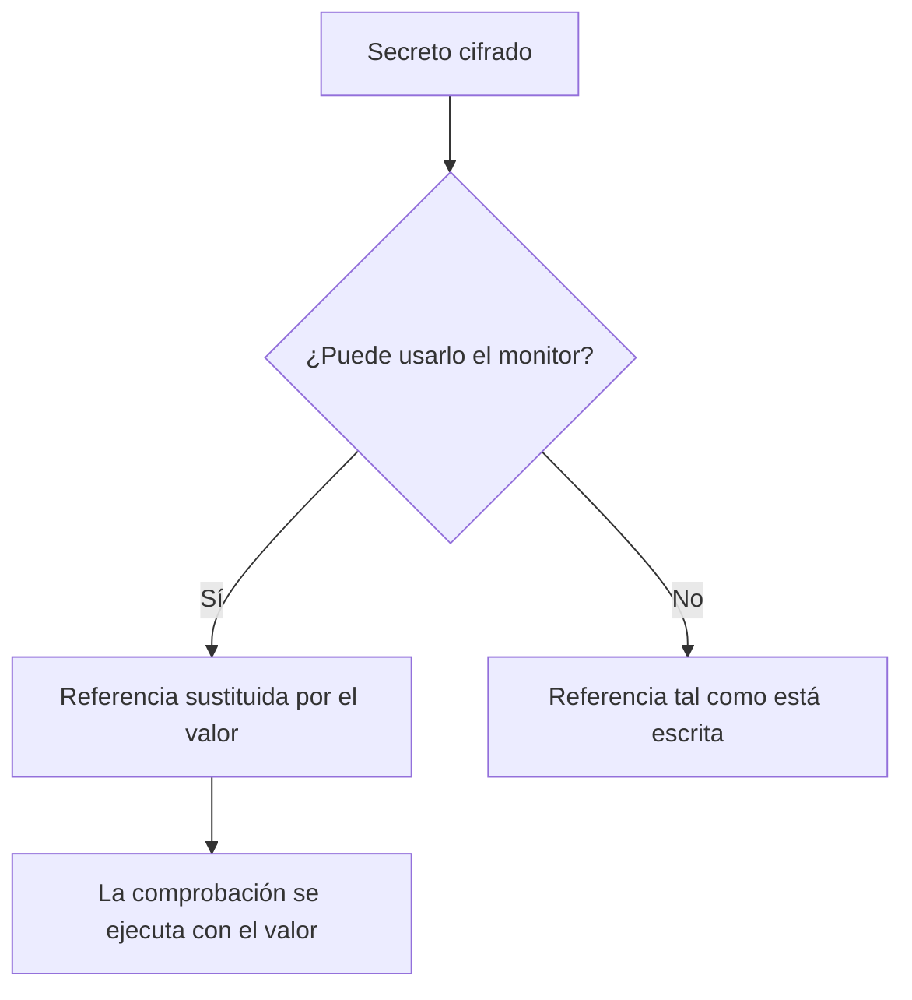

# Secretos del monitor

Los secretos de monitor mantienen fuera del propio monitor las contraseñas, claves de API y tokens que necesitan sus monitores. Usted guarda un valor una vez, cifrado, elige qué monitores pueden usarlo y lo referencia como `{{monitorSecrets.NAME}}` donde el monitor lo necesite.

:::cards
- [Añadir un secreto](#añadir-un-secreto): Guardar un valor y elegir quién puede usarlo.
- [Elegir el acceso](#elegir-qué-monitores-pueden-usar-un-secreto): Todos los monitores, monitores concretos o monitores con etiquetas.
- [Usar un secreto](#usar-un-secreto): Dónde funciona `{{monitorSecrets.NAME}}`.
- [Iniciar sesión con un código de un solo uso](#iniciar-sesión-con-un-código-de-un-solo-uso): Permitir que un monitor supere el inicio de sesión de dos factores de un sitio.
:::

## Cómo llegan los secretos a un monitor

Un secreto se guarda cifrado y no se vuelve a mostrar después de guardarlo. Antes de entregar un monitor a una sonda, OneUptime sustituye cada referencia que el monitor puede usar por el valor descifrado; una referencia que el monitor no puede usar se queda tal como está escrita. Un secreto de código de un solo uso es la excepción: la sonda genera su código cuando se ejecuta la comprobación (consulte [Iniciar sesión con un código de un solo uso](#iniciar-sesión-con-un-código-de-un-solo-uso)).



La sonda que ejecuta la comprobación recibe el valor, así que un monitor que usa un secreto debe ejecutarse en sondas de confianza: las de OneUptime, o una [sonda personalizada](/docs/probe/custom-probe) que gestione usted mismo.

## Antes de empezar

- **El plan Growth o superior**, en OneUptime Cloud. Las instalaciones autoalojadas no tienen planes.
- **Un rol que pueda gestionar secretos**: Propietario del proyecto, Administrador del proyecto, o un rol personalizado con el permiso Create Monitor Secret.

## Trabajar con secretos

### Añadir un secreto

:::steps
1. Vaya a **Monitores → Ajustes → Secretos** y haga clic en **Crear Secreto de monitor**.
2. Introduzca un **Nombre** y el **Valor del secreto**. El nombre es lo que usted referencia, por ejemplo `ApiKey`. Solo puede contener letras, números, guiones (`-`) y guiones bajos (`_`), y dos secretos de un mismo proyecto no pueden compartirlo. Para la clave de configuración de dos factores de un sitio, elija primero **Código de un solo uso (TOTP)** (consulte [Iniciar sesión con un código de un solo uso](#iniciar-sesión-con-un-código-de-un-solo-uso)).
3. En el paso **Acceso**, elija qué monitores pueden usarlo (consulte la sección siguiente) y haga clic en **Crear Secreto de monitor**.
:::

> [!IMPORTANT]
> Los secretos se cifran y se guardan de forma segura. El valor del secreto no se vuelve a mostrar después de guardarlo — ni en la tabla, ni en el formulario de edición, ni mediante la API. Si pierde el valor, tendrá que obtenerlo de donde lo sacó y volver a establecerlo. Para rotar un secreto, use el botón **Actualizar valor del secreto** de su fila; no necesita eliminarlo y volver a crearlo.

### Elegir qué monitores pueden usar un secreto

Cada secreto tiene una de tres opciones de acceso:

| Opción | Qué monitores pueden usar el secreto | Úsela para |
| --- | --- | --- |
| **Todos los monitores** | Todos los monitores del proyecto, incluidos los que cree más adelante. | Una credencial que comparten muchos monitores. |
| **Monitores específicos** | Solo los monitores que elija. Es la opción predeterminada, y los secretos creados antes de que existieran estas opciones funcionan así. | Una credencial para uno o unos pocos monitores. |
| **Monitores con etiquetas** | Los monitores que tienen al menos una de las etiquetas que elija. Añadir una de esas etiquetas a un monitor le da acceso, y quitar la etiqueta se lo retira la próxima vez que se ejecute el monitor. | Una credencial para un grupo de monitores que cambia con el tiempo. |

Puede cambiar la opción en cualquier momento con **Editar** en la fila del secreto. Solo se conserva la lista de la opción elegida: cambiar a **Todos los monitores** vacía las listas de monitores y de etiquetas del secreto, y cambiar entre **Monitores específicos** y **Monitores con etiquetas** vacía la lista que deja.

Un secreto nunca está disponible para los monitores de otro proyecto.

> [!WARNING]
> Cualquiera que pueda editar un monitor que puede usar un secreto puede enviar ese secreto a cualquier lugar al que se conecte el monitor. Con **Todos los monitores**, eso es cualquiera que pueda crear o editar monitores en el proyecto. Con **Monitores con etiquetas**, incluye también a cualquiera que pueda añadir una de esas etiquetas a un monitor.

En la API, la opción de acceso es el campo `monitorAccess`: `All Monitors`, `Specific Monitors` o `Monitors With Labels`. Los campos `monitors` y `labels` contienen las listas. Un secreto creado sin `monitorAccess` recibe `Specific Monitors`.

### Usar un secreto

Para usar un secreto, escriba `{{monitorSecrets.SECRET_NAME}}` en un campo que admita secretos. Por ejemplo, una cabecera de solicitud `Authorization: Bearer {{monitorSecrets.ApiKey}}` envía el valor del secreto `ApiKey`.

Estos tipos de monitor y campos admiten secretos:

| Tipo de monitor | Campos |
| --- | --- |
| API | La URL, las cabeceras y el cuerpo de la solicitud, y el certificado de cliente, la clave privada y la frase de contraseña (mTLS) |
| Sitio web | La URL, y el certificado de cliente, la clave privada y la frase de contraseña (mTLS) |
| Ping, IP, Puerto, NTP, Certificado SSL | El host o la URL que se comprueba |
| DNS | El nombre de dominio y el servidor DNS |
| DNSSEC, Dominio | El nombre de dominio |
| Consulta SQL | El host, el nombre de la base de datos, el usuario, la contraseña y la consulta |
| Salud de la base de datos | El host, el nombre de la base de datos, el usuario y la contraseña |
| Página de estado externa | La URL de la página de estado |
| Monitor sintético, Código JavaScript personalizado | El script |
| Dispositivo de red | La cadena de comunidad SNMP, y las claves de autenticación y de privacidad de SNMPv3 |

Los secretos se rellenan antes de que se ejecute el script de un monitor sintético o de Código JavaScript personalizado, así que una referencia como `{{monitorSecrets.ApiKey}}` dentro del script es el valor descifrado cuando se ejecuta.

Si un monitor referencia un secreto que no puede usar, la referencia se queda como está y no se sustituye por el valor.

Cuando prueba un monitor antes de guardarlo, solo se rellenan los secretos disponibles para **Todos los monitores**, porque un monitor nuevo no está en ninguna lista y todavía no tiene etiquetas. Después de guardar el monitor, las pruebas usan todos los secretos que el monitor puede usar.

## Iniciar sesión con un código de un solo uso

Algunos sitios piden un código de una aplicación de autenticación al iniciar sesión. Un secreto **Código de un solo uso (TOTP)** guarda la clave de configuración de ese sitio, para que un monitor pueda iniciar sesión igual que usted: dondequiera que el monitor use el secreto, la sonda genera el código actual con su propio reloj, en el momento en que la comprobación lo necesita. La clave de configuración se guarda cifrada y no se vuelve a mostrar, como cualquier valor de secreto, y nunca se escribe en el monitor.

1. Active el inicio de sesión de dos factores en la cuenta con la que inicia sesión el monitor. Donde el sitio muestre un código QR, pida en su lugar introducir la clave a mano, y copie la clave de configuración o el enlace `otpauth://`.
2. Vaya a **Monitores → Ajustes → Secretos**, haga clic en **Crear Secreto de monitor**, elija **Código de un solo uso (TOTP)** y pegue la clave o el enlace en **Clave de configuración**.
3. Compruebe que el **Código actual** que aparece debajo coincide con el código que muestra ahora su aplicación de autenticación y, después, elija qué monitores pueden usar el secreto en el paso **Acceso**, como con cualquier secreto.

| Lo que pega | Los códigos que genera el monitor |
| --- | --- |
| Una clave de configuración, como `JBSW Y3DP EHPK 3PXP` | SHA1, 6 dígitos y un código nuevo cada 30 segundos: lo que da por hecho cualquier aplicación de autenticación |
| Un enlace `otpauth://totp/` | Los valores `algorithm` (`SHA1`, `SHA256` o `SHA512`), `digits` (`6` u `8`) y `period` en segundos (`30` si el enlace no lo indica) del enlace |

| Tipo de monitor | Dónde va el código y cuándo se genera |
| --- | --- |
| API | `{{monitorSecrets.NAME}}` en la URL, una cabecera de la solicitud o el cuerpo de la solicitud, justo antes de enviar cada intento |
| Monitor sintético, Código JavaScript personalizado | `{{monitorSecrets.NAME}}` en el script, cuando empieza el script, y `await oneuptime.getTotpCode("NAME")`, cuando el script lo pide |

Cualquier otro campo conserva `{{monitorSecrets.NAME}}` tal como está escrito. En el cuerpo JSON de una solicitud, ponga la referencia entre comillas, como en `{"otp": "{{monitorSecrets.LoginCode}}"}`, porque un código puede empezar por cero.

Un inicio de sesión suele llegar a la petición del código unas páginas después de que empiece el script, así que pida el código ahí. Este script inicia sesión con una contraseña y un código de un solo uso:

```javascript
await page.goto("https://app.example.com/login");
await page.fill("#email", "monitoring@example.com");
await page.fill("#password", "{{monitorSecrets.AppPassword}}");
await page.click("button[type=submit]");

// The code is made now, when the sign-in asks for it.
await page.waitForSelector("#otp");
await page.fill("#otp", await oneuptime.getTotpCode("AppLoginCode"));
await page.click("button[type=submit]");

await page.waitForSelector(".dashboard", { timeout: 10000 });

return {
  data: { signedIn: true },
};
```

La sonda nunca entrega un código al que le queden menos de cinco segundos, o menos de un tercio del periodo cuando el periodo es más corto: en su lugar espera al código siguiente, cinco segundos como máximo, y deja esa espera fuera del tiempo de ejecución de la comprobación. Cada código que genera una comprobación se muestra como asteriscos, como `******`, en sus mensajes de registro, su resultado, su error y los nombres de sus capturas de pantalla. Una captura de pantalla es una imagen de la página, así que tómela antes de que se escriba el código o después de que la página avance.

> [!NOTE]
> Es la sonda la que genera los códigos, así que actualice una sonda personalizada antes de usar un secreto de código de un solo uso: una sonda más antigua envía `{{monitorSecrets.NAME}}` tal como está escrito. El reloj de la sonda también debe estar en hora, porque una sonda que va un minuto desfasada genera códigos que el sitio ya ha dejado atrás.

## Solución de problemas

:::details `{{monitorSecrets.NAME}}` se envía literalmente
El monitor no puede usar el secreto, o el nombre no coincide. Revise la opción de acceso del secreto con **Editar** en su fila, y que el nombre de la referencia es exactamente el nombre del secreto.
:::

:::details Probar un monitor nuevo no rellena el secreto
Antes de guardar un monitor, solo se rellenan los secretos disponibles para **Todos los monitores**. Guarde el monitor y vuelva a probarlo.
:::

:::details Un campo ignora el secreto
Solo los campos de la tabla de arriba admiten secretos. En cualquier otro campo, `{{monitorSecrets.NAME}}` se envía tal como está escrito.
:::

:::details El sitio rechaza el código de un solo uso
Compruebe que el **Código actual** coincidía con su aplicación de autenticación cuando guardó el secreto, que el reloj de la sonda está en hora y que una referencia en el cuerpo JSON de una solicitud va entre comillas. Si el inicio de sesión tarda en llegar a la petición del código, pida el código ahí con `oneuptime.getTotpCode`.
:::

## Próximos pasos

:::cards
- [Monitor de API](/docs/monitor/api-monitor): Enviar un secreto en una cabecera de solicitud.
- [Monitor sintético](/docs/monitor/synthetic-monitor): Usar un secreto dentro de un script de navegador.
- [Monitor de consultas SQL](/docs/monitor/sql-monitor): Mantener cifrada la contraseña de una base de datos.
:::
