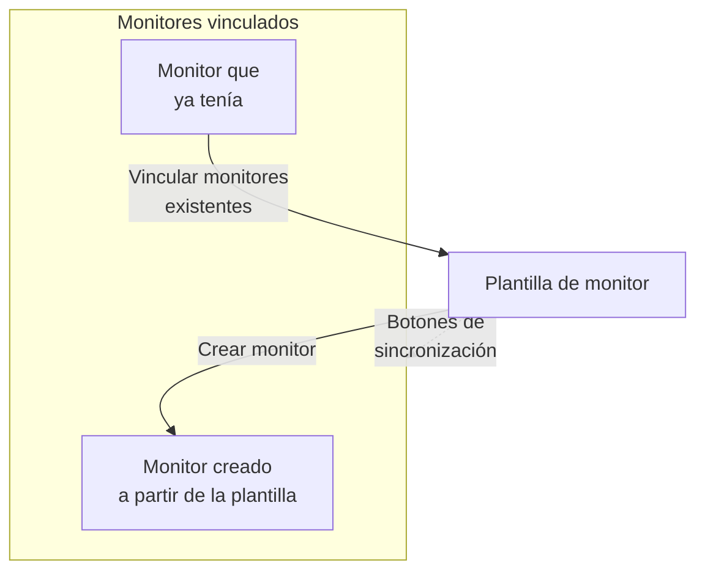

# Plantillas de monitor

Una plantilla de monitor es una configuración de monitor guardada (un tipo, criterios, un intervalo, etiquetas y valores predeterminados de campos personalizados) a partir de la cual crea monitores con un clic. Los monitores creados a partir de ella, o vinculados a ella, siguen conectados: cambie la plantilla y luego sincronice el cambio con todos ellos. Use plantillas cuando muchos monitores deban comportarse igual, como la misma comprobación de salud en cada servicio, o las mismas comprobaciones de API en producción y en staging.

:::cards
- [Crear una plantilla](#crear-una-plantilla): Cuatro pasos, como Crear monitor.
- [Crear monitores a partir de ella](#crear-monitores-a-partir-de-una-plantilla): Un clic, o vincule monitores que ya tiene.
- [Sincronizar cambios](#sincronizar-cambios-con-los-monitores-vinculados): Qué copia cada botón de sincronización.
- [Mover monitores a otra plantilla](#mover-monitores-a-otra-plantilla): Una plantilla mejor, y cada monitor conserva su historial.
- [Conservar valores propios de cada monitor](#conservar-valores-propios-de-cada-monitor): Proteger un destino o unos encabezados de una sincronización.
:::

## Cómo funcionan las plantillas

Una plantilla no vigila nada por sí misma. Los monitores se crean a partir de ella, o se vinculan a ella, y la página de la plantilla los lista como **Monitores vinculados**. Cuando cambia la plantilla, nada cambia en esos monitores hasta que sincroniza: cada botón de sincronización copia una parte de la plantilla en cada monitor vinculado, y los campos que protege conservan el valor propio de cada monitor.



## Antes de empezar

- **Un rol que pueda crear plantillas**: Propietario del proyecto, Administrador del proyecto, Miembro del proyecto, Administrador de monitores o Miembro de monitores, o un rol personalizado con el permiso Create Monitor Template. Cambiar una plantilla requiere los mismos roles, o el permiso Edit Monitor Template.
- **Permiso para actualizar los monitores vinculados.** Una sincronización escribe en cada monitor vinculado en su nombre, y omite los monitores que sus permisos no cubren.

## Crear una plantilla

:::steps
### Abrir Plantillas

Vaya a **Monitores → Ajustes → Plantillas** y haga clic en **Crear Plantilla de monitor**.

### Poner nombre a la plantilla

En **Información de la plantilla**, introduzca un **Nombre de la plantilla**, como `Production API Health`. La **Descripción de la plantilla** es opcional. Luego haga clic en **Siguiente**.

### Definir los valores predeterminados del monitor

En **Valores predeterminados del monitor**, elija el **Tipo de monitor**, con el mismo selector que Crear monitor. Opcionalmente, introduzca un **Nombre de monitor predeterminado**; si lo deja en blanco, cada monitor recibe el nombre del recurso que vigila. **Descripción de monitor predeterminada** y **Etiquetas** esperan en **Más campos**. Haga clic en **Siguiente**.

### Definir los criterios y el intervalo

En **Criterios**, rellene qué comprobar y los criterios, como en [Crear monitor](/docs/monitor/create-monitor#criterios). La tarjeta **Ajustes de sincronización de la plantilla** de la parte superior le permite proteger campos de las sincronizaciones (consulte [Conservar valores propios de cada monitor](#conservar-valores-propios-de-cada-monitor)). En un tipo de monitor que comprueban las sondas, el último paso, **Intervalo**, pide el **Intervalo de monitoreo**. Haga clic en **Crear Plantilla de monitor** en el último paso.
:::

La plantilla se añade a la lista. Ábrala para ver su página, con una tarjeta para cada parte: **Información de la plantilla**, **Valores predeterminados del monitor**, **Criterios**, **Intervalo de monitoreo** (con **Acuerdo mínimo de sondas**), **Etiquetas**, **Valores predeterminados de campos personalizados** (cuando el proyecto tiene campos personalizados de monitor) y **Monitores vinculados**. Cambia cada parte en su propia tarjeta, por ejemplo con **Editar criterios** o **Editar intervalo**.

## Crear monitores a partir de una plantilla

- **Monitor nuevo.** Haga clic en **Crear monitor** en la fila de la plantilla en la lista, o en **Crear monitor desde plantilla** en su página. **Crear monitor** se abre con el tipo y los ajustes de la plantilla rellenados; cambie lo que necesite y créelo. El monitor nuevo queda vinculado a la plantilla.
- **Monitores que ya tiene.** En **Monitores vinculados**, haga clic en **Vincular monitores existentes** y elíjalos. Con **Usar los criterios y el intervalo de la plantilla** activado, toman los criterios, el intervalo y el acuerdo de sondas de la plantilla al vincularse; desactivado, conservan sus ajustes hasta que sincroniza. Un monitor vinculado a otra plantilla pasa a esta.

Los valores definidos en **Valores predeterminados de campos personalizados** se escriben en cada monitor creado a partir de la plantilla, incluidos los monitores que las reglas de importación automática y las políticas de alertas crean a partir de ella.

## Sincronizar cambios con los monitores vinculados

Editar una plantilla solo cambia la plantilla. Para copiar un cambio en los monitores vinculados, use el botón de sincronización de la tarjeta que cambió. Cada botón indica a cuántos monitores llega, como **Sincronizar criterios con 3 monitores vinculados**, y aparece atenuado mientras no haya nada vinculado. Una sincronización no se puede deshacer.

| Botón | Copia en cada monitor vinculado | Deja sin tocar |
| --- | --- | --- |
| **Sincronizar criterios con los monitores vinculados** | Los criterios y los ajustes del paso, como los destinos y las opciones de la solicitud, excepto los campos protegidos | El intervalo de monitoreo, el acuerdo mínimo de sondas, el nombre, la descripción, las etiquetas y los valores de los campos personalizados |
| **Sincronizar el intervalo con los monitores vinculados** | El intervalo de monitoreo y el acuerdo mínimo de sondas | Los criterios, el nombre, la descripción, las etiquetas y los valores de los campos personalizados |
| **Sincronizar etiquetas con los monitores vinculados** | Las etiquetas, y nada más | Todo lo demás |
| **Sincronizar campos personalizados con los monitores vinculados** | Los campos personalizados para los que la plantilla tiene un valor predeterminado, sustituyendo lo que tenía cada monitor | Los campos personalizados que la plantilla deja en blanco, y todo lo demás |

Para sincronizar un solo monitor, haga clic en **Sincronizar desde la plantilla** en su fila de **Monitores vinculados**. Eso copia los criterios y los ajustes del paso (excepto los campos protegidos), el intervalo de monitoreo, el acuerdo mínimo de sondas y las etiquetas, y deja sin tocar el nombre, la descripción y los valores de los campos personalizados del monitor. Para desconectar un monitor, consulte [Desvincular monitores de una plantilla](#desvincular-monitores-de-una-plantilla).

Después de una sincronización, un resumen indica cuántos monitores se actualizaron. **Sincronizado parcialmente** significa que algunos monitores vinculados todavía tienen la configuración anterior, normalmente porque sus permisos no los cubren.

Una sincronización que quita los criterios que abrieron un incidente o una alerta abiertos los resuelve si estaban configurados para resolverse automáticamente, ya que nada podría resolverlos una vez desaparecidos esos criterios: su cronología indica por qué, y el resumen indica cuántos se resolvieron. Un incidente o una alerta cuyos criterios la plantilla todavía tiene sigue abierto, y el que debe resolverse a mano queda en sus manos. Editar usted mismo los criterios de un monitor, en el panel, mediante la API o con Terraform, hace lo mismo.

## Mover monitores a otra plantilla

Cuando una plantilla mejor sustituye a otra, mueva sus monitores a ella en lugar de eliminarlos. Cada monitor conserva su nombre, su historial de estado, sus etiquetas, sus propietarios y sus incidentes, y toma los criterios de la nueva plantilla.

:::steps
### Seleccionar los monitores

Abra la plantilla a la que están vinculados ahora. En **Monitores vinculados**, seleccione los monitores, o todos. También puede seleccionar monitores en la lista de monitores, filtrada por cualquier columna.

### Moverlos

En **Acciones masivas**, haga clic en **Mover a otra plantilla** (en la lista de monitores, **Vincular a una plantilla**). Elija la plantilla.

### Dejar activados los ajustes de la plantilla

Deje activado **Usar los criterios y el intervalo de la plantilla**, para que cada monitor tome ahora los criterios, los ajustes del paso, el intervalo y el acuerdo de sondas de la plantilla. Desactivado, cada uno conserva los suyos hasta que sincroniza. Luego confirme.
:::

Lo que hace el traslado:

- Los criterios, el intervalo y el acuerdo de sondas de los monitores se sustituyen por los de la plantilla. Se resuelve el incidente o la alerta abiertos que sus criterios anteriores tenían configurados para resolverse automáticamente, y los nuevos criterios abren uno nuevo si el problema sigue presente. Cada monitor de dispositivo de red sigue vigilando su propio dispositivo, y cada monitor de dirección o de URL sigue comprobando la dirección de su propio dispositivo.
- Los nombres, las descripciones, el historial de estado, las etiquetas, los propietarios, los valores de los campos personalizados y los enlaces a incidentes se mantienen como están.
- Un monitor que creó una importación, una regla de importación automática o una política de alertas de red conserva la plantilla a partir de la que se creó. Esa regla no vuelve a crearlo, y una política de alertas lo deja ir: ya no lo elimina ni lo sustituye.
- Un dispositivo tiene un monitor de cada plantilla. Cuando un dispositivo ya tiene un monitor creado para él a partir de la nueva plantilla, su otro monitor se omite, y el cambio nombra el que estorba: elimine uno de los dos y vuelva a moverlo.
- Se omite un monitor de un tipo distinto al de la plantilla.

El cambio se ejecuta en el servidor, hasta 10 000 monitores a la vez, y muestra su progreso: qué se movió, qué se omitió y por qué, y los incidentes y alertas abiertos que resolvió. Cerrar el cuadro de diálogo no lo detiene: la página de la plantilla y la lista de monitores muestran un cambio que sigue en curso, con hasta dónde ha llegado, y la lista de monitores muestra durante una hora uno terminado que omitió monitores o en el que fallaron. Haga clic en su línea para volver a abrirlo, con **Mostrar progreso** mientras se ejecuta y **Mostrar qué pasó** cuando termina. **Detener** lo detiene antes del siguiente monitor, y **Reintentar** vuelve a intentarlo con los monitores que fallaron o no se alcanzaron.

> [!TIP]
> Apuntar una regla de importación automática a otra plantilla del mismo tipo ofrece mover primero allí los monitores de sus dispositivos, y la regla usa la nueva plantilla cuando ya se han movido, así que ningún dispositivo recibe un segundo monitor. **Guardar sin mover** apunta la regla a ella ahora: cada dispositivo conserva su monitor y recibe el de la nueva plantilla a su lado.

## Desvincular monitores de una plantilla

Haga clic en **Desvincular de la plantilla** en la fila de un monitor en **Monitores vinculados**, o seleccione monitores allí o en la lista de monitores y use **Desvincular de la plantilla** en **Acciones masivas**. Elija qué conservan los monitores:

| Opción | Qué hacen los monitores después |
| --- | --- |
| **Conservar su configuración** | Siguen comprobando y generando alertas con los criterios que tienen ahora, como monitores propios, y ya no reciben las actualizaciones de la plantilla. |
| **Quitarles los criterios de la plantilla** | Siguen comprobando, pero no generan incidentes ni alertas ni establecen ningún estado hasta que los vuelva a vincular a una plantilla. Se resuelve el incidente o la alerta abiertos que sus criterios tenían configurados para resolverse automáticamente. |

En ambos casos conservan sus nombres, su historial de estado, sus etiquetas, sus propietarios y sus incidentes, y una regla que los creó no vuelve a crearlos.

## Eliminar una plantilla

No se puede eliminar una plantilla a partir de la cual aprovisiona una política de alertas de red o una regla de importación automática: apunte primero la política o la regla a otra plantilla. Los monitores de una política se mueven con ella, y el formulario de una regla ofrece mover los monitores de sus dispositivos. Cuando hay monitores vinculados a la plantilla, su eliminación pregunta qué pasa con ellos:

- **Conservar su configuración** (la opción predeterminada): la eliminación los desvincula, y siguen comprobando y generando alertas con los criterios que tienen.
- **Quitarles los criterios de esta plantilla**: cada uno se desvincula y se le quitan los criterios, como arriba, y luego se elimina la plantilla. Cuando un monitor sigue vinculado, como uno que sus permisos no cubren, la plantilla se conserva, y el cuadro de diálogo indica cuántos.

Para mover los monitores a otra plantilla en su lugar, use **Mover a otra plantilla** antes de eliminarla.

## Conservar valores propios de cada monitor

Una sincronización de criterios también copia ajustes del paso como los destinos, los encabezados de la solicitud y los tiempos de espera, a menos que proteja esos campos. Proteja un campo para que cada monitor vinculado conserve su propio valor.

:::steps
### Abrir la plantilla

Vaya a **Monitores → Ajustes → Plantillas** y abra la plantilla.

### Editar sus criterios

En la tarjeta **Criterios**, haga clic en **Editar criterios**.

### Proteger los campos

En **Ajustes de sincronización de la plantilla**, marque **No sincronizar este campo** junto a cada campo que quiera conservar en los monitores vinculados.

### Guardar

Guarde los cambios. La tarjeta **Criterios**, y la confirmación de las dos sincronizaciones de abajo, listan los campos protegidos.

### Sincronizar

Use **Sincronizar criterios con los monitores vinculados**, o **Sincronizar desde la plantilla** en un monitor vinculado concreto.
:::

Por ejemplo, proteja **Destino del monitor** y **Encabezados de la solicitud** en una plantilla de API. Los monitores de producción y de staging conservan sus propias URL y encabezados, mientras ambos reciben los criterios actualizados de la plantilla y sus demás ajustes no protegidos.

Las opciones disponibles dependen del tipo de monitor. Incluyen destinos y puertos, opciones de solicitud HTTP, conexiones de base de datos, ajustes de DNS, selectores de infraestructura y consultas de telemetría. Las credenciales relacionadas, como un certificado de cliente y su clave privada, se conservan juntas.

### Cómo se comportan las exclusiones

- Los campos marcados conservan el valor actual de cada monitor existente, incluido un valor vacío o sin definir. Los encabezados de la solicitud y otras colecciones se conservan completos.
- Los campos sin marcar siguen sincronizándose desde la plantilla. Desmarque un campo protegido y guarde para copiar su valor de plantilla en la siguiente sincronización.
- Las exclusiones se aplican a las sincronizaciones masivas e individuales. Se guardan en la plantilla, no se eligen por separado en cada sincronización.
- Los monitores nuevos siguen empezando con los valores de campo de la plantilla. Las exclusiones solo afectan a la sincronización de monitores existentes.
- Los criterios siempre se sincronizan. Una sincronización solo de criterios deja sin tocar el intervalo de monitoreo, las etiquetas y otros ajustes del monitor.
- Las plantillas existentes no tienen exclusiones de campos hasta que las configura. Los monitores de dispositivo de red siguen conservando automáticamente su propia vinculación al dispositivo, y los monitores Ping, IP, Puerto y NTP que una importación del descubrimiento de red creó para dispositivos siguen comprobando la dirección propia de cada dispositivo. Los monitores Sitio web, API y Certificado SSL que creó conservan la dirección de cada dispositivo como host de su URL y toman el esquema, el puerto y la ruta de la plantilla.

En las plantillas con varios pasos, los valores protegidos se emparejan por los ID de paso. Los monitores de un solo paso creados de forma independiente también pueden recibir una plantilla de un solo paso. Si un paso protegido no se puede emparejar, la sincronización se rechaza antes de actualizar ningún monitor, para que un paso nuevo o reordenado no copie por accidente el destino o las credenciales de otro paso.

> [!IMPORTANT]
> Antes de cambiar el tipo de monitor de una plantilla guardada (con **Editar valores predeterminados del monitor**), quite en **Editar criterios** las exclusiones que no se aplican al nuevo tipo. Todas las exclusiones de una plantilla deben existir para su tipo de monitor.

## Configuración por API

Cada paso de plantilla acepta un array `doNotSyncFields` en su objeto `MonitorStep.value`. Para un monitor de API, proteja su destino y toda su colección de encabezados con:

```json title="monitorSteps (excerpt)"
{
  "_type": "MonitorSteps",
  "value": {
    "monitorStepsInstanceArray": [
      {
        "_type": "MonitorStep",
        "value": {
          "id": "<step id>",
          "doNotSyncFields": ["monitorDestination", "requestHeaders"]
        }
      }
    ]
  }
}
```

Omita el array o póngalo en `[]` para sincronizar todos los ajustes de paso admitidos. Los nombres de campo no admitidos y los campos que no se aplican al tipo de monitor de la plantilla se rechazan. El array de la plantilla controla la sincronización; esos metadatos en un monitor vinculado no lo anulan.

:::details Nombres de campo para doNotSyncFields, por tipo de monitor
| Tipo de monitor | Nombres de campo |
| --- | --- |
| Sitio web, API, Ping, IP, Puerto, Certificado SSL, NTP | `monitorDestination`, `requestTimeoutInMs`, `retryCount` |
| Solo API | `requestHeaders`, `requestType`, `requestBody` |
| Sitio web y API | `doNotFollowRedirects`, `allowSelfSignedCertificates`, `tlsClientAuthentication` (el certificado de cliente, la clave y la frase de contraseña juntos) |
| Puerto, NTP | `monitorDestinationPort` |
| Monitor sintético, Código JavaScript personalizado | `customCode` |
| Monitor sintético | `browserTypes`, `screenSizeTypes`, `retryCountOnError` |
| DNS | `dnsMonitor.queryName`, `dnsMonitor.recordType`, `dnsMonitor.resolver` (el servidor DNS y el puerto juntos), `dnsMonitor.timeout`, `dnsMonitor.retries` |
| Dominio | `domainMonitor.domainName`, `domainMonitor.lookupMethod`, `domainMonitor.timeout`, `domainMonitor.retries` |
| DNSSEC | `dnssecMonitor.domainName`, `dnssecMonitor.resolvers`, `dnssecMonitor.checkNameserverConsistency`, `dnssecMonitor.signatureExpiryWarningDays`, `dnssecMonitor.timeout`, `dnssecMonitor.retries` |
| Consulta SQL | `sqlMonitor.connection`, `sqlMonitor.connectionTimeoutInMs`, `sqlMonitor.statementTimeoutInMs`, `sqlMonitor.query`, `sqlMonitor.maxRows` |
| Salud de la base de datos | `databaseMonitor.connection`, `databaseMonitor.connectionTimeoutInMs`, `databaseMonitor.statementTimeoutInMs`, `databaseMonitor.enabledMetricGroups` |
| Página de estado externa | `externalStatusPageMonitor.statusPageUrl`, `externalStatusPageMonitor.provider`, `externalStatusPageMonitor.components`, `externalStatusPageMonitor.timeout`, `externalStatusPageMonitor.retries` |
| Registros, Eventos de seguridad, Trazas, IA / LLM, Métricas, Excepciones, Perfiles | `logMonitor`, `securityEventsMonitor`, `traceMonitor`, `llmMonitor`, `metricMonitor`, `exceptionMonitor`, `profileMonitor` (toda la configuración del monitor) |
| Estado de la sonda | `probeStatusMonitor.probeIds` |

Los monitores de infraestructura (Kubernetes, Contenedor de Docker, Host, Contenedor de Podman, Proxmox, Docker Swarm, Ceph, Cabina de almacenamiento, Dispositivo IoT) ofrecen su selector de recursos, filtros (todos salvo Host), consultas de métricas y ventana de tiempo de consulta. Sus nombres aparecen en **Ajustes de sincronización de la plantilla** en una plantilla de ese tipo.
:::

## Solución de problemas

:::details Una sincronización dice «Sincronizado parcialmente»
Algunos monitores vinculados no se actualizaron, normalmente porque sus permisos no los cubren. Pida a alguien que pueda actualizar todos los monitores vinculados que vuelva a ejecutar la sincronización.
:::

:::details Una sincronización falla con «a template step cannot be matched to an existing monitor step»
Un campo protegido no se pudo emparejar con un paso de uno de los monitores, así que la sincronización se detuvo antes de cambiar ninguno. Dé a los pasos de la plantilla los mismos ID que a los pasos de los monitores, o use una plantilla de un solo paso con monitores de un solo paso.
:::

:::details Los botones de sincronización aparecen atenuados
Todavía no hay ningún monitor vinculado a la plantilla. Cree un monitor a partir de ella, o haga clic en **Vincular monitores existentes** en **Monitores vinculados**.
:::

:::details Un traslado omite un monitor: «El dispositivo para el que se creó este monitor ya tiene un monitor vinculado a esta plantilla»
El dispositivo tiene un monitor creado para él a partir de la plantilla a la que está moviendo, normalmente porque una regla de importación automática se apuntó a esa plantilla antes del traslado. Elimine el que no necesite (el más reciente es el que tiene menos historial) y vuelva a moverlo.
:::

:::details Después de que una regla de importación automática pasara a una plantilla nueva, los dispositivos tienen dos monitores
La regla se guardó con **Guardar sin mover**, o se apuntó a la plantilla antes de que su formulario ofreciera moverlos, y dio a cada dispositivo el monitor de la nueva plantilla junto al que tenía. Elimine los monitores nuevos y luego mueva los antiguos a la nueva plantilla: conservan su historial, y la regla no vuelve a crear ninguno.
:::

:::details Guardar falla con «Unsupported do not sync field»
Un nombre de `doNotSyncFields` no es un campo del tipo de monitor de la plantilla. Compruébelo con los nombres de campo de arriba.
:::

## Próximos pasos

:::cards
- [Crear un monitor](/docs/monitor/create-monitor): El formulario que rellena una plantilla.
- [Monitor de API](/docs/monitor/api-monitor): Los ajustes que lleva una plantilla de API.
- [Secretos del monitor](/docs/monitor/monitor-secrets): Compartir credenciales entre monitores sin copiarlas.
- [Pasos de monitor de Terraform](/docs/terraform/monitor-steps): Gestionar los monitores y sus pasos como código.
:::
