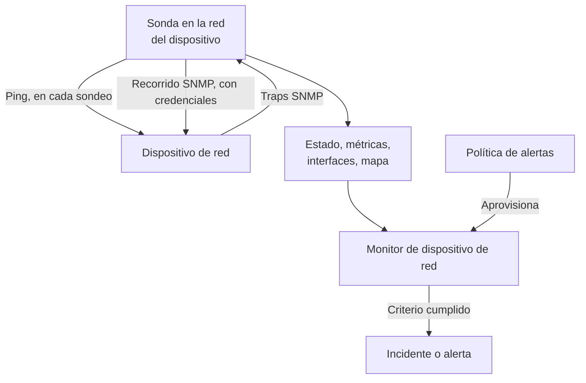
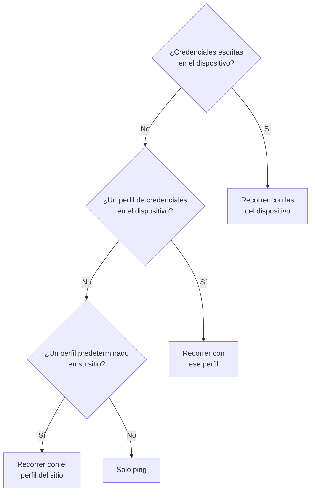
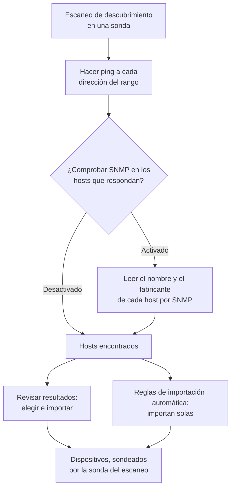
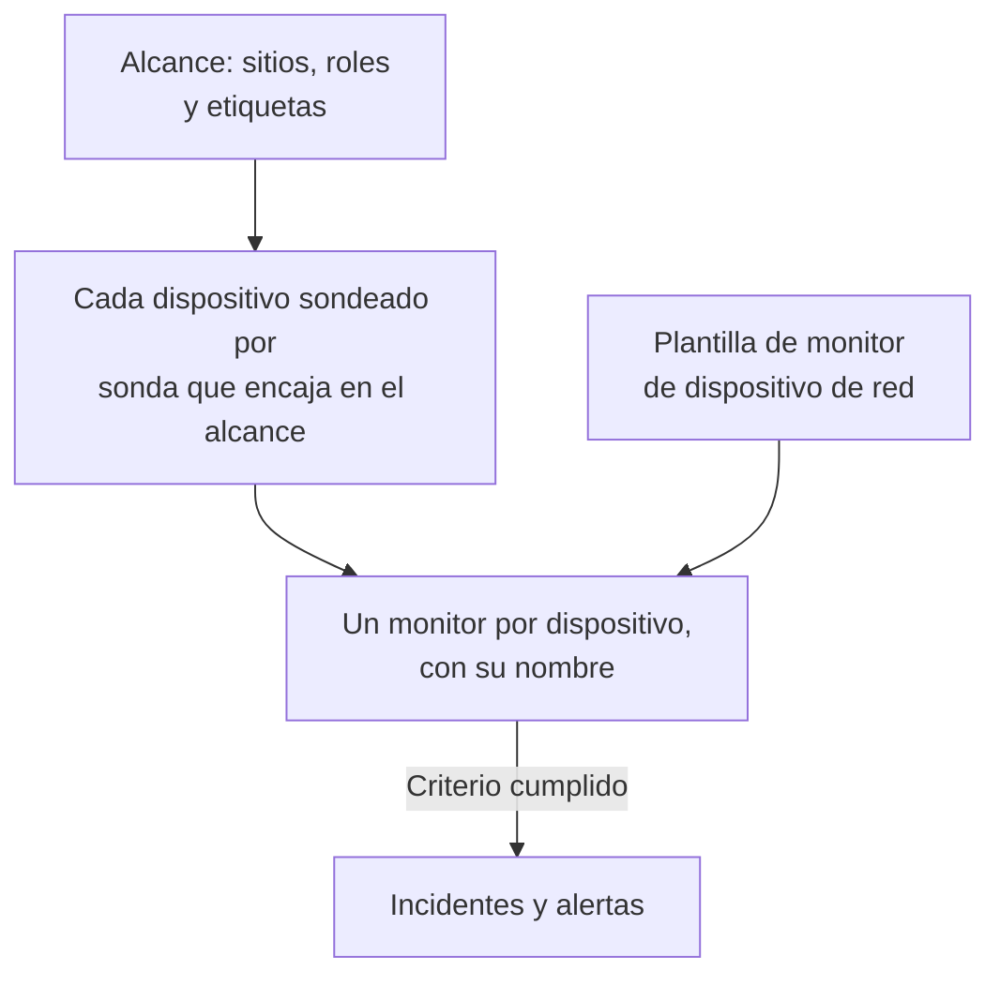
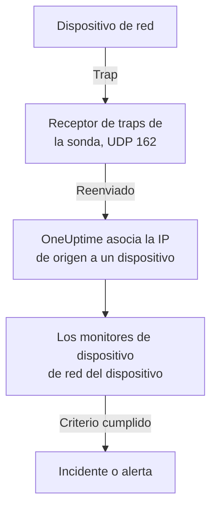

# Monitor de dispositivos de red

Monitorea switches, routers, firewalls, puntos de acceso, PDU, cámaras e impresoras: todo lo que tenga una dirección en tu red, hable SNMP o no.

Añade un dispositivo con su dirección y una sonda, y la sonda le hace ping según un horario: el dispositivo obtiene un estado activo o caído, un lugar en el mapa de la red y un voto en la salud de su sitio. Dale credenciales SNMP y la misma sonda también lo recorre por SNMP (walk): las interfaces y los ópticos que contienen, el inventario de hardware, los vecinos LLDP y CDP, y los OID de salud. Añade un monitor, o una política de alertas para toda una flota, y sus sondeos y traps generan incidentes y alertas.

:::cards
- [Añadir un dispositivo](#añadir-un-dispositivo-de-red): Su dirección y una sonda, en una sola página.
- [Descubrir una red](#descubrir-dispositivos-con-un-escaneo-de-red): Recorre un rango de direcciones e importa lo que responda.
- [Leer dispositivos por SNMP](#credenciales-snmp-y-perfiles-de-credenciales): Interfaces, ópticos, inventario y salud.
- [Recibir alertas](#alertas): Un monitor para un dispositivo, una política para una flota.
- [Ver el mapa](#topología-de-la-red): Vecinos dibujados en vivo, exportados como PDF.
- [Resolver un problema](#solución-de-problemas): Dispositivos pendientes, recorridos fallidos, traps que no llegan.
:::

## Cómo funciona



El dispositivo y el monitor hacen trabajos distintos:

| Parte | Qué hace | Cuándo la necesitas |
| --- | --- | --- |
| El dispositivo | Su sonda lo sondea según el horario propio del dispositivo. Cada sondeo registra la accesibilidad, el tiempo de ida y vuelta del ping y la pérdida de paquetes; un sondeo con credenciales SNMP también lee la identidad, las interfaces, los vecinos y los OID de salud del dispositivo. | Siempre: el dispositivo es lo que añades. |
| Un monitor | Evalúa criterios sobre cada resultado de sondeo y cada trap del dispositivo, y abre incidentes y alertas. | Solo para incidentes y alertas. El estado, el inventario, los gráficos y el mapa no necesitan un monitor. |

## Antes de empezar

- **Una sonda que pueda alcanzar el dispositivo.** La sonda hace ping al dispositivo y lo recorre desde su propia red, así que un dispositivo en una dirección privada necesita una [sonda personalizada](/docs/probe/custom-probe) dentro de esa red: una sonda en internet pública no puede alcanzarlo.
- **SNMP, para algo más que ping.** Opcional. Una cadena de comunidad v1 o v2c, o un usuario SNMPv3, configurado en el dispositivo, con UDP 161 abierto desde la sonda. Sin eso, el dispositivo solo recibe ping.
- **Traps, syslog y flujos.** Opcional. La sonda recibe traps SNMP en UDP 162, syslog en UDP 5140 una vez que lo activas, y registros de flujo en UDP 2055, 4739 y 6343; abre esos puertos desde tus dispositivos hacia la sonda.

## La vista general de la red

**Red → Vista general** es donde se abre el área de Red, y empieza por la respuesta: una frase que dice si tu red está sana y, si no lo está, qué falla, la peor noticia primero.

| Lo que dice | Cuándo |
| --- | --- |
| **3 dispositivos están caídos** | La sonda o el monitor de un dispositivo no puede alcanzarlo. |
| **2 sitios requieren atención** | Todos los dispositivos responden, pero la salud de un sitio no es operativa. |
| **5 interfaces están caídas** | Todos los dispositivos responden, pero hay puertos apagados. |
| **2 dispositivos no informan de sus detalles** | Responden al ping, pero su recorrido SNMP falla, así que sus interfaces y su salud no se actualizan: normalmente son las credenciales. |
| **Esperando la primera comprobación** | Se añadieron dispositivos y su sonda aún no los ha comprobado. |
| **Los 40 dispositivos están activos** | Todos los dispositivos responden. Los dispositivos que aún esperan su primera comprobación se cuentan en una línea aparte. |

Debajo, una línea dice si algo genera un incidente cuando un dispositivo cae: cuántas [políticas de alertas](#políticas-de-alertas) están activas, o un enlace **Configurar alertas** cuando no hay ninguna. Los botones **Añadir dispositivo** y **Descubrir dispositivos** a su lado abren esos formularios, y los mosaicos y las listas de abajo dan el detalle: los dispositivos y sitios que requieren atención, la flota por fabricante y los escaneos recientes.

Mientras no se ha añadido nada, la vista general muestra en su lugar las dos formas de empezar: **Descubrir dispositivos** escanea un rango de direcciones para que elijas qué añadir, lo mejor para toda una red o un sitio nuevo, y **Añadir un solo dispositivo** añade uno por su dirección IP o su nombre de host.

El menú Red mantiene a la vista lo que abres cada día: **Vista general**, **Dispositivos**, **Sitios**, **Mapa**, **Tráfico** y **Descubrimiento**. El resto queda plegado en secciones, y una sección se abre sola en cualquiera de sus páginas:

| Sección | Páginas |
| --- | --- |
| **Topología** | **Topología del dispositivo**, **Endpoints**, **Matriz de latencia**, **Enlaces del sitio**, **Enlaces del dispositivo** |
| **Reglas** | **Reglas de importación automática**, **Reglas de asignación de sitios**, **Reglas del propietario**, **Reglas de etiquetas**, **Reglas de enlaces** |
| **Ajustes** | **Políticas de alertas**, **Credenciales SNMP**, **Roles de dispositivo**, **Tipos de sitio**, **Plantillas de recopilación de OID** |
| **Avanzado** | **Dispositivos archivados** |

## Añadir un dispositivo de red

:::steps
### Abrir la lista de dispositivos
Ve a **Red → Dispositivos** y haz clic en **Añadir dispositivo**. **Añadir dispositivo** en la **Vista general** de Red abre el mismo formulario.

### Escribir la dirección del dispositivo
En **Nombre de host**, escribe su dirección IP o su nombre de host. Deja **Nombre** vacío para que el dispositivo se llame como su nombre de host.

### Comprobar el sitio y la sonda
Elige el **Sitio** donde está el dispositivo, si usas sitios. **Sonda** se rellena con la sonda predeterminada del sitio, o con la única sonda personalizada del proyecto; asegúrate de que sea una que pueda alcanzar el dispositivo.

### Añadir el dispositivo
Haz clic en **Añadir dispositivo**. En un par de minutos, la sonda hace ping al dispositivo y su estado pasa a **Activo** o **Caído**. Con credenciales SNMP, su vista general también se rellena con la identidad, las interfaces y la salud del dispositivo tras el primer recorrido correcto.
:::

El formulario es una sola página — el nombre de host, un nombre, el sitio y la sonda —, con **SNMP** y **Más campos** plegados debajo. No pregunta nada sobre cómo se monitorea el dispositivo: cada dispositivo que añades lo sondea su sonda, y la [anulación con monitor vinculado](#la-anulación-con-monitor-vinculado) está en la página **Ajustes** del dispositivo para los pocos dispositivos que la necesitan.

Los detalles de un dispositivo — su nombre, descripción, rol, sitio, etiquetas y direcciones — se editan después en un solo lugar: la tarjeta **Ajustes del dispositivo** de su página **Ajustes**. La tarjeta **Detalles del dispositivo** de su vista general los muestra, con un enlace **Editar en Ajustes**.

### El dispositivo

| Campo | Descripción | Obligatorio |
| --- | --- | --- |
| Nombre de host | La dirección IP o el nombre de host al que la sonda hace ping, y que recorre por SNMP cuando el dispositivo tiene credenciales. | Sí |
| Nombre | Un nombre descriptivo, como core-switch-01. Déjalo vacío y el dispositivo se llamará como su nombre de host. La API hace lo mismo: un dispositivo creado sin nombre se llama como su nombre de host. | No |
| Sitio | El [sitio de red](/docs/monitor/network-sites) donde está el dispositivo. La salud del sitio se resume a partir de sus dispositivos, y un sitio con una sonda predeterminada rellena la sonda de abajo. | No |
| Sonda | La sonda que hace ping a este dispositivo, lo recorre por SNMP cuando tiene credenciales, y recibe sus traps, su syslog y sus [registros de flujo](/docs/monitor/network-traffic). Debe alcanzar el dispositivo directamente: una sonda en internet pública no puede alcanzar una dirección privada. | Sí |

**Sonda** se rellena sola cuando puede: un proyecto con exactamente una sonda personalizada empieza con esa, y elegir un sitio la sustituye por la [sonda predeterminada del sitio](/docs/monitor/network-sites#valores-predeterminados-de-monitoreo). Nunca sobrescribe una sonda que hayas elegido tú. Define una sonda predeterminada en tus sitios y podrás añadir un dispositivo solo con su dirección.

### Más campos (plegado)

| Campo | Descripción | Obligatorio |
| --- | --- | --- |
| Descripción | Texto libre. | No |
| Rol del dispositivo | Switch de núcleo, switch de acceso, firewall, etc. Fija el nivel del dispositivo en el mapa y acota las políticas de alertas. | No |
| Dirección MAC | La MAC propia del dispositivo. El mapa la usa para colocar un dispositivo que no habla LLDP ni CDP en el puerto del switch que lo aprendió; consulta [Dispositivos solo con ping y su puerto de switch](#dispositivos-solo-con-ping-y-su-puerto-de-switch). Normalmente se aprende por ti de la tabla ARP de un router. | No |
| Crear también un monitor Ping para incidentes | La sonda ya hace ping al dispositivo y le da un estado; un monitor Ping es lo que convierte los pings fallidos en un incidente. Márcalo y se crea uno sobre el nombre de host, vinculado al dispositivo, al guardar. Cuenta para tu plan, y sus incidentes quedan desactivados hasta que los actives desde la página del monitor. | No |

Marcar el monitor Ping muestra **Ping desde las sondas**, las sondas propias del monitor. Tienen que alcanzar la red del dispositivo; deja el campo vacío para usar las sondas predeterminadas del proyecto. Para alertar sobre muchos dispositivos a la vez, usa mejor las [políticas de alertas](#políticas-de-alertas).

### SNMP (plegado, opcional)

Déjalo plegado y el dispositivo solo recibe ping: la sección plegada lo dice en una frase. El dispositivo obtiene igualmente un estado desde su primer sondeo y sigue en su sitio y en el mapa, pero no tiene interfaces, inventario ni OID de salud hasta que tenga credenciales. Abre la sección para escribir una cadena de comunidad o un usuario v3, o para elegir un perfil de credenciales guardado.

:::tabs
@tab SNMP v1 / v2c
| Campo | Descripción | Obligatorio |
| --- | --- | --- |
| Versión de SNMP | V1, V2c o V3. | Sí, empieza en V2c |
| Cadena de comunidad SNMP | La cadena de comunidad v1 o v2c, como `public`. | No: vacía significa solo ping |
| Puerto SNMP | El puerto UDP en el que escucha el agente. | No, 161 por defecto |
| Perfil de credenciales SNMP | Un conjunto de credenciales guardado, en lugar de escribirlas aquí. | No |
@tab SNMPv3
| Campo | Descripción | Obligatorio |
| --- | --- | --- |
| Nivel de seguridad SNMP v3 | No Auth, No Priv; Auth, No Priv; o Auth, Priv. | Sí |
| Usuario SNMP v3 | El nombre de seguridad (usuario) configurado en el dispositivo. | Sí: vacío significa solo ping |
| Protocolo de autenticación SNMP v3 | MD5, SHA, SHA-256 o SHA-512. | Con autenticación |
| Clave de autenticación SNMP v3 | La frase de contraseña de autenticación. | Con autenticación |
| Protocolo de privacidad SNMP v3 | DES, AES o AES-256. | Con privacidad |
| Clave de privacidad SNMP v3 | La frase de contraseña de privacidad (cifrado). | Con privacidad |
:::

Las credenciales escritas en el dispositivo prevalecen sobre un perfil de credenciales elegido a su lado, y el sitio del dispositivo también puede llevar un perfil predeterminado. Las credenciales de un perfil se cifran en reposo. Las credenciales escritas en un dispositivo están protegidas por los mismos permisos de lectura pero no se cifran en reposo: una razón más para guardar las credenciales compartidas en un perfil.

## Cambiar muchos dispositivos a la vez

Un escaneo de descubrimiento de la red de un cliente trae docenas de dispositivos que pertenecen a un mismo sitio, comparten un rol y son de un mismo fabricante. No los abres uno a uno: selecciónalos en la lista **Dispositivos**, marcando filas o seleccionando todos los que coinciden con los filtros, y abre **Acciones masivas**.

| Acción | Qué hace |
| --- | --- |
| **Definir sitio** / **Quitar del sitio** | Mueve cada dispositivo seleccionado al sitio que elijas, donde cuenta para la salud del sitio; un dispositivo sin sonda propia toma la sonda predeterminada del sitio. **Quitar del sitio** los saca de sus sitios. Un dispositivo que coincide con una regla de asignación de sitios vuelve al sitio de la regla en su siguiente sondeo, así que para los dispositivos que el descubrimiento sigue encontrando, añade mejor una regla en **Red → Reglas → Reglas de asignación de sitios**; el diálogo **Definir sitio** enlaza a ella. |
| **Definir rol del dispositivo** / **Quitar rol del dispositivo** | Da un mismo rol a cada dispositivo seleccionado, como los veinte switches que son todos «Access Switch». Los roles son los del proyecto, en **Red → Ajustes → Roles de dispositivo**, a los que enlaza el diálogo. **Quitar rol del dispositivo** vuelve a deducir el rol de cada dispositivo a partir de su identidad SNMP. |
| **Aplicar plantilla del fabricante** | Añade los OID de salud y las tablas SNMP de una [plantilla del fabricante](#plantillas-de-salud-de-fabricantes) a cada dispositivo seleccionado. **Según el fabricante de cada dispositivo**, la primera opción del diálogo, elige la plantilla de cada dispositivo según lo que informa su recorrido SNMP, de modo que una selección mezclada recibe la correcta en todas partes; o elige una sola plantilla para todos. |

Cada acción es un diálogo y un guardado para toda la selección, y cada dispositivo pasa por las mismas comprobaciones que una edición en su propia página de Ajustes: los permisos, el alcance de etiquetas y de propietario de tu rol, y los límites de lo que un dispositivo puede recopilar.

**Aplicar plantilla del fabricante** muestra lo que va a hacer antes de hacer nada: cuántos dispositivos reciben qué plantilla y cuántos deja sin cambios, y por qué. Añade a lo que cada dispositivo ya recopila y no quita nada, y un dispositivo que ya tiene todo lo de la plantilla no se vuelve a escribir. Deja sin cambios un dispositivo respaldado por un monitor (nada lo sondea), un dispositivo vinculado a una [plantilla de recopilación de OID](#plantillas-de-recopilación-de-oid) (la plantilla decide lo que recopila, así que añade allí los OID del fabricante) y, al hacer coincidir, un dispositivo aún no recorrido por SNMP o cuyo fabricante no tiene plantilla.

Cuando una acción termina, indica cuántos dispositivos cambiaron, cuáles fallaron y por qué — un dispositivo que tu rol no puede editar, una lista por encima de su límite — y cuáles no cambió y por qué: un dispositivo que ya estaba en ese sitio o rol, o uno que la plantilla del fabricante deja sin cambios.

Las demás acciones masivas se describen donde corresponden: **Definir plantilla de recopilación de OID** en [Plantillas de recopilación de OID](#plantillas-de-recopilación-de-oid), **Set SNMP Credential Profile**, **Switch to Probe Polling** y **Crear monitores de ping** en [En bloque](#en-bloque), y **Shorten Names to Hostname** en [Cómo se nombran los dispositivos descubiertos](#cómo-se-nombran-los-dispositivos-descubiertos).

## Lo que hace realmente un sondeo

Cada sondeo de un dispositivo sondeado por una sonda es un ping. Cuando el dispositivo tiene credenciales SNMP utilizables, la sonda también ejecuta un recorrido SNMP completo. Los dos se ejecutan a la vez y el recorrido nunca espera al ping, así que el equipo SNMP detrás de una ACL que descarta ICMP sigue informando **Activo**.

| Resultado | Dispositivo solo con ping | Dispositivo con credenciales SNMP |
| --- | --- | --- |
| Estado (Activo o Caído) | Del ping | Del ping o del recorrido: basta con que responda uno |
| Tiempo de ida y vuelta del ping y pérdida de paquetes | Registrados como métricas del dispositivo | Registrados como métricas del dispositivo |
| Tiempo de respuesta SNMP | — | La duración del recorrido, nunca la del ping |
| Interfaces, vecinos, endpoints | — | De un recorrido correcto |
| Identidad del sistema, fabricante, modelo, número de serie | — | De un recorrido correcto |
| OID de salud y tablas SNMP | — | De un recorrido correcto |

Las credenciales utilizables son un conjunto v1 o v2c con una cadena de comunidad, o un conjunto v3 con un nombre de usuario, encontrados mediante la [cadena de credenciales](#credenciales-snmp-y-perfiles-de-credenciales). Un conjunto vacío se omite, así que un dispositivo nunca se recorre con una comunidad predeterminada adivinada.

La pérdida de paquetes reutiliza la serie del [monitor Ping](/docs/monitor/ping-monitor), así que se lee igual en todo el producto. El tiempo de ida y vuelta tiene una serie propia, `oneuptime.monitor.ping.round.trip.time`, porque en un dispositivo de red el tiempo de respuesta a secas es el del recorrido SNMP. La página **Métricas** del dispositivo grafica el uso de las interfaces y los OID de salud; el tiempo de ida y vuelta de la última hora se dibuja en el panel del dispositivo en el mapa.

### «SNMP fallando» no es «Caído»

Un dispositivo que responde al ping pero cuyo recorrido falla está **Activo**, marcado con **SNMP fallando**, y las dos mitades importan:

- Está activo porque algo responde en esa dirección. Pintarlo de rojo metería un dispositivo que funciona bien en tu recuento de incidentes.
- SNMP falla porque sus interfaces, su inventario y sus OID de salud han dejado de actualizarse, casi siempre por las credenciales, un agente SNMP desactivado o una ACL. Nada más en la página te diría que los números están congelados.

Un dispositivo cuyo ping y cuyo recorrido fallan los dos está simplemente **Caído**, así que la marca solo aparece junto a un estado verde.

### Leer el estado de un dispositivo

Cada lugar que muestra un dispositivo — la lista de dispositivos, la página Dispositivos de un sitio, la vista general, el mapa — usa los mismos tres veredictos y los mismos calificativos a su lado.

| Veredicto | Significa |
| --- | --- |
| **Activo** | El último sondeo (ping o SNMP), o el monitor vinculado, alcanzó el dispositivo. |
| **Caído** | El último sondeo (ping o SNMP), o el monitor vinculado, no pudo alcanzar el dispositivo. |
| **Pendiente** | Aún no hay veredicto: nunca sondeado, sin sonda asignada o sin monitor vinculado. |

| Calificativo | Aparece cuando | Qué hacer |
| --- | --- | --- |
| **Obsoleto** | No se ha intentado ningún sondeo desde hace bastante más que el intervalo del dispositivo. | Comprueba que la sonda del dispositivo está en línea y da abasto con su flota. |
| **Sin sonda** | El dispositivo se sondea por sonda pero no tiene ninguna, o su sondeo está desactivado. | Asigna una sonda que pueda alcanzarlo; nada lo sondea hasta entonces. |
| **Sin monitor** | El dispositivo usa la [anulación con monitor vinculado](#la-anulación-con-monitor-vinculado) y no hay nada vinculado. | Vincula un monitor, o vuelve a ponerlo en sondeo por sonda. |
| **SNMP fallando** | Activo por ping, pero el último recorrido SNMP falló. | Comprueba las credenciales, el agente SNMP o una ACL. |

La lista **Dispositivos** tiene un filtro **SNMP** con tres valores: **OK** (el último recorrido fue correcto), **Fallando** (el último recorrido falló) y **No configurado** (solo ping, sin credenciales o nunca sondeado). «Qué dispositivos tienen credenciales que dejaron de funcionar» está a un clic. La columna **Interfaces (activas / caídas)** de la lista muestra **Sin SNMP** en lugar de `0 / 0` para un dispositivo que recibe ping y nunca se recorre: cero puertos funcionando sería otra afirmación, y una falsa.

## Credenciales SNMP y perfiles de credenciales

Un dispositivo se recorre con el primer conjunto de credenciales utilizable que se encuentre en este orden, y la búsqueda se detiene en el primero:



El paso del sitio lee el sitio propio del dispositivo y nada más: un dispositivo en una unidad no toma un perfil definido en la región de encima. La sonda predeterminada de un sitio sí baja por el árbol, porque una sonda se copia una vez en el dispositivo mientras que las credenciales se vuelven a leer en cada sondeo; [Sitios de red](/docs/monitor/network-sites#valores-predeterminados-de-monitoreo) tiene los detalles.

### La página Credenciales SNMP

**Red → Ajustes → Credenciales SNMP** guarda los perfiles de credenciales del proyecto. Un perfil es un conjunto con nombre — una cadena de comunidad v1 o v2c, o un usuario v3 con su nivel de seguridad, sus protocolos y sus claves — al que apuntan tantos dispositivos y sitios como quieras. No se copia nada en los dispositivos, así que rotar una cadena de comunidad es una sola edición aquí, y cada dispositivo que usa el perfil toma el nuevo valor en su siguiente sondeo.

Los secretos de un perfil se cifran en reposo, y solo los roles que pueden leer las credenciales propias de un dispositivo pueden leerlos. Un dispositivo o sitio que muestra su perfil muestra su nombre y su versión, nunca sus secretos.

Un perfil al que todavía apunta un dispositivo o sitio no se puede eliminar: la eliminación se rechaza con un recuento de lo que la impide. Mueve esos dispositivos y sitios a otro perfil, o quítales el perfil, y después elimínalo.

### Volver a dejar un dispositivo solo con ping

En la página **Ajustes** del dispositivo, **Editar configuración** tiene una casilla **Solo ping: borrar las credenciales SNMP propias de este dispositivo** en su paso **Credenciales SNMP**. Borra la cadena de comunidad y el usuario v3 propios del dispositivo al guardar. Existe porque vaciar el campo correcto no es evidente: un dispositivo v3 sigue siendo recorrible mientras exista su usuario, vacíes lo que vacíes.

Borrar las credenciales propias del dispositivo no borra un perfil. Si el dispositivo o su sitio todavía nombran uno, el dispositivo se sigue recorriendo con él; quita también el perfil para que el dispositivo solo reciba ping.

### En bloque

Selecciona dispositivos en la lista **Dispositivos** y usa:

- **Set SNMP Credential Profile** / **Clear SNMP Credential Profile**: asignar un perfil a una selección, o quitárselo.
- **Switch to Probe Polling**: para dispositivos con la anulación con monitor vinculado. Elige una sonda, y cada dispositivo seleccionado recibe ping según su horario a partir de entonces, y se recorre cuando tenga credenciales. Un monitor ya vinculado sigue vinculado; el estado del dispositivo pasa a venir de la sonda.
- **Crear monitores de ping**: para dispositivos con la anulación con monitor vinculado, crea un monitor Ping sobre el nombre de host de cada dispositivo y lo vincula, para que el dispositivo muestre Activo o Caído.

La página **Dispositivos** muestra un aviso cuando el proyecto tiene dispositivos con la anulación con monitor vinculado sin nada vinculado — dispositivos que nada sondea y de los que nada informa — y enlaza a la selección que los corrige.

## Valores predeterminados de monitoreo del sitio

Un [sitio de red](/docs/monitor/network-sites#valores-predeterminados-de-monitoreo) lleva dos valores predeterminados para sus dispositivos. Su **Sonda predeterminada** se copia en un dispositivo creado en el sitio, o movido a él, sin sonda propia. Su **Perfil de credenciales SNMP predeterminado** se lee en cada sondeo de un dispositivo del sitio que no tiene credenciales propias. Define los dos en un sitio y un dispositivo de ese sitio se puede añadir solo con su dirección, y recibe ping y se recorre desde su primer sondeo. La guía de sitios explica hasta dónde baja cada valor predeterminado por el árbol de sitios.

## La anulación con monitor vinculado

Hay equipos que ninguna sonda puede alcanzar ni sondear con ping de forma útil: un dispositivo detrás de un NAT, un appliance cuya salud se juzga mejor con una comprobación HTTP, un servicio cuya señal real es una comprobación de puerto. Para esos, **Editar configuración** en la página **Ajustes** del dispositivo ofrece un **Método de monitoreo**:

| Método | Qué significa |
| --- | --- |
| **Sonda** | El predeterminado. La sonda asignada le hace ping según su horario, y lo recorre por SNMP cuando tiene credenciales. |
| **Monitor vinculado** | El estado de un monitor existente es el estado de este dispositivo. |

Pasar un dispositivo a **Monitor vinculado** detiene su sondeo. La sonda, el intervalo y el interruptor de sondeo salen de la tarjeta **Sondeo y recopilación de datos**, los resultados de sondeo anteriores del dispositivo se borran, y su estado viene del monitor que vincules. Vincular uno es opcional: hasta entonces, el dispositivo muestra **Pendiente**, marcado con **Sin monitor**.

Volver a **Sonda** restablece el sondeo y pide una sonda. Un monitor que estaba vinculado sigue vinculado y sigue alertando; solo deja de decidir el estado del dispositivo.

La mayoría de los dispositivos no lo necesitan. Cada dispositivo sondeado por una sonda ya tiene un estado de accesibilidad, así que no hace falta vincular un monitor Ping para tenerlo; vincula un monitor cuando quieras los incidentes de ese monitor.

## Sondeo y recopilación de datos

El sondeo se configura en la página **Ajustes** del dispositivo, en la tarjeta **Sondeo y recopilación de datos** (**Editar sondeo**). Los valores predeterminados sirven para un dispositivo nuevo, que no necesita ajustes:

| Ajuste | Descripción | Predeterminado |
| --- | --- | --- |
| Sonda | La sonda que sondea el dispositivo. | Se fija al añadir el dispositivo |
| Sondeo habilitado | La sonda sondea el dispositivo según el horario de abajo. Desactívalo para pausar el sondeo sin eliminar el dispositivo. | Activado |
| Intervalo de sondeo (minutos) | Con qué frecuencia la sonda sondea el dispositivo. Al menos 1 minuto. | 5 |
| Recorrer interfaces | Recorrer las tablas de interfaces (IF-MIB) en cada sondeo: estado, ancho de banda, uso y errores de cada puerto, más los vecinos LLDP y CDP para el mapa. | Activado |
| Recopilar endpoints conectados | Recorrer también las tablas ARP y de reenvío del puente para encontrar lo que está conectado al dispositivo: terminales de punto de venta, impresoras, teléfonos, portátiles. A partir de una tabla ARP también rellena la dirección MAC de los dispositivos registrados en esas direcciones. Cuesta recorridos adicionales en cada sondeo. | Desactivado |
| Plantilla de recopilación de OID | Una lista de OID compartida y con nombre que el dispositivo recopila. Editar la plantilla cambia cada dispositivo vinculado en su siguiente sondeo. | Ninguna |
| OID de salud específicos del dispositivo | OID adicionales que solo este dispositivo recopila, además de los de su plantilla. | Ninguno |
| Aplicar automáticamente la plantilla de salud del fabricante | Cuando se reconoce el fabricante del dispositivo y su propia lista de OID está vacía, rellenar la lista con la plantilla del fabricante en el siguiente sondeo. | Desactivado; activado en los dispositivos que importa el descubrimiento |
| Device-Specific SNMP Tables | [Tablas SNMP](#tablas-snmp) adicionales que solo este dispositivo recorre, además de las de su plantilla. Una tabla con la misma clave que una tabla de la plantilla la sustituye en este dispositivo. | Ninguna |

Todo lo que va de **Recorrer interfaces** hacia abajo necesita credenciales SNMP: en un dispositivo solo con ping, esos ajustes se guardan y no tienen ningún recorrido al que aplicarse.

### Recorrido de interfaces

Con **Recorrer interfaces** activado y credenciales encontradas, cada sondeo sigue en cada interfaz su estado operativo y administrativo, los bits de entrada y salida, el uso y los errores. El mismo recorrido recopila los vecinos LLDP y CDP para el mapa.

Silencia una interfaz en la página **Interfaces** del dispositivo, para un puerto de laboratorio o un enlace desconectado a propósito, y sigue en el inventario pero sale de las alertas y las métricas. Un recorrido fallido nunca borra a medias lo recopilado: la última instantánea de interfaces se mantiene, y el dispositivo se marca con **SNMP fallando** para que nadie la tome por actual.

### Plantillas de salud de fabricantes

En el editor **OID de salud**, **Plantilla de salud del fabricante** aplica un conjunto predefinido de OID para el fabricante del dispositivo. Muchas plantillas también traen [tablas SNMP](#tablas-snmp), que se añaden con **Add a Vendor's Tables** en el editor **SNMP Tables**.

| Plantilla del fabricante | OID de salud | Tablas SNMP |
| --- | --- | --- |
| Generic (Host Resources MIB) | Carga de CPU, RAM total y disponible, carga media | Núcleos de CPU (una fila por núcleo, como sea que la plataforma los numere) |
| Arista EOS | Carga de CPU, carga media, RAM total y disponible | — |
| Cambium Networks cnMatrix | CPU, RAM, flash, temperatura, tensión de alimentación | Ventiladores, puertos PoE, fuente de alimentación redundante |
| Cambium Networks Enterprise Wi-Fi (cnPilot, XV, XE, XH) | CPU, memoria libre, clientes Wi-Fi, conexión con cnMaestro | Radios Wi-Fi (banda, canal, ancho, potencia de transmisión, clientes, ruido de fondo, tiempo de aire, estado), SSID |
| Cisco IOS / IOS-XE | CPU, memoria usada y libre, temperatura, estado de los ventiladores, estado de las fuentes | — |
| Dell Force10 / OS9 | CPU, memoria | — |
| Extreme Networks EXOS / Switch Engine | CPU, temperatura, alarma de sobretemperatura, estado de la alimentación | Fuentes de alimentación, ventiladores, memoria por ranura, miembros de la pila |
| Extreme Networks Fabric Engine / VOSS | Sesión vIST, número de I-SID | Adyacencias de fabric (IS-IS) nombradas por vecino, CPU y memoria por ranura, sensores de temperatura, ventiladores, fuentes de alimentación |
| Extreme Networks IQ Engine (HiveOS) Access Points | CPU, memoria, clientes Wi-Fi, temperatura | Radios Wi-Fi (canal, potencia de transmisión, ruido de fondo), SSID |
| Extreme Networks Wireless Controller (XIQ-C, ExtremeWireless) | Puntos de acceso, puntos de acceso activos, clientes Wi-Fi | Puntos de acceso (estado, clientes, dirección, software), radios Wi-Fi (banda, canal, ancho, ruido de fondo, tiempo de aire ocupado), WLAN (SSID, clientes) |
| Fortinet FortiGate | CPU, memoria, disco | — |
| HPE / Aruba ProCurve | CPU, memoria total y libre | — |
| HPE Aruba Instant (AOS 8) | Nombre del clúster, versión de firmware, conductor | Puntos de acceso (estado, modelo, CPU, memoria), radios Wi-Fi nombradas por punto de acceso (canal, potencia de transmisión, ruido de fondo, uso, clientes, estado), SSID (clientes) |
| HPE Aruba Mobility Controller (AOS 8) | Puntos de acceso, clientes Wi-Fi, rol del controlador | Puntos de acceso (estado, modelo, grupo de AP), radios Wi-Fi nombradas por punto de acceso (banda, canal, potencia de transmisión, uso, clientes, modo), SSID (clientes, puntos de acceso activos y caídos), procesadores, memoria |
| Huawei VRP | CPU, memoria, temperatura | — |
| Juniper Junos | CPU, búfer de memoria, temperatura | — |
| MikroTik RouterOS | Carga de CPU, temperatura, tensión | — |
| Palo Alto PAN-OS | CPU de gestión, uso de sesiones, sesiones activas | — |
| Sophos Firewall (SFOS / XGS) | Memoria, disco, swap, estado de HA y estado del par, servicio IPsec, temperatura de CPU (SFOS v22 y posteriores) | Túneles IPsec (el estado requiere SFOS v20 y posteriores), núcleos de CPU |
| TP-Link Omada Access Points (EAP) | Clientes Wi-Fi | — |
| Ubiquiti EdgeOS / EdgeSwitch / UniFi Switches | Carga de CPU, RAM total y disponible | — |
| Ubiquiti UniFi Access Points | Estado aislado, carga media, RAM total y disponible | Radios Wi-Fi (banda, tiempo de aire), SSID (banda, canal, clientes, potencia de transmisión, calidad de conexión), núcleos de CPU |

Los OID de la plantilla se copian en la lista propia del dispositivo, donde puedes recortarlos o ampliarlos. Una vez que el primer recorrido identifica al fabricante, la página del dispositivo sugiere la plantilla correspondiente. La coincidencia lee el `sysObjectID` del dispositivo, y su `sysDescr` cuando un mismo número de empresa aloja dos sistemas operativos: Extreme Fabric Engine en hardware universal informa el mismo número de empresa (1916) que EXOS, y solo su descripción (`…-FabricEngine (9.0.4.0)`) los distingue. Los puntos de acceso UniFi se distinguen igual de los routers de Ubiquiti (`U6-Pro 6.6.50.15098`), también cuando un firmware antiguo responde con la rama de Net-SNMP, y los puntos de acceso IQ Engine de los switches Aerohive que comparten su rama (`AP230, HiveOS 8.2r1`).

Los dispositivos con **Aplicar automáticamente la plantilla de salud del fabricante** activado reciben los OID y las tablas de la plantilla en su primer sondeo: los dispositivos que trae una regla de importación automática, y los importados desde **Revisar resultados** con su interruptor de plantilla del fabricante activado, que lo está salvo que lo desactives. Para dar su plantilla a muchos dispositivos a la vez, como una flota descubierta antes de que existiera el interruptor, selecciónalos en la lista **Dispositivos** y usa **Aplicar plantilla del fabricante** (consulta [Cambiar muchos dispositivos a la vez](#cambiar-muchos-dispositivos-a-la-vez)).

Aplicar una plantilla del fabricante es una copia única: nada se propaga cuando la plantilla cambia. Para más de un dispositivo, usa mejor una **Plantilla de recopilación de OID**; las plantillas de fabricantes se ofrecen como punto de partida al crear una.

### Plantillas de recopilación de OID

Una **Plantilla de recopilación de OID** (**Red → Ajustes → Plantillas de recopilación de OID**) es una lista de OID con nombre, normalmente el de un tipo de dispositivo como «Cisco Catalyst 9300», a la que se vinculan tantos dispositivos como quieras. El vínculo es vivo, no una copia: la lista de OID de un dispositivo se arma en cada sondeo, así que editar una plantilla cambia lo que cada dispositivo vinculado recopila en su siguiente sondeo, sin paso de sincronización.

Antes de crear una, comprueba que la necesitas. Los bits de entrada y salida por puerto, el estado operativo, el uso y los errores por segundo se recopilan de cada puerto en cada sondeo sin ningún OID (consulta [Recorrido de interfaces](#recorrido-de-interfaces)), y ya se pueden alertar por puerto. Las plantillas son para lo que no es por puerto: CPU, memoria, temperatura, ventiladores, fuentes de alimentación, pares BGP.

Si vienes de Zabbix:

| Zabbix | OneUptime |
| --- | --- |
| Template | Plantilla de recopilación de OID |
| Item | Un OID de esa plantilla |
| Regla de descubrimiento «Network interfaces by SNMP» con prototipos de items | Integrado y siempre activo para los contadores de interfaces: nada que escribir |
| Trigger | Criterios del monitor |
| Prototipo de trigger, uno por interfaz descubierta | Un criterio con **Interfaz** en `*`, que se reparte por puerto |
| Regla de descubrimiento sobre cualquier otra tabla SNMP (túneles, radios, ventiladores) con prototipos de items | Una [tabla SNMP](#tablas-snmp) en la plantilla |
| Prototipo de trigger sobre una tabla así | Un criterio SNMP Table Value o SNMP Table Row Is Unhealthy con **Row** en `*` |
| Grupo de hosts | Etiquetas |
| Acción «Link template on host discovery» | La **Plantilla de recopilación de OID** de una regla de importación automática |
| Acción sobre un grupo de hosts («alertar en cada switch») | Una [política de alertas](#políticas-de-alertas) |

Un OID de una plantilla se recopila tal como está escrito, así que un OID que nombra una fila de una tabla (`…ifSpeed.3`) solo recopila esa fila, sea lo que sea lo que haya en el índice 3 el día del sondeo. Todo lo que es una lista — túneles, radios, ventiladores, vecinos — va en una [tabla SNMP](#tablas-snmp), que recorre cada fila y sigue las filas a medida que aparecen y desaparecen. Los datos de interfaz por puerto no necesitan ninguna de las dos cosas: el recorrido de interfaces registra como series el estado operativo, los bits de entrada y salida por segundo, el uso y una tasa combinada de errores por segundo. Los errores por sentido, los descartes, el estado administrativo y la velocidad del enlace van al inventario de interfaces del dispositivo, pero no son series y no se pueden alertar.

Hay tres formas de vincular dispositivos, y en una flota que el descubrimiento sigue encontrando, la tercera es la que más importa:

- Un dispositivo cada vez, en la tarjeta **Sondeo y recopilación de datos** del dispositivo.
- En bloque, seleccionando dispositivos en la lista **Dispositivos** y usando **Definir plantilla de recopilación de OID**. La columna **Plantilla** de la lista muestra qué dispositivos están vinculados a qué.
- Automáticamente, definiendo una plantilla de recopilación de OID en una regla de importación automática, para que cada dispositivo que importa un escaneo quede vinculado en el momento de crearse.

Un dispositivo recopila primero los OID de su plantilla y después sus propios **OID de salud específicos del dispositivo**. Cuando los dos nombran el mismo OID se recopila una vez, y prevalecen el nombre y la descripción del dispositivo; las entradas de la plantilla conservan su lugar, así que los añadidos propios del dispositivo nunca pueden desplazarlas.

| Límite | Valor |
| --- | --- |
| OID de salud que sondea un dispositivo | 200 |
| OID en una plantilla | 150 |
| OID propios de un dispositivo vinculado | 50 |
| OID propios de un dispositivo no vinculado | 200 |

Los límites se suman, así que un dispositivo vinculado nunca puede sondear más de 200 OID. Superarlos es un error de validación al guardar, nunca un recorte silencioso al sondear, y vincular un dispositivo que ya tiene más de 50 OID propios se rechaza con un mensaje que dice cuántos quitar.

Una plantilla a la que todavía hay dispositivos vinculados no se puede eliminar. Desvincúlalos primero, por ejemplo con la acción masiva **Quitar plantilla de recopilación de OID**, para que una eliminación nunca detenga en silencio la recopilación de toda una flota.

### OID personalizados

Añade los OID que quieras recopilar en cada sondeo, en una plantilla o como añadidos propios del dispositivo:

| Campo | Descripción | Obligatorio |
| --- | --- | --- |
| OID | El OID numérico, como 1.3.6.1.2.1.1.1.0. | Sí |
| Nombre | Un nombre descriptivo para el OID, como sysDescr. | No |
| Descripción | Lo que representa el OID. | No |

Los valores recopilados se grafican en la página **Métricas** del dispositivo, y los criterios **SNMP OID Value** y **SNMP OID Exists** alertan sobre ellos. El selector de OID de esos criterios lista los OID que recopila el dispositivo elegido, los de su plantilla y los suyos, así que no hay nada que escribir.

Las listas largas de OID se reparten en varias solicitudes SNMP GET para que cada una quepa en un datagrama UDP. Si mantenías cortas tus listas de OID porque una versión antigua daba por desconectado un dispositivo que respondía `tooBig`, ya no hace falta.

### Tablas SNMP

Parte de lo que sabe un dispositivo es una lista: una fila por túnel IPsec, radio Wi-Fi, SSID, vecino de fabric, ventilador o fuente de alimentación. Una tabla SNMP se define por sus columnas, y cada fila se recorre en cada sondeo, así que un túnel que se añade, se renombra o se elimina se sigue sin que nadie edite nada.

| Campo | Qué hace |
| --- | --- |
| Nombre y clave | Cómo se llama la tabla. La clave (letras, dígitos y guiones bajos, formada a partir del nombre si se deja vacía) es lo que usan los criterios, las métricas y las variables de plantilla, así que renombrar una tabla nunca rompe una alerta. |
| Tipo | Qué son las filas: túneles VPN, puntos de acceso Wi-Fi, radios Wi-Fi, SSID Wi-Fi, vecinos de enrutamiento, hardware o genérico. Los tipos Wi-Fi alimentan la [página Wi-Fi](#la-pestaña-wi-fi) del dispositivo. |
| Columnas | Los OID de columna que se recopilan (el OID de la entrada de la tabla más el número de columna, como `1.3.6.1.4.1.2604.5.1.6.1.1.1.1.9` para el estado de un túnel de Sophos), cada uno con un nombre y, opcionalmente, una unidad, un rol (estado, banda, canal, ancho de canal, potencia de transmisión, clientes, ruido de fondo, uso, SSID), etiquetas de valores y valores sanos. |
| Nombres de fila | Columnas opcionales cuyos valores nombran cada fila, como el nombre de conexión de un túnel. Sin ellas, las filas se nombran por su índice. Un nombre puede venir de una tabla hermana que comparte el índice (Fabric Engine nombra las adyacencias IS-IS a partir de `rcIsisAdjHostName`), o de una tabla padre cuyo índice empieza el de esta (Aruba Instant nombra cada radio por su punto de acceso). Una tabla indexada por un nombre (ArubaOS indexa sus SSID por el SSID) se nombra por su índice decodificado. |
| Límite de filas | Cuántas filas se conservan: 100 por defecto, 250 como máximo. |

Los números se leen como números, y el texto que empieza por un número se lee como ese número (`"36"`, `"-95 dBm"`, `"80MHz"`), porque muchos fabricantes ponen números en cadenas. Pon el tipo de valor de una columna en **Text only** para los valores que solo parecen numéricos. Las **Value labels** convierten códigos en palabras (`0=inactive, 1=active`): el valor bruto sigue siendo lo que se grafica y se compara, la etiqueta lo que se muestra. Los **Healthy values** (`1`) dicen qué valores significan que todo va bien: colorean la fila en la página **SNMP Tables** del dispositivo y alimentan el criterio **SNMP Table Row Is Unhealthy**.

Algunas columnas de las plantillas de fabricantes también **ajustan** el número que leen, para MIB que guardan un valor en una unidad propia: ArubaOS informa la potencia de transmisión duplicada (se lee × 0.5), Aruba Instant el ruido de fondo sin su signo (× −1), Aerohive el ruido de fondo más 256 (− 256), y el controlador de Extreme el ancho de canal en pasos de 20 MHz (× 20). El número ajustado es lo que se muestra, se grafica y se compara, así que **Noise Floor Greater Than -80** significa lo mismo en todos los fabricantes, y el editor de tablas muestra la cuenta bajo la columna.

Las tablas vienen de una [plantilla de recopilación de OID](#plantillas-de-recopilación-de-oid), compartida por cada dispositivo vinculado (hasta 10 tablas), o del propio dispositivo en **Device-Specific SNMP Tables** (hasta 10 más). Se combinan por clave en cada sondeo, primero la plantilla, y una tabla del dispositivo con la misma clave sustituye a la de la plantilla. Los dos editores ofrecen **Add a Vendor's Tables**.

La sonda recorre cada columna como un subárbol, dentro de un presupuesto de 30 segundos que comparten todas las tablas del dispositivo. Una tabla que no se puede recorrer dice por qué y nunca hace fallar el sondeo: la página **SNMP Tables** del dispositivo conserva sus últimas filas buenas e indica que el último recorrido falló, mientras que los criterios solo juzgan lo que produjo este recorrido, así que un tiempo de espera agotado nunca se toma por una tabla vacía. Cada celda numérica se registra como la métrica `oneuptime.monitor.snmp.table.value`, con los atributos `snmpTableKey`, `snmpTableName`, `snmpTableColumn`, `snmpTableColumnOid`, `snmpTableRow` y `snmpTableRowIndex`, así que un panel puede graficar el estado de cada túnel o la potencia de transmisión de cada radio, y un monitor de métricas puede agrupar por `snmpTableRow`.

### La pestaña Wi-Fi

Un dispositivo cuyo recorrido incluye una tabla Wi-Fi — puntos de acceso, radios o SSID, tal como los traen las plantillas Wi-Fi de los fabricantes — obtiene una página **Wi-Fi**. Se abre con los puntos de acceso activos (en un controlador), las radios encendidas, los clientes y los SSID, y luego lista cada punto de acceso que gestiona un controlador con su estado, sus radios y sus clientes; cada radio con su banda, canal, frecuencia, ancho de canal, potencia de transmisión, clientes, ruido de fondo y tiempo de aire; y cada SSID con su banda y sus clientes. Las columnas se encuentran por su rol, así que las tablas de cualquier fabricante que etiqueten sus columnas se muestran igual.

Los fabricantes reparten estos datos de forma distinta, y la página los vuelve a juntar:

- La frecuencia se calcula a partir de la banda y el canal con el plan de canales 802.11 (2.4, 5 y 6 GHz). Un controlador que informa la frecuencia donde su MIB dice canal (el de Extreme) se lee al revés.
- Una radio que no informa banda se ubica por su canal: de 1 a 14 es 2.4 GHz, de 32 a 177 es 5 GHz, y un número que solo usa 6 GHz (37, 53, 181…) es 6 GHz.
- UniFi informa el canal, la potencia de transmisión y los clientes por SSID: una radio los toma de los SSID de su banda.
- Aruba cuenta los clientes por radio: los clientes de un punto de acceso son los de sus radios.
- Una interfaz que no emite ninguna red (IQ Engine lista cada interfaz, con N/A en esas) no se lista como SSID.

En un dispositivo que todavía no informa Wi-Fi, la página nombra la plantilla de su fabricante, encontrada a partir del último sondeo igual que la aplicación automática, y la aplica con **Aplicar plantilla**; las radios aparecen después del siguiente sondeo.

### Fabricantes de Wi-Fi compatibles

Lo que cada fabricante de Wi-Fi informa por SNMP, y lo que solo tiene su nube:

| Fabricante | Puntos de acceso y controladores | Plantilla del fabricante | Leído por SNMP | Requiere la API en la nube del fabricante (no desarrollado) |
| --- | --- | --- | --- | --- |
| Cambium Networks | Puntos de acceso Wi-Fi empresariales (cnPilot, XV, XE, XH) | Cambium Networks Enterprise Wi-Fi (cnPilot, XV, XE, XH) | Banda, canal, ancho, potencia de transmisión, clientes, ruido de fondo, tiempo de aire y estado de cada radio; SSID; CPU, memoria | Vistas de flota en cnMaestro |
| Ubiquiti UniFi | Puntos de acceso UniFi (UAP, U6, U7, UK) | Ubiquiti UniFi Access Points | Banda y tiempo de aire de cada radio; canal, clientes y potencia de transmisión de cada SSID; CPU por núcleo, memoria | Datos por cliente y vistas por sitio en la aplicación UniFi Network |
| HPE Aruba | Clústeres Instant (AOS 8), a través de su controlador virtual | HPE Aruba Instant (AOS 8) | Estado, CPU y memoria de cada punto de acceso; canal, potencia de transmisión, ruido de fondo, uso, clientes y estado de cada radio; SSID con clientes | — |
| HPE Aruba | Mobility Controllers (AOS 8) | HPE Aruba Mobility Controller (AOS 8) | Estado de cada punto de acceso gestionado; banda, canal, potencia de transmisión, uso y clientes de cada radio; SSID con clientes; CPU y memoria del controlador | — |
| HPE Aruba | Puntos de acceso con AOS 10, gestionados por Aruba Central | — | Accesibilidad (ping) | Radios, SSID y clientes: la API de Aruba Central |
| Extreme Networks | Puntos de acceso IQ Engine (HiveOS) | Extreme Networks IQ Engine (HiveOS) Access Points | Canal, potencia de transmisión y ruido de fondo de cada radio; SSID; CPU, memoria, clientes, temperatura | Vistas de clientes y de flota en ExtremeCloud IQ |
| Extreme Networks | ExtremeCloud IQ Controller (antes Extreme Campus Controller) y controladores ExtremeWireless | Extreme Networks Wireless Controller (XIQ-C, ExtremeWireless) | Estado y clientes de cada punto de acceso; banda, canal, ancho, ruido de fondo y tiempo de aire ocupado de cada radio; WLAN con clientes | — |
| TP-Link | Puntos de acceso Omada (EAP) | TP-Link Omada Access Points (EAP) | El número de clientes, en firmware con la MIB de clientes EAP de TP-Link | Radios, canales y SSID: la API de Omada Controller |
| Juniper | Puntos de acceso Mist | — | Accesibilidad (ping); puntos de acceso que caen y vuelven, mediante los webhooks de Mist | Todo lo demás: la API en la nube de Mist |

Las plantillas se emparejan a partir del `sysObjectID` y el `sysDescr` de cada dispositivo, así que la aplicación automática, **Según el fabricante de cada dispositivo** de la acción masiva **Aplicar plantilla del fabricante** y la página Wi-Fi las eligen sin que se lo digas, salvo la de TP-Link, que aplicas tú. Para activar SNMP, por fabricante:

- **Cambium**: en cnMaestro, SNMP se configura por grupo de AP (Configuration → Wi-Fi Profiles → AP Groups → Management → SNMP), con una comunidad v2c o un usuario v3. Añade cada punto de acceso.
- **Ubiquiti UniFi**: activa SNMP en la aplicación UniFi Network, que lo configura en los dispositivos que gestiona. Añade cada punto de acceso.
- **HPE Aruba Instant**: activa SNMP para el clúster y añade la dirección de su controlador virtual como un único dispositivo; responde por cada punto de acceso.
- **HPE Aruba Mobility Controller**: añade el controlador; los puntos de acceso de campus no responden a SNMP por sí mismos.
- **Extreme IQ Engine**: activa SNMP en la política de red que ExtremeCloud IQ envía a los puntos de acceso, y añade cada punto de acceso.
- **Extreme Wireless Controller**: activa SNMP en los ajustes de administración del controlador y añade el controlador.
- **TP-Link Omada**: activa SNMP para el sitio en Omada Controller (Network Config → SNMP), añade los puntos de acceso, y aplica la plantilla desde su página de Ajustes o con **Aplicar plantilla del fabricante**.
- **Juniper Mist**: los puntos de acceso Mist no responden a SNMP. Añádelos como dispositivos solo con ping para la accesibilidad, y envía el webhook `device-updowns` de Mist a un [monitor de solicitudes entrantes](/docs/monitor/incoming-request-monitor) para que un punto de acceso que se desconecta se convierta en un incidente.

La tabla de un controlador conserva hasta 250 filas: en un controlador con más de 250 puntos de acceso o radios, el resto no se lista, y la tabla lo indica. Sus recuentos de puntos de acceso y de clientes son OID de salud, así que cuentan todo.

### Transceptores

Los ópticos SFP, SFP+, SFP28 y QSFP de los puertos de un dispositivo se leen en cada sondeo que recorre las interfaces: no hay nada que activar ni ninguna plantilla que aplicar. De cada óptico, OneUptime guarda:

- Qué es: fabricante, número de pieza, número de serie, revisión, tipo y longitud de onda, tal como los informa el óptico. Los ópticos de terceros (FS.com, FLEXOPTIX, Carritech y los demás) se leen igual que los del fabricante del switch.
- Sus lecturas: temperatura, tensión de alimentación, corriente de polarización del láser, y potencia transmitida y recibida, de su monitorización óptica digital (DOM, también llamada DDM). Un QSFP informa la potencia y la polarización por carril.
- Los umbrales propios del dispositivo: los límites bajos y altos de advertencia y de alarma que informa el switch para cada lectura. Un óptico se juzga con esos y con nada más; OneUptime nunca inventa límites propios.
- Un mes de potencia recibida: la media diaria del carril más débil de los últimos 30 días. Un conector sucio, una fibra doblada o un óptico que se desgasta se ven aquí semanas antes de que caiga el enlace.

La página **Interfaces** del dispositivo se abre con una tarjeta **Transceptores**: primero los problemas, luego una fila por óptico con su puerto, qué es, un estado en palabras y sus lecturas. Una lectura que pasa un umbral se colorea y se nombra (**Alarma baja**, **Advertencia alta**), y un pequeño gráfico de la potencia recibida del mes acompaña al valor RX; la fila de un QSFP muestra su peor carril. Haz clic en una fila para ver cada carril frente a cada umbral, la tendencia de la potencia recibida con su mejor día, y la identidad del óptico. Un dispositivo que no informa ningún óptico, con solo puertos de cobre o un agente que no los expone, no muestra la tarjeta.

| Estado | Significa |
| --- | --- |
| Sano | Cada lectura para la que el dispositivo tiene umbrales está dentro de ellos. |
| Advertencia | Una lectura alcanza o supera un umbral de advertencia. |
| Alarma | Una lectura alcanza o supera un umbral de alarma, o el dispositivo señala una pérdida de señal o un fallo del transmisor. |
| No detectado | El puerto tenía un óptico y ya no informa ninguno, mientras el puerto sigue habilitado. La página sigue nombrando lo que había. |
| Sin umbrales | El óptico informa lecturas, pero el dispositivo no informa límites con los que juzgarlas. Alerta sobre ellas con **SNMP Transceiver Reading**. |
| Detectado | El óptico no informa ningún diagnóstico: lo habitual en los SFP de cobre y los cables de conexión directa. |
| Puerto deshabilitado | El puerto está apagado, así que su láser está apagado a propósito: sus lecturas se muestran pero nunca se juzgan. |

El `sysObjectID` del dispositivo elige de dónde vienen las lecturas: primero la tabla propia del fabricante, donde contiene lo que la estándar no tiene, y ENTITY-SENSOR-MIB como respaldo.

| Dispositivos | Se lee de | Umbrales |
| --- | --- | --- |
| Cisco | CISCO-ENTITY-SENSOR-MIB, asociado a los puertos mediante ENTITY-MIB | Sí |
| Arista | ENTITY-SENSOR-MIB, con los umbrales de ARISTA-ENTITY-SENSOR-MIB | Sí |
| Juniper | JUNIPER-DOM-MIB, con lecturas por carril para ópticos multicarril | Sí |
| HPE Comware y H3C | HH3C-TRANSCEIVER-INFO-MIB | Sí |
| HPE Aruba ProCurve / ArubaOS-Switch | HP-ICF-TRANSCEIVER-MIB | Sí |
| MikroTik RouterOS | MIKROTIK-MIB (`mtxrOpticalTable`), con indicadores de pérdida de señal y fallo del transmisor | No |
| Cambium Networks cnMatrix (4.5 y posteriores) | CAMBIUM-NETWORKS-TRANSCEIVER-MIB | No |
| Cualquier otro dispositivo | ENTITY-SENSOR-MIB (RFC 3433), asociado a los puertos mediante ENTITY-MIB | No |

El primer sondeo lo lee todo. Los siguientes solo leen lo que cambia — las lecturas, y los números de serie que distinguen un óptico sustituido —, y el resto (umbrales, identidad, qué óptico está en qué puerto) se vuelve a leer cuando se inserta, se retira o se sustituye un óptico, y al menos una vez por hora. Un dispositivo sin ninguna de estas MIB cuesta una solicitud por MIB probada. La lectura tiene su propio presupuesto de 20 segundos, y una lectura que agota el tiempo o se corta conserva los últimos ópticos buenos del dispositivo en lugar de darlos por desaparecidos.

Un óptico que falta en un puerto habilitado aparece enseguida como **No detectado** en la página, y cuenta como ausente para las alertas tras dos sondeos seguidos, así que un agente que responde vacío una vez no despierta a nadie. Un óptico retirado de un puerto apagado simplemente se olvida, y una interfaz silenciada conserva su óptico en la página pero nunca genera alertas.

Cada lectura es también una métrica del dispositivo, una serie por puerto y carril, en las unidades que muestra la página: `oneuptime.monitor.snmp.transceiver.temperature` (°C), `oneuptime.monitor.snmp.transceiver.voltage` (V), `oneuptime.monitor.snmp.transceiver.bias.current` (mA), `oneuptime.monitor.snmp.transceiver.tx.power` y `oneuptime.monitor.snmp.transceiver.rx.power` (dBm), con los atributos `interfaceName`, `interfaceIndex` y `lane`. Un panel puede graficar la luz de un enlace durante meses, y un monitor de métricas puede alertar sobre ella.

Una investigación de OneUptime AI sobre un incidente o una alerta de un monitor de dispositivo de red empieza por los ópticos de los puertos implicados: si siguen detectados o no, cada lectura frente a los umbrales del dispositivo y la potencia recibida de las últimas semanas. La IA también puede leer los ópticos de cualquier dispositivo cuando le preguntas por ellos.

### Identidad del dispositivo

Tras el primer recorrido correcto, OneUptime lee el grupo de sistema SNMPv2 y, cuando el dispositivo lo admite, ENTITY-MIB, y rellena la ficha del dispositivo: nombre del sistema, descripción, ubicación, contacto, tiempo en funcionamiento, fabricante, modelo, número de serie y versión de firmware. El OID de empresa del fabricante (`sysObjectID`) es la huella del dispositivo: nombra al fabricante y elige la plantilla del fabricante correspondiente. Los mismos datos aparecen en el [inventario](/docs/inventory/cmdb-sync#network-device-asset-attributes) junto a todos tus demás activos.

Un dispositivo solo con ping conserva el nombre y la dirección que le diste tú, o un escaneo de descubrimiento: no hay agente SNMP al que pedirle algo mejor.

## Descubrir dispositivos con un escaneo de red

En lugar de añadir los dispositivos de uno en uno, recorre un rango de direcciones desde una sonda e importa lo que responda.



:::steps
### Abrir el descubrimiento
Ve a **Red → Descubrimiento** y haz clic en **Iniciar escaneo**. **Descubrir dispositivos** en la **Vista general** de Red abre el mismo formulario.

### Decir qué escanear
En el paso **Objetivo del escaneo**, escribe el rango, comprueba la **Sonda** y decide si **Comprobar SNMP en los hosts que respondan**.

### Añadir las credenciales que probar
Con SNMP activado, el paso **Credenciales SNMP** pide los conjuntos de credenciales que probar. Con SNMP desactivado no hay segundo paso: el escaneo es un [escaneo solo con ping](#escaneos-solo-con-ping), e **Iniciar escaneo** está en la primera página.

### Iniciar el escaneo
Haz clic en **Iniciar escaneo**. La sonda recorre el rango e informa de cuántos hosts escaneó y cuántos respondieron: cuántos respondieron a SNMP o, en un escaneo solo con ping, cuántos respondieron al ping.

### Importar lo que encontró
Haz clic en **Revisar resultados** en el escaneo terminado, selecciona los dispositivos que quieras y haz clic en **Importar seleccionados**.
:::

| Campo | Descripción | Obligatorio |
| --- | --- | --- |
| Objetivo del escaneo | Las direcciones que escanear, en [notación CIDR o de rangos de octetos](#notación-del-objetivo-del-escaneo). | Sí |
| Sonda | La sonda que ejecuta el recorrido. Debe alcanzar el rango directamente. Un proyecto con exactamente una sonda personalizada empieza con esa. | Sí |
| Comprobar SNMP en los hosts que respondan | Un escaneo hace ping al rango primero; esto decide si después se pregunta por SNMP a los hosts que responden por su nombre y su fabricante. Desactívalo para un [escaneo solo con ping](#escaneos-solo-con-ping). Se elige al crear el escaneo y queda fijo después. Activado por defecto. | No |
| Configuraciones SNMP | El segundo paso: los conjuntos de credenciales que probar, en orden. A cada host se le pregunta con cada conjunto hasta que uno responde, así que añade un conjunto por grupo de dispositivos que compartan versión y comunidad o usuario v3. | Cuando la comprobación SNMP está activada |

Plegados en **Más campos** del primer paso, para los escaneos que los necesitan:

| Campo | Descripción | Predeterminado |
| --- | --- | --- |
| Nombre | Para qué es el escaneo, para distinguirlo de los demás. La lista muestra el objetivo del escaneo cuando está vacío. | Vacío |
| Buscar nombres de Windows (NetBIOS) | Preguntar a cada host sin nombre de sistema SNMP por su nombre NetBIOS, su nombre de equipo Windows, por UDP 137. Ese nombre prevalece sobre el nombre DNS inverso del host. Solo direcciones privadas y sondas personalizadas; consulta [Cómo se nombran los dispositivos descubiertos](#cómo-se-nombran-los-dispositivos-descubiertos). | Activado |
| Nombrar los dispositivos por su nombre de host corto | Nombrar los dispositivos importados por la primera parte de un nombre de host totalmente calificado: `core-sw-01` en lugar de `core-sw-01.corp.example.com`. | Desactivado |
| Repetir este escaneo | Volver a ejecutar el escaneo cada cierto tiempo, el **Intervalo de nuevo escaneo (minutos)**, de al menos 15 minutos, para que el descubrimiento continúe; consulta [las reglas de importación automática](#importar-automáticamente-con-reglas-de-importación-automática). Los hosts que encuentra un escaneo repetido esperan tu revisión salvo que una regla de importación automática coincida con ellos. | Desactivado |

### Notación del objetivo del escaneo

El objetivo del escaneo admite dos notaciones, ambas solo IPv4. CIDR es una subred contigua:

```text
192.168.1.0/24
10.0.5.0/28
```

Las direcciones de red y de difusión se omiten, así que un `/24` recorre 254 hosts. `/31` y `/32` no tienen dirección de red ni de difusión que omitir, así que se escanean todas sus direcciones.

En un rango de octetos, cualquiera de los cuatro octetos puede ser un rango inclusivo `low-high` en lugar de un solo número:

```text
10.16-22.0-255.51-66
10.48-50.0-255.51-66
192.168.1.10-40
10.0.0.5
```

Se escanea cada dirección del resultado, y ninguna se trata como dirección de red o de difusión, porque no hay longitud de prefijo de la que deducirla: `10.0.0.0-255` incluye `10.0.0.0` y `10.0.0.255`.

- Cada octeto es un número de 0 a 255, o un rango cuyo límite inferior va primero. `10.22-16.0.1` se rechaza como rango invertido en lugar de no escanear nada en silencio.
- Una dirección suelta (`10.0.0.5`) escanea exactamente ese host.
- Un escaneo cubre como máximo 32.768 direcciones. Un objetivo mayor se rechaza al guardar el escaneo: divídelo en varios escaneos o acota los rangos.

Los objetivos se comprueban al guardar el escaneo, así que una errata aparece en el formulario y no minutos después como un escaneo fallido.

Los rangos de octetos existen para redes que no tienen forma de bloques CIDR. `10.16-22.0-255.51-66` recorre de `.51` a `.66` en cada `/24` de `10.16` a `10.22`: 28.672 direcciones. Escrito en CIDR harían falta 1.792 escaneos, y el bloque CIDR más pequeño que lo contiene (`10.16.0.0/13`) tiene 512k direcciones, el 98% de las cuales no vale la pena sondear.

### Lo que importa un escaneo

Cada host que encuentra un escaneo se importa como dispositivo sondeado por sonda, con la sonda del escaneo asignada y el sondeo activado, así que tiene un estado desde su primer sondeo. Lo que cambia de un host a otro es lo que viene con él:

- Los hosts que respondieron a SNMP se importan con la dirección que respondió como nombre de host, el nombre elegido como se explica abajo y las credenciales que respondieron, así que un escaneo v3 importa dispositivos listos para recorrerse por v3 que empiezan a recopilar interfaces e inventario de inmediato.
- Los hosts que respondieron al ping pero no a SNMP — cada host que encuentra un [escaneo solo con ping](#escaneos-solo-con-ping), y los hosts que un escaneo SNMP no pudo identificar — se importan sin credenciales. La sonda les hace ping según su horario; añade credenciales más tarde, en el dispositivo o como perfil en él o en su sitio, y la misma sonda empieza a recorrerlos también.

Los dispositivos ya registrados se marcan y se omiten. Vincula un monitor [Ping](/docs/monitor/ping-monitor) o [IP](/docs/monitor/ip-monitor) a un dispositivo importado solo si quieres los incidentes de ese monitor; para una flota, una [política de alertas](#políticas-de-alertas) suele ser la mejor respuesta.

Cuando un escaneo encontró hosts SNMP, **Revisar resultados** ofrece **Aplicar la plantilla del fabricante de cada host SNMP en su primer sondeo (recomendado)**, activado por defecto: cada dispositivo SNMP importado recibe la [plantilla del fabricante](#plantillas-de-salud-de-fabricantes) que corresponde a lo que informa su primer recorrido, sus OID de salud y sus tablas SNMP, igual que los dispositivos que trae una regla de importación automática. Un dispositivo cuyo fabricante no tiene plantilla queda como está. Desactiva el interruptor para un lote que deba empezar sin ella.

### Cómo se nombran los dispositivos descubiertos

Un host descubierto se nombra con el primero de estos nombres que tenga:

1. Su nombre de sistema SNMP (`sysName`), el nombre que el dispositivo informa de sí mismo. Un marcador como `localhost`, o una dirección IP, no cuenta.
2. Su nombre NetBIOS, el nombre de equipo que un host Windows o Samba informa de sí mismo, cuando el escaneo tiene **Buscar nombres de Windows (NetBIOS)** activado. Conserva las mayúsculas y minúsculas que informa el host: `WB0024KDS03`.
3. Su nombre DNS inverso, el registro PTR que la sonda busca después del recorrido.
4. Su dirección IP.

Los nombres propios del dispositivo van primero porque son los que usan sus responsables: un host Windows llamado `WB0024KDS03` conserva ese nombre aunque su zona inversa lo llame `wb-0024-kds03.wbhq.com`. El nombre DNS inverso tampoco se pierde: **Revisar resultados** lo muestra junto a la dirección, y el dispositivo lo conserva como su **Nombre DNS**. NetBIOS recorta un nombre de equipo a 15 caracteres, así que un nombre NetBIOS que es el comienzo de un nombre DNS inverso más largo (`WB-0024-KITCHEN` para `wb-0024-kitchen-display-03.wbhq.com`) cede ante el nombre DNS inverso.

**Revisar resultados** muestra el nombre que recibirá un dispositivo, y recibe el mismo nombre tanto si lo importas desde ahí como si lo hace una [regla de importación automática](#importar-automáticamente-con-reglas-de-importación-automática). El nombre de host del dispositivo es siempre su dirección IP. Mientras el nombre de un dispositivo siga siendo el que le dio el descubrimiento, su vista general muestra de dónde salió como **Origen del nombre**.

**Nombrar los dispositivos por su nombre de host corto** recorta un nombre totalmente calificado a su primera etiqueta: `core-sw-01.corp.example.com` se importa como `core-sw-01`. Se aplica a un nombre DNS inverso y a un `sysName` que sea un nombre de host totalmente calificado; todo lo demás (`Core Switch`, `ubuntu-22.04`, una dirección IP) queda como está. Solo cambia cómo se llaman los dispositivos, así que no hace falta volver a escanear: **Revisar resultados** y las reglas de importación automática lo usan la próxima vez que nombran un host, y los dispositivos ya importados conservan sus nombres.

Un dispositivo importado desde un host con nombre DNS inverso conserva el nombre completo como su **Nombre DNS**, use o no el escaneo nombres cortos. Se muestra en la vista general del dispositivo, la búsqueda de la lista **Dispositivos** lo encuentra, y las reglas de asignación de sitios comparan los patrones de nombre de host con él, así que una regla `*.store-0660.corp.example.com` sigue ubicando un dispositivo cuyo nombre perdió su dominio. Un nombre NetBIOS nunca se guarda como nombre DNS: el host lo informa de sí mismo, y no es un registro DNS.

> [!WARNING]
> Las reglas de etiquetas y de propietario comparan el nombre del dispositivo. Un patrón escrito para nombres DNS (`*.wbhq.com`) o nombres completos (`*.corp.example.com`) no coincide con un dispositivo nombrado por su propio nombre o por su nombre corto. Las reglas de asignación de sitios también prueban el nombre DNS, así que siguen coincidiendo.

Para acortar los dispositivos que ya importaste, selecciónalos en la lista **Dispositivos** y usa **Shorten Names to Hostname**. La confirmación muestra cuántos dispositivos se renombrarán, con ejemplos. Un dispositivo sin nombre DNS conserva su nombre completo como nombre DNS, salvo que ese nombre sea también su nombre de sistema SNMP o sea lo bastante largo como para haberse recortado al importarlo. Un dispositivo se omite cuando otro dispositivo ya tiene su nombre corto, cuando dos dispositivos seleccionados recibirían el mismo nombre corto, o cuando su nombre cambió después de que lo seleccionaras. Las reglas de asignación de sitios se vuelven a ejecutar para cada dispositivo renombrado; las de etiquetas y de propietario no, así que usa [Ejecutar ahora](/docs/configuration/run-rules-now) en una regla que compare nombres de dispositivos. Los monitores Ping existentes conservan sus nombres, y las series de métricas etiquetadas con el nombre del dispositivo empiezan una serie nueva con el nombre nuevo.

:::details Nombres NetBIOS: cómo funciona la búsqueda
Los hosts Windows y Samba a menudo no tienen agente SNMP, así que sin esto aparecerían con un nombre DNS inverso que sus responsables quizá no usan, o por su dirección. Con **Buscar nombres de Windows (NetBIOS)** activado, la sonda pregunta después del recorrido a cada host sin nombre de sistema SNMP por su nombre NetBIOS, con una consulta NBSTAT a UDP 137, empezando por los hosts sin nombre DNS inverso. La opción está activada en los escaneos nuevos y desactivada en los creados antes de que existiera; activarla o desactivarla conserva los resultados del escaneo y surte efecto la próxima vez que se ejecute. Funciona en la medida de lo posible:

- Solo se pregunta a los hosts con direcciones privadas (`10.0.0.0/8`, `172.16.0.0/12`, `192.168.0.0/16`) y de NAT de operador (`100.64.0.0/10`). Nunca a las direcciones públicas.
- Las sondas globales nunca envían las consultas, diga lo que diga el escaneo. Ejecuta el escaneo desde una [sonda personalizada](/docs/probe/custom-probe) dentro de la red, y permite UDP 137 desde la sonda y las respuestas de vuelta.
- El nombre conserva las mayúsculas y minúsculas que informa el host (`FILESRV01`), y solo se usa si tiene entre 1 y 15 caracteres, es una etiqueta de nombre de host válida y contiene una letra.
- La búsqueda pregunta como máximo a 2.000 hosts por escaneo y añade hasta un minuto aproximadamente al final del escaneo. Una sonda personalizada puede aumentar el número de hosts con `PROBE_DISCOVERY_NETBIOS_MAX_HOSTS`. Cuando el límite o el tiempo la detienen antes de terminar, el mensaje de estado del escaneo dice a cuántos hosts no se preguntó, y un host que no responde conserva su nombre DNS inverso, o su dirección, como nombre.
- Las consultas NBSTAT a muchos hosts pueden disparar reglas de detección de intrusiones. Desactiva la opción en los escaneos de redes donde eso importe, o avisa antes a tu equipo de seguridad.
:::

:::details Cuando un host no tiene nombre
Un host que aparece por su dirección en **Revisar resultados** muestra **No name found** y un (i) al lado. Pasa el ratón por encima del (i) o dale el foco para ver qué devolvió cada forma de nombrarlo:

- SNMP: el escaneo no comprobó SNMP, el host no respondió, o respondió sin nombre de sistema o con uno que no sirve como nombre, como `localhost` o una dirección IP.
- NetBIOS: la opción está desactivada para el escaneo, el escaneo se ejecutó en una sonda global, no se preguntó por la dirección (una dirección pública, o se alcanzó el límite de hosts o de tiempo), o el host no respondió en UDP 137.
- DNS inverso: el servidor DNS de la sonda no tiene registro PTR para la dirección, devolvió uno que no es un nombre de host válido, no respondió a tiempo, falló (SERVFAIL), rechazó la consulta o no estaba accesible; o la dirección nunca se consultó, porque el escaneo se quedó sin tiempo para las búsquedas de nombres o el servidor DNS no respondía en absoluto.

La sonda busca los nombres a través de sus propios servidores DNS, los de `/etc/resolv.conf` donde se ejecuta: los del host en las sondas incluidas de Docker Compose, el DNS del clúster en una sonda en Kubernetes. Puede que no sean los servidores a los que pregunta tu equipo, así que cuando un host que sabes que tiene registro PTR no muestra ninguno, ejecuta `nslookup <address>` desde dentro del contenedor o el pod de la sonda para comparar. Una búsqueda que agota el tiempo o falla se reintenta una vez mientras dure el tiempo del escaneo para las búsquedas de nombres, preguntando a cada servidor de nombres configurado por turno (hasta tres), y solo el «sin registro PTR» del primer servidor de nombres es definitivo. Cuando las búsquedas siguen fallando, el mensaje de estado del escaneo dice para cuántos hosts, y un nuevo escaneo vuelve a intentarlo. Los nombres de `/etc/hosts` de la sonda se usan antes de preguntar al DNS.
:::

:::details Mejores nombres encontrados más tarde
Un escaneo no siempre encuentra el mejor nombre de un host a la primera. Los resultados parciales que sube un escaneo en curso no llevan nombres, porque los nombres DNS inversos y NetBIOS se buscan una vez, después del recorrido, así que un host importado a partir de ellos — por una regla de importación automática, o desde **Revisar resultados** mientras el escaneo sigue en curso — se nombra al principio por su dirección IP. Una respuesta NetBIOS puede perderse, y un host puede tener un agente SNMP después de importarse.

Por eso un dispositivo que nombró el descubrimiento recuerda de dónde salió su nombre. Cuando un escaneo terminado de su dirección encuentra un nombre mejor — su nombre de sistema SNMP o su nombre NetBIOS en lugar de su nombre DNS inverso, cualquier nombre en lugar de su dirección IP —, el dispositivo se renombra con el nombre que le daría ahora una importación, y su nombre DNS se rellena si no tiene. Si otro dispositivo ya tiene ese nombre, el dispositivo se nombra con su dirección entre paréntesis (`FILESRV01 (10.0.0.5)`), y si también está ocupado, conserva su nombre.

Un nombre solo mejora: un dispositivo conserva su nombre cuando cambia su registro DNS, o cuando un escaneo posterior no obtiene respuesta NetBIOS. Un dispositivo con nombre DNS solo se renombra con un escaneo que encuentra ese mismo nombre DNS en su dirección, así que cuando la dirección pertenece ahora a otra máquina (una concesión DHCP que se movió, por ejemplo) el dispositivo no toma el nombre de esa máquina. Un dispositivo que renombraste tú — en su página de Ajustes, mediante la API o con **Shorten Names to Hostname** — nunca lo renombra un escaneo. Los dispositivos importados antes de que el descubrimiento registrara el origen de los nombres conservan sus nombres, salvo uno que un escaneo todavía en curso importó por su dirección IP, que se renombra cuando ese escaneo termina.
:::

### Importar automáticamente con reglas de importación automática

Revisar cada escaneo a mano no escala más allá de las primeras subredes. **Red → Reglas → Reglas de importación automática** es donde dejas escrita la importación una vez: una regla dice qué hosts descubiertos reclama (un rango de IP, y patrones opcionales de nombre de sistema, descripción y `sysObjectID`) y, opcionalmente, qué plantilla de monitor y qué [plantilla de recopilación de OID](#plantillas-de-recopilación-de-oid) reciben los dispositivos que importa. Una regla marcada como exclusión no reclama nada y veta a las demás: así se apartan impresoras y teléfonos de una regla de subred amplia.

Las reglas no tienen horario propio ni lo necesitan. Las reglas habilitadas se ejecutan solas sobre los resultados de cada escaneo a medida que llegan, incluidos los resultados parciales que sube un recorrido largo mientras sigue en curso, así que los hosts se importan un minuto después de encontrarse en lugar de al final del rango. Activa **Repetir este escaneo** en un escaneo de descubrimiento y la pareja se convierte en un acuerdo permanente: el escaneo vuelve a recorrer su rango con tu intervalo, y cada host nuevo que encuentra se importa sin que nadie pulse nada.

Guardar una regla también la aplica a los resultados que el proyecto ya tiene: una regla que escribes o habilitas hoy alcanza en aproximadamente un minuto los hosts descubiertos en las últimas 24 horas, así que una regla escrita después de un escaneo puntual no se queda esperando un escaneo que no volverá a ejecutarse. Los resultados más antiguos no se tocan, porque importar un parque descubierto el mes pasado es una decisión, no un efecto secundario de guardar una regla. Los dos botones de una regla son la forma de tomar esa decisión, y alcanzan cada escaneo del proyecto, por antiguo que sea:

- **Simulación** evalúa cada escaneo terminado e informa de lo que la regla importaría y monitorearía. No se escribe nada, así que es la forma segura de ver qué reclamaría una regla antes de habilitarla sobre un parque en producción. Una regla deshabilitada puede simularse; solo una ejecución real exige que esté habilitada, por eso una regla creada en el panel empieza con **Habilitado** desactivado: simúlala y después actívala.
- **Ejecutar regla** hace la misma evaluación y realiza la importación.

**Quién puede ejecutar una regla.** Una ejecución alcanza cada escaneo del proyecto, así que pulsar **Simulación** o **Ejecutar regla** requiere permisos que alcancen todo el proyecto: permiso para editar la regla, para crear dispositivos de red y - cuando la regla tiene una plantilla de monitor - para crear monitores, cada uno con alcance a todos los recursos del proyecto. Un permiso limitado a etiquetas o a dispositivos propios no basta, y un bloqueo de equipo con etiquetas sobre la creación de dispositivos o monitores rechaza la ejecución. **Ejecutar ahora** de una regla de asignación de sitios o de etiquetas de dispositivos requiere permiso para editar la regla y para editar dispositivos de red, con alcance a todo el proyecto de la misma manera (consulta [Ejecutar reglas sobre recursos existentes](/docs/configuration/run-rules-now#antes-de-empezar), que nombra cada permiso).

Los parques grandes se importan en lotes a ritmo controlado. Crear un dispositivo o un monitor pasa por todo el procesamiento — asignación de sitio, propietarios, etiquetas y, en los monitores, el plan, el estado y las páginas de estado —, así que una ejecución crea unos cientos de cada a la vez en lugar de decenas de miles de golpe. Una pulsación de **Ejecutar regla** encadena tantos lotes como necesite el parque e informa del total, así que un escaneo de 900 routers es una sola pulsación. Si una ejecución se detiene con trabajo pendiente, el informe dice exactamente cuánto («Stopped at the run cap with 409 active Network Device monitors still to create»), y volver a pulsar el botón continúa: los hosts ya importados y los monitores ya creados se omiten, así que volver a ejecutar nunca añade dos veces.

Los dispositivos y los monitores son trabajos separados con límites separados: una regla que recibe una plantilla de monitor después de importar sus dispositivos no crea ningún dispositivo, solo monitores, y su informe lo dice.

### Escaneos solo con ping

Desactiva **Comprobar SNMP en los hosts que respondan** y el escaneo es un simple recorrido ICMP: hace ping a cada dirección del rango, informa de las que respondieron y no envía ningún paquete SNMP. El paso Credenciales SNMP desaparece del formulario, que queda en una sola página con **Iniciar escaneo**, y no se pide ni se guarda en el escaneo ninguna versión, cadena de comunidad ni credencial v3.

La elección se hace al crear el escaneo y no se puede cambiar: un escaneo creado solo con ping sigue siéndolo, también en cada ejecución de un escaneo repetido. Para escanear el mismo rango de la otra forma, crea un segundo escaneo.

Recurre a uno cuando:

- No tienes credenciales SNMP para el rango: un laboratorio, una red de un inquilino, una subred que heredaste. Un escaneo solo con ping te dice qué está vivo ahí sin que tengas que adivinar antes una cadena de comunidad.
- Quieres un inventario más que una comprobación de identidad: qué responde en este rango, no qué modelo es. También es el más rápido de los dos, porque se salta la consulta SNMP y su tiempo de espera por host en los hosts que responden al ping pero no te hablarán por SNMP.

Dos cosas que conviene saber antes de ejecutar uno:

- La sonda necesita un entorno de ejecución que permita ICMP. El recorrido ejecuta el `ping` del sistema operativo, así que el contenedor de la sonda necesita la capacidad `NET_RAW` y el binario. Los despliegues de OneUptime tienen ambos: `docker-compose.base.yml` y el `probeContainerSecurityContext` del chart de Helm añaden `NET_RAW`, y la imagen de la sonda instala `iputils-ping`. Un fallo aquí suele significar que un `securityContext` de Kubernetes endurecido quitó `NET_RAW`, o que una imagen de sonda personalizada omitió `ping`. Un escaneo solo con ping no tiene entonces nada más que probar, así que falla con un mensaje que lo dice, en lugar de informar de un rango vacío. Si el ping deja de funcionar a mitad, el escaneo conserva los hosts que ya confirmó e indica que el rango no se comprobó entero.
- Todo lo que encuentra se importa como dispositivo sondeado por sonda sin credenciales, al que la sonda del escaneo hace ping desde su primer sondeo. Añade credenciales, en el dispositivo o como perfil en él o en su sitio, cuando las tengas, y la sonda empieza también a recorrer el dispositivo.

Un escaneo solo con ping solo encuentra hosts que responden al eco ICMP. Los hosts que descartan el ping (los hosts Windows por defecto, y a menudo las VLAN de gestión) le resultan invisibles aunque respondan a SNMP. Un escaneo SNMP cubre ese caso: cuando su pasada de ping no encuentra ningún equipo que responda a SNMP, vuelve atrás y pregunta también por SNMP a las direcciones silenciosas. Así que, si esperas dispositivos gestionados en un rango y un escaneo solo con ping vuelve vacío, escanéalo de nuevo con **Comprobar SNMP en los hosts que respondan** activado.

## Alertas

El sondeo te da estado, inventario y gráficos. Los incidentes, las alertas y los avisos de guardia necesitan un monitor, y hay dos formas de tener uno: una política de alertas que mantiene un monitor en cada dispositivo de un conjunto, o un monitor que creas para un dispositivo.

### Políticas de alertas

**Red → Ajustes → Políticas de alertas** es donde las alertas de una flota quedan escritas una vez. Una política dice qué dispositivos (un alcance de sitios, roles de dispositivo y etiquetas) y sobre qué se alerta (una plantilla de monitor de dispositivo de red), de modo que «cada switch de almacén genera un incidente cuando deja de ser accesible» es una fila y no doscientos monitores.



OneUptime mantiene entonces un monitor de dispositivo de red por cada dispositivo que coincide, creado a partir de la plantilla, a medida que los dispositivos se añaden, se mueven entre sitios, se reetiquetan, se archivan y se eliminan; el switch número doscientos uno queda cubierto en cuanto se descubre. Un cambio en unos pocos dispositivos se aplica al momento, y un barrido cada cinco minutos recoge los cambios más grandes, como mover mil dispositivos a un sitio.

- **Alcance**: Y entre tipos y O dentro de un tipo: un dispositivo debe coincidir con los sitios y los roles y las etiquetas, donde «en el sitio A o en el sitio B» se cumple con cualquiera de los dos. Un tipo vacío coincide con todo, así que una política con todos los tipos vacíos cubre cada dispositivo del proyecto, y la tabla muestra **Todos los dispositivos** a su lado.
- Solo se cubren los dispositivos sondeados por sonda que tienen una sonda. Un dispositivo con la anulación con monitor vinculado ya tiene su propio monitor, y un dispositivo archivado se deja aparte.
- Los monitores aprovisionados llevan el nombre del dispositivo y se mantienen al día con la plantilla: edita los criterios de la plantilla y cada monitor los sigue; edita a mano un monitor aprovisionado y la siguiente sincronización lo sobrescribe. Deshabilitar una política pone en pausa sus monitores sin eliminarlos; eliminar una política elimina los monitores que aprovisionó.
- Una plantilla solo puede respaldar una política, y no puede elegirla a la vez una regla de importación automática, porque un monitor aprovisionado pertenece a un dispositivo y a una plantilla. El formulario rechaza esas elecciones con una frase. Una política sobrevive a su plantilla: conserva su nombre y su alcance, no aprovisiona nada hasta que se elige otra plantilla, y aparece en la tabla sin plantilla.

> [!IMPORTANT]
> Cada monitor que aprovisiona una política cuenta para tu plan. Una política sobre un parque grande son muchos monitores con un solo guardado, así que la confirmación de la política recomendada indica el número de dispositivos del proyecto antes de crear nada.

La columna **Dispositivos cubiertos** de la tabla muestra **Aún no contabilizado** hasta la primera sincronización de la política, y **Última sincronización** dice cuándo fue, o por qué falló.

Mientras no hay políticas, la página ofrece **Crear la política recomendada**: una plantilla de monitor **Network device alert pack (recommended)**, que lleva el [paquete de alertas recomendado](#paquete-de-alertas-recomendado), y una política **Alert on every device** que la aplica a todo el proyecto. La plantilla se vuelve a encontrar por una marca en su descripción, así que la acción nunca crea una segunda copia, y es una plantilla de monitor que también puedes usar para los monitores que creas tú. Acota después el alcance de la política si todo el proyecto es demasiado.

### Un dispositivo cada vez

Abre la página del dispositivo y haz clic en **Crear monitor** en la tarjeta **Monitores que alertan sobre este dispositivo**. El formulario del monitor se abre con el tipo Dispositivo de red y el dispositivo elegidos, y el [paquete de alertas recomendado](#paquete-de-alertas-recomendado) relleno: revísalo, define las gravedades y las políticas de guardia, y guarda.

Para crear uno desde **Monitores**:

1. Ve a **Monitores** y haz clic en **Crear monitor**.
2. Elige **Dispositivo de red** como tipo de monitor.
3. Elige el dispositivo de red sobre el que alertar. Todo lo relativo a recopilar datos — nombre de host, credenciales, horario, recorridos de interfaces, OID de salud — viene del dispositivo; el monitor solo elige sobre qué alertar, mediante sus criterios.

Un monitor de dispositivo de red no tiene intervalo propio: se evalúa cada vez que llegan los resultados de sondeo del dispositivo, y cada vez que llega un trap del dispositivo.

### Valores predeterminados de campos personalizados

Si tu proyecto define campos personalizados de monitor — fabricante, elemento de configuración, servicio responsable, lo que necesite tu CMDB —, una plantilla de monitor puede rellenarlos. Abre la plantilla desde **Monitores → Ajustes → Plantillas** y define sus **Valores predeterminados de campos personalizados**.

Cada monitor creado después a partir de esa plantilla lleva esos valores: los que creas con **Crear monitor desde plantilla**, y los que crea una regla de importación automática o una política de alertas cuando un [escaneo de descubrimiento](#descubrir-dispositivos-con-un-escaneo-de-red) trae mil dispositivos de golpe.

- Un campo que la plantilla deja vacío no es un valor predeterminado: cada monitor lo sigue respondiendo por su cuenta, así que una plantilla puede fijar el fabricante en toda una flota de switches mientras el elemento de configuración sigue siendo propio de cada dispositivo.
- Los valores predeterminados se aplican al crear un monitor, no a los monitores que ya existen. **Sincronizar campos personalizados con los monitores vinculados**, en la misma tarjeta, los lleva a los monitores existentes. Sobrescribe los campos que la plantilla fija, incluidos los valores escritos a mano, y su confirmación nombra antes esos campos; los campos que la plantilla deja vacíos nunca se tocan.

Un simple **Sincronizar desde la plantilla** deja en paz los campos personalizados: llevar los criterios o un intervalo nunca reescribe los valores de tus monitores.

## Criterios de monitoreo

Los criterios revisan cada resultado de sondeo y cada trap, y abren incidentes o alertas.

### Tipos de filtro disponibles

| Tipo de filtro | Qué comprueba | En un sondeo solo con ping |
| --- | --- | --- |
| SNMP Device Is Online | Si el dispositivo es accesible, por ping o SNMP: el mismo veredicto que su estado. | Se evalúa |
| SNMP Walk Is Succeeding | Si el último recorrido SNMP fue correcto. Falso es el estado «SNMP fallando»: accesible, pero las interfaces y el inventario dejaron de actualizarse. | No se evalúa |
| SNMP Response Time (in ms) | El tiempo de respuesta del recorrido en milisegundos, nunca el del ping. | No se evalúa |
| SNMP OID Value | El valor que devolvió un OID. | No se evalúa |
| SNMP OID Exists | Si un OID devuelve un valor. | No se evalúa |
| SNMP Interface Is Down | Verdadero cuando una interfaz habilitada administrativamente está caída operativamente. | No se evalúa |
| SNMP Interface Utilization (in %) | El uso del enlace de la interfaz más cargada. | No se evalúa |
| SNMP Interface Errors (per second) | La tasa de errores de la peor interfaz. | No se evalúa |
| SNMP Transceiver Not Detected | Verdadero cuando un puerto que tenía un óptico no ha informado ninguno durante dos sondeos seguidos, mientras el puerto está habilitado. | No se evalúa |
| SNMP Transceiver Past Alarm Threshold | Verdadero cuando una lectura de un óptico alcanza o supera un umbral de alarma que informa el dispositivo, o el dispositivo señala una pérdida de señal o un fallo del transmisor. | No se evalúa |
| SNMP Transceiver Past Warning Threshold | Lo mismo con los umbrales de advertencia; un óptico que supera un umbral de alarma también cuenta. | No se evalúa |
| SNMP Transceiver RX Power Drop (in dB) | Cuánto está la potencia recibida de un óptico por debajo de su mejor media diaria de los últimos 30 días. | No se evalúa |
| SNMP Transceiver Reading | Una lectura — potencia RX o TX (dBm), temperatura (°C), tensión de alimentación (V) o corriente de polarización (mA) — frente a un valor tuyo, para los dispositivos que no informan umbrales. Se cumple cuando coincide cualquier carril de cualquier óptico del alcance. | No se evalúa |
| SNMP Table Value | Una columna de una [tabla SNMP](#tablas-snmp), fila a fila. Se cumple cuando coincide cualquier fila del alcance; Row `*` genera una alerta por fila. | No se evalúa |
| SNMP Table Row Is Unhealthy | Verdadero cuando una fila del alcance tiene un estado fuera de los valores sanos de su columna. Row `*` genera una alerta por fila. | No se evalúa |
| SNMP Table Row Count | Cuántas filas tiene una tabla, o las filas del alcance. | No se evalúa |
| SNMP Trap Received (Trap OID) | Se cumple cuando llega del dispositivo un trap con el OID indicado. | Lo disparan los traps |
| SNMP Trap Varbind Value | Los valores que lleva un trap, o una de sus varbinds. | Lo disparan los traps |

En un sondeo sin recorrido, los criterios marcados «No se evalúa» no devuelven veredicto en lugar de uno fallido. Un criterio que abre un incidente cuando el tiempo de respuesta SNMP es demasiado alto no puede dispararse en un dispositivo que solo recibe ping, así que un dispositivo solo con ping vigilado por criterios basados en el recorrido nunca genera falsas alarmas.

Las comprobaciones de interfaces necesitan **Recorrer interfaces** activado en los ajustes de sondeo del dispositivo, como lo está por defecto. Las comprobaciones de OID leen los OID de salud configurados del dispositivo. Las interfaces deshabilitadas administrativamente están caídas a propósito y nunca cuentan como fallos.

Los criterios de tablas SNMP eligen una tabla, una columna (para SNMP Table Value) y un alcance de filas. Vacío juzga todas las filas como una sola alerta combinada; `*` genera una alerta aparte por cada fila, que se resuelve sola y lleva el nombre de su fila; cualquier otra cosa nombra una fila por su nombre o su índice. Los números se comparan como números, y el texto tanto con el valor bruto como con su etiqueta, así que Not Equal To `active` y Not Equal To `1` detectan los dos un túnel de Sophos caído. Una tabla cuyo recorrido falló en este sondeo no se evalúa en lugar de leerse como vacía, y los criterios de tablas solo juzgan el recorrido actual, no un periodo de tiempo.

Los criterios de transceptores tienen alcance como las comprobaciones de interfaces: vacío juzga todos los ópticos como una sola alerta combinada, `*` genera una alerta aparte por cada puerto con un óptico (que se resuelve sola y lleva el nombre de su puerto), y cualquier otra cosa nombra un puerto por su nombre o su alias. Juzgan los [transceptores](#transceptores) del dispositivo tal como están en este sondeo, que ya llevan su historial — cuántos sondeos lleva un óptico ausente, un mes de potencia recibida —, así que tampoco se evalúan sobre un periodo. Un sondeo cuya lectura de transceptores falló los deja juzgando la última lectura buena, así que una alerta abierta no se resuelve en un sondeo que no pudo mirar.

### Paquete de alertas recomendado

Haz clic en **Añadir alertas recomendadas** en el formulario de criterios para añadir un conjunto de criterios predefinido: las alertas que quieren la mayoría de los operadores de red, sin construirlas a mano cada vez. El paquete viene relleno cuando creas un monitor desde la página del dispositivo, y es lo que lleva la plantilla de la política de alertas recomendada.

| Criterio | Se dispara cuando | Crea |
| --- | --- | --- |
| Device unreachable | El dispositivo deja de responder al ping y a SNMP. | Incidente |
| SNMP walk failing | El dispositivo responde al ping pero su recorrido SNMP falla. | Alerta |
| Interface down | Una interfaz habilitada administrativamente cae operativamente. | Incidente |
| Interface saturated | Una interfaz funciona por encima del 80% de uso. | Alerta |
| Interface errors | Una interfaz registra más de 1 error por segundo. | Alerta |
| Transceiver not detected | Un óptico deja de detectarse en un puerto que sigue habilitado, durante dos sondeos seguidos. | Alerta |
| Transceiver past its alarm threshold | Una lectura de un óptico supera un umbral de alarma que informa el dispositivo, o el dispositivo señala una pérdida de señal o un fallo del transmisor. | Alerta |
| Transceiver RX power dropping | Un óptico recibe al menos 2 dB menos de luz que en su mejor día de los últimos 30. | Alerta |

Cuando el dispositivo recorre [tablas SNMP](#tablas-snmp) que declaran valores sanos, el paquete también añade un criterio **SNMP Table Row Is Unhealthy** por cada tabla así, con Row `*`: un incidente por fila para los túneles, los vecinos de enrutamiento y los puntos de acceso de un controlador («IPsec Tunnels: row unhealthy», o «Access Points: row unhealthy» para un punto de acceso que desapareció de su controlador), y una alerta por fila para las tablas de hardware y las radios.

SNMP walk failing es una alerta y no un incidente a propósito: el dispositivo no está caído, así que despertar a alguien a las 2 de la madrugada por eso sería un error, pero su inventario dejó de actualizarse y alguien debería arreglar las credenciales. Nunca se dispara en un dispositivo solo con ping, porque el criterio no se evalúa cuando no hubo recorrido.

Los tres criterios de transceptores generan una alerta por puerto (`*`), y son alertas y no incidentes por la misma razón: un óptico apagado ya hace caer su interfaz, e Interface down avisa por eso, mientras que estos dicen por qué, o avisan antes de que ocurra. 2 dB es aproximadamente un tercio de la luz perdida: muy por encima de las pocas décimas de dB que oscila un enlace sano de un día a otro, y lo bastante pronto para limpiar un conector antes de que el enlace pierda su margen. Ninguno puede dispararse en un dispositivo que no informa ningún óptico.

Después de añadir el paquete, elige las gravedades y las políticas de guardia de cada criterio como siempre; los umbrales se editan como los de cualquier criterio que construyas tú.

## Traps SNMP

El sondeo detecta un problema en el siguiente sondeo; los traps lo detectan en segundos. Cada sonda ejecuta un receptor de traps SNMP que acepta traps e informs v1 y v2c y los reenvía a OneUptime.



### Habilitar el receptor de traps

El receptor está activado por defecto y escucha en UDP 162. Configúralo en la sonda con variables de entorno:

| Variable de entorno | Descripción | Predeterminado |
| --- | --- | --- |
| `PROBE_SNMP_TRAP_RECEIVER_ENABLED` | Ponla en `false` para desactivar el receptor de traps. | `true` |
| `PROBE_SNMP_TRAP_RECEIVER_PORT` | El puerto UDP en el que escucha el receptor. | `162` |
| `PROBE_SNMP_TRAP_RATE_LIMIT_PER_MINUTE` | Cuántos traps reenvía por minuto antes de descartar el resto. | `300` |

Si la sonda se ejecuta en Docker, publica el puerto UDP para que los traps puedan llegar:

```bash
docker run ... -p 162:162/udp oneuptime/probe
```

Fuera de Docker, un puerto inferior a 1024 necesita privilegios elevados: ejecuta la sonda con ellos, o pon `PROBE_SNMP_TRAP_RECEIVER_PORT` en un puerto superior a 1024 y envía allí los traps de tus dispositivos. Un fallo al enlazar el puerto se registra y nunca afecta al sondeo.

Después apunta el destino de traps de tus dispositivos a la sonda; en Cisco IOS, por ejemplo:

```text
snmp-server host <probe-ip> traps version 2c <community>
```

### Cómo se asocian los traps a los monitores

Los traps se asocian a través del inventario de dispositivos:

1. Un trap llega al receptor de una sonda y se reenvía a OneUptime.
2. OneUptime busca los dispositivos de red asignados a esa sonda cuyo nombre de host, o una de cuyas **Otras direcciones**, es la dirección IP de origen del trap.
3. El trap se registra en el historial de traps del dispositivo, y cada monitor de dispositivo de red de un dispositivo que coincide lo evalúa frente a sus criterios, normalmente un filtro **SNMP Trap Received (Trap OID)**.

La asociación se hace por dirección, no por credenciales, así que un dispositivo solo con ping puede recibir traps igualmente: un dispositivo del que no tienes credenciales de lectura puede enviarlos. Registra el dispositivo con la dirección desde la que envía traps, o añade esa dirección a sus **Otras direcciones** en su página **Ajustes**. Los traps genéricos de SNMPv1 (coldStart, linkDown, linkUp, etc.) se convierten en sus OID de notificación SNMPv2 estándar, así que linkDown coincide con el OID de trap `1.3.6.1.6.3.1.1.5.3` sea cual sea la versión de SNMP.

#### Ejemplo: generar un incidente con linkDown

- **Tipo de filtro**: SNMP Trap Received (Trap OID)
- **Condición de filtro**: Equal To
- **Valor**: `1.3.6.1.6.3.1.1.5.3`

El filtro también ofrece Contains, Starts With y Ends With, así que un solo criterio puede detectar una familia de traps de empresa por prefijo de OID.

#### Ejemplo: distinguir eventos que comparten un mismo OID de trap

Algunos fabricantes envían cada evento como el mismo trap y ponen el evento en una varbind de texto: cada notificación de un Sophos Firewall es `sfosNotification` (`1.3.6.1.4.1.2604.5.1.8.1.1`) con el mensaje en `sfosTrapMessage` (`1.3.6.1.4.1.2604.5.1.8.1.2`). Combina los dos en un criterio:

- **SNMP Trap Received (Trap OID)**: Equal To `1.3.6.1.4.1.2604.5.1.8.1.1`
- **SNMP Trap Varbind Value**: OID de varbind `1.3.6.1.4.1.2604.5.1.8.1.2`, Contains `IPSec`

Un filtro negativo (Not Contains, Not Equal To, Is Empty) solo se cumple cuando ninguna varbind del alcance coincide con su forma positiva. Deja vacío el OID de varbind para buscar en todas las varbinds que lleva el trap.

## Variables de plantilla para alertas

Las plantillas de incidentes y alertas de un monitor de dispositivo de red pueden usar estas variables:

| Variable | Descripción |
| --- | --- |
| `{{isOnline}}` | Si el dispositivo es accesible por ping o SNMP (true o false) |
| `{{responseTimeInMs}}` | La duración del recorrido SNMP en milisegundos |
| `{{failureCause}}` | El mensaje de error cuando el recorrido SNMP falló |
| `{{oidResponses}}` | Las respuestas de los OID, como array |
| `{{OID_NAME}}` | El valor de un OID, por su nombre: `{{sysUpTime}}` |
| `{{sysName}}` | El nombre del dispositivo del grupo de sistema SNMP |
| `{{sysDescr}}` | La descripción del dispositivo del grupo de sistema SNMP |
| `{{sysObjectId}}` | El OID de empresa del fabricante (la huella del dispositivo) |
| `{{sysLocation}}` | La ubicación del dispositivo del grupo de sistema SNMP |
| `{{downInterfaces}}` | Las interfaces activas administrativamente pero caídas operativamente, cada una con `name`, `alias` e `interfaceIndex` |
| `{{interfacesTotal}}` | Cuántas interfaces se recorrieron |
| `{{interfacesUp}}` | Las interfaces activas administrativa y operativamente |
| `{{interfacesDown}}` | Las interfaces activas administrativamente pero caídas operativamente |
| `{{interfaceWalkFailure}}` | El mensaje de error cuando el recorrido de interfaces falló |
| `{{trapOid}}` | El OID del trap, en las comprobaciones que disparó un trap |
| `{{trapSourceIp}}` | La dirección de la que vino el trap, en las comprobaciones que disparó un trap |
| `{{trapVarbinds}}` | Las varbinds que llevaba el trap, cada una con `oid` y `value` |
| `{{tables.<key>.rowCount}}` | Las filas recorridas en una [tabla SNMP](#tablas-snmp), por su clave: `{{tables.ipsec_tunnels.rowCount}}` |
| `{{tables.<key>.unhealthyRowCount}}` / `{{tables.<key>.unhealthyRows}}` | Las filas con un estado fuera de sus valores sanos, cada una con `name`, `index` y `values.<column>` |
| `{{tables.<key>.rows}}` | Cada fila (hasta 50), cada una con `name`, `index` y `values.<column>`, con los nombres de columna en minúsculas y los espacios como `_` |
| `{{snmpTable}}` / `{{snmpTableRow}}` | En una alerta por fila (Row `*`), la tabla y la fila de la que trata |

`{{isOnline}}` se rellena en cada sondeo. Todas las demás variables vienen del recorrido SNMP, así que en un sondeo solo con ping están todas vacías: escribe plantillas que empiecen por `{{isOnline}}` y el nombre del dispositivo si el alcance de una política puede incluir dispositivos sin credenciales. Las variables de interfaces y de sistema también necesitan el recorrido de interfaces activado, y las variables de trap solo se rellenan cuando un trap disparó la comprobación. Un título de incidente como este:

```text
{{downInterfaces.0.name}} on {{sysName}} is down
```

queda como «Gi0/1 on core-switch-01 is down». [Plantillas de incidentes y alertas](/docs/monitor/incident-alert-templating) explica las plantillas en general.

## Topología de la red

**Red → Topología → Topología del dispositivo** es un mapa en vivo de tu red, construido a partir de los vecinos LLDP que recopilan los recorridos de interfaces, completado con CDP en los parques Cisco. Los dispositivos gestionados aparecen rellenos y los pares LLDP no gestionados, huecos; el color de un nodo es el estado de su dispositivo, y hacer clic en un dispositivo gestionado lo abre.

Para que el mapa se rellene:

- Da credenciales SNMP a los dispositivos. Las tablas de vecinos vienen del recorrido, así que un dispositivo solo con ping aparece en el mapa pero no informa vecinos propios.
- Mantén **Recorrer interfaces** activado en los ajustes de sondeo de los dispositivos: las tablas de vecinos se recorren junto con las interfaces.
- Activa LLDP, o CDP en los dispositivos Cisco, en los propios dispositivos.

Haz clic en un par no gestionado y **Añadir al monitoreo** lo registra como dispositivo sondeado por sonda. Toma la sonda en la que coinciden sus vecinos, así que recibe ping desde su primer sondeo, y puedes añadir credenciales más tarde si resulta que tiene SNMP.

### Exportar el mapa como PDF

**Exportar PDF**, en la parte superior del mapa, descarga el mapa que estás viendo como un PDF que puedes adjuntar a una evaluación, una solicitud de cambio o una revisión de incidente, o leer sin conexión. Todas las vistas del mapa de dispositivos lo tienen: **Topología del dispositivo**, un sitio en el **Mapa**, y la pestaña **Red** de **Topología**.

El PDF contiene:

- El mapa entero, no solo la parte que se ve en pantalla, dibujado en vectores para que se vea nítido con cualquier zoom. Cada dispositivo tiene su nombre, la forma de su tipo y el color de su estado (Up, Down o Unknown). Cada enlace se dibuja en su estado, y los dispositivos sin enlaces se agrupan bajo **No vinculado a nada**.
- Tu vista del mapa: la disposición que elegiste, los dispositivos que arrastraste y tus filtros — tipos de nodo ocultos, la VLAN de los endpoints, un filtro de salud o una búsqueda, que atenúa los dispositivos que no coinciden. La cabecera dice qué filtros estaban activos.
- La leyenda, y una cabecera con el proyecto, el sitio y la hora de la exportación.
- Dos tablas: cada dispositivo (tipo, clase, estado, fabricante y modelo, dirección, interfaces y número de enlaces), y cada conexión (el puerto de cada extremo, su estado, su uso y cómo se encontró).

Un sitio pequeño cabe en una página A4. Una red más grande recibe una primera página más grande, para que los nombres de los dispositivos sigan siendo legibles al acercarse, y las tablas siguen en páginas A4. El PDF siempre es claro, sea cual sea tu tema, y se genera en tu navegador a partir del mapa en pantalla. Su texto está en inglés: los nombres en escrituras que su fuente integrada no puede dibujar, como chino, japonés o cirílico, se sustituyen, y el PDF lo indica.

### Ping y traceroute desde el mapa

Hacer clic en un dispositivo gestionado del mapa abre su panel, y la sección **Conectividad** del panel responde a las dos preguntas que suelen seguir a «¿está activo?»: cómo ha ido, y si puedo alcanzarlo ahora mismo.

- **Tiempo de ida y vuelta, última hora** es un pequeño gráfico del tiempo de ida y vuelta del ping del dispositivo a partir de sus propios sondeos, con los valores actual, medio y máximo debajo y la peor pérdida de paquetes de la hora al lado. **Abrir métricas** abre la página **Métricas** del dispositivo. Un dispositivo que no ha recibido ping en la última hora muestra **No hay datos de ping en la última hora.**
- **Ping** envía cinco solicitudes de eco ICMP al dispositivo e informa de si respondió, del tiempo de ida y vuelta mínimo, medio y máximo, de la fluctuación y de la pérdida de paquetes. Un dispositivo que responde a algunas se da por accesible, con pérdida de paquetes.
- **Traceroute** informa de la ruta de la sonda al dispositivo salto a salto — el número del salto, el host que respondió y su tiempo de ida y vuelta —, con los saltos sin respuesta marcados como `* * *` y, cuando la ruta no llegó al dispositivo, el salto en el que se cortó.

Los dos se ejecutan desde la sonda asignada al dispositivo, no desde el servidor de OneUptime, así que la respuesta es la vista desde donde realmente se monitorea el dispositivo. La sonda recoge la solicitud en unos diez segundos y el resultado aparece en cuanto responde. Si la sonda no ha respondido en dos minutos, el panel lo dice y sugiere comprobar que la sonda está en línea y ejecuta una versión que admite diagnósticos. Un dispositivo sin sonda muestra, en lugar de los botones, una nota que remite a su página **Ajustes**. Ejecutar un diagnóstico requiere el permiso **Create Network Device Diagnostic**, que tienen los miembros del proyecto; sin él, los botones se ocultan, pero el gráfico de ida y vuelta se sigue mostrando.

Los resultados se guardan dos días y después se eliminan. Las mismas herramientas están en la vista general del dispositivo, en la tarjeta **Herramientas de conectividad**, para cuando llegas al dispositivo en lugar de al mapa.

### Dispositivos solo con ping y su puerto de switch

Una caja registradora, un terminal telefónico, un quiosco o una cámara no hablan LLDP ni CDP, así que nada de lo que informan puede ubicarlos en el mapa. Su switch sí lo sabe: cada switch recorrido informa su tabla de reenvío, qué MAC aprendió en qué puerto, y el mapa la usa para dibujar el cable del dispositivo, del switch al nodo propio del dispositivo, con el puerto y la VLAN donde se aprendió. El enlace se calcula a partir del último recorrido cada vez que se carga el mapa, así que cuando el dispositivo pasa a otro puerto u otro switch, el mapa lo sigue en el siguiente sondeo.

Para eso, el mapa tiene que saber qué MAC aprendida es la del dispositivo. Hay dos formas, y rara vez necesitas ninguna a mano:

- Desde una tabla ARP: cuando un router del sitio, o cualquier dispositivo recorrido cuyo recorrido devuelve una tabla ARP, tiene **Recopilar endpoints conectados** activado, la tabla asocia cada dirección a una MAC, y un dispositivo registrado cuyo nombre de host es esa dirección recibe su **Dirección MAC**. Una MAC aprendida así se corrige cuando un recorrido posterior asocia la dirección a otra MAC; una MAC que escribiste tú nunca se toca. Los dispositivos registrados por dirección IP, como los importa el descubrimiento, no necesitan nada más.
- Escribiéndola: define la **Dirección MAC** en el dispositivo, en su página **Ajustes** o en la tarjeta de la vista general, cuando su nombre de host es un nombre DNS o ningún router del sitio se recorre. Se acepta cualquiera de las grafías habituales.

El switch del que cuelga el dispositivo también necesita **Recopilar endpoints conectados** activado: de ahí sale el puerto. Las direcciones se asocian dentro del sitio del dispositivo, porque cada sucursal tiene su `10.0.0.5`; una MAC coincide sea cual sea el sitio.

La vista general del dispositivo tiene una tarjeta **Conectado a** que nombra el switch, el puerto y la VLAN. En el mapa, el panel del dispositivo muestra lo mismo bajo **Conectado a**, y el panel del enlace indica que se aprendió de la tabla de reenvío del switch. La vista padre-hijo dibuja el dispositivo bajo su switch. Un enlace que dibujaste a mano en **Enlaces del dispositivo** para el mismo par se fusiona con el aprendido en lugar de duplicarlo: el puerto aprendido sustituye a uno mal escrito, y se conserva un padre que hayas definido en el enlace dibujado a mano.


## Buenas prácticas

- **Registra todo y añade credenciales donde puedas.** Un dispositivo sin credenciales SNMP sigue teniendo un estado, un sitio y un lugar en el mapa, así que no dejes nada fuera mientras buscas una cadena de comunidad.
- **Define valores predeterminados de monitoreo en tus sitios.** Una sonda predeterminada y un perfil de credenciales predeterminado por sitio permiten añadir un dispositivo nuevo solo con su dirección, y una rotación de credenciales de todo un sitio es una sola edición.
- **Prefiere los perfiles de credenciales a las credenciales por dispositivo, y SNMPv3 a v2c.** Rotar una cadena de comunidad toca entonces un perfil en lugar de cientos de dispositivos, y v3 añade autenticación y cifrado.
- **Descubre y después importa.** Un escaneo de descubrimiento es más rápido y menos propenso a errores que añadir dispositivos a mano, y todo lo que encuentra se sondea desde que se importa.
- **Deja escritas las alertas de una flota como una política.** Una política cubre los dispositivos que vas a descubrir además de los que ya tienes; los monitores hechos a mano solo cubren los que tenías.
- **Registra los dispositivos con la dirección desde la que envían traps**, o lista esa dirección en **Otras direcciones**: los traps se asocian por IP de origen.
- **Mantén el recorrido de interfaces activado en switches y routers, y activa la recopilación de endpoints conectados en los switches y el router de cada sitio.** El recorrido de interfaces alimenta las alertas de interfaces, el uso y el mapa; los recorridos de endpoints ubican cada dispositivo solo con ping en el puerto al que está conectado.
- **Reserva la anulación con monitor vinculado para el equipo que ninguna sonda puede alcanzar.** Desactiva el sondeo, y con él las interfaces, el inventario y las métricas propias del dispositivo.

## Solución de problemas

:::details Un dispositivo se queda en Pendiente
Un dispositivo muestra **Pendiente** mientras nada ha informado todavía sobre él. Lee el calificativo junto al estado:

- **Sin sonda**: asigna una sonda, o vuelve a activar **Sondeo habilitado**. Nada sondea el dispositivo hasta entonces.
- **Sin monitor**: el dispositivo tiene la [anulación con monitor vinculado](#la-anulación-con-monitor-vinculado) sin nada vinculado. Vincula un monitor, o usa **Switch to Probe Polling** para que su sonda le haga ping.
- Ningún calificativo: el dispositivo tiene sonda y espera su primer sondeo. En una flota grande, una sonda reparte un número limitado de dispositivos por ciclo, así que el primer sondeo puede tardar más que el intervalo del dispositivo.

Si un dispositivo solo con ping se queda en Pendiente durante horas mientras los dispositivos con credenciales de la misma sonda van bien, comprueba la versión de esa sonda. Una sonda anterior al sondeo con ping primero no puede hacer ping a un dispositivo, y darle un dispositivo sin credenciales la haría recorrerlo con una comunidad predeterminada y dar por caído un dispositivo sano. Por eso el servidor retiene los dispositivos solo con ping de una sonda antigua y registra un aviso por lote con el nombre de la sonda y cuántos dispositivos retuvo. Esos dispositivos siguen en Pendiente, esperando a la vista y nunca caídos por error, hasta que se actualice la sonda; entonces informan en el siguiente ciclo sin hacer nada más.
:::

:::details Un dispositivo está Activo pero marcado con «SNMP fallando»
El dispositivo responde al ping y su recorrido SNMP no. Por orden de probabilidad:

- Las credenciales son incorrectas o se rotaron. Revisa la [cadena de credenciales](#credenciales-snmp-y-perfiles-de-credenciales): las credenciales propias del dispositivo prevalecen sobre su perfil, que prevalece sobre el de su sitio.
- SNMP no está habilitado en el dispositivo, o el agente se detuvo.
- Una ACL o un firewall bloquea UDP 161 desde la sonda.
- En v3, el usuario, el protocolo o la clave de autenticación, el protocolo o la clave de privacidad, o el nivel de seguridad no coinciden con el dispositivo.

Mientras tanto, el dispositivo conserva sus últimas interfaces y su último inventario: están congelados, no borrados, que es justo lo que te dice la marca.
:::

:::details La columna Interfaces muestra «Sin SNMP»
El dispositivo se sondeó y no se intentó ningún recorrido, porque no se encontraron credenciales utilizables en ningún punto de su cadena. Añade credenciales en el dispositivo, apúntalo a un perfil de credenciales o define un perfil predeterminado en su sitio. Es un estado normal para un teléfono, una cámara o una PDU: no todos los dispositivos necesitan recorrerse.
:::

:::details Las interfaces no aparecen en un dispositivo con credenciales
- Comprueba que **Recorrer interfaces** está activado en los ajustes de sondeo del dispositivo.
- Revisa la variable de plantilla `{{interfaceWalkFailure}}` y los registros del monitor: puede que el dispositivo restrinja el subárbol IF-MIB para tus credenciales.
:::

:::details Un dispositivo solo con ping no aparece conectado a su switch
El mapa dibuja el cable de un dispositivo solo con ping a partir de la tabla de reenvío de su switch, para lo cual tienen que encajar tres cosas:

- El switch recopila endpoints: **Recopilar endpoints conectados** activado en sus ajustes de sondeo, con credenciales que permitan que el recorrido funcione. La vista general del dispositivo muestra una tarjeta **Conectado a** en cuanto un switch lo ha aprendido.
- Se conoce la MAC del dispositivo: su **Dirección MAC** está definida, o un router del sitio recopila endpoints y el nombre de host del dispositivo es la dirección que asocia la tabla ARP de ese router. Un dispositivo registrado por nombre DNS sin MAC no se puede asociar, así que escribe la MAC.
- El mismo sitio: una dirección solo se asocia a un dispositivo del mismo sitio que el switch que la aprendió. Un dispositivo sin sitio solo se asocia por dirección cuando ese switch tampoco tiene sitio; si el switch está en un sitio, pon el dispositivo en el mismo. Una MAC coincide sea cual sea el sitio.

Si el dispositivo está detrás de un switch no gestionado o de un hub, el switch gestionado aprende todas las MAC que hay detrás en un solo puerto, y ese es el puerto que dibuja el mapa: la realidad física vista desde el switch gestionado.
:::

:::details Solo se importaron algunos dispositivos descubiertos
El informe de la ejecución responde a esto, en el diálogo que se abre al terminar una ejecución y no en un registro. Una ejecución que se detuvo en su límite de lote lo dice y nombra lo que falta: pulsa de nuevo **Ejecutar regla** y continúa donde se detuvo. Una ejecución que terminó pero reclamó menos hosts de los que esperabas dice adónde fue el resto: vetado por una regla de exclusión, ya registrado en esa dirección, o no coincidente con los criterios de la regla.

Si están todos los dispositivos pero no los monitores: los dispositivos y los monitores son trabajos separados, así que una regla que recibió su plantilla de monitor después de importar sus dispositivos informa cero dispositivos importados y solo monitores creados. Es la regla haciendo exactamente el trabajo que quedaba, no una importación fallida; consulta [Importar automáticamente con reglas de importación automática](#importar-automáticamente-con-reglas-de-importación-automática).
:::

:::details Una tabla SNMP no muestra filas
- El dispositivo no devolvió nada bajo esos OID de columna. Recorre uno desde la red de la sonda (`snmpwalk -v2c -c <community> <device> <column OID>`): una columna que el dispositivo no implementa no tiene filas.
- Puede que la vista SNMP de tus credenciales no incluya ese subárbol; un usuario v3 restringido a menudo solo ve el grupo de sistema e IF-MIB.
- El estado de los túneles de Sophos requiere SFOS v20 o posterior; los recuentos de clientes de Cambium valen 0 antes del firmware 6.5.3.
- Una tabla Wi-Fi sigue vacía hasta que se activa SNMP donde lo configura el fabricante (consulta [Fabricantes de Wi-Fi compatibles](#fabricantes-de-wi-fi-compatibles)); los puntos de acceso Juniper Mist y los puntos de acceso AOS 10 de Aruba Central no responden a SNMP en absoluto.
- Una tabla que aparece en **Waiting for the first walk** aún no se ha recorrido; aparece tras el siguiente sondeo SNMP correcto del dispositivo.
:::

:::details La tarjeta Transceptores no aparece
- El dispositivo no informa ningún óptico, o ninguno que exponga por SNMP. Recorre ENTITY-SENSOR-MIB desde la red de la sonda (`snmpwalk -v2c -c <community> <device> 1.3.6.1.2.1.99.1.1.1.1`): ninguna fila significa que el agente no informa los sensores de esa forma.
- **Recorrer interfaces** está desactivado en los ajustes de sondeo del dispositivo: los transceptores se leen con el recorrido de interfaces y se asocian a los puertos que encuentra.
- Puede que la vista SNMP de tus credenciales no incluya ENTITY-MIB ni la tabla de transceptores del fabricante; un usuario v3 restringido a menudo solo ve el grupo de sistema e IF-MIB.
- Un switch Cambium cnMatrix informa sus transceptores a partir del firmware 4.5.
:::

:::details Los traps no llegan
- Publica y permite UDP 162 hasta la sonda, o el puerto de `PROBE_SNMP_TRAP_RECEIVER_PORT`.
- Comprueba que el nombre de host del dispositivo, o una de sus **Otras direcciones**, es la dirección desde la que envía traps: así se asocian los traps a los dispositivos.
- Revisa los registros de la sonda en busca de errores al enlazar el puerto: puerto en uso, o sin privilegios para un puerto inferior a 1024.
:::

:::details Probar SNMP desde la red de la sonda
Antes de añadir credenciales a un dispositivo, pruébalas con las herramientas de línea de comandos desde la propia red de la sonda:

:::tabs
@tab SNMP v2c
```bash
snmpget -v2c -c public 192.168.1.1 1.3.6.1.2.1.1.1.0
```
@tab SNMPv3
```bash
snmpget -v3 -u username -l authPriv -a SHA -A authpassword -x AES -X privpassword 192.168.1.1 1.3.6.1.2.1.1.1.0
```
:::

Una respuesta con la descripción del dispositivo significa que la sonda puede recorrerlo con esas credenciales.
:::

## Próximos pasos

:::cards
- [Sitios de red](/docs/monitor/network-sites): Agrupa los dispositivos en lugares y resume su salud a lo largo del árbol.
- [Tráfico de red](/docs/monitor/network-traffic): Ve quién habla con quién a partir de los registros de flujo de tus dispositivos.
- [Guías por fabricante de red](/docs/monitor/network-vendor-guides): Sophos, Extreme y Cambium, de principio a fin.
- [Captura de paquetes](/docs/probe/packet-capture): Captura paquetes en la sonda de un dispositivo para Wireshark.
:::
