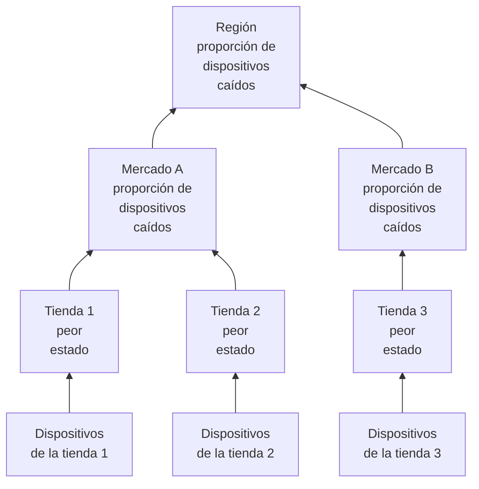

# Sitios de red (resumen de salud y tiempo de actividad)

Un sitio de red es un lugar: una región, un mercado, un franquiciado, un centro de distribución, una tienda. Los sitios se anidan unos dentro de otros, los dispositivos de red se asignan a ellos, y OneUptime resume la salud de los dispositivos a lo largo del árbol, de modo que un solo estado en una región responde a «¿falla algo por ahí?».

Los encontrarás en **Red → Sitios**, y sobre un mapa en **Red → Mapa**. Esta página precisa cómo se calcula el estado de un sitio a partir de lo que tiene debajo, qué significa su tiempo de actividad y cómo cambia ambos el mantenimiento programado.

:::cards
- [Añadir un sitio](#añadir-un-sitio): Tres pasos, o un archivo CSV para todo un parque.
- [Definir valores predeterminados de monitoreo](#valores-predeterminados-de-monitoreo): Una sonda y credenciales para cada dispositivo de un sitio.
- [Elegir cómo se resume la salud](#cómo-se-calcula-la-salud-del-padre): El peor estado para una tienda, una proporción para una región.
- [Leer el tiempo de actividad](#tiempo-de-actividad): Qué cuentan los porcentajes, día a día.
:::

## Cómo funciona



El estado de cada sitio sale de todos los dispositivos de su subárbol, juzgados por la propia [política de resumen](#cómo-se-calcula-la-salud-del-padre) del sitio. El tiempo de actividad de un sitio sale de su propia cronología de estados, y una [ventana de mantenimiento](#mantenimiento-programado-para-sitios-de-red) en un sitio deja a sus dispositivos fuera del voto de los sitios de encima.

## La jerarquía

Los sitios forman un árbol. Cada sitio tiene un **Tipo de sitio** y, opcionalmente, un sitio padre. Los tipos de sitio son la lista propia del proyecto, en **Red → Ajustes → Tipos de sitio**, y un proyecto nuevo empieza con Account Type, Region, Franchisee, Market y Unit, en ese orden desde arriba, más Data Center y Other. Los tipos forman su propia jerarquía (**Tipo de sitio padre**), que decide qué sitios pueden ser padre de un sitio. Un tipo marcado como **Es nivel de unidad** es el último nivel de tu parque, la tienda o la sucursal individual: sus sitios contienen dispositivos, no otros sitios.

El tipo, el nombre, la descripción, el padre y la ubicación de un sitio se editan en un solo lugar: la tarjeta **Ajustes del sitio** de la página **Ajustes** del sitio. La vista general del sitio los muestra con un enlace **Editar en Ajustes**, y la lista **Sitios** añade sitios pero no los edita.

Cada dispositivo pertenece a un sitio. El subárbol de un sitio es el propio sitio más todos los sitios que tiene debajo, y los dispositivos del subárbol son de los que se resume su salud, así que una región sin dispositivos propios sigue teniendo un estado, porque las unidades de debajo lo tienen.

> [!NOTE]
> Un resumen se vuelve a calcular cuando cambia el estado de un dispositivo, cuando un dispositivo pasa a otro sitio, cuando un sitio se mueve en el árbol, y en un barrido cada cinco minutos que recoge los casos en los que solo el paso del tiempo cambió la respuesta.

## Añadir un sitio

:::steps
### Empezar un sitio nuevo
Ve a **Red → Sitios** y haz clic en **Añadir Sitio**.

### Decir qué es el sitio
En el paso **Detalles del sitio**, elige el **Tipo de sitio** (qué clase de lugar es: una región, una tienda, un centro de datos) y escribe un **Nombre**. La descripción, la dirección postal y la latitud y la longitud que sitúan el sitio en el mapa están plegadas en **Más campos**: rellénalas ahora o más tarde.

### Colocarlo en el árbol
En el paso **Jerarquía**, elige el **Sitio padre** si el sitio está bajo otro. Déjalo vacío para mantener el sitio en el nivel superior.

### Definir sus valores predeterminados
En el paso **Valores predeterminados de monitoreo**, elige la [sonda y el perfil de credenciales predeterminados](#valores-predeterminados-de-monitoreo) para los dispositivos que se añadan al sitio, y haz clic en **Añadir Sitio**.
:::

En la página **Sitios hijos** de un sitio, **Añadir Sitio hijo** solo pide el tipo y el nombre, en una sola página con la ubicación plegada, y coloca el nuevo sitio bajo ese.

### Importar sitios desde un archivo CSV

Para traer todo un parque de una vez, abre el menú de la parte superior de la lista **Sitios** y haz clic en **Importar desde CSV**. El archivo necesita una fila de cabecera; las columnas pueden venir en cualquier orden y sus nombres no distinguen mayúsculas de minúsculas:

```csv title="sites.csv"
name,siteType,parentName,address,latitude,longitude
North,Region,,,,
Leeds,Market,North,,,
Store 0660,Unit,Leeds,"1 High Street, Leeds",53.7997,-1.5492
```

- `name` y `siteType` son obligatorios. `siteType` debe ser uno de los tipos de sitio del proyecto.
- `parentName` nombra el sitio padre, que puede estar en el mismo archivo: las filas sin padre, o con un padre que ya existe, entran primero, y después sus hijos. Déjalo vacío para un sitio de nivel superior.
- Una fila cuyo padre no se encuentra se omite, y los resultados la listan. **Previsualizar importación** muestra lo que creará el archivo antes de escribir nada.

## El mapa

**Red → Mapa** muestra tus sitios en un mapa, encuadrado donde estén; haz clic en un sitio para entrar en él. Un sitio con sitios debajo los muestra, en el mapa y como un grafo de los enlaces entre ellos. Un sitio sin sitios debajo pero con dispositivos propios, o un sitio cuyo tipo es de nivel de unidad, abre la topología en vivo de esos dispositivos.

Un proyecto todavía sin sitios sigue teniendo un mapa: el Mapa muestra en su lugar la topología de sus dispositivos, y agrupar los dispositivos en sitios los coloca en el mapa por ubicación.

## Valores predeterminados de monitoreo

Un sitio es también donde dices, una sola vez, cómo se monitorean sus dispositivos. **Editar configuración** en la tarjeta **Ajustes del sitio** tiene un paso **Valores predeterminados de monitoreo** con dos campos:

| Ajuste | Efecto |
| --- | --- |
| **Sonda predeterminada** | La sonda que hace ping a los dispositivos de este sitio, y los recorre por SNMP cuando tienen credenciales. Un dispositivo creado en el sitio sin sonda propia la toma, y también un dispositivo que se mueve al sitio sin ninguna. |
| **Perfil de credenciales SNMP predeterminado** | El [perfil de credenciales](/docs/monitor/network-device-monitor#credenciales-snmp-y-perfiles-de-credenciales) con el que se recorren los dispositivos de este sitio cuando ni el dispositivo ni su propio perfil tienen credenciales. |

Define los dos en un sitio y un dispositivo nuevo se puede añadir allí solo con su dirección: recibe ping desde su primer sondeo y se recorre desde su primer sondeo.

Los dos se comportan de forma distinta, a propósito:

- La sonda se copia en el dispositivo cuando el dispositivo se crea en el sitio o se mueve a él. Cambiar más tarde la sonda predeterminada de un sitio no mueve los dispositivos que ya tienen una: qué sonda puede alcanzar un dispositivo es un hecho de la red, no una preferencia que reescribir en bloque desde un formulario de sitio.
- El perfil de credenciales se lee en vivo, en cada sondeo. Define uno en un sitio y cada dispositivo sin credenciales de ese sitio empieza a recorrerse en su siguiente sondeo, sin editar ningún dispositivo; quítalo y vuelven a recibir solo ping.

También llegan a distinta profundidad en el árbol:

- La sonda llega a todo el árbol. Un dispositivo que entra en un sitio sin sonda predeterminada toma la del antepasado más cercano, así que una sola sonda definida en una región cubre cada mercado y cada unidad de debajo, y un mercado que nombra la suya la sustituye en su subárbol.
- El perfil de credenciales solo se lee del sitio propio del dispositivo. Un dispositivo en una unidad no toma un perfil definido en su región, así que defínelo en los sitios a los que realmente se asignan los dispositivos.

## Cómo se calcula la salud del padre

Cada sitio elige una de dos políticas de resumen, en la tarjeta **Resumen de salud** de su página **Ajustes** (**Política de resumen**).

### El peor estado de cualquier dispositivo (predeterminado)

El peor estado que informa cualquier dispositivo del subárbol pasa a ser el estado del sitio. Lo grave que es un estado viene de su prioridad como estado de monitor: los estados de un proyecto nuevo son Operational (1), Degraded (2) y Offline (3), y más alto es peor. Un solo dispositivo desconectado deja el sitio desconectado, por muchos dispositivos sanos que tenga al lado.

Es la respuesta correcta para una unidad. Cuatro switches y un firewall en un mismo edificio no son independientes: que uno se apague es un problema en esa dirección, y promediarlo esconde una caída real.

Suele ser la respuesta equivocada para una región que está por encima de cuatrocientas tiendas. Un switch apagado en la tienda 12.000 pinta toda la región como Offline: cierto en el sentido más estricto e inútil en cualquier sentido práctico, porque la región se pone roja cada vez que cualquier tienda tiene un problema, y deja de decirte nada.

### Porcentaje de dispositivos caídos

El estado del sitio lo decide la proporción de dispositivos del subárbol que informan y no están en un estado operativo:

| Proporción de dispositivos caídos | Estado del sitio |
| --- | --- |
| 0% | Operational |
| Por encima del 0%, por debajo del umbral | Degraded: el estado del proyecto que no es ni operativo ni desconectado, u Offline cuando el proyecto no tiene ninguno |
| En el umbral o por encima | Offline |

El umbral se define por sitio, como **Umbral de desconexión (%)**, y es 50 por defecto.

Sin nada caído el sitio es Operational por bajo que sea el umbral: un umbral de 0 significa «cualquier dispositivo caído lo desconecta», no «una región sana está desconectada».

### Qué dispositivos votan

Las dos políticas coinciden aquí, y importa más de lo que parece:

- Los dispositivos archivados nunca votan. Están dados de baja: conservan su sitio pero quedan fuera.
- Los dispositivos que nunca han informado nada nunca votan. Un dispositivo que espera su primer sondeo no es prueba de una caída, así que queda fuera de los dos lados de la proporción, y una región a medio incorporar se puntúa con la mitad que ha respondido.
- Un dispositivo sondeado por sonda, el tipo normal, vota con el resultado de su último sondeo: accesible por ping o SNMP, no cuánto hace de su último éxito. Un dispositivo que responde al ping mientras su recorrido SNMP falla es accesible y vota así; el sitio dice que está activo, y la fila del dispositivo dice **SNMP fallando** para que alguien arregle las credenciales.
- Un dispositivo respaldado por un monitor, uno pasado a la anulación con monitor vinculado en su página Ajustes, vota con el estado del monitor vinculado, porque nada lo sondea. Sin nada vinculado nunca ha informado, así que no vota en absoluto.

Un monitor de dispositivo de red sobre un dispositivo sondeado por sonda no cambia cómo vota el dispositivo. Un monitor con un criterio «interfaz caída, así que Offline» marcaría como Offline un switch que responde a cada ping, y un solo puerto apagado pondría en rojo todo un sitio mientras cada fila de dispositivo de debajo dice Activo: el sitio contradiría la lista que resume. Para un dispositivo sondeado, el sondeo es la fuente de su salud; el monitor está para abrir incidentes.

### Elegir una política

Un punto de partida razonable para un parque de franquicias:

| Nivel | Política | Por qué |
| --- | --- | --- |
| Unidad o tienda | Peor estado | Un dispositivo caído es un sitio con problemas. |
| Mercado | Porcentaje, umbral en torno al 50% | Un mercado con la mitad de sus tiendas caídas está caído. |
| Región | Porcentaje, umbral del 25% al 50% | El fallo de una sola tienda deja la región en Degraded, no en Offline, y pasa a Offline cuando ocurre algo sistémico. |

La política se define por sitio, así que puedes dar la política de porcentaje a las filas de región y dejar todo lo de debajo con la predeterminada.

## Tiempo de actividad

Cada sitio tiene una cronología de estados: una fila por cada cambio de su estado resumido, abierta cuando el estado cambia y cerrada cuando vuelve a cambiar. El tiempo de actividad se calcula a partir de ella:

- El tiempo en un estado no marcado como operativo es tiempo de inactividad.
- Las filas que se solapan se fusionan, así que ningún segundo cuenta dos veces.
- El tiempo que no cubre ninguna fila cuenta como activo. La cronología solo gana filas cuando se ha ejecutado un resumen, y la falta de pruebas no es una caída.
- Una fila todavía abierta llega hasta el final de la ventana medida.

Degraded no es operativo, así que también cuenta como caído. Con cualquiera de las dos políticas, por tanto, el tiempo de actividad de un sitio es la proporción de tiempo en la que ningún dispositivo que informa por debajo de él estaba caído: la política cambia el estado que muestra una caída parcial, Degraded u Offline, no si cuenta.

Un sitio sin ninguna fila en su cronología muestra `—` en lugar de 100%: un sitio del que nunca se ha resumido nada no está monitoreado, no es perfecto.

### Tiempo de actividad diario

Junto a la cifra de 30 días, la vista general de cada sitio muestra **Uptime (24h)**, y su página **Cronología de estados** muestra las últimas 24 horas, 7, 30 y 90 días, y una barra por día para los últimos 30.

Una media de 30 días no puede mostrar un mal día. Un día entero de caída en una ventana de 30 días cuesta 3,3 puntos, así que un sitio que estuvo apagado todo un martes sigue informando un 96,7% para el mes, una cifra que parece redondeo. Las barras diarias ponen los mismos datos donde un mal día es una mala barra.

Los días son franjas móviles de 24 horas que terminan ahora, no días naturales: los dispositivos, quien mira y el servidor pueden estar cada uno en una zona horaria distinta, y no hay un único «día» en el que se pondrían de acuerdo.

### El tiempo de actividad del padre no es la media de los hijos

El tiempo de actividad de un padre sale de la propia cronología del padre, que produjo su política de resumen, no de la media de los porcentajes de sus hijos.

Una media sobre los hijos pesa igual una tienda con dos dispositivos que un centro de distribución con doscientos. La propia cronología de un padre da en cambio una lectura que se puede enunciar en una frase: la proporción de tiempo en la que nada en absoluto en la región estaba caído. Es estricta a propósito, así que en una región grande léela con las barras diarias, y con el estado, que dice si una caída parcial fue Degraded u Offline.

## Mantenimiento programado para sitios de red

Asocia sitios a un evento de mantenimiento programado en **Otros recursos afectados**, en el paso **Recursos afectados** del evento, como harías con un host. La página **Mantenimiento programado** de un sitio lista los eventos asociados a él, y su **Crear evento de mantenimiento programado** abre el formulario con el sitio ya elegido.

Una ventana en un padre cubre todo lo que tiene debajo: una ventana en una región cubre cada mercado y cada unidad que contiene, incluidos los sitios creados después de programar la ventana, así que un cambio de operador regional no tiene que listar cuatrocientas tiendas.

La cobertura solo baja. Una ventana en una unidad no pone su región en mantenimiento: se sigue esperando que la región esté activa, y un fallo real en otra unidad durante las mismas horas sigue contando en su contra.

### Lo que cambia una ventana de mantenimiento

| Durante la ventana | Qué ocurre |
| --- | --- |
| El estado en vivo del sitio | Sin cambios. Una unidad apagada por trabajos planificados sigue apareciendo como Offline en el mapa y en el árbol, con una insignia «En mantenimiento» al lado: quien la mire necesita saber que está apagada. |
| El tiempo de actividad del sitio | La ventana se descuenta del tiempo de inactividad y del periodo medido. Dos horas de mantenimiento dejan el día en 22 horas, y nada dentro de esas dos horas cuenta en ningún sentido. |
| El resumen de salud de sus antepasados | Los dispositivos del subárbol en mantenimiento dejan de votar, así que la región no se pone en rojo por un cambio que estaba en el calendario. |
| El tiempo de actividad de sus antepasados | Sin efecto, sin nada que corregir, porque la caída planificada nunca llegó a sus cronologías. |

Esa última fila es la razón por la que los antepasados se tratan reteniendo votos y no descontando la ventana de su tiempo de actividad: descontarla del periodo de la región también borraría un fallo real en otra parte de la región durante las mismas horas.

El tiempo de actividad se corrige con el inicio y el fin declarados del evento, no con el momento en que un proceso lo cambió de estado, así que la cifra se puede comprobar a mano contra el calendario. Un día que cae por completo dentro de una ventana se dibuja como mantenimiento en las barras diarias en lugar de como un día perfecto, y no suma nada a la media.

### Interacción con los monitores

Asociar un monitor al mismo evento sigue haciendo lo de siempre: el monitoreo activo de ese monitor se pausa durante la ventana. Las dos cosas son independientes: asocia el sitio para dejarlo fuera del resumen y de su tiempo de actividad, y asocia los monitores para que dejen de alertar.

## Alertas sobre un sitio

La tarjeta **Alertas** de la página **Ajustes** de un sitio tiene **Alertar cuando no esté en buen estado**: se abre una alerta cuando el resumen del sitio pasa a un estado que no es operativo, y se resuelve sola cuando el sitio se recupera. **Gravedad de la alerta** fija su gravedad; si se deja vacía, es la más grave del proyecto.

Solo alerta sobre el cambio: activarla en un sitio que ya no está en buen estado arma el siguiente cambio en lugar de alertar sobre el pasado. Degraded no es operativo, así que un sitio con la política de porcentaje alerta en cuanto uno de sus dispositivos que informan cae, igual que un sitio con la política del peor estado; la alerta sigue abierta, sin una segunda, mientras el sitio pasa entre Degraded y Offline, y su título nombra el estado al que llegó primero el sitio.

## Solución de problemas

:::details Una región está siempre en rojo
El sitio usa la política del peor estado, así que un solo dispositivo desconectado en cualquier punto por debajo lo desconecta. Pasa la región a **Percentage of devices down** en su tarjeta **Resumen de salud**, con un umbral que corresponda a cuánta parte de la región tiene que estar caída para que la des por caída.
:::

:::details Un sitio muestra — en lugar de un tiempo de actividad
Nunca se ha ejecutado un resumen para el sitio, así que no tiene filas en su cronología: no está monitoreado, no es perfecto. Añade dispositivos al sitio, o a los sitios de debajo, y el siguiente resumen inicia su cronología.
:::

:::details Un dispositivo no cuenta para su sitio
Los dispositivos archivados, y los que aún no han informado, nunca votan. Un dispositivo respaldado por un monitor sin monitor vinculado tampoco ha informado nunca. Comprueba el estado del dispositivo: un dispositivo **Pendiente** empieza a votar después de su primer sondeo.
:::

:::details La alerta de un sitio no se disparó
**Alertar cuando no esté en buen estado** se dispara con un cambio de un estado operativo a cualquier otro, así que un sitio que ya no estaba en buen estado cuando la activaste alerta en su siguiente cambio, después de recuperarse. Comprueba también que sus dispositivos votan: los dispositivos archivados y los que esperan su primer sondeo nunca lo hacen, y los dispositivos de un sitio en mantenimiento no votan en los resúmenes de encima.
:::

## Próximos pasos

:::cards
- [Monitor de dispositivos de red](/docs/monitor/network-device-monitor): Añade, sondea y alerta sobre los dispositivos que pertenecen a estos sitios.
- [Tráfico de red](/docs/monitor/network-traffic): Ve el tráfico de un sitio a partir de los registros de flujo de sus dispositivos.
- [Inventario](/docs/inventory/overview): Los dispositivos de red junto a todos tus demás activos.
:::
