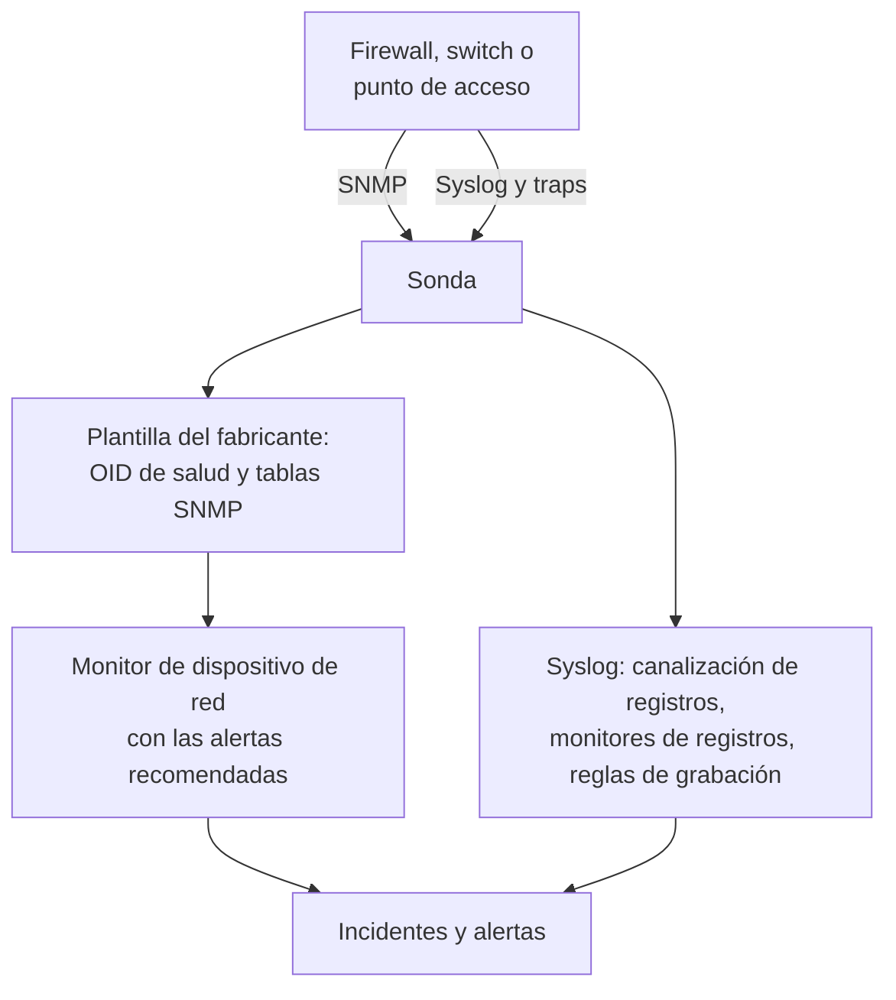

# Guías por fabricante de red (Sophos, Extreme, Cambium)

Cómo monitorear de principio a fin tres parques habituales con OneUptime: un Sophos Firewall (XGS, SFOS) con sus túneles IPsec, sus enlaces WAN y su SD-WAN; los switches de Extreme Networks (EXOS / Switch Engine y Fabric Engine / VOSS) con su fabric; y los switches cnMatrix y los puntos de acceso Wi-Fi empresariales de Cambium Networks, hasta el canal y la potencia de transmisión de cada radio.

:::cards
- [Sophos Firewall](#sophos-firewall-xgs-sfos): Túneles, enlaces WAN, gateways y SD-WAN.
- [Extreme Networks](#extreme-networks-exos-switch-engine-y-fabric-engine-voss): Los switches, el fabric y su hardware.
- [Cambium Networks](#cambium-networks-wi-fi-empresarial-y-cnmatrix): Los puntos de acceso hasta cada radio, y los switches cnMatrix.
:::

## Cómo funciona

Todas las guías usan las mismas piezas:

- Un [dispositivo de red](/docs/monitor/network-device-monitor) por equipo, sondeado por una sonda que pueda alcanzarlo, con una plantilla del fabricante que trae los OID de salud y las [tablas SNMP](/docs/monitor/network-device-monitor#tablas-snmp) adecuados.
- Un monitor de dispositivo de red por dispositivo para las alertas. Créalo desde la página del dispositivo para que las [alertas recomendadas](/docs/monitor/network-device-monitor#paquete-de-alertas-recomendado), incluida una alerta por fila para cada tabla que sabe qué aspecto tiene lo sano, se rellenen por ti. Para una flota, una [política de alertas](/docs/monitor/network-device-monitor#políticas-de-alertas) mantiene uno en cada dispositivo.
- Para lo que un fabricante solo informa en sus registros: syslog hacia la sonda, una [canalización de registros](/docs/telemetry/log-pipelines) que convierte cada línea en atributos, [monitores de registros con Group By](/docs/monitor/logs-monitor#alertas-por-grupo-group-by) para alertar una vez por túnel o por gateway, y [reglas de grabación de registros](/docs/telemetry/log-recording-rules) para graficar las cifras de esos registros.

## Sophos Firewall (XGS / SFOS)

| Lo que quieres ver | De dónde sale |
| --- | --- |
| La salud del firewall: memoria, disco, swap, estado de HA, servicio IPsec, CPU por núcleo | SNMP, con la plantilla del fabricante **Sophos Firewall (SFOS / XGS)** |
| El estado de cada túnel IPsec, por nombre | La tabla SNMP `ipsec_tunnels` (SFOS v20 y posteriores) |
| El estado, el caudal, el uso y los errores de cada enlace WAN | El recorrido de interfaces de los puertos WAN |
| La latencia, la pérdida de paquetes y la fluctuación de cada enlace WAN | Monitores Ping y sondeos del dispositivo desde las sondas de OneUptime |
| Gateways activos y caídos, SLA de SD-WAN cumplido o no, cambios de ruta de SD-WAN | El syslog del firewall |
| La latencia, la fluctuación y la pérdida de paquetes de SD-WAN por gateway, como gráficos | Reglas de grabación de registros sobre los registros de SLA de SD-WAN |

Sophos no informa la salud de los gateways ni de SD-WAN por SNMP, en ninguna versión de SFOS: solo existe en los registros del firewall y en las alertas de Sophos Central, por eso las tres últimas filas pasan por syslog.

### Registrar el firewall

:::steps
1. En el firewall, activa SNMP en **Administration → SNMP**: añade un usuario SNMPv3, o una comunidad v2c, y permite que la dirección de la sonda lo consulte.
2. En OneUptime, ve a **Red → Dispositivos** y haz clic en **Añadir dispositivo**. Escribe la dirección de gestión del firewall, elige una sonda que pueda alcanzarlo y añade las credenciales SNMP en **SNMP**.
3. En la página **Ajustes** del dispositivo, en **Sondeo y recopilación de datos**, aplica la plantilla **Sophos Firewall (SFOS / XGS)** desde **Plantilla de salud del fabricante** y añade sus tablas desde **Add a Vendor's Tables**. O activa **Aplicar automáticamente la plantilla de salud del fabricante**, y el primer sondeo hace las dos cosas.
:::

Tras el siguiente sondeo, la página **SNMP Tables** del dispositivo lista cada conexión IPsec con su estado (active, inactive, partially active), y los núcleos de CPU. SFOS numera sus núcleos a partir de 196608, por eso la CPU sale de una tabla y no de un único `hrProcessorLoad.1`.

### Alertar sobre cada túnel IPsec

En la página del dispositivo, haz clic en **Crear monitor**. Las alertas recomendadas incluyen **IPsec Tunnels: row unhealthy**, un criterio **SNMP Table Row Is Unhealthy** sobre la tabla `ipsec_tunnels` con Row `*`: abre un incidente por cada túnel que no está activo, con el nombre del túnel, y resuelve cada uno cuando su túnel vuelve.

Un túnel que Sophos informa como activo solo tiene sus asociaciones de seguridad establecidas. Para comprobar que el tráfico lo atraviesa, añade un [monitor Ping](/docs/monitor/ping-monitor) desde una sonda en un sitio hacia un host al otro lado de cada túnel, y dibuja el túnel como un enlace de sitio en **Red → Topología → Enlaces del sitio** entre los dos [sitios](/docs/monitor/network-sites), vinculado a ese monitor: el enlace del mapa toma entonces el color del monitor.

### Enlaces WAN

- **Salud de los puertos.** El recorrido de interfaces ya mide el estado, los bits de entrada y salida, el uso y los errores de cada puerto WAN. En el monitor del firewall, un criterio **SNMP Interface Is Down** o **SNMP Interface Utilization (in %)** con **Interfaz** puesto en el nombre del puerto WAN, o `*` para cada puerto, alerta por enlace.
- **Calidad del camino.** La latencia, la pérdida de paquetes y la fluctuación de cada enlace se miden desde fuera del firewall: un monitor Ping desde las sondas en la nube de OneUptime hacia la dirección pública de cada enlace WAN, y un monitor Ping desde una sonda del sitio hacia el gateway de cada proveedor. Los criterios de pérdida de paquetes y de fluctuación de esos monitores alertan por enlace, y **Red → Topología → Matriz de latencia** muestra de un vistazo cada sonda frente a cada monitor.
- **Tráfico.** SFOS exporta NetFlow v5. Envíalo a la sonda en UDP 2055, donde escucha por defecto el colector de flujos de la sonda, y la página **Tráfico** del dispositivo muestra quién habla con quién por cada enlace WAN; [Tráfico de red](/docs/monitor/network-traffic) tiene los detalles.

### Gateways y SD-WAN desde syslog

:::steps
1. Activa el receptor de syslog de la sonda: pon `PROBE_SYSLOG_RECEIVER_ENABLED=true` en la sonda. Escucha en UDP 5140 por defecto (`PROBE_SYSLOG_RECEIVER_PORT` lo cambia); publica el puerto si la sonda se ejecuta en Docker. Los mensajes se asocian al dispositivo de red cuyo nombre de host, o una de cuyas **Otras direcciones**, es la dirección del remitente, y aparecen en la página **Registros** del dispositivo.
2. En el firewall, en **System services → Log settings**, añade un servidor syslog que apunte a la sonda y a ese puerto, y marca los tipos de registro **Event** para IPsec y los gateways y el tipo de registro **SD-WAN**: los registros de SLA siguen desactivados hasta que se marca.
3. En **Registros → Ajustes → Canalizaciones**, crea una canalización cuyo filtro coincida con los registros del firewall, como `attributes.networkDevice.name = 'hq-firewall'`, y añade un **Key=Value Parser** con **Prefijo de destino** `sophos`. Pega una línea del firewall en su probador para ver los nombres de atributo exactos que produce tu versión de SFOS; [el ejemplo de Sophos](/docs/telemetry/log-pipelines#ejemplo-firewall-sophos-xgs) lo recorre paso a paso.
4. Crea [monitores de registros](/docs/monitor/logs-monitor) sobre los registros del firewall, cada uno con **Group by Attributes** para que cada túnel o gateway alerte por su cuenta, y el criterio **Log Count** **Greater Than** `0` durante unos minutos. Las filas de abajo son las tres con las que empezar.
5. Grafica la calidad de SD-WAN: con el registro de SD-WAN activado, el firewall escribe un resumen de SLA por perfil y por gateway (`latency`, `jitter`, `packet_loss`). En **Registros → Ajustes → Reglas de grabación**, crea una regla por cifra, como la media de `sophos.latency` agrupada por `sophos.gw_name` y `sophos.profile_name`, y después grafica los resultados, o alerta sobre ellos con un [monitor de métricas](/docs/monitor/metrics-monitor) que agrupe por gateway. [Reglas de grabación de registros](/docs/telemetry/log-recording-rules) recorre este ejemplo.
:::

| Alerta | Registros que contar | Agrupar por |
| --- | --- | --- |
| Túnel IPsec terminado | Atributo `sophos.log_component` = `IPSec`, el cuerpo contiene `terminated` | `sophos.con_name` |
| Gateway caído | Atributo `sophos.log_component` = `Gateway`, el cuerpo contiene `is Down` | `sophos.gatewayname` |
| SLA de SD-WAN no cumplido | Atributo `sophos.log_type` = `SD-WAN`, el cuerpo contiene `SLA not met` | `sophos.gw_name` |

Los eventos de syslog complementan la tabla SNMP: llegan en el momento en que cae un túnel, mientras que la tabla también detecta un túnel que nunca llegó a establecerse.

### Traps

Cada notificación de Sophos es el mismo trap, `sfosNotification` (`1.3.6.1.4.1.2604.5.1.8.1.1`), con el evento como texto en `sfosTrapMessage` (`1.3.6.1.4.1.2604.5.1.8.1.2`). Para alertar sobre un tipo de evento, combina **SNMP Trap Received (Trap OID)** Equal To `1.3.6.1.4.1.2604.5.1.8.1.1` con **SNMP Trap Varbind Value** sobre esa varbind, Contains `IPSec` por ejemplo. Pon el destino de traps del firewall en SNMP v2c: el receptor de traps de la sonda acepta traps v1 y v2c.

## Extreme Networks (EXOS / Switch Engine y Fabric Engine / VOSS)

| Lo que quieres ver | De dónde sale |
| --- | --- |
| EXOS: CPU, temperatura y su alarma, estado de la alimentación, fuentes de alimentación, ventiladores, memoria por ranura, miembros de la pila | La plantilla **Extreme Networks EXOS / Switch Engine** |
| Fabric Engine: CPU y memoria por ranura, sensores de temperatura, ventiladores, fuentes de alimentación, sesión vIST, número de I-SID | La plantilla **Extreme Networks Fabric Engine / VOSS** |
| Cada adyacencia de Fabric Connect (IS-IS), nombrada por su vecino | La tabla `isis_adjacencies` de la plantilla de Fabric Engine |
| Puertos, vecinos LLDP, el mapa de la red | El recorrido de interfaces, en los dos |

### Qué plantilla

Fabric Engine en el hardware universal de Extreme (las series 5000 y 7000) informa el mismo número de empresa que EXOS: solo su descripción del sistema (`7520-48Y-8C-FabricEngine (9.0.4.0)`) dice qué sistema operativo se está ejecutando. OneUptime lee los dos, así que la aplicación automática y la sugerencia de la página del dispositivo eligen la plantilla correcta, y los switches VSP más antiguos informan la rama de Avaya/Nortel y se reconocen directamente como Fabric Engine.

### Alertas del fabric y del hardware

Las alertas recomendadas en un switch Fabric Engine incluyen **Fabric Adjacencies (IS-IS): row unhealthy**, un incidente por cada vecino cuya adyacencia no está activa. Fabric Engine también envía un trap cuando cambia una adyacencia, `rcnIsisPlsbAdjStateTrap` (`1.3.6.1.4.1.2272.1.21.0.281`), y un criterio **SNMP Trap Received (Trap OID)** sobre él alerta en segundos, antes del siguiente sondeo.

Las fuentes de alimentación, los ventiladores, los sensores de temperatura y los miembros de la pila son tablas que declaran sus valores sanos, así que cada una recibe una alerta por fila en las alertas recomendadas.

### Flujos y Wi-Fi

EXOS y Fabric Engine exportan los flujos como sFlow e IPFIX. Envía sFlow a la sonda en UDP 6343, o IPFIX en UDP 4739, y la página **Tráfico** del dispositivo muestra su tráfico; consulta [Tráfico de red](/docs/monitor/network-traffic).

Los puntos de acceso IQ Engine (HiveOS) y ExtremeCloud IQ Controller tienen sus propias plantillas del fabricante, que rellenan la página **Wi-Fi** del dispositivo. [Fabricantes de Wi-Fi compatibles](/docs/monitor/network-device-monitor#fabricantes-de-wi-fi-compatibles) los trata, junto a Ubiquiti UniFi, HPE Aruba, TP-Link Omada y Juniper Mist.

## Cambium Networks (Wi-Fi empresarial y cnMatrix)

### Puntos de acceso

:::steps
1. Activa SNMP en los puntos de acceso. En cnMaestro, SNMP se configura por grupo de AP: **Configuration → Wi-Fi Profiles → AP Groups → Management → SNMP**. Actívalo con una comunidad de lectura v2c o un usuario SNMPv3.
2. Añade cada punto de acceso con su dirección de gestión y esas credenciales, y aplica la plantilla **Cambium Networks Enterprise Wi-Fi (cnPilot, XV, XE, XH)**, o activa la aplicación automática.
3. Abre la página **Wi-Fi** del dispositivo. Muestra cuántas radios están encendidas, los clientes y los SSID, después la banda, el canal, la frecuencia, el ancho de canal, la potencia de transmisión, los clientes, el ruido de fondo y el tiempo de aire de cada radio, y cada SSID con sus clientes. La frecuencia se calcula a partir de la banda y el canal; el punto de acceso no la informa.
:::

Alertas útiles, todas sobre la tabla `wifi_radios` con Row `*`, para que cada radio alerte por su cuenta:

| Alerta | Criterio |
| --- | --- |
| Una radio apagada | **SNMP Table Row Is Unhealthy**, parte de las alertas recomendadas |
| Cambió la potencia de transmisión | **SNMP Table Value**, columna TX Power, Not Equal To tu potencia planificada |
| Una radio saturada | **SNMP Table Value**, columna Clients, Greater Than tu límite |
| Un canal ruidoso | **SNMP Table Value**, columna Noise Floor, Greater Than `-80` |

Cada valor numérico de radio es también una métrica (`oneuptime.monitor.snmp.table.value`, una serie por radio y columna), así que el canal, la potencia y los clientes se pueden graficar a lo largo del tiempo en un panel; un canal que no deja de cambiar es DFS en acción.

Cambium informa el número total de clientes solo a partir del firmware 6.5.3; los firmwares anteriores devuelven 0.

### Switches cnMatrix

La plantilla **Cambium Networks cnMatrix** recopila la CPU, la RAM, la flash, la temperatura y la tensión de alimentación, y como tablas los ventiladores, la fuente de alimentación redundante y el consumo PoE de cada puerto. Los puertos y los vecinos LLDP salen del recorrido de interfaces, como en cualquier switch.

### Alarmas de cnMaestro

cnMaestro puede enviar sus alarmas, como un punto de acceso que se desconecta, a un webhook HTTPS. Apúntalo a un [monitor de solicitudes entrantes](/docs/monitor/incoming-request-monitor) para convertir esas alarmas en incidentes de OneUptime junto a los datos SNMP.

## Solución de problemas

:::details La tabla IPsec Tunnels no tiene estado
El estado de los túneles requiere SFOS v20 o posterior. Comprueba también que la vista SNMP de tus credenciales incluye el árbol de empresa de Sophos (`1.3.6.1.4.1.2604`): un usuario v3 restringido a menudo solo ve el grupo de sistema e IF-MIB.
:::

:::details No llega syslog del firewall
El receptor de syslog de la sonda está desactivado por defecto: pon `PROBE_SYSLOG_RECEIVER_ENABLED=true` y publica UDP 5140, o tu `PROBE_SYSLOG_RECEIVER_PORT`, hacia la sonda. Los mensajes se asocian a un dispositivo por la dirección del remitente, así que el nombre de host del firewall en OneUptime, o una de sus **Otras direcciones**, debe ser la dirección desde la que envía syslog.
:::

:::details Un switch Fabric Engine recibió la plantilla de EXOS
La plantilla se elige a partir de la descripción del sistema del switch. Comprueba que la vista general del dispositivo muestra una descripción que nombra Fabric Engine (como `7520-48Y-8C-FabricEngine (9.0.4.0)`); si es así, quita los OID y las tablas de EXOS y aplica **Extreme Networks Fabric Engine / VOSS** desde **Plantilla de salud del fabricante**.
:::

:::details Los puntos de acceso Cambium informan 0 clientes
El número total de clientes requiere el firmware 6.5.3 o posterior. En firmwares anteriores, las radios siguen informando su canal, su potencia y su ruido de fondo.
:::

## Próximos pasos

:::cards
- [Monitor de dispositivos de red](/docs/monitor/network-device-monitor): Todo lo que recopila un dispositivo, y cada criterio sobre el que puede alertar.
- [Canalizaciones de registros](/docs/telemetry/log-pipelines): Descompón los registros del firewall en atributos.
- [Monitor de registros](/docs/monitor/logs-monitor): Alerta una vez por túnel o por gateway.
:::
