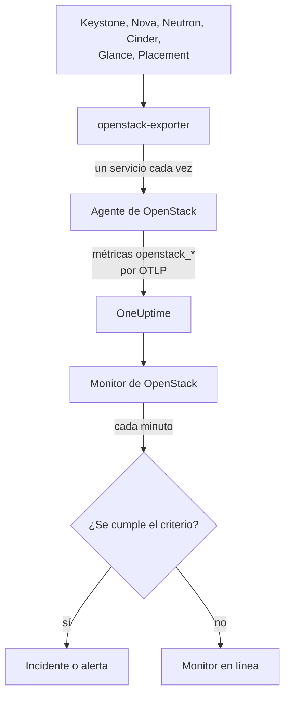

# Monitor de OpenStack

Un monitor de OpenStack vigila una nube (sus API, los workers que hay detrás, los hipervisores, las instancias, las redes, los pools de almacenamiento y las cuotas de proyecto) y te avisa cuando una API deja de responder, cae un worker, un hipervisor se queda sin margen o se llena un pool. Lee las series `openstack_*` que recopila el agente de OpenStack de OneUptime a partir de openstack-exporter, o que recopila una sonda desde las API de la nube.

:::cards
- [Crear el monitor](#crear-un-monitor-de-openstack): Seis pasos en el Dashboard.
- [Plantillas](#pre-built-alert-templates): Alertas listas para usar, con un incidente por worker, instancia, red o región.
- [Comprobaciones desde fuera](#comprobaciones-desde-fuera): Si alguien puede arrancar de verdad una instancia, medido desde una sonda fuera de la nube.
- [Atributos de identidad](#atributos-de-identidad): Cómo apuntar a una región, un host o un proyecto.
- [Métricas](#métricas-recopiladas): Todas las series sobre las que puede alertar el monitor.
:::

## Cómo funciona

El agente es un OpenTelemetry Collector junto con un openstack-exporter que ejecutas en una máquina con acceso a las API de la nube. Lee cada servicio de OpenStack en su propia recopilación, de modo que un Nova que falla solo cuesta las series de Nova, y lo hace con suavidad: compute, network, volume y placement cada 2 minutos, identity e image cada 5.

Cada serie lleva el nombre de la nube, `openstack.cloud.name`, y cada punto de datos lleva `openstack.region.name` y `openstack_service`. Una nube es un Keystone, y un monitor de OpenStack está vinculado a una sola nube. Cada minuto ejecuta su consulta sobre las métricas de esa nube y compara el resultado con sus criterios.



## Antes de empezar

- **Recopila las métricas de la nube** con el agente de OpenStack, o con [una sonda](/docs/telemetry/openstack-agentless). **Documentación**, en **Productos → Infraestructura → OpenStack**, te guía en la instalación del agente.
- **Comprueba que la nube está registrada.** Aparece en **Productos → Infraestructura → OpenStack**, con el nombre del `OPENSTACK_CLOUD_NAME` del agente, tras su primera recopilación.

## Crear un monitor de OpenStack

:::steps
### Empieza un monitor nuevo

Ve a **Monitores** y haz clic en **Crear monitor**.

### Elige OpenStack

En **Tipo de monitor**, haz clic en **Más tipos de monitor** y elige **OpenStack** en **Infraestructura**, o escribe `openstack` en el cuadro de búsqueda. Introduce un **Nombre** (se usa en los títulos de incidentes y alertas) y haz clic en **Siguiente**.

### Elige la nube

En **OpenStack Monitor Configuration**, elige la nube en **Nube OpenStack**. En la lista aparece toda nube que haya enviado datos. Una vez elegida, una línea bajo el campo indica si están llegando datos.

### Elige qué vigilar

Un monitor nuevo empieza con **Cloud Stopped Reporting**, en **Sobre qué alertar**. Para vigilar otra cosa:

- **Cambiar** - elige otra [plantilla](#pre-built-alert-templates). Define la métrica, los filtros de atributos, la agregación, el intervalo de tiempo, la agrupación y los umbrales, y sustituye los criterios de abajo por los suyos. Aun así puedes cambiar el **Intervalo de tiempo**.
- **Custom Metric** (en **Más campos**) - elige una métrica en **Métrica de OpenStack**, define la **Agregación** y el **Intervalo de tiempo**, y acótala con los [filtros](#ajustes-del-monitor).
- **Avanzado** (en **Más campos**) - crea tú mismo las consultas y fórmulas en **Seleccionar métricas**, con filtros sobre atributos como `status`, `adminState` o `resourcetype`. Usa **Agrupar por** un [atributo de identidad](#atributos-de-identidad) para juzgar cada pieza por separado.

### Revisa los criterios

Abre cada criterio en **Criterios** y comprueba su **Métrica**, **Agregación**, **Condición** y **Umbral**. Una plantilla los rellena. Con **Custom Metric** o **Avanzado**, el monitor empieza con los criterios por defecto, que solo detectan que la métrica deja de enviar datos, así que define tu propio umbral.

### Crea el monitor

Haz clic en **Crear monitor**. OneUptime abre la página del monitor y lo evalúa cada minuto. Los incidentes y las alertas que genera también aparecen en las páginas **Incidentes** y **Alertas** de la nube.
:::

> [!TIP]
> Para configurar varias plantillas a la vez, abre la nube desde **Productos → Infraestructura → OpenStack** y ve a **Recomendaciones**. Elige las plantillas que quieras, decide a quién se avisa y OneUptime crea un monitor por plantilla.

## Ajustes del monitor

| Campo | Pestaña | Qué hace |
| --- | --- | --- |
| **Nube OpenStack** | Todas | Obligatorio. Limita cada consulta a `resource.openstack.cloud.name`. |
| **Región** | Métrica personalizada, Avanzado | Opcional. Una región: `openstack.region.name`. Todas las series la llevan. |
| **Zona de disponibilidad** | Métrica personalizada, Avanzado | Opcional. Una zona: `availability_zone` en hipervisores, instancias, volúmenes y agentes de Neutron, `zone` en los workers de Nova y Cinder. |
| **Hipervisor** | Métrica personalizada, Avanzado | Opcional. Un host: `hostname` en workers, hipervisores y Placement, `hypervisor_hostname` en instancias. Los workers de Nova indican el nombre corto del host, y los hipervisores, Placement y las instancias su nombre completo, así que usa el que indica la serie. |
| **Servicio** | Métrica personalizada, Avanzado | Opcional. El binario de un worker, como `nova-compute`: `service`. |
| **ID del proyecto** | Métrica personalizada, Avanzado | Opcional. Un proyecto: `tenant_id` en las series de Nova y Cinder y en redes y subredes, `project_id` en IP flotantes, routers y disponibilidad de direcciones. |
| **Métrica de OpenStack** | Métrica personalizada | Una métrica del [catálogo](#métricas-recopiladas). |
| **Agregación** | Métrica personalizada | Cómo se combinan las muestras: **Promedio**, **Máximo**, **Mínimo**, **Suma** o **Recuento**. Empieza con la agregación habitual de la métrica. |
| **Intervalo de tiempo** | Todas | La ventana móvil que lee la consulta, desde **Past 1 Minute** hasta **Past 365 Days**. Un monitor nuevo empieza en **Últimos 15 minutos**; las plantillas fijan la suya. |
| **Seleccionar métricas** | Avanzado | El generador de consultas: **Métrica**, **Agregar por**, **Filtrar por atributos**, **Agrupar por**, además de **Añadir métrica** y **Añadir fórmula** para combinar consultas. |

Un filtro solo acota una serie que lleva su etiqueta: `openstack_nova_up` no tiene proyecto, así que un filtro por proyecto la deja como está.

Mantén la ventana en tres recopilaciones o más de lo que lees: 6 minutos para compute, network, volume y placement, 15 para identity e image. Una ventana más corta no contiene suficientes recopilaciones para que la opción **Todos los valores** signifique una duración.

## Atributos de identidad

Cada serie lleva `openstack.cloud.name` como **atributo de recurso**, y `openstack.region.name` y `openstack_service` como atributos del punto de datos. El resto lo indican las etiquetas propias del exporter:

| Pieza | Series | Etiquetas que la identifican |
| --- | --- | --- |
| API | `openstack_*_up` | `openstack.region.name`, `openstack_service` |
| Worker | `openstack_nova_agent_state`, `openstack_neutron_agent_state`, `openstack_cinder_agent_state` | `hostname`, `service`. `adminState` indica si un operador lo dejó activado. No agrupes nunca por `uuid` en el de Cinder: el exporter inventa uno en cada recopilación |
| Hipervisor | `openstack_placement_resource_*`, `openstack_nova_vcpus_*` | `hostname` (su nombre completo), `resourcetype` en el de Placement |
| Instancia | `openstack_nova_server_status` | `uuid`, `name`, `tenant_id`, `hypervisor_hostname`, `status`. El valor es un código: filtra por la palabra de `status` |
| Volumen | `openstack_cinder_volume_gb` | `id`, `name`, `tenant_id`, `status` |
| Pool de almacenamiento | `openstack_cinder_pool_capacity_*` | `name`, `volume_backend_name` |
| Red | `openstack_neutron_network_ip_availabilities_*` | `network_id`, `network_name`, `cidr`, `ip_version` |
| Router | `openstack_neutron_l3_agent_of_router` | `router_id`, `agent_host`, `ha_state`, `agent_alive`, `agent_admin_up` |
| Proyecto | `openstack_nova_limits_*`, `openstack_cinder_limits_*` | `tenant_id`, `tenant` |

En los filtros del monitor y en las claves de agrupación, un atributo de recurso empieza por `resource.` (`resource.openstack.cloud.name`), y un atributo del punto de datos no (`openstack.region.name`, `hostname`, `status`). Una etiqueta vacía no llega a OneUptime, así que `disabledReason` solo aparece en un worker que alguien ha deshabilitado.

## Pre-built Alert Templates

OneUptime incluye 120 plantillas para los problemas habituales de OpenStack, y la lista **Sobre qué alertar** las ofrece. La página Recomendaciones de una nube solo ofrece una plantilla de Heat, Magnum, Ironic, Manila, Octavia, Trove, Designate, Gnocchi o Swift a una nube que lo ejecuta, una sobre una serie que solo envía una sonda a una nube que recopila una sonda, y una sobre una [comprobación desde fuera](#comprobaciones-desde-fuera) a una nube que tiene esa comprobación activada: en cualquier otra nube sus series no existen, así que nunca podría dispararse. Cada una crea un monitor completo: la consulta de métricas, sus filtros de atributos, una agrupación por aquello de lo que trata un incidente, un criterio que dispara y otro que recupera. Los umbrales son las mismas líneas que dibujan las propias páginas de la nube, y son puntos de partida que puedes editar.

Cada plantilla lee al menos tres recopilaciones de lo que vigila, y solo dispara cuando la condición se mantiene durante toda su ventana. Un umbral sobre un porcentaje se recupera un 10% más allá de su línea, de modo que un valor que ronda ese punto no oscile.

| Plantilla | Categoría | Gravedad | Vigila | Dispara cuando | Se recupera cuando |
| --- | --- | --- | --- | --- | --- |
| Cloud Stopped Reporting | Disponibilidad | Crítica | `openstack_identity_up`, Recuento sobre toda la nube, **últimos 15 minutos** | No hay datos durante toda la ventana: el agente se detuvo o no llega a OneUptime, o el exporter no puede iniciar sesión en Keystone | Vuelven a llegar datos |
| Identity API Down | Disponibilidad | Crítica | `openstack_identity_up` y `scrape_samples_scraped` para `identity`, Mín. por región, **últimos 15 minutos** | Todas las llamadas fallaron, o la recopilación llegó vacía porque el exporter no pudo iniciar sesión | Ambas valen 1 o más |
| Compute API Down | Disponibilidad | Crítica | `openstack_nova_up` y `scrape_samples_scraped` para `compute`, Mín. por región, **últimos 10 minutos** | Todas las llamadas fallaron, o la recopilación llegó vacía porque el exporter no pudo llegar a la API de Nova | Ambas valen 1 o más |
| Network API Down | Disponibilidad | Crítica | `openstack_neutron_up` y `up` para `network`, Mín. por región, **últimos 10 minutos** | Todas las llamadas fallaron, o el exporter no respondió | Ambas valen 1 |
| Block Storage API Down | Disponibilidad | Crítica | `openstack_cinder_up` y `up` para `volume`, Mín. por región, **últimos 10 minutos** | Todas las llamadas fallaron, o el exporter no respondió | Ambas valen 1 |
| Image API Down | Disponibilidad | Crítica | `openstack_glance_up` y `up` para `image`, Mín. por región, **últimos 15 minutos** | Todas las llamadas fallaron, o el exporter no respondió | Ambas valen 1 |
| Placement API Down | Disponibilidad | Crítica | `openstack_placement_up` y `up` para `placement`, Mín. por región, **últimos 10 minutos** | Todas las llamadas fallaron, o el exporter no respondió | Ambas valen 1 |
| Compute Service Down | Plano de control | Crítica | `openstack_nova_agent_state` filtrada por `service = nova-compute` y `adminState = enabled`, Mín. por host, **últimos 10 minutos** | Por debajo de 1: un nova-compute habilitado está caído. Uno que alguien deshabilitó nunca dispara | Está activo o deshabilitado |
| Compute Service Disabled | Plano de control | Advertencia | `openstack_nova_agent_state` filtrada por `service = nova-compute` y `adminState = disabled`, un Recuento por host, **últimos 10 minutos** | Por encima de 0: se deshabilitó un `nova-compute` y ningún evento de mantenimiento en curso cubre su host, su zona de disponibilidad ni la nube. Uno que se deshabilitó solo porque libvirt cayó (su motivo empieza por `AUTO:`) permanece en silencio mientras libvirt Service Down esté abierto. Los proyectos no reciben aviso | Se vuelve a habilitar, o un evento lo cubre |
| Scheduler or Conductor Down | Plano de control | Advertencia | `openstack_nova_agent_state` filtrada por `nova-scheduler` o `nova-conductor` y `adminState = enabled`, Mín. por host y binario, **últimos 10 minutos** | Por debajo de 1. Los demás siguen funcionando mientras quede alguno | Está activo o deshabilitado |
| Every Scheduler or Conductor Down | Plano de control | Crítica | Lo mismo, Máx. por región y binario, **últimos 10 minutos** | Por debajo de 1: no queda ninguno vivo, así que no puede arrancar nada nuevo | Hay uno activo |
| Network Agent Down | Plano de control | Crítica | `openstack_neutron_agent_state` filtrada por `adminState = up`, Mín. por host y binario, **últimos 10 minutos** | Por debajo de 1: un agente configurado como activo no está vivo. Uno que alguien puso en estado down nunca dispara | Está vivo o en estado down |
| Block Storage Service Down | Plano de control | Crítica | `openstack_cinder_agent_state` filtrada por `adminState = enabled`, Mín. por host y binario, **últimos 10 minutos** | Por debajo de 1: un servicio de Cinder habilitado está caído. Uno que alguien deshabilitó nunca dispara | Está activo o deshabilitado |
| vCPU Allocation High | Compute | Advertencia | `openstack_placement_resource_*` filtrada por `resourcetype = VCPU`, uso / ((total - reservado) x ratio), por hipervisor, **últimos 10 minutos** | Por encima del 90%: asignación, no carga | En el 81% o menos |
| Memory Allocation High | Compute | Advertencia | Lo mismo, `resourcetype = MEMORY_MB` | Por encima del 90% | En el 81% o menos |
| Local Disk Allocation High | Compute | Advertencia | Lo mismo, `resourcetype = DISK_GB` | Por encima del 90% | En el 81% o menos |
| Hypervisor CPU Saturated | Compute | Advertencia | `openstack.hypervisor.instances.cpu.utilization`, por hipervisor, **últimos 15 minutos**. Requiere el exporter de libvirt o el de Ceilometer | Por encima del 90% de sus hilos de CPU: carga, no asignación. Su página nombra las instancias responsables | En el 81% o menos |
| Hypervisor Memory Pressure | Compute | Advertencia | `openstack.hypervisor.instances.memory.utilization`, por hipervisor, **últimos 15 minutos**. Requiere el exporter de libvirt, o el sondeo de `memory.resident` de Ceilometer | Por encima del 90% de su memoria: en uso, no prometida | En el 81% o menos |
| Instance CPU Saturated | Compute | Advertencia | `openstack.instance.cpu.utilization`, Máx. por instancia, **últimos 15 minutos**. Requiere el exporter de libvirt o el de Ceilometer | Por encima del 95% de sus vCPU | En el 85,5% o menos |
| Instance Disk Latency High | Compute | Advertencia | `openstack.instance.disk.read.latency` y `openstack.instance.disk.write.latency`, Máx. por instancia y disco, **últimos 15 minutos**. Requiere el exporter de libvirt, o el sondeo de `disk.device.read.latency` y `disk.device.write.latency` de Ceilometer | Por encima de 50 ms por solicitud. Un disco sin solicitudes no tiene latencia, así que uno inactivo nunca dispara | En 45 ms o menos, o deja de usarse |
| Instances in Error | Compute | Advertencia | `openstack_nova_server_status` filtrada por `status = ERROR`, Recuento por región, **últimos 10 minutos** | Por encima de 0 | No queda ninguna |
| Instance Stuck Building | Compute | Advertencia | `openstack_nova_server_status` filtrada por `status = BUILD` o `BUILD(spawning)`, Máx. por instancia, **última hora** | En ese estado en cada recopilación durante una hora | Salió de él |
| Instance Stuck Transitioning | Compute | Advertencia | Lo mismo para `REBUILD`, `RESIZE`, `REVERT_RESIZE`, `MIGRATING`, `REBOOT`, `HARD_REBOOT` y `PASSWORD`, **última hora** | En uno de ellos en cada recopilación durante una hora | Salió de él |
| Instance Stuck in Verify Resize | Compute | Advertencia | Lo mismo para `VERIFY_RESIZE`, **última hora** | Esperando durante una hora a que alguien confirme o revierta | Confirmada o revertida |
| Router Not Active | Red | Advertencia | `openstack_neutron_routers_not_active`, Máx. por región, **últimos 10 minutos** | Por encima de 0 | En 0 |
| Floating IP Not Active | Red | Advertencia | `openstack_neutron_floating_ips_associated_not_active`, Máx. por región, **últimos 10 minutos** | Por encima de 0: una en uso no está ACTIVE. Una libre debe estar inactiva | En 0 |
| External IP Pool Nearly Full | Red | Advertencia | `openstack_neutron_network_ip_availabilities_*` para `ip_version = 4`, junto con `is_external = true` en `openstack_neutron_network`, por red, **últimos 10 minutos** | Por encima del 90% de las direcciones IPv4 de una red externa. La red de un inquilino nunca dispara | En el 81% o menos |
| Network Out of IPs | Red | Crítica | Lo mismo | En el 100%: no queda ninguna dirección | Por debajo del 90% |
| Router Without Active Agent | Red | Crítica | `openstack_neutron_l3_agent_of_router` filtrada por `agent_admin_up = true`, Máx. por router, **últimos 10 minutos** | Por debajo de 1: ningún agente que lo mantiene está vivo. En silencio en OVN, que no tiene esos agentes | Hay uno vivo |
| Router With Two Active Agents | Red | Crítica | Lo mismo filtrada por `ha_state = active` y `agent_alive = true`, Recuento por router, **últimos 10 minutos** | Por encima de 1: un split brain. En silencio en OVN | En 1 o menos |
| Storage Pool Warning | Almacenamiento | Advertencia | `openstack_cinder_pool_capacity_*`, (total - libre) / total, por pool, **últimos 10 minutos** | Por encima del 85% | En el 76,5% o menos |
| Storage Pool Critical | Almacenamiento | Crítica | Lo mismo | Por encima del 95% | En el 85,5% o menos |
| Volumes in Error | Almacenamiento | Advertencia | `openstack_cinder_volume_status_counter` para cada palabra de error, Máx. por región y palabra, **últimos 10 minutos** | Por encima de 0 | En 0 |
| Volume Stuck | Almacenamiento | Advertencia | `openstack_cinder_volume_gb` para cada palabra de estado transitorio, Máx. por volumen, **últimos 30 minutos** | En ese estado en cada recopilación durante 30 minutos | Salió de él |
| Image Stuck | Almacenamiento | Advertencia | `openstack_glance_image_created_at` para cada palabra de estado transitorio, Máx. por imagen, **última hora** | En ese estado en cada recopilación durante una hora | Salió de él, o se eliminó |
| Orchestration API Down | Disponibilidad | Crítica | `openstack_heat_up` y `up` para `orchestration`, Mín. por región, **últimos 15 minutos** | Todas las llamadas fallaron, que es también lo que se lee cuando un `heat-engine` está detenido, o el exporter no respondió | Ambas valen 1 |
| Kubernetes Clusters API Down | Disponibilidad | Crítica | `openstack_container_infra_up` y `up` para `container-infra`, Mín. por región, **últimos 15 minutos** | Todas las llamadas fallaron, o el exporter no respondió | Ambas valen 1 |
| Rating API Down | Disponibilidad | Crítica | `openstack_cloudkitty_up` y `up` para `rating`, Mín. por región, **últimos 15 minutos**. Solo la envía una sonda | La API de CloudKitty no responde, así que lo que se tarifó a cada proyecto deja de avanzar | Ambas valen 1 |
| Heat Engine Down | Plano de control | Advertencia | `openstack_heat_agent_state`, Mín. por host, **últimos 15 minutos**. Solo la envía una sonda | Heat indica que un `heat-engine` está caído. Con todos los motores detenidos Heat no puede listarlos, y dispara Orchestration API Down en su lugar | Vale 1, o Heat elimina su registro |
| Magnum Conductor Down | Plano de control | Crítica | `openstack_container_infra_agent_state` con `adminState=enabled`, Mín. por host, **últimos 15 minutos**. Solo la envía una sonda | Magnum indica que un `magnum-conductor` habilitado está caído. La API de Magnum sigue respondiendo, así que nada más lo dice | Vale 1, o alguien lo deshabilita |
| Stack Failed | Orquestación | Advertencia | `openstack_heat_stack_status` con cada estado `*_FAILED`, por stack, **últimos 15 minutos** | Un stack mantiene un estado de fallo durante toda la ventana | Se actualiza o se elimina |
| Stack Stuck In Progress | Orquestación | Advertencia | `openstack_heat_stack_status` con cada estado `*_IN_PROGRESS`, por stack, **últimas 2 horas** | Un stack mantiene un estado en curso durante toda la ventana, más allá de la hora que Heat concede salvo que alguien haya elegido más | Alcanza su siguiente estado, o se elimina |
| Kubernetes Cluster Failed | Orquestación | Advertencia | `openstack_container_infra_cluster_status` con cada estado `*_FAILED`, por clúster, **últimos 15 minutos** | Un clúster mantiene un estado de fallo durante toda la ventana | Se actualiza o se elimina |
| Kubernetes Cluster Stuck | Orquestación | Advertencia | `openstack_container_infra_cluster_status` con cada estado `*_IN_PROGRESS`, por clúster, **últimas 2 horas** | Un clúster mantiene un estado en curso durante toda la ventana. Solo el conductor de Magnum lo hace avanzar | Alcanza su siguiente estado, o se elimina |
| Shared File Systems API Down | Disponibilidad | Crítica | `openstack_sharev2_up` y `up` para `sharev2`, Mín. por región, **últimos 15 minutos** | Todas las llamadas fallaron, o el exporter no respondió. Toda credencial que puede iniciar sesión vale 1, así que esto no puede ser una credencial rechazada | Ambas valen 1 |
| Manila Service Down | Plano de control | Advertencia | `openstack_sharev2_agent_state` con `adminState=enabled`, Mín. por host y servicio, **últimos 15 minutos**. Solo la envía una sonda | Manila indica que un servicio habilitado está detenido o caído. Su API sigue respondiendo, así que nada más lo dice | Vale 1, o alguien lo deshabilita |
| Share in Error | Almacenamiento | Advertencia | `openstack_sharev2_share_gb` con cada estado de error, por share, **últimos 15 minutos** | Un share mantiene un estado de error durante toda la ventana | Se corrige o se elimina |
| Share Stuck | Almacenamiento | Advertencia | `openstack_sharev2_share_gb` con cada estado transitorio, por share, **última hora** | Un share mantiene un estado transitorio durante toda la ventana. Manila no tiene tiempo de espera propio para un backend lento. No se vigila uno que se está migrando o respaldando | Alcanza su siguiente estado, o se elimina |
| Load Balancers API Down | Balanceadores de carga | Crítica | `openstack_loadbalancer_up`, Mín. por región, **últimos 15 minutos** | Por debajo de 1. Una API de Octavia detenida da al exporter del agente una respuesta vacía en lugar de un 0, igual que una nube sin Octavia, así que en la nube de un agente esto permanece en silencio y las páginas de la nube indican cuándo se supo por última vez de Octavia | Vale 1, o ha desaparecido |
| Load Balancer in Error | Balanceadores de carga | Crítica | `openstack_loadbalancer_loadbalancer_status` con `provisioning_status=ERROR`, Recuento por balanceador de carga, **últimos 15 minutos** | Un balanceador de carga mantiene provisioning ERROR durante toda la ventana. Octavia no reintenta ninguno de estos | Vuelve a ACTIVE, o se elimina |
| Load Balancer Stuck Pending | Balanceadores de carga | Advertencia | `openstack_loadbalancer_loadbalancer_status` con cada estado de aprovisionamiento `PENDING_*`, Recuento por balanceador de carga, **última hora** | Un balanceador de carga mantiene un estado PENDING durante toda la ventana: el worker de Octavia está detenido o perdió la solicitud | Alcanza ACTIVE o ERROR, o se elimina |
| Load Balancer With Two Masters | Balanceadores de carga | Crítica | `openstack_loadbalancer_amphora_status` con `role=MASTER` y `status=ALLOCATED`, Recuento por balanceador de carga, **últimos 15 minutos**. Requiere una credencial que pueda listar amphorae | Más de una amphora asignada indica MASTER para un mismo balanceador de carga | Solo una lo indica |
| Amphora in Error | Balanceadores de carga | Crítica | `openstack_loadbalancer_amphora_status` con `status=ERROR`, Recuento por amphora, **últimos 15 minutos**. Requiere una credencial que pueda listar amphorae | Una amphora mantiene ERROR durante toda la ventana: el health manager no pudo reemplazarla | Se reemplaza |
| Pool Has No Healthy Members | Balanceadores de carga | Crítica | `openstack_loadbalancer_pool_status` con `operating_status=ERROR`, Recuento por pool, **últimos 15 minutos** | Todos los miembros de un pool fallan su comprobación de estado, mientras el pool y su balanceador de carga siguen aprovisionados como ACTIVE | Un miembro vuelve a estar sano |
| DNS API Down | Disponibilidad | Crítica | `openstack_designate_up`, Mín. por región, **últimos 15 minutos**. Solo la ofrece una sonda | Por debajo de 1. Un Designate detenido da al exporter del agente una respuesta vacía, igual que una nube sin Designate, así que una nube que recopila el agente solo puede decir que se quedó en silencio | Vale 1 |
| DNS Zone in Error | Red | Advertencia | Un recuento de `openstack_designate_zone_status` con `status=ERROR`, por zona, **últimos 15 minutos** | Una zona indica `ERROR` durante toda la ventana: su worker renunció a escribirla en un servidor DNS | Indica cualquier otro estado |
| DNS Zone Stuck Pending | Red | Advertencia | Un recuento de `openstack_designate_zone_status` con `status=PENDING`, por zona, **últimos 30 minutos** | Una zona indica `PENDING` durante toda la ventana. Su worker se rinde en pocos minutos, así que nada está trabajando en ella | Indica cualquier otro estado |
| DNS Recordset in Error | Red | Advertencia | Un recuento de `openstack_designate_recordsets_status` con `status=ERROR` y cada tipo que alguien pida, por zona, **últimos 15 minutos** | Un recordset distinto del SOA y los NS propios de una zona indica `ERROR`. Esos dos indican `ERROR` junto con su zona, así que de eso avisa DNS Zone in Error | Indica cualquier otro estado |
| Metrics API Down | Disponibilidad | Crítica | `openstack_gnocchi_up` y `up` para `gnocchi`, Mín. por región, **últimos 15 minutos** | Falló la lectura de Gnocchi por el exporter, o el exporter no respondió. Una credencial que Gnocchi rechaza se lee igual, así que no se ofrece a una nube cuya credencial nunca ha leído Gnocchi | Ambas valen 1 |
| Gnocchi No Processors | Métricas | Crítica | `openstack_gnocchi_status_metricd_processors`, Máx. por región, **últimos 15 minutos** | El estado de Gnocchi no nombra ningún procesador. Su API sigue respondiendo y aceptando medidas, así que **Metrics API Down** no dice nada de esto | Nombra uno |
| Gnocchi Backlog Growing | Métricas | Advertencia | `openstack_gnocchi_status_measures_to_process`, una línea trazada por las **últimas 2 horas** | La línea supera las 10.000 medidas en la próxima hora. No dispara una acumulación que ya supera esa cifra y va bajando | La línea ya no llega a 9.000 |
| Object Storage API Down | Disponibilidad | Crítica | `openstack_object_store_up` y `up` para `object-store`, Mín. por región, **últimos 15 minutos** | Falló la lectura de Swift por el exporter, o el exporter no respondió. Una credencial que Swift rechaza se lee igual, así que no se ofrece a una nube cuya credencial nunca ha leído Swift | Ambas valen 1 |
| Object Container Growth Forecast | Almacenamiento | Advertencia | `openstack_object_store_bytes`, una línea trazada por los **últimos 7 días**, por contenedor | La línea supera 1 TiB en la próxima semana. Cámbialo por lo que tu nube deba comunicar | La línea ya no llega al 90% de esa cifra |
| Key Manager API Down | Disponibilidad | Crítica | `openstack_barbican_up`, Mín. por región, **últimos 15 minutos**. Solo la ofrece una sonda | Por debajo de 1. El exporter no tiene ningún lector para Barbican | Vale 1 |
| Swift Storage Server Not Answering | Almacenamiento | Advertencia | `openstack_object_store_recon_up`, Mín. por servidor, **últimos 15 minutos**. Solo la ofrece una sonda, cuando los ajustes de la nube nombran sus servidores de almacenamiento | El servidor no responde a `/recon`. El proxy de Swift sigue respondiendo sin él | Responde |
| Swift Rings Differ | Almacenamiento | Advertencia | `openstack_object_store_recon_rings_differ`, Mín. por ring, **últimos 15 minutos**. Solo la ofrece una sonda | Los servidores nombrados informan checksums distintos para un ring | Coinciden |
| Swift Replication Stale | Almacenamiento | Advertencia | `openstack_object_store_recon_replication_age_seconds`, Mín. por servidor y ring, **últimos 15 minutos**. Solo la ofrece una sonda | Un servidor terminó su última pasada hace más de 6 horas | Uno termina |
| Databases API Down | Disponibilidad | Crítica | `openstack_trove_up` y `up` para `database`, Mín. por región, **últimos 15 minutos** | Falló la lectura de Trove por el exporter, o el exporter no respondió. Lee la API mgmt de Trove, así que una credencial rechazada se lee igual que una API detenida, y no se ofrece a una nube cuya credencial nunca ha leído Trove | Ambas valen 1 |
| Database Instance in Error | Bases de datos | Advertencia | Un recuento de `openstack_trove_instance_status` con cada estado de error, por instancia, **últimos 15 minutos** | Una instancia mantiene un estado de error durante toda la ventana | Se corrige o se elimina |
| Database Instance Stuck | Bases de datos | Advertencia | Un recuento de `openstack_trove_instance_status` con cada estado transitorio, por instancia, **última hora** | Una instancia mantiene un estado transitorio durante toda la ventana. Trove no tiene una lista de sus workers, así que esto es lo que indica que `trove-taskmanager` se detuvo | Alcanza su siguiente estado, o se elimina |
| Database Volume Nearly Full | Bases de datos | Advertencia | `openstack_trove_instance_volume_used_gb` sobre `openstack_trove_instance_volume_size_gb`, por instancia, **últimos 15 minutos** | En el 85% o más. Una instancia que no está en ejecución indica 0 usados. Ninguna grabación contiene una en ejecución | Se redimensiona, o se reduce |
| Bare Metal API Down | Bare Metal | Crítica | `openstack_ironic_up`, Mín. por región, **últimos 15 minutos** | Por debajo de 1. Solo habla donde una lectura de Ironic puede decirlo: una sonda, o el exporter 1.7.0. Un Ironic detenido no da nada que leer al exporter del agente, igual que una nube sin Ironic, así que ahí permanece en silencio y las páginas de la nube indican cuándo se supo por última vez de Ironic | Vale 1, o ha desaparecido |
| Bare Metal Conductor Down | Bare Metal | Advertencia | `openstack_ironic_agent_state`, Mín. por host, **últimos 15 minutos**. Solo la envía una sonda, y solo donde la política de la nube permite a su credencial leer los conductores de Ironic: por defecto rechaza la de un proyecto | Ironic indica que un conductor no está vivo. Su API sigue respondiendo y cada nodo se lee como antes, así que nada más lo dice | Vale 1, o Ironic elimina su registro |
| Bare Metal Node in Error | Bare Metal | Advertencia | `openstack_ironic_node` para cada `provision_state` fallido, Máx. por nodo, **últimos 15 minutos** | En ese estado en cada recopilación durante 15 minutos, esté en mantenimiento o no | Salió de él, o se eliminó |
| Bare Metal Node Stuck Transitioning | Bare Metal | Advertencia | `openstack_ironic_node` para cada `provision_state` transitorio con `maintenance = false`, Máx. por nodo, **últimas 2 horas** | En ese estado en cada recopilación durante 2 horas. Un borrado largo de disco puede tardar legítimamente tanto, algo que la página de un nodo puede decir y esto no | Salió de él, o se eliminó |
| Bare Metal Node in Maintenance Too Long | Bare Metal | Advertencia | `openstack_ironic_node` con `maintenance = true`, Máx. por nodo, **últimos 7 días** | En mantenimiento en cada recopilación durante 7 días. Requiere conservar tus métricas todo ese tiempo | Salió de mantenimiento, o se eliminó |
| Bare Metal Power State Unexpected | Bare Metal | Advertencia | `openstack_ironic_node` con `provision_state = active`, `power_state = power off` y `maintenance = false`, Máx. por nodo, **últimos 15 minutos** | En cada recopilación durante 15 minutos. Una instancia que su propietario detuvo se lee igual, algo que la página de un nodo puede decir y esto no | Se encendió, o ya no está desplegado |
| Project Quota Nearly Reached | Proyectos | Advertencia | `openstack_nova_limits_*` y `openstack_cinder_limits_volume_*`, usado / máx. por proyecto, **últimas 3 horas** | Por encima del 90% de su cuota de vCPU, memoria, instancias o volúmenes. Requiere [activar las series de límites](#activar-las-series-de-límites) | En el 81% o menos |
| Token Issue Failing | Disponibilidad | Crítica | `openstack_check_token_success`, Mín. por región, **últimos 5 minutos**. Requiere las comprobaciones de API activadas | Por debajo de 1: Keystone no emitió ningún token a la sonda | Se emite un token |
| Service API Check Failing | Disponibilidad | Crítica | `openstack_check_api_success`, Mín. por región y `service_type`, **últimos 5 minutos**. Requiere las comprobaciones de API activadas | Por debajo de 1: ese servicio no respondió, para cualquier servicio del catálogo | Responde, o sale del catálogo |
| Public Certificate Expiring in 30 Days | Disponibilidad | Advertencia | `openstack_check_certificate_expiry_days`, Mín. por región, host y puerto, **últimos 5 minutos**. Requiere las comprobaciones de API activadas | Quedan menos de 30 días | Quedan 33 días o más, o el endpoint sale del catálogo |
| Public Certificate Expiring in 7 Days | Disponibilidad | Crítica | Lo mismo | Quedan menos de 7 días | Quedan 7,7 días o más, o el endpoint sale del catálogo |
| Instance Boot Failing | Compute | Crítica | `openstack_check_lifecycle_phase_success` filtrada por `phase = boot`, Mín. por región, **últimos 5 minutos**. Requiere la comprobación de ciclo de vida activada | Por debajo de 1: la última ejecución no pudo arrancar una instancia | Una ejecución arranca una |
| Instance Boot Slow | Compute | Advertencia | `openstack_check_lifecycle_step_duration_seconds` filtrada por `step = server_active`, Máx. por región, **últimos 5 minutos**. Requiere la comprobación de ciclo de vida activada | Por encima de 300 segundos, el propio `build_timeout` de Tempest | En 270 segundos o menos, o una ejecución que no arrancó, de lo cual avisa Instance Boot Failing |
| Volume Attach Failing | Almacenamiento | Crítica | `openstack_check_lifecycle_phase_success` filtrada por `phase = volume`, Mín. por región, **últimos 5 minutos**. Requiere la parte de volúmenes de la comprobación activada | Por debajo de 1: la última ejecución no pudo crear ni adjuntar un volumen | Una ejecución adjunta uno |
| Floating IP Unreachable | Red | Crítica | `openstack_check_lifecycle_phase_success` filtrada por `phase = floating_ip`, Mín. por región, **últimos 5 minutos**. Requiere la parte de IP flotantes de la comprobación activada | Por debajo de 1: la última ejecución no pudo llegar a su servidor mediante una IP flotante | Una ejecución llega a uno |
| Flavor Can No Longer Be Placed | Capacidad | Advertencia | `openstack_capacity_flavor_fits`, **por flavor y por región** | Ningún host tiene espacio para uno más, durante 10 minutos. Solo flavors que alguien puede pedir, y nunca uno demasiado grande para todos los hosts, ni uno cuyo único espacio está en un host que alguien deshabilitó | Un host tiene espacio, o el flavor ya no se vigila |
| Capacity Forecast Under 14 Days | Capacidad | Advertencia | `openstack_capacity_days_until_full`, **por zona y clase de recurso, red externa o pool de almacenamiento** | Quedan menos de 14 días hasta llenarse al ritmo de crecimiento de la última semana, durante 10 minutos. En silencio con menos de un día de historial, o cuando no crece | Más de 15,4 días, o ya no hay previsión |
| Reserved Headroom Gone | Capacidad | Advertencia | `openstack_capacity_can_lose_a_host`, **por zona** | No podría perder su mayor host y aún alojar lo que se ejecuta en él, durante 10 minutos. En silencio en una zona de un solo host, o con un host que alguien deshabilitó | Podría, o la zona ya no se evalúa |

**Gravedad** es la etiqueta que muestra el selector. El incidente y la alerta que crea una plantilla empiezan con la gravedad de incidente y de alerta más severa de tu proyecto; cámbialas en los criterios.

- **Las series up, alive y de estado usan Mín.**, de modo que cualquiera que esté caído vale 0. **Los recuentos y las series de información usan Máx.** Nada usa Suma, porque un monitor lee buckets de un minuto entre series y recopilaciones, y una Suma los acumula.
- **Toda plantilla salvo Cloud Stopped Reporting agrupa por aquello de lo que trata un incidente:** el host y el binario de un worker, la región de una API, una instancia, un router, una red, un pool, un proyecto. El incidente lo nombra, junto con los [comandos que ejecutar a continuación](#comandos-que-ejecutar-a-continuación).
- **El valor de una serie de estado es un código**, no un recuento: `openstack_nova_server_status` vale 4 para una instancia en ERROR. Las plantillas filtran por la palabra de `status`.
- **Una serie que acaba de aparecer espera una ventana completa,** de modo que una instancia, un volumen o una imagen vistos una vez de camino a otra cosa no generan nada. Cada plantilla sabe con qué frecuencia se recopila su servicio a partir de la propia serie `_up` de ese servicio.
- **Una serie que desaparece cuenta como recuperada:** un worker que alguien deshabilitó, la última instancia en ERROR eliminada, un pool retirado. Cada plantilla lee la serie `_up` de su servicio junto a la suya, así que distingue una pieza que desapareció de una nube que se quedó en silencio. Cuando no llega nada en absoluto, sus incidentes siguen abiertos y avisa **Cloud Stopped Reporting**.
- **Cuando una API está caída, sus propias series también desaparecen**, así que las demás plantillas de ese servicio se resuelven y vuelven a disparar una ventana después de que vuelva si el fallo persiste. Si todas las API aparecen caídas a la vez, mira primero el exporter.
- **Una nube que no tiene ese servicio permanece en silencio.** El exporter responde con nada para un servicio que no está en el catálogo de la nube, y **Red**, **Block Storage**, **Imagen** y **Placement API Down** no lo interpretan como una caída. **Identidad** y **Compute API Down** sí, porque así es también como el exporter informa de que Keystone o la API de Nova se han detenido por completo, y todas las nubes los tienen.

### Cuando una dispara

Con `nova-compute` detenido, su fila en la página **Servicios** de la nube pasa a caída en pocos minutos:


Cuando eso ha durado toda la ventana de la plantilla, **Compute Service Down** abre un incidente, que nombra el host y se resuelve solo cuando el servicio vuelve:


### Qué dicen los servicios

Otras siete plantillas leen los registros de una nube en lugar de sus métricas, así que son monitores de registros, y necesitan el [perfil de registros](/docs/telemetry/openstack#registros-de-servicios) del agente. Cada una lee solo los registros de esta nube, cuenta lo que busca y se resuelve sola cuando el recuento baja.

| Plantilla | Categoría | Gravedad | Lee | Dispara cuando | Se recupera cuando |
| --- | --- | --- | --- | --- | --- |
| No Valid Host | Registros de servicios | Advertencia | Líneas que un servicio escribió con nivel `WARNING` o peor y que contienen `No valid host was found`, **últimos 15 minutos** | Una o más | No queda ninguna en la ventana |
| RabbitMQ Connection Lost | Registros de servicios | Crítica | `AMQP server on <host> is unreachable`, `Unable to connect to AMQP server`, `Connection failed` o `MessagingTimeout` de oslo.messaging, **últimos 5 minutos** | 5 o más | Menos de 5 |
| Database Connection Lost | Registros de servicios | Crítica | `DBConnectionError`, `SQL connection failed`, o `Lost connection` y `Can't connect` de MySQL, **últimos 5 minutos** | 5 o más | Menos de 5 |
| Too Many Errors from a Service | Registros de servicios | Advertencia | Líneas `ERROR` y `CRITICAL`, por servicio y máquina, **últimos 5 minutos** | 50 o más | Menos de 50 |
| Token Validation Failing | Registros de servicios | Crítica | `Authorization failed for token` de un servicio, **últimos 5 minutos** | 10 o más. Una es la sesión obsoleta de alguien. Un controlador cuyas claves Fernet difieren de las de los demás se lee así y ninguna línea dice más, así que compara `/etc/keystone/fernet-keys` en cada uno | Menos de 10 |
| Instance Action Failed | Eventos | Advertencia | `compute.exception` y cualquier `instance.*.error`, por instancia, evento y motivo, **últimos 15 minutos**. Requiere [notificaciones](/docs/telemetry/openstack#activa-las-notificaciones) o una sonda | Una o más | No queda ninguna en la ventana |
| Scheduling Failed | Eventos | Advertencia | Un error de una tarea de compute que nombra `NoValidHost`, como `compute_task.build_instances.error`, que es lo que envía Nova. También `scheduler.create_volume` de Cinder, y `scheduler.select_destinations.error`, que la documentación de Nova nombra y que nuestras nubes de prueba nunca enviaron. Por instancia, evento y motivo, **últimos 15 minutos**. Requiere lo mismo | Una o más | No queda ninguna en la ventana |

### Sobre qué se asienta la nube

Estas leen lo que [el agente lee bajo la nube](/docs/telemetry/openstack#sobre-qué-se-sostiene-la-nube), una vez que la has nombrado. Una ventana lee al menos tres recopilaciones. Nada usa Suma, y una serie que desaparece cuenta como recuperada. Cada una se escribió a partir de lo que dijeron clústeres reales rotos a propósito.

| Plantilla | Gravedad | Vigila | Dispara cuando | Un incidente por |
| --- | --- | --- | --- | --- |
| RabbitMQ Down | Crítica | `up`, **últimos 5 minutos** | Ningún nodo responde | Región |
| RabbitMQ Node Down | Advertencia | `up`, **últimos 10 minutos** | Un nodo no responde | Máquina |
| RabbitMQ Partition Detected | Crítica | `erlang_vm_dist_node_state`, **últimos 5 minutos** | Todos los nodos responden, y un enlace entre dos no está activo | Región |
| RabbitMQ Memory Alarm | Crítica | `rabbitmq_alarms_memory_used_watermark`, **últimos 5 minutos** | Por encima de 0: ha dejado de aceptar mensajes | Máquina |
| RabbitMQ Disk Alarm | Crítica | `rabbitmq_alarms_free_disk_space_watermark`, **últimos 5 minutos** | Por encima de 0: ha dejado de aceptar mensajes | Máquina |
| RabbitMQ File Descriptors High | Advertencia | Abiertos frente a permitidos, **últimos 5 minutos** | Más del 90% | Máquina |
| RabbitMQ Messages Unacknowledged | Advertencia | `rabbitmq_queue_messages_unacked`, **últimos 10 minutos** | Más de 1000 | Máquina |
| RabbitMQ Queue Without Consumers | Advertencia | Cada cola de `/metrics/detailed`, **últimos 10 minutos** | Mensajes listos y nadie leyendo. Se excluye una cola de respuesta o fanout | Cola |
| MariaDB Cluster Down | Crítica | `up`, `mysql_up` y `wsrep_cluster_status`, **últimos 5 minutos** | Ningún nodo responde, o ningún nodo está en el componente Primary | Región |
| Galera Cluster Size Dropped | Advertencia | Nodos leídos frente a `wsrep_cluster_size`, **últimos 10 minutos** | Galera cuenta menos nodos de los que nombraste | Región |
| Galera Node Not Ready | Advertencia | `wsrep_ready`, **últimos 10 minutos** | Por debajo de 1 con Galera activo | Máquina |
| Galera Node Out of Sync | Advertencia | `wsrep_local_state`, **últimos 10 minutos** | No está Synced, salvo que `wsrep_desync` indique que alguien lo pidió, como hace una copia de seguridad | Máquina |
| MariaDB Too Many Connections | Advertencia | Conectados frente a permitidos, **últimos 5 minutos** | Más del 80% | Máquina |
| MariaDB Slow Queries | Advertencia | `mysql_slow_queries_increase`, **últimos 10 minutos** | Más de 10 por minuto | Máquina |
| Memcached Cluster Down | Advertencia | `memcached_up`, **últimos 5 minutos** | Ninguno responde. Nada se detiene, y las API se ralentizan | Región |
| Memcached No Connections | Advertencia | `memcached_current_connections` y comandos, **últimos 15 minutos** | Menos de 10 conexiones y nadie preguntando. Nunca vale 0: sus propios listeners y el exporter mantienen unas pocas | Región |
| Memcached Evictions High | Advertencia | `memcached_items_evicted_increase`, **últimos 10 minutos** | Más de 100 por minuto | Máquina |
| HAProxy Down | Crítica | `up`, **últimos 5 minutos** | Ninguno responde | Región |
| HAProxy Backend Down | Crítica | `haproxy_backend_status` para `DOWN`, **últimos 5 minutos** | Caído en todos los balanceadores de carga que responden | Backend |
| HAProxy Server Down | Advertencia | `haproxy_server_status` para `DOWN`, **últimos 10 minutos** | Un servidor está caído y su backend tiene otros | Backend |
| API 5xx Rate High | Crítica | `haproxy_backend_http_responses_increase`, **últimos 5 minutos** | Más del 5%, con servidores que aún pueden responder | Backend |
| API 4xx Rate High | Advertencia | Lo mismo, **últimos 5 minutos** | Más del 25%. HAProxy cuenta por clase, así que aquí es donde se ve una ráfaga de 401 | Backend |
| OVN Controller Not Running | Crítica | `ovnc_encap_ip` y `ovnc_rconn_queued`, **últimos 5 minutos** | Un chassis que tenía uno ya no tiene ninguno | Máquina |
| Northbound or Southbound Database Without a Leader | Crítica | `ovn_raft_cluster_leader`, **últimos 5 minutos** | Ningún miembro dice ser el líder | Base de datos |
| OVN Northd Not Active | Crítica | `ovn_northd_status`, **últimos 10 minutos** | Ninguno está activo, que es también lo que se lee cuando todas las bases de datos de OVN se detienen | Región |
| Geneve Transmit Errors | Advertencia | `ovs_interface_tx_errors_increase` para `type = geneve`, **últimos 10 minutos** | Errores en cada minuto | Máquina |
| Open vSwitch Service Down | Crítica | `ovs_memory_rules_total`, **últimos 5 minutos** | Ha desaparecido de una máquina que lo tenía, con el exporter respondiendo | Máquina |
| Exporter Lost Open vSwitch's Database | Advertencia | `ovs_build_info`, **últimos 10 minutos** | Ha desaparecido de una máquina que lo tenía, con Open vSwitch respondiendo. Reinicia el exporter | Máquina |
| Network Exporter Target Down | Advertencia | `up`, **últimos 10 minutos** | openstack-network-exporter no responde | Máquina |
| libvirt Service Down | Crítica | `libvirt_up`, **últimos 5 minutos** | Por debajo de 1. nova-compute se deshabilita solo, así que Compute Service Down y Compute Service Disabled permanecen en silencio | Máquina |
| libvirt Exporter Target Down | Advertencia | `up`, **últimos 10 minutos** | prometheus-libvirt-exporter no responde | Máquina |

**Un fallo abre un incidente.** Un RabbitMQ detenido arrastra consigo a `nova-compute` y, en ML2/OVS, a los agentes de Neutron, cada uno con una plantilla propia. Por eso lo que cae junto a algo espera más que ello, y su monitor se vincula al de aquello que espera: una dependencia de monitor, que se crea por ti cuando ambos proceden de estas plantillas, sea cual sea el que crees primero. Mientras RabbitMQ Down está abierto en una región, lo que depende de él no abre nada allí, y aparece como caído en su propia página. Sigue esperando 10 minutos después de que RabbitMQ Down se resuelva, porque el agente lee esos workers cada 2 a 5 minutos, y un worker que sigue caído pasado ese tiempo tiene otro problema.

| Qué cae | Qué lo espera |
| --- | --- |
| RabbitMQ Down | RabbitMQ Node Down, todas las plantillas de workers y de API, y RabbitMQ Connection Lost y Too Many Errors from a Service de los registros |
| MariaDB Cluster Down | Las plantillas de nodo y de tamaño de Galera, todas las plantillas de workers y de API, Cloud Stopped Reporting, y Database Connection Lost, Token Validation Failing y Too Many Errors from a Service de los registros |
| HAProxy Down | Las demás plantillas de HAProxy, todas las plantillas de API y Cloud Stopped Reporting |
| OVN Controller Not Running, Open vSwitch Service Down | Network Agent Down, para `ovn-controller`, `neutron-ovn-agent` y `neutron-openvswitch-agent` y ningún otro, en esa región |
| Northbound or Southbound Database Without a Leader | OVN Northd Not Active |

Un exporter nombra una máquina por la dirección con la que llega a ella, y Neutron por su nombre de host, así que esos dos no pueden emparejarse por máquina. Mientras el ovn-controller de una máquina está caído, un agente `ovn-controller` caído en otra máquina de la región espera junto con él.

El incidente indica qué arrastra consigo, y una alerta sobre un worker mientras su dependencia está caída indica cuál es probablemente su causa.

### Activar las series de límites

Las tres plantillas de **Capacidad** leen series que OneUptime escribe por sí mismo a partir del inventario de la nube, cada dos minutos mientras la nube informa. Ninguna serie del exporter contiene una zona ni el recuento de un flavor. Consulta [Capacidad](/docs/telemetry/openstack#capacidad) para saber qué significan. Las tres tratan de asignación, de lo que se ha prometido, y ninguna trata de carga.

**Project Quota Nearly Reached** lee `openstack_nova_limits_*` y `openstack_cinder_limits_*`, que están desactivadas por defecto porque cuestan llamadas a la API por cada proyecto. La plantilla permanece en silencio hasta que las actives: ejecuta de nuevo el `install.sh` del agente con `OPENSTACK_COLLECT_QUOTAS=true`. Entonces un segundo exporter las lee una vez por hora, y la plantilla espera tres de esas lecturas. En una nube que lee una sonda, activa **Límites de proyecto** en **Recopilación de datos**, en su página de **Ajustes**.

### Comandos que ejecutar a continuación

Un incidente que abre una plantilla indica qué ejecutar para la pieza que nombra, siempre de solo lectura y para su propia región. Por ejemplo:

| El incidente nombra | Sugiere |
| --- | --- |
| Un nova-compute | `openstack compute service list --host <host> --service nova-compute --long`, `openstack server list --all-projects --host <host>` |
| Un agente de Neutron | `openstack network agent list --host <host> --long` |
| Un servicio de Cinder | `openstack volume service list --host <host> --service <binary> --long` |
| Un hipervisor | `openstack hypervisor show <hypervisor>` |
| Una instancia | `openstack server show <instance>`, `openstack server event list <instance> --long` |
| Un router | `openstack router show <router>`, `openstack network agent list --router <router> --long` |
| Una red | `openstack ip availability show <network>`, `openstack floating ip list --network <network> --long` |
| Un proyecto | `openstack limits show --absolute --project <project>` |
| Un nodo bare metal | `openstack baremetal node show <node>`, `openstack baremetal node maintenance unset <node>` cuando se haya terminado con él |

## Métricas recopiladas

Las métricas de abajo son el catálogo que ofrece el formulario del monitor. **Lecturas** es su agregación habitual, con la que empieza un formulario. Los tamaños en GiB y MiB son los que contienen los propios campos `_gb` y `_mb` de OpenStack.

### Disponibilidad

| Métrica | Unidad | Lecturas | Descripción |
| --- | --- | --- | --- |
| `up` | - | Mín. | Si el exporter respondió a esta recopilación (1) o no (0): estaba detenido, agotó el tiempo de espera o respondió con un error. 1 no dice nada de la API en sí, porque el exporter responde incluso cuando no pudo llegar a ella. Lo informa el collector del agente, una serie por servicio y región. |
| `scrape_samples_scraped` | `count` | Mín. | Con cuántas series respondió el exporter a una recopilación. 0 significa que no tenía nada que decir: no pudo iniciar sesión en Keystone, o no pudo llegar a la API de Nova para acordar una microversión, y esos fallos no dejan ninguna serie con prefijo openstack en absoluto. Lo informa el collector del agente, una serie por servicio y región. |
| `openstack_identity_up` | - | Mín. | Si la API de Keystone respondió a las llamadas del exporter (1) o todas fallaron (0). Cuando no se puede iniciar sesión en Keystone en absoluto, el exporter responde con nada, así que esta serie desaparece en lugar de valer 0. |
| `openstack_nova_up` | - | Mín. | Si la API de Nova respondió a las llamadas del exporter (1) o todas fallaron (0). Cuando no se puede llegar a la API de Nova en absoluto, el exporter responde con nada, así que esta serie desaparece en lugar de valer 0. |
| `openstack_neutron_up` | - | Mín. | Si la API de Neutron respondió a las llamadas del exporter (1) o todas fallaron (0). |
| `openstack_cinder_up` | - | Mín. | Si la API de Cinder respondió a las llamadas del exporter (1) o todas fallaron (0). |
| `openstack_glance_up` | - | Mín. | Si la API de Glance respondió a las llamadas del exporter (1) o todas fallaron (0). |
| `openstack_placement_up` | - | Mín. | Si la API de Placement respondió a las llamadas del exporter (1) o todas fallaron (0). |

### Plano de control

| Métrica | Unidad | Lecturas | Descripción |
| --- | --- | --- | --- |
| `openstack_nova_agent_state` | - | Mín. | Si un worker de Nova (nova-compute, nova-scheduler, nova-conductor) está activo (1) o caído (0), una serie por worker. adminState indica enabled o disabled, y uno deshabilitado es trabajo planificado, con su motivo en disabledReason. hostname es el nombre corto del host en Nova, mientras que las series de hipervisor y Placement indican el nombre completo. forced_down indica que un operador le dijo a Nova que está caído: solo la envía una sonda. |
| `openstack_neutron_agent_state` | - | Mín. | Si un agente de Neutron está vivo (1) o no (0), una serie por host y binario. adminState indica up o down, y uno puesto en down es trabajo planificado. dhcp_network_count indica a cuántas redes sirve un agente DHCP: solo la envía una sonda. |
| `openstack_cinder_agent_state` | - | Mín. | Si un servicio de Cinder (cinder-volume, cinder-scheduler, cinder-backup) está activo (1) o caído (0), una serie por host y binario. adminState indica enabled o disabled, y uno deshabilitado es trabajo planificado. La etiqueta uuid se inventa de nuevo en cada recopilación, así que no agrupes nunca por ella. |

### RabbitMQ

| Métrica | Unidad | Lecturas | Descripción |
| --- | --- | --- | --- |
| `erlang_vm_dist_node_state` | - | Mín. | El estado del enlace de este nodo con otro: 3 es activo, 1 es pendiente, que es lo que indica un par aislado por una partición. Un par que se detuvo no tiene ninguna serie. |
| `rabbitmq_alarms_memory_used_watermark` | - | Máx. | 1 mientras este nodo ha superado su watermark de memoria. RabbitMQ detiene a todos los publicadores del clúster mientras dure. |
| `rabbitmq_alarms_free_disk_space_watermark` | - | Máx. | 1 mientras este nodo tiene menos disco libre que su límite. RabbitMQ detiene a todos los publicadores del clúster mientras dure. |
| `rabbitmq_process_open_fds` | `count` | Máx. | Descriptores de archivo que este nodo tiene abiertos. Cada conexión mantiene uno. |
| `rabbitmq_process_max_fds` | `count` | Máx. | Cuántos descriptores de archivo puede abrir este nodo. |
| `rabbitmq_queue_messages_unacked` | `count` | Máx. | Mensajes que las colas de este nodo han entregado y que no han sido confirmados. Un recuento que solo sube es un consumidor que ha dejado de funcionar sin soltarlos. |
| `rabbitmq_queue_messages` | `count` | Máx. | Mensajes en las colas de este nodo, listos o sin confirmar. |
| `rabbitmq_connections` | `count` | Máx. | Conexiones que mantiene este nodo. |
| `rabbitmq_detailed_queue_messages_ready` | `count` | Máx. | Mensajes en espera en una cola, del endpoint detallado de RabbitMQ. Las colas de respuesta y fanout se excluyen. |
| `rabbitmq_detailed_queue_consumers` | `count` | Máx. | Consumidores de una cola, del endpoint detallado de RabbitMQ. Las colas de respuesta y fanout se excluyen. |

### MariaDB y Galera

| Métrica | Unidad | Lecturas | Descripción |
| --- | --- | --- | --- |
| `mysql_up` | - | Mín. | Si MariaDB respondió a su exporter (1) o no (0). El exporter está a su lado, así que un MariaDB detenido deja esto en 0 en lugar de desaparecer. |
| `mysql_global_status_wsrep_cluster_status` | - | Máx. | 1 mientras este nodo está en el componente Primary, 0 en caso contrario. Un MariaDB que nadie ha puesto en clúster también vale 0, así que léela junto a Galera On. |
| `mysql_global_variables_wsrep_on` | - | Máx. | 1 donde Galera está activo. Los paquetes de MariaDB incluyen Galera, así que un servidor que nadie ha puesto en clúster también informa del resto de estas series, con esta en 0. |
| `mysql_global_status_wsrep_cluster_size` | `count` | Mín. | Cuántos nodos dice este nodo que tiene el clúster. |
| `mysql_global_status_wsrep_ready` | - | Mín. | 1 mientras este nodo acepta consultas, 0 mientras las rechaza. |
| `mysql_global_status_wsrep_local_state` | - | Mín. | En qué situación está este nodo, como un código y no como una cantidad: 4 es Synced, 3 Joined, 2 Donor o Desynced, 1 Joining, y 0 fuera del componente Primary. |
| `mysql_global_variables_wsrep_desync` | - | Máx. | 1 mientras alguien ha indicado a este nodo que se salga de sincronía, normalmente para una copia de seguridad. Eso es trabajo planificado, y no dispara ninguna alerta. |
| `mysql_global_status_threads_connected` | `count` | Máx. | Conexiones que mantiene este nodo. |
| `mysql_global_variables_max_connections` | `count` | Máx. | Cuántas conexiones acepta este nodo. |
| `mysql_slow_queries_increase` | `count` | Máx. | Cuántas consultas por encima de long_query_time contó este nodo desde la última recopilación: cuánto creció mysql_global_status_slow_queries. |

### Memcached

| Métrica | Unidad | Lecturas | Descripción |
| --- | --- | --- | --- |
| `memcached_up` | - | Mín. | Si Memcached respondió a su exporter (1) o no (0). El exporter está a su lado, así que un Memcached detenido deja esto en 0 en lugar de desaparecer. |
| `memcached_current_connections` | `count` | Máx. | Conexiones que mantiene este Memcached. Nunca vale 0, porque sus propios listeners y el exporter mantienen unas pocas. |
| `memcached_commands_increase` | `count` | Máx. | Cuántas veces se le pidió a este Memcached cada cosa desde la última recopilación: cuánto creció memcached_commands_total. |
| `memcached_items_evicted_increase` | `count` | Máx. | Cuántos elementos descartó este Memcached antes de tiempo para hacer sitio desde la última recopilación: cuánto creció memcached_items_evicted_total. |

### HAProxy

| Métrica | Unidad | Lecturas | Descripción |
| --- | --- | --- | --- |
| `haproxy_backend_status` | - | Máx. | Una serie por cada estado en que podría estar un backend, con 1 en el estado en que está. La etiqueta state es la palabra. |
| `haproxy_server_status` | - | Máx. | Una serie por cada estado en que podría estar un servidor de un backend, con 1 en el estado en que está. La etiqueta state es la palabra. Mantenimiento no se lee ni como activo ni como caído. |
| `haproxy_backend_active_servers` | `count` | Mín. | Cuántos servidores tiene activos cada backend. Una sección sin servidores vale 0 para siempre, así que esto por sí solo nunca dice que un backend está caído. |
| `haproxy_backend_http_responses_increase` | `count` | Máx. | Cuántas respuestas dio cada backend desde la última recopilación, por clase: 2xx, 3xx, 4xx y 5xx. HAProxy no las cuenta con más detalle, así que un 401 es un 4xx. |

### OVN y Open vSwitch

| Métrica | Unidad | Lecturas | Descripción |
| --- | --- | --- | --- |
| `ovnc_encap_ip` | - | Mín. | 1 en una máquina configurada como chassis de OVN, etiquetada con su dirección de túnel. Se lee de Open vSwitch, así que permanece mientras ovn-controller está detenido y desaparece con Open vSwitch. |
| `ovnc_rconn_queued` | `count` | Máx. | Cuántos mensajes OpenFlow ha puesto en cola ovn-controller desde que arrancó. Solo un ovn-controller en ejecución tiene esta serie, que es para lo que se lee aquí. |
| `ovn_raft_cluster_leader` | - | Máx. | 1 en el miembro de una base de datos de OVN que la lidera, y 0 en los demás. openstack-network-exporter lee Southbound en una máquina con los sockets de ambas bases de datos, así que Northbound solo aparece donde una máquina no tiene Southbound que leer. |
| `ovn_northd_status` | - | Máx. | 1 en el ovn-northd que está activo, y 0 en uno en espera. Vale 0 en todas partes con las bases de datos de OVN detenidas. |
| `ovs_memory_rules_total` | `count` | Máx. | Cuántas reglas OpenFlow mantiene ovs-vswitchd. Se consulta por el propio socket de ovs-vswitchd, así que desaparece cuando este se detiene y vuelve de inmediato cuando arranca. |
| `ovs_build_info` | - | Máx. | 1 mientras openstack-network-exporter puede leer la base de datos de Open vSwitch, etiquetada con su versión. La versión 0.3.0 se conecta a esa base de datos una sola vez, así que tras reiniciar Open vSwitch esto permanece ausente hasta que el exporter también se reinicie. |
| `ovs_interface_tx_errors_increase` | `count` | Máx. | Cuántos errores de transmisión informaron los túneles Geneve de una máquina desde la última recopilación. El agente conserva las interfaces de Geneve y ninguna de las demás, porque una máquina tiene una interfaz por puerto. |

### libvirt

| Métrica | Unidad | Lecturas | Descripción |
| --- | --- | --- | --- |
| `libvirt_up` | - | Mín. | Si libvirt respondió a su exporter (1) o no (0). El exporter está a su lado, así que un libvirt detenido lo deja respondiendo con esto en 0. |

### Compute

| Métrica | Unidad | Lecturas | Descripción |
| --- | --- | --- | --- |
| `openstack_placement_resource_total` | - | Máx. | Cuánto de un recurso tiene un hipervisor, antes de cualquier ratio de asignación: vCPU para VCPU, MiB para MEMORY_MB, GiB para DISK_GB, según la etiqueta resourcetype. hostname es el nombre completo del hipervisor. |
| `openstack_placement_resource_reserved` | - | Máx. | Cuánto de un recurso reserva Placement fuera del alcance de las instancias de un hipervisor, en las mismas unidades que la capacidad de Placement. |
| `openstack_placement_resource_allocation_ratio` | `ratio` | Máx. | Cuántas veces por encima de su capacidad promete Placement un recurso de un hipervisor. Lo que promete es (capacidad - reservado) x este ratio. |
| `openstack_placement_resource_usage` | - | Máx. | Cuánto de un recurso ha prometido Placement a las instancias de un hipervisor. Es asignación, no carga: una instancia inactiva lo retiene todo. |
| `openstack_placement_resource_generation` | `count` | Máx. | Cuántas veces ha cambiado el inventario de un hipervisor, según lo cuenta Placement. Sube con cada cambio, así que dice que algo cambió, no qué. |
| `openstack_placement_resource_provider_allocations` | - | Máx. | Cuánto de un recurso retiene un consumidor, su uuid, en un hipervisor. |
| `openstack_placement_flavor_fits` | `count` | Máx. | Cuántos más de un flavor dice Placement que cabrían, contados host a host, a partir de `GET /allocation_candidates`: una serie para la región y una para cada zona y agregado. Se lee por turnos, unos pocos flavors por recopilación, y se envía como la última lectura entre medias. Solo lo consulta una sonda. |
| `openstack_nova_vcpus_available` | `count` | Máx. | Las vCPU que tiene un hipervisor, diga lo que diga el nombre, antes de cualquier ratio de asignación. Nova dejó de informar de esto en la microversión 2.88, así que las series de Placement son las que hay que creer. |
| `openstack_nova_vcpus_used` | `count` | Máx. | Las vCPU que Nova ha prometido a las instancias de un hipervisor. Asignación, no carga. |
| `openstack_nova_memory_available_bytes` | `bytes` | Máx. | La memoria que tiene un hipervisor, diga lo que diga el nombre, antes de cualquier ratio de asignación. |
| `openstack_nova_memory_used_bytes` | `bytes` | Máx. | La memoria que Nova ha prometido a las instancias de un hipervisor. Asignación, no carga. |
| `openstack_nova_local_storage_available_bytes` | `bytes` | Máx. | El disco local que tiene un hipervisor, diga lo que diga el nombre, antes de cualquier ratio de asignación. |
| `openstack_nova_local_storage_used_bytes` | `bytes` | Máx. | El disco local que Nova ha prometido a las instancias de un hipervisor. Asignación, no uso. |
| `openstack_nova_free_disk_bytes` | `bytes` | Mín. | El disco local que Nova cuenta como libre en un hipervisor. Puede ser negativo cuando un hipervisor ha prometido más de lo que tiene. |
| `openstack_nova_current_workload` | `count` | Máx. | Cuántas operaciones de creación, redimensionado, snapshot, migración y rescate se están ejecutando en un hipervisor. No es carga de CPU. |
| `openstack_nova_running_vms` | `count` | Máx. | Cuántas instancias ACTIVE tiene un hipervisor. hostname es el nombre completo del hipervisor. |
| `openstack_nova_server_status` | - | Máx. | Una serie por instancia, cuyo valor es un código numérico de su estado: ACTIVE es 0, BUILD es 1, ERROR es 4. Lee la palabra de la etiqueta status y filtra por ella: el código no es un recuento ni una gravedad. El exporter del agente deja address_ipv4 y address_ipv6 vacías en una nube real, y una sonda las rellena con las direcciones que lista Nova. hypervisor_hostname, host_id y availability_zone están vacías hasta que la instancia se planifica. image_id nombra la imagen desde la que arrancó: solo la envía una sonda, y no para una instancia arrancada desde un volumen. network_names lista las redes en las que tiene una dirección, como un array JSON de sus nombres: solo la envía una sonda. |
| `openstack_nova_server_local_gb` | `GiB` | Máx. | El disco local que retiene una instancia. _Desactivada por defecto:_ elimina `--disable-metric=nova-server_local_gb` del exporter. |
| `openstack_nova_total_vms` | `count` | Máx. | Cuántas instancias tiene la región, en cualquier estado. |
| `openstack_nova_instances_by_status` | `count` | Máx. | Cuántas instancias hay en cada estado, una serie por estado en cada región. Una nube que supera el tamaño de resumen la conserva en lugar de una serie por instancia. Las demás nubes no la envían. |
| `openstack_nova_instances_by_project` | `count` | Máx. | Cuántas instancias retiene cada proyecto, una serie por proyecto en cada región. Una nube que supera el tamaño de resumen la conserva en lugar de una serie por instancia. Las demás nubes no la envían. |
| `openstack_nova_flavors` | `count` | Máx. | Cuántos flavors tiene la región. |
| `openstack_nova_flavor` | `count` | Máx. | Una serie por flavor, siempre 1, con su tamaño en las etiquetas vcpus, ram (MiB) y disk (GiB). |
| `openstack_nova_availability_zones` | `count` | Máx. | Cuántas zonas de disponibilidad tiene Nova en la región. |
| `openstack_nova_security_groups` | `count` | Máx. | Cuántos grupos de seguridad informa Nova en la región. El agente la omite con `--disable-metric=nova-security_groups`, porque Nova ya no tiene esta ruta. |
| `openstack.instance.cpu.usage` | `{cpu}` | Máx. | Cuántos hilos de CPU de su hipervisor está usando esta instancia, calculado a partir de su tiempo de CPU acumulado. Solo se informa donde se lee el exporter de libvirt o el de Ceilometer. |
| `openstack.instance.cpu.utilization` | `%` | Máx. | Esa CPU como porcentaje de las vCPU propias de la instancia. 100 es que todas las vCPU están ocupadas, y puede superar 100 mientras los propios hilos de QEMU trabajan para ella. Solo se informa donde se lee el exporter de libvirt o el de Ceilometer. |
| `openstack.instance.cpu.contention` | `%` | Máx. | Cuánto del tiempo las vCPU de la instancia quisieron ejecutarse y el hipervisor las hizo esperar, como porcentaje de sus vCPU: el invitado lo llama steal. Indica que el problema es un vecino y no la instancia. Procede del exporter de libvirt. Ninguna versión publicada de Ceilometer tiene aún su meter `cpu.delay`, y se leerá cuando alguna lo tenga. |
| `openstack.instance.memory.usage` | `By` | Máx. | Lo que el invitado dice estar usando, según su driver de balloon. Un invitado sin él no tiene esta lectura. Solo se informa donde se lee el exporter de libvirt o el de Ceilometer. |
| `openstack.instance.memory.resident` | `By` | Máx. | Lo que la instancia retiene realmente de la memoria de su hipervisor, diga lo que diga el invitado que está usando, que es más que el tamaño de su flavor porque el propio QEMU está dentro. Se informa donde se lee el exporter de libvirt, o donde Ceilometer sondea `memory.resident`. |
| `openstack.instance.disk.read.rate` | `By/s` | Máx. | Bytes por segundo que esta instancia lee de un disco, su `device`. Solo se informa donde se lee el exporter de libvirt o el de Ceilometer. |
| `openstack.instance.disk.write.rate` | `By/s` | Máx. | Bytes por segundo que esta instancia escribe en un disco. Solo se informa donde se lee el exporter de libvirt o el de Ceilometer. |
| `openstack.instance.disk.read.operations` | `{operation}/s` | Máx. | Solicitudes de lectura por segundo en un disco de esta instancia. Solo se informa donde se lee el exporter de libvirt o el de Ceilometer. |
| `openstack.instance.disk.write.operations` | `{operation}/s` | Máx. | Solicitudes de escritura por segundo en un disco de esta instancia. Solo se informa donde se lee el exporter de libvirt o el de Ceilometer. |
| `openstack.instance.disk.read.latency` | `ms` | Máx. | Cuánto tardó de media una lectura en un disco de esta instancia. Un disco sin lecturas no tiene valor, en lugar de valer 0. Solo se informa donde se lee el exporter de libvirt o el de Ceilometer. |
| `openstack.instance.disk.write.latency` | `ms` | Máx. | Cuánto tardó de media una escritura en un disco de esta instancia. Un disco sin escrituras no tiene valor, en lugar de valer 0. Solo se informa donde se lee el exporter de libvirt o el de Ceilometer. |
| `openstack.instance.network.receive.rate` | `By/s` | Máx. | Bytes por segundo que llegan a esta instancia por una interfaz de red, su `device`. Solo se informa donde se lee el exporter de libvirt o el de Ceilometer. |
| `openstack.instance.network.transmit.rate` | `By/s` | Máx. | Bytes por segundo que salen de esta instancia por una interfaz de red. Solo se informa donde se lee el exporter de libvirt o el de Ceilometer. |
| `openstack.hypervisor.instances.cpu.usage` | `{cpu}` | Máx. | Cuántos hilos de CPU de este hipervisor están usando entre todas sus instancias. Los procesos propios del host no están incluidos: los tiene el producto Host, donde el agente de OneUptime se ejecuta en él. Solo se informa donde se lee el exporter de libvirt o el de Ceilometer. |
| `openstack.hypervisor.instances.cpu.utilization` | `%` | Máx. | Eso como porcentaje de los hilos de CPU que tiene este hipervisor, antes de cualquier ratio de asignación. 100 es que todos los hilos están ocupados. Solo se informa donde se lee el exporter de libvirt o el de Ceilometer, y una vez que el inventario sabe lo que tiene el hipervisor. |
| `openstack.hypervisor.instances.memory.resident` | `By` | Máx. | Lo que las instancias de este hipervisor retienen realmente de su memoria entre todas, sea lo que sea que se les haya prometido. Solo se informa donde se lee el exporter de libvirt o el de Ceilometer. |
| `openstack.hypervisor.instances.memory.utilization` | `%` | Máx. | Eso como porcentaje de la memoria que tiene este hipervisor, antes de cualquier ratio de asignación. Solo se informa donde se lee el exporter de libvirt o el de Ceilometer, y una vez que el inventario sabe lo que tiene el hipervisor. |
| `openstack.hypervisor.instances.reporting` | `{instance}` | Máx. | Cuántas instancias suman esas series, para distinguir un total de un total al que le faltan algunas. Solo se informa donde se lee el exporter de libvirt o el de Ceilometer. |

### Red

| Métrica | Unidad | Lecturas | Descripción |
| --- | --- | --- | --- |
| `openstack_neutron_routers_not_active` | `count` | Máx. | Cuántos routers de la región tienen un estado distinto de ACTIVE. Vale 0 cuando todo va bien. |
| `openstack_neutron_floating_ips_associated_not_active` | `count` | Máx. | Cuántas IP flotantes de la región están asociadas a algo y no están ACTIVE. Una libre debe estar inactiva, así que aquí no cuenta. Vale 0 cuando todo va bien. |
| `openstack_neutron_l3_agent_of_router` | - | Máx. | Una serie por router y agente L3 que lo mantiene: 1 mientras el agente está vivo, 0 cuando no, con sus etiquetas ha_state (active o standby) y agent_admin_up. Un router está bien mientras algún agente esté vivo, así que léela con Máx. por router. Una nube con OVN no tiene tales agentes, y por tanto tampoco esta serie. |
| `openstack_neutron_network_ip_availabilities_total` | `count` | Máx. | Cuántas direcciones tiene una subred, una serie por subred de cada red. |
| `openstack_neutron_network_ip_availabilities_used` | `count` | Máx. | Cuántas de las direcciones de una subred están ocupadas, una serie por subred de cada red. |
| `openstack_neutron_network` | - | Máx. | Una serie por red, cuyo valor es un código numérico de su estado: ACTIVE es 0, BUILD es 1, DOWN es 2, ERROR es 3. Si es externa está en la etiqueta is_external. |
| `openstack_neutron_networks` | `count` | Máx. | Cuántas redes tiene la región. |
| `openstack_neutron_subnet` | `count` | Máx. | Una serie por subred, siempre 1, con sus detalles en etiquetas. |
| `openstack_neutron_subnets` | `count` | Máx. | Cuántas subredes tiene la región. |
| `openstack_neutron_subnets_total` | `count` | Máx. | Cuántas subredes de una longitud de prefijo podría albergar en total un pool de subredes. _Desactivada por defecto:_ elimina `--disable-metric=neutron-subnets_total` del exporter. |
| `openstack_neutron_subnets_used` | `count` | Máx. | Cuántas subredes de una longitud de prefijo ha entregado un pool de subredes. _Desactivada por defecto:_ elimina `--disable-metric=neutron-subnets_total` del exporter. |
| `openstack_neutron_subnets_free` | `count` | Mín. | Cuántas subredes de una longitud de prefijo le quedan por entregar a un pool de subredes. _Desactivada por defecto:_ elimina `--disable-metric=neutron-subnets_total` del exporter. |
| `openstack_neutron_router` | `count` | Máx. | Una serie por router, siempre 1, con sus etiquetas status y admin_state_up. |
| `openstack_neutron_routers` | `count` | Máx. | Cuántos routers tiene la región. |
| `openstack_neutron_floating_ip` | `count` | Máx. | Una serie por IP flotante, siempre 1, con su estado y el router por el que pasa en etiquetas. Una libre indica DOWN sin router_id. |
| `openstack_neutron_floating_ips` | `count` | Máx. | Cuántas IP flotantes tiene la región. |
| `openstack_neutron_security_groups` | `count` | Máx. | Cuántos grupos de seguridad tiene Neutron en la región. |
| `openstack_neutron_port` | `count` | Máx. | Una serie por puerto, siempre 1, con sus etiquetas status y binding_vif_type. El agente la mantiene desactivada, porque listar todos los puertos con una credencial de administrador puede saturar Neutron en una nube grande. _Desactivada por defecto:_ elimina `--disable-metric=neutron-port` del exporter. |
| `openstack_neutron_ports` | `count` | Máx. | Cuántos puertos tiene la región. El agente la mantiene desactivada, porque listar todos los puertos con una credencial de administrador puede saturar Neutron en una nube grande. _Desactivada por defecto:_ elimina `--disable-metric=neutron-ports` del exporter. |
| `openstack_neutron_ports_no_ips` | `count` | Máx. | Cuántos puertos ACTIVE no tienen dirección. El agente la mantiene desactivada, junto con las demás series de puertos. _Desactivada por defecto:_ elimina `--disable-metric=neutron-ports_no_ips` del exporter. |
| `openstack_neutron_ports_lb_not_active` | `count` | Máx. | Cuántos puertos de balanceadores de carga no están ACTIVE. El agente la mantiene desactivada, junto con las demás series de puertos. _Desactivada por defecto:_ elimina `--disable-metric=neutron-ports_lb_not_active` del exporter. |
| `openstack_neutron_vpn_endpoint_groups` | `count` | Máx. | Cuántos grupos de endpoints VPN tiene la región. |
| `openstack_neutron_vpn_ike_policies` | `count` | Máx. | Cuántas políticas VPN IKE tiene la región. |
| `openstack_neutron_vpn_ipsec_policies` | `count` | Máx. | Cuántas políticas VPN IPsec tiene la región. |
| `openstack_neutron_vpn_services` | `count` | Máx. | Cuántos servicios VPN tiene la región. |
| `openstack_neutron_vpn_service` | - | Máx. | Una serie por servicio VPN, cuyo valor es un código numérico de su estado: ACTIVE es 0, DOWN es 1, BUILD es 2, ERROR es 3. |
| `openstack_neutron_vpn_siteconnections` | `count` | Máx. | Cuántas conexiones de sitio VPN tiene la región. |
| `openstack_neutron_vpn_siteconnection` | - | Máx. | Una serie por conexión de sitio VPN, cuyo valor es un código numérico de su estado: ACTIVE es 0, DOWN es 1, BUILD es 2, ERROR es 3. |

### Almacenamiento

| Métrica | Unidad | Lecturas | Descripción |
| --- | --- | --- | --- |
| `openstack_cinder_pool_capacity_total_gb` | `GiB` | Máx. | Cuánto contiene un pool de almacenamiento de Cinder, según su backend. |
| `openstack_cinder_pool_capacity_free_gb` | `GiB` | Mín. | Cuánto de un pool de almacenamiento de Cinder está libre, según su backend. |
| `openstack_cinder_volume_status_counter` | `count` | Máx. | Cuántos volúmenes hay en cada estado, una serie por palabra de estado en la etiqueta status. Un estado conocido sin volúmenes vale 0. |
| `openstack_cinder_volume_gb` | `GiB` | Máx. | Una serie por volumen, cuyo valor es su tamaño, con su palabra de estado en la etiqueta status. En una nube que recopila una sonda, la etiqueta pool indica qué pool lo contiene, para una credencial que Cinder trata como administrador. |
| `openstack_cinder_volume_status` | - | Máx. | Una serie por volumen, cuyo valor es un código numérico de su estado. El exporter la ha marcado como obsoleta: lee la etiqueta status de Volume Size, o Volumes by Status. |
| `openstack_cinder_volumes` | `count` | Máx. | Cuántos volúmenes tiene la región. |
| `openstack_cinder_snapshots` | `count` | Máx. | Cuántos snapshots de volumen tiene la región. |
| `openstack_cinder_snapshot_gb` | `GiB` | Máx. | Una serie por snapshot de volumen, cuyo valor es su tamaño, con su palabra de estado en la etiqueta status. Solo la envía una sonda: el exporter del agente solo cuenta los snapshots. |
| `openstack_cinder_backup_gb` | `GiB` | Máx. | Una serie por copia de seguridad de volumen, cuyo valor es su tamaño, con su palabra de estado en la etiqueta status, de modo que se puede ver una copia que sigue fallando. Solo la envía una sonda: el exporter del agente no tiene copias de seguridad. |

### Capacidad

OneUptime las escribe por sí mismo, a partir del inventario de la nube, cada dos minutos mientras la nube informa. Nada las recopila. Cada una es asignación, lo que se ha prometido, y ninguna es carga.

| Métrica | Unidad | Lecturas | Qué contiene |
| --- | --- | --- | --- |
| `openstack_capacity_allocated` | - | Máx. | Lo que está asignado de algo que se llena: una clase de recurso de una zona, las direcciones IPv4 de una red externa o los bytes de un pool de almacenamiento. `capacity_scope`, `capacity_name` y `resourcetype` indican cuál. Cuenta lo que retienen los hosts perdidos y deshabilitados, porque esas instancias existen. |
| `openstack_capacity_total` | - | Máx. | Lo que se puede asignar de ello, a partir de los hosts que pueden darlo: (total - reservado) x ratio de asignación, para una zona. |
| `openstack_capacity_days_until_full` | `d` | Máx. | Cuántos días faltan para que esté lleno, al ritmo de crecimiento de la última semana, y 0 cuando lo está. Sin serie con menos de un día de historial, o cuando no crece. |
| `openstack_capacity_flavor_fits` | `count` | Máx. | Cuántos más de un flavor caben, contados host a host, en cada región. `source` indica si respondió Placement o se sumaron inventarios. Solo flavors que alguien puede pedir, y ninguno demasiado grande para todos los hosts. |
| `openstack_capacity_can_lose_a_host` | - | Mín. | 1 cuando una zona podría perder su mayor host y aún alojar lo que se ejecuta en él, y 0 cuando no podría, por clase de recurso. Sin serie para una zona de un solo host, o con un host que alguien deshabilitó. |

### Imágenes

| Métrica | Unidad | Lecturas | Descripción |
| --- | --- | --- | --- |
| `openstack_glance_images` | `count` | Máx. | Cuántas imágenes tiene la región. |
| `openstack_glance_image_bytes` | `bytes` | Máx. | Una serie por imagen, cuyo valor es su tamaño. |
| `openstack_glance_image_created_at` | `seconds` | Máx. | Una serie por imagen, cuyo valor es cuándo se creó, como hora Unix. |

### Identidad

| Métrica | Unidad | Lecturas | Descripción |
| --- | --- | --- | --- |
| `openstack_identity_project_info` | `count` | Máx. | Una serie por proyecto, siempre 1, con sus etiquetas name, domain y enabled. |
| `openstack_identity_projects` | `count` | Máx. | Cuántos proyectos tiene la nube. |
| `openstack_identity_domain_info` | `count` | Máx. | Una serie por dominio, siempre 1, con sus etiquetas name y enabled. |
| `openstack_identity_domains` | `count` | Máx. | Cuántos dominios tiene la nube. |
| `openstack_identity_users` | `count` | Máx. | Cuántos usuarios tiene la nube. |
| `openstack_identity_groups` | `count` | Máx. | Cuántos grupos tiene la nube. |
| `openstack_identity_regions` | `count` | Máx. | Cuántas regiones conoce Keystone. |

### Orquestación

Una nube que ejecuta Heat o Magnum tiene estas. Una que no los ejecuta no tiene ninguna, y ninguna de sus páginas ni recomendaciones las menciona.

| Métrica | Unidad | Lecturas | Descripción |
| --- | --- | --- | --- |
| `openstack_heat_up` | | Mín. | Si la API de Heat respondió. Un `heat-engine` detenido también vale 0, porque la API de Heat pide sus listas a un motor. |
| `openstack_heat_stack_status` | | Máx. | Una serie por stack, con `id`, `name`, `project_id` y `status`. Su valor es un código, así que lee su etiqueta `status`. `project_id` está vacío para cualquier rol por debajo de administrador. |
| `openstack_heat_stack_status_counter` | `count` | Máx. | Cuántos stacks tienen cada estado, por región. |
| `openstack_heat_agent_state` | | Mín. | Si Heat lista cada `heat-engine` como activo. Solo la envía una sonda. |
| `openstack_container_infra_up` | | Mín. | Si la API de Magnum respondió. Un `magnum-conductor` detenido la deja en 1. |
| `openstack_cloudkitty_up` | | Mín. | Si la API de CloudKitty respondió, en una nube que lo ejecuta. Solo la envía una sonda. |
| `openstack_cloudkitty_rated` | | Máx. | Lo que CloudKitty tarifó a un proyecto durante un mes, una vez por hora, por proyecto y mes. Un número, en la unidad en que estén sus tarifas. Solo la envía una sonda. |
| `openstack_container_infra_total_clusters` | `count` | Máx. | Cuántos clústeres listó Magnum para esta credencial. |
| `openstack_container_infra_cluster_status` | | Máx. | Una serie por clúster, con `uuid`, `name`, `stack_id`, `status`, `node_count`, `master_count` y `project_id`. Su valor es un código, así que lee su etiqueta `status`. `project_id` viene vacío del exporter. |
| `openstack_container_infra_cluster_masters` | `count` | Máx. | Cuántos nodos del plano de control se pidieron para cada clúster. |
| `openstack_container_infra_cluster_nodes` | `count` | Máx. | Cuántos nodos worker se pidieron para cada clúster. |
| `openstack_container_infra_agent_state` | | Mín. | Si Magnum lista cada `magnum-conductor` como activo. Solo la envía una sonda. |

### Shared File Systems

Solo una nube que ejecuta Manila envía estas, y una nube sin él no muestra rastro de ellas.

| Métrica | Unidad | Lecturas | Descripción |
| --- | --- | --- | --- |
| `openstack_sharev2_up` | | Mín. | Si la API de Manila respondió. Una API detenida vale 0, y toda credencial que puede iniciar sesión vale 1. Un `manila-share` detenido la deja en 1. |
| `openstack_sharev2_share_gb` | `GiB` | Máx. | Una serie por share, con `id`, `name`, `project_id`, `availability_zone`, `share_proto`, `share_type` y `status`. Su valor nunca es 0, así que indica que un share mantiene un estado durante un tiempo. |
| `openstack_sharev2_share_status` | | Máx. | Una serie por share. Su valor es un código, y el de `creating` es 0, así que lee su etiqueta `status`. |
| `openstack_sharev2_share_status_counter` | `count` | Máx. | Cuántos shares tienen cada estado, por región. |
| `openstack_sharev2_shares_counter` | `count` | Máx. | Cuántos shares listó Manila para esta credencial, por región. |
| `openstack_sharev2_agent_state` | | Mín. | Si Manila lista cada servicio como activo, con `state` indicando `stopped` para uno que se apagó limpiamente y `down` para uno que murió. Solo la envía una sonda. |

### Balanceadores de carga

Solo una nube que ejecuta Octavia envía estas, y una nube sin él no muestra rastro de ellas. Las series de Octavia llevan su estado en etiquetas y un código en su valor, y el código de una sana es 0, así que una plantilla lee qué series existen y nunca el valor.

| Métrica | Unidad | Lecturas | Descripción |
| --- | --- | --- | --- |
| `openstack_loadbalancer_up` | | Mín. | Si una lectura de Octavia llegó lo bastante lejos como para decirlo. Una API detenida no da ningún 0, solo una respuesta vacía. |
| `openstack_loadbalancer_loadbalancer_status` | | Máx. | Una serie por balanceador de carga, con `provisioning_status`, `operating_status`, `provider`, `vip_address` y `project_id`. Su valor es un código del estado operativo: lee las palabras. |
| `openstack_loadbalancer_pool_status` | | Máx. | Una serie por pool, con `provisioning_status`, `operating_status`, `protocol` y `lb_algorithm`. Un pool cuyos miembros están todos caídos sigue valiendo 0: lee `operating_status`. |
| `openstack_loadbalancer_amphora_status` | | Máx. | Una serie por amphora, con `status`, `role`, `compute_id`, `loadbalancer_id` y `cert_expiration`, un texto y no un número. Solo un administrador puede listar amphorae. |
| `openstack_loadbalancer_listener_status` | | Máx. | Una serie por listener, siempre 1, con `provisioning_status`, `operating_status`, `protocol`, `protocol_port` y `loadbalancer_id`. Solo la envía una sonda. |
| `openstack_loadbalancer_member_status` | | Máx. | Una serie por miembro de pool, siempre 1, con `operating_status` sobre todo, `pool_id`, `address`, `protocol_port` y `weight`. Solo la envía una sonda. |
| `openstack_loadbalancer_stats_active_connections` | `{connection}` | Máx. | Conexiones abiertas en el momento de la lectura, por balanceador de carga. Solo la envía una sonda: lee la API de Octavia. |
| `openstack_loadbalancer_stats_connections_per_second` | `{connection}/s` | Máx. | Conexiones abiertas cada segundo, por balanceador de carga, entre dos lecturas. Solo la envía una sonda. |
| `openstack_loadbalancer_stats_bytes_in_per_second` | `By/s` | Máx. | Bytes que llegaron cada segundo, por balanceador de carga. Solo la envía una sonda. |
| `openstack_loadbalancer_stats_bytes_out_per_second` | `By/s` | Máx. | Bytes enviados cada segundo, por balanceador de carga. Solo la envía una sonda. |
| `openstack_loadbalancer_stats_request_errors_per_second` | `{request}/s` | Máx. | Solicitudes que fallaron cada segundo, por balanceador de carga. Solo la envía una sonda. |
| `openstack_loadbalancer_listener_stats_active_connections` | `{connection}` | Máx. | Lo mismo, por listener. Solo la envía una sonda. |
| `openstack_loadbalancer_listener_stats_connections_per_second` | `{connection}/s` | Máx. | Lo mismo, por listener. Solo la envía una sonda. |
| `openstack_loadbalancer_listener_stats_bytes_in_per_second` | `By/s` | Máx. | Lo mismo, por listener. Solo la envía una sonda. |
| `openstack_loadbalancer_listener_stats_bytes_out_per_second` | `By/s` | Máx. | Lo mismo, por listener. Solo la envía una sonda. |
| `openstack_loadbalancer_listener_stats_request_errors_per_second` | `{request}/s` | Máx. | Lo mismo, por listener. Solo la envía una sonda. |
| `openstack_loadbalancer_total_loadbalancers` | `count` | Máx. | Cuántos balanceadores de carga listó Octavia para esta credencial, por región. |
| `openstack_loadbalancer_total_pools` | `count` | Máx. | Cuántos pools listó Octavia para esta credencial, por región. |
| `openstack_loadbalancer_total_amphorae` | `count` | Máx. | Cuántas amphorae listó Octavia para esta credencial, por región. |

### DNS

Solo una nube que ejecuta Designate envía estas, y una nube sin él no muestra rastro de ellas.

| Métrica | Unidad | Lecturas | Descripción |
| --- | --- | --- | --- |
| `openstack_designate_up` | | Mín. | 1 cuando el exporter leyó las zonas de Designate. Una API detenida no dice nada en absoluto, así que esta serie se queda en silencio en lugar de valer 0. Por tanto, 0 significa que Designate respondió y rechazó las zonas, que es lo que obtiene cualquier credencial por debajo de la de un administrador. |
| `openstack_designate_zones` | `count` | Máx. | Cuántas zonas listó Designate, por región. |
| `openstack_designate_zone_status` | | Máx. | Una serie por zona, con `id`, `name`, `tenant_id`, `type` y `status`. Su valor es un código, y el de `PENDING` es 0, así que lee su etiqueta `status`. |
| `openstack_designate_recordsets` | `count` | Máx. | Cuántos recordsets contiene cada zona. El exporter hace una llamada por zona para saberlo, en cada recopilación. |
| `openstack_designate_recordsets_status` | | Máx. | Una serie por recordset, con `id`, `name`, `type`, `zone_id`, `zone_name` y `status`. Su valor es un código, y el de `PENDING` es 0, así que lee su etiqueta `status`. |
| `openstack_designate_agent_state` | | Mín. | Si Designate lista cada uno de sus servicios como activo. Solo la envía una sonda. |

### Métricas

Solo una nube que ejecuta Gnocchi envía estas, y una nube sin él no muestra rastro de ellas.

| Métrica | Unidad | Lecturas | Descripción |
| --- | --- | --- | --- |
| `openstack_gnocchi_up` | | Mín. | Si la lectura de Gnocchi por el exporter obtuvo respuesta. Lee el estado de Gnocchi, que solo puede leer un administrador, así que cualquier credencial por debajo de esa vale 0 igual que una API detenida. |
| `openstack_gnocchi_status_measures_to_process` | `count` | Máx. | Cuántas medidas le quedan por procesar a `gnocchi-metricd`. |
| `openstack_gnocchi_status_metric_having_measures_to_process` | `count` | Máx. | Cuántas métricas tienen medidas en espera. |
| `openstack_gnocchi_status_metricd_processors` | `count` | Máx. | Cuántos procesadores nombra el estado de Gnocchi. |

### Almacenamiento de objetos

Solo una nube que ejecuta Swift envía estas, y una nube sin él no muestra rastro de ellas.

| Métrica | Unidad | Lecturas | Descripción |
| --- | --- | --- | --- |
| `openstack_object_store_up` | | Mín. | Si la lectura de Swift por el exporter obtuvo respuesta. Una credencial que Swift rechaza vale 0 igual que un proxy detenido. |
| `openstack_object_store_bytes` | `bytes` | Máx. | Cuánto contiene un contenedor, con `container_name`. Solo los del proyecto propio de la credencial, sin etiqueta de proyecto. |
| `openstack_object_store_recon_servers` | `count` | Máx. | Cuántos de los servidores de almacenamiento de Swift nombran los ajustes de la nube para `/recon`. Solo la envía una sonda. |
| `openstack_object_store_recon_up` | | Mín. | Si un servidor nombrado respondió a `/recon`, con `address`. Solo la envía una sonda. |
| `openstack_object_store_recon_servers_not_answering` | `count` | Máx. | Cuántos de los servidores nombrados no responden. Solo la envía una sonda. |
| `openstack_object_store_recon_replication_age_seconds` | `s` | Mín. | Hace cuánto terminó un servidor su última pasada de replicación, con `address` y `ring`. Solo la envía una sonda. |
| `openstack_object_store_recon_replication_failures` | `count` | Máx. | Cuántos intentos de esa pasada fallaron, con `address` y `ring`. Solo la envía una sonda. |
| `openstack_object_store_recon_oldest_replication_seconds` | `s` | Máx. | La espera más larga de cualquiera de esas. Solo la envía una sonda. |
| `openstack_object_store_recon_unmounted_drives` | `count` | Máx. | Cuántos discos dice un servidor que no están montados, con `address`. Solo la envía una sonda. |
| `openstack_object_store_recon_rings_differ` | | Mín. | Si los servidores nombrados informan checksums distintos para un ring, con `ring`. Solo la envía una sonda. |
| `openstack_object_store_recon_rings_differing` | `count` | Máx. | Para cuántos rings ocurre eso. Solo la envía una sonda. |
| `openstack_object_store_objects` | `count` | Máx. | Cuántos objetos contiene un contenedor, con `container_name`. Solo los del proyecto propio de la credencial, sin etiqueta de proyecto. |

### Gestor de claves

Solo las envía una sonda, en una nube cuyo catálogo nombra Barbican: el exporter no tiene lector para él. Una nube sin él no muestra rastro de ellas, y tampoco una nube que recopila el agente.

| Métrica | Unidad | Lecturas | Descripción |
| --- | --- | --- | --- |
| `openstack_barbican_up` | | Mín. | Si la API de Barbican respondió. Una credencial que rechaza vale 1, porque respondió. Solo la envía una sonda. |
| `openstack_barbican_secrets` | `count` | Máx. | Cuántos secretos retiene el proyecto propio de esta credencial. Solo la envía una sonda. |
| `openstack_barbican_orders` | `count` | Máx. | Cuántos pedidos retiene el proyecto propio de esta credencial. Solo la envía una sonda. |
| `openstack_barbican_containers` | `count` | Máx. | Cuántos contenedores de secretos retiene el proyecto propio de esta credencial. Solo la envía una sonda. |

### Bases de datos

Solo una nube que ejecuta Trove envía estas, y una nube sin él no muestra rastro de ellas.

| Métrica | Unidad | Lecturas | Descripción |
| --- | --- | --- | --- |
| `openstack_trove_up` | | Mín. | Si la lectura de Trove por el exporter obtuvo respuesta. Lee la API mgmt de Trove, que solo puede leer un administrador, así que cualquier credencial por debajo de esa vale 0 igual que una API detenida. Un `trove-taskmanager` detenido la deja en 1. |
| `openstack_trove_total_instances` | `count` | Máx. | Cuántas instancias de base de datos listó Trove, por región. |
| `openstack_trove_instance_status` | | Máx. | Una serie por instancia, con `id`, `name`, `tenant_id`, `datastore_type`, `datastore_version` y `status`. Su valor es un código, así que lee su etiqueta `status`. |
| `openstack_trove_instance_volume_size_gb` | `GiB` | Máx. | Cuántos GiB contiene el volumen de cada instancia. |
| `openstack_trove_instance_volume_used_gb` | `GiB` | Máx. | Cuántos GiB del volumen de cada instancia ha usado su base de datos. Una instancia que no está en ejecución vale 0, contenga lo que contenga. |

### Bare Metal

Solo una nube que ejecuta Ironic envía estas, y una nube sin él no muestra rastro de ellas.

| Métrica | Unidad | Lecturas | Descripción |
| --- | --- | --- | --- |
| `openstack_ironic_up` | | Mín. | 1 cuando una lectura de Ironic llegó lo bastante lejos como para decirlo. Detenido, el exporter que ejecuta el agente de OpenStack responde un 200 vacío, como para una nube sin Ironic, así que esta serie se queda en silencio en lugar de valer 0: una sonda y el exporter 1.7.0 pueden decir 0. |
| `openstack_ironic_node` | | Máx. | Una serie por nodo que Ironic muestra a esta credencial, siempre 1: lo que dice está en sus etiquetas, su estado de aprovisionamiento, su estado de energía y si está en mantenimiento. Ironic muestra a un proyecto solo los nodos que posee. |
| `openstack_ironic_node_provision_updated_at` | `seconds` | Máx. | Cuándo vio Ironic por última vez moverse el estado de aprovisionamiento de este nodo, como hora Unix. Los heartbeats de un agente de despliegue también lo mueven, así que un borrado largo no es un nodo atascado. Un nodo que nunca se ha movido no tiene esta serie. |
| `openstack_ironic_node_updated_at` | `seconds` | Máx. | Cuándo cambió por última vez el registro de este nodo, como hora Unix. Un nodo que nunca ha cambiado no tiene esta serie. |
| `openstack_ironic_agent_state` | | Mín. | 1 mientras Ironic considera vivo a un conductor, 0 cuando su heartbeat ha caducado. Solo la envía una sonda: el exporter no tiene tal serie, y a una credencial limitada a un proyecto se le rechaza el listado. |

### Proyectos

| Métrica | Unidad | Lecturas | Descripción |
| --- | --- | --- | --- |
| `openstack_nova_limits_vcpus_max` | `count` | Máx. | Cuántas vCPU puede usar un proyecto, y -1 si no hay límite. _Desactivada por defecto:_ ejecuta el `install.sh` del agente con `OPENSTACK_COLLECT_QUOTAS=true` para leerla una vez por hora. |
| `openstack_nova_limits_vcpus_used` | `count` | Máx. | Cuántas vCPU retienen las instancias de un proyecto. _Desactivada por defecto:_ ejecuta el `install.sh` del agente con `OPENSTACK_COLLECT_QUOTAS=true` para leerla una vez por hora. |
| `openstack_nova_limits_memory_max` | `MiB` | Máx. | Cuánta memoria, en MiB, puede usar un proyecto, y -1 si no hay límite. _Desactivada por defecto:_ ejecuta el `install.sh` del agente con `OPENSTACK_COLLECT_QUOTAS=true` para leerla una vez por hora. |
| `openstack_nova_limits_memory_used` | `MiB` | Máx. | Cuánta memoria, en MiB, retienen las instancias de un proyecto. _Desactivada por defecto:_ ejecuta el `install.sh` del agente con `OPENSTACK_COLLECT_QUOTAS=true` para leerla una vez por hora. |
| `openstack_nova_limits_instances_max` | `count` | Máx. | Cuántas instancias puede tener un proyecto, y -1 si no hay límite. _Desactivada por defecto:_ ejecuta el `install.sh` del agente con `OPENSTACK_COLLECT_QUOTAS=true` para leerla una vez por hora. |
| `openstack_nova_limits_instances_used` | `count` | Máx. | Cuántas instancias tiene un proyecto. _Desactivada por defecto:_ ejecuta el `install.sh` del agente con `OPENSTACK_COLLECT_QUOTAS=true` para leerla una vez por hora. |
| `openstack_cinder_limits_volume_max_gb` | `GiB` | Máx. | Cuánto espacio de volúmenes puede usar un proyecto, y -1 si no hay límite. _Desactivada por defecto:_ ejecuta el `install.sh` del agente con `OPENSTACK_COLLECT_QUOTAS=true` para leerla una vez por hora. |
| `openstack_cinder_limits_volume_used_gb` | `GiB` | Máx. | Cuánto espacio de volúmenes retiene un proyecto. _Desactivada por defecto:_ ejecuta el `install.sh` del agente con `OPENSTACK_COLLECT_QUOTAS=true` para leerla una vez por hora. |
| `openstack_cinder_limits_backup_max_gb` | `GiB` | Máx. | Cuánto espacio de copias de seguridad puede usar un proyecto, y -1 si no hay límite. _Desactivada por defecto:_ ejecuta el `install.sh` del agente con `OPENSTACK_COLLECT_QUOTAS=true` para leerla una vez por hora. |
| `openstack_cinder_limits_backup_used_gb` | `GiB` | Máx. | Cuánto espacio de copias de seguridad retiene un proyecto. _Desactivada por defecto:_ ejecuta el `install.sh` del agente con `OPENSTACK_COLLECT_QUOTAS=true` para leerla una vez por hora. |
| `openstack_cinder_volume_type_quota_gigabytes` | `GiB` | Máx. | Cuánto de un tipo de volumen puede usar un proyecto. _Desactivada por defecto:_ ejecuta el `install.sh` del agente con `OPENSTACK_COLLECT_QUOTAS=true` para leerla una vez por hora. |
| `openstack_nova_quota_cores` | `count` | Máx. | La cuota de vCPU de un proyecto. Su etiqueta type indica de qué número se trata: in_use, reserved o limit. _Desactivada por defecto:_ elimina `--disable-metric=nova-quota_cores` del exporter. |
| `openstack_nova_quota_instances` | `count` | Máx. | La cuota de instancias de un proyecto. Su etiqueta type indica de qué número se trata: in_use, reserved o limit. _Desactivada por defecto:_ elimina `--disable-metric=nova-quota_cores` del exporter. |
| `openstack_nova_quota_ram` | `MiB` | Máx. | La cuota de memoria de un proyecto en MiB. Su etiqueta type indica de qué número se trata: in_use, reserved o limit. _Desactivada por defecto:_ elimina `--disable-metric=nova-quota_cores` del exporter. |
| `openstack_nova_quota_key_pairs` | `count` | Máx. | La cuota de pares de claves de un proyecto. Su etiqueta type indica de qué número se trata: in_use, reserved o limit. _Desactivada por defecto:_ elimina `--disable-metric=nova-quota_cores` del exporter. |
| `openstack_nova_quota_metadata_items` | `count` | Máx. | La cuota de elementos de metadatos por instancia de un proyecto. Su etiqueta type indica de qué número se trata: in_use, reserved o limit. _Desactivada por defecto:_ elimina `--disable-metric=nova-quota_cores` del exporter. |
| `openstack_nova_quota_server_groups` | `count` | Máx. | La cuota de grupos de servidores de un proyecto. Su etiqueta type indica de qué número se trata: in_use, reserved o limit. _Desactivada por defecto:_ elimina `--disable-metric=nova-quota_cores` del exporter. |
| `openstack_nova_quota_server_group_members` | `count` | Máx. | La cuota de miembros por grupo de servidores de un proyecto. Su etiqueta type indica de qué número se trata: in_use, reserved o limit. _Desactivada por defecto:_ elimina `--disable-metric=nova-quota_cores` del exporter. |
| `openstack_nova_quota_fixed_ips` | `count` | Máx. | La cuota de IP fijas de un proyecto en Nova, que las nubes modernas dejan a Neutron. Su etiqueta type indica de qué número se trata: in_use, reserved o limit. _Desactivada por defecto:_ elimina `--disable-metric=nova-quota_cores` del exporter. |
| `openstack_nova_quota_floating_ips` | `count` | Máx. | La cuota de IP flotantes de un proyecto en Nova, que las nubes modernas dejan a Neutron. Su etiqueta type indica de qué número se trata: in_use, reserved o limit. _Desactivada por defecto:_ elimina `--disable-metric=nova-quota_cores` del exporter. |
| `openstack_nova_quota_security_groups` | `count` | Máx. | La cuota de grupos de seguridad de un proyecto en Nova, que las nubes modernas dejan a Neutron. Su etiqueta type indica de qué número se trata: in_use, reserved o limit. _Desactivada por defecto:_ elimina `--disable-metric=nova-quota_cores` del exporter. |
| `openstack_nova_quota_security_group_rules` | `count` | Máx. | La cuota de reglas de grupos de seguridad de un proyecto en Nova, que las nubes modernas dejan a Neutron. Su etiqueta type indica de qué número se trata: in_use, reserved o limit. _Desactivada por defecto:_ elimina `--disable-metric=nova-quota_cores` del exporter. |
| `openstack_nova_quota_injected_files` | `count` | Máx. | La cuota de archivos inyectados por instancia de un proyecto. Su etiqueta type indica de qué número se trata: in_use, reserved o limit. _Desactivada por defecto:_ elimina `--disable-metric=nova-quota_cores` del exporter. |
| `openstack_nova_quota_injected_file_content_bytes` | `bytes` | Máx. | La cuota del tamaño de un archivo inyectado de un proyecto. Su etiqueta type indica de qué número se trata: in_use, reserved o limit. _Desactivada por defecto:_ elimina `--disable-metric=nova-quota_cores` del exporter. |
| `openstack_nova_quota_injected_file_path_bytes` | `bytes` | Máx. | La cuota de la longitud de la ruta de un archivo inyectado de un proyecto. Su etiqueta type indica de qué número se trata: in_use, reserved o limit. _Desactivada por defecto:_ elimina `--disable-metric=nova-quota_cores` del exporter. |
| `openstack_neutron_quota_network` | `count` | Máx. | La cuota de redes de un proyecto. Su etiqueta type indica de qué número se trata: used, reserved o limit. _Desactivada por defecto:_ ejecuta el `install.sh` del agente con `OPENSTACK_COLLECT_QUOTAS=true` para leerla una vez por hora. |
| `openstack_neutron_quota_subnet` | `count` | Máx. | La cuota de subredes de un proyecto. Su etiqueta type indica de qué número se trata: used, reserved o limit. _Desactivada por defecto:_ ejecuta el `install.sh` del agente con `OPENSTACK_COLLECT_QUOTAS=true` para leerla una vez por hora. |
| `openstack_neutron_quota_subnetpool` | `count` | Máx. | La cuota de pools de subredes de un proyecto. Su etiqueta type indica de qué número se trata: used, reserved o limit. _Desactivada por defecto:_ ejecuta el `install.sh` del agente con `OPENSTACK_COLLECT_QUOTAS=true` para leerla una vez por hora. |
| `openstack_neutron_quota_port` | `count` | Máx. | La cuota de puertos de un proyecto. Su etiqueta type indica de qué número se trata: used, reserved o limit. _Desactivada por defecto:_ ejecuta el `install.sh` del agente con `OPENSTACK_COLLECT_QUOTAS=true` para leerla una vez por hora. |
| `openstack_neutron_quota_router` | `count` | Máx. | La cuota de routers de un proyecto. Su etiqueta type indica de qué número se trata: used, reserved o limit. _Desactivada por defecto:_ ejecuta el `install.sh` del agente con `OPENSTACK_COLLECT_QUOTAS=true` para leerla una vez por hora. |
| `openstack_neutron_quota_floatingip` | `count` | Máx. | La cuota de IP flotantes de un proyecto. Su etiqueta type indica de qué número se trata: used, reserved o limit. _Desactivada por defecto:_ ejecuta el `install.sh` del agente con `OPENSTACK_COLLECT_QUOTAS=true` para leerla una vez por hora. |
| `openstack_neutron_quota_security_group` | `count` | Máx. | La cuota de grupos de seguridad de un proyecto. Su etiqueta type indica de qué número se trata: used, reserved o limit. _Desactivada por defecto:_ ejecuta el `install.sh` del agente con `OPENSTACK_COLLECT_QUOTAS=true` para leerla una vez por hora. |
| `openstack_neutron_quota_security_group_rule` | `count` | Máx. | La cuota de reglas de grupos de seguridad de un proyecto. Su etiqueta type indica de qué número se trata: used, reserved o limit. _Desactivada por defecto:_ ejecuta el `install.sh` del agente con `OPENSTACK_COLLECT_QUOTAS=true` para leerla una vez por hora. |
| `openstack_neutron_quota_rbac_policy` | `count` | Máx. | La cuota de políticas RBAC de un proyecto. Su etiqueta type indica de qué número se trata: used, reserved o limit. _Desactivada por defecto:_ ejecuta el `install.sh` del agente con `OPENSTACK_COLLECT_QUOTAS=true` para leerla una vez por hora. |

### Comprobaciones

Lo que encuentra una sonda desde fuera de la nube: consulta [Comprobaciones desde fuera](#comprobaciones-desde-fuera). Nada las recopila, así que están vacías hasta que alguien activa las comprobaciones. Todas llevan `openstack.region.name`.

| Métrica | Unidad | Lecturas | Descripción |
| --- | --- | --- | --- |
| `openstack_check_token_success` | - | Mín. | Si Keystone emitió un token a la sonda que comprueba esta nube desde fuera: 1 cuando lo hizo, 0 cuando no. |
| `openstack_check_token_duration_seconds` | `s` | Máx. | Cuánto tardó Keystone en emitir ese token. |
| `openstack_check_api_success` | - | Mín. | Si un servicio del catálogo respondió a una lectura de una fila: 1 cuando respondió, o rechazó esta credencial, porque entonces su API funciona, y 0 cuando falló, agotó el tiempo de espera o no se pudo alcanzar. Etiquetas `service_type`, `service_name`, `outcome`. |
| `openstack_check_api_duration_seconds` | `s` | Máx. | Cuánto tardó ese servicio en responder. Etiquetas `service_type`, `service_name`. |
| `openstack_check_certificate_expiry_days` | `d` | Mín. | Días hasta que caduca el certificado de un endpoint que nombra el catálogo, negativo una vez caducado. Etiquetas `host`, `port`. |
| `openstack_check_lifecycle_success` | - | Mín. | Si la última ejecución del ciclo de vida que terminó en una región superó todos los pasos: 1 o 0. Se repite cada minuto hasta que termina la siguiente ejecución, así que su promedio a lo largo de un mes es la parte del mes en que alguien pudo arrancar una instancia. |
| `openstack_check_lifecycle_phase_success` | - | Mín. | En qué terminó la última vez cada parte de la comprobación de ciclo de vida: etiqueta `phase`, una de `credential`, `boot`, `floating_ip`, `volume` y `cleanup`. Una parte que una ejecución no alcanzó conserva en qué terminó la última vez. |
| `openstack_check_lifecycle_step_success` | - | Mín. | Si cada paso de la última ejecución se superó: etiqueta `step`. Los pasos que no alcanzó no tienen serie. |
| `openstack_check_lifecycle_step_duration_seconds` | `s` | Máx. | Cuánto tardó cada paso de la última ejecución, para los pasos que se superaron: etiqueta `step`. `server_active` es el arranque en sí. |
| `openstack_check_lifecycle_run_duration_seconds` | `s` | Máx. | Cuánto tardó la última ejecución, desde su primera solicitud hasta la última. |
| `openstack_check_lifecycle_run_age_seconds` | `s` | Máx. | Hace cuánto terminó la última ejecución. |
| `openstack_check_lifecycle_leftovers` | `count` | Máx. | Cuántas cosas no pudo eliminar la última ejecución. |
| `openstack_check_lifecycle_janitor_removed` | `count` | Máx. | Cuántas cosas eliminó el janitor al inicio de la última ejecución: lo que dejó atrás una ejecución que murió. |
| `openstack_check_lifecycle_refused` | - | Máx. | 1 mientras la comprobación se niega a escribir con su credencial, de modo que ninguna ejecución tiene veredicto. |

## Comprobaciones desde fuera

Todos los servicios pueden informar de que están sanos mientras nadie puede arrancar una instancia. El `/healthcheck` de `oslo.middleware` solo muestra que un servicio es accesible, así que la prueba más fiable es hacer lo que hacen los usuarios. Una sonda lo hace desde fuera de la nube, porque una comprobación dentro de una nube caída no dice nada. Actívalas desde la página **Comprobaciones** de la nube. [La guía](/docs/telemetry/openstack#comprobar-la-nube-desde-fuera) explica cómo, y qué crea exactamente la comprobación de ciclo de vida y qué puede tocar.

- **Las comprobaciones de API** se ejecutan cada minuto por defecto y solo leen. Keystone emite un token, cada servicio del catálogo responde a una lectura autenticada de una fila, y se lee el certificado de cada endpoint para saber cuándo caduca. No hay lista que mantener: un servicio que alguien añade al catálogo se comprueba desde ese momento.
- **La comprobación de ciclo de vida** se ejecuta cada 30 minutos por defecto, y solo si la activas. En un proyecto que le es propio: crea un servidor, espera a `ACTIVE`, opcionalmente asocia una IP flotante y le hace ping, opcionalmente crea y adjunta un volumen, y luego elimina todo. La duración de cada paso es una serie.

### Un incidente por región, desde una ejecución fallida hasta una correcta

Una ejecución del ciclo de vida informa una vez cada 30 minutos, y una plantilla lee varias recopilaciones. Por eso lo que encontró la última ejecución se repite con la comprobación de API de cada minuto, mientras siga siendo la última. Un incidente se abre a los pocos minutos de una ejecución fallida, y se cierra a los pocos minutos de la siguiente ejecución que pasa, sea cual sea el intervalo. El incidente de una ejecución fallida nombra el paso y el fallo que dio Nova o Cinder, leído de lo que informó la ejecución. Un fallo es texto libre, así que no es una etiqueta: un arranque que falla de otra manera la próxima vez sigue siendo el mismo incidente.

El silencio no es recuperación. Un veredicto más antiguo que dos intervalos y medio ya no se repite, ni tampoco nada una vez que la sonda se detiene, así que un incidente abierto sigue abierto en lugar de aparecer como resuelto.

### Construir sobre estas series

Estos nombres y etiquetas son estables, y los SLO y las páginas de estado pueden apoyarse en ellos.

- `openstack_check_lifecycle_success` es la señal más fiable de que una región funciona. En cada momento indica si la última ejecución pasó, así que su promedio a lo largo de un mes es la parte del mes en que alguien pudo arrancar una instancia.
- `openstack_check_api_success` y `openstack_check_token_success` responden lo mismo para cada API, una vez por minuto.
- Una comprobación que rechaza su propia credencial, o que se omitió porque podría haber otra ejecución en curso, no dice nada de la nube y deja estas series como estaban.

## Criterios de monitorización

Un criterio compara una de las consultas o fórmulas del monitor con un umbral. Los criterios de un monitor de OpenStack no tienen **Tipo de filtro**: cada regla comprueba el valor de la métrica, con estos campos.

| Campo | Qué hace |
| --- | --- |
| **Métrica** | La consulta o fórmula que se comprueba, por el nombre de su variable. |
| **Agregación** | Cómo los valores de la ventana se convierten en una sola respuesta: **Promedio**, **Suma**, **Valor máximo**, **Valor mínimo**, **Todos los valores** (todos deben coincidir, en toda la ventana) o **Cualquier valor** (basta con uno). |
| **Condición** | **Mayor que**, **Menor que**, **Mayor o igual que**, **Menor o igual que** o **Igual a**, o una condición de anomalía: **Anómalamente alto**, **Anómalamente bajo** o **Anómalo**. **Sin datos** coincide cuando la consulta no envió nada en la ventana, **Con datos** cuando envió algo. **Previsto por encima de** y **Previsto por debajo de** coinciden cuando la tendencia de la métrica en la ventana estará más allá del umbral al final de **Plazo**. |
| **Umbral** | El valor con el que comparar. Junto a él aparece una lista de unidades cuando la métrica tiene unidad. No se muestra para las condiciones de anomalía. |
| **Sensibilidad** | Solo condiciones de anomalía. **Bajo** (4σ), **Medio** (3σ, el predeterminado) o **Alto** (2σ). |
| **Ventana de referencia** | Solo condiciones de anomalía. 14 días (la predeterminada), 28, 60 o 90 días de historial. |
| **Si no hay datos** | En **Más campos**. Qué ocurre cuando la ventana no tiene muestras: **Ignore** (la predeterminada), **Treat As Zero** o **Disparador**. |

Las condiciones de anomalía comparan cada valor con la misma hora de la semana en la referencia. Permanecen en estado "Aprendiendo", y no generan nada, hasta que la ventana de referencia contiene historial suficiente. Este monitor filtra sus consultas por atributos, así que cada consulta, y cada serie de una agrupada, se compara con su propio historial, hasta donde se conserven tus métricas. Si eso es menos de dos semanas, una Suma, un Recuento o una consulta sobre un histograma permanece en ese estado para siempre, y cualquier otra cosa se compara con todas las series de la métrica. Un percentil de un histograma permanece siempre en ese estado.

Algunos criterios de partida:

- **El nova-compute de una zona está caído:** `openstack_nova_agent_state` filtrada por `service = nova-compute`, `adminState = enabled` y `zone = nova`, Mínimo, agrupada por `hostname`, **Menor que** `1`, durante los últimos 10 minutos.
- **Un host lleva demasiadas instancias:** `openstack_nova_running_vms`, Máximo, agrupada por `hostname`, **Mayor que** el número que debería llevar un host.
- **A un pool de almacenamiento le queda poco espacio:** `openstack_cinder_pool_capacity_free_gb`, Mínimo, agrupada por `name`, **Menor que** `100`.
- **Hay demasiadas instancias arrancando a la vez:** `openstack_nova_server_status` filtrada por `status = BUILD`, Recuento, agrupada por `openstack.region.name`, **Mayor que** `20`.

### Criterios predeterminados

Un monitor que no creas a partir de una plantilla empieza con dos criterios:

| Orden | Criterio | Coincide cuando | Entonces |
| --- | --- | --- | --- |
| 1 | Check if _monitor name_ is offline | La primera consulta no tiene datos en toda la ventana | Marca el monitor como **Sin conexión** y declara el incidente "_monitor name_ is offline", que se resuelve solo cuando el monitor se recupera. |
| 2 | Check if _monitor name_ is online | La primera consulta tiene datos | Marca el monitor como **Operativo**. |

> [!IMPORTANT]
> Un valor de `0` es un dato, así que una métrica que suele ser cero, como los reinicios o los errores, no deja el monitor sin conexión. Para alertar sobre un valor, parte de una plantilla o añade un criterio con un umbral. Cuando no llega ningún dato y ningún criterio coincide, el monitor mantiene su estado y los incidentes abiertos siguen abiertos: el silencio no es recuperación. El tiempo en que el propio OneUptime no estaba recibiendo nunca cuenta como falta de datos: una comprobación cuya ventana lo contiene espera en su lugar, como explica [Cuando OneUptime no está recibiendo datos](/docs/monitor/when-oneuptime-is-not-receiving).

## Terraform

El [proveedor de Terraform de OneUptime](/docs/terraform/monitor-steps) lleva la configuración del paso de un monitor de OpenStack en el atributo `openstack_monitor`: el JSON sin procesar de la configuración `openstackMonitor` (`cloudIdentifier`, `resourceFilters`, `metricViewConfig`, `rollingTime`).

```hcl title="main.tf"
monitor_steps = [{
  openstack_monitor = jsonencode({
    cloudIdentifier = "production"
    resourceFilters = { regionName = "RegionOne" }
    rollingTime     = "Past 10 Minutes"
    metricViewConfig = {
      queryConfigs = [{
        metricAliasData = { metricVariable = "compute_service_up", title = "Compute Service", description = "", legend = "" }
        metricQueryData = {
          filterData = {
            metricName     = "openstack_nova_agent_state"
            attributes     = { service = "nova-compute", adminState = "enabled" }
            aggegationType = "Min"
            aggregateBy    = {}
          }
          groupByAttributeKeys = ["openstack.region.name", "hostname", "service"]
        }
      }]
      formulaConfigs = []
    }
  })
  criteria = [ /* ... */ ]
}]
```

`cloudIdentifier` es el `openstack.cloud.name` de la nube (el `OPENSTACK_CLOUD_NAME` con el que se inició el agente), no su ID de OneUptime.

## Solución de problemas

:::details La nube no aparece en la lista de nubes
Una nube se registra a partir de los datos del agente. Comprueba que los contenedores del agente están en ejecución y que puede llegar a OneUptime con su token.
:::

:::details Project Quota Nearly Reached nunca dispara
Sus series están desactivadas por defecto. Consulta [Activar las series de límites](#activar-las-series-de-límites).
:::

:::details Router Without Active Agent nunca dispara
Una nube con OVN no tiene agentes L3, así que `openstack_neutron_l3_agent_of_router` no existe allí, y las dos plantillas de agentes de router permanecen en silencio.
:::

:::details Block Storage API Down no disparó cuando Keystone cayó
Sin Keystone el exporter no puede leer nada, de ningún servicio, y responde a cada recopilación con nada. **Identity API Down** y **Cloud Stopped Reporting** son las que disparan.
:::

:::details Un worker que deshabilité sigue apareciendo en un gráfico
Las plantillas filtran un worker por `adminState`, así que uno que alguien deshabilitó nunca dispara, pero un gráfico sin filtro lo sigue dibujando. Su `disabledReason` indica por qué se deshabilitó.
:::

:::details Un filtro por host no coincide con nada
Los workers de Nova indican el nombre corto del host en `hostname`, mientras que los hipervisores, Placement y las instancias indican su nombre completo. Usa el nombre que indica la serie.
:::

## Siguientes pasos

:::cards
- [Monitor de Proxmox](/docs/monitor/proxmox-monitor): El mismo tipo de monitor para Proxmox VE.
- [Monitor de VMware](/docs/monitor/vmware-monitor): El mismo tipo de monitor para vCenter.
- [Incidentes](/docs/incidents/index): Qué ocurre después de que un criterio declara un incidente.
:::
