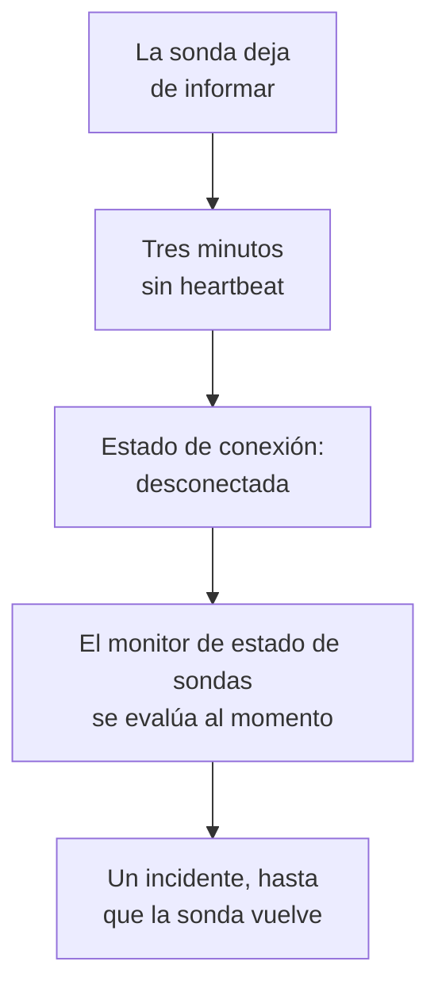

# Monitor de estado de sondas

Un monitor de estado de sondas le avisa cuando una sonda deja de informar: un incidente cuando se desconecta, que se resuelve solo cuando vuelve. Apúntelo a sus sondas personalizadas o, en un OneUptime autoalojado, a la sonda global en la que se ejecuta cada monitor, para que una sonda que se queda en silencio nunca deje sus monitores sin comprobar sin que nadie lo sepa.

:::cards
- [Crear uno](#crear-un-monitor-de-estado-de-sondas): Elegir las sondas y mantener los criterios predeterminados.
- [Criterios](#criterios): Contar las sondas conectadas o desconectadas, ahora o en una ventana de tiempo.
- [Métricas](#métricas): Cuántas sondas estaban conectadas, minuto a minuto.
:::

## Cómo funciona

OneUptime evalúa cada monitor de estado de sondas una vez por minuto, y otra vez en el momento en que una de sus sondas se conecta o se desconecta. Lee el estado de conexión de cada sonda, el que muestra la página de la sonda: una sonda está desconectada cuando no se ha sabido nada de ella durante tres minutos. Después de que el propio OneUptime haya estado caído o sin recibir datos, espera tres minutos completos antes de dar por desconectada una sonda, así que actualizar OneUptime nunca abre un incidente.

Una sonda que sigue caída es un solo incidente, no uno por minuto. El monitor sigue fuera de línea, con su incidente abierto, hasta que todas las sondas que vigila vuelven a estar conectadas; entonces el incidente se resuelve solo.

Un monitor puede vigilar las sondas de su propio proyecto y las sondas globales. Una sonda eliminada no se cuenta en ningún sentido. Cuando no queda ninguna de las sondas que vigila un monitor, este mantiene su estado, y su vista general lo indica al cabo de un día.

## Crear un monitor de estado de sondas

:::steps
### Empezar un monitor nuevo

Vaya a **Monitores** y haga clic en **Crear monitor**.

### Elegir el estado de la sonda

En **Tipo de monitor**, haga clic en **Más tipos de monitor** y elija **Estado de la sonda** en **Otro**. Rellene el **Nombre** y haga clic en **Siguiente**.

### Elegir las sondas

En **Sondas a vigilar**, elija las sondas. Un monitor nuevo empieza con las sondas propias de su proyecto. Un OneUptime autoalojado sin sondas propias empieza con sus sondas globales; en OneUptime Cloud las sondas globales las gestiona OneUptime, así que un proyecto las elige por su cuenta si quiere vigilarlas.

### Crear el monitor

Mantenga los criterios predeterminados, descritos más abajo, y haga clic en **Crear monitor**. El monitor se evalúa al momento, y su vista general muestra cada sonda que vigila, primero las desconectadas.
:::

> [!TIP]
> **Monitorizar esta sonda**, en la página de una sonda y en el menú de su fila en **Monitores → Ajustes → Sondas**, abre **Crear monitor** con un monitor de estado de sondas que vigila esa sonda y lleva su nombre.

## Criterios

Los filtros de un monitor de estado de sondas cuentan sondas:

| Filtro | Qué cuenta |
| --- | --- |
| **Disconnected Probes** | Las sondas vigiladas que están desconectadas. |
| **Connected Probes** | Las sondas vigiladas que están conectadas. |

Ambos son números enteros y se comparan con **Mayor que**, **Menor que**, **Igual a** y las demás comparaciones. Un monitor nuevo empieza con dos criterios:

| Criterio | Filtro | Qué hace |
| --- | --- | --- |
| Check if a probe is disconnected | **Disconnected Probes** mayor que `0` | Pone el monitor fuera de línea y declara un incidente titulado `Probe disconnected: {{disconnectedProbeNames}}`, que se resuelve solo. |
| Check if every probe is connected | **Disconnected Probes** igual a `0` | Pone el monitor en estado operativo. |

**Connected Probes** sirve para un monitor que vigila varias sondas y puede perder una: **Connected Probes** menor que `2` declara un incidente solo cuando quedan menos de dos.

### Esperar más antes de un incidente

Una sonda solo está desconectada tras tres minutos de silencio, así que un reinicio rápido no abre nada. Para esperar más, marque **Evaluar estos criterios durante un periodo de tiempo** bajo el filtro, elija **All Values** en **Evaluar** y una ventana en **Durante los últimos (en minutos)**. Con cinco minutos, una sonda tiene que seguir desconectada cinco minutos más antes de que se declare el incidente.

## Métricas

Cada evaluación registra dos series en el monitor: `oneuptime.monitor.probes.connected` y `oneuptime.monitor.probes.disconnected`, el número de sondas vigiladas que estaban conectadas y desconectadas. Se grafican en la página **Métricas** del monitor, y un panel o un monitor de métricas las lee como cualquier otra serie.

## Variables de plantilla

Las plantillas de incidentes y alertas de un monitor de estado de sondas pueden usar estas variables, además de las que tiene cualquier monitor:

| Variable | Valor |
| --- | --- |
| `{{disconnectedProbeNames}}` | Los nombres de las sondas desconectadas, separados por comas. |
| `{{disconnectedProbeCount}}` | Cuántas de las sondas están desconectadas. |
| `{{connectedProbeNames}}` | Los nombres de las sondas conectadas, separados por comas. |
| `{{connectedProbeCount}}` | Cuántas de las sondas están conectadas. |
| `{{probeStatusSummary}}` | Una frase que nombra las sondas desconectadas, como `1 of 3 probes is disconnected: EU Probe.`, o que indica que todas las sondas están conectadas. |
| `{{probes}}` | Cada sonda, con `probeName`, `isConnected`, `isGlobalProbe` y `lastAliveAt`. |

## Solución de problemas

:::details El monitor dice que está esperando datos
Un monitor nuevo muestra su primera evaluación en uno o dos minutos. Si no vigila ninguna sonda, muestra **Sin configurar** en su lugar: elija las sondas en **Criterios**.
:::

:::details Una sonda se cayó y no se declaró ningún incidente
Una sonda se considera desconectada tras tres minutos sin heartbeat, y más tarde aún si el propio OneUptime estuvo caído. Compruebe que el monitor no esté desactivado ni en una ventana de mantenimiento, y que sus criterios sigan declarando un incidente.
:::

## Siguientes pasos

:::cards
- [Sondas personalizadas](/docs/probe/custom-probe): Ejecutar una sonda en su propia red.
- [Criterios y estados del monitor](/docs/monitor/criteria-and-statuses): Cómo deciden los criterios el estado de un monitor.
- [Plantillas de incidentes y alertas](/docs/monitor/incident-alert-templating): Redactar el incidente que declara un monitor.
:::
