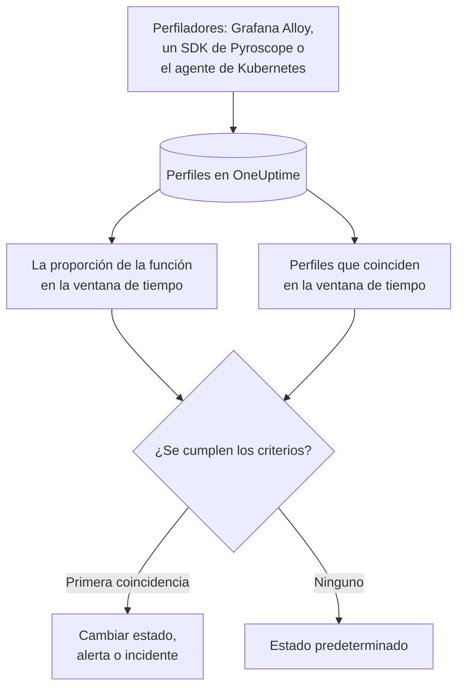

# Monitor de perfiles

Un monitor de perfiles lee los perfiles continuos que tus servicios envían a OneUptime y avisa de dos cosas: una función que ocupa una proporción del tiempo mayor de la que debería, como un analizador que se volvió más pesado tras un despliegue, y perfiles que dejan de llegar de un servicio. Cada minuto mide qué parte de su ventana de tiempo pasó por la función que indicas, cuenta los perfiles que coinciden con sus filtros, y cambia el estado del monitor, crea una alerta o declara un incidente cuando se cumplen tus criterios.

:::cards
- [Crear el monitor](#crear-un-monitor-de-perfiles): Desde una función en el Profiler, o desde Crear monitor.
- [Qué consulta](#qué-consulta): La función, el tipo de perfil, los servicios y la ventana.
- [Criterios](#criterios): La proporción de una función en la ventana, o el número de perfiles.
- [Una función se vuelve más pesada](#ejemplo-práctico-una-función-se-vuelve-más-pesada): Avisa cuando la proporción de una función se dispara.
:::

## Cómo funciona



Cada minuto, OneUptime lee los perfiles que coinciden con los filtros del monitor y empezaron dentro de su ventana de tiempo. Los cuenta y, cuando el monitor indica una función, mide la proporción del tiempo de esa ventana que pasó por la función. Compara estos números con los criterios del monitor de arriba abajo, y el primer criterio que coincide decide qué ocurre. Cuando no coincide ninguno, el monitor vuelve a su estado predeterminado.

## Antes de empezar

- Tus servicios envían datos de perfilado continuo a OneUptime mediante Grafana Alloy (eBPF), un SDK de Pyroscope o el agente de Kubernetes de OneUptime. Consulta [Perfilado continuo](/docs/telemetry/profiles).
- Para vigilar una función, conoces su nombre, o una parte de la ruta de su archivo o paquete, tal como la muestra el Profiler.

## Crear un monitor de perfiles

:::steps
### Empezar desde el Profiler, o desde Crear monitor

Lo más rápido es partir de la propia función: en **Perfiles de rendimiento**, abre la función y haz clic en el enlace que ofrece una alerta sobre su proporción. **Crear monitor** se abre con el monitor ya rellenado para esa función y su servicio, con un umbral por encima de lo que ocupa hoy, como se describe en [Ejemplo práctico: una función se vuelve más pesada](#ejemplo-práctico-una-función-se-vuelve-más-pesada). Si no, ve a **Monitores** y haz clic en **Crear monitor**.

### Elegir Profiles

En **Tipo de monitor**, haz clic en **Más tipos de monitor** y elige **Perfiles** en **Telemetría**, o escribe `profiles` en el cuadro de búsqueda. Escribe un **Nombre** y haz clic en **Siguiente**.

### Elegir qué lee

En **Configuración del monitor de perfiles**, pon en **Función** la función que quieres vigilar, en **Qué analizar** el tipo de perfil y en **Supervisar perfiles durante (tiempo)** la ventana. Un monitor nuevo lee **Tiempo de CPU** de los **Últimos 5 minutos**. **Qué lee este monitor ahora**, debajo de los campos, muestra cuántos perfiles coinciden y qué parte de la ventana ocupa hoy la función, para que puedas poner el umbral por encima. Abre **Más campos** para filtrar por servicio de telemetría o por entidad de infraestructura.

### Definir los criterios

Un monitor creado desde **Crear monitor** tiene dos criterios: fuera de línea, con un incidente, cuando el **Número de perfiles** es 0, y en línea cuando está por encima de 0. Para avisar sobre la función, añade un filtro **Proporción de la función (en %)**: consulta [Criterios](#criterios).

### Crear el monitor

Haz clic en **Crear monitor**. El monitor se abre en su página **Vista general**, y su primera evaluación se ejecuta en menos de un minuto.
:::

### Crearlo mediante la API o Terraform

El paso de un monitor contiene los mismos ajustes que su configuración `profileMonitor`. Esta vigila `parseOrder` en los perfiles de CPU de un servicio durante los últimos cinco minutos:

```json
{
  "profileMonitor": {
    "telemetryServiceIds": [],
    "profileTypes": ["cpu"],
    "profileType": "",
    "functionName": "parseOrder",
    "attributes": {},
    "lastXSecondsOfProfiles": 300
  }
}
```

Pon el ID del servicio en `telemetryServiceIds`, o deja la lista vacía para leer perfiles de todos los servicios, y deja `functionName` vacío para solo contar perfiles. Crea un monitor con el tipo de monitor `Profiles` y un paso que contenga esta configuración y al menos un criterio, mediante la [API](/docs/api-reference/api-reference) o [Terraform](/docs/terraform/monitor-steps). En Terraform, pasa la configuración como el atributo `profile_monitor` del paso, escrita con `jsonencode()`.

## Qué consulta

| Campo | Qué selecciona | Valor predeterminado |
| --- | --- | --- |
| `profileTypes` | Perfiles de cualquiera de estos tipos, comparados exactamente, como `cpu`. | Vacío: todos los tipos |
| `profileType` | Perfiles cuyo tipo contiene este texto, sin distinguir mayúsculas de minúsculas. Cuando está definido, se ignora `profileTypes`. | Vacío |
| `functionName` | El código cuya proporción mide **Proporción de la función (en %)**: los marcos de pila cuyo nombre de función o ruta de archivo contiene este texto, sin distinguir mayúsculas de minúsculas. | Vacío: no se mide ninguna proporción |
| `telemetryServiceIds` | Perfiles de cualquiera de estos servicios de telemetría. | Vacío: todos los servicios |
| `entityKeys` | Perfiles de cualquiera de estos hosts, pods, contenedores y otras entidades de infraestructura. | Vacío: todas las entidades |
| `attributes` | Perfiles cuyos atributos tienen estos valores. | Vacío: sin condición |
| `lastXSecondsOfProfiles` | Perfiles que empezaron dentro de este número de segundos antes de la evaluación. | Ninguno: defínelo siempre, o se cuentan todos los perfiles almacenados y el recuento nunca baja a 0 |

Todos los filtros que definas deben coincidir para que se lea un perfil. En el formulario, **Función** define `functionName`, **Qué analizar** define `profileTypes` (**Todos los tipos de perfil** lo deja vacío), **Supervisar perfiles durante (tiempo)** define `lastXSecondsOfProfiles`, y **Filtrar por servicio de telemetría** y **Filtrar por entidad de infraestructura** definen `telemetryServiceIds` y `entityKeys`.

## Cómo se evalúa

- **Cada minuto.** Un monitor de perfiles no lo comprueban sondas, así que no tiene intervalo que configurar ni página **Sondas e intervalo**.
- **Dos números por evaluación.** El monitor cuenta los perfiles que coinciden con todos los filtros y empezaron dentro de `lastXSecondsOfProfiles`, y mide la proporción de la función en esos mismos perfiles. Un perfilador sube datos a intervalos regulares, así que deja espacio en la ventana para varias subidas.
- **Una unidad cada vez.** Una proporción suma muestras de una sola unidad: cuando los tipos que lee mezclan unidades, como tiempo de CPU en nanosegundos de un SDK y recuentos de muestras de eBPF, lee la unidad con más muestras en la ventana.
- **Sin perfiles, el recuento es 0 y no hay proporción.** Un servicio cuyo perfilador deja de subir datos produce un recuento de 0, y un criterio **Proporción de la función (en %)** no coincide con una ventana vacía: avisa sobre el **Número de perfiles** para saber que el perfilado se detuvo.
- **La caída del propio OneUptime no es silencio.** Mientras la ventana de tiempo contenga un periodo en el que OneUptime no recibía datos (se estaba reiniciando, actualizando o poniéndose al día), la comprobación espera: el estado no cambia y no se abre ni se resuelve ningún incidente ni alerta. Consulta [Cuando OneUptime no recibe datos](/docs/monitor/when-oneuptime-is-not-receiving).
- **Criterios de arriba abajo.** Decide el primer criterio que coincide, así que pon primero el más grave.

Cada cambio de estado, con su motivo, queda registrado en la **Cronología de estados** del monitor.

## Criterios

Los criterios de un monitor de perfiles comparan uno de dos números con un valor.

**Proporción de la función (en %)** es la proporción del tiempo de la ventana, de 0 a 100, que pasó por la función del monitor: cada pila con un marco que coincide con `functionName` cuenta una vez, sea cual sea su profundidad, así que incluye tanto el código propio de la función como todo lo que llama.

| Condición de filtro | Coincide cuando la proporción de la función está… |
| --- | --- |
| **Mayor que** | por encima del valor |
| **Mayor o igual que** | en el valor o por encima |
| **Menor que** | por debajo del valor |
| **Menor o igual que** | en el valor o por debajo |

El **Número de perfiles** es la cantidad de perfiles que coincidieron en la ventana:

| Condición de filtro | Coincide cuando el recuento de perfiles está… |
| --- | --- |
| **Mayor que** | por encima del valor |
| **Mayor o igual que** | en el valor o por encima |
| **Menor que** | por debajo del valor |
| **Menor o igual que** | en el valor o por debajo |
| **Igual a** | exactamente en el valor |
| **Distinto de** | en cualquier valor menos ese |

Los recuentos de perfiles no tienen condiciones de anomalía: no hay ninguna referencia con la que compararlos.

## Ejemplo práctico: una función se vuelve más pesada

En el servicio de checkout, `parseOrder` ocupa el 18 % de su tiempo de CPU. Un despliegue que analiza una carga más grande no debería pasar desapercibido:

1. En **Perfiles de rendimiento**, elige el servicio de checkout y abre `parseOrder`.
2. Haz clic en el enlace que ofrece una alerta sobre su proporción. El Profiler sugiere un 30 %: la mitad más que la proporción de hoy, al menos 10 puntos más, redondeado hacia arriba a un múltiplo de 5.
3. **Crear monitor** se abre con un monitor de perfiles del servicio de checkout que lee **Tiempo de CPU** de los **Últimos 5 minutos**, con dos criterios: **Proporción de la función (en %)** **Mayor que** `30` lanza una alerta, que se resuelve sola, y marca el monitor como degradado; **Menor o igual que** `30` lo marca como operativo. El incidente está rellenado pero desactivado: actívalo para avisar a alguien.
4. Haz clic en **Crear monitor**.

Cuando el despliegue hace que `parseOrder` ocupe el 45 % del tiempo de CPU, la siguiente evaluación lanza la alerta. Cuando una corrección la vuelve a bajar del 30 %, la alerta se resuelve sola.

## Ejemplo práctico: los perfiles dejan de llegar

El servicio de checkout ejecuta un SDK de Pyroscope que sube perfiles de CPU. Quieres un incidente cuando dejan de llegar durante cinco minutos:

- `profileTypes`: `["cpu"]`, `telemetryServiceIds`: el servicio de checkout, `lastXSecondsOfProfiles`: `300`
- Criterio 1: **Número de perfiles** **Igual a** `0`: poner el monitor fuera de línea y declarar un incidente
- Criterio 2: **Número de perfiles** **Mayor que** `0`: poner el monitor en línea

Mientras el SDK sube datos, cada evaluación cuenta algunos perfiles y el criterio 2 mantiene el monitor en línea. Cuando el servicio se despliega sin el SDK, el recuento baja a 0 cinco minutos después de la última subida, coincide el criterio 1 y se declara el incidente. La primera subida tras la corrección vuelve a llevar el recuento por encima de 0, y el incidente se resuelve solo si **Resolver incidente automáticamente** está activado para él.

## Solución de problemas

:::details El monitor cuenta 0, pero en OneUptime aparecen perfiles
Compara los filtros con los perfiles que ves: `profileTypes` debe coincidir exactamente con el tipo, y `telemetryServiceIds` debe contener los ID de servicio correctos. Un `lastXSecondsOfProfiles` corto también puede caer entre dos subidas.
:::

:::details La proporción de la función se queda en 0 %
Ningún marco de la ventana contiene el texto de la función. Abre la función en el Profiler y copia su nombre tal como aparece allí; basta con una parte del nombre, y las mayúsculas no importan. Después comprueba que el servicio envía el tipo de perfil que lee **Qué analizar**.
:::

## Próximos pasos

:::cards
- [Perfilado continuo](/docs/telemetry/profiles): Envía perfiles y léelos en el Profiler.
- [Pasos del monitor](/docs/terraform/monitor-steps): Pasa la configuración del paso desde Terraform.
- [Monitor de trazas](/docs/monitor/traces-monitor): Alerta sobre spans fallidos.
- [Monitor de métricas](/docs/monitor/metrics-monitor): Alerta sobre CPU, memoria y otras métricas.
:::
