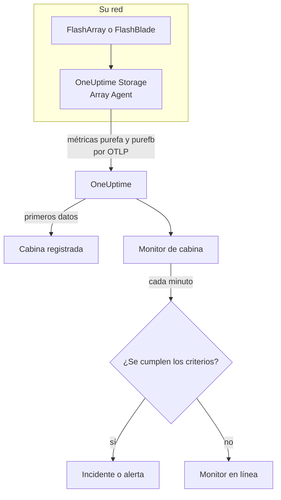

# Monitor de cabinas de almacenamiento

Un monitor de cabina de almacenamiento vigila una cabina de almacenamiento y le avisa cuando la cabina genera una alerta propia, se queda sin espacio, se ralentiza, pierde hardware o una ruta de host, o se retrasa en la replicación. Funciona con Pure Storage FlashArray y Pure Storage FlashBlade, y lee las métricas que exporta la propia cabina - las series `purefa_*` y `purefb_*` de Pure -, que recoge el OneUptime Storage Array Agent.

:::cards
- [Crear el monitor](#crear-un-monitor-de-cabina-de-almacenamiento): Seis pasos en el panel.
- [Plantillas](#plantillas-de-alerta-predefinidas): Dieciocho alertas listas para usar, un incidente por volumen, host o componente.
- [Cómo funcionan las series de Pure](#cómo-están-construidas-las-series-de-pure): Un nombre de métrica, muchos valores.
- [Métricas](#métricas-recogidas): Cada serie sobre la que el monitor puede alertar.
:::

## Cómo funciona

El OneUptime Storage Array Agent se ejecuta en una máquina que puede llegar a la interfaz de gestión de la cabina. Lee las métricas de la cabina con un token de API de solo lectura, las etiqueta con el nombre de la cabina, `storage.array.name`, y su plataforma, `storage.system`, y las envía a OneUptime por OTLP. Los primeros datos registran la cabina.

Un monitor de cabina de almacenamiento está ligado a una cabina. Cada minuto ejecuta su consulta sobre las métricas de esa cabina y compara el resultado con sus criterios.



## Antes de empezar

- **Instale el Storage Array Agent** donde pueda llegar a la cabina por HTTPS, con el token de API de un usuario que tenga el rol **readonly** de la cabina. La [guía del Storage Array Agent](/docs/telemetry/storage-arrays) cubre el usuario, el token y la instalación, mediante `ONEUPTIME_URL`, `ONEUPTIME_TELEMETRY_INGESTION_KEY`, `STORAGE_ARRAY_NAME`, y la dirección y el token de la cabina (`PURE_FA_ENDPOINT` y `PURE_FA_API_TOKEN`, o `PURE_FB_ENDPOINT` y `PURE_FB_API_TOKEN`).
- **Compruebe que la cabina está registrada.** Aparece en **Productos → Infraestructura → Storage Arrays → All Storage Arrays**, con el nombre del `STORAGE_ARRAY_NAME` del agente, alrededor de un minuto después de la primera lectura.

## Crear un monitor de cabina de almacenamiento

:::steps
### Empezar un monitor nuevo

Vaya a **Monitores** y haga clic en **Crear monitor**.

### Elegir Cabina de almacenamiento

En **Tipo de monitor**, haga clic en **Más tipos de monitor** y elija **Cabina de almacenamiento** en **Infraestructura**, o escriba `storage` en el cuadro de búsqueda. Introduzca un **Nombre** - se usa en los títulos de incidentes y alertas - y haga clic en **Siguiente**.

### Elegir la cabina

En **Storage Array Monitor Configuration**, elija la cabina en **Cabina de almacenamiento**. Cada cabina que ha enviado datos está en la lista. Su plataforma decide qué métricas y plantillas ofrece el formulario.

### Elegir qué vigilar

Elija una de las tres pestañas:

- **Quick Setup** - haga clic en una [plantilla](#plantillas-de-alerta-predefinidas). Establece la métrica, los filtros de etiquetas, la agregación, el intervalo de tiempo y los umbrales, y sustituye los criterios de abajo por los suyos. Aún puede cambiar el **Intervalo de tiempo**.
- **Custom Metric** - elija una métrica en **Storage Array Metric** y luego establezca **Agregación** e **Intervalo de tiempo**. Los [filtros](#configuración-del-monitor) la acotan a un volumen, host, pod, componente, sistema de archivos o bucket.
- **Avanzado** - construya usted mismo consultas y fórmulas en **Seleccionar métricas**, por ejemplo la capacidad usada como `purefa_array_space_bytes` filtrada a `space=capacity` menos la misma métrica filtrada a `space=empty`. Use **Agrupar por** con la etiqueta de un objeto para juzgar cada objeto por separado.

### Revisar los criterios

Abra cada criterio en **Criterios del monitor** y revise su **Métrica**, **Agregación**, **Condición** y **Umbral**. Una plantilla los rellena. Con **Custom Metric** o **Avanzado**, el monitor empieza con los [criterios predeterminados](#criterios-predeterminados), que solo detectan una métrica que cae a cero, así que establezca su propio umbral.

### Crear el monitor

Haga clic en **Crear monitor**. OneUptime abre la página del monitor y lo evalúa cada minuto. Los incidentes y alertas que genera también aparecen en las páginas **Incidentes** y **Alertas** de la cabina.
:::

> [!TIP]
> Para configurar varias plantillas a la vez, abra la cabina desde **Productos → Infraestructura → Storage Arrays** y vaya a **Recomendaciones**. Elija las plantillas que quiera, decida a quién se avisa, y OneUptime crea un monitor por plantilla.

## Configuración del monitor

| Campo | Pestaña | Qué hace |
| --- | --- | --- |
| **Cabina de almacenamiento** | Todas | Obligatorio. Limita cada consulta a `resource.storage.array.name`, así que dos cabinas que tienen ambas un volumen llamado `vol-01` nunca se mezclan. |
| **Volumen** | Custom Metric, Avanzado | Solo FlashArray. Un volumen, por la etiqueta `name`, como `vol-db-01`. Un volumen dentro de un pod o de un grupo de volúmenes se llama `pod::volume` o `group/volume`. |
| **Host** | Custom Metric, Avanzado | Solo FlashArray. Un host tal como lo conoce la cabina, por la etiqueta `host`, como `esxi-01`. |
| **Pod** | Custom Metric, Avanzado | Solo FlashArray. Un pod de ActiveCluster o ActiveDR, por la etiqueta `name`, o `local_pod` en las series de enlaces de réplica. |
| **Hardware Component** | Custom Metric, Avanzado | Un componente de hardware, como `CH0.BAY1` o `CT0`: la etiqueta `component_name` en un FlashArray, `name` en un FlashBlade. |
| **File System** | Custom Metric, Avanzado | Solo FlashBlade. Un sistema de archivos, por la etiqueta `name`. |
| **Bucket** | Custom Metric, Avanzado | Solo FlashBlade. Un bucket de almacenamiento de objetos, por la etiqueta `name`. |
| **Storage Array Metric** | Custom Metric | Una métrica del [catálogo](#métricas-recogidas). El formulario añade el filtro de etiqueta que le da su significado, y la agrupa por el objeto que describe, así que cada volumen, host o componente se juzga por separado. |
| **Agregación** | Custom Metric | Cómo se combinan las muestras: **Promedio**, **Máximo**, **Mínimo**, **Suma** o **Recuento**. Empieza en la agregación habitual de la métrica. |
| **Intervalo de tiempo** | Todas | La ventana móvil que lee la consulta, de **Past 1 Minute** a **Past 365 Days**. Un monitor nuevo empieza en **Últimos 5 minutos**; una métrica personalizada de un sistema de archivos o de un bucket, en **Últimos 15 minutos**; las plantillas fijan la suya. |
| **Seleccionar métricas** | Avanzado | El constructor de consultas: **Métrica**, **Agregar por**, **Filtrar por atributos**, **Agrupar por**, además de **Añadir métrica** y **Añadir fórmula** para combinar consultas. |

El agente lee el endpoint de la cabina cada 60 segundos, y los volúmenes, hosts y pods cada 2 minutos, así que una ventana de 5 minutos siempre contiene una muestra. Lee los sistemas de archivos y los buckets de un FlashBlade cada 5 minutos, de ahí los 15, y los directorios de FlashArray cada 30 minutos: dé a un monitor de directorios una ventana de 60 minutos.

## Cómo están construidas las series de Pure

Pure pone varios valores en **un solo** nombre de métrica y los distingue con una etiqueta:

- **`dimension`** en las series de rendimiento. `purefa_array_performance_latency_usec` lleva la latencia de lectura (`usec_per_read_op`), la latencia de escritura (`usec_per_write_op`), la latencia de escritura en espejo, y el tiempo de SAN, de cola, de QoS y de servicio de cada una. Filtre siempre por una sola `dimension`: un promedio entre todas mezcla una latencia de lectura de 200 µs con un valor de cola.
- **`space`** en las series de capacidad: `capacity`, `empty`, `snapshots`, `total_provisioned`, `total_physical`, `available_ratio` y más.

Varias series llevan su estado en una **etiqueta**, con un valor que siempre es 1:

| Serie | Etiqueta de estado | Una serie por |
| --- | --- | --- |
| `purefa_alerts_open` | `severity`, con `summary`, `code` y `component_type` | Alerta abierta |
| `purefa_hw_component_status` | `component_status` | Componente de hardware |
| `purefa_host_connectivity_info` | `status`, con `details` | Host |
| `purefa_drive_capacity_bytes` | `component_status` (el valor es la capacidad del disco) | Disco |

Una serie filtrada a un estado malo solo existe mientras algo está en ese estado, así que no tener serie significa que todo está bien. Por eso **Max por encima de 0 dispara y 0 recupera** es la forma correcta para ellas, y así están construidas las plantillas: sus criterios de recuperación cuentan una serie ausente como cero.

En los filtros del monitor y en las claves de agrupación, los atributos del agente empiezan por `resource.` (`resource.storage.array.name`, `resource.storage.system`), mientras que las etiquetas propias de Pure no (`name`, `host`, `component_name`, `dimension`, `space`, `severity`).

## Plantillas de alerta predefinidas

OneUptime incluye 18 plantillas — 11 para FlashArray y 7 para FlashBlade — y **Quick Setup** ofrece las de la plataforma de la cabina. Cada una construye un monitor completo: la consulta de la métrica, sus filtros de etiquetas, una agrupación por la etiqueta propia del objeto, un criterio que dispara y otro que recupera. Los umbrales son puntos de partida que puede editar.

Un criterio solo dispara cuando la condición se cumple para **cada** valor de su ventana. Un monitor que disparó por un umbral de capacidad, latencia, retraso o ratio solo se recupera un 10 % más allá, así que un valor que oscila alrededor del umbral no parpadea; las plantillas de alertas y de hardware se recuperan en cuanto desaparece el estado.

### FlashArray

| Plantilla                      | Categoría    | Gravedad    | Vigila                                                                                          | Dispara cuando                                                                                                                                   |
| ------------------------------ | ------------ | ----------- | ----------------------------------------------------------------------------------------------- | ------------------------------------------------------------------------------------------------------------------------------------------------ |
| Critical Array Alert           | Array Health | Crítico     | `purefa_alerts_open` filtrada a `severity=critical`, Max por `summary`, últimos 5 minutos       | > 0 — la cabina tiene una alerta crítica abierta (un componente averiado, una emergencia de capacidad, un fallo de replicación). Un incidente por alerta; se recupera cuando la alerta se cierra |
| Warning Array Alert            | Array Health | Advertencia | `purefa_alerts_open` filtrada a `severity=warning`, Max por `summary`, últimos 5 minutos        | > 0 — la cabina tiene una alerta de advertencia abierta. Un incidente por alerta; se recupera cuando la alerta se cierra                          |
| Capacity Above 80%             | Capacidad    | Advertencia | `purefa_array_space_utilization`, Max, últimos 15 minutos                                       | > 80 — el primer umbral de capacidad del propio Pure; se recupera en ≤ 72                                                                        |
| Capacity Above 90%             | Capacidad    | Crítico     | `purefa_array_space_utilization`, Max, últimos 5 minutos                                        | > 90 — la cabina está a punto de rechazar escrituras; se recupera en ≤ 81                                                                        |
| High Read Latency              | Performance  | Advertencia | `purefa_array_performance_latency_usec` filtrada a `dimension=usec_per_read_op`, Avg, últimos 10 minutos  | > 5000 µs (5 ms) — las lecturas de un FlashArray suelen completarse muy por debajo de 1 ms; se recupera en ≤ 4500                     |
| High Write Latency             | Performance  | Advertencia | `purefa_array_performance_latency_usec` filtrada a `dimension=usec_per_write_op`, Avg, últimos 10 minutos | > 5000 µs (5 ms); se recupera en ≤ 4500                                                                                                |
| Hardware Component Failed      | Hardware     | Crítico     | `purefa_hw_component_status` filtrada a `component_status=critical`, Max por `component_name`, últimos 5 minutos | > 0 — un controlador, una fuente de alimentación, un ventilador, una bahía o un puerto está en estado crítico y la redundancia se ha perdido. Un incidente por componente; se recupera cuando informa ok |
| Hardware Component Degraded    | Hardware     | Advertencia | `purefa_hw_component_status` filtrada a `component_status=degraded`, Max por `component_name`, últimos 5 minutos | > 0 — un componente está degradado. Un incidente por componente; se recupera cuando informa ok                                       |
| Drive Failed                   | Hardware     | Crítico     | `purefa_drive_capacity_bytes` filtrada a `component_status=failed`, Max por `component_name`, últimos 5 minutos | > 0 — un módulo DirectFlash o un SSD ha fallado y la cabina reconstruye sobre los demás. Un incidente por disco; se recupera cuando se sustituye |
| Host Lost Redundant Paths      | Hosts        | Advertencia | `purefa_host_connectivity_info` filtrada a `status=critical`, Max por `host`, últimos 5 minutos | > 0 — el host llega a la cabina a través de un solo controlador o de ninguno; una conmutación de controlador dejaría su almacenamiento sin conexión. Un incidente por host; se recupera cuando vuelven sus rutas |
| Replication Lag Above 1 Minute | Replicación  | Advertencia | `purefa_pod_replica_links_lag_max_msec`, Max por `local_pod`, últimos 10 minutos                | > 60000 ms (60 s) — una conmutación ahora perdería más escrituras recientes de lo previsto. Un incidente por pod; se recupera en ≤ 54000         |

### FlashBlade

| Plantilla                    | Categoría    | Gravedad    | Vigila                                                                                                         | Dispara cuando                                                                                                      |
| ---------------------------- | ------------ | ----------- | -------------------------------------------------------------------------------------------------------------- | ------------------------------------------------------------------------------------------------------------------- |
| Critical Array Alert         | Array Health | Crítico     | `purefb_alerts_open` filtrada a `severity=critical`, Max por `summary`, últimos 5 minutos                      | > 0 — el FlashBlade tiene una alerta crítica abierta. Un incidente por alerta; se recupera cuando la alerta se cierra |
| Warning Array Alert          | Array Health | Advertencia | `purefb_alerts_open` filtrada a `severity=warning`, Max por `summary`, últimos 5 minutos                       | > 0 — el FlashBlade tiene una alerta de advertencia abierta. Un incidente por alerta; se recupera cuando la alerta se cierra |
| Capacity Above 80%           | Capacidad    | Advertencia | `purefb_array_space_utilization` filtrada a `type=array`, Max, últimos 15 minutos                              | > 80; se recupera en ≤ 72                                                                                           |
| Capacity Above 90%           | Capacidad    | Crítico     | `purefb_array_space_utilization` filtrada a `type=array`, Max, últimos 5 minutos                               | > 90 — las escrituras fallan para todos los clientes cuando se llena; se recupera en ≤ 81                           |
| Hardware Component Unhealthy | Hardware     | Crítico     | `purefb_hardware_health`, Min por `name`, últimos 5 minutos                                                    | < 1 — una blade, un módulo de fabric, una fuente de alimentación o un ventilador no está en buen estado (una ranura sin usar informa 2). Un incidente por componente; se recupera en ≥ 1 |
| High Read Latency            | Performance  | Advertencia | `purefb_array_performance_latency_usec` filtrada a `dimension=usec_per_read_op` y `protocol=all`, Avg, últimos 10 minutos | > 10000 µs (10 ms) en todos los protocolos; se recupera en ≤ 9000                                      |
| File System Near Full        | File Systems | Advertencia | `purefb_file_systems_space_bytes` filtrada a `space=available_ratio`, Min por `name`, últimos 15 minutos       | < 0.1 — queda menos del 10 % del tamaño aprovisionado de un sistema de archivos. Un incidente por sistema de archivos; se recupera en ≥ 0.11 |

**Gravedad** es la etiqueta que muestra el selector. El incidente y la alerta que crea una plantilla empiezan en la gravedad de incidente y de alerta más alta de su proyecto; cámbielas en el criterio.

- **Las alertas abiertas y los estados de hardware usan Max** de una serie que solo existe mientras la alerta está abierta o el componente está en ese estado, así que una sola lectura que la muestre supera el umbral.
- **Cada plantilla por objeto agrupa por la etiqueta propia del objeto** (`summary`, `component_name`, `host`, `local_pod`, `name`), así que se dispara un incidente por cada objeto afectado, y el incidente lo nombra.
- **Las plantillas de latencia usan Avg** del promedio por operación que calcula la propia cabina, y las de capacidad **Max** de su propio porcentaje de utilización. Las latencias se fijan en microsegundos y la capacidad en porcentaje.
- **Hardware Component Unhealthy usa Min** por componente: su salud es 1 cuando está bien y baja a 0 cuando no.

No hay plantilla para la latencia de cada volumen, porque el umbral correcto depende de la carga de trabajo: constrúyala desde el catálogo con una agrupación por `name`. La previsión de capacidad necesita una tendencia de crecimiento más que un umbral, y el desgaste de los discos no tiene ninguna serie sobre la que alertar.

## Métricas recogidas

El agente envía todo lo que exporta la cabina; las series de abajo son el catálogo que ofrece el formulario del monitor. Cada valor es un gauge que calcula la propia cabina - las latencias son microsegundos por operación y el rendimiento es por segundo -, así que no hace falta calcular tasas. **Filtro** es el filtro de etiqueta que da a la serie el significado que indica su fila; el formulario lo aplica por usted.

### Array Health

| Métrica              | Filtro | Plataforma | Unidad  | Descripción                                                                                                                                                       |
| -------------------- | ------ | ---------- | ------- | ----------------------------------------------------------------------------------------------------------------------------------------------------------------- |
| `purefa_alerts_open` | —      | FlashArray | `count` | Una serie por cada alerta abierta en la cabina (valor 1), con las etiquetas `severity` (`critical`, `warning`, `info`, `hidden`), `category`, `code`, `component_type` y `summary` |
| `purefb_alerts_open` | —      | FlashBlade | `count` | Una serie por cada alerta abierta en el FlashBlade (valor 1), con las etiquetas `severity` (`info`, `warning`, `critical`), `code`, `component_name`, `component_type`, `summary` y `kburl` (el artículo de la base de conocimiento de Pure) |

### Capacity

| Métrica                                   | Filtro                       | Plataforma | Unidad  | Descripción                                                                                                                           |
| ----------------------------------------- | ---------------------------- | ---------- | ------- | ------------------------------------------------------------------------------------------------------------------------------------- |
| `purefa_array_space_utilization`          | —                            | FlashArray | `%`     | Parte de la capacidad utilizable de la cabina que está en uso. Pure genera sus propias alertas de capacidad al 80 %, 90 % y 100 %     |
| `purefa_array_space_bytes`                | `space=capacity`             | FlashArray | `bytes` | Capacidad utilizable de la cabina                                                                                                     |
| `purefa_array_space_bytes`                | `space=empty`                | FlashArray | `bytes` | Capacidad sin usar — siga su tendencia para prever cuándo se llenará la cabina                                                       |
| `purefa_array_space_bytes`                | `space=snapshots`            | FlashArray | `bytes` | Espacio físico ocupado solo por snapshots; un aumento rápido suele significar que un grupo de protección conserva más snapshots de lo previsto |
| `purefa_array_space_data_reduction_ratio` | —                            | FlashArray | `ratio` | Deduplicación y compresión en toda la cabina, p. ej. 4.2 para 4.2:1. Una caída sostenida significa que los datos nuevos se reducen mal |
| `purefb_array_space_utilization`          | `type=array`                 | FlashBlade | `%`     | Parte de la capacidad utilizable del FlashBlade que está en uso                                                                       |
| `purefb_array_space_bytes`                | `type=array`, `space=empty`  | FlashBlade | `bytes` | Capacidad sin usar del FlashBlade                                                                                                     |
| `purefb_array_space_data_reduction_ratio` | `type=array`                 | FlashBlade | `ratio` | Reducción de datos en todo el FlashBlade                                                                                              |

### Performance

| Métrica                                    | Filtro                                         | Plataforma | Unidad    | Descripción                                                                                                  |
| ------------------------------------------ | ---------------------------------------------- | ---------- | --------- | ------------------------------------------------------------------------------------------------------------ |
| `purefa_array_performance_latency_usec`    | `dimension=usec_per_read_op`                   | FlashArray | `µs`      | Latencia media de una lectura tal como la ven los hosts; las lecturas de un FlashArray suelen completarse muy por debajo de 1 ms |
| `purefa_array_performance_latency_usec`    | `dimension=usec_per_write_op`                  | FlashArray | `µs`      | Latencia media de una escritura tal como la ven los hosts                                                    |
| `purefa_array_performance_latency_usec`    | `dimension=usec_per_mirrored_write_op`         | FlashArray | `µs`      | Latencia media de una escritura a un pod extendido de ActiveCluster, incluido el viaje de ida y vuelta a la cabina par |
| `purefa_array_performance_latency_usec`    | `dimension=san_usec_per_read_op`               | FlashArray | `µs`      | Tiempo que una lectura pasa en la SAN; una latencia de SAN alta con una latencia de servicio baja apunta al fabric o al host |
| `purefa_array_performance_throughput_iops` | `dimension=reads_per_sec`                      | FlashArray | `ops/s`   | Operaciones de lectura por segundo                                                                           |
| `purefa_array_performance_throughput_iops` | `dimension=writes_per_sec`                     | FlashArray | `ops/s`   | Operaciones de escritura por segundo                                                                         |
| `purefa_array_performance_bandwidth_bytes` | `dimension=read_bytes_per_sec`                 | FlashArray | `bytes/s` | Bytes leídos por segundo                                                                                     |
| `purefa_array_performance_bandwidth_bytes` | `dimension=write_bytes_per_sec`                | FlashArray | `bytes/s` | Bytes escritos por segundo                                                                                   |
| `purefa_array_performance_queue_depth_ops` | —                                              | FlashArray | `ops`     | Operaciones en cola en la cabina; una cola que crece con una latencia en aumento significa que los hosts envían más de lo que puede atender |
| `purefa_array_performance_average_bytes`   | `dimension=bytes_per_op`                       | FlashArray | `bytes`   | Tamaño medio de una operación — una E/S grande aumenta la latencia sin que nada esté mal                     |
| `purefb_array_performance_latency_usec`    | `dimension=usec_per_read_op`, `protocol=all`   | FlashBlade | `µs`      | Latencia media de lectura en todos los protocolos                                                            |
| `purefb_array_performance_latency_usec`    | `dimension=usec_per_write_op`, `protocol=all`  | FlashBlade | `µs`      | Latencia media de escritura en todos los protocolos                                                          |
| `purefb_array_performance_throughput_iops` | `dimension=reads_per_sec`, `protocol=all`      | FlashBlade | `ops/s`   | Operaciones de lectura por segundo en todos los protocolos                                                   |
| `purefb_array_performance_throughput_iops` | `dimension=writes_per_sec`, `protocol=all`     | FlashBlade | `ops/s`   | Operaciones de escritura por segundo en todos los protocolos                                                 |
| `purefb_array_performance_bandwidth_bytes` | `dimension=read_bytes_per_sec`, `protocol=all` | FlashBlade | `bytes/s` | Bytes leídos por segundo en todos los protocolos                                                             |
| `purefb_array_performance_bandwidth_bytes` | `dimension=write_bytes_per_sec`, `protocol=all` | FlashBlade | `bytes/s` | Bytes escritos por segundo en todos los protocolos                                                          |

### Volumes

| Métrica                                     | Filtro                           | Plataforma | Unidad    | Descripción                                                   |
| ------------------------------------------- | -------------------------------- | ---------- | --------- | ------------------------------------------------------------- |
| `purefa_volume_performance_latency_usec`    | `dimension=usec_per_read_op`     | FlashArray | `µs`      | Latencia media de lectura de cada volumen — agrupe por `name` |
| `purefa_volume_performance_latency_usec`    | `dimension=usec_per_write_op`    | FlashArray | `µs`      | Latencia media de escritura de cada volumen                   |
| `purefa_volume_performance_throughput_iops` | `dimension=reads_per_sec`        | FlashArray | `ops/s`   | Operaciones de lectura por segundo de cada volumen            |
| `purefa_volume_performance_throughput_iops` | `dimension=writes_per_sec`       | FlashArray | `ops/s`   | Operaciones de escritura por segundo de cada volumen          |
| `purefa_volume_performance_bandwidth_bytes` | `dimension=read_bytes_per_sec`   | FlashArray | `bytes/s` | Bytes leídos por segundo de cada volumen                      |
| `purefa_volume_performance_bandwidth_bytes` | `dimension=write_bytes_per_sec`  | FlashArray | `bytes/s` | Bytes escritos por segundo en cada volumen                    |
| `purefa_volume_space_bytes`                 | `space=total_provisioned`        | FlashArray | `bytes`   | Tamaño de cada volumen tal como lo ven los hosts              |
| `purefa_volume_space_bytes`                 | `space=total_physical`           | FlashArray | `bytes`   | Espacio físico que usa cada volumen tras la reducción de datos |
| `purefa_volume_space_data_reduction_ratio`  | —                                | FlashArray | `ratio`   | Ratio de reducción de datos de cada volumen                   |

### Hosts

| Métrica                                   | Filtro                        | Plataforma | Unidad  | Descripción                                                                                                                                    |
| ----------------------------------------- | ----------------------------- | ---------- | ------- | ---------------------------------------------------------------------------------------------------------------------------------------------- |
| `purefa_host_connectivity_info`           | —                             | FlashArray | `count` | Una serie por host (valor 1) con la etiqueta de su conectividad `status` (`healthy`, `critical`, `unused`) y `details` (`Redundant`, `Single Controller`, `None`, ...) |
| `purefa_host_performance_latency_usec`    | `dimension=usec_per_read_op`  | FlashArray | `µs`    | Latencia media de lectura que ve cada host — agrupe por `host`                                                                                 |
| `purefa_host_performance_latency_usec`    | `dimension=usec_per_write_op` | FlashArray | `µs`    | Latencia media de escritura que ve cada host                                                                                                   |
| `purefa_host_performance_throughput_iops` | `dimension=reads_per_sec`     | FlashArray | `ops/s` | Operaciones de lectura por segundo de cada host                                                                                                |
| `purefa_host_performance_throughput_iops` | `dimension=writes_per_sec`    | FlashArray | `ops/s` | Operaciones de escritura por segundo de cada host                                                                                              |

### Replication

| Métrica                                              | Filtro                                 | Plataforma | Unidad    | Descripción                                                                                                                                                  |
| ---------------------------------------------------- | -------------------------------------- | ---------- | --------- | ------------------------------------------------------------------------------------------------------------------------------------------------------------ |
| `purefa_pod_replica_links_lag_max_msec`              | —                                      | FlashArray | `ms`      | Mayor retraso de replicación de cada enlace de réplica de pod (ActiveDR / asíncrono), con las etiquetas `local_pod`, `remote_pod`, `remote`, `direction` y `status` — agrupe por `local_pod` |
| `purefa_pod_replica_links_lag_average_msec`          | —                                      | FlashArray | `ms`      | Retraso medio de replicación de cada enlace de réplica de pod                                                                                                |
| `purefa_pod_performance_replication_bandwidth_bytes` | —                                      | FlashArray | `bytes/s` | Tráfico de replicación de cada pod, con las etiquetas `direction` y `dimension`                                                                              |
| `purefa_pod_performance_latency_usec`                | `dimension=usec_per_mirrored_write_op` | FlashArray | `µs`      | Latencia media de escritura en espejo de cada pod de ActiveCluster                                                                                           |

### Hardware

| Métrica                                       | Filtro                           | Plataforma | Unidad     | Descripción                                                                                                                                                                                                  |
| --------------------------------------------- | -------------------------------- | ---------- | ---------- | ------------------------------------------------------------------------------------------------------------------------------------------------------------------------------------------------------------ |
| `purefa_hw_component_status`                  | —                                | FlashArray | `count`    | Una serie por componente de hardware (valor 1) — chasis, controladores, bahías de discos y de NVRAM, fuentes de alimentación, ventiladores, sensores de temperatura, puertos Ethernet y Fibre Channel — con la etiqueta `component_status` (`ok`, `critical`, `degraded`, `device_off`, `identifying`, `not_installed`, `unknown`) |
| `purefa_hw_component_temperature_celsius`     | —                                | FlashArray | `°C`       | Temperatura de cada sensor — agrupe por `component_name`                                                                                                                                                     |
| `purefa_drive_capacity_bytes`                 | —                                | FlashArray | `bytes`    | Capacidad bruta de cada disco, con la etiqueta de su `component_status` (`healthy`, `failed`, `missing`, `recovering`, `unhealthy`, `empty`, ...) y su tipo                                                   |
| `purefa_network_interface_performance_errors` | `dimension=total_errors_per_sec` | FlashArray | `errors/s` | Errores por segundo en cada interfaz Ethernet y Fibre Channel — los errores sostenidos suelen indicar un cable, un óptico o un puerto de switch defectuoso                                                    |
| `purefb_hardware_health`                      | —                                | FlashBlade | —          | Salud de cada componente de hardware (blades, módulos de fabric, fuentes de alimentación, ventiladores, ...): 1 = en buen estado, 2 = sin usar, 0 = en mal estado. Tome el mínimo por `name`                   |

### File Systems

| Métrica                                        | Filtro                        | Plataforma | Unidad  | Descripción                                                                                  |
| ---------------------------------------------- | ----------------------------- | ---------- | ------- | -------------------------------------------------------------------------------------------- |
| `purefb_file_systems_performance_latency_usec` | `dimension=usec_per_read_op`  | FlashBlade | `µs`    | Latencia media de lectura de cada sistema de archivos — agrupe por `name`                    |
| `purefb_file_systems_performance_latency_usec` | `dimension=usec_per_write_op` | FlashBlade | `µs`    | Latencia media de escritura de cada sistema de archivos                                      |
| `purefb_file_systems_space_bytes`              | `space=total_physical`        | FlashBlade | `bytes` | Espacio físico que usa cada sistema de archivos                                              |
| `purefb_file_systems_space_bytes`              | `space=available_ratio`       | FlashBlade | `ratio` | Parte del tamaño aprovisionado de cada sistema de archivos que sigue disponible, de 0 a 1 — cerca de 0 está a punto de llenar su cuota |

### Buckets

| Métrica                                   | Filtro                       | Plataforma | Unidad  | Descripción                                           |
| ----------------------------------------- | ---------------------------- | ---------- | ------- | ----------------------------------------------------- |
| `purefb_buckets_performance_latency_usec` | `dimension=usec_per_read_op` | FlashBlade | `µs`    | Latencia media de lectura de cada bucket — agrupe por `name` |
| `purefb_buckets_space_bytes`              | `space=total_physical`       | FlashBlade | `bytes` | Espacio físico que usa cada bucket                    |
| `purefb_buckets_object_count`             | —                            | FlashBlade | `count` | Número de objetos de cada bucket                      |

## Criterios de monitorización

Un criterio compara una de las consultas o fórmulas del monitor con un umbral. Los criterios de un monitor de cabina de almacenamiento no tienen **Tipo de filtro**: cada regla comprueba el valor de la métrica, con estos campos.

| Campo | Qué hace |
| --- | --- |
| **Métrica** | La consulta o fórmula que se comprueba, por su nombre de variable. |
| **Agregación** | Cómo se convierten los valores de la ventana en una sola respuesta: **Promedio**, **Suma**, **Maximum Value**, **Minimum Value**, **All Values** (todos los valores deben coincidir) o **Any Value** (basta con uno). |
| **Condición** | **Greater Than**, **Less Than**, **Greater Than Or Equal To**, **Less Than Or Equal To** o **Equal To** — o una condición de anomalía: **Anomalously High**, **Anomalously Low** o **Anomalous**. |
| **Umbral** | El valor con el que se compara. Junto a él hay una lista de unidades cuando la métrica tiene unidad. No se muestra para las condiciones de anomalía. |
| **Sensibilidad** | Solo condiciones de anomalía. **Bajo** (4σ), **Medio** (3σ, el predeterminado) o **Alto** (2σ). |
| **Ventana de referencia** | Solo condiciones de anomalía. 14 días (el predeterminado), 28, 60 o 90 días de historial. |
| **Si no hay datos** | En **Más campos**. Qué ocurre cuando la ventana no tiene muestras: **Ignore** (el predeterminado), **Treat As Zero** o **Disparador**. |

Las condiciones de anomalía comparan cada valor con la misma hora de la semana en la referencia. Permanecen en estado «Learning», y no generan nada, hasta que la ventana de referencia tiene historial suficiente.

Algunos criterios para empezar:

- **Un volumen va lento:** `purefa_volume_performance_latency_usec` filtrada a `dimension=usec_per_read_op`, Promedio, agrupada por `name`, **Greater Than** `2000`, en los últimos 10 minutos.
- **La cabina se está llenando:** `purefa_array_space_utilization`, Máximo, **Greater Than** `85`, en los últimos 15 minutos.
- **Un host funciona con un solo controlador:** `purefa_host_connectivity_info` filtrada a `status=critical`, Máximo, agrupada por `host`, **Greater Than** `0`.
- **Un sistema de archivos de FlashBlade está casi lleno:** `purefb_file_systems_space_bytes` filtrada a `space=available_ratio`, Mínimo, agrupada por `name`, **Less Than** `0.05`.

### Criterios predeterminados

Un monitor que no construye a partir de una plantilla empieza con dos criterios:

| Orden | Criterio | Coincide cuando | Entonces |
| --- | --- | --- | --- |
| 1 | Check if _monitor name_ is offline | Algún valor de la primera consulta es `0` | Marca el monitor como **Sin conexión** y declara el incidente «_monitor name_ is offline», que se resuelve solo cuando el monitor se recupera. |
| 2 | Check if _monitor name_ is online | Algún valor está por encima de `0` | Marca el monitor como **Operativo**. |

> [!IMPORTANT]
> El silencio no coincide con ninguno de los dos criterios: una cabina que deja de enviar datos deja el monitor como estaba. Para que se le avise cuando se detienen los datos, establezca **Si no hay datos** en **Disparador** en un criterio. El tiempo en que el propio OneUptime no estaba recibiendo nunca cuenta como falta de datos: una comprobación cuya ventana lo contiene espera en su lugar, como explica [Cuando OneUptime no recibe datos](/docs/monitor/when-oneuptime-is-not-receiving).

## Terraform

El [proveedor de Terraform de OneUptime](/docs/terraform/monitor-steps) lleva la configuración de un paso de monitor de cabina de almacenamiento en el atributo `storage_array_monitor`: el JSON sin procesar de la configuración `storageArrayMonitor` (`arrayIdentifier`, `storageSystem`, `resourceFilters`, `metricViewConfig`, `rollingTime`), escrito con `jsonencode()`:

```hcl title="main.tf"
monitor_steps = [{
  storage_array_monitor = jsonencode({
    arrayIdentifier = "my-storage-array"
    storageSystem   = "purestorage.flasharray"
    resourceFilters = {}
    rollingTime     = "Past 15 Minutes"
    metricViewConfig = {
      queryConfigs = [{
        metricAliasData = { metricVariable = "capacity_used_percent", title = "Capacity Used", description = "", legend = "" }
        metricQueryData = {
          filterData = {
            metricName     = "purefa_array_space_utilization"
            attributes     = {}
            aggegationType = "Max"
            aggregateBy    = {}
          }
        }
      }]
      formulaConfigs = []
    }
  })
  criteria = [ /* ... */ ]
}]
```

`arrayIdentifier` es el `storage.array.name` de la cabina - el `STORAGE_ARRAY_NAME` con el que se inició el agente -, no su ID de OneUptime. `storageSystem` es `purestorage.flasharray` o `purestorage.flashblade`. Decide qué catálogo y qué plantillas muestra el formulario, y si un filtro de hardware lee `component_name` o `name`.

## Solución de problemas

:::details La cabina no está en la lista Cabina de almacenamiento
Las cabinas se registran solas a partir de los datos del agente. Compruebe que el agente se está ejecutando y enviando datos (consulte la [guía del Storage Array Agent](/docs/telemetry/storage-arrays)), y que `STORAGE_ARRAY_NAME` está definido.
:::

:::details Una plantilla de alertas o de hardware nunca dispara
Es el caso saludable. `purefa_alerts_open`, `purefa_hw_component_status`, `purefa_drive_capacity_bytes` y `purefa_host_connectivity_info` llevan su estado en una etiqueta, y una serie filtrada a un estado malo (`severity=critical`, `component_status=failed`) solo existe mientras algo está en ese estado. Para ver la serie detrás de una plantilla, ejecute su consulta sin el filtro en la página **Métricas**.
:::

:::details Un monitor de latencia muestra valores incorrectos
Pure pone los valores de lectura, escritura, escritura en espejo, SAN, cola y QoS en un solo nombre de métrica, distinguidos únicamente por la etiqueta `dimension`, y una consulta sin filtro de `dimension` los promedia todos juntos. Filtre por una sola dimensión, como hacen las plantillas y el catálogo del formulario. Las series por volumen y por host solo conservan `usec_per_read_op`, `usec_per_write_op` y `usec_per_mirrored_write_op`: el agente descarta el resto para ahorrar series, y solo `purefa_array_performance_latency_usec`, para toda la cabina, las conserva todas.
:::

:::details Una ventana de 1 minuto no muestra datos
El agente lee los volúmenes, hosts y pods cada 2 minutos, los sistemas de archivos y buckets de un FlashBlade cada 5, y los directorios de FlashArray cada 30, así que una ventana de 1 minuto puede no contener ninguna muestra. Use 5 minutos o más: 15 para sistemas de archivos y buckets, 60 para directorios.
:::

:::details Los incidentes disparan una vez para toda la cabina en lugar de una vez por volumen
Agrupe la consulta por la etiqueta del objeto: `name` para volúmenes, pods, directorios, sistemas de archivos y buckets, `host` para hosts, y `component_name` para el hardware de FlashArray. Las etiquetas de Pure no tienen prefijo, así que `resource.name` no coincide con nada.
:::

## Próximos pasos

:::cards
- [Agente de cabinas de almacenamiento](/docs/telemetry/storage-arrays): Instalar el agente que envía las métricas.
- [Monitor de Ceph](/docs/monitor/ceph-monitor): El mismo tipo de monitor para clústeres de almacenamiento Ceph.
- [Monitor de métricas](/docs/monitor/metrics-monitor): Alertar sobre cualquier métrica, de cualquier origen.
- [Visión general de los incidentes](/docs/incidents/index): Qué ocurre después de que un criterio declara un incidente.
:::
