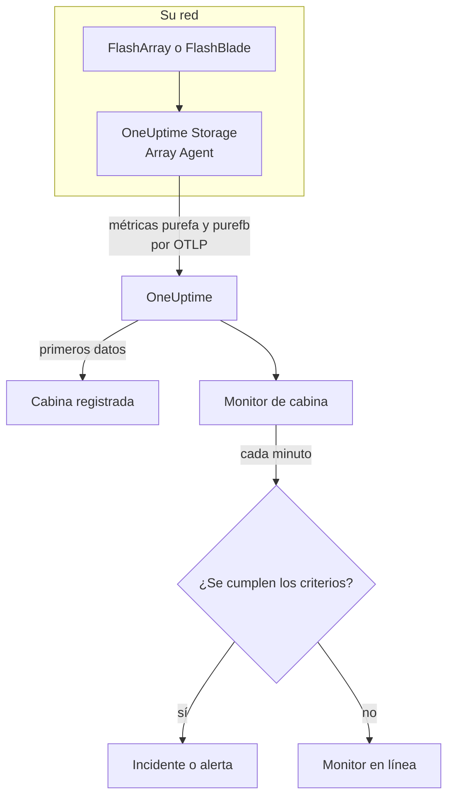

# Monitor de cabinas de almacenamiento

Un monitor de cabina de almacenamiento vigila una cabina de almacenamiento y le avisa cuando la cabina genera una alerta propia, se queda sin espacio, se ralentiza, pierde hardware o una ruta de host, o se retrasa en la replicación. Funciona con Pure Storage FlashArray, Pure Storage FlashBlade y NetApp ONTAP (Amazon FSx for NetApp ONTAP incluido), y lee las métricas que recoge el OneUptime Storage Array Agent: las series `purefa_*` y `purefb_*` de Pure, y las series `netapp_*` que NetApp Harvest lee de un clúster ONTAP.

También funciona con Dell PowerStore (`dell.powerstore`), a partir de las series `powerstore_*` de Dell.

También funciona con Dell PowerScale (`dell.powerscale`), a partir de las series `powerscale_*` de Dell.

:::cards
- [Crear el monitor](#crear-un-monitor-de-cabina-de-almacenamiento): Seis pasos en el panel.
- [Plantillas](#plantillas-de-alerta-predefinidas): Alertas listas para usar, un incidente por volumen, host, appliance o componente.
- [Cómo funcionan las series de Pure](#cómo-están-construidas-las-series-de-pure): Un nombre de métrica, muchos valores. Las de ONTAP [tienen una sección propia](#cómo-están-construidas-las-series-de-ontap).
- [Métricas](#métricas-recogidas): Cada serie sobre la que el monitor puede alertar.
:::

## Cómo funciona

El OneUptime Storage Array Agent se ejecuta en una máquina que puede llegar a la interfaz de gestión de la cabina. Lee las métricas de la cabina con un token de API de solo lectura (las de un PowerScale, por SNMP, con una comunidad de solo lectura o un usuario SNMPv3), las etiqueta con el nombre de la cabina, `storage.array.name`, y su plataforma, `storage.system`, y las envía a OneUptime por OTLP. Los primeros datos registran la cabina.

Un monitor de cabina de almacenamiento está ligado a una cabina. Cada minuto ejecuta su consulta sobre las métricas de esa cabina y compara el resultado con sus criterios.



## Antes de empezar

- **Instale el Storage Array Agent** donde pueda llegar a la cabina por HTTPS, con el token de API de un usuario que tenga el rol **readonly** de la cabina. La [guía del Storage Array Agent](/docs/telemetry/storage-arrays) cubre el usuario, el token y la instalación, mediante `ONEUPTIME_URL`, `ONEUPTIME_TELEMETRY_INGESTION_KEY`, `STORAGE_ARRAY_NAME`, y la dirección y el token de la cabina (`PURE_FA_ENDPOINT` y `PURE_FA_API_TOKEN`, o `PURE_FB_ENDPOINT` y `PURE_FB_API_TOKEN`), o en ONTAP la dirección del clúster y un usuario REST de solo lectura (`NETAPP_ONTAP_ENDPOINT`, `NETAPP_ONTAP_USERNAME` y `NETAPP_ONTAP_PASSWORD`).
- **Compruebe que la cabina está registrada.** Aparece en **Productos → Infraestructura → Cabinas de almacenamiento → Todas las cabinas de almacenamiento**, con el nombre del `STORAGE_ARRAY_NAME` del agente, alrededor de un minuto después de la primera lectura.

## Crear un monitor de cabina de almacenamiento

:::steps
### Empezar un monitor nuevo

Vaya a **Monitores** y haga clic en **Crear monitor**.

### Elegir Cabina de almacenamiento

En **Tipo de monitor**, haga clic en **Más tipos de monitor** y elija **Cabina de almacenamiento** en **Infraestructura**, o escriba `storage` en el cuadro de búsqueda. Introduzca un **Nombre** - se usa en los títulos de incidentes y alertas - y haga clic en **Siguiente**.

### Elegir la cabina

En **Storage Array Monitor Configuration**, elija la cabina en **Cabina de almacenamiento**. Cada cabina que ha enviado datos está en la lista. Su plataforma decide qué métricas y plantillas ofrece el formulario. Una vez elegido, una línea bajo el campo indica si llegan datos. **Añadir cabina de almacenamiento** abre los pasos de configuración con sus claves ya rellenadas, que esperan los primeros datos.

### Elegir qué vigilar

Un monitor nuevo empieza con **Array Stopped Reporting**, en **Sobre qué alertar**. Para vigilar otra cosa:

- **Cambiar** - elija otra [plantilla](#plantillas-de-alerta-predefinidas). Establece la métrica, los filtros de etiquetas, la agregación, el intervalo de tiempo y los umbrales, y sustituye los criterios de abajo por los suyos. Aún puede cambiar el **Intervalo de tiempo**.
- **Custom Metric** (en **Más campos**) - elija una métrica en **Storage Array Metric** y luego establezca **Agregación** e **Intervalo de tiempo**. Los [filtros](#configuración-del-monitor) la acotan a un volumen, host, pod, componente, sistema de archivos o bucket.
- **Avanzado** (en **Más campos**) - construya usted mismo consultas y fórmulas en **Seleccionar métricas**, por ejemplo la capacidad usada como `purefa_array_space_bytes` filtrada a `space=capacity` menos la misma métrica filtrada a `space=empty`. Use **Agrupar por** con la etiqueta de un objeto para juzgar cada objeto por separado.

### Revisar los criterios

Abra cada criterio en **Criterios** y revise su **Métrica**, **Agregación**, **Condición** y **Umbral**. Una plantilla los rellena. Con **Custom Metric** o **Avanzado**, el monitor empieza con los [criterios predeterminados](#criterios-predeterminados), que solo detectan una métrica que no envía datos, así que establezca su propio umbral.

### Crear el monitor

Haga clic en **Crear monitor**. OneUptime abre la página del monitor y lo evalúa cada minuto. Los incidentes y alertas que genera también aparecen en las páginas **Incidentes** y **Alertas** de la cabina.
:::

> [!TIP]
> Para configurar varias plantillas a la vez, abra la cabina desde **Productos → Infraestructura → Cabinas de almacenamiento** y vaya a **Recomendaciones**. Elija las plantillas que quiera, decida a quién se avisa, y OneUptime crea un monitor por plantilla.

## Configuración del monitor

| Campo | Pestaña | Qué hace |
| --- | --- | --- |
| **Cabina de almacenamiento** | Todas | Obligatorio. Limita cada consulta a `resource.storage.array.name`, así que dos cabinas que tienen ambas un volumen llamado `vol-01` nunca se mezclan. |
| **Volumen** | Custom Metric, Avanzado | Un volumen: en un FlashArray, por la etiqueta `name`, como `vol-db-01` (un volumen dentro de un pod o de un grupo de volúmenes se llama `pod::volume` o `group/volume`); en ONTAP, por la etiqueta `volume`, que dos SVM pueden compartir. |
| **Host** | Custom Metric, Avanzado | Solo FlashArray. Un host tal como lo conoce la cabina, por la etiqueta `host`, como `esxi-01`. |
| **Pod** | Custom Metric, Avanzado | Solo FlashArray. Un pod de ActiveCluster o ActiveDR, por la etiqueta `name`, o `local_pod` en las series de enlaces de réplica. |
| **Componente de hardware** | Custom Metric, Avanzado | Un componente de hardware, como `CH0.BAY1` o `CT0`: la etiqueta `component_name` en un FlashArray, `name` en un FlashBlade, y en ONTAP la etiqueta con la que lo nombra su serie (`node`, `disk`, `shelf` o `port`). |
| **Sistema de archivos** | Custom Metric, Avanzado | FlashBlade y PowerScale. Un sistema de archivos por la etiqueta `name` en un FlashBlade; una cuota por la etiqueta `quota` en un PowerScale, como `/ifs/data/home`. |
| **Bucket** | Custom Metric, Avanzado | Solo FlashBlade. Un bucket de almacenamiento de objetos, por la etiqueta `name`. |
| **Storage Array Metric** | Custom Metric | Una métrica del [catálogo](#métricas-recogidas). El formulario añade el filtro de etiqueta que le da su significado, y la agrupa por el objeto que describe, así que cada volumen, host o componente se juzga por separado. |
| **Agregación** | Custom Metric | Cómo se combinan las muestras: **Promedio**, **Máximo**, **Mínimo**, **Suma** o **Recuento**. Empieza en la agregación habitual de la métrica. |
| **Intervalo de tiempo** | Todas | La ventana móvil que lee la consulta, de **Past 1 Minute** a **Past 365 Days**. Un monitor nuevo empieza en **Últimos 5 minutos**; una métrica personalizada de un sistema de archivos o de un bucket, en **Últimos 15 minutos**; las plantillas fijan la suya. |
| **Seleccionar métricas** | Avanzado | El constructor de consultas: **Métrica**, **Agregar por**, **Filtrar por atributos**, **Agrupar por**, además de **Añadir métrica** y **Añadir fórmula** para combinar consultas. |

El agente lee el endpoint de la cabina cada 60 segundos, y los volúmenes, hosts y pods cada 2 minutos, así que una ventana de 5 minutos siempre contiene una muestra. Lee los sistemas de archivos y los buckets de un FlashBlade cada 5 minutos, de ahí los 15, y los directorios de FlashArray cada 30 minutos: dé a un monitor de directorios una ventana de 60 minutos. En ONTAP, Harvest lee el rendimiento del clúster cada minuto y su configuración, su estado y sus eventos EMS cada 3 minutos, así que una ventana de 5 minutos siempre contiene una muestra. Consulta un clúster PowerScale y cada uno de sus nodos cada 60 segundos, y sus cuotas cada 5 minutos: dé a un monitor de cuotas una ventana de 15 minutos.

Lee un PowerStore cada 5 minutos, y el estado de su clúster cada 60 segundos: dé a un monitor de PowerStore una ventana de 15 minutos.

## Cómo están construidas las series de Pure

Pure pone varios valores en **un solo** nombre de métrica y los distingue con una etiqueta:

- **`dimension`** en las series de rendimiento. `purefa_array_performance_latency_usec` lleva la latencia de lectura (`usec_per_read_op`), la latencia de escritura (`usec_per_write_op`), la latencia de escritura en espejo, y el tiempo de SAN, de cola, de QoS y de servicio de cada una. Filtre siempre por una sola `dimension`: un promedio entre todas mezcla una latencia de lectura de 200 µs con un valor de cola.
- **`space`** en las series de capacidad: `capacity`, `empty`, `snapshots`, `total_provisioned`, `total_physical`, `available_ratio` y más.

Varias series llevan su estado en una **etiqueta**, con un valor que siempre es 1:

| Serie | Etiqueta de estado | Una serie por |
| --- | --- | --- |
| `purefa_alerts_open` | `severity`, con `summary`, `code` y `component_type` | Alerta abierta |
| `purefa_hw_component_status` | `component_status` | Componente de hardware |
| `purefa_host_connectivity_info` | `status`, con `details` | Host |
| `purefa_drive_capacity_bytes` | `component_status` (el valor es la capacidad del disco) | Disco |

Una serie filtrada a un estado malo solo existe mientras algo está en ese estado, así que no tener serie significa que todo está bien. Por eso **Max por encima de 0 dispara y 0 recupera** es la forma correcta para ellas, y así están construidas las plantillas: sus criterios de recuperación cuentan una serie ausente como cero. Si no queda ninguna serie, una plantilla así solo se recupera si `purefa_info` o `purefb_info` llegó en la misma ventana, de modo que un array que dejó de informar no cierra nada.

En los filtros del monitor y en las claves de agrupación, los atributos del agente empiezan por `resource.` (`resource.storage.array.name`, `resource.storage.system`), mientras que las etiquetas propias de las cabinas no (`name`, `host`, `component_name`, `dimension`, `space`, `severity`, y las de un PowerScale: `node`, `quota`, `drive` y `protocol`).

## Cómo se forman las series de PowerStore

El exportador de Dell escribe un valor por nombre de métrica, así que una serie de PowerStore no necesita filtro de etiquetas. Sus etiquetas nombran el objeto: `appliance_id` un appliance, `name` una pieza, un volumen o un sistema de archivos, y `volume_id`, `fc_port_id`, `eth_port_id`, `nas_id` o `volume_group_id` el objeto de una serie de rendimiento. Sus series de estado valen 1 mientras todo está bien y 0 en otro caso, así que las plantillas se disparan por debajo de 1. Sus propias alertas llegan por syslog, y sus plantillas, monitores de registros, se listan tras su tabla más abajo.

## Cómo están construidas las series de ONTAP

NetApp Harvest nombra cada serie `netapp_<object>_<counter>` y nombra el objeto por sus etiquetas: un volumen por `volume` dentro de su `svm`, un agregado por `aggr`, una LUN por `lun` dentro de su `volume` y su `svm`, un nodo por `node`, un disco por `disk`, una bandeja por `shelf`, una relación de SnapMirror por `destination_location`. Las latencias son microsegundos por operación, `_ops` son operaciones por segundo y `_data`, bytes por segundo.

Los estados de ONTAP llegan de tres formas:

| Serie | Estado | Una serie por |
| --- | --- | --- |
| `netapp_*_new_status` | 1 en buen estado, en línea, activo o en ejecución; 0 si no | Objeto, en cada consulta |
| `netapp_health_*_alerts` | Valor 1, con `severity` (`error` o `warning`) y el motivo en sus etiquetas | Problema abierto: un disco roto, un fallo de bandeja, un nodo que no puede tomar el control de su partner, un puerto caído, una alerta de salud del sistema |
| `netapp_ems_events` | Valor 1, con `message`, `severity` y los parámetros del evento | Evento EMS, durante la única consulta que lo recogió; cuando un evento emparejado se resuelve, se exporta una vez más como 0 |

Un estado como número dispara cuando todas las lecturas de la ventana están por debajo de 1, y se recupera en cuanto una lectura vuelve a ser 1. Un problema abierto dispara mientras su serie está ahí y se recupera en cuanto desaparece, siempre que `netapp_cluster_new_status` siga llegando, de modo que un agente detenido no cierra nada. Un evento EMS dispara con su única lectura y sigue abierto mientras está dentro de la hora de la plantilla; se recupera cuando pasa una hora sin otro.

## Plantillas de alerta predefinidas

OneUptime incluye 80 plantillas — 12 para FlashArray, 8 para FlashBlade, 16 para PowerStore, 13 para PowerScale y 31 para ONTAP — y la lista de **Sobre qué alertar** ofrece las de la plataforma de la cabina. Cada una construye un monitor completo: la consulta de la métrica, sus filtros de etiquetas, una agrupación por la etiqueta propia del objeto, un criterio que dispara y otro que recupera. Los umbrales son puntos de partida que puede editar.

Un criterio solo dispara cuando la condición se cumple para **cada** valor de su ventana, salvo el de una plantilla de EMS de ONTAP: Harvest exporta un evento durante una sola consulta, así que basta con una lectura. Un monitor que disparó por un umbral de capacidad, latencia, retraso o ratio solo se recupera un 10 % más allá, así que un valor que oscila alrededor del umbral no parpadea. Las plantillas de alertas, hardware y conectividad se disparan cuando un estado se ha visto durante toda su ventana de 5 minutos, y se recuperan unos 5 minutos después de que desaparece.

### FlashArray

| Plantilla                      | Categoría    | Gravedad    | Vigila                                                                                          | Dispara cuando                                                                                                                                   |
| ------------------------------ | ------------ | ----------- | ----------------------------------------------------------------------------------------------- | ------------------------------------------------------------------------------------------------------------------------------------------------ |
| Array Stopped Reporting        | Disponibilidad | Crítico     | `purefa_info`, Count, últimos 10 minutos                                                        | Sin datos durante toda la ventana — el Storage Array Agent se detuvo, perdió su conexión con OneUptime o le revocaron el token, o la cabina dejó de responderle; se recupera cuando vuelven a llegar datos |
| Critical Array Alert           | Salud de la cabina | Crítico     | `purefa_alerts_open` filtrada a `severity=critical`, Max por `summary`, últimos 5 minutos       | > 0 — la cabina tiene una alerta crítica abierta (un componente averiado, una emergencia de capacidad, un fallo de replicación). Un incidente por alerta; se recupera cuando la alerta se cierra |
| Warning Array Alert            | Salud de la cabina | Advertencia | `purefa_alerts_open` filtrada a `severity=warning`, Max por `summary`, últimos 5 minutos        | > 0 — la cabina tiene una alerta de advertencia abierta. Un incidente por alerta; se recupera cuando la alerta se cierra                          |
| Capacity Above 80%             | Capacidad    | Advertencia | `purefa_array_space_utilization`, Max, últimos 15 minutos                                       | > 80 — el primer umbral de capacidad del propio Pure; se recupera en ≤ 72                                                                        |
| Capacity Above 90%             | Capacidad    | Crítico     | `purefa_array_space_utilization`, Max, últimos 5 minutos                                        | > 90 — la cabina está a punto de rechazar escrituras; se recupera en ≤ 81                                                                        |
| High Read Latency              | Rendimiento  | Advertencia | `purefa_array_performance_latency_usec` filtrada a `dimension=usec_per_read_op`, Avg, últimos 10 minutos  | > 5000 µs (5 ms) — las lecturas de un FlashArray suelen completarse muy por debajo de 1 ms; se recupera en ≤ 4500                     |
| High Write Latency             | Rendimiento  | Advertencia | `purefa_array_performance_latency_usec` filtrada a `dimension=usec_per_write_op`, Avg, últimos 10 minutos | > 5000 µs (5 ms); se recupera en ≤ 4500                                                                                                |
| Hardware Component Failed      | Hardware     | Crítico     | `purefa_hw_component_status` filtrada a `component_status=critical`, Max por `component_name`, últimos 5 minutos | > 0 — un controlador, una fuente de alimentación, un ventilador, una bahía o un puerto está en estado crítico y la redundancia se ha perdido. Un incidente por componente; se recupera cuando informa ok |
| Hardware Component Degraded    | Hardware     | Advertencia | `purefa_hw_component_status` filtrada a `component_status=degraded`, Max por `component_name`, últimos 5 minutos | > 0 — un componente está degradado. Un incidente por componente; se recupera cuando informa ok                                       |
| Drive Failed                   | Hardware     | Crítico     | `purefa_drive_capacity_bytes` filtrada a `component_status=failed`, Max por `component_name`, últimos 5 minutos | > 0 — un módulo DirectFlash o un SSD ha fallado y la cabina reconstruye sobre los demás. Un incidente por disco; se recupera cuando se sustituye |
| Host Lost Redundant Paths      | Hosts        | Advertencia | `purefa_host_connectivity_info` filtrada a `status=critical`, Max por `host`, últimos 5 minutos | > 0 — el host llega a la cabina a través de un solo controlador o de ninguno; una conmutación de controlador dejaría su almacenamiento sin conexión. Un incidente por host; se recupera cuando vuelven sus rutas |
| Replication Lag Above 1 Minute | Replicación  | Advertencia | `purefa_pod_replica_links_lag_max_msec`, Max por `local_pod`, últimos 10 minutos                | > 60000 ms (60 s) — una conmutación ahora perdería más escrituras recientes de lo previsto. Un incidente por pod; se recupera en ≤ 54000         |

### FlashBlade

| Plantilla                    | Categoría    | Gravedad    | Vigila                                                                                                         | Dispara cuando                                                                                                      |
| ---------------------------- | ------------ | ----------- | -------------------------------------------------------------------------------------------------------------- | ------------------------------------------------------------------------------------------------------------------- |
| Array Stopped Reporting      | Disponibilidad | Crítico     | `purefb_info`, Count, últimos 10 minutos                                                                       | Sin datos durante toda la ventana — el agente, su exportador o el FlashBlade dejó de responder; se recupera cuando vuelven a llegar datos |
| Critical Array Alert         | Salud de la cabina | Crítico     | `purefb_alerts_open` filtrada a `severity=critical`, Max por `summary`, últimos 5 minutos                      | > 0 — el FlashBlade tiene una alerta crítica abierta. Un incidente por alerta; se recupera cuando la alerta se cierra |
| Warning Array Alert          | Salud de la cabina | Advertencia | `purefb_alerts_open` filtrada a `severity=warning`, Max por `summary`, últimos 5 minutos                       | > 0 — el FlashBlade tiene una alerta de advertencia abierta. Un incidente por alerta; se recupera cuando la alerta se cierra |
| Capacity Above 80%           | Capacidad    | Advertencia | `purefb_array_space_utilization` filtrada a `type=array`, Max, últimos 15 minutos                              | > 80; se recupera en ≤ 72                                                                                           |
| Capacity Above 90%           | Capacidad    | Crítico     | `purefb_array_space_utilization` filtrada a `type=array`, Max, últimos 5 minutos                               | > 90 — las escrituras fallan para todos los clientes cuando se llena; se recupera en ≤ 81                           |
| Hardware Component Unhealthy | Hardware     | Crítico     | `purefb_hardware_health`, Min por `name`, últimos 5 minutos                                                    | < 1 — una blade, un módulo de fabric, una fuente de alimentación o un ventilador no está en buen estado (una ranura sin usar informa 2). Un incidente por componente; se recupera en ≥ 1 |
| High Read Latency            | Rendimiento  | Advertencia | `purefb_array_performance_latency_usec` filtrada a `dimension=usec_per_read_op` y `protocol=all`, Avg, últimos 10 minutos | > 10000 µs (10 ms) en todos los protocolos; se recupera en ≤ 9000                                      |
| File System Near Full        | Sistemas de archivos | Advertencia | `purefb_file_systems_space_bytes` filtrada a `space=available_ratio`, Min por `name`, últimos 15 minutos       | < 0.1 — queda menos del 10 % del tamaño aprovisionado de un sistema de archivos. Un incidente por sistema de archivos; se recupera en ≥ 0.11 |

### PowerStore

| Plantilla                    | Categoría    | Gravedad    | Vigila                                                                                                         | Dispara cuando                                                                                                      |
| --- | --- | --- | --- | --- |
| Array Stopped Reporting | Disponibilidad | Crítico | `powerstore_cluster`, Count, últimos 10 minutos | Sin datos durante toda la ventana — el agente, el exportador de Dell o el clúster dejó de responder; se recupera cuando vuelven a llegar datos |
| Capacity Above 80% | Capacidad | Advertencia | `powerstore_cap_physical_used_percent`, Max por `appliance_id`, últimos 15 minutos | > 80 — la capacidad de un appliance se está llenando; se recupera en ≤ 72 |
| Capacity Above 90% | Capacidad | Crítico | `powerstore_cap_physical_used_percent`, Max por `appliance_id`, últimos 15 minutos | > 90 — un appliance está cerca de rechazar escrituras; se recupera en ≤ 81 |
| High Read Latency | Rendimiento | Advertencia | `powerstore_perf_avg_read_latency`, Avg por `appliance_id`, últimos 15 minutos | > 5000 µs (5 ms); se recupera en ≤ 4500 |
| High Write Latency | Rendimiento | Advertencia | `powerstore_perf_avg_write_latency`, Avg por `appliance_id`, últimos 15 minutos | > 5000 µs (5 ms); se recupera en ≤ 4500 |
| Drive Failed | Hardware | Crítico | `powerstore_hardware_Drive_state`, Min por `name`, últimos 10 minutos | < 1 — una unidad falló o se retiró; se recupera en ≥ 1 |
| Node Unhealthy | Hardware | Crítico | `powerstore_hardware_node_state`, Min por `name`, últimos 10 minutos | < 1 — un nodo no está Healthy; se recupera en ≥ 1 |
| Power Supply Unhealthy | Hardware | Advertencia | `powerstore_hardware_Power_Supply_state`, Min por `name`, últimos 10 minutos | < 1 — una fuente de alimentación falló o perdió la alimentación; se recupera en ≥ 1 |
| Fan Unhealthy | Hardware | Advertencia | `powerstore_hardware_Fan_state`, Min por `name`, últimos 10 minutos | < 1 — un ventilador falló; se recupera en ≥ 1 |
| Battery Unhealthy | Hardware | Advertencia | `powerstore_hardware_Battery_state`, Min por `name`, últimos 10 minutos | < 1 — un módulo de batería de respaldo falló; se recupera en ≥ 1 |
| Drive Wearing Out | Hardware | Advertencia | `powerstore_wear_metrics_by_drive`, Min por `name`, últimos 15 minutos | < 10 — a una unidad le queda menos del 10 % de su resistencia; se recupera en ≥ 11 |
| NAS Server Not Started | Sistemas de archivos | Advertencia | `powerstore_nas_server_operational_status`, Max por `name`, últimos 10 minutos | < 1 — un servidor NAS está detenido o degradado; se recupera en ≥ 1 |
| Volume Not Ready | Salud de la cabina | Advertencia | `powerstore_volume_state`, Max por `name`, últimos 15 minutos | < 1 — un volumen está fuera de línea; se recupera en ≥ 1 |
| File System Near Full | Sistemas de archivos | Advertencia | `powerstore_filesystem_logical_used_percent`, Max por `name`, últimos 15 minutos | > 90 — un sistema de archivos está casi lleno; se recupera en ≤ 81 |
| Cluster Not Configured | Salud de la cabina | Advertencia | `powerstore_cluster`, Max, últimos 10 minutos | < 1 — el clúster no está Configured; se recupera en ≥ 1 |
| Metro Witness Not Connected | Replicación | Advertencia | `powerstore_metro_witness_status`, Min por `name`, últimos 10 minutos | > 0 — un testigo Metro no está conectado; se recupera cuando vuelve a estar OK |

### Alertas de PowerStore, por syslog

Las propias alertas de un PowerStore llegan como registros, así que sus plantillas son monitores de **Registros**, que se ofrecen en la página **Recomendaciones** de la cabina bajo **Alertas de la cabina**. Cada una abre una alerta por alerta de PowerStore, agrupada por `powerstore.resource.name` y `powerstore.alert.id`, y la resuelve cuando el PowerStore borra esa alerta:

| Plantilla | Gravedad | Se abre con una línea con | Se resuelve con |
| --- | --- | --- | --- |
| Critical Array Alert | Crítico | `powerstore.alert.severity=Critical` | `powerstore.alert.state=Cleared` |
| Major Array Alert | Advertencia | `powerstore.alert.severity=Major` | `powerstore.alert.state=Cleared` |
| Port Link Down | Advertencia | `powerstore.event.code=0x00307404` | `powerstore.alert.state=Cleared` |

### ONTAP

| Plantilla | Categoría | Gravedad | Vigila | Dispara cuando |
| --- | --- | --- | --- | --- |
| Array Stopped Reporting | Disponibilidad | Crítico | `netapp_cluster_new_status`, Count, últimos 10 minutos | Sin datos durante toda la ventana — el agente o Harvest se detuvo, o el clúster dejó de responder a Harvest; se recupera cuando vuelven a llegar datos |
| Cluster Not Healthy | Salud de la cabina | Advertencia | `netapp_cluster_new_status`, Max, últimos 10 minutos | < 1 — ONTAP informa de que el clúster no está en buen estado; se recupera en ≥ 1 |
| System Health Alert | Salud de la cabina | Advertencia | `netapp_health_support_alerts`, Max por `name`, últimos 5 minutos | > 0 — el monitor de salud del sistema de ONTAP generó una alerta (una ruta que falta hacia una bandeja, un problema de conectividad de un nodo). Un incidente por alerta; se recupera cuando ONTAP la resuelve |
| Emergency EMS Event | Salud de la cabina | Crítico | `netapp_ems_events` filtrada a `severity=emergency`, Max por `message`, última 1 hora, cualquier lectura | > 0 — ONTAP registró un evento de emergencia. Un incidente por evento; se recupera cuando pasa una hora sin otro |
| Alert EMS Event | Salud de la cabina | Crítico | `netapp_ems_events` filtrada a `severity=alert`, Max por `message`, última 1 hora, cualquier lectura | > 0 — ONTAP registró un evento de alerta (un ventilador averiado); se recupera cuando pasa una hora sin otro |
| Disk Out of Service | Hardware | Advertencia | `netapp_ems_events` filtrada a `message=disk.outOfService`, Max por `disk`, última 1 hora, cualquier lectura | > 0 — ONTAP puso un disco fuera de servicio; se recupera cuando pasa una hora sin otro |
| Node Panic | Hardware | Crítico | `netapp_ems_events` filtrada a `message=sk.panic`, Max por `node`, última 1 hora, cualquier lectura | > 0 — un nodo entró en pánico y se reinició, y su partner tomó el control de su almacenamiento; se recupera cuando pasa una hora sin otro |
| Aggregate Above 80% | Capacidad | Advertencia | `netapp_aggr_space_used_percent`, Max por `aggr`, últimos 15 minutos | > 80; se recupera en ≤ 72 |
| Aggregate Above 90% | Capacidad | Crítico | `netapp_aggr_space_used_percent`, Max por `aggr`, últimos 5 minutos | > 90 — los volúmenes que contiene ya no pueden crecer; se recupera en ≤ 81 |
| Volume Above 90% | Capacidad | Advertencia | `netapp_volume_size_used_percent`, Max por `volume` y `svm`, últimos 15 minutos | > 90; se recupera en ≤ 81 |
| Volume Above 98% | Capacidad | Crítico | `netapp_volume_size_used_percent`, Max por `volume` y `svm`, últimos 5 minutos | > 98 — los clientes reciben errores de falta de espacio, y una LUN que contenga puede quedarse sin conexión; se recupera en ≤ 88.2 |
| High Read Latency | Rendimiento | Advertencia | `netapp_cluster_read_latency`, Avg, últimos 15 minutos | > 10000 µs (10 ms); se recupera en ≤ 9000 |
| High Write Latency | Rendimiento | Advertencia | `netapp_cluster_write_latency`, Avg, últimos 15 minutos | > 10000 µs (10 ms); se recupera en ≤ 9000 |
| Volume Latency Above 20 ms | Rendimiento | Advertencia | `netapp_volume_read_latency`, Avg por `volume` y `svm`, últimos 15 minutos | > 20000 µs; se recupera en ≤ 18000 |
| Node Not Healthy | Hardware | Crítico | `netapp_node_new_status`, Max por `node`, últimos 10 minutos | < 1 — ONTAP informa de que el nodo no está en buen estado; se recupera en ≥ 1 |
| Takeover Not Possible | Hardware | Crítico | `netapp_health_ha_alerts`, Max por `node`, últimos 5 minutos | > 0 — un nodo no puede tomar el control de su partner de HA, así que un fallo dejaría sin conexión el almacenamiento de ese partner; se recupera cuando vuelve a poder |
| Disk Failed | Hardware | Crítico | `netapp_health_disk_alerts` filtrada a `container_type=broken`, Max por `disk`, últimos 5 minutos | > 0 — un disco está roto; se recupera cuando se sustituye |
| Shelf Fault | Hardware | Crítico | `netapp_health_shelf_alerts` filtrada a `severity=error`, Max por `shelf`, últimos 5 minutos | > 0 — ONTAP informa de un error en una bandeja de discos (una fuente de alimentación, un módulo, una ruta); se recupera cuando ONTAP lo resuelve |
| Node Fan Failed | Hardware | Advertencia | `netapp_node_failed_fan`, Max por `node`, últimos 10 minutos | > 0 ventiladores averiados; se recupera en ≤ 0 |
| Node Power Supply Failed | Hardware | Crítico | `netapp_node_failed_power`, Max por `node`, últimos 10 minutos | > 0 fuentes de alimentación averiadas; se recupera en ≤ 0 |
| Shelf Power Supply Failed | Hardware | Crítico | `netapp_shelf_psu_status`, Max por `shelf`, últimos 10 minutos | < 1 — una fuente de alimentación de una bandeja no está en estado normal; se recupera en ≥ 1 |
| Shelf Fan Failed | Hardware | Advertencia | `netapp_shelf_fan_status`, Max por `shelf`, últimos 10 minutos | < 1 — un ventilador de una bandeja no está en estado normal; se recupera en ≥ 1 |
| Ethernet Port Down | Hardware | Advertencia | `netapp_health_network_ethernet_port_alerts`, Max por `port` y `node`, últimos 5 minutos | > 0 — un puerto Ethernet habilitado está caído; se recupera cuando su enlace vuelve a estar activo |
| FC Port Link Failures | Hardware | Advertencia | `netapp_fcp_link_failure`, Max por `port` y `node`, últimos 15 minutos | > 0 — el enlace de un puerto Fibre Channel falló en la ventana; se recupera en ≤ 0 |
| SnapMirror Behind Schedule | Replicación | Advertencia | `netapp_snapmirror_lag_time` entre `netapp_snapmirror_schedule_seconds`, Max por `destination_location`, últimos 15 minutos | > 1.5 — el retraso de una relación supera una vez y media el intervalo de su programación (en una horaria, 90 minutos); se recupera en ≤ 1.35 |
| SnapMirror Relationship Unhealthy | Replicación | Crítico | `netapp_snapmirror_labels` filtrada a `healthy=false`, Max por `destination_location`, últimos 5 minutos | > 0 — ONTAP informa de que la relación tiene problemas, con el motivo en su etiqueta `unhealthy_reason`; se recupera cuando ONTAP la informa en buen estado |
| SnapMirror Lag Above 1 Day | Replicación | Advertencia | `netapp_snapmirror_lag_time`, Max por `destination_location`, últimos 15 minutos | > 86400 s, sea cual sea su programación; se recupera en ≤ 77760 |
| Aggregate Offline | Disponibilidad | Crítico | `netapp_aggr_new_status`, Max por `aggr`, últimos 10 minutos | < 1 — un agregado no está en línea, así que no se puede acceder a ninguno de sus volúmenes; se recupera en ≥ 1 |
| Volume Offline | Disponibilidad | Advertencia | `netapp_volume_new_status`, Max por `volume` y `svm`, últimos 10 minutos | < 1 — un volumen no está en línea; se recupera en ≥ 1 |
| LUN Offline | Disponibilidad | Crítico | `netapp_lun_new_status`, Max por `lun`, `volume` y `svm`, últimos 10 minutos | < 1 — una LUN no está en línea, y sus hosts han perdido el disco; se recupera en ≥ 1 |
| SVM Stopped | Disponibilidad | Advertencia | `netapp_svm_labels` filtrada a `state=stopped` y `type=data`, Max por `svm`, últimos 10 minutos | > 0 — una SVM de datos está detenida; se recupera cuando vuelve a ejecutarse. Las SVM que ONTAP reserva para sí nunca se vigilan |

### PowerScale

| Plantilla | Categoría | Gravedad | Vigila | Dispara cuando |
| --- | --- | --- | --- | --- |
| Array Stopped Reporting | Disponibilidad | Crítico | `powerscale_cluster_health`, Count, últimos 10 minutos | Sin datos durante toda la ventana — el Storage Array Agent se detuvo, perdió su conexión con OneUptime o le revocaron el token, o el clúster dejó de responder a sus consultas; se recupera cuando vuelven a llegar datos |
| Cluster Needs Attention | Salud de la cabina | Advertencia | `powerscale_cluster_health`, Max, últimos 5 minutos | > 0 — OneFS informa de que el clúster necesita atención, está caído o no es válido, y `isi event groups list` dice por qué; se recupera en ≤ 0 |
| Cluster Down | Salud de la cabina | Crítico | `powerscale_cluster_health`, Max, últimos 5 minutos | ≥ 2 — OneFS informa de que el clúster está caído o no es válido; se recupera en < 2 |
| Node Offline | Hardware | Crítico | `powerscale_cluster_offline_nodes`, Max, últimos 5 minutos | > 0 — un nodo del clúster está sin conexión, y `offline_nodes` indica cuál; se recupera en ≤ 0 |
| Node Needs Attention | Hardware | Advertencia | `powerscale_node_health`, Max por `node`, últimos 5 minutos | > 0 — un nodo informa de que necesita atención, está caído o no es válido. Un incidente por nodo; se recupera en ≤ 0 |
| Node Read-Only | Hardware | Advertencia | `powerscale_node_read_only`, Max por `node`, últimos 5 minutos | > 0 — un nodo está en modo de solo lectura, y los clientes conectados a él no pueden escribir. Un incidente por nodo; se recupera en ≤ 0 |
| Drive Failed | Hardware | Crítico | `powerscale_drive_size_bytes` filtrada a `status=DEAD`, Count por `drive`, últimos 5 minutos | > 0 — un disco ha muerto, y OneFS vuelve a proteger sus datos en los demás. Un incidente por disco; se recupera cuando informa de otro estado |
| Drive Smartfailed | Hardware | Advertencia | `powerscale_drive_size_bytes` filtrada a `status=SMARTFAIL`, Count por `drive`, últimos 5 minutos | > 0 — OneFS está sacando los datos de un disco que está fallando antes de que se sustituya. Un incidente por disco; se recupera cuando informa de otro estado |
| Capacity Above 80% | Capacidad | Advertencia | `powerscale_ifs_used_percent`, Max, últimos 15 minutos | > 80, contando el espacio reservado para repuestos en caliente virtuales; se recupera en ≤ 72 |
| Capacity Above 90% | Capacidad | Crítico | `powerscale_ifs_used_percent`, Max, últimos 5 minutos | > 90 — el clúster está a punto de rechazar escrituras; se recupera en ≤ 81 |
| Quota Near Its Limit | Capacidad | Advertencia | `powerscale_quota_used_percent`, Max por `quota`, últimos 15 minutos | > 90 de su límite estricto, o de su límite flexible cuando no tiene uno estricto. Un incidente por cuota; se recupera en ≤ 81 |
| Quota Full | Capacidad | Crítico | `powerscale_quota_used_percent`, Max por `quota`, últimos 5 minutos | ≥ 100 — las escrituras bajo la ruta de la cuota fallan con un límite estricto. Un incidente por cuota; se recupera en < 90 |
| High Protocol Latency | Rendimiento | Advertencia | `powerscale_protocol_latency_microseconds`, Max por `protocol`, últimos 10 minutos | > 20000 µs (20 ms) en el nodo más lento. Un incidente por protocolo; se recupera en ≤ 18000 |

**Gravedad** es la etiqueta que muestra el selector. El incidente y la alerta que crea una plantilla empiezan en la gravedad de incidente y de alerta más alta de su proyecto; cámbielas en el criterio.

- **Array Stopped Reporting** cuenta la serie de identidad de la plataforma (`purefa_info` o `purefb_info`), que cada endpoint que lee el agente exporta en cada lectura; la de un PowerScale es `powerscale_cluster_health`, que la consulta del agente al clúster envía cada minuto. Cuando los datos dejan de llegar, las demás plantillas no tienen nada que comparar y mantienen su último estado, así que esta es la que le avisa.
- **Las alertas abiertas y los estados de hardware usan Max** de una serie que solo existe mientras la alerta está abierta o el componente está en ese estado, así que el estado dispara el umbral cuando se ha visto durante toda la ventana de 5 minutos.
- **Cada plantilla por objeto agrupa por la etiqueta propia del objeto** (`summary`, `component_name`, `host`, `local_pod`, `name`, y las de un PowerScale: `node`, `drive`, `quota` y `protocol`), así que se dispara un incidente por cada objeto afectado, y el incidente lo nombra.
- **Las plantillas de latencia usan Avg** del promedio por operación que calcula la propia cabina, y las de capacidad **Max** de su propio porcentaje de utilización. Las latencias se fijan en microsegundos y la capacidad en porcentaje.
- **Hardware Component Unhealthy usa Min** por componente: su salud es 1 cuando está bien y baja a 0 cuando no.

No hay plantilla de FlashArray para la latencia de cada volumen, porque el umbral correcto depende de la carga de trabajo: constrúyala desde el catálogo con una agrupación por `name`. La previsión de capacidad necesita una tendencia de crecimiento más que un umbral, y el desgaste de los discos no tiene ninguna serie sobre la que alertar.

## Métricas recogidas

El agente envía todo lo que exporta la cabina; las series de abajo son el catálogo que ofrece el formulario del monitor. Cada valor es un gauge que calcula la propia cabina - las latencias son microsegundos por operación y el rendimiento es por segundo -, así que no hace falta calcular tasas. **Filtro** es el filtro de etiqueta que da a la serie el significado que indica su fila; el formulario lo aplica por usted.

### Salud de la cabina

| Métrica              | Filtro | Plataforma | Unidad  | Descripción                                                                                                                                                       |
| -------------------- | ------ | ---------- | ------- | ----------------------------------------------------------------------------------------------------------------------------------------------------------------- |
| `purefa_alerts_open` | —      | FlashArray | `count` | Una serie por cada alerta abierta en la cabina (valor 1), con las etiquetas `severity` (`critical`, `warning`, `info`, `hidden`), `category`, `code`, `component_type` y `summary` |
| `purefb_alerts_open` | —      | FlashBlade | `count` | Una serie por cada alerta abierta en el FlashBlade (valor 1), con las etiquetas `severity` (`info`, `warning`, `critical`), `code`, `component_name`, `component_type`, `summary` y `kburl` (el artículo de la base de conocimiento de Pure) |
| `powerstore_cluster` | — | PowerStore | `count` | 1 mientras el clúster PowerStore está Configured (formado y en servicio), 0 en cualquier otro estado: Configuring, Expanding, Removing, Clustering_Failed o Unconfigured. |
| `netapp_cluster_new_status` | — | ONTAP | — | 1 mientras ONTAP informa de que el clúster está en buen estado; también indica que el agente sigue leyéndolo |
| `netapp_cluster_subsystem_outstanding_alerts` | — | ONTAP | `count` | Alertas abiertas en cada uno de los subsistemas de salud de ONTAP, por `subsystem` |
| `netapp_health_support_alerts` | — | ONTAP | `count` | Una serie por cada alerta que el monitor de salud del sistema de ONTAP tiene abierta, mientras está abierta |
| `netapp_ems_events` | — | ONTAP | `count` | Una serie por cada evento EMS, durante la consulta que lo recogió; cuando un evento emparejado se resuelve, se exporta una vez más como 0 |
| `powerscale_cluster_health` | — | PowerScale | — | La salud que informa OneFS para el clúster: 0 es OK, 1 necesita atención, 2 está caído y 3 no es válido. Tome el máximo para ver cualquier cambio |
| `powerscale_cluster_offline_nodes` | — | PowerScale | `count` | Cuántos nodos del clúster están sin conexión; la etiqueta `offline_nodes` enumera sus números lógicos de nodo |

### Capacidad

| Métrica                                   | Filtro                       | Plataforma | Unidad  | Descripción                                                                                                                           |
| ----------------------------------------- | ---------------------------- | ---------- | ------- | ------------------------------------------------------------------------------------------------------------------------------------- |
| `purefa_array_space_utilization`          | —                            | FlashArray | `%`     | Parte de la capacidad utilizable de la cabina que está en uso. Pure genera sus propias alertas de capacidad al 80 %, 90 % y 100 %     |
| `purefa_array_space_bytes`                | `space=capacity`             | FlashArray | `bytes` | Capacidad utilizable de la cabina                                                                                                     |
| `purefa_array_space_bytes`                | `space=empty`                | FlashArray | `bytes` | Capacidad sin usar — siga su tendencia para prever cuándo se llenará la cabina                                                       |
| `purefa_array_space_bytes`                | `space=snapshots`            | FlashArray | `bytes` | Espacio físico ocupado solo por snapshots; un aumento rápido suele significar que un grupo de protección conserva más snapshots de lo previsto |
| `purefa_array_space_data_reduction_ratio` | —                            | FlashArray | `ratio` | Deduplicación y compresión en toda la cabina, p. ej. 4.2 para 4.2:1. Una caída sostenida significa que los datos nuevos se reducen mal |
| `purefb_array_space_utilization`          | `type=array`                 | FlashBlade | `%`     | Parte de la capacidad utilizable del FlashBlade que está en uso                                                                       |
| `purefb_array_space_bytes`                | `type=array`, `space=empty`  | FlashBlade | `bytes` | Capacidad sin usar del FlashBlade                                                                                                     |
| `purefb_array_space_data_reduction_ratio` | `type=array`                 | FlashBlade | `ratio` | Reducción de datos en todo el FlashBlade                                                                                              |
| `powerstore_cap_physical_used_percent` | — | PowerStore | `%` | Proporción de la capacidad física de cada appliance en uso, en porcentaje: su espacio físico usado sobre su total físico, según el resumen diario de espacio de PowerStore. PowerStore emite sus propias alertas de capacidad desde el 70 %. Agrupe por appliance_id. |
| `powerstore_cap_last_physical_total` | — | PowerStore | `bytes` | Capacidad física utilizable de cada appliance en bytes. |
| `powerstore_cap_last_physical_used` | — | PowerStore | `bytes` | Capacidad física que usa cada appliance en bytes, después de la deduplicación y la compresión. Siga su tendencia para prever cuándo se llenará un appliance. |
| `powerstore_cap_last_logical_provisioned` | — | PowerStore | `bytes` | Capacidad lógica aprovisionada en cada appliance en bytes: el tamaño de cada volumen, sistema de archivos y vVol que contiene, que puede superar con creces su capacidad física. |
| `powerstore_cap_last_logical_used` | — | PowerStore | `bytes` | Datos que los hosts han escrito en cada appliance en bytes, antes de la deduplicación y la compresión. |
| `powerstore_cap_last_data_reduction` | — | PowerStore | `ratio` | Deduplicación y compresión en cada appliance, por ejemplo 3.4 para 3.4:1. Una caída sostenida significa que los datos recién escritos se reducen mal: datos cifrados o ya comprimidos. |
| `powerstore_cap_last_efficiency_ratio` | — | PowerStore | `ratio` | Eficiencia global de cada appliance: la reducción de datos junto con el ahorro de las instantáneas y del aprovisionamiento fino. |
| `netapp_aggr_space_used_percent` | — | ONTAP | `%` | Parte del espacio utilizable de cada agregado en uso — agrupe por `aggr` |
| `netapp_aggr_space_total` | — | ONTAP | `bytes` | Espacio utilizable de cada agregado; la capacidad del clúster es su suma |
| `netapp_aggr_space_used` | — | ONTAP | `bytes` | Espacio que cada agregado tiene en uso o reservado |
| `netapp_aggr_space_available` | — | ONTAP | `bytes` | Espacio que queda en cada agregado — siga su tendencia para prever cuándo se llenará |
| `netapp_aggr_inode_used_percent` | — | ONTAP | `%` | Parte de los archivos (inodos) de cada agregado en uso |
| `netapp_aggr_new_status` | — | ONTAP | — | 1 mientras un agregado está en línea |
| `netapp_aggr_logical_used_wo_snapshots_flexclones` | — | ONTAP | `bytes` | Lo que ocuparían los datos de cada agregado sin eficiencia del almacenamiento, sin contar los snapshots ni los FlexClone |
| `netapp_aggr_physical_used_wo_snapshots_flexclones` | — | ONTAP | `bytes` | Lo que ocupan en disco los datos de cada agregado tras la eficiencia del almacenamiento |
| `powerscale_ifs_used_percent` | — | PowerScale | `%` | Parte de la capacidad del clúster que ya no está disponible para escrituras: lo que está en uso, más el espacio que OneFS reserva para repuestos en caliente virtuales |
| `powerscale_ifs_available_bytes` | — | PowerScale | `bytes` | Espacio aún disponible para escrituras en `/ifs` |
| `powerscale_ifs_used_bytes` | — | PowerScale | `bytes` | Espacio en uso en `/ifs`, según lo cuenta OneFS |
| `powerscale_ifs_total_bytes` | — | PowerScale | `bytes` | El tamaño de `/ifs` en todo el clúster |
| `powerscale_quota_used_percent` | — | PowerScale | `%` | El uso de cada cuota como parte de su límite estricto, o de su límite flexible cuando no tiene uno estricto (la etiqueta `limit` indica cuál) — agrupe por `quota` |
| `powerscale_quota_usage_bytes` | — | PowerScale | `bytes` | Lo que contiene cada cuota, según lo imputa OneFS a la cuota |

### Rendimiento

| Métrica                                    | Filtro                                         | Plataforma | Unidad    | Descripción                                                                                                  |
| ------------------------------------------ | ---------------------------------------------- | ---------- | --------- | ------------------------------------------------------------------------------------------------------------ |
| `purefa_array_performance_latency_usec`    | `dimension=usec_per_read_op`                   | FlashArray | `µs`      | Latencia media de una lectura tal como la ven los hosts; las lecturas de un FlashArray suelen completarse muy por debajo de 1 ms |
| `purefa_array_performance_latency_usec`    | `dimension=usec_per_write_op`                  | FlashArray | `µs`      | Latencia media de una escritura tal como la ven los hosts                                                    |
| `purefa_array_performance_latency_usec`    | `dimension=usec_per_mirrored_write_op`         | FlashArray | `µs`      | Latencia media de una escritura a un pod extendido de ActiveCluster, incluido el viaje de ida y vuelta a la cabina par |
| `purefa_array_performance_latency_usec`    | `dimension=san_usec_per_read_op`               | FlashArray | `µs`      | Tiempo que una lectura pasa en la SAN; una latencia de SAN alta con una latencia de servicio baja apunta al fabric o al host |
| `purefa_array_performance_throughput_iops` | `dimension=reads_per_sec`                      | FlashArray | `ops/s`   | Operaciones de lectura por segundo                                                                           |
| `purefa_array_performance_throughput_iops` | `dimension=writes_per_sec`                     | FlashArray | `ops/s`   | Operaciones de escritura por segundo                                                                         |
| `purefa_array_performance_bandwidth_bytes` | `dimension=read_bytes_per_sec`                 | FlashArray | `bytes/s` | Bytes leídos por segundo                                                                                     |
| `purefa_array_performance_bandwidth_bytes` | `dimension=write_bytes_per_sec`                | FlashArray | `bytes/s` | Bytes escritos por segundo                                                                                   |
| `purefa_array_performance_queue_depth_ops` | —                                              | FlashArray | `ops`     | Operaciones en cola en la cabina; una cola que crece con una latencia en aumento significa que los hosts envían más de lo que puede atender |
| `purefa_array_performance_average_bytes`   | `dimension=bytes_per_op`                       | FlashArray | `bytes`   | Tamaño medio de una operación — una E/S grande aumenta la latencia sin que nada esté mal                     |
| `purefb_array_performance_latency_usec`    | `dimension=usec_per_read_op`, `protocol=all`   | FlashBlade | `µs`      | Latencia media de lectura en todos los protocolos                                                            |
| `purefb_array_performance_latency_usec`    | `dimension=usec_per_write_op`, `protocol=all`  | FlashBlade | `µs`      | Latencia media de escritura en todos los protocolos                                                          |
| `purefb_array_performance_throughput_iops` | `dimension=reads_per_sec`, `protocol=all`      | FlashBlade | `ops/s`   | Operaciones de lectura por segundo en todos los protocolos                                                   |
| `purefb_array_performance_throughput_iops` | `dimension=writes_per_sec`, `protocol=all`     | FlashBlade | `ops/s`   | Operaciones de escritura por segundo en todos los protocolos                                                 |
| `purefb_array_performance_bandwidth_bytes` | `dimension=read_bytes_per_sec`, `protocol=all` | FlashBlade | `bytes/s` | Bytes leídos por segundo en todos los protocolos                                                             |
| `purefb_array_performance_bandwidth_bytes` | `dimension=write_bytes_per_sec`, `protocol=all` | FlashBlade | `bytes/s` | Bytes escritos por segundo en todos los protocolos                                                          |
| `powerstore_perf_avg_read_latency` | — | PowerStore | `µs` | Latencia media de una lectura en cada appliance, en microsegundos, sobre la última muestra de cinco minutos de PowerStore. Las lecturas de PowerStore suelen completarse muy por debajo de 1 ms. |
| `powerstore_perf_avg_write_latency` | — | PowerStore | `µs` | Latencia media de una escritura en cada appliance, en microsegundos. |
| `powerstore_perf_avg_read_iops` | — | PowerStore | `ops/s` | Operaciones de lectura por segundo en cada appliance. |
| `powerstore_perf_avg_write_iops` | — | PowerStore | `ops/s` | Operaciones de escritura por segundo en cada appliance. |
| `powerstore_perf_avg_read_bandwidth` | — | PowerStore | `bytes/s` | Bytes leídos por segundo en cada appliance. |
| `powerstore_perf_avg_write_bandwidth` | — | PowerStore | `bytes/s` | Bytes escritos por segundo en cada appliance. |
| `powerstore_perf_avg_io_workload_cpu_utilization` | — | PowerStore | `%` | Proporción de los núcleos de CPU que cada appliance dedica a la E/S de almacenamiento que están ocupados, en porcentaje. Los valores altos sostenidos significan que el appliance está cerca de la carga que puede atender. |
| `netapp_cluster_read_latency` | — | ONTAP | `µs` | Latencia media de una lectura en todo el clúster |
| `netapp_cluster_write_latency` | — | ONTAP | `µs` | Latencia media de una escritura en todo el clúster |
| `netapp_cluster_read_ops` | — | ONTAP | `ops/s` | Operaciones de lectura por segundo en todo el clúster |
| `netapp_cluster_write_ops` | — | ONTAP | `ops/s` | Operaciones de escritura por segundo en todo el clúster |
| `netapp_cluster_total_ops` | — | ONTAP | `ops/s` | Todas las operaciones por segundo en todo el clúster, incluidas las de metadatos |
| `netapp_cluster_read_data` | — | ONTAP | `bytes/s` | Bytes leídos por segundo en todo el clúster |
| `netapp_cluster_write_data` | — | ONTAP | `bytes/s` | Bytes escritos por segundo en todo el clúster |
| `netapp_aggr_read_latency` | — | ONTAP | `µs` | Latencia media de una lectura en cada agregado |
| `netapp_aggr_write_latency` | — | ONTAP | `µs` | Latencia media de una escritura en cada agregado |
| `netapp_aggr_read_ops` | — | ONTAP | `ops/s` | Operaciones de lectura por segundo en cada agregado |
| `netapp_aggr_write_ops` | — | ONTAP | `ops/s` | Operaciones de escritura por segundo en cada agregado |
| `netapp_svm_vol_read_latency` | — | ONTAP | `µs` | Latencia media de una lectura en los volúmenes de cada SVM |
| `netapp_svm_vol_write_latency` | — | ONTAP | `µs` | Latencia media de una escritura en los volúmenes de cada SVM |
| `netapp_svm_vol_read_ops` | — | ONTAP | `ops/s` | Operaciones de lectura por segundo en los volúmenes de cada SVM |
| `netapp_svm_vol_write_ops` | — | ONTAP | `ops/s` | Operaciones de escritura por segundo en los volúmenes de cada SVM |
| `netapp_svm_vol_read_data` | — | ONTAP | `bytes/s` | Bytes leídos por segundo de los volúmenes de cada SVM |
| `netapp_svm_vol_write_data` | — | ONTAP | `bytes/s` | Bytes escritos por segundo en los volúmenes de cada SVM |
| `powerscale_cluster_ifs_read_bytes_per_second` | — | PowerScale | `bytes/s` | Bytes leídos de `/ifs` por segundo, en todo el clúster |
| `powerscale_cluster_ifs_write_bytes_per_second` | — | PowerScale | `bytes/s` | Bytes escritos en `/ifs` por segundo, en todo el clúster |
| `powerscale_cluster_network_in_bytes_per_second` | — | PowerScale | `bytes/s` | Bytes por segundo que reciben los puertos front-end del clúster |
| `powerscale_cluster_network_out_bytes_per_second` | — | PowerScale | `bytes/s` | Bytes por segundo que envían los puertos front-end del clúster |
| `powerscale_cluster_cpu_busy_percent` | — | PowerScale | `%` | Parte del tiempo de CPU en uso, en promedio sobre los nodos del clúster |
| `powerscale_protocol_latency_microseconds` | — | PowerScale | `µs` | Tiempo medio que tarda una operación por protocolo (NFS, SMB, HDFS, ...) en cada nodo; el máximo es el nodo más lento — agrupe por `protocol` o `node` |
| `powerscale_protocol_latency_max_microseconds` | — | PowerScale | `µs` | La operación individual más lenta por protocolo en cada nodo |
| `powerscale_protocol_operations_per_second` | — | PowerScale | `ops/s` | Operaciones por segundo por protocolo en cada nodo; el máximo es el nodo más ocupado |
| `powerscale_protocol_in_bytes_per_second` | — | PowerScale | `bytes/s` | Bytes por segundo que los clientes envían por cada protocolo a cada nodo: escrituras y solicitudes |
| `powerscale_protocol_out_bytes_per_second` | — | PowerScale | `bytes/s` | Bytes por segundo enviados a los clientes por cada protocolo desde cada nodo: lecturas y respuestas |

### Volúmenes

| Métrica                                     | Filtro                           | Plataforma | Unidad    | Descripción                                                   |
| ------------------------------------------- | -------------------------------- | ---------- | --------- | ------------------------------------------------------------- |
| `purefa_volume_performance_latency_usec`    | `dimension=usec_per_read_op`     | FlashArray | `µs`      | Latencia media de lectura de cada volumen — agrupe por `name` |
| `purefa_volume_performance_latency_usec`    | `dimension=usec_per_write_op`    | FlashArray | `µs`      | Latencia media de escritura de cada volumen                   |
| `purefa_volume_performance_throughput_iops` | `dimension=reads_per_sec`        | FlashArray | `ops/s`   | Operaciones de lectura por segundo de cada volumen            |
| `purefa_volume_performance_throughput_iops` | `dimension=writes_per_sec`       | FlashArray | `ops/s`   | Operaciones de escritura por segundo de cada volumen          |
| `purefa_volume_performance_bandwidth_bytes` | `dimension=read_bytes_per_sec`   | FlashArray | `bytes/s` | Bytes leídos por segundo de cada volumen                      |
| `purefa_volume_performance_bandwidth_bytes` | `dimension=write_bytes_per_sec`  | FlashArray | `bytes/s` | Bytes escritos por segundo en cada volumen                    |
| `purefa_volume_space_bytes`                 | `space=total_provisioned`        | FlashArray | `bytes`   | Tamaño de cada volumen tal como lo ven los hosts              |
| `purefa_volume_space_bytes`                 | `space=total_physical`           | FlashArray | `bytes`   | Espacio físico que usa cada volumen tras la reducción de datos |
| `purefa_volume_space_data_reduction_ratio`  | —                                | FlashArray | `ratio`   | Ratio de reducción de datos de cada volumen                   |
| `powerstore_volume_state` | — | PowerStore | `count` | 1 mientras un volumen está Ready, 0 mientras está Initializing, Offline o en proceso de destrucción. Agrupe por name para encontrar el volumen al que los hosts no llegan. |
| `powerstore_volume_size` | — | PowerStore | `bytes` | Tamaño de cada volumen tal como lo ven los hosts, en bytes. |
| `powerstore_volume_logical_used` | — | PowerStore | `bytes` | Datos que los hosts han escrito en cada volumen en bytes, antes de la deduplicación y la compresión. |
| `powerstore_metricVolume_avg_read_latency` | — | PowerStore | `µs` | Latencia media de lectura de cada volumen en microsegundos. Agrupe por volume_id, que contiene el nombre del volumen, para encontrar el volumen lento. |
| `powerstore_metricVolume_avg_write_latency` | — | PowerStore | `µs` | Latencia media de escritura de cada volumen en microsegundos. |
| `powerstore_metricVolume_avg_read_iops` | — | PowerStore | `ops/s` | Operaciones de lectura por segundo de cada volumen. |
| `powerstore_metricVolume_avg_write_iops` | — | PowerStore | `ops/s` | Operaciones de escritura por segundo de cada volumen. |
| `powerstore_metricVolume_avg_read_bandwidth` | — | PowerStore | `bytes/s` | Bytes leídos por segundo de cada volumen. |
| `powerstore_metricVolume_avg_write_bandwidth` | — | PowerStore | `bytes/s` | Bytes escritos por segundo en cada volumen. |
| `powerstore_volumegroup_logical_provisioned` | — | PowerStore | `bytes` | Capacidad aprovisionada a los volúmenes de cada grupo de volúmenes, en bytes. Agrupe por name. |
| `powerstore_volumegroup_logical_used` | — | PowerStore | `bytes` | Datos que los hosts han escrito en los volúmenes de cada grupo de volúmenes en bytes, antes de la deduplicación y la compresión. |
| `powerstore_metricVg_avg_read_latency` | — | PowerStore | `µs` | Latencia media de lectura en los volúmenes de cada grupo de volúmenes, en microsegundos. Agrupe por volume_group_id, que contiene el nombre del grupo. |
| `powerstore_metricVg_avg_write_latency` | — | PowerStore | `µs` | Latencia media de escritura en los volúmenes de cada grupo de volúmenes, en microsegundos. |
| `powerstore_metricVg_avg_total_iops` | — | PowerStore | `ops/s` | Operaciones de lectura y escritura por segundo en los volúmenes de cada grupo de volúmenes. |
| `netapp_svm_new_status` | — | ONTAP | — | 1 mientras una SVM está en ejecución — agrupe por `svm` |
| `netapp_svm_labels` | `state=stopped`, `type=data` | ONTAP | — | Una serie por cada SVM de datos que está detenida |
| `netapp_volume_size_used_percent` | — | ONTAP | `%` | Parte del espacio de cada volumen en uso, según lo informa `volume show` — agrupe por `volume` y `svm` |
| `netapp_volume_size_total` | — | ONTAP | `bytes` | Tamaño utilizable de cada volumen, sin contar su reserva de snapshots |
| `netapp_volume_size_used` | — | ONTAP | `bytes` | Espacio que cada volumen tiene en uso |
| `netapp_volume_size_available` | — | ONTAP | `bytes` | Espacio que queda en cada volumen |
| `netapp_volume_snapshots_size_used` | — | ONTAP | `bytes` | Espacio que usan los snapshots de cada volumen |
| `netapp_volume_inode_used_percent` | — | ONTAP | `%` | Parte de los archivos (inodos) de cada volumen en uso |
| `netapp_volume_sis_total_saved_percent` | — | ONTAP | `%` | Parte de los datos de cada volumen que ahorran la deduplicación y la compresión |
| `netapp_volume_new_status` | — | ONTAP | — | 1 mientras un volumen está en línea |
| `netapp_volume_read_latency` | — | ONTAP | `µs` | Latencia media de una lectura en cada volumen |
| `netapp_volume_write_latency` | — | ONTAP | `µs` | Latencia media de una escritura en cada volumen |
| `netapp_volume_read_ops` | — | ONTAP | `ops/s` | Operaciones de lectura por segundo en cada volumen |
| `netapp_volume_write_ops` | — | ONTAP | `ops/s` | Operaciones de escritura por segundo en cada volumen |
| `netapp_volume_read_data` | — | ONTAP | `bytes/s` | Bytes leídos por segundo de cada volumen |
| `netapp_volume_write_data` | — | ONTAP | `bytes/s` | Bytes escritos por segundo en cada volumen |
| `netapp_lun_size_used_percent` | — | ONTAP | `%` | Parte del tamaño de cada LUN que ha escrito su host |
| `netapp_lun_size` | — | ONTAP | `bytes` | El tamaño que cada LUN presenta a sus hosts |
| `netapp_lun_size_used` | — | ONTAP | `bytes` | Espacio que usa cada LUN en su volumen |
| `netapp_lun_new_status` | — | ONTAP | — | 1 mientras una LUN está en línea |
| `netapp_lun_avg_read_latency` | — | ONTAP | `µs` | Latencia media de una lectura en cada LUN |
| `netapp_lun_avg_write_latency` | — | ONTAP | `µs` | Latencia media de una escritura en cada LUN |
| `netapp_lun_read_ops` | — | ONTAP | `ops/s` | Operaciones de lectura por segundo en cada LUN |
| `netapp_lun_write_ops` | — | ONTAP | `ops/s` | Operaciones de escritura por segundo en cada LUN |
| `netapp_lun_read_data` | — | ONTAP | `bytes/s` | Bytes leídos por segundo de cada LUN |
| `netapp_lun_write_data` | — | ONTAP | `bytes/s` | Bytes escritos por segundo en cada LUN |

### Hosts

| Métrica                                   | Filtro                        | Plataforma | Unidad  | Descripción                                                                                                                                    |
| ----------------------------------------- | ----------------------------- | ---------- | ------- | ---------------------------------------------------------------------------------------------------------------------------------------------- |
| `purefa_host_connectivity_info`           | —                             | FlashArray | `count` | Una serie por host (valor 1) con la etiqueta de su conectividad `status` (`healthy`, `critical`, `unused`) y `details` (`Redundant`, `Single Controller`, `None`, ...) |
| `purefa_host_performance_latency_usec`    | `dimension=usec_per_read_op`  | FlashArray | `µs`    | Latencia media de lectura que ve cada host — agrupe por `host`                                                                                 |
| `purefa_host_performance_latency_usec`    | `dimension=usec_per_write_op` | FlashArray | `µs`    | Latencia media de escritura que ve cada host                                                                                                   |
| `purefa_host_performance_throughput_iops` | `dimension=reads_per_sec`     | FlashArray | `ops/s` | Operaciones de lectura por segundo de cada host                                                                                                |
| `purefa_host_performance_throughput_iops` | `dimension=writes_per_sec`    | FlashArray | `ops/s` | Operaciones de escritura por segundo de cada host                                                                                              |

### Replicación

| Métrica                                              | Filtro                                 | Plataforma | Unidad    | Descripción                                                                                                                                                  |
| ---------------------------------------------------- | -------------------------------------- | ---------- | --------- | ------------------------------------------------------------------------------------------------------------------------------------------------------------ |
| `purefa_pod_replica_links_lag_max_msec`              | —                                      | FlashArray | `ms`      | Mayor retraso de replicación de cada enlace de réplica de pod (ActiveDR / asíncrono), con las etiquetas `local_pod`, `remote_pod`, `remote`, `direction` y `status` — agrupe por `local_pod` |
| `purefa_pod_replica_links_lag_average_msec`          | —                                      | FlashArray | `ms`      | Retraso medio de replicación de cada enlace de réplica de pod                                                                                                |
| `purefa_pod_performance_replication_bandwidth_bytes` | `direction=total`                      | FlashArray | `bytes/s` | Tráfico de replicación de cada pod, con las etiquetas `direction` y `dimension`                                                                              |
| `purefa_pod_performance_latency_usec`                | `dimension=usec_per_mirrored_write_op` | FlashArray | `µs`      | Latencia media de escritura en espejo de cada pod de ActiveCluster                                                                                           |
| `powerstore_metro_witness_status` | — | PowerStore | `count` | Estado de cada testigo Metro: 0 OK, 1 parcialmente conectado, 2 desconectado, 3 en eliminación, 4 en inicialización. Por encima de 0, una sesión Metro puede no conmutar por sí sola. |
| `netapp_snapmirror_lag_time` | — | ONTAP | `s` | Cuánto va por detrás de su origen el destino de cada relación de SnapMirror |
| `netapp_snapmirror_schedule_seconds` | — | ONTAP | `s` | Cada cuánto transfiere la programación de cada relación; el agente la escribe a partir del nombre de la programación |
| `netapp_snapmirror_last_transfer_duration` | — | ONTAP | `s` | Cuánto tardó la última transferencia de cada relación |
| `netapp_snapmirror_last_transfer_size` | — | ONTAP | `bytes` | Cuánto envió la última transferencia de cada relación |
| `netapp_snapmirror_update_failed_count` | — | ONTAP | `count` | Cuántas actualizaciones de cada relación han fallado; solo crece |
| `netapp_snapmirror_labels` | `healthy=false` | ONTAP | — | Una serie por cada relación que ONTAP informa con problemas, con el motivo en `unhealthy_reason` |

### Hardware

| Métrica                                       | Filtro                           | Plataforma | Unidad     | Descripción                                                                                                                                                                                                  |
| --------------------------------------------- | -------------------------------- | ---------- | ---------- | ------------------------------------------------------------------------------------------------------------------------------------------------------------------------------------------------------------ |
| `purefa_hw_component_status`                  | —                                | FlashArray | `count`    | Una serie por componente de hardware (valor 1) — chasis, controladores, bahías de discos y de NVRAM, fuentes de alimentación, ventiladores, sensores de temperatura, puertos Ethernet y Fibre Channel — con la etiqueta `component_status` (`ok`, `critical`, `degraded`, `device_off`, `identifying`, `not_installed`, `unknown`) |
| `purefa_hw_component_temperature_celsius`     | —                                | FlashArray | `°C`       | Temperatura de cada sensor — agrupe por `component_name`                                                                                                                                                     |
| `purefa_drive_capacity_bytes`                 | —                                | FlashArray | `bytes`    | Capacidad bruta de cada disco, con la etiqueta de su `component_status` (`healthy`, `failed`, `missing`, `recovering`, `unhealthy`, `empty`, ...) y su tipo                                                   |
| `purefa_network_interface_performance_errors` | `dimension=total_errors_per_sec` | FlashArray | `errors/s` | Errores por segundo en cada interfaz Ethernet y Fibre Channel — los errores sostenidos suelen indicar un cable, un óptico o un puerto de switch defectuoso                                                    |
| `purefb_hardware_health`                      | —                                | FlashBlade | —          | Salud de cada componente de hardware (blades, módulos de fabric, fuentes de alimentación, ventiladores, ...): 1 = en buen estado, 2 = sin usar, 0 = en mal estado. Tome el mínimo por `name`                   |
| `powerstore_hardware_node_state` | — | PowerStore | `count` | 1 mientras un nodo de un appliance está Healthy, 0 en cualquier otro estado, que nombra su etiqueta state (Failed, Disconnected, Initializing...). Agrupe por name y appliance_id. |
| `powerstore_hardware_Drive_state` | — | PowerStore | `count` | 1 mientras una unidad está Healthy, 0 cuando ha fallado, se ha retirado o no está lista. Agrupe por name para abrir un incidente por unidad. |
| `powerstore_wear_metrics_by_drive` | — | PowerStore | `%` | Proporción de la resistencia de escritura que le queda a cada unidad, en porcentaje. Una unidad cerca de 0 está cerca del final de su vida: planifique su sustitución. |
| `powerstore_hardware_Fan_state` | — | PowerStore | `count` | 1 mientras el módulo de ventilación de un nodo está Healthy, 0 cuando ha fallado o se ha retirado. |
| `powerstore_hardware_Power_Supply_state` | — | PowerStore | `count` | 1 mientras la fuente de alimentación de un nodo está Healthy, 0 cuando ha fallado, ha perdido la alimentación de entrada o se ha desconectado. |
| `powerstore_hardware_Battery_state` | — | PowerStore | `count` | 1 mientras el módulo de batería de respaldo de un nodo está Healthy, 0 cuando ha fallado o se ha desconectado. |
| `powerstore_fc_port_is_link_up` | — | PowerStore | `count` | 1 mientras el enlace de un puerto Fibre Channel está activo, 0 mientras está caído, como siempre lo está un puerto sin cable. Agrupe por fc_port_id, que contiene el nombre del puerto. |
| `powerstore_eth_port_is_link_up` | — | PowerStore | `count` | 1 mientras el enlace de un puerto Ethernet está activo, 0 mientras está caído. Agrupe por eth_port_id, que contiene el nombre del puerto. |
| `powerstore_metricFcPort_avg_read_latency` | — | PowerStore | `µs` | Latencia media de una lectura a través de cada puerto Fibre Channel, en microsegundos. |
| `powerstore_metricFcPort_avg_write_latency` | — | PowerStore | `µs` | Latencia media de una escritura a través de cada puerto Fibre Channel, en microsegundos. |
| `powerstore_metricFcPort_avg_total_iops` | — | PowerStore | `ops/s` | Operaciones de lectura y escritura por segundo a través de cada puerto Fibre Channel. |
| `powerstore_metricFcPort_avg_total_bandwidth` | — | PowerStore | `bytes/s` | Bytes leídos y escritos por segundo a través de cada puerto Fibre Channel. |
| `powerstore_metricFcPort_avg_invalid_crc_count_ps` | — | PowerStore | `errors/s` | Tramas recibidas con un CRC no válido por segundo en cada puerto Fibre Channel. Los errores sostenidos suelen indicar un cable, una óptica o un puerto de switch defectuosos. |
| `powerstore_metricFcPort_avg_link_failure_count_ps` | — | PowerStore | `errors/s` | Fallos de enlace por segundo en cada puerto Fibre Channel. Cualquiera merece revisar el cable, la óptica y el switch del puerto. |
| `powerstore_metricEthPort_avg_bytes_rx_ps` | — | PowerStore | `bytes/s` | Bytes recibidos por segundo en cada puerto Ethernet. |
| `powerstore_metricEthPort_avg_bytes_tx_ps` | — | PowerStore | `bytes/s` | Bytes transmitidos por segundo en cada puerto Ethernet. |
| `powerstore_metricEthPort_avg_pkt_rx_crc_error_ps` | — | PowerStore | `errors/s` | Paquetes recibidos con un error CRC por segundo en cada puerto Ethernet. Los errores sostenidos suelen indicar un cable, una óptica o un puerto de switch defectuosos. |
| `netapp_node_new_status` | — | ONTAP | — | 1 mientras ONTAP informa de que un nodo está en buen estado — agrupe por `node` |
| `netapp_node_avg_processor_busy` | — | ONTAP | `%` | Lo ocupados que están los procesadores de cada nodo |
| `netapp_node_failed_fan` | — | ONTAP | `count` | Ventiladores averiados de cada nodo |
| `netapp_node_failed_power` | — | ONTAP | `count` | Fuentes de alimentación averiadas de cada nodo |
| `netapp_node_uptime` | — | ONTAP | `s` | Cuánto tiempo lleva activo cada nodo; una caída es un reinicio o una devolución |
| `netapp_disk_new_status` | — | ONTAP | — | 1 mientras un disco no informa de ninguna interrupción — agrupe por `disk` |
| `netapp_health_disk_alerts` | — | ONTAP | `count` | Una serie por cada disco que ONTAP informa roto o sin asignar, mientras lo está |
| `netapp_shelf_new_status` | — | ONTAP | — | 1 mientras una bandeja de discos está en línea |
| `netapp_health_shelf_alerts` | — | ONTAP | `count` | Una serie por cada fallo que ONTAP informa en una bandeja de discos, mientras dura |
| `netapp_shelf_psu_status` | — | ONTAP | — | 1 mientras la fuente de alimentación de una bandeja está en estado normal |
| `netapp_shelf_fan_status` | — | ONTAP | — | 1 mientras el ventilador de una bandeja está en estado normal |
| `netapp_shelf_temperature_status` | — | ONTAP | — | 1 mientras el sensor de temperatura de una bandeja está dentro de sus umbrales |
| `netapp_shelf_temperature_reading` | — | ONTAP | `°C` | Lo que lee cada sensor de temperatura de bandeja |
| `netapp_environment_sensor_status` | — | ONTAP | — | 1 mientras un sensor ambiental de un nodo está dentro de sus umbrales |
| `netapp_health_node_alerts` | — | ONTAP | `count` | Una serie por cada nodo que ONTAP informa con problemas, mientras los tiene |
| `netapp_health_ha_alerts` | — | ONTAP | `count` | Una serie por cada nodo que no puede tomar el control de su partner de HA, mientras no puede |
| `netapp_net_port_status` | — | ONTAP | — | 1 mientras el enlace de un puerto Ethernet está activo |
| `netapp_health_network_ethernet_port_alerts` | — | ONTAP | `count` | Una serie por cada puerto Ethernet habilitado que está caído, mientras lo está |
| `netapp_nic_rx_bytes` | — | ONTAP | `bytes/s` | Bytes que recibe cada puerto Ethernet por segundo |
| `netapp_nic_tx_bytes` | — | ONTAP | `bytes/s` | Bytes que envía cada puerto Ethernet por segundo |
| `netapp_nic_util_percent` | — | ONTAP | `%` | Cuánta velocidad de cada puerto Ethernet está en uso |
| `netapp_nic_rx_total_errors` | — | ONTAP | `count` | Errores de recepción que contó cada puerto Ethernet en el último minuto |
| `netapp_fcp_read_data` | — | ONTAP | `bytes/s` | Bytes leídos por segundo a través de cada puerto Fibre Channel |
| `netapp_fcp_write_data` | — | ONTAP | `bytes/s` | Bytes escritos por segundo a través de cada puerto Fibre Channel |
| `netapp_fcp_util_percent` | — | ONTAP | `%` | Cuánta velocidad de cada puerto Fibre Channel está en uso |
| `netapp_fcp_link_failure` | — | ONTAP | `count` | Fallos de enlace que contó cada puerto Fibre Channel en el último minuto |
| `powerscale_node_health` | — | PowerScale | — | La salud que informa cada nodo: 0 es OK, 1 necesita atención, 2 está caído y 3 no es válido — agrupe por `node` |
| `powerscale_node_read_only` | — | PowerScale | — | 1 mientras un nodo está en modo de solo lectura, 0 en caso contrario — agrupe por `node` |
| `powerscale_node_cpu_busy_percent` | — | PowerScale | `%` | Parte del tiempo de CPU de cada nodo en uso — agrupe por `node` |
| `powerscale_node_ifs_read_bytes_per_second` | — | PowerScale | `bytes/s` | Bytes leídos de `/ifs` por segundo a través de cada nodo |
| `powerscale_node_ifs_write_bytes_per_second` | — | PowerScale | `bytes/s` | Bytes escritos en `/ifs` por segundo a través de cada nodo |
| `powerscale_drive_size_bytes` | — | PowerScale | `bytes` | Una serie por bahía de disco, con el tamaño del disco como valor y con las etiquetas `status` (`HEALTHY`, `SMARTFAIL`, `DEAD`, ...), `model` y `serial` |
| `powerscale_drive_operations_per_second` | — | PowerScale | `ops/s` | Operaciones por segundo que atiende cada disco — agrupe por `drive` |
| `powerscale_temperature_celsius` | — | PowerScale | `°C` | La lectura de cada sensor de temperatura en cada nodo; el máximo por nodo es su sensor más caliente |
| `powerscale_fan_speed_rpm` | — | PowerScale | `rpm` | La velocidad de cada ventilador en cada nodo; el mínimo detecta un ventilador que se frena |
| `powerscale_interface_status` | — | PowerScale | — | El estado de cada puerto de nodo: 1 es activo, 2 es inactivo, 7 es inactivo por debajo del puerto (sin enlace); `admin_status` es 1 para un puerto que debería estar activo |

### Sistemas de archivos

| Métrica                                        | Filtro                        | Plataforma | Unidad  | Descripción                                                                                  |
| ---------------------------------------------- | ----------------------------- | ---------- | ------- | -------------------------------------------------------------------------------------------- |
| `purefb_file_systems_performance_latency_usec` | `dimension=usec_per_read_op`  | FlashBlade | `µs`    | Latencia media de lectura de cada sistema de archivos — agrupe por `name`                    |
| `purefb_file_systems_performance_latency_usec` | `dimension=usec_per_write_op` | FlashBlade | `µs`    | Latencia media de escritura de cada sistema de archivos                                      |
| `purefb_file_systems_space_bytes`              | `space=total_physical`        | FlashBlade | `bytes` | Espacio físico que usa cada sistema de archivos                                              |
| `purefb_file_systems_space_bytes`              | `space=available_ratio`       | FlashBlade | `ratio` | Parte del tamaño aprovisionado de cada sistema de archivos que sigue disponible, de 0 a 1 — cerca de 0 está a punto de llenar su cuota |
| `powerstore_nas_server_operational_status` | — | PowerStore | `count` | 1 mientras un servidor NAS está Started, 0 mientras está Stopped, Starting, Stopping, conmutado o Degraded (funcionando sin su nodo de respaldo). Agrupe por name. |
| `powerstore_metricNas_avg_read_latency` | — | PowerStore | `µs` | Latencia media de una lectura que sirve cada servidor NAS, en microsegundos. Agrupe por nas_id, que contiene el nombre del servidor. |
| `powerstore_metricNas_avg_write_latency` | — | PowerStore | `µs` | Latencia media de una escritura que sirve cada servidor NAS, en microsegundos. |
| `powerstore_metricNas_avg_total_iops` | — | PowerStore | `ops/s` | Operaciones de lectura y escritura por segundo que sirve cada servidor NAS. |
| `powerstore_filesystem_logical_used_percent` | — | PowerStore | `%` | Proporción del tamaño de cada sistema de archivos en uso, en porcentaje: su espacio lógico usado sobre su tamaño aprovisionado. Agrupe por name. |
| `powerstore_filesystem_logical_provisioned` | — | PowerStore | `bytes` | Tamaño de cada sistema de archivos tal como lo ven los clientes, en bytes. |
| `powerstore_filesystem_logical_used` | — | PowerStore | `bytes` | Datos que los clientes han escrito en cada sistema de archivos, en bytes. |
| `powerstore_metricFilesystem_avg_read_latency` | — | PowerStore | `µs` | Latencia media de una lectura desde cada sistema de archivos, en microsegundos. Agrupe por name. |
| `powerstore_metricFilesystem_avg_write_latency` | — | PowerStore | `µs` | Latencia media de una escritura en cada sistema de archivos, en microsegundos. |
| `powerstore_metricFilesystem_avg_read_iops` | — | PowerStore | `ops/s` | Operaciones de lectura por segundo de cada sistema de archivos. |
| `powerstore_metricFilesystem_avg_write_iops` | — | PowerStore | `ops/s` | Operaciones de escritura por segundo de cada sistema de archivos. |

### Buckets

| Métrica                                   | Filtro                       | Plataforma | Unidad  | Descripción                                           |
| ----------------------------------------- | ---------------------------- | ---------- | ------- | ----------------------------------------------------- |
| `purefb_buckets_performance_latency_usec` | `dimension=usec_per_read_op` | FlashBlade | `µs`    | Latencia media de lectura de cada bucket — agrupe por `name` |
| `purefb_buckets_space_bytes`              | `space=total_physical`       | FlashBlade | `bytes` | Espacio físico que usa cada bucket                    |
| `purefb_buckets_object_count`             | —                            | FlashBlade | `count` | Número de objetos de cada bucket                      |

## Criterios de monitorización

Un criterio compara una de las consultas o fórmulas del monitor con un umbral. Los criterios de un monitor de cabina de almacenamiento no tienen **Tipo de filtro**: cada regla comprueba el valor de la métrica, con estos campos.

| Campo | Qué hace |
| --- | --- |
| **Métrica** | La consulta o fórmula que se comprueba, por su nombre de variable. |
| **Agregación** | Cómo se convierten los valores de la ventana en una sola respuesta: **Promedio**, **Suma**, **Valor máximo**, **Valor mínimo**, **Todos los valores** (todos los valores deben coincidir, en toda la ventana) o **Cualquier valor** (basta con uno). |
| **Condición** | **Mayor que**, **Menor que**, **Mayor o igual que**, **Menor o igual que**, **Igual a** o **Distinto de** — o una condición de anomalía: **Anómalamente alto**, **Anómalamente bajo** o **Anómalo**. **Sin datos** se cumple cuando la consulta no devolvió nada en la ventana, y **Con datos** cuando devolvió algo. **Previsto por encima de** y **Previsto por debajo de** coinciden cuando la tendencia de la métrica en la ventana habrá cruzado el umbral al final de **Plazo**. |
| **Umbral** | El valor con el que se compara. Junto a él hay una lista de unidades cuando la métrica tiene unidad. No se muestra para las condiciones de anomalía. |
| **Sensibilidad** | Solo condiciones de anomalía. **Bajo** (4σ), **Medio** (3σ, el predeterminado) o **Alto** (2σ). |
| **Ventana de referencia** | Solo condiciones de anomalía. 14 días (el predeterminado), 28, 60 o 90 días de historial. |
| **Si no hay datos** | En **Más campos**. Qué ocurre cuando la ventana no tiene muestras: **Ignore** (el predeterminado), **Treat As Zero** o **Disparador**. |

Las condiciones de anomalía comparan cada valor con la misma hora de la semana en la referencia. Permanecen en estado «Learning», y no generan nada, hasta que la ventana de referencia tiene historial suficiente. Este monitor filtra sus consultas por atributos, así que cada consulta, y cada serie de una consulta agrupada, se compara con su propio historial, tan atrás como se conserven tus métricas. Si es menos de dos semanas, una suma, un recuento o una consulta sobre un histograma permanece en ese estado para siempre, y todo lo demás se compara con todas las series de la métrica. Un percentil de un histograma siempre permanece en ese estado.

Algunos criterios para empezar:

- **Un volumen va lento:** `purefa_volume_performance_latency_usec` filtrada a `dimension=usec_per_read_op`, Promedio, agrupada por `name`, **Mayor que** `2000`, en los últimos 10 minutos.
- **La cabina se está llenando:** `purefa_array_space_utilization`, Máximo, **Mayor que** `85`, en los últimos 15 minutos.
- **Un host funciona con un solo controlador:** `purefa_host_connectivity_info` filtrada a `status=critical`, Máximo, agrupada por `host`, **Mayor que** `0`.
- **Un sistema de archivos de FlashBlade está casi lleno:** `purefb_file_systems_space_bytes` filtrada a `space=available_ratio`, Mínimo, agrupada por `name`, **Menor que** `0.05`.

### Criterios predeterminados

Un monitor que no construye a partir de una plantilla empieza con dos criterios:

| Orden | Criterio | Coincide cuando | Entonces |
| --- | --- | --- | --- |
| 1 | Comprobar si _nombre del monitor_ está sin conexión | La primera consulta no tiene datos en toda la ventana | Marca el monitor como **Sin conexión** y declara el incidente «_nombre del monitor_ está sin conexión», que se resuelve solo cuando el monitor se recupera. |
| 2 | Comprobar si _nombre del monitor_ está en línea | La primera consulta tiene datos | Marca el monitor como **Operativo**. |

> [!IMPORTANT]
> Un valor de `0` son datos, así que una métrica que suele valer cero, como los reinicios o los errores, no deja el monitor fuera de línea. Para recibir alertas sobre un valor, empiece con una plantilla o añada un criterio con un umbral. Cuando no llega ningún dato y no se cumple ningún criterio, el monitor conserva su estado y los incidentes abiertos siguen abiertos: el silencio no es una recuperación. El tiempo en que OneUptime no recibía datos nunca cuenta como falta de datos: una comprobación cuya ventana lo incluye espera, como explica [Cuando OneUptime no recibe datos](/docs/monitor/when-oneuptime-is-not-receiving).

## Terraform

El [proveedor de Terraform de OneUptime](/docs/terraform/monitor-steps) lleva la configuración de un paso de monitor de cabina de almacenamiento en el atributo `storage_array_monitor`: el JSON sin procesar de la configuración `storageArrayMonitor` (`arrayIdentifier`, `storageSystem`, `resourceFilters`, `metricViewConfig`, `rollingTime`), escrito con `jsonencode()`:

```hcl title="main.tf"
monitor_steps = [{
  storage_array_monitor = jsonencode({
    arrayIdentifier = "my-storage-array"
    storageSystem   = "purestorage.flasharray"
    resourceFilters = {}
    rollingTime     = "Past 15 Minutes"
    metricViewConfig = {
      queryConfigs = [{
        metricAliasData = { metricVariable = "capacity_used_percent", title = "Capacity Used", description = "", legend = "" }
        metricQueryData = {
          filterData = {
            metricName     = "purefa_array_space_utilization"
            attributes     = {}
            aggegationType = "Max"
            aggregateBy    = {}
          }
        }
      }]
      formulaConfigs = []
    }
  })
  criteria = [ /* ... */ ]
}]
```

`arrayIdentifier` es el `storage.array.name` de la cabina - el `STORAGE_ARRAY_NAME` con el que se inició el agente -, no su ID de OneUptime. `storageSystem` es `purestorage.flasharray`, `purestorage.flashblade` o `netapp.ontap`. Decide qué catálogo y qué plantillas muestra el formulario, y qué etiqueta lee un filtro de volumen o de hardware.

## Solución de problemas

:::details La cabina no está en la lista Cabina de almacenamiento
Las cabinas se registran solas a partir de los datos del agente. Compruebe que el agente se está ejecutando y enviando datos (consulte la [guía del Storage Array Agent](/docs/telemetry/storage-arrays)), y que `STORAGE_ARRAY_NAME` está definido.
:::

:::details Una plantilla de alertas o de hardware nunca dispara
Es el caso saludable. `purefa_alerts_open`, `purefa_hw_component_status`, `purefa_drive_capacity_bytes` y `purefa_host_connectivity_info` llevan su estado en una etiqueta, y una serie filtrada a un estado malo (`severity=critical`, `component_status=failed`) solo existe mientras algo está en ese estado. Para ver la serie detrás de una plantilla, ejecute su consulta sin el filtro en la página **Métricas**.
:::

:::details Un monitor de latencia muestra valores incorrectos
Pure pone los valores de lectura, escritura, escritura en espejo, SAN, cola y QoS en un solo nombre de métrica, distinguidos únicamente por la etiqueta `dimension`, y una consulta sin filtro de `dimension` los promedia todos juntos. Filtre por una sola dimensión, como hacen las plantillas y el catálogo del formulario. Las series por volumen y por host solo conservan `usec_per_read_op`, `usec_per_write_op` y `usec_per_mirrored_write_op`: el agente descarta el resto para ahorrar series, y solo `purefa_array_performance_latency_usec`, para toda la cabina, las conserva todas.
:::

:::details Una plantilla de ONTAP sobre un evento EMS nunca dispara
Una plantilla de EMS solo dispara mientras hay un evento de su tipo en su ventana: Harvest exporta un evento una sola vez, en la consulta que lo recogió. Compruebe que el Harvest del agente ejecuta el colector `Ems` (lo hace tal como viene) y que el evento es uno de la lista predeterminada de Harvest: `sk.panic`, `disk.outOfService` y los eventos de alerta y de emergencia lo son. Un fallo de ONTAP que dura (un disco roto, un error de bandeja, un nodo que no puede tomar el control de su partner) también lo vigila su plantilla de problema abierto, que sigue abierta hasta que ONTAP lo resuelve.
:::

:::details Una ventana de 1 minuto no muestra datos
El agente lee los volúmenes, hosts y pods cada 2 minutos, los sistemas de archivos y buckets de un FlashBlade cada 5, y los directorios de FlashArray cada 30, así que una ventana de 1 minuto puede no contener ninguna muestra. Use 5 minutos o más: 15 para sistemas de archivos y buckets, 60 para directorios.
:::

:::details Los incidentes disparan una vez para toda la cabina en lugar de una vez por volumen
Agrupe la consulta por la etiqueta del objeto: `name` para volúmenes, pods, directorios, sistemas de archivos y buckets, `host` para hosts, y `component_name` para el hardware de FlashArray. Las etiquetas de Pure no tienen prefijo, así que `resource.name` no coincide con nada.
:::

## Próximos pasos

:::cards
- [Agente de cabinas de almacenamiento](/docs/telemetry/storage-arrays): Instalar el agente que envía las métricas.
- [Monitor de Ceph](/docs/monitor/ceph-monitor): El mismo tipo de monitor para clústeres de almacenamiento Ceph.
- [Monitor de métricas](/docs/monitor/metrics-monitor): Alertar sobre cualquier métrica, de cualquier origen.
- [Visión general de los incidentes](/docs/incidents/index): Qué ocurre después de que un criterio declara un incidente.
:::
