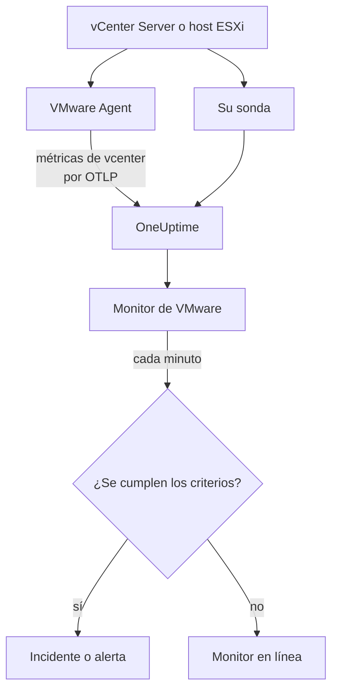

# Monitor de VMware

Un monitor de VMware vigila un vCenter - sus centros de datos, clústeres, hosts ESXi, máquinas virtuales, almacenes de datos, pools de recursos y vSAN - y le avisa cuando un host se satura, a una VM le falta CPU o memoria, un almacén de datos se llena o vSphere genera una alarma. Lee las métricas `vcenter.*` que recoge el OneUptime VMware Agent, o que recoge una de sus sondas sin agente.

:::cards
- [Crear el monitor](#crear-un-monitor-de-vmware): Seis pasos en el panel.
- [Plantillas](#plantillas-de-alerta-predefinidas): Veintitrés alertas listas para usar, un incidente por host, VM o almacén de datos.
- [Atributos de identidad](#atributos-de-identidad): Cómo apuntar a un host, una VM o un almacén de datos.
- [Métricas](#métricas-recogidas): Cada serie `vcenter.*` sobre la que el monitor puede alertar.
:::

## Cómo funciona

Las métricas vienen de la API de vCenter, leídas con una cuenta de solo lectura de una de estas dos formas:

- **El VMware Agent**, un OpenTelemetry Collector con su receptor `vcenter`, que usted ejecuta en una máquina que puede llegar a vCenter. Consulte [Agente de VMware](/docs/telemetry/vmware).
- **Una sonda**, sin nada que instalar: conecta el vCenter en OneUptime y elige la sonda que llega a él. Consulte [VMware sin agente](/docs/telemetry/vmware-agentless).

Ambas envían las mismas series en cada intervalo de recogida (2 minutos por defecto), marcadas con el nombre del vCenter, `vmware.vcenter.name`. Un vCenter es un endpoint de vSphere: un vCenter Server o un host ESXi independiente. Un monitor de VMware está ligado a un vCenter. Cada minuto ejecuta su consulta sobre las métricas de ese vCenter y compara el resultado con sus criterios.



## Antes de empezar

- **Recoja las métricas del vCenter**, con el [VMware Agent](/docs/telemetry/vmware) o [sin agente](/docs/telemetry/vmware-agentless). Ambos usan un usuario de vSphere con el rol **Read-Only** en el objeto vCenter de nivel superior, con **Propagate to children** marcado. El agente lee `ONEUPTIME_URL`, `ONEUPTIME_TELEMETRY_INGESTION_KEY`, `VMWARE_VCENTER_NAME`, `VCENTER_ENDPOINT`, `VCENTER_USERNAME` y `VCENTER_PASSWORD`.
- **Compruebe que el vCenter está registrado.** Aparece en **Productos → Infraestructura → VMware → Todos los vCenter**: a través del agente, con el nombre de su `VMWARE_VCENTER_NAME`, tras su primera recogida completa; sin agente, desde el momento en que lo conecta.

## Crear un monitor de VMware

:::steps
### Empezar un monitor nuevo

Vaya a **Monitores** y haga clic en **Crear monitor**.

### Elegir VMware

En **Tipo de monitor**, haga clic en **Más tipos de monitor** y elija **VMware** en **Infraestructura**, o escriba `vmware` en el cuadro de búsqueda. Introduzca un **Nombre** - se usa en los títulos de incidentes y alertas - y haga clic en **Siguiente**.

### Elegir el vCenter

En **Configuración del monitor de VMware**, elija el vCenter en **vCenter**. Cada vCenter que ha enviado datos, o que conectó sin agente, está en la lista.

### Elegir qué vigilar

Elija una de las tres pestañas:

- **Quick Setup** - haga clic en una [plantilla](#plantillas-de-alerta-predefinidas). Establece la métrica, los filtros de atributos, la agregación, el intervalo de tiempo, la agrupación y los umbrales, y sustituye los criterios de abajo por los suyos. Aún puede cambiar el **Intervalo de tiempo**.
- **Custom Metric** - elija una métrica en **Métrica de VMware** y luego establezca **Agregación** e **Intervalo de tiempo**. El formulario la agrupa por el objeto que describe, así que cada host, VM o almacén de datos se juzga por separado, y los [filtros](#configuración-del-monitor) la acotan a un centro de datos, clúster, host, VM, almacén de datos o pool de recursos.
- **Avanzado** - construya usted mismo consultas y fórmulas en **Seleccionar métricas**, con filtros sobre atributos como `disk_state`, `power_state` o `status`. Use **Agrupar por** con un [atributo de identidad](#atributos-de-identidad) para juzgar cada objeto por separado.

### Revisar los criterios

Abra cada criterio en **Criterios del monitor** y revise su **Métrica**, **Agregación**, **Condición** y **Umbral**. Una plantilla los rellena. Con **Custom Metric** o **Avanzado**, el monitor empieza con los [criterios predeterminados](#criterios-predeterminados), que solo detectan una métrica que cae a cero, así que establezca su propio umbral.

### Crear el monitor

Haga clic en **Crear monitor**. OneUptime abre la página del monitor y lo evalúa cada minuto. Los incidentes y alertas que genera también aparecen en las páginas **Incidentes** y **Alertas** del vCenter.
:::

> [!TIP]
> Para configurar varias plantillas a la vez, abra el vCenter desde **Productos → Infraestructura → VMware** y vaya a **Recomendaciones**. Elija las plantillas que quiera, decida a quién se avisa, y OneUptime crea un monitor por plantilla.

## Configuración del monitor

| Campo | Pestaña | Qué hace |
| --- | --- | --- |
| **vCenter** | Todas | Obligatorio. Limita cada consulta a `resource.vmware.vcenter.name`. |
| **Centro de datos** | Custom Metric, Avanzado | Opcional. Un centro de datos: `resource.vcenter.datacenter.name`. Todas las series lo llevan. |
| **Clúster** | Custom Metric, Avanzado | Opcional. Un clúster: `resource.vcenter.cluster.name`. Coincide con las series propias del clúster y con las de los hosts, VM y pools de recursos que contiene; un host ESXi independiente no tiene ninguno. |
| **Host ESXi** | Custom Metric, Avanzado | Opcional. Un host ESXi: `resource.vcenter.host.name`. Coincide con las series propias del host **y** con las de cada VM que ejecuta, porque una VM lleva el nombre de su host. |
| **Máquina virtual** | Custom Metric, Avanzado | Opcional. Una VM: `resource.vcenter.vm.name`. Los nombres de VM no tienen por qué ser únicos: añada un host o un clúster cuando dos VM compartan uno. |
| **Almacén de datos** | Custom Metric, Avanzado | Opcional. Un almacén de datos: `resource.vcenter.datastore.name`. |
| **Ruta del pool de recursos** | Custom Metric, Avanzado | Opcional. Un pool de recursos, por su ruta de inventario (`/DC/host/Cluster/Resources/pool`): `resource.vcenter.resource_pool.inventory_path`. Una ruta, porque los nombres de los pools solo son únicos dentro de su padre. |
| **Métrica de VMware** | Custom Metric | Una métrica del [catálogo](#métricas-recogidas). |
| **Agregación** | Custom Metric | Cómo se combinan las muestras: **Promedio**, **Máximo**, **Mínimo**, **Suma** o **Recuento**. Empieza en la agregación habitual de la métrica. |
| **Intervalo de tiempo** | Todas | La ventana móvil que lee la consulta, de **Past 1 Minute** a **Past 365 Days**. Un monitor nuevo empieza en **Últimos 5 minutos**; las plantillas fijan la suya. |
| **Seleccionar métricas** | Avanzado | El constructor de consultas: **Métrica**, **Agregar por**, **Filtrar por atributos**, **Agrupar por**, además de **Añadir métrica** y **Añadir fórmula** para combinar consultas. |

vCenter se lee una vez por intervalo de recogida, 2 minutos por defecto, así que una ventana de 1 minuto puede no contener ninguna muestra. Mantenga la ventana en 5 minutos o más, y más larga si aumentó el intervalo de recogida para un inventario grande.

## Atributos de identidad

El receptor `vcenter` envía un recurso de OpenTelemetry por cada objeto de vSphere, y lo nombra con **atributos de recurso**. Los que lleva una serie le indican qué tipo de objeto describe:

| Objeto de vSphere   | Atributos de recurso de identidad                                                                                              |
| ------------------- | ------------------------------------------------------------------------------------------------------------------------------ |
| Centro de datos     | `vcenter.datacenter.name`                                                                                                      |
| Clúster             | `vcenter.datacenter.name`, `vcenter.cluster.name`                                                                              |
| Host ESXi           | `vcenter.datacenter.name`, `vcenter.host.name` (+ `vcenter.cluster.name` cuando está en un clúster)                            |
| Máquina virtual     | `vcenter.datacenter.name`, `vcenter.host.name`, `vcenter.vm.name`, `vcenter.vm.id` (+ `vcenter.cluster.name`; `vcenter.resource_pool.*` o `vcenter.virtual_app.*`) |
| Plantilla de VM     | `vcenter.datacenter.name`, `vcenter.host.name`, `vcenter.vm_template.name`, `vcenter.vm_template.id`                           |
| Almacén de datos    | `vcenter.datacenter.name`, `vcenter.datastore.name`                                                                            |
| Pool de recursos    | `vcenter.datacenter.name`, `vcenter.resource_pool.name`, `vcenter.resource_pool.inventory_path` (+ `vcenter.cluster.name` o `vcenter.host.name`) |

En los filtros del monitor y en las claves de agrupación, los atributos de recurso empiezan por `resource.` (`resource.vcenter.host.name`), mientras que los atributos de punto de datos no (`disk_state`, `power_state`, `status`, `effective`, `direction`, `object`, `type`). El atributo booleano `effective` se guarda como el texto `"true"` o `"false"`, así que fíltrelo con el texto. Filtre por un atributo de identidad para apuntar a un objeto, y agrupe por él para juzgar cada objeto por separado.

## Plantillas de alerta predefinidas

OneUptime incluye 23 plantillas para problemas comunes de VMware, y **Quick Setup** las ofrece todas. Cada una construye un monitor completo: la consulta de la métrica, sus filtros de atributos, una agrupación por el atributo de identidad propio del objeto, un criterio que dispara y otro que recupera. Los umbrales son puntos de partida que puede editar.

Las plantillas leen los últimos 5 minutos salvo que la tabla diga otra cosa. Un criterio solo dispara cuando la condición se cumple en cada minuto de su ventana, y un criterio de umbral se recupera un 10 % más allá de su umbral, así que un valor que oscila en la línea no parpadea.

| Plantilla | Categoría | Gravedad | Vigila | Dispara cuando | Se recupera cuando |
| --- | --- | --- | --- | --- | --- |
| Host CPU Saturation | Host | Advertencia | `vcenter.host.cpu.utilization`, Avg por `resource.vcenter.host.name` | Por encima del 90 %: cada VM del host compite por los núcleos y muestra tiempo de CPU ready | En el 81 % o menos |
| Host Memory Saturation | Host | Advertencia | `vcenter.host.memory.utilization`, Avg por host | Por encima del 90 %: el host empieza a recuperar memoria con ballooning, compresión y swapping | En el 81 % o menos |
| Host Disk Latency High | Host | Advertencia | `vcenter.host.disk.latency.max`, Max por host | Por encima de 50 ms: cada VM cuyos discos están en esa ruta espera al almacenamiento. Necesita el nivel de contadores de rendimiento 3 | En 45 ms o menos |
| Host Network Packet Errors | Host | Advertencia | `vcenter.host.network.packet.error.rate`, Max por host | Por encima de 0: casi siempre un fallo de cable, SFP o puerto de switch | En 0 |
| Host Network Packet Drops | Host | Advertencia | `vcenter.host.network.packet.drop.rate`, Max por host | Por encima de 0: un uplink sobresuscrito, o búferes en anillo de la NIC que se desbordan | En 0 |
| VM CPU Saturation | Máquina virtual | Advertencia | `vcenter.vm.cpu.utilization`, Avg por `resource.vcenter.vm.name`, **últimos 15 minutos** | Por encima del 90 % de las vCPU de la VM durante los 15 minutos: una VM puede usar lo que se le dio, así que solo avisa una que nunca baja | En el 81 % o menos |
| VM CPU Ready Contention | Máquina virtual | Advertencia | `vcenter.vm.cpu.readiness`, Avg por VM | Por encima del 10 %: la VM estaba lista para ejecutarse, pero el host no tenía un núcleo físico para ella. Invisible desde dentro del invitado | En el 9 % o menos |
| VM Memory Saturation | Máquina virtual | Advertencia | `vcenter.vm.memory.utilization`, Avg por VM | Por encima del 90 % de su memoria: el invitado está a punto de paginar | En el 81 % o menos |
| VM Memory Ballooning | Máquina virtual | Advertencia | `vcenter.vm.memory.ballooned`, Max por VM | Por encima de 0: al host le falta memoria y se la quita a este invitado | En 0 |
| VM Memory Swapping | Máquina virtual | Crítico | `vcenter.vm.memory.swapped`, Max por VM | Por encima de 0: el host hace swap de la memoria de la VM, el último recurso tras el ballooning y la compresión | En 0 |
| VM Disk Latency High | Máquina virtual | Advertencia | `vcenter.vm.disk.latency.max`, Max por VM | Por encima de 50 ms: las aplicaciones del invitado agotan el tiempo de espera en la E/S | En 45 ms o menos |
| VM Disk Usage High | Máquina virtual | Advertencia | `vcenter.vm.disk.utilization`, Avg por VM | Por encima del 90 % de su almacenamiento aprovisionado comprometido: una VM con aprovisionamiento ligero está a punto de reclamar su tamaño completo | En el 81 % o menos |
| Datastore Capacity Warning | Almacén de datos | Advertencia | `vcenter.datastore.disk.utilization`, Avg por `resource.vcenter.datastore.name` | Por encima del 80 %: un aviso temprano, porque los discos ligeros y los snapshots consumen el resto rápido | En el 72 % o menos |
| Datastore Capacity Critical | Almacén de datos | Crítico | `vcenter.datastore.disk.utilization`, Avg por almacén de datos | Por encima del 90 %: un almacén de datos lleno pausa cada VM que tiene un disco en él | En el 81 % o menos |
| Cluster Host Not Effective | Clúster | Crítico | `vcenter.cluster.host.count` filtrada a `effective = false`, Max por `resource.vcenter.cluster.name` | Por encima de 0: un host está en modo de mantenimiento, desconectado o sin respuesta, así que el clúster funciona con menos capacidad de la prevista | En 0 |
| Datacenter Hosts Unhealthy | Centro de datos | Crítico | `vcenter.datacenter.host.count` filtrada a `status = red`, Max por `resource.vcenter.datacenter.name` | Por encima de 0: un host tiene una alarma crítica, como un sensor de hardware, una ruta de almacenamiento perdida o un error del agente de HA | En 0 |
| Datacenter Hosts Degraded | Centro de datos | Advertencia | `vcenter.datacenter.host.count` filtrada a `status = yellow`, Max por centro de datos | Por encima de 0: un host tiene una alarma de advertencia | En 0 |
| Datacenter Hosts Powered Off | Centro de datos | Advertencia | `vcenter.datacenter.host.count` filtrada a `power_state = off`, Max por centro de datos | Por encima de 0: un host está apagado - falló, se quedó sin corriente o DPM lo puso en espera | En 0 |
| Datacenter VMs Unhealthy | Centro de datos | Advertencia | `vcenter.datacenter.vm.count` filtrada a `status = red`, Max por centro de datos | Por encima de 0: una VM tiene una alarma crítica, como un reinicio de HA fallido, un almacén de datos perdido o un heartbeat de Tools perdido | En 0 |
| Datacenter Clusters Unhealthy | Centro de datos | Crítico | `vcenter.datacenter.cluster.count` filtrada a `status = red`, Max por centro de datos | Por encima de 0: un clúster tiene una alarma crítica, como recursos de conmutación de HA insuficientes, una elección de HA fallida o una comprobación de salud de vSAN crítica | En 0 |
| vSAN Latency High | vSAN | Advertencia | `vcenter.cluster.vsan.latency.avg`, Avg por clúster | Por encima de 20 000 µs (20 ms): el almacenamiento se ralentiza para cada VM del almacén de datos vSAN. Silencioso en clústeres sin vSAN | En 18 000 µs o menos |
| vSAN Congestion | vSAN | Advertencia | `vcenter.cluster.vsan.congestions`, Max por clúster | Por encima de 0: un grupo de discos no da abasto, y vSAN ralentiza la E/S de sus clientes | En 0 |
| Resource Pool Memory Swapped | Clúster | Advertencia | `vcenter.resource_pool.memory.swapped`, Max por `resource.vcenter.resource_pool.inventory_path` | Por encima de 0: las VM del pool toman memoria del swap del host, normalmente porque el límite o las participaciones de memoria del pool son demasiado bajos | En 0 |

**Gravedad** es la etiqueta que muestra el selector. El incidente y la alerta que crea una plantilla empiezan en la gravedad de incidente y de alerta más alta de su proyecto; cámbielas en el criterio.

- **Las plantillas de utilización usan Avg:** el receptor informa un porcentaje real de 0 a 100 para cada objeto, así que el promedio en un minuto es la utilización sostenida.
- **Las plantillas de latencia usan Max:** la métrica ya es la peor latencia entre los discos del objeto, así que su muestra más alta es la honesta.
- **Las plantillas de recuento y de estado usan Max**, así que una sola recogida que muestre la condición las dispara: errores de paquetes, ballooning, swapping, estado rojo y amarillo, hosts no efectivos, congestión.
- **Cada plantilla agrupa por el atributo de identidad propio del objeto**, así que se dispara un incidente por cada objeto afectado, y el incidente lo nombra.
- **Los umbrales están fijados en su unidad** (`%`, `ms`, `us`), así que conservan su significado sea cual sea la unidad que muestre un gráfico.

## Métricas recogidas

Las métricas de abajo son el catálogo que ofrece el formulario del monitor. Las unidades son las del propio receptor: `MHz`, `%`, `MiBy` (mebibytes), `By` (bytes), `KiBy`, `ms`, `us` (microsegundos), `{KiBy/s}`, `By/s` y recuentos. Una métrica marcada como _desactivada por defecto_ no se recoge hasta que la active en el `otel-collector-config.yaml` del agente; la configuración incluida ya activa `vcenter.host.memory.capacity`.

### Centro de datos

| Métrica                              | Unidad              | Descripción                                                                                                                                                    |
| ------------------------------------ | ------------------- | -------------------------------------------------------------------------------------------------------------------------------------------------------------- |
| `vcenter.datacenter.cluster.count`   | `{clusters}`        | Clústeres del centro de datos, desglosados por `status` (`red` / `yellow` / `green` / `gray`). Sume para el total; filtre `status = red` para los clústeres con una alarma crítica |
| `vcenter.datacenter.cpu.limit`       | `MHz`               | CPU total disponible para el centro de datos en todos los hosts ESXi                                                                                           |
| `vcenter.datacenter.datastore.count` | `{datastores}`      | Almacenes de datos del centro de datos                                                                                                                         |
| `vcenter.datacenter.disk.space`      | `By`                | Espacio de los almacenes de datos de todo el centro de datos, desglosado por `disk_state` (`used` / `available`). used ÷ (used + available) es la utilización de almacenamiento de todo el centro de datos |
| `vcenter.datacenter.host.count`      | `{hosts}`           | Hosts ESXi del centro de datos, desglosados por `status` y `power_state` (`on` / `off` / `standby` / `unknown`). Filtre `status = red` o `power_state = off`   |
| `vcenter.datacenter.memory.limit`    | `By`                | Memoria física total disponible para el centro de datos en todos los hosts ESXi                                                                                |
| `vcenter.datacenter.vm.count`        | `{virtual_machines}` | Máquinas virtuales del centro de datos, desglosadas por `status` y `power_state` (`on` / `off` / `suspended` / `unknown`). Filtre `power_state = on` para las VM en ejecución |

### Clúster

| Métrica                             | Unidad                        | Descripción                                                                                                                                                  |
| ----------------------------------- | ----------------------------- | ------------------------------------------------------------------------------------------------------------------------------------------------------------ |
| `vcenter.cluster.cpu.effective`     | `MHz`                         | CPU que el clúster puede programar realmente — excluye los hosts en modo de mantenimiento o sin respuesta. Compárela con `vcenter.cluster.cpu.limit` para ver la capacidad fuera de servicio |
| `vcenter.cluster.cpu.limit`         | `MHz`                         | CPU total de cada host ESXi del clúster, sea cual sea el estado del host                                                                                     |
| `vcenter.cluster.host.count`        | `{hosts}`                     | Hosts ESXi del clúster, desglosados por `effective` (`"true"` / `"false"`). Un host no es efectivo mientras está en modo de mantenimiento, desconectado o sin respuesta |
| `vcenter.cluster.memory.effective`  | `By`                          | Memoria que el clúster puede asignar realmente a las VM — excluye los hosts en mantenimiento o sin respuesta y la memoria reservada del propio ESXi          |
| `vcenter.cluster.memory.limit`      | `By`                          | Memoria física total de cada host ESXi del clúster                                                                                                           |
| `vcenter.cluster.vm.count`          | `{virtual_machines}`          | Máquinas virtuales del clúster, desglosadas por `power_state`. Sume para el total; filtre `power_state = on` para las VM en ejecución                        |
| `vcenter.cluster.vm_template.count` | `{virtual_machine_templates}` | Plantillas de máquinas virtuales del clúster                                                                                                                 |

### Host (ESXi)

| Métrica                                  | Unidad        | Descripción                                                                                                                                                       |
| ---------------------------------------- | ------------- | ----------------------------------------------------------------------------------------------------------------------------------------------------------------- |
| `vcenter.host.cpu.capacity`              | `MHz`         | Capacidad total de CPU del host ESXi (núcleos × frecuencia) — el denominador de `vcenter.host.cpu.usage`                                                          |
| `vcenter.host.cpu.reserved`              | `MHz`         | CPU reservada para máquinas virtuales, desglosada por `cpu_reservation_type` (`total` / `used`). Si `used` se acerca a `total`, las nuevas reservas fallarán el control de admisión |
| `vcenter.host.cpu.usage`                 | `MHz`         | CPU consumida ahora en el host por todas las VM y el propio hipervisor                                                                                           |
| `vcenter.host.cpu.utilization`           | `%`           | Utilización de CPU del host como porcentaje (0–100) de su capacidad                                                                                               |
| `vcenter.host.disk.latency.avg`          | `ms`          | Latencia media de disco (tiempo de dispositivo + kernel), desglosada por `direction` (`read` / `write`) y `object` (dispositivo de disco). Requiere el nivel de contadores de rendimiento 2 |
| `vcenter.host.disk.latency.max`          | `ms`          | Mayor latencia observada en todos los discos que usa el host, por `object`, en el último intervalo de 20 s. Requiere el nivel de contadores de rendimiento 3      |
| `vcenter.host.disk.throughput`           | `{KiBy/s}`    | Kilobytes por segundo leídos de los discos del host o escritos en ellos, por `direction` y `object`. Requiere el nivel de contadores de rendimiento 4            |
| `vcenter.host.memory.active`             | `MiBy`        | Memoria que las VM encendidas del host están usando activamente. _Desactivada por defecto_ — active `vcenter.host.memory.active` en la configuración del agente  |
| `vcenter.host.memory.ballooned`          | `MiBy`        | Memoria de invitado recuperada de las VM del host por el driver de ballooning; por encima de 0 indica presión de memoria en el host. _Desactivada por defecto_    |
| `vcenter.host.memory.capacity`           | `MiBy`        | Memoria física total del host — el denominador de `vcenter.host.memory.usage`. Desactivada por defecto en el original; la configuración incluida del agente la activa |
| `vcenter.host.memory.granted`            | `MiBy`        | Memoria de máquina concedida a las VM encendidas del host. _Desactivada por defecto_                                                                              |
| `vcenter.host.memory.usage`              | `MiBy`        | Memoria consumida ahora en el host, incluida la sobrecarga propia del hipervisor                                                                                  |
| `vcenter.host.memory.utilization`        | `%`           | Utilización de memoria del host como porcentaje (0–100) de su capacidad física                                                                                    |
| `vcenter.host.network.packet.drop.rate`  | `{packets/s}` | Paquetes por segundo descartados en cada NIC física, por `direction` (`transmitted` / `received`) y `object` (p. ej. `vmnic0`) — un uplink sobresuscrito o una NIC que falla |
| `vcenter.host.network.packet.error.rate` | `{errors/s}`  | Errores de paquetes por segundo en las NIC físicas del host, por `direction` y `object` — casi siempre un fallo de cable, SFP o puerto de switch                  |
| `vcenter.host.network.packet.rate`       | `{packets/s}` | Paquetes por segundo transmitidos o recibidos en cada NIC física, por `direction` y `object`                                                                     |
| `vcenter.host.network.throughput`        | `{KiBy/s}`    | Kilobytes por segundo transmitidos o recibidos por el host, por `direction` y `object`                                                                           |
| `vcenter.host.network.usage`             | `{KiBy/s}`    | Tasa combinada de transmisión y recepción en las NIC del host, por `object`                                                                                       |

### Máquina virtual

| Métrica                                    | Unidad        | Descripción                                                                                                                                                                   |
| ------------------------------------------ | ------------- | ----------------------------------------------------------------------------------------------------------------------------------------------------------------------------- |
| `vcenter.vm.cpu.readiness`                 | `%`           | Porcentaje del tiempo en que la VM estaba lista para ejecutarse pero no pudo programarse en una CPU física (CPU ready). Por encima del 5 % el invitado va lento; por encima del 10 % el host está sobresuscrito. Solo VM encendidas |
| `vcenter.vm.cpu.time`                      | `%`           | Tiempo que las vCPU de la VM pasaron en cada estado, por `cpu_state` (`idle` / `ready` / `wait`) y `object` (vCPU). _Desactivada por defecto_ — active `vcenter.vm.cpu.time`   |
| `vcenter.vm.cpu.usage`                     | `MHz`         | CPU consumida por la VM. Solo VM encendidas — su presencia es como OneUptime deduce el estado de alimentación de una VM                                                         |
| `vcenter.vm.cpu.utilization`               | `%`           | Utilización de CPU de la VM como porcentaje (0–100) de sus vCPU configuradas. Solo VM encendidas                                                                              |
| `vcenter.vm.disk.latency.avg`              | `ms`          | Latencia media de disco, por `direction` (`read` / `write`), `disk_type` (`virtual` / `physical`) y `object` (disco virtual). Requiere el nivel de contadores de rendimiento 2 |
| `vcenter.vm.disk.latency.max`              | `ms`          | Mayor latencia total (tiempo de dispositivo + kernel) que vio la VM en algún disco durante un intervalo de 20 s, por `object`                                                  |
| `vcenter.vm.disk.throughput`               | `{KiBy/s}`    | Kilobytes por segundo leídos de los discos de la VM o escritos en ellos, por `direction` y `object`. Requiere el nivel de contadores de rendimiento 2                          |
| `vcenter.vm.disk.usage`                    | `By`          | Espacio de almacén de datos consumido por los archivos de la VM, desglosado por `disk_state` (`used` / `available`). También se emite para plantillas de VM. Filtre `disk_state = used` para el tamaño comprometido |
| `vcenter.vm.disk.utilization`              | `%`           | Porcentaje (0–100) del almacenamiento aprovisionado de la VM que está comprometido en el almacén de datos — una VM con aprovisionamiento ligero cerca del 100 % está a punto de reclamar su tamaño completo |
| `vcenter.vm.memory.ballooned`              | `MiBy`        | Memoria de invitado recuperada de la VM por el driver de ballooning (VMware Tools). Por encima de 0 significa que al host ESXi le falta memoria                                |
| `vcenter.vm.memory.granted`                | `MiBy`        | Memoria de máquina que el host concedió a la VM. _Desactivada por defecto_ — active `vcenter.vm.memory.granted`                                                               |
| `vcenter.vm.memory.swapped`                | `MiBy`        | Memoria concedida a la VM desde el archivo de swap del host — el último recurso tras el ballooning y la compresión; cualquier valor por encima de 0 significa que la VM paga latencia de disco por la RAM |
| `vcenter.vm.memory.swapped_ssd`            | `KiBy`        | Memoria de la VM enviada a la caché de swap flash del host — menos dolorosa que el archivo de swap, pero sigue siendo presión de memoria                                       |
| `vcenter.vm.memory.usage`                  | `MiBy`        | Memoria que usa activamente el invitado de la VM. Se emite igual para VM encendidas y apagadas (0 cuando está apagada)                                                        |
| `vcenter.vm.memory.utilization`            | `%`           | Utilización de memoria de la VM como porcentaje (0–100) de su memoria configurada                                                                                              |
| `vcenter.vm.network.broadcast.packet.rate` | `{packets/s}` | Paquetes de broadcast por segundo por vNIC, por `direction` y `object`. _Desactivada por defecto_                                                                             |
| `vcenter.vm.network.multicast.packet.rate` | `{packets/s}` | Paquetes de multicast por segundo por vNIC, por `direction` y `object`. _Desactivada por defecto_                                                                             |
| `vcenter.vm.network.packet.drop.rate`      | `{packets/s}` | Paquetes por segundo descartados por cada vNIC, por `direction` y `object`. Los descartes en recepción suelen significar que el invitado no vacía su búfer en anillo lo bastante rápido |
| `vcenter.vm.network.packet.rate`           | `{packets/s}` | Paquetes por segundo transmitidos o recibidos por cada vNIC, por `direction` y `object`                                                                                      |
| `vcenter.vm.network.throughput`            | `By/s`        | Bytes por segundo transmitidos o recibidos por la red de la VM, por `direction` y `object`                                                                                   |
| `vcenter.vm.network.usage`                 | `{KiBy/s}`    | Tasa combinada de transmisión y recepción de la VM, por `object`                                                                                                               |

### Almacén de datos

| Métrica                              | Unidad | Descripción                                                                                                                                  |
| ------------------------------------ | ------ | -------------------------------------------------------------------------------------------------------------------------------------------- |
| `vcenter.datastore.disk.usage`       | `By`   | Espacio del almacén de datos, desglosado por `disk_state` (`used` / `available`). used + available es la capacidad del almacén de datos     |
| `vcenter.datastore.disk.utilization` | `%`    | Porcentaje (0–100) de la capacidad del almacén de datos en uso. Un almacén de datos lleno pausa cada VM que escribe en él, así que alerte mucho antes del 100 % |

### Pool de recursos

| Métrica                                  | Unidad     | Descripción                                                                                                                                                              |
| ---------------------------------------- | ---------- | ------------------------------------------------------------------------------------------------------------------------------------------------------------------------ |
| `vcenter.resource_pool.cpu.shares`       | `{shares}` | Participaciones de CPU configuradas en el pool — su prioridad relativa frente a los pools hermanos cuando el padre está en contención                                     |
| `vcenter.resource_pool.cpu.usage`        | `MHz`      | CPU consumida por todas las VM del pool (y de sus pools hijos)                                                                                                           |
| `vcenter.resource_pool.memory.ballooned` | `MiBy`     | Memoria recuperada por el driver de ballooning en todas las VM del pool                                                                                                  |
| `vcenter.resource_pool.memory.granted`   | `MiBy`     | Memoria del host concedida a las VM del pool, desglosada por `type` (`private` / `shared` — las páginas compartidas se deduplican con transparent page sharing)          |
| `vcenter.resource_pool.memory.shares`    | `{shares}` | Participaciones de memoria configuradas en el pool                                                                                                                       |
| `vcenter.resource_pool.memory.swapped`   | `MiBy`     | Memoria concedida a las VM del pool desde el espacio de swap de los hosts ESXi — cualquier valor por encima de 0 significa que al menos una VM del pool sufre swap del host |
| `vcenter.resource_pool.memory.usage`     | `MiBy`     | Memoria que usa el pool, desglosada por `type` (`guest` / `host` / `overhead`) en las versiones recientes del colector; las más antiguas emiten una sola serie sin tipo. Filtre `type = guest` |

### vSAN

Solo se envían para clústeres con vSAN, los hosts que contienen y las VM de un almacén de datos vSAN. Las latencias están en **microsegundos** (`us`), a diferencia de las latencias en milisegundos de hosts y VM:

| Métrica                             | Unidad            | Descripción                                                                                                                                     |
| ----------------------------------- | ----------------- | ----------------------------------------------------------------------------------------------------------------------------------------------- |
| `vcenter.cluster.vsan.congestions`  | `{congestions/s}` | Eventos de congestión por segundo generados contra la E/S de cada cliente de vSAN del clúster — la propia señal de contrapresión de vSAN        |
| `vcenter.cluster.vsan.latency.avg`  | `us`              | Latencia media que ve el clúster al acceder al almacenamiento vSAN, por `type` (`read` / `write`). 20 000 µs = 20 ms                            |
| `vcenter.cluster.vsan.operations`   | `{operations/s}`  | Operaciones de E/S de vSAN por segundo en todo el clúster, por `type` (`read` / `write` / `unmap`)                                              |
| `vcenter.cluster.vsan.throughput`   | `By/s`            | Rendimiento de vSAN del clúster, por `direction` (`read` / `write`)                                                                             |
| `vcenter.host.vsan.cache.hit_rate`  | `%`               | Porcentaje de la E/S de lectura de vSAN del host servida desde su caché de cliente local en el último intervalo de 5 min — una tasa que baja significa que las lecturas llegan al nivel de capacidad |
| `vcenter.host.vsan.congestions`     | `{congestions/s}` | Eventos de congestión por segundo generados contra la E/S de vSAN del host                                                                      |
| `vcenter.host.vsan.latency.avg`     | `us`              | Latencia media que ve el host al acceder al almacenamiento vSAN, por `type`                                                                     |
| `vcenter.host.vsan.operations`      | `{operations/s}`  | Operaciones de E/S de vSAN por segundo emitidas por el host, por `type`                                                                         |
| `vcenter.host.vsan.throughput`      | `By/s`            | Rendimiento de vSAN del host, por `direction`                                                                                                   |
| `vcenter.vm.vsan.latency.avg`       | `us`              | Latencia media que ve la VM al acceder al almacenamiento vSAN, por `type`                                                                       |
| `vcenter.vm.vsan.operations`        | `{operations/s}`  | Operaciones de E/S de vSAN por segundo emitidas por la VM, por `type`                                                                           |
| `vcenter.vm.vsan.throughput`        | `By/s`            | Rendimiento de vSAN de la VM, por `direction`                                                                                                   |

> [!NOTE]
> El estado de alimentación de una VM no es una métrica. El receptor envía `vcenter.vm.cpu.*` solo para las VM encendidas, así que OneUptime distingue **Encendido** de **Apagado** según si llegaron datos de CPU en la misma recogida que los datos de memoria y disco de la VM; la página **Máquinas virtuales** del vCenter muestra el resultado. Para alertar sobre hosts apagados o sobre cuántas VM se ejecutan, use el atributo `power_state` de `vcenter.datacenter.host.count`, `vcenter.datacenter.vm.count` o `vcenter.cluster.vm.count`.

## Criterios de monitorización

Un criterio compara una de las consultas o fórmulas del monitor con un umbral. Los criterios de un monitor de VMware no tienen **Tipo de filtro**: cada regla comprueba el valor de la métrica, con estos campos.

| Campo | Qué hace |
| --- | --- |
| **Métrica** | La consulta o fórmula que se comprueba, por su nombre de variable. |
| **Agregación** | Cómo se convierten los valores de la ventana en una sola respuesta: **Promedio**, **Suma**, **Maximum Value**, **Minimum Value**, **All Values** (todos los valores deben coincidir) o **Any Value** (basta con uno). |
| **Condición** | **Greater Than**, **Less Than**, **Greater Than Or Equal To**, **Less Than Or Equal To** o **Equal To** — o una condición de anomalía: **Anomalously High**, **Anomalously Low** o **Anomalous**. |
| **Umbral** | El valor con el que se compara. Junto a él hay una lista de unidades cuando la métrica tiene unidad. No se muestra para las condiciones de anomalía. |
| **Sensibilidad** | Solo condiciones de anomalía. **Bajo** (4σ), **Medio** (3σ, el predeterminado) o **Alto** (2σ). |
| **Ventana de referencia** | Solo condiciones de anomalía. 14 días (el predeterminado), 28, 60 o 90 días de historial. |
| **Si no hay datos** | En **Más campos**. Qué ocurre cuando la ventana no tiene muestras: **Ignore** (el predeterminado), **Treat As Zero** o **Disparador**. |

Las condiciones de anomalía comparan cada valor con la misma hora de la semana en la referencia. Permanecen en estado «Learning», y no generan nada, hasta que la ventana de referencia tiene historial suficiente.

Algunos criterios para empezar:

- **Un host está saturado:** `vcenter.host.cpu.utilization`, Promedio, agrupada por `resource.vcenter.host.name`, **Greater Than** `90`, en los últimos 5 minutos.
- **Un almacén de datos se está llenando:** `vcenter.datastore.disk.utilization`, Promedio, agrupada por `resource.vcenter.datastore.name`, **Greater Than** `80`.
- **Un clúster perdió un host:** `vcenter.cluster.host.count` filtrada a `effective = false`, Máximo, agrupada por `resource.vcenter.cluster.name`, **Greater Than** `0`.
- **Se ejecutan menos VM de las esperadas:** `vcenter.cluster.vm.count` filtrada a `power_state = on` y `resource.vcenter.cluster.name = Production`, Suma, **Less Than** el número que espera.
- **El host está haciendo swap de una VM:** `vcenter.vm.memory.swapped`, Máximo, agrupada por `resource.vcenter.vm.name`, **Greater Than** `0`.

### Criterios predeterminados

Un monitor que no construye a partir de una plantilla empieza con dos criterios:

| Orden | Criterio | Coincide cuando | Entonces |
| --- | --- | --- | --- |
| 1 | Check if _monitor name_ is offline | Algún valor de la primera consulta es `0` | Marca el monitor como **Sin conexión** y declara el incidente «_monitor name_ is offline», que se resuelve solo cuando el monitor se recupera. |
| 2 | Check if _monitor name_ is online | Algún valor está por encima de `0` | Marca el monitor como **Operativo**. |

> [!IMPORTANT]
> El silencio no coincide con ninguno de los dos criterios: un vCenter que deja de enviar datos deja el monitor como estaba. Para que se le avise cuando se detienen los datos, establezca **Si no hay datos** en **Disparador** en un criterio. El tiempo en que el propio OneUptime no estaba recibiendo nunca cuenta como falta de datos: una comprobación cuya ventana lo contiene espera en su lugar, como explica [Cuando OneUptime no recibe datos](/docs/monitor/when-oneuptime-is-not-receiving).

## Terraform

El [proveedor de Terraform de OneUptime](/docs/terraform/monitor-steps) lleva la configuración de un paso de monitor de VMware en el atributo `vmware_monitor`: el JSON sin procesar de la configuración `vmwareMonitor` (`vcenterIdentifier`, `resourceFilters`, `metricViewConfig`, `rollingTime`), escrito con `jsonencode()`:

```hcl title="main.tf"
monitor_steps = [{
  vmware_monitor = jsonencode({
    vcenterIdentifier = "prod-vcenter"
    resourceFilters   = { clusterName = "Production" }
    rollingTime       = "Past 5 Minutes"
    metricViewConfig = {
      queryConfigs = [{
        metricAliasData = { metricVariable = "host_cpu", title = "Host CPU", description = "", legend = "" }
        metricQueryData = {
          filterData = {
            metricName     = "vcenter.host.cpu.utilization"
            attributes     = {}
            aggegationType = "Avg"
            aggregateBy    = {}
          }
          groupByAttributeKeys = ["resource.vcenter.host.name"]
        }
      }]
      formulaConfigs = []
    }
  })
  criteria = [ /* ... */ ]
}]
```

`vcenterIdentifier` es el `vmware.vcenter.name` del vCenter - el `VMWARE_VCENTER_NAME` con el que se inició el agente -, no su ID de OneUptime.

## Solución de problemas

:::details El vCenter no está en la lista vCenter
Un vCenter que recoge el agente se registra solo a partir de los datos del agente. Compruebe que el agente se está ejecutando y enviando datos (consulte [Verificar la instalación](/docs/telemetry/vmware#verify-the-installation)), que `VMWARE_VCENTER_NAME` está definido y que ha pasado un intervalo de recogida: no se envía nada hasta que termina el primer recorrido completo del inventario.
:::

:::details Los hosts tienen métricas, pero las VM, los almacenes de datos o los clústeres no
El usuario de vSphere de solo lectura recibió su rol sin **Propagate to children**, o en un objeto por debajo de la raíz del vCenter. Los objetos que el usuario no puede ver simplemente faltan en las métricas. Establezca el permiso en el objeto vCenter de nivel superior, con la propagación marcada.
:::

:::details Host CPU Saturation nunca dispara
La plantilla promedia `vcenter.host.cpu.utilization` por `resource.vcenter.host.name`, así que cada host se comprueba por separado. Si construyó su propia consulta, agrúpela por el atributo de identidad con su prefijo `resource.`: el `vcenter.host.name` sin prefijo no coincide con nada, y un promedio de todos los hosts queda rebajado por los inactivos.
:::

:::details Las plantillas de vSAN nunca disparan
`vcenter.cluster.vsan.*`, `vcenter.host.vsan.*` y `vcenter.vm.vsan.*` solo se envían para clústeres con vSAN, los hosts que contienen y las VM de un almacén de datos vSAN. Sin vSAN las series no existen, y las plantillas permanecen en silencio.
:::

:::details Un criterio filtrado por effective no coincide con nada
El atributo booleano `effective` del receptor se guarda como el texto `"true"` o `"false"`. Fíltrelo con el texto, no con un booleano.
:::

:::details Faltan métricas de latencia o de rendimiento de disco
`vcenter.host.disk.latency.avg` y `vcenter.vm.disk.*` necesitan el nivel de estadísticas 2 de vCenter, `vcenter.host.disk.latency.max` necesita el nivel 3, y `vcenter.host.disk.throughput` el nivel 4. Suba el nivel de estadísticas del intervalo de 5 minutos en _vCenter → Configure → General → Statistics_.
:::

:::details Una ventana de 1 minuto no muestra datos
vCenter se lee una vez por intervalo de recogida, 2 minutos por defecto y a menudo más para un inventario grande, así que una ventana de 1 minuto puede no contener ninguna muestra. Use 5 minutos o más.
:::

## Próximos pasos

:::cards
- [Agente de VMware](/docs/telemetry/vmware): Instalar el agente que recoge de vCenter.
- [VMware sin agente](/docs/telemetry/vmware-agentless): Dejar que una sonda recoja en su lugar.
- [Monitor de Proxmox](/docs/monitor/proxmox-monitor): El mismo tipo de monitor para Proxmox VE.
- [Visión general de los incidentes](/docs/incidents/index): Qué ocurre después de que un criterio declara un incidente.
:::
