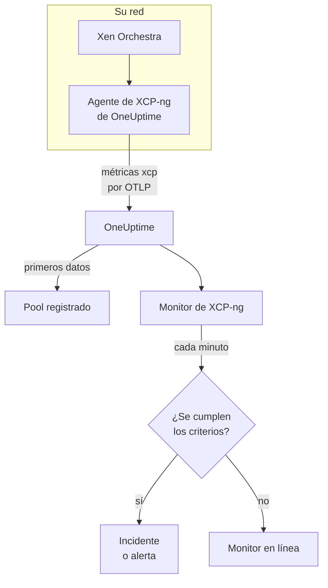

# Monitor de XCP-ng

Un monitor de XCP-ng vigila un pool de XCP-ng – sus hosts, VM, repositorios de almacenamiento y discos virtuales – y le avisa cuando Xen Orchestra pierde el pool, un host se desconecta o sigue deshabilitado, una VM que estaba en ejecución se detiene o se queda sin CPU, o un repositorio de almacenamiento se llena o se vuelve lento. Lee las series `xcp_*` del plugin OpenMetrics de Xen Orchestra, que recoge el agente de XCP-ng de OneUptime, y las series de estado que OneUptime deriva de ellas, así que no se sondea nada desde fuera.

:::cards
- [Crear el monitor](#crear-un-monitor-de-xcp-ng): Seis pasos en el panel.
- [Plantillas](#plantillas-de-alerta-listas-para-usar): Diez alertas listas para usar, un incidente por host, VM o repositorio de almacenamiento.
- [Identidad de los recursos](#identidad-de-los-recursos): Cómo apuntar a un solo host, VM o repositorio de almacenamiento.
- [Métricas](#métricas-recopiladas): Cada serie sobre la que el monitor puede alertar.
:::

## Cómo funciona

El agente de XCP-ng de OneUptime se ejecuta en una máquina que llega a Xen Orchestra. Cada 60 segundos lee el plugin OpenMetrics de Xen Orchestra, que lee cada host de cada pool que gestiona Xen Orchestra, y envía las series a OneUptime por OTLP, un recurso por pool, marcado con el UUID del pool, `xcp_ng.pool.id`. Los primeros datos registran cada pool.

Un monitor de XCP-ng está ligado a un pool. Cada minuto ejecuta su consulta sobre las métricas de ese pool y compara el resultado con sus criterios.



## Antes de empezar

- **Instale el agente de XCP-ng** donde pueda llegar a Xen Orchestra, con el secreto del plugin OpenMetrics de Xen Orchestra. La [guía del agente de XCP-ng](/docs/telemetry/xcp-ng) cubre el plugin, el certificado de Xen Orchestra y la instalación.
- **Compruebe que el pool está registrado.** Aparece en **Productos → Infraestructura → XCP-ng → Todos los pools**, con el nombre que le da Xen Orchestra, alrededor de un minuto después de la primera lectura.

## Crear un monitor de XCP-ng

:::steps
### Empezar un monitor nuevo

Vaya a **Monitores** y haga clic en **Crear monitor**.

### Elegir XCP-ng

En **Tipo de monitor**, haga clic en **Más tipos de monitor** y elija **XCP-ng** en **Infraestructura**, o escriba `xcp` en el cuadro de búsqueda. Introduzca un **Nombre** – se usa en los títulos de incidentes y alertas – y haga clic en **Siguiente**.

### Elegir el pool

En **Configuración del monitor de XCP-ng**, elija el pool en **Pool de XCP-ng**. Cada pool que ha enviado datos está en la lista. Una vez elegido, una línea bajo el campo indica si llegan datos. **Añadir pool de XCP-ng** abre los pasos de configuración con sus claves ya rellenadas, que esperan los primeros datos.

### Elegir qué vigilar

Un monitor nuevo empieza en **Pool Disconnected**, en **Sobre qué alertar**. Para vigilar otra cosa:

- **Cambiar** – elija otra [plantilla](#plantillas-de-alerta-listas-para-usar). Fija las métricas, los filtros, la agregación, el intervalo de tiempo y los umbrales, y sustituye los criterios de abajo por los suyos. Aún puede cambiar el **Intervalo de tiempo**.
- **Custom Metric** (en **Más campos**) – elija una métrica en **Métrica de XCP-ng** y después fije la **Agregación** y el **Intervalo de tiempo**. Los [filtros](#ajustes-del-monitor) la reducen a un tipo de objeto o a un solo objeto.
- **Avanzado** (en **Más campos**) – construya usted mismo consultas y fórmulas en **Seleccionar métricas**, por ejemplo la parte usada de un repositorio de almacenamiento a partir de `xcp_sr_physical_usage_bytes / xcp_sr_physical_size_bytes`. Use **Agrupar por** `xcp_ng.id` para juzgar cada objeto por separado.

### Revisar los criterios

Abra cada criterio en **Criterios** y revise su **Métrica**, **Agregación**, **Condición** y **Umbral**. Una plantilla los rellena. Con **Custom Metric** o **Avanzado**, el monitor empieza con los [criterios predeterminados](#criterios-predeterminados), que solo detectan que la métrica no envía datos, así que fije su propio umbral.

### Crear el monitor

Haga clic en **Crear monitor**. OneUptime abre la página del monitor y lo evalúa cada minuto. Los incidentes y las alertas que genera también aparecen en las páginas **Incidentes** y **Alertas** del pool.
:::

> [!TIP]
> Para configurar varias plantillas a la vez, abra el pool desde **Productos → Infraestructura → XCP-ng** y vaya a **Recomendaciones**. Elija las plantillas que quiera, decida a quién se avisa, y OneUptime crea un monitor por plantilla.

## Ajustes del monitor

| Campo | Pestaña | Qué hace |
| --- | --- | --- |
| **Pool de XCP-ng** | Todas | Obligatorio. Limita cada consulta a `resource.xcp_ng.pool.id`, el UUID del pool, así que dos pools con el mismo nombre nunca se mezclan. |
| **Ámbito del recurso** | Custom Metric, Avanzado | Opcional. **Host**, **VM**, **Repositorio de almacenamiento**, **Disco virtual**, **XOSTOR** o **Pool de XCP-ng** – una coincidencia exacta con `xcp_ng.scope`. |
| **UUID** | Custom Metric, Avanzado | Opcional. Coincidencia exacta con `xcp_ng.id`: el UUID de un host, una VM, un repositorio de almacenamiento o un disco virtual, tal como lo muestra Xen Orchestra. Combínelo con un ámbito para apuntar a un solo objeto. |
| **Nombre del host** | Custom Metric, Avanzado | Opcional. Coincidencia exacta con la etiqueta `host_name` de Xen Orchestra: las propias series del host y las de las VM que se ejecutan en él. |
| **Métrica de XCP-ng** | Custom Metric | Una métrica del [catálogo](#métricas-recopiladas). |
| **Agregación** | Custom Metric | Cómo se combinan las muestras: **Promedio**, **Máximo**, **Mínimo**, **Suma** o **Recuento**. Empieza en la agregación habitual de la métrica. |
| **Intervalo de tiempo** | Todas | La ventana móvil que lee la consulta, de **Past 1 Minute** a **Past 365 Days**. Un monitor nuevo empieza en **Past 1 Minute**; las plantillas fijan la suya. |
| **Seleccionar métricas** | Avanzado | El generador de consultas: **Métrica**, **Agregar por**, **Filtrar por atributos**, **Agrupar por**, además de **Añadir métrica** y **Añadir fórmula** para combinar consultas. |

El agente lee Xen Orchestra cada 60 segundos, y Xen Orchestra lee sus hosts con una resolución de 60 segundos, así que una ventana de 1 minuto contiene alrededor de una muestra; las plantillas leen 5 minutos o más.

## Identidad de los recursos

Xen Orchestra nombra un host o una VM por su etiqueta `uuid`, un repositorio de almacenamiento por `sr_uuid` y un disco virtual por `vdi_uuid`. OneUptime estampa dos atributos en cada punto al llegar, así que un solo filtro lee cada serie de un objeto, sea cual sea la etiqueta que lo nombró. Las plantillas se basan en ellos:

| Atributo | Valores | Para una VM |
| --- | --- | --- |
| `xcp_ng.scope` | `pool`, `host`, `vm`, `sr` (un repositorio de almacenamiento), `vdi` (un disco virtual), `xostor` | `vm` |
| `xcp_ng.id` | El UUID del objeto, en minúsculas: el `uuid` de un host o una VM, el `sr_uuid` de un repositorio de almacenamiento o de un clúster XOSTOR, el `vdi_uuid` de un disco virtual, y el propio UUID del pool en las series del pool | `5c6d7e8f-1a2b-4c3d-9e8f-0a1b2c3d4e5f` |

Filtre por `xcp_ng.scope` para un tipo de objeto, por `xcp_ng.id` para un objeto, y agrupe por `xcp_ng.id` para juzgar cada objeto por separado. Las propias etiquetas de Xen Orchestra se quedan como las envía: `host_name` nombra un host en sus series y el host de una VM en las de la VM, `vm_name`, `sr_name` y `vdi_name` nombran el resto, `power_state` y `enabled` llevan el estado de un host o de una VM en las series de estado, e `is_control_domain` vale `true` en las series de VM de un dominio de control.

El pool mismo es el recurso en el que llegan las series, así que sus atributos llevan el prefijo `resource.` en los filtros y las claves de agrupación: `resource.xcp_ng.pool.id` (su UUID), `resource.xcp_ng.pool.name` (su nombre en Xen Orchestra) y `resource.xen_orchestra.name` (el Xen Orchestra desde el que se lee).

## Plantillas de alerta listas para usar

La lista **Sobre qué alertar** ofrece 12 plantillas. Cada una construye un monitor completo – consultas, filtros de atributos, una agrupación, un criterio que se dispara y otro que se recupera. La mayoría agrupa por `xcp_ng.id`, así que cada host, VM o repositorio de almacenamiento tiene su propio incidente y su propia alerta. Los umbrales son puntos de partida que puede editar.

Un criterio solo se dispara cuando la condición se cumple en cada minuto de su ventana, y un criterio de umbral se recupera un 10 % más allá de su umbral para que un valor que oscila en la línea no haga parpadear el estado. Una serie 0/1 se recupera en el otro valor.

| Plantilla | Categoría | Gravedad | Vigila | Dispara cuando | Se recupera cuando |
| --- | --- | --- | --- | --- | --- |
| Pool Disconnected | Disponibilidad | Crítico | `xcp_pool_connected`, Count sobre todo el pool, últimos 10 minutos | Sin datos durante toda la ventana | Vuelven a llegar datos |
| Host Offline | Disponibilidad | Crítico | `xcp_ng.host.running` para `xcp_ng.scope = host`, Min por `xcp_ng.id`, últimos 5 minutos | Por debajo de 1 | En 1 |
| HA Cannot Tolerate a Host Failure | Disponibilidad | Crítico | `xcp_ng.pool.ha.can_tolerate_host_failure` para `xcp_ng.scope = pool`, Max sobre todo el pool, últimos 5 minutos | Por debajo de 1 | En 1 |
| VM Stopped | VM | Advertencia | `xcp_ng.vm.stopped_after_running` para `xcp_ng.scope = vm`, Min por `xcp_ng.id`, últimos 5 minutos | Por encima de 0 | En 0 |
| VM Not Backed Up | VM | Advertencia | `xcp_ng.vm.backup_overdue` para `xcp_ng.scope = vm`, Min por `xcp_ng.id`, últimos 10 minutos | Por encima de 0 | En 0 |
| Storage Repository Near Full | Almacenamiento | Crítico | `xcp_sr_physical_usage_bytes` ÷ `xcp_sr_physical_size_bytes` × 100 para `xcp_ng.scope = sr` (ambos Suma), por `xcp_ng.id`, últimos 5 minutos | Por encima del 90 % | 81 % o menos |
| Host Disabled | Host | Advertencia | `xcp_ng.host.enabled` para `xcp_ng.scope = host`, Max por `xcp_ng.id`, últimos 30 minutos | Por debajo de 1 | En 1 |
| Host Restarted | Host | Advertencia | `xcp_host_uptime_seconds` y `xcp_ng.host.running` para `xcp_ng.scope = host`, Min por `xcp_ng.id`, últimos 5 minutos | `xcp_host_uptime_seconds` está por debajo de 900 (15 minutos) mientras `xcp_ng.host.running` es 1 | `xcp_host_uptime_seconds` está en 990 o más, o `xcp_ng.host.running` es 0 |
| High Host CPU Usage | Host | Advertencia | `xcp_host_cpu_average` para `xcp_ng.scope = host`, Avg por `xcp_ng.id`, últimos 10 minutos | Por encima de 0,9 (el 90 % de la CPU del host) | 0,81 o menos |
| High Host Memory Usage | Host | Advertencia | (`xcp_host_memory_total_bytes` − `xcp_host_memory_free_bytes`) ÷ `xcp_host_memory_total_bytes` × 100 para `xcp_ng.scope = host` (ambos Suma), por `xcp_ng.id`, últimos 10 minutos | Por encima del 95 % | 85,5 % o menos |
| VM Starved of CPU | VM | Advertencia | `xcp_vm_runstate_full_contention` para `xcp_ng.scope = vm`, Avg por `xcp_ng.id`, últimos 15 minutos | Por encima de 0,1 (el 10 % del tiempo) | 0,09 o menos |
| Storage Repository Slow | Almacenamiento | Advertencia | `xcp_host_disk_latency_seconds` para `xcp_ng.scope = host`, Avg por `sr`, últimos 15 minutos | Por encima de 0,05 (50 ms) | 0,045 o menos |

**Gravedad** es la etiqueta que muestra el selector. El incidente y la alerta que crea una plantilla empiezan con la gravedad de incidente y de alerta más alta de su proyecto; cámbielas en los criterios.

- **Pool Disconnected** se dispara cuando `xcp_pool_connected` deja de llegar durante diez minutos. Xen Orchestra la envía en cada lectura mientras está conectado al pool, y deja de enviarla, en lugar de enviar 0, cuando pierde el maestro del pool; también deja de llegar cuando se detienen Xen Orchestra, su plugin o el agente de XCP-ng, o cuando el agente pierde su ruta hacia OneUptime. Se resuelve cuando vuelve la serie. Cuando los datos se detienen, las demás plantillas no tienen nada que comparar y mantienen su último estado, así que esta es la que le avisa.
- **Host Offline** lee `xcp_ng.host.running`, que OneUptime deriva de `xcp_host_status`: 0 mientras Xen Orchestra informa del host como Halted, o de su estado como Unknown porque el maestro del pool perdió el contacto con él. Las VM que se ejecutaban en el host también están caídas, salvo que HA las haya reiniciado en otro lugar.
- **HA Cannot Tolerate a Host Failure** lee `xcp_ng.pool.ha.can_tolerate_host_failure`. Leído directamente de XAPI, es el propio plan de HA: sobrecomprometido, o cubriendo menos fallos de host de los que debe tolerar. Leído a través de Xen Orchestra, cuya API REST no informa del plan, son menos de dos hosts activos y habilitados en los que reiniciar VM, así que basta con deshabilitar un host de un pool de HA con dos hosts. Nunca se activa mientras HA está desactivada.
- **VM Stopped** lee `xcp_ng.vm.stopped_after_running`: 1 mientras una VM que se ejecutó en las últimas 24 horas está Halted o Paused. Una VM apagada durante más de un día cuenta como apagada a propósito y deja de alertar, una VM suspendida (Suspended) nunca alerta, y los dominios de control y las plantillas de VM quedan fuera.
- **VM Not Backed Up** lee `xcp_ng.vm.backup_overdue`, a partir de los registros de copias de seguridad de Xen Orchestra: 1 mientras una VM que incluye una tarea de copia de seguridad programada no haya tenido una copia correcta dentro de su intervalo, el mayor hueco entre dos ejecuciones de las programaciones de sus tareas, más una cuarta parte de él, al menos una hora. La VM de una tarea nocturna la activa a las 30 horas, y una VM que no incluye ninguna tarea programada nunca la activa.
- **Host Disabled** se dispara para un host que sigue deshabilitado durante 30 minutos: en modo de mantenimiento, o dejado deshabilitado por una evacuación. XAPI no inicia ninguna VM en él y HA no puede conmutar hacia él. Treinta minutos dejan pasar un reinicio o una actualización planificados sin aviso.
- **Host Restarted** se dispara para un host que está en ejecución pero lleva encendido menos de 15 minutos: se reinició, o falló y volvió. Se resuelve cuando el host lleva 16,5 minutos encendido, un 10 % más allá del umbral; un host caído genera en su lugar **Host Offline**.
- Las **fórmulas de proporción** toman la **Suma** de ambos lados. Ambos vienen de la misma lectura, así que el resultado es un porcentaje real. Un repositorio de almacenamiento que informa de un tamaño de 0, como hacen algunas bibliotecas ISO y algunos medios extraíbles, nunca se dispara.
- **VM Starved of CPU** lee la contención completa: la parte del tiempo en que todas las vCPU de una VM estaban listas para ejecutarse pero esperaban una CPU física. Su host tiene más vCPU ejecutables que hilos de CPU, así que la VM va más lenta de lo que sugiere su propio uso de CPU.
- **Storage Repository Slow** agrupa por `sr`, el identificador corto de un repositorio de almacenamiento en Xen Orchestra, presente en cada serie de disco de un host, así que cada repositorio de almacenamiento tiene un incidente, con su latencia promediada sobre los hosts que leen y escriben en él.

**HA Cannot Tolerate a Host Failure** y **VM Not Backed Up** leen series que añade la lectura del pool por una sonda, así que necesitan el pool conectado desde una sonda: el plugin que lee el agente de XCP-ng no informa del estado de HA ni de las copias de seguridad. Un pool que lee una sonda también puede alertar de sus mensajes y alarmas de XAPI, como una VM bloqueada o un host que HA perdió, y de tareas de copia de seguridad fallidas: active esas plantillas desde las **Recomendaciones** del pool, como explica [XCP-ng sin agente](/docs/telemetry/xcp-ng-agentless).

## Métricas recopiladas

El agente lee cada serie del plugin OpenMetrics de Xen Orchestra cada 60 segundos; las series de abajo son el catálogo que ofrece el formulario del monitor. Xen Orchestra ya convierte los KiB, MiB/s y microsegundos de XAPI en bytes, bytes por segundo y segundos. Ocho series que llama `_total` y tipifica como contadores contienen tasas por segundo, y OneUptime las guarda como las tasas que son, como explica la [guía del agente de XCP-ng](/docs/telemetry/xcp-ng#qué-recopila-el-agente). Las series `xcp_ng.*` son propias de OneUptime: cuatro derivadas de las series de estado de Xen Orchestra a su llegada y seis de lo que una sonda lee además de las métricas, que un pool leído solo por el agente de XCP-ng no tiene.

### Disponibilidad

| Métrica | Unidad | Descripción |
| --- | --- | --- |
| `xcp_pool_connected` | — | 1 mientras Xen Orchestra está conectado al pool. Xen Orchestra deja de enviarla cuando pierde el pool, en lugar de enviar 0: vigile que deje de llegar. |
| `xcp_ng.host.running` | — | 1 mientras Xen Orchestra informa de un host como Running, 0 mientras está Halted o su estado es Unknown. Derivada por OneUptime del estado del host. |
| `xcp_ng.host.enabled` | — | 1 mientras un host está habilitado, 0 mientras está en modo de mantenimiento o se está evacuando, cuando XAPI no inicia ninguna VM en él. Derivada por OneUptime del estado del host. |
| `xcp_ng.vm.running` | — | 1 mientras una VM está Running, 0 mientras está Halted, Paused o Suspended. Los dominios de control quedan fuera. Derivada por OneUptime del estado de la VM. |
| `xcp_ng.vm.stopped_after_running` | — | 1 mientras una VM que se ejecutó en las últimas 24 horas está Halted o Paused, si no 0. Una VM que nadie ha visto ejecutarse en un día cuenta como apagada a propósito, y una VM suspendida nunca cuenta. Derivada por OneUptime. |
| `xcp_ng.pool.ha.enabled` | — | 1 mientras la alta disponibilidad del pool está activada; si no, 0. Lo lee una sonda a través de la API REST de Xen Orchestra o directamente de XAPI; el agente de XCP-ng no lo lee. |
| `xcp_ng.pool.ha.can_tolerate_host_failure` | — | Mientras la HA está activada: 1 mientras aún pueda soportar el fallo de un host, 0 en cuanto ya no pueda. Directamente de XAPI es el propio plan de la HA; a través de Xen Orchestra, que no informa del plan, si hay un host en funcionamiento y habilitado además del que falla. Derivado por OneUptime. |
| `xcp_ng.pool.ha.host_failures_to_tolerate` | — | Cuántos fallos de host debe tolerar la HA. Se lee solo directamente de XAPI: la API REST de Xen Orchestra no lo informa. |
| `xcp_ng.pool.ha.plan_exists_for` | — | Cuántos fallos de host puede aún soportar el plan de HA con cada VM protegida reiniciada. Se lee solo directamente de XAPI. |
| `xcp_host_status` | count | Siempre 1 para cada host, esté en ejecución o no; el estado del host está en las etiquetas `power_state` (Running, Halted, Unknown) y `enabled`. |
| `xcp_vm_status` | count | Siempre 1 para cada VM salvo los dominios de control y las plantillas; el estado de la VM está en la etiqueta `power_state` (Running, Halted, Paused, Suspended). |
| `xcp_host_uptime_seconds` | seconds | Cuánto tiempo lleva encendido un host desde su arranque. |
| `xcp_vm_uptime_seconds` | seconds | Cuánto tiempo lleva encendida una VM en ejecución desde su inicio. Solo se informa mientras la VM se ejecuta. |

### Host

| Métrica | Unidad | Descripción |
| --- | --- | --- |
| `xcp_ng.host.missing_patches` | — | Cuántos parches le faltan a un host, según los listó Xen Orchestra la última vez (se comprueban cada seis horas). |
| `xcp_host_cpu_average` | ratio | El uso de CPU de un host, promediado sobre sus núcleos, como proporción de 0 a 1. |
| `xcp_host_cpu_core_usage` | ratio | El uso de un hilo de CPU en un host, como proporción de 0 a 1; la etiqueta `core` dice cuál. |
| `xcp_host_load` | — | Las vCPU que se ejecutan o esperan para ejecutarse en un host, por CPU física. Por encima de 1, las VM esperan una CPU. |
| `xcp_host_load_average` | — | La carga media del dominio de control (dom0) de un host. |
| `xcp_host_memory_total_bytes` | bytes | La memoria física de un host. |
| `xcp_host_memory_free_bytes` | bytes | La memoria de un host no asignada a ninguna VM. Compárela con `xcp_host_memory_total_bytes` para ver lo lleno que está el host. |
| `xcp_host_memory_reclaimed_bytes` | bytes | La memoria recuperada de las VM de un host por el control dinámico de memoria. |
| `xcp_host_memory_reclaimed_max_bytes` | bytes | La memoria máxima que el control dinámico de memoria podría recuperar de las VM de un host. |
| `xcp_host_running_vcpus` | count | Las vCPU de las VM que se ejecutan en un host, sumadas. |
| `xcp_host_power_consumption_watts` | W | El consumo eléctrico de un host, leído de su sensor DCMI. Donde Xen Orchestra lo lee por IPMI, envía esa lectura sin su pool, así que el agente no la conserva; la parte estimada de cada VM sí se conserva. |

### VM

| Métrica | Unidad | Descripción |
| --- | --- | --- |
| `xcp_ng.vm.backup_overdue` | — | Para una VM de una tarea de copia de seguridad programada de Xen Orchestra: 1 mientras no haya tenido ninguna copia de seguridad correcta dentro del intervalo de sus tareas más una cuarta parte de él (al menos una hora); si no, 0. Derivado por OneUptime de los registros de copias de seguridad. |
| `xcp_vm_cpu_usage` | ratio | El uso de CPU de una VM, promediado sobre sus vCPU, como proporción de 0 a 1. |
| `xcp_vm_cpu_core_usage` | ratio | El uso de una vCPU, como proporción de 0 a 1; la etiqueta `core` dice cuál. |
| `xcp_vm_runstate_full_contention` | ratio | La parte del tiempo en que todas las vCPU de una VM estaban listas para ejecutarse pero esperaban una CPU física, de 0 a 1. Un valor alto significa que sus vecinas dejan a la VM sin CPU. |
| `xcp_vm_runstate_partial_contention` | ratio | La parte del tiempo en que algunas vCPU de una VM esperaban una CPU física mientras las demás estaban bloqueadas, de 0 a 1. |
| `xcp_vm_runstate_concurrency_hazard` | ratio | La parte del tiempo en que algunas vCPU de una VM se ejecutaban mientras otras esperaban una CPU física, de 0 a 1. |
| `xcp_vm_runstate_fullrun` | ratio | La parte del tiempo en que todas las vCPU de una VM se ejecutaban, de 0 a 1. |
| `xcp_vm_runstate_partial_run` | ratio | La parte del tiempo en que algunas vCPU de una VM se ejecutaban y las demás estaban bloqueadas, de 0 a 1. |
| `xcp_vm_runstate_blocked` | ratio | La parte del tiempo en que todas las vCPU de una VM estaban bloqueadas, sin nada que hacer o esperando E/S, de 0 a 1. |
| `xcp_vm_memory_bytes` | bytes | La memoria que se ha asignado a una VM. |
| `xcp_vm_memory_target_bytes` | bytes | La memoria que el control dinámico de memoria pretende asignar a una VM. |
| `xcp_vm_memory_internal_free_bytes` | bytes | La memoria que el invitado declara libre. Necesita las herramientas de invitado en la VM. |
| `xcp_vm_power_consumption_watts` | W | La estimación de Xen Orchestra de la parte de una VM en el consumo de su host, repartida según la carga de CPU. Su etiqueta `data_complete` es `false` cuando faltaba la lectura de CPU de la VM. |

### Almacenamiento

| Métrica | Unidad | Descripción |
| --- | --- | --- |
| `xcp_sr_physical_size_bytes` | bytes | El tamaño físico de un repositorio de almacenamiento. Algunas bibliotecas ISO y algunos medios extraíbles informan de 0. |
| `xcp_sr_physical_usage_bytes` | bytes | El espacio usado en un repositorio de almacenamiento. Divídalo entre su tamaño para ver lo lleno que está. |
| `xcp_sr_virtual_size_bytes` | bytes | El tamaño virtual de todos los discos de un repositorio de almacenamiento, sumado. Por encima de su tamaño, el repositorio tiene thin provisioning más allá de lo que puede contener. |
| `xcp_vdi_virtual_size_bytes` | bytes | El tamaño de un disco virtual tal como lo ve su VM. |
| `xcp_vdi_physical_usage_bytes` | bytes | El espacio que ocupa un disco virtual en su repositorio de almacenamiento. |
| `xcp_host_disk_iops_read` | ops/s | Operaciones de lectura por segundo de un host hacia un repositorio de almacenamiento; la etiqueta `sr_name` dice cuál. |
| `xcp_host_disk_iops_write` | ops/s | Operaciones de escritura por segundo de un host hacia un repositorio de almacenamiento. |
| `xcp_host_disk_iops_total` | ops/s | Operaciones de lectura y escritura por segundo de un host hacia un repositorio de almacenamiento. |
| `xcp_host_disk_throughput_read_bytes` | bytes/s | Bytes por segundo que un host lee de un repositorio de almacenamiento. |
| `xcp_host_disk_throughput_write_bytes` | bytes/s | Bytes por segundo que un host escribe en un repositorio de almacenamiento. |
| `xcp_host_disk_throughput_total_bytes` | bytes/s | Bytes por segundo que un host lee de un repositorio de almacenamiento y escribe en él. |
| `xcp_host_disk_read_latency_seconds` | seconds | Cuánto tardan las lecturas de un host desde un repositorio de almacenamiento. |
| `xcp_host_disk_write_latency_seconds` | seconds | Cuánto tardan las escrituras de un host en un repositorio de almacenamiento. |
| `xcp_host_disk_latency_seconds` | seconds | Cuánto tardan las lecturas y escrituras de un host en un repositorio de almacenamiento. |
| `xcp_host_disk_iowait` | ratio | La parte del tiempo en que un host esperó a un repositorio de almacenamiento, de 0 a 1. |
| `xcp_vm_disk_read_bytes_total` | bytes/s | Bytes por segundo que una VM lee de uno de sus discos; la etiqueta `device` dice cuál. Una tasa, aunque Xen Orchestra la llame `_total` y la tipifique como contador. |
| `xcp_vm_disk_write_bytes_total` | bytes/s | Bytes por segundo que una VM escribe en uno de sus discos. Una tasa, aunque Xen Orchestra la llame `_total` y la tipifique como contador. |
| `xcp_vm_disk_iops_read` | ops/s | Operaciones de lectura por segundo en el disco de una VM. |
| `xcp_vm_disk_iops_write` | ops/s | Operaciones de escritura por segundo en el disco de una VM. |
| `xcp_vm_disk_iops_total` | ops/s | Operaciones de lectura y escritura por segundo en el disco de una VM. |
| `xcp_vm_disk_throughput_read_bytes` | bytes/s | Bytes por segundo leídos del disco de una VM. |
| `xcp_vm_disk_throughput_write_bytes` | bytes/s | Bytes por segundo escritos en el disco de una VM. |
| `xcp_vm_disk_throughput_total_bytes` | bytes/s | Bytes por segundo leídos del disco de una VM y escritos en él. |
| `xcp_vm_disk_read_latency_seconds` | seconds | Cuánto tardan las lecturas del disco de una VM. |
| `xcp_vm_disk_write_latency_seconds` | seconds | Cuánto tardan las escrituras en el disco de una VM. |
| `xcp_vm_disk_latency_seconds` | seconds | Cuánto tardan de media las lecturas y escrituras en el disco de una VM. |
| `xcp_vm_disk_iowait` | ratio | La parte del tiempo en que una VM esperó a uno de sus discos, de 0 a 1. |
| `xcp_vm_disk_inflight` | count | Las peticiones en el disco de una VM aún sin respuesta. |
| `xcp_vm_disk_queue_size` | count | La cola media de peticiones en el disco de una VM. |

### Red

| Métrica | Unidad | Descripción |
| --- | --- | --- |
| `xcp_host_network_receive_bytes_total` | bytes/s | Bytes por segundo que un host recibe en una interfaz física; la etiqueta `interface` dice cuál. Una tasa, aunque Xen Orchestra la llame `_total` y la tipifique como contador. |
| `xcp_host_network_transmit_bytes_total` | bytes/s | Bytes por segundo que un host envía por una interfaz física. Una tasa, aunque Xen Orchestra la llame `_total` y la tipifique como contador. |
| `xcp_host_network_aggregated_receive_bytes` | bytes/s | Bytes por segundo que un host recibe en todas sus interfaces físicas. |
| `xcp_host_network_aggregated_transmit_bytes` | bytes/s | Bytes por segundo que un host envía por todas sus interfaces físicas. |
| `xcp_vm_network_receive_bytes_total` | bytes/s | Bytes por segundo que una VM recibe en una de sus interfaces de red; la etiqueta `vif` dice cuál. Una tasa, aunque Xen Orchestra la llame `_total` y la tipifique como contador. |
| `xcp_vm_network_transmit_bytes_total` | bytes/s | Bytes por segundo que una VM envía por una de sus interfaces de red. Una tasa, aunque Xen Orchestra la llame `_total` y la tipifique como contador. |
| `xcp_vm_network_receive_errors_total` | errors/s | Errores de recepción por segundo en una de las interfaces de red de una VM. Una tasa, aunque Xen Orchestra la tipifique como contador. |
| `xcp_vm_network_transmit_errors_total` | errors/s | Errores de envío por segundo en una de las interfaces de red de una VM. Una tasa, aunque Xen Orchestra la tipifique como contador. |

### XOSTOR

Solo se envían para los pools que ejecutan XOSTOR, el almacenamiento replicado de Vates construido sobre LINSTOR.

| Métrica | Unidad | Descripción |
| --- | --- | --- |
| `xcp_xostor_up` | — | 1 cuando Xen Orchestra pudo leer el estado de un clúster XOSTOR, 0 cuando no pudo. |
| `xcp_xostor_node_status` | count | Siempre 1 para cada nodo de un clúster XOSTOR; su rol y su estado están en las etiquetas `role` y `state`. |
| `xcp_xostor_resource_total` | count | Los recursos de LINSTOR que define un clúster XOSTOR. |
| `xcp_xostor_resource_state_count` | count | Las réplicas de recursos de un clúster XOSTOR en cada estado de disco; la etiqueta `state` dice cuál. |
| `xcp_xostor_alarms_up` | — | 1 cuando Xen Orchestra pudo leer las alarmas de un clúster XOSTOR, 0 cuando no pudo. |
| `xcp_xostor_alarms_count` | count | Las alarmas de XAPI activas en un repositorio de almacenamiento XOSTOR o en sus hosts, por `alarm_name` y `target_type`. Ausente cuando no hay ninguna. |
| `xcp_xostor_smart_up` | — | 1 cuando Xen Orchestra pudo leer los datos SMART de un host para XOSTOR, 0 cuando no pudo. |
| `xcp_xostor_disk_smart_status` | count | Siempre 1 para cada disco de un host XOSTOR; su estado SMART está en la etiqueta `status`. |
| `xcp_xostor_updates_up` | — | 1 cuando la comprobación de actualizaciones de XOSTOR de un host respondió, 0 cuando falló. |
| `xcp_xostor_package_update_available` | count | 1 por cada paquete de XOSTOR con una actualización pendiente en un host; la etiqueta `package` dice cuál. |

## Criterios de monitoreo

Un criterio compara una de las consultas o fórmulas del monitor con un umbral. Los criterios de un monitor de XCP-ng no tienen **Tipo de filtro**: cada regla comprueba el valor de la métrica, con estos campos.

| Campo | Qué hace |
| --- | --- |
| **Métrica** | La consulta o fórmula que se comprueba, por su nombre de variable. |
| **Agregación** | Cómo los valores de la ventana se convierten en una sola respuesta: **Promedio**, **Suma**, **Valor máximo**, **Valor mínimo**, **Todos los valores** (cada valor debe coincidir, en toda la ventana) o **Cualquier valor** (basta con uno). |
| **Condición** | **Mayor que**, **Menor que**, **Mayor o igual que**, **Menor o igual que**, **Igual a** o **Distinto de**, o una condición de anomalía: **Anómalamente alto**, **Anómalamente bajo** o **Anómalo**. **Sin datos** se cumple cuando la consulta no devolvió nada en la ventana, y **Con datos** cuando devolvió algo. **Previsto por encima de** y **Previsto por debajo de** coinciden cuando la tendencia de la métrica en la ventana habrá cruzado el umbral al final de **Plazo**. |
| **Umbral** | El valor con el que comparar. Junto a él hay una lista de unidades cuando la métrica tiene unidad. No se muestra para las condiciones de anomalía. |
| **Sensibilidad** | Solo condiciones de anomalía. **Bajo** (4σ), **Medio** (3σ, el predeterminado) o **Alto** (2σ). |
| **Ventana de referencia** | Solo condiciones de anomalía. 14 días (el predeterminado), 28, 60 o 90 días de historial. |
| **Si no hay datos** | En **Más campos**. Qué ocurre cuando la ventana no tiene muestras: **Ignore** (el predeterminado), **Treat As Zero** o **Disparador**. |

Las condiciones de anomalía comparan cada valor con la misma hora de la semana en la referencia. Permanecen en un estado «Learning», y no generan nada, hasta que la ventana de referencia contiene suficiente historial. Este monitor filtra sus consultas por atributos, así que cada consulta, y cada serie de una consulta agrupada, se compara con su propio historial, tan atrás como se conserven tus métricas. Si es menos de dos semanas, una suma, un recuento o una consulta sobre un histograma permanece en ese estado para siempre, y todo lo demás se compara con todas las series de la métrica. Un percentil de un histograma siempre permanece en ese estado.

Cada criterio indica también qué hacer cuando coincide: cambiar el estado del monitor, crear una alerta o declarar un incidente. Los criterios se comprueban de arriba abajo, y el primero que coincide decide.

### Criterios predeterminados

Un monitor que no crea a partir de una plantilla empieza con dos criterios:

| Orden | Criterio | Coincide cuando | Entonces |
| --- | --- | --- | --- |
| 1 | Comprobar si _nombre del monitor_ está sin conexión | La primera consulta no tiene datos en toda la ventana | Marca el monitor como **Sin conexión** y declara el incidente «_nombre del monitor_ está sin conexión», que se resuelve solo cuando el monitor se recupera. |
| 2 | Comprobar si _nombre del monitor_ está en línea | La primera consulta tiene datos | Marca el monitor como **Operativo**. |

> [!IMPORTANT]
> Un valor de `0` es un dato, así que una métrica que a menudo vale cero, como los errores de red de una VM, no deja el monitor fuera de línea. Para alertar sobre un valor, parta de una plantilla o añada un criterio con un umbral. Cuando no llega ningún dato y ningún criterio coincide, el monitor mantiene su estado y los incidentes abiertos siguen abiertos: el silencio no es una recuperación. El tiempo en que OneUptime mismo no recibía datos nunca cuenta como ausencia de datos: una comprobación cuya ventana lo contiene espera, como explica [Cuando OneUptime no recibe datos](/docs/monitor/when-oneuptime-is-not-receiving).

## Terraform

El [proveedor de Terraform de OneUptime](/docs/terraform/monitor-steps) lleva la configuración de un paso de monitor de XCP-ng en el atributo `xcp_ng_monitor`: el JSON en bruto de la configuración `xcpNgMonitor` (`poolIdentifier`, `resourceFilters`, `metricViewConfig`, `rollingTime`), escrito con `jsonencode()`:

```hcl title="main.tf"
monitor_steps = [{
  xcp_ng_monitor = jsonencode({
    poolIdentifier  = "b7569d99-30f8-178a-7d94-801de3e29b5b"
    resourceFilters = { scope = "host" }
    rollingTime     = "Past 10 Minutes"
    metricViewConfig = {
      queryConfigs = [{
        metricAliasData = { metricVariable = "host_cpu", title = "Host CPU", description = "", legend = "" }
        metricQueryData = {
          filterData = {
            metricName     = "xcp_host_cpu_average"
            attributes     = {}
            aggegationType = "Avg"
            aggregateBy    = {}
          }
          groupByAttributeKeys = ["xcp_ng.id"]
        }
      }]
      formulaConfigs = []
    }
  })
  criteria = [ /* ... */ ]
}]
```

`poolIdentifier` es el UUID del pool, su `xcp_ng.pool.id` tal como lo muestran los **Ajustes** del pool, no su ID de OneUptime. `resourceFilters` contiene los [filtros](#ajustes-del-monitor) que el formulario llama **Ámbito del recurso**, **UUID** y **Nombre del host**: `scope` (`host`, `vm`, `sr`, `vdi`, `xostor` o `pool`), `xcpNgId` y `hostName`.

## Solución de problemas

:::details El pool no está en la lista Pool de XCP-ng
Los pools se registran a partir de los datos del agente. Compruebe que el agente se está ejecutando y enviando datos (consulte la [guía del agente de XCP-ng](/docs/telemetry/xcp-ng)), y que Xen Orchestra está conectado al pool: un pool del que Xen Orchestra no informa nunca llega a OneUptime.
:::

:::details Host Offline o VM Stopped nunca se dispara
Leen `xcp_ng.host.running` y `xcp_ng.vm.stopped_after_running`, que OneUptime deriva de `xcp_host_status` y `xcp_vm_status`. Ambas series de estado vienen del plugin OpenMetrics de Xen Orchestra 6.9 o posterior: en un Xen Orchestra más antiguo, actualícelo. **VM Stopped** también calla para una VM que nadie ha visto ejecutarse en las últimas 24 horas, y para una suspendida.
:::

:::details Los incidentes se disparan una vez para todo el pool en lugar de una vez por host
Agrupe la consulta por `xcp_ng.id`, como hacen las plantillas. Sin agrupación, la consulta lee cada host, VM o repositorio de almacenamiento del pool como una sola serie, y un promedio de todos oculta el que tiene problemas.
:::

:::details Un gráfico de rendimiento muestra valores demasiado altos, o baja de cero
Las ocho series `_total` que contienen tasas se guardan como gauges en bytes o errores por segundo, los valores que sirve Xen Orchestra. Léalas tal como son, con **Promedio** o **Máximo**: **Convertir a tasa por segundo** en el generador de consultas tomaría una tasa de una tasa. Un colector que haya configurado usted también debe convertirlas en gauges, como hace el procesador `transform/xcp-ng-rates` del agente; OneUptime también convierte las que aún lleguen como contadores.
:::

:::details Pool Disconnected se dispara para todos los pools de un Xen Orchestra a la vez
El agente, Xen Orchestra o su plugin OpenMetrics se detuvo, o el agente perdió su ruta hacia OneUptime: todos los pools de ese Xen Orchestra callaron a la vez. El `troubleshoot.sh` del agente nombra el paso que falla, como explica la [guía del agente de XCP-ng](/docs/telemetry/xcp-ng#solución-de-problemas).
:::

## Próximos pasos

:::cards
- [Agente de XCP-ng](/docs/telemetry/xcp-ng): Instale el agente que envía las métricas.
- [Monitor de Proxmox](/docs/monitor/proxmox-monitor): El mismo tipo de monitor para Proxmox VE.
- [Monitor de VMware](/docs/monitor/vmware-monitor): El mismo tipo de monitor para vSphere.
- [Visión general de los incidentes](/docs/incidents/index): Qué ocurre después de que un criterio declare un incidente.
:::
