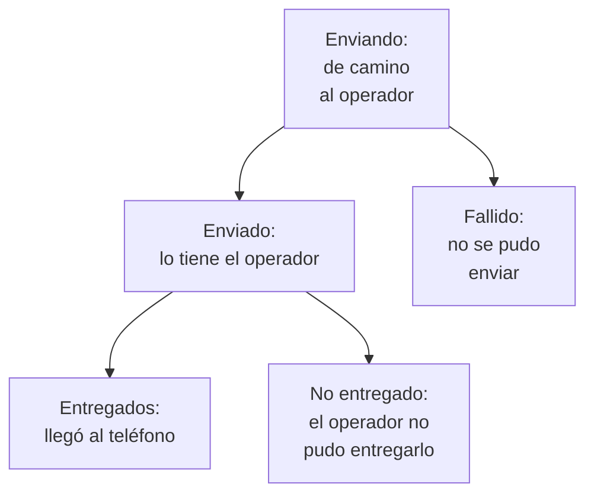

# Registros de notificación

Los registros de notificación listan cada mensaje que OneUptime envió para tu proyecto, una pestaña por canal, y qué fue de cada uno: si salió, si llegó y, si no, por qué. Ábrelos en **Ajustes del proyecto → Notificaciones → Registros de notificación**, o en **Registros de notificación** de un incidente, una alerta, un evento de mantenimiento, una página de estado o una política de guardia, para ver lo que se envió sobre ellos.

:::cards
- [Cómo leer un estado](#cómo-leer-un-estado): Su color dice dónde está el mensaje, y al señalarlo dice qué significa.
- [SMS](#sms): Enviando, luego Enviado, luego Entregados, según informa el operador.
- [Llamadas](#llamadas): Llamando, y luego cómo terminó la llamada.
- [WhatsApp y Telegram](#whatsapp-y-telegram): Lo que informa cada aplicación después de aceptar un mensaje.
- [Correo, push, webhooks y espacios de trabajo](#correo-push-webhooks-y-espacios-de-trabajo): Éxito, o Error y por qué.
- [Cuando un SMS se queda en Enviado](#cuando-un-sms-se-queda-en-enviado): Operadores que nunca responden, e informes que nunca llegan.
:::

## Cómo leer un estado

Cada estado es una etiqueta cuyo color dice dónde está el mensaje:

| Color | Dónde está el mensaje |
| --- | --- |
| Gris | Entregado al proveedor, y todavía no ha vuelto nada, como **Enviando**. |
| Azul | El proveedor lo tiene, y aún tiene que decir cómo terminó, como **Enviado** en un SMS o **Llamando** en una llamada. |
| Verde | Llegó a la persona, como **Entregados**, o este es el último estado que tendrá. |
| Amarillo | Llegó al teléfono y nadie contestó, como **Llamada perdida**, o salió con una advertencia. |
| Rojo | No llegó a la persona, como **No entregado**, **Fallido**, **Error** o **Saldo insuficiente**. |

Señala un estado, tócalo o llega a él con la tecla Tab, y dirá qué significa y qué viene después. **Ver mensaje de estado**, en el menú de la fila, muestra lo que respondió el proveedor, como el ID del mensaje o por qué falló. El filtro **Estado** de cada pestaña lista todos los estados que puede mostrar la pestaña, en el orden en que un mensaje pasa por ellos.

La tarjeta **A quién se avisó**, en la vista general de un incidente o una alerta, y el resultado de un aviso de prueba muestran el estado de cada mensaje de la misma manera y con los mismos colores: una llamada que aún está sonando aparece también allí como **Llamando**, nunca como **Enviado**.

## SMS

| Estado | Qué significa |
| --- | --- |
| **Enviando** | OneUptime entregó el SMS a Twilio, que lo está pasando al operador. |
| **Enviado** | El operador aceptó el SMS. Pasa a **Entregados** o **No entregado** en cuanto el operador responde. |
| **Entregados** | El operador confirmó que el SMS llegó al teléfono. Es el último estado de un SMS que llegó. |
| **No entregado** | El operador no pudo entregarlo. **Código de error** indica por qué y qué significa el código. |
| **Fallido** | Twilio no pudo enviarlo. **Código de error** indica por qué. |
| **Error** | No se envió, por ejemplo porque los SMS están desactivados en el proyecto, o Twilio rechazó el número. **Ver mensaje de estado** indica por qué. |
| **Saldo insuficiente** | No se envió: el saldo del proyecto no alcanzaba para pagarlo. |
| **Éxito** | Se envió antes de que OneUptime hiciera seguimiento de la entrega, y Twilio lo aceptó. |

Un SMS que aceptó la pasarela de SMS y llamadas del propio servidor se queda en **Enviado**, en verde: la pasarela no informa de la entrega, así que ese es su último estado.

Twilio informa a OneUptime de cada cambio en cuanto ocurre, firmado con el token de autenticación de la cuenta desde la que salió el SMS, y OneUptime rechaza cualquier informe que no sea de Twilio. Para ello, Twilio debe poder llegar a tu servidor: consulta [Integración de Twilio](/docs/self-hosted/twilio-integration).

### Códigos de error

Cada código en **Código de error** abre la página de Twilio sobre ese código, que enumera lo que puede causarlo. Debajo de los códigos con los que un SMS falla más a menudo, el registro dice en una línea qué significan:

| Código | Qué significa |
| --- | --- |
| `20003` | Twilio no aceptó las credenciales de la cuenta. |
| `21211` | El número no es un número de teléfono válido. |
| `21408` | La cuenta de Twilio no tiene permiso para enviar SMS a este país. |
| `21606` | El número de origen no puede enviar SMS para esta cuenta de Twilio. |
| `21608` | Una cuenta de prueba de Twilio solo puede enviar a números verificados en ella. |
| `21610` | El destinatario respondió STOP, así que Twilio ya no le envía SMS desde este número. |
| `21612` | El número de origen no puede llegar a este número. |
| `21614` | El número no es un número móvil, sino, por ejemplo, un teléfono fijo. |
| `30001` | Se enviaron demasiados SMS a la vez y la cola de Twilio se desbordó. |
| `30002` | La cuenta de Twilio se suspendió antes de que saliera el SMS. |
| `30003` | El teléfono está apagado o fuera de cobertura. |
| `30004` | El número tiene bloqueada la recepción del SMS. |
| `30005` | El número es desconocido y puede que ya no exista. |
| `30006` | El número no puede recibir SMS, por ejemplo porque es un teléfono fijo. |
| `30007` | Twilio o el operador filtró el SMS como spam. |
| `30008` | El operador no pudo entregar el SMS y no dijo por qué. |
| `30032` | El número gratuito de origen aún no está verificado. |
| `30034` | El número de origen no está registrado para A2P 10DLC, que exigen los operadores de EE. UU. |

Un código que no es de Twilio, como el estado HTTP con el que respondió tu pasarela de SMS y llamadas, se muestra tal cual.

## Llamadas

| Estado | Qué significa |
| --- | --- |
| **Llamando** | Twilio realizó la llamada. Cambia en cuanto Twilio informa de cómo terminó la llamada. |
| **Éxito** | Se contestó la llamada, y **Ver mensaje de estado** indica cuánto duró. Una llamada que aceptó la pasarela de SMS y llamadas del propio servidor queda en **Éxito** en cuanto la pasarela la acepta. |
| **Llamada perdida** | La llamada sonó sin respuesta: nadie contestó. |
| **Ocupado** | La línea estaba ocupada, o se rechazó la llamada. |
| **Buzón de voz** | El buzón de voz contestó una llamada de guardia. **Ver mensaje de estado** indica si se dejó un mensaje. |
| **Error** | No se pudo hacer ni conectar la llamada. |
| **Saldo insuficiente** | No se hizo: el saldo del proyecto no alcanzaba para pagarla. |

## WhatsApp y Telegram

Un mensaje de WhatsApp está **En cola** mientras OneUptime lo entrega, **Enviado** en cuanto WhatsApp lo acepta, **Entregados** en cuanto llega al teléfono, y **Leído** en cuanto se abre, si la persona comparte las confirmaciones de lectura. **Fallido** es un mensaje que WhatsApp no pudo entregar, y **Advertencia** uno que envió con una advertencia: **Ver mensaje de estado** indica lo que informó WhatsApp. **Error** y **Saldo insuficiente** significan que no se envió, igual que en un SMS.

Telegram no informa de nada después de aceptar un mensaje, así que el estado **Enviado** de un mensaje de Telegram es verde: Telegram lo publicó en el chat, y ese es su último estado.

## Correo, push, webhooks y espacios de trabajo

Estas pestañas dicen **Éxito** o **Error**. **Éxito** es el último estado: el servidor de correo aceptó el correo electrónico, el servicio push aceptó la notificación, la dirección del webhook respondió que recibió la solicitud, o el espacio de trabajo hizo lo que se le pidió. OneUptime no sigue un correo electrónico después de que el servidor de correo lo acepta, y una notificación push pasa a **Error** si el servicio push informa más tarde de que no se entregó. **Ver mensaje de estado** indica por qué un mensaje está en **Error**, como lo hace **Motivo** en la pestaña **Espacio de trabajo**.

## Cuando un SMS se queda en Enviado

**Enviado** significa que el operador tiene el SMS y aún no ha respondido. La mayoría de los operadores responden en segundos o minutos, pero algunos nunca lo hacen: entonces Twilio también mantiene el SMS en `sent`, como muestran sus registros de mensajes, y OneUptime no puede saber si llegó.

Un SMS que se queda en **Enviando** es otra cosa: los informes de Twilio no llegan a OneUptime. Comprueba que Twilio puede llegar a tu servidor, y busca en el registro del servidor las líneas que empiezan por `Twilio callback refused`: consulta [Integración de Twilio](/docs/self-hosted/twilio-integration).

## Próximos pasos

:::cards
- [Integración de Twilio](/docs/self-hosted/twilio-integration): Conecta Twilio, y deja que sus informes de entrega lleguen a OneUptime.
- [Pasarela de SMS y llamadas](/docs/self-hosted/sms-and-call-gateway): Envía SMS y llamadas por una pasarela propia.
- [Métricas de entrega de notificaciones](/docs/self-hosted/notification-delivery-metrics): Cuenta lo que se entregó en toda la instalación.
:::
