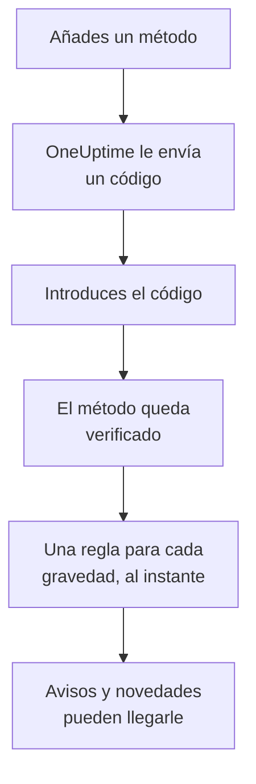

# Métodos de notificación

Un método de notificación es una dirección en la que OneUptime puede contactarte dentro de un proyecto: una dirección de correo, un número de teléfono para SMS o llamadas, un número de WhatsApp, una cuenta de Telegram, tu cuenta de Slack o Microsoft Teams, un teléfono o navegador para notificaciones push, o un webhook. Los añades en **Ajustes de usuario → Métodos de notificación**, los verificas, y OneUptime empieza a usarlos para tus avisos de inmediato.

:::cards
- [Elige un método](#elige-un-método): Lo que necesita cada método, y cómo se verifica.
- [Añade y verifica un método](#añade-y-verifica-un-método): Correo, SMS, llamadas y WhatsApp, con un código de 6 dígitos.
- [Webhooks](#webhooks): Envía los avisos a tu propio endpoint, firmados si quieres.
- [Activa un canal para tu proyecto](#activa-un-canal-para-tu-proyecto): Por qué pueden faltar SMS, llamadas, WhatsApp o Telegram.
:::

## Cómo se activa un método



Un método que no has verificado nunca se usa. Los dispositivos push, Slack, Microsoft Teams y los webhooks no necesitan código: registrar un dispositivo o vincular tu cuenta demuestra que es tuyo, y un webhook no necesita prueba. Verificar un método añade al instante tus [reglas predeterminadas](/docs/notifications/on-call-rules#las-reglas-con-las-que-empiezas) para él, así que un número de teléfono nuevo te avisa en cada gravedad hasta que cambies sus reglas.

## Elige un método

Cada pestaña de **Métodos de notificación** contiene una o más tarjetas, una por tipo de método:

| Tarjeta | Pestaña | Lo que añades | Cómo se verifica |
| --- | --- | --- | --- |
| **Correos para notificaciones** | **Direct Contact** | Una dirección de correo | Un código por correo |
| **Números de teléfono para notificaciones SMS** | **Direct Contact** | Un número de teléfono | Un código por SMS |
| **Números de teléfono para notificaciones por llamada** | **Direct Contact** | Un número de teléfono | Un código leído en una llamada, o ninguno para un número verificado para SMS |
| **Números de WhatsApp para notificaciones** | **Direct Contact** | Un número de WhatsApp | Un código por WhatsApp |
| **Cuentas de Telegram para notificaciones** | **Direct Contact** | Tu cuenta de Telegram | Un mensaje al bot de OneUptime |
| **Cuenta de Slack para notificaciones** | **Workspace Apps** | Tu cuenta de Slack | Vincular tu cuenta al espacio de trabajo del proyecto |
| **Cuenta de Microsoft Teams para notificaciones** | **Workspace Apps** | Tu cuenta de Microsoft Teams | Vincular tu cuenta al espacio de trabajo del proyecto |
| **Dispositivos de notificaciones push** | **Push Notifications** | Un teléfono con la app OneUptime On-Call, o un navegador | Registrar el dispositivo |
| **Webhooks para notificaciones** | **Webhooks** | Un endpoint HTTPS propio | Ninguno |

**Workspace Apps** solo aparece si el proyecto ha conectado Slack o Microsoft Teams, y solo contiene los que ha conectado. SMS, llamadas, WhatsApp y Telegram se pueden desactivar para todo el proyecto; consulta [Activa un canal para tu proyecto](#activa-un-canal-para-tu-proyecto).

## Añade y verifica un método

Las direcciones de correo, los números para SMS, los números para llamadas y los números de WhatsApp se verifican con un código de 6 dígitos.

:::steps
### Abre tus métodos

Ve a **Ajustes de usuario → Métodos de notificación**. **Direct Contact** es la primera pestaña.

### Añade la dirección

En la tarjeta del método, haz clic en su botón para añadir, por ejemplo **Añadir Número de teléfono para notificaciones SMS**. Introduce el **Correo electrónico**, o el **Número de teléfono** en formato internacional, por ejemplo `+11234567890`, y guarda.

### Introduce el código

El diálogo de verificación se abre solo, y dice adónde fue el código y hasta cuándo vale. Escribe el código en **Código de verificación** y haz clic en **Verificar**.

### Comprueba la fila

La fila aparece ahora como **Verificado**. ¿Cerraste el diálogo demasiado pronto? Haz clic en **Verificar** en la fila para volver a abrirlo.
:::

- Un código vale 15 minutos. Cinco intentos fallidos lo anulan, y necesitas uno nuevo.
- **Send a new code**, o **Call me with a new code** para un número de llamadas, está en el diálogo. Puedes pedir uno un minuto después del anterior.
- Un número que verificaste para SMS también queda verificado para llamadas. Añadirlo en **Números de teléfono para notificaciones por llamada** no necesita código, y verificar un número para SMS también verifica el número para llamadas que añadiste para él.
- Tu correo de inicio de sesión ya está ahí, verificado, desde el día en que te uniste al proyecto.

## Vincula Telegram

:::steps
### Añade la cuenta

En **Cuentas de Telegram para notificaciones**, haz clic en **Añadir Cuenta de Telegram**. **Usuario de Telegram (opcional)** es solo una etiqueta para ti, y puede quedar vacío.

### Escribe al bot

Haz clic en **Verificar** en la fila nueva. El diálogo **Verificar cuenta de Telegram** te da tres maneras de llegar al bot de OneUptime: escanear el código QR con tu teléfono, hacer clic en **Abrir en Telegram**, o buscar el bot en Telegram y enviarle el comando `/start` que muestra el diálogo.

### Confírmalo

De vuelta en OneUptime, haz clic en **He enviado el mensaje: comprueba**. En cuanto el bot tiene tu mensaje, la cuenta queda verificada.
:::

**Rotar código** crea un código nuevo para una cuenta que aún no está verificada. El código QR y el enlace que abriste antes dejan de funcionar. En un OneUptime autoalojado, el administrador del servidor conecta un bot de Telegram antes de que nadie pueda vincular una cuenta.

## Slack y Microsoft Teams

1. Vincula tu propia cuenta al espacio de trabajo del proyecto: **Ajustes de usuario → Espacio de trabajo → Slack**, o **Microsoft Teams**. Consulta [Slack](/docs/workspace-connections/slack) y [Microsoft Teams](/docs/workspace-connections/microsoft-teams).
2. En la pestaña **Workspace Apps**, haz clic en **Añadir cuenta de Slack** o **Añadir cuenta de Microsoft Teams**. La cuenta queda verificada al añadirla.
3. Haz clic en **Enviar mensaje de prueba** en su fila. Los avisos llegan como mensajes directos de la app de OneUptime.

## Notificaciones push

La pestaña **Push Notifications** lista tus **Dispositivos de notificaciones push**.

- **Un teléfono.** Instala la app OneUptime On-Call, conéctala a tu OneUptime, inicia sesión y permite las notificaciones: el teléfono se añade solo a esta lista. Consulta [Visión general de las aplicaciones](/docs/mobile-desktop-apps/index).
- **Este navegador.** Haz clic en **Registrar dispositivo**, ponle un **Nombre del dispositivo** y permite las notificaciones cuando el navegador lo pida.
- **Notificación de prueba** en la fila de un dispositivo le envía un push ahora mismo.
- **Alertas críticas** indica si los avisos del teléfono suenan aunque esté en silencio o en No molestar. Se activa en la app, nunca aquí, y un navegador no puede hacerlo. Consulta [Alertas de guardia críticas](/docs/self-hosted/push-notifications#alertas-críticas-de-guardia-anular-el-modo-silencio).
- A un dispositivo marcado como **No recibe notificaciones** no se le envía nada. Abre la app en ese teléfono, o vuelve a registrar el navegador, y vuelve a estar disponible.

## Webhooks

Un webhook envía cada aviso como JSON a un endpoint HTTPS tuyo, para que una herramienta propia actúe.

:::steps
### Añade el webhook

En la pestaña **Webhooks**, haz clic en **Añadir Webhook**. Rellena un **Nombre** que reconozcas, la **URL del webhook** y un **Secreto de firma (opcional)**.

### Envía una prueba

Haz clic en **Enviar prueba** en su fila. Tu endpoint recibe un evento cuyo `eventType` es `test`.

### Comprueba lo que llega

Un aviso es un `POST` JSON como el de abajo. Responde con cualquier estado `2xx` en menos de 10 segundos; las redirecciones no se siguen.
:::

```json title="A page, as your endpoint receives it"
{
  "eventType": "on-call.incident.created",
  "timestamp": "2026-10-15T09:30:00.000Z",
  "projectId": "6a3f0d2e-1c4b-4e8a-9b7d-2f5c8e1a0b3c",
  "userId": "0c9e8d7f-6b5a-4c3d-8e2f-1a0b9c8d7e6f",
  "incident": {
    "id": "5b4a3c2d-1e0f-4a9b-8c7d-6e5f4a3b2c1d",
    "title": "Checkout API is down",
    "description": "Health check failed from 3 probes.",
    "incidentNumber": 42,
    "incidentNumberWithPrefix": "INC-42",
    "severity": "Critical Incident",
    "state": "Identified"
  },
  "onCallPolicyId": "7d6c5b4a-3e2f-4d1c-9b8a-7f6e5d4c3b2a",
  "onCallPolicyEscalationRuleId": "8e7d6c5b-4a3f-4e2d-8c1b-9a8f7e6d5c4b"
}
```

| `eventType` | Se envía para | La clave del registro |
| --- | --- | --- |
| `on-call.incident.created` | Un incidente | `incident` |
| `on-call.alert.created` | Una alerta | `alert` |
| `on-call.incidentEpisode.created` | Un episodio de incidente | `incidentEpisode` |
| `on-call.alertEpisode.created` | Un episodio de alerta | `alertEpisode` |

Las novedades que activas para Webhook en **Ajustes de notificaciones** llegan al mismo endpoint, con el evento del ajuste en `eventType` y un breve resumen en `subject` y `message`.

Cada solicitud lleva `X-OneUptime-Event`, el tipo de evento. Con un secreto de firma, lleva además `X-OneUptime-Signature`: `sha256=` seguido del HMAC-SHA256 del cuerpo sin procesar, en hexadecimal. Compruébalo antes de confiar en la solicitud:

```javascript title="verify-signature.js"
const crypto = require("crypto");

// rawBody: the request body exactly as it arrived, before any JSON parsing.
function isFromOneUptime(rawBody, signatureHeader, secret) {
  const expected =
    "sha256=" + crypto.createHmac("sha256", secret).update(rawBody).digest("hex");
  const received = Buffer.from(signatureHeader || "");
  const wanted = Buffer.from(expected);
  return received.length === wanted.length && crypto.timingSafeEqual(received, wanted);
}
```

Un webhook no necesita verificación, así que añadirlo añade sus reglas al instante. Las direcciones privadas e internas se rechazan, salvo que el administrador de un servidor autoalojado las permita: consulta [Acceso a red privada](/docs/self-hosted/private-network-access#webhooks-y-workflows).

## Activa un canal para tu proyecto

**SMS**, **Llamadas telefónicas**, **WhatsApp** y **Telegram** empiezan desactivados en cada proyecto nuevo, porque cada mensaje cuesta dinero: en OneUptime Cloud se paga con el saldo del proyecto, y los SMS y las llamadas pasan en cambio por la cuenta de Twilio propia del proyecto cuando su cuenta predeterminada los envía. El correo, el push, Slack, Microsoft Teams y los webhooks siempre están activados.

Mientras un canal está desactivado, nadie en el proyecto puede añadir un método en él: su tarjeta no tiene botón para añadir, y dice quién puede activarlo. Lo activa un propietario del proyecto, un **Administrador de facturación** o alguien con **Manage Billing**, en la tarjeta **Canales de notificación** de **Ajustes del proyecto → Notificaciones → Ajustes de notificaciones**. Un administrador del proyecto no puede. En un OneUptime autoalojado, los SMS y las llamadas necesitan además una cuenta de Twilio, y Telegram un bot que conecta el administrador del servidor; consulta [Integración de Twilio](/docs/self-hosted/twilio-integration).

## Elimina un método

Haz clic en **Eliminar** en la fila del método. Eliminar un método elimina todas las reglas de guardia que lo usan, así que el diálogo cuenta primero esas reglas y nombra cualquier gravedad que la eliminación dejaría sin ninguna regla.

## Solución de problemas

:::details Una tarjeta no tiene botón para añadir
Ese canal está desactivado en este proyecto. La tarjeta dice quién puede activarlo; consulta [Activa un canal para tu proyecto](#activa-un-canal-para-tu-proyecto).
:::

:::details El código nunca llegó
Los correos pueden tardar unos minutos, y a veces acaban en spam; los SMS pueden tardar un minuto. Espera un minuto y luego haz clic en **Send a new code** en el diálogo. **Ajustes del proyecto → Notificaciones → Registros de notificación** muestra qué pasó con el mensaje.
:::

:::details Falla al añadir mi cuenta de Slack
Vincula primero tu cuenta en **Ajustes de usuario → Espacio de trabajo → Slack**, y luego vuelve a hacer clic en **Añadir cuenta de Slack**. El diálogo de error tiene un botón que te lleva allí.
:::

:::details Mi teléfono no recibe notificaciones push
Comprueba que el teléfono aparece en **Dispositivos de notificaciones push**, y envíale una **Notificación de prueba**. Consulta [Preguntas frecuentes y solución de problemas](/docs/mobile-desktop-apps/faq-troubleshooting#notificaciones).
:::

## Próximos pasos

:::cards
- [Reglas de guardia personales](/docs/notifications/on-call-rules): Decide qué método prueba cada aviso, y cuándo.
- [Ajustes de notificaciones](/docs/notifications/notification-settings): Elige las novedades de las que te enteras, y por qué canales.
- [Visión general de las aplicaciones](/docs/mobile-desktop-apps/index): Recibe los avisos en tu teléfono o tu ordenador.
- [Cómo te contacta OneUptime](/docs/notifications/index): Cómo encajan los métodos, las reglas y los ajustes.
:::
