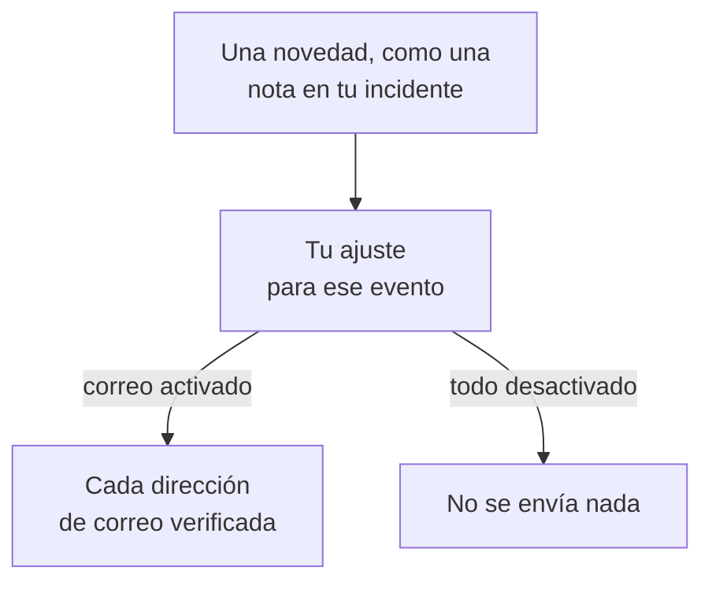

# Ajustes de notificaciones

Los ajustes de notificaciones deciden qué novedades te llegan sobre los registros que son tuyos, como un incidente, un monitor o una página de estado, y sobre tus propios turnos de guardia, y por qué canales. Nunca te avisan: avisar es tarea de tus reglas de guardia. Los configuras en **Ajustes de usuario → Ajustes de notificaciones**, con un interruptor por evento y canal.

:::cards
- [Cómo funcionan los ajustes](#cómo-funcionan-los-ajustes): Un interruptor por evento y canal, enviado a cada método verificado.
- [Cambia un ajuste](#cambia-un-ajuste): Tres clics, guardado al instante.
- [Qué está activado para un miembro nuevo](#qué-está-activado-para-un-miembro-nuevo): Los valores predeterminados, pestaña por pestaña.
- [Menos correos](#menos-correos): Agrupa las ráfagas, o deja fuera los rutinarios.
:::

## Cómo funcionan los ajustes

- Cada fila es un evento, y cada columna un canal: Correo electrónico, SMS, Llamada, Push, WhatsApp, Telegram, Slack y Microsoft Teams, y Webhook. Slack y Microsoft Teams solo son columnas cuando el proyecto los ha conectado.
- Un canal activado envía a cada método verificado que tengas en él en este proyecto, no solo a uno.
- Un canal activado sin un método verificado detrás no envía nada. **Tu lista de configuración** lo indica en **Mantenerse informado**.
- Una novedad va a los propietarios del registro: las personas nombradas como propietarias y los miembros de sus equipos propietarios. Cuando un registro no tiene propietarios, va en cambio a los propietarios del proyecto. Un evento sobre haber sido añadido como propietario solo va a la persona añadida.
- Los casos de seguridad no tienen propietarios. Un caso nuevo va a todas las personas que pueden ver los casos del proyecto, a partir de la prioridad que elige cada una, y un caso asignado, a las personas a las que está asignado. Consulta [Casos de seguridad](/docs/telemetry/security-cases#notificaciones).
- Cada correo a los propietarios termina con un enlace "Manage notification preferences" que lleva de vuelta a esta página.

## Cambia un ajuste

:::steps
### Abre tus ajustes

Ve a **Ajustes de usuario → Ajustes de notificaciones**. Las pestañas son **Incidentes**, **Alertas**, **Monitoreo**, **Páginas de estado**, **Mantenimiento programado**, **De guardia** y **Seguridad**.

### Busca el evento

Cada pestaña contiene una o más tarjetas, como **Episodios de incidente** en la pestaña **Incidentes**. Cada fila es un evento, con una línea que dice cuándo se envía.

### Haz clic en un canal

Haz clic en el círculo de un canal para activarlo, y otra vez para desactivarlo. Una marca de verificación significa activado. Los cambios se guardan automáticamente.
:::

## Qué está activado para un miembro nuevo

Cuando te unes a un proyecto, estos eventos empiezan activados, por correo. Todo lo demás empieza desactivado, y no envía nada hasta que activas un canal.

| Pestaña | Activados por correo | Desactivados hasta que los actives |
| --- | --- | --- |
| **Incidentes** | **Incidente creado**, **Estado del incidente cambiado**, **Recordatorio de incidente**, **SLA de incidente incumplido**, **Episodio de incidente creado**, **Estado del episodio de incidente cambiado**, **Incidente añadido al episodio de incidente** | **Nota de incidente publicada**, **Añadido como propietario del incidente**, **Asignado a un incidente**, **Nota de episodio de incidente publicada**, **Añadido como propietario del episodio de incidente** |
| **Alertas** | **Alerta creada**, **El estado de la alerta ha cambiado**, **Recordatorio de alerta**, **Episodio de alerta creado**, **El estado del episodio de alerta ha cambiado**, **Alerta añadida al episodio de alerta** | **Nota de alerta publicada**, **Añadido como propietario de la alerta**, **Nota del episodio de alerta publicada**, **Añadido como propietario del episodio de alerta** |
| **Monitoreo** | **El estado de la sonda cambió para tu monitor**, **El monitor no tiene sondas activas**, **El estado del SLO cambió**, **Añadido como propietario del SLO**, **Estado de la sonda cambiado**, **Añadido como propietario de la sonda** | **Monitor creado**, **Estado del monitor cambiado**, **Añadido como propietario del monitor**, **El estado del agente de IA ha cambiado**, **Añadido como propietario del agente de IA** |
| **Páginas de estado** | Ninguno | **Página de estado creada**, **Anuncio de página de estado publicado**, **Añadido como propietario de la página de estado** |
| **Mantenimiento programado** | **Recordatorio de mantenimiento** | **Evento de mantenimiento creado**, **Estado de mantenimiento cambiado**, **Nota de mantenimiento publicada**, **Añadido como propietario del mantenimiento** |
| **De guardia** | **Entras en la guardia**, **Eres el siguiente en la guardia**, **Sales de la guardia**, **Añadido a la política de guardia**, **Eliminado de la política de guardia**, **Llamada perdida**, y también por push: **Antes de que empiece mi turno de guardia**, **Mi próximo turno de guardia se reasigna** | Ninguno |
| **Seguridad** | También por push: **Nuevo caso de seguridad** (casos de prioridad Alta y Crítica), **Caso de seguridad asignado a mí**, **Paso de playbook esperando mi aprobación** | Ninguno |

> [!IMPORTANT]
> **Estado del monitor cambiado** empieza desactivado. Para enterarte de cuándo un monitor que es tuyo cae o vuelve, actívalo en la pestaña **Monitoreo**.

## Tus turnos

La pestaña **De guardia** trata de ti, no de los registros que son tuyos:

- **Entras en la guardia**, **Eres el siguiente en la guardia** y **Sales de la guardia** siguen tus turnos en los calendarios de guardia en los que estás.
- **Añadido a la política de guardia** y **Eliminado de la política de guardia** te dicen cuándo una política de guardia empieza o deja de nombrarte.
- **Antes de que empiece mi turno de guardia** envía recordatorios en los momentos que eliges en **Ajustes de usuario → Calendario → Feed de calendario**, y **Mi próximo turno de guardia se reasigna** te dice cuándo otra persona cubre un turno del que recibiste un recordatorio. Consulta [Feeds de calendario](/docs/on-call/calendar-feeds#recordatorios-y-avisos-de-reasignación).
- **Llamada perdida**, en la tarjeta **Políticas de llamadas entrantes**, avisa a los propietarios de una política de llamadas entrantes de que una persona que llamó no contactó con nadie. Consulta [Política de llamadas entrantes](/docs/on-call/incoming-call-policy#llamadas-perdidas).

## Casos de seguridad

La pestaña **Seguridad** trata de los casos de seguridad que puedes ver:

- **Nuevo caso de seguridad** tiene una prioridad debajo de su nombre: la prioridad mínima de los casos que te avisan. Es **Alta y superior** salvo que elijas **Solo Crítica**, **Media y superior**, **Baja y superior** o **Todos los casos**.
- **Caso de seguridad asignado a mí** sigue los casos asignados a ti y a los equipos de los que formas parte.
- **Paso de playbook esperando mi aprobación** te pide que apruebes o rechaces un paso de playbook en un caso en el que puedes aprobar.

Consulta [Casos de seguridad](/docs/telemetry/security-cases#notificaciones).

## Menos correos

Estos interruptores deciden qué novedades te llegan, no cuántos correos suman. **Ajustes de usuario → Preferencias de correo** tiene dos tarjetas para eso, ambas solo para ti, en este proyecto:

- **Resumen de correos** agrupa una ráfaga de novedades en un solo correo: las primeras siguen llegando una a una, y el resto juntas unos minutos después.
- **Menos correos rutinarios** desactiva, con **Reducir los correos rutinarios**, los correos sobre notas, nuevos propietarios, nuevos monitores y páginas de estado, incorporaciones a episodios y cambios en políticas de guardia.

Consulta [Resumen de notificaciones](/docs/emails/notification-rollup).

## Solución de problemas

:::details Un interruptor está activado, pero no llega nada
Comprueba que tienes un método verificado en ese canal en **Ajustes de usuario → Métodos de notificación**. Para SMS, llamadas, WhatsApp y Telegram, el proyecto también debe tener el canal activado.
:::

:::details Soy propietario de un monitor, pero nunca me entero de cuándo cae
**Estado del monitor cambiado** empieza desactivado. Activa un canal para él, en la pestaña **Monitoreo**.
:::

:::details Sigo recibiendo correos después de desactivarlo todo
Los avisos siguen tus reglas de guardia, no estos interruptores, y los correos de inicio de sesión, seguridad y facturación no son novedades sobre registros. Cada proyecto tiene sus propios ajustes, así que revisa el proyecto del que vino el correo. Consulta [Reglas de guardia personales](/docs/notifications/on-call-rules).
:::

## Próximos pasos

:::cards
- [Métodos de notificación](/docs/notifications/notification-methods): Añade los métodos a los que envían tus ajustes.
- [Reglas de guardia personales](/docs/notifications/on-call-rules): Decide cómo te llega un aviso.
- [Resumen de notificaciones](/docs/emails/notification-rollup): Menos correos, más completos, durante una ráfaga.
- [Cómo te contacta OneUptime](/docs/notifications/index): Cómo encajan los métodos, las reglas y los ajustes.
:::
