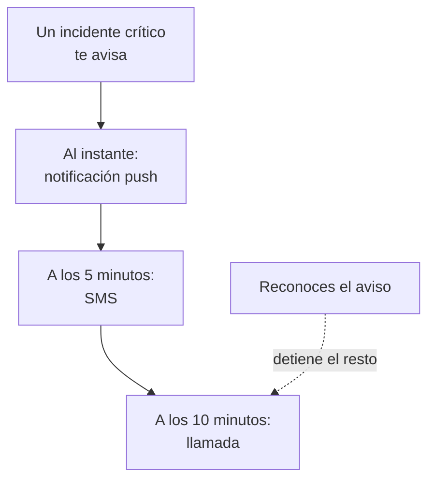

# Cómo contactarme

Tus reglas de guardia deciden cómo te llega un aviso: qué métodos de notificación tuyos prueba OneUptime, y cuánto tiempo después de que empiece el aviso. Cada tipo de aviso tiene sus propias reglas, un conjunto por gravedad, de modo que un incidente crítico puede llamarte al instante mientras una alerta leve espera a un correo. Las configuras en **Ajustes de usuario → Cómo contactarme**.

> [!NOTE]
> Estas reglas son solo tuyas. Las **Reglas de guardia** de **Incidentes → Reglas** y **Alertas → Reglas** son otra cosa: deciden qué políticas de guardia ejecuta un incidente o una alerta nuevos.

:::cards
- [Cómo te llega un aviso](#cómo-te-llega-un-aviso): Tus reglas para un aviso, paso a paso.
- [Una sola secuencia para todo](#una-sola-secuencia-para-todo): Los pasos que prueba cada aviso, configurados una vez.
- [Las reglas con las que empiezas](#las-reglas-con-las-que-empiezas): Lo que añade cada método verificado, y cómo recortarlo.
- [Añade una regla](#añade-una-regla): Un método y un retraso para una gravedad.
- [Reglas push](#reglas-push): Suenan aunque el teléfono esté en silencio, y se repiten hasta que alguien reconoce.
:::

## Cómo te llega un aviso

Una política de guardia te avisa cuando una de sus reglas de escalado te nombra a ti, a un equipo del que formas parte o un calendario en el que estás de guardia. OneUptime recorre entonces tus reglas para ese tipo de aviso y su gravedad: cada regla se dispara por su propio método cuando ha pasado su retraso desde que empezó el aviso. Reconocer el incidente o la alerta, desde cualquier mensaje o en OneUptime, detiene todas las reglas que aún no se han disparado.

La mayoría de los mensajes pueden reconocer el aviso: los correos, los SMS y los mensajes de WhatsApp, Telegram, Slack, Microsoft Teams y Mattermost llevan un enlace para reconocerlo, y una llamada te pide que pulses 1. Si no puedes atender un aviso, los mismos mensajes te permiten escalarlo, y una llamada te pide que pulses 2: la política avisa de inmediato a su siguiente nivel, y no te vuelven a avisar de ello. Consulta [Escalar un aviso](/docs/on-call/escalation-rules#escalar-un-aviso). Cada aviso que recibes aparece en **Ajustes de usuario → Registros de guardia**, donde **Ver cronología** muestra cada mensaje enviado y si se entregó.

## Una sola secuencia para todo

**Ajustes de usuario → Cómo contactarme** se abre con tu secuencia: pasos numerados que cada aviso prueba uno tras otro, para incidentes, alertas y episodios de cualquier gravedad. Cada paso es un momento, por ejemplo de inmediato o después de 5 minutos, con los métodos verificados que salen juntos en ese momento. Un paso posterior solo sale si nadie ha reconocido el aviso para entonces.

:::steps
### Añadir una forma de contactarte

Haz clic en **Añadir** en un paso para enviar uno de tus métodos verificados en el momento de ese paso, o en **Añadir paso** para empezar un paso nuevo después del último. Un número o una dirección que aún espera su código aparece en **Aún sin verificar**, con **Verificar**. Sin salir de la página, **Añadir tu teléfono** bajo los pasos envía un código a tu número y, en cuanto está verificado, el número te avisa por SMS y por llamada telefónica; **Usar este navegador** y **Obtener la app** añaden push de la misma forma.

### Elegir cuándo se usa

Haz clic en el momento de un paso, por ejemplo **De inmediato**, y elige otro, hasta una hora: todo el paso se mueve. Un paso de push indica además cómo suena y si se repite: consulta [Reglas push](#reglas-push).

### Guardar

Haz clic en **Guardar cambios**, que aparece en cuanto algo ha cambiado. Escribe las mismas reglas en cada tarjeta de cada pestaña: las reglas que añadirías a mano a cada tarjeta.
:::

**Prueba tus avisos**, al pie de la página, te envía un aviso de prueba a través de ellas.

Cuando tu servidor no puede enviar ahora mismo correos, SMS ni llamadas telefónicas, un paso de ese tipo aparece marcado con **No se envía ahora mismo**, y la página dice una sola vez quién puede configurarlo.

Cuando una gravedad merece otra cosa, **Distinto para algunas gravedades**, el botón junto al título, abre las pestañas y tarjetas que se describen abajo. Una tarjeta que difiere de tu secuencia lleva la marca **Difiere de la secuencia**. La página sigue abriéndose en tus pasos y, debajo de ellos, lista cada tarjeta que difiere y qué hace en su lugar. **Guardar cambios** deja esas tarjetas como están; **Usar esta secuencia para cada gravedad**, al final de esa lista, les da también tu secuencia, después de nombrar las tarjetas que pierden su diferencia. Una gravedad que tu proyecto archivó conserva sus propias reglas.

Una política de guardia decide a quién se avisa y cuándo llega su siguiente nivel. Cómo se te contacta es esta secuencia, para cada política que te avisa.

## Las cuatro pestañas

**Ajustes de usuario → Cómo contactarme** tiene una pestaña por tipo de aviso. Cada pestaña tiene una tarjeta por gravedad, con el nombre y el color que les dio tu proyecto:

| Pestaña | Avisos de | Tarjetas para |
| --- | --- | --- |
| **Incidentes** | Incidentes | Gravedades de incidente |
| **Episodios de incidente** | Episodios que agrupan incidentes | Gravedades de incidente |
| **Alertas** | Alertas | Gravedades de alerta |
| **Episodios de alerta** | Episodios que agrupan alertas | Gravedades de alerta |

Un episodio te avisa mediante sus propias políticas de guardia, aparte de los incidentes o alertas que contiene, por eso sus reglas tienen su propia pestaña. La dirección de la página indica la pestaña abierta, por ejemplo `/dashboard/{projectId}/user-settings/on-call-rules?type=alerts`; los otros valores son `incident-episodes` y `alert-episodes`, y sin `type` la página se abre en **Incidentes**.

Una gravedad que su proyecto archivó aparece después de las demás, marcada como **Archivado**, mientras tenga reglas para ella: los incidentes y las alertas que aún la tienen le avisan con esas reglas. Puede cambiarlas o eliminarlas, pero no añadir otras nuevas.

## Las reglas con las que empiezas

Cada método que verificas recibe una regla en cada tarjeta de cada pestaña, enviada en cuanto te avisan. Tu correo de inicio de sesión las tiene desde el día en que te uniste, para que un aviso siempre te llegue. Verifica un número de teléfono para SMS, y cada aviso también te envía un SMS. Cuando tu proyecto tiene una secuencia predeterminada, cada método que verificas la sigue en su lugar: consulta [La secuencia predeterminada](#la-secuencia-predeterminada).

Es un comienzo seguro, y normalmente demasiado. Recórtalo a lo que merece cada gravedad:

| Gravedad | Un conjunto sensato |
| --- | --- |
| Crítica | Push al instante, una llamada a los 5 minutos |
| Mayor | Push al instante, un SMS a los 10 minutos |
| Menor o baja | Un correo al instante |

Tus propias reglas no tienen horas de silencio: deja las gravedades bajas en correo, o en una regla push configurada como **Estándar**, para que nunca te despierten. Para que el aviso de una gravedad baja espere al horario laboral para todos, configura la regla de guardia que lo activa como **Solo en horario laboral**: consulta [Reglas de guardia](/docs/alerts/settings#reglas-de-guardia).

## La secuencia predeterminada

Un proyecto puede tener una secuencia predeterminada: cómo se avisa a un miembro en cuanto verifica una forma de contactarlo. Un Propietario del proyecto o un Administrador del proyecto la define en **Secuencia predeterminada para nuevos miembros**, plegada en **Más ajustes** en **Ajustes del proyecto → Notificaciones → Canales de notificación**, con canales en lugar de los dispositivos de cada persona: por ejemplo, push al instante y una llamada telefónica a los 5 minutos.

Con una secuencia predeterminada, un método que verificas recibe una regla en cada paso de su canal, en cada tarjeta de cada pestaña, y un canal que la secuencia deja fuera no recibe ninguna. Las reglas que ya tienes nunca cambian, y un aviso que no encuentra ninguna regla sigue recurriendo a tus métodos verificados.

Para dársela a miembros que ya tienen reglas, un administrador usa **Aplicar secuencia predeterminada** en la página Preparación: consulta [Aplicar la secuencia predeterminada](/docs/on-call/readiness#aplicar-la-secuencia-predeterminada). Cada uno de ellos recibe un correo.

Para seguirla tú mismo, haz clic en **Partir de la secuencia predeterminada**, junto a **Distinto para algunas gravedades**. Tus pasos pasan a ser los de la secuencia, con tus propios métodos verificados: una forma que no has verificado queda fuera y se nombra, y conservas tus propios pasos en su lugar. Nada cambia hasta que haces clic en **Guardar cambios**.

**Teléfono para las personas de guardia**, a su lado, pide a todas las personas de guardia un número verificado de SMS, llamada telefónica o WhatsApp. Mientras no tengas ninguno, esta página lo dice encima de **Añadir tu teléfono**, y Preparación y Salud de la configuración te nombran. Nadie queda bloqueado.

## Añade una regla

:::steps
### Abre la tarjeta

Ve a **Ajustes de usuario → Cómo contactarme**, abre la pestaña del tipo de aviso y busca la tarjeta de la gravedad.

### Elige el método

Haz clic en **Añadir regla de notificación**. En **Método de notificación**, elige uno de tus métodos verificados; un método que no has verificado no se ofrece.

### Elige cómo suena un push

Para un teléfono, elige **Notificación push**: **Alerta crítica** o **Estándar**. Para cualquier dispositivo push, elige **Repetir hasta que se reconozca**. Consulta [Reglas push](#reglas-push).

### Fija el retraso

Elige **Notificarme después de**: **Inmediatamente**, **5 minutos**, **10 minutos**, **15 minutos**, **30 minutos** o **1 hora**. Luego haz clic en **Añadir regla de notificación** en el diálogo.
:::

La tarjeta lista sus reglas por orden de retraso, con **Método de notificación** y **Notificar después de** para cada una.

## Cambia o elimina una regla

- **Editar** en la fila de una regla cambia su retraso. Para enviar una regla a otro método, elimínala y añade una nueva.
- En una regla push, haz clic en la etiqueta bajo el método para cambiar entre **Alerta crítica** y **Estándar**, o para cambiar cada cuánto se repite. Se guarda al instante.
- **Eliminar** pide confirmación primero, y dice si la gravedad se queda sin regla. Una gravedad sin regla recurre a tus métodos verificados; consulta [Cuando una gravedad no tiene regla](#cuando-una-gravedad-no-tiene-regla).

## Reglas push

Una regla que avisa a un teléfono indica cómo suena su push:

| Opción | Lo que hace el teléfono |
| --- | --- |
| **Alerta crítica** | Suena aunque el teléfono esté en silencio o en No molestar, una vez que Critical On-Call Alerts está activado en la app OneUptime On-Call. Una regla nueva para un teléfono empieza aquí. |
| **Estándar** | Sigue los ajustes de sonido, silencio y No molestar del teléfono. |

Una regla push, para un teléfono o un navegador, también puede reenviar su push hasta que alguien reconozca: **No repetir**, la opción predeterminada, o **Cada minuto**, **Cada 2 minutos**, **Cada 3 minutos**, **Cada 5 minutos**, **Cada 10 minutos**, **Cada 15 minutos** o **Cada 30 minutos**. Se repite hasta 10 veces más, y se detiene en cuanto el incidente, la alerta o el episodio se reconoce. Un aviso que sigue después de un reconocimiento, como un nuevo aviso, se repite hasta que responde alguien a quien avisó o se resuelve el incidente, la alerta o el episodio: [Cuando avisan varias políticas](/docs/on-call/policies#cuando-avisan-varias-políticas) los enumera. Consulta [Alertas de guardia críticas](/docs/self-hosted/push-notifications#alertas-críticas-de-guardia-anular-el-modo-silencio).

## Cuando una gravedad no tiene regla

Una gravedad que tu proyecto añade más tarde recibe reglas en pocos minutos, hechas con lo que ya elegiste en esa pestaña: los mismos métodos, tras los mismos retrasos, y un push que suena y se repite igual. Si no tenías reglas en esa pestaña, recibe tu correo verificado, al instante. Cuando tu proyecto tiene una secuencia predeterminada, tu correo la sigue en su lugar: consulta [La secuencia predeterminada](#la-secuencia-predeterminada).

Un aviso que aun así no encuentra regla se envía igualmente a tus métodos verificados, y recibes un correo al respecto; consulta [Cuando ninguna regla coincide](/docs/notifications/index#cuando-ninguna-regla-coincide).

:::details Desactivar una gravedad a propósito
La API puede guardar una regla de exclusión, con `isOptOut` activado y sin método: entonces no te avisan para ese tipo de aviso y esa gravedad, y nada la sustituye. La fila muestra **Silenciado: notificaciones desactivadas para esta regla**, y eliminarla vuelve a activar los avisos. Una gravedad añadida más tarde también queda silenciada cuando todas las reglas que tienes en esa pestaña son exclusiones.
:::

:::details Desactivar la alternativa para todo un proyecto
Un Propietario del proyecto, o alguien con **Manage Billing**, puede establecer `disableOnCallNotificationFallback` del proyecto mediante la API. Un aviso que no encuentra regla no se entrega entonces, y su registro dice que el usuario debe añadir reglas en **Ajustes de usuario → Cómo contactarme**.
:::

## Las reglas de un compañero

Los Propietarios del proyecto y Administradores del proyecto pueden ver y cambiar la misma página para cualquier persona del proyecto: en **Usuarios**, abren a la persona y luego **Cómo contactarme** en la sección **Guardia**. **Preparación**, al lado, muestra si cada gravedad le llega. Cuando otra persona añade, cambia o elimina tus reglas, recibes un correo al respecto, y cada cambio queda en el registro de auditoría del proyecto.

## Solución de problemas

:::details Mi teléfono no sonó con un aviso crítico
Comprueba que el push de la regla es **Alerta crítica** y no **Estándar**, y que **Alertas críticas** está activado para el teléfono en **Ajustes de usuario → Métodos de notificación**, en la pestaña **Notificaciones push**.
:::

:::details Me avisan dos veces por cada incidente
Cada método verificado tiene una regla para cada gravedad, enviada al instante. Elimina las reglas que no quieras, o dales un retraso. Un incidente dentro de un episodio puede avisarte una vez por el incidente y otra por el episodio, mediante dos políticas.
:::

:::details Recibí un correo aunque mi regla dice SMS
El aviso no encontró regla para su tipo o gravedad, y recurrió a tus métodos gratuitos: añade la regla en la pestaña y la tarjeta correctas. O el correo era una novedad sobre un registro que es tuyo, que sigue los **Ajustes de notificaciones**, no tus reglas. Tus **Registros de guardia** solo listan avisos.
:::

## Próximos pasos

:::cards
- [Métodos de notificación](/docs/notifications/notification-methods): Añade y verifica los métodos a los que apuntan tus reglas.
- [Reglas de escalado](/docs/on-call/escalation-rules): Cómo una política de guardia avisa a las personas, nivel por nivel.
- [Notificaciones push](/docs/self-hosted/push-notifications): Alertas críticas, sonidos de alarma y repeticiones en teléfonos.
- [Cómo te contacta OneUptime](/docs/notifications/index): Cómo encajan los métodos, las reglas y los ajustes.
:::
