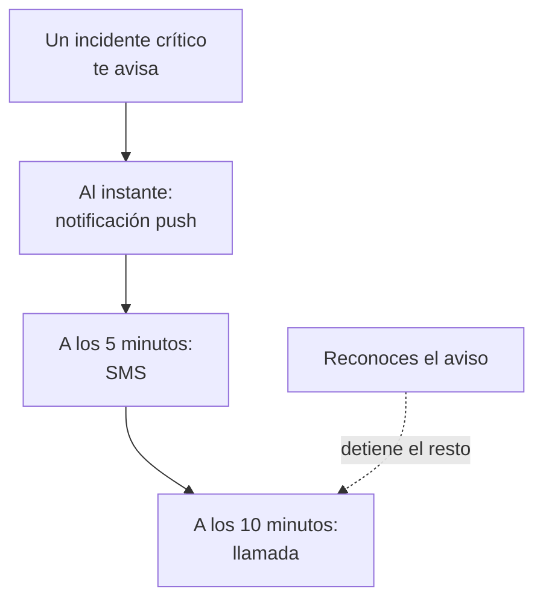

# Reglas de guardia personales

Tus reglas de guardia deciden cómo te llega un aviso: qué métodos de notificación tuyos prueba OneUptime, y cuánto tiempo después de que empiece el aviso. Cada tipo de aviso tiene sus propias reglas, un conjunto por gravedad, de modo que un incidente crítico puede llamarte al instante mientras una alerta leve espera a un correo. Las configuras en **Ajustes de usuario → Reglas de guardia**.

> [!NOTE]
> Estas reglas son solo tuyas. Las **Reglas de guardia** de **Incidentes → Reglas** y **Alertas → Reglas** son otra cosa: deciden qué políticas de guardia ejecuta un incidente o una alerta nuevos.

:::cards
- [Cómo te llega un aviso](#cómo-te-llega-un-aviso): Tus reglas para un aviso, paso a paso.
- [Las reglas con las que empiezas](#las-reglas-con-las-que-empiezas): Lo que añade cada método verificado, y cómo recortarlo.
- [Añade una regla](#añade-una-regla): Un método y un retraso para una gravedad.
- [Reglas push](#reglas-push): Suenan aunque el teléfono esté en silencio, y se repiten hasta que alguien reconoce.
:::

## Cómo te llega un aviso

Una política de guardia te avisa cuando una de sus reglas de escalado te nombra a ti, a un equipo del que formas parte o un calendario en el que estás de guardia. OneUptime recorre entonces tus reglas para ese tipo de aviso y su gravedad: cada regla se dispara por su propio método cuando ha pasado su retraso desde que empezó el aviso. Reconocer el incidente o la alerta, desde cualquier mensaje o en OneUptime, detiene todas las reglas que aún no se han disparado.

La mayoría de los mensajes pueden reconocer el aviso: los correos, los SMS y los mensajes de WhatsApp, Telegram, Slack y Microsoft Teams llevan un enlace para reconocerlo, y una llamada te pide que pulses 1. Si no puedes atender un aviso, los mismos mensajes te permiten escalarlo, y una llamada te pide que pulses 2: la política avisa de inmediato a su siguiente nivel, y no te vuelven a avisar de ello. Consulta [Escalar un aviso](/docs/on-call/escalation-rules#escalar-un-aviso). Cada aviso que recibes aparece en **Ajustes de usuario → Registros de guardia**, donde **Ver cronología** muestra cada mensaje enviado y si se entregó.

## Las cuatro pestañas

**Ajustes de usuario → Reglas de guardia** tiene una pestaña por tipo de aviso. Cada pestaña tiene una tarjeta por gravedad, con el nombre y el color que les dio tu proyecto:

| Pestaña | Avisos de | Tarjetas para |
| --- | --- | --- |
| **Incidentes** | Incidentes | Gravedades de incidente |
| **Episodios de incidente** | Episodios que agrupan incidentes | Gravedades de incidente |
| **Alertas** | Alertas | Gravedades de alerta |
| **Episodios de alerta** | Episodios que agrupan alertas | Gravedades de alerta |

Un episodio te avisa mediante sus propias políticas de guardia, aparte de los incidentes o alertas que contiene, por eso sus reglas tienen su propia pestaña. La dirección de la página indica la pestaña abierta, por ejemplo `/dashboard/{projectId}/user-settings/on-call-rules?type=alerts`; los otros valores son `incident-episodes` y `alert-episodes`, y sin `type` la página se abre en **Incidentes**.

## Las reglas con las que empiezas

Cada método que verificas recibe una regla en cada tarjeta de cada pestaña, enviada en cuanto te avisan. Tu correo de inicio de sesión las tiene desde el día en que te uniste, para que un aviso siempre te llegue. Verifica un número de teléfono para SMS, y cada aviso también te envía un SMS.

Es un comienzo seguro, y normalmente demasiado. Recórtalo a lo que merece cada gravedad:

| Gravedad | Un conjunto sensato |
| --- | --- |
| Crítica | Push al instante, una llamada a los 5 minutos |
| Mayor | Push al instante, un SMS a los 10 minutos |
| Menor o baja | Un correo al instante |

Tus propias reglas no tienen horas de silencio: deja las gravedades bajas en correo, o en una regla push configurada como **Estándar**, para que nunca te despierten. Para que el aviso de una gravedad baja espere al horario laboral para todos, configura la regla de guardia que lo activa como **Solo en horario laboral**: consulta [Reglas de guardia](/docs/alerts/settings#reglas-de-guardia).

## Añade una regla

:::steps
### Abre la tarjeta

Ve a **Ajustes de usuario → Reglas de guardia**, abre la pestaña del tipo de aviso y busca la tarjeta de la gravedad.

### Elige el método

Haz clic en **Añadir Regla de notificación**. En **Método de notificación**, elige uno de tus métodos verificados; un método que no has verificado no se ofrece.

### Elige cómo suena un push

Para un teléfono, elige **Notificación push**: **Alerta crítica** o **Estándar**. Para cualquier dispositivo push, elige **Repetir hasta que se reconozca**. Consulta [Reglas push](#reglas-push).

### Fija el retraso

Elige **Notificarme después de**: **Inmediatamente**, **5 minutos**, **10 minutos**, **15 minutos**, **30 minutos** o **1 hora**. Luego haz clic en **Añadir Regla de notificación** en el diálogo.
:::

La tarjeta lista sus reglas por orden de retraso, con **Método de notificación** y **Notificar después de** para cada una.

## Cambia o elimina una regla

- **Editar** en la fila de una regla cambia su retraso. Para enviar una regla a otro método, elimínala y añade una nueva.
- En una regla push, haz clic en la etiqueta bajo el método para cambiar entre **Alerta crítica** y **Estándar**, o para cambiar cada cuánto se repite. Se guarda al instante.
- **Eliminar** pide confirmación primero, y dice si la gravedad se queda sin regla. Una gravedad sin regla recurre a tus métodos verificados; consulta [Cuando una gravedad no tiene regla](#cuando-una-gravedad-no-tiene-regla).

## Reglas push

Una regla que avisa a un teléfono indica cómo suena su push:

| Opción | Lo que hace el teléfono |
| --- | --- |
| **Alerta crítica** | Suena aunque el teléfono esté en silencio o en No molestar, una vez que Critical On-Call Alerts está activado en la app OneUptime On-Call. Una regla nueva para un teléfono empieza aquí. |
| **Estándar** | Sigue los ajustes de sonido, silencio y No molestar del teléfono. |

Una regla push, para un teléfono o un navegador, también puede reenviar su push hasta que alguien reconozca: **No repetir**, la opción predeterminada, o **Cada minuto**, **Cada 2 minutos**, **Cada 3 minutos**, **Cada 5 minutos**, **Cada 10 minutos**, **Cada 15 minutos** o **Cada 30 minutos**. Se repite hasta 10 veces más, y se detiene en cuanto el incidente, la alerta o el episodio se reconoce. Consulta [Alertas de guardia críticas](/docs/self-hosted/push-notifications#alertas-críticas-de-guardia-anular-el-modo-silencio).

## Cuando una gravedad no tiene regla

Una gravedad que tu proyecto añade más tarde recibe reglas en pocos minutos, hechas con lo que ya elegiste en esa pestaña: los mismos métodos, tras los mismos retrasos. Si no tenías reglas en esa pestaña, recibe tu correo verificado, al instante.

Un aviso que aun así no encuentra regla se envía igualmente a tus métodos verificados, y recibes un correo al respecto; consulta [Cuando ninguna regla coincide](/docs/notifications/index#cuando-ninguna-regla-coincide).

:::details Desactivar una gravedad a propósito
La API puede guardar una regla de exclusión, con `isOptOut` activado y sin método: entonces no te avisan para ese tipo de aviso y esa gravedad, y nada la sustituye. La fila muestra **Muted - notifications turned off for this rule**, y eliminarla vuelve a activar los avisos. Una gravedad añadida más tarde también queda silenciada cuando todas las reglas que tienes en esa pestaña son exclusiones.
:::

:::details Desactivar la alternativa para todo un proyecto
Un propietario del proyecto, o alguien con **Manage Billing**, puede establecer `disableOnCallNotificationFallback` del proyecto mediante la API. Un aviso que no encuentra regla no se entrega entonces, y su registro dice que el usuario debe añadir reglas en **Ajustes de usuario → Reglas de guardia**.
:::

## Las reglas de un compañero

Los propietarios y administradores del proyecto pueden ver y cambiar la misma página para cualquier persona del proyecto: en **Usuarios**, abren a la persona y luego **Reglas de guardia** en la sección **De guardia**. **Preparación**, al lado, muestra si cada gravedad le llega. Cuando otra persona añade, cambia o elimina tus reglas, recibes un correo al respecto, y cada cambio queda en el registro de auditoría del proyecto.

## Solución de problemas

:::details Mi teléfono no sonó con un aviso crítico
Comprueba que el push de la regla es **Alerta crítica** y no **Estándar**, y que **Alertas críticas** está activado para el teléfono en **Ajustes de usuario → Métodos de notificación**, en la pestaña **Push Notifications**.
:::

:::details Me avisan dos veces por cada incidente
Cada método verificado tiene una regla para cada gravedad, enviada al instante. Elimina las reglas que no quieras, o dales un retraso. Un incidente dentro de un episodio puede avisarte una vez por el incidente y otra por el episodio, mediante dos políticas.
:::

:::details Recibí un correo aunque mi regla dice SMS
El aviso no encontró regla para su tipo o gravedad, y recurrió a tus métodos gratuitos: añade la regla en la pestaña y la tarjeta correctas. O el correo era una novedad sobre un registro que es tuyo, que sigue los **Ajustes de notificaciones**, no tus reglas. Tus **Registros de guardia** solo listan avisos.
:::

## Próximos pasos

:::cards
- [Métodos de notificación](/docs/notifications/notification-methods): Añade y verifica los métodos a los que apuntan tus reglas.
- [Reglas de escalado](/docs/on-call/escalation-rules): Cómo una política de guardia avisa a las personas, nivel por nivel.
- [Notificaciones push](/docs/self-hosted/push-notifications): Alertas críticas, sonidos de alarma y repeticiones en teléfonos.
- [Cómo te contacta OneUptime](/docs/notifications/index): Cómo encajan los métodos, las reglas y los ajustes.
:::
