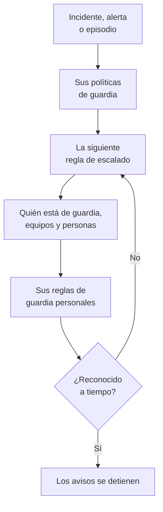

# Visión general de las guardias

La guardia es la forma en que OneUptime pone a una persona ante un problema, a cualquier hora. Cuando un incidente, una alerta o un episodio necesita a alguien, sus políticas de guardia avisan a personas nivel a nivel hasta que alguien lo reconoce, y cada persona recibe el aviso como eligió: una notificación push, un SMS, una llamada, un correo o un mensaje de chat. Esta página muestra cómo encajan las piezas y dónde está cada una.

:::cards
- [Cómo llega un aviso a alguien](#cómo-llega-un-aviso-a-alguien): De un incidente nuevo a la persona que responde.
- [Las piezas](#las-piezas): Políticas, reglas de escalado, programaciones, sustituciones y reglas personales.
- [Configurar las guardias](#configurar-las-guardias): De cero a un equipo que recibe avisos, en cinco pasos.
- [Dónde están las guardias](#dónde-están-las-guardias): El menú de Guardia, sección por sección.
:::

## Cómo llega un aviso a alguien

1. Un incidente, una alerta o un episodio nuevo ejecuta en el acto sus políticas de guardia: las elegidas en él y las que añaden sus reglas de guardia. Cada política se ejecuta por su cuenta. Una regla de guardia configurada como **Solo en horario laboral** hace esperar las políticas que añade hasta que empieza ese horario.
2. La primera regla de escalado de una política avisa de inmediato: a quien está de guardia ahora mismo en sus programaciones, a cada miembro de sus equipos y a las personas que nombra.
3. Si alguna de ellas está ausente, una sustitución de usuario envía su aviso a la persona que la cubre, o la omite.
4. Cada persona recibe el aviso según sus reglas de guardia personales: qué método se prueba y al cabo de cuánto tiempo. Un aviso sin regla le llega igualmente por los métodos que ha verificado.
5. Si nadie lo reconoce antes de que acabe la espera de la regla, avisa la regla siguiente. Tras la última, la política vuelve a empezar si se repite y, si no, se detiene.

Reconocer o resolver el incidente, la alerta o el episodio detiene toda política que aún esté avisando por él. OneUptime hace avanzar las políticas en curso cada minuto y registra cada ejecución, regla a regla, en **Registros de ejecución**.

La primera vez que un aviso llega a alguien, OneUptime lo registra en el incidente, la alerta o el episodio como `First Paged At`. Una medición puede contar desde ahí: **Tiempo hasta el reconocimiento tras el aviso** mide cuánto tardaron las personas en responder una vez avisadas, no cuánto tiempo pasó antes de que se avisara a alguien. Consulta [Tiempo hasta el reconocimiento tras el aviso](/docs/incidents/settings#tiempo-hasta-el-reconocimiento-tras-el-aviso).

> [!NOTE]
> Un incidente, una alerta o un episodio que se crea ya reconocido o resuelto no ejecuta ninguna de sus políticas, y su feed lo indica. Consulta [Creada ya reconocida o resuelta](/docs/alerts/index#creada-ya-reconocida-o-resuelta).

## Las piezas

| Pieza | Qué decide | Más información |
| --- | --- | --- |
| Política de guardia | A quién se avisa por un incidente o una alerta, nivel a nivel | [Políticas de guardia](/docs/on-call/policies) |
| Regla de escalado | Un nivel de una política: a quién avisa y cuánto espera a que alguien reconozca | [Reglas de escalado](/docs/on-call/escalation-rules) |
| Programación de guardia | Quién está de guardia en cada momento, por turnos | [Programaciones de guardia](/docs/on-call/schedules) |
| Sustitución de usuario | Quién cubre a alguien mientras está ausente | [Sustituciones de usuarios](/docs/on-call/user-overrides) |
| Reglas de guardia personales | Cómo se llega a una persona: por qué método y al cabo de cuánto tiempo | [Reglas de guardia personales](/docs/notifications/on-call-rules) |
| Política de llamadas entrantes | Un número de teléfono que hace sonar a quien está de guardia | [Política de llamadas entrantes](/docs/on-call/incoming-call-policy) |

Las políticas, las reglas de escalado, las programaciones y las sustituciones pertenecen al proyecto, en **Guardia**. Los métodos de notificación y las reglas de guardia personales pertenecen a cada persona, en **Ajustes de usuario**: un administrador puede ver la configuración de alguien, pero solo esa persona puede verificar su teléfono o su correo. Consulta [Cómo te contacta OneUptime](/docs/notifications/index).

## Configurar las guardias

:::steps
### Crear una programación

Abre **Guardia** desde el menú **Productos** y ve a **Programaciones de guardia**. Haz clic en **Crear programación de guardia**, ponle un nombre y, en **¿Quiénes se turnan?**, elige a las personas en el orden en que se turnan. Consulta [Programaciones de guardia](/docs/on-call/schedules).

### Crear una política

Ve a **Políticas de guardia** y haz clic en **Crear Política de guardia**. En **¿A quién se avisa primero?**, elige la programación. Se convierte en la primera regla de escalado de la política, **Level 1**, que espera 30 minutos a que alguien reconozca.

### Añadir los niveles siguientes

En la página **Reglas de escalado** de la política, haz clic en **Añadir regla de escalado** para cada nivel después del primero: la siguiente persona de la rotación de la misma programación, un jefe de equipo, un responsable. Consulta [Reglas de escalado](/docs/on-call/escalation-rules).

### Ejecutar la política automáticamente

La primera política de un proyecto puede hacerlo al crearla: deja activado **Activarla con cada nuevo incidente y cada nueva alerta**. Para cualquier otra política, ve a **Incidentes → Reglas → Reglas de guardia** o **Alertas → Reglas → Reglas de guardia** y añade una regla que la ejecute para los incidentes o las alertas que coincidan, por ejemplo cada uno crítico. Consulta [Qué ejecuta una política](/docs/on-call/policies#qué-ejecuta-una-política).

### Comprobar que todos son localizables

Abre **Guardia → Preparación**. Cada persona a la que tus políticas pueden avisar aparece como **Listo**, **Necesita configuración** o **Inaccesible**, con lo que le falta. Consulta [Preparación e informes](/docs/on-call/readiness).
:::

> [!NOTE]
> En OneUptime Cloud, las políticas de guardia y las reglas de escalado están en todos los planes. Las programaciones de guardia, las sustituciones de usuarios, los registros de ejecución y el informe de tiempo de guardia necesitan el plan **Growth**.

## Dónde están las guardias

Abre **Guardia** desde el menú **Productos** de la barra superior. Se abre en **Políticas de guardia**, en `/dashboard/{projectId}/on-call-duty/policies`, y su menú lateral contiene el resto:

| Sección | Páginas |
| --- | --- |
| **Políticas** | **Políticas de guardia** y **Preparación**: a quién llegan de verdad tus políticas |
| **Programaciones** | **Programaciones de guardia**, **Cronología de la programación** y **Feeds de calendario** |
| **Llamadas entrantes** | **Políticas de llamadas entrantes**: un número de teléfono que hace sonar a quien está de guardia |
| **Avanzado** | **Sustituciones de usuarios**, **Registros de ejecución** y **Políticas archivadas** |
| **Informes** | **Tiempo de guardia del usuario**: cuánto tiempo estuvo de guardia cada persona |
| **Espacio de trabajo** | **Slack** y **Microsoft Teams**: reglas que publican los eventos de guardia en un canal |
| **Ajustes** | **Campos personalizados**, **Reglas de etiquetas** y **Reglas del propietario** |
| **Desarrolladores** | **Terraform**, **API** y **Asistentes de IA**: las guardias configuradas desde código |

**Políticas**, **Programaciones** y **Llamadas entrantes** están abiertas; las demás secciones empiezan plegadas, y una sección se abre sola cuando estás en una de sus páginas. **Espacio de trabajo** muestra las herramientas de chat que el proyecto ha conectado, o **Conectar Slack o Teams** si no tiene ninguna.

Cuando estás de guardia para una política, la campana de arriba a la derecha lo indica. Haz clic en ella para abrir **Mis políticas de guardia**: cada política para la que estás de guardia, en todos tus proyectos, y si apareces en ella directamente, en un equipo o en una programación.

## Solución de problemas

:::details No se avisó a nadie por un incidente nuevo
Abre la página **Ejecuciones de guardia** del incidente. Si está vacía, el incidente no tenía ninguna política de guardia: no se eligió ninguna en él y ninguna regla de guardia coincidió. Una ejecución con **Execution Completed - No One Notified** recorrió todas las reglas de escalado sin encontrar a nadie: normalmente una programación sin nadie de guardia. Consulta [Registros de ejecución](/docs/on-call/policies#registros-de-ejecución). Una ejecución **Esperando** espera al horario laboral, por una regla de guardia configurada como **Solo en horario laboral**, y no avisa a nadie hasta que empiece.
:::

:::details Alguien recibió el aviso por el canal equivocado, o no lo recibió
Abre **Guardia → Preparación** y haz clic en **Cobertura** en su fila. Verás los métodos que ha verificado y cada gravedad para la que no tiene regla. Solo esa persona puede arreglarlo, en **Ajustes de usuario**: envíale un recordatorio de configuración desde la misma página. Consulta [Preparación e informes](/docs/on-call/readiness). En OneUptime Cloud, un teléfono que bloquea las llamadas desconocidas puede silenciar un aviso: añade [los números de OneUptime](/docs/on-call/phone-number-whitelist) a su lista de permitidos.
:::

:::details Una persona de vacaciones sigue recibiendo avisos
Añade una sustitución de usuario con ella en **¿Quién está ausente?**. Una en **Guardia → Avanzado → Sustituciones de usuarios** cubre todas las políticas; una en la página **Sustituciones de usuarios** de una política cubre solo esa política. Consulta [Sustituciones de usuarios](/docs/on-call/user-overrides).
:::

## Próximos pasos

:::cards
- [Políticas de guardia](/docs/on-call/policies): Crear una política, decidir qué la ejecuta y leer lo que hizo.
- [Reglas de escalado](/docs/on-call/escalation-rules): Avisar a las personas nivel a nivel hasta que alguien responda.
- [Programaciones de guardia](/docs/on-call/schedules): Rotaciones, capas y relevos.
- [Cómo te contacta OneUptime](/docs/notifications/index): Los métodos y las reglas que deciden cómo se llega a cada persona.
:::
