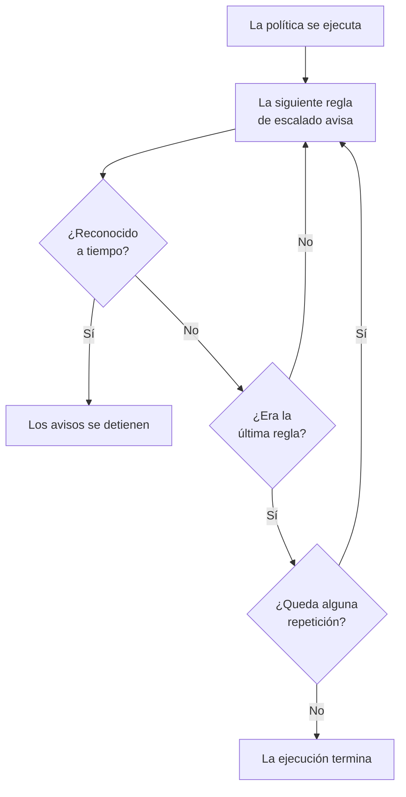

# Políticas de guardia

Una política de guardia decide a quién se avisa por un incidente o una alerta, y quién es el siguiente si nadie lo reconoce. Sus reglas de escalado son sus niveles, y la ejecutan los incidentes, las alertas y los episodios que la usan. Esta página explica cómo crear una política, qué la ejecuta, qué muestran sus páginas y cómo se registra cada ejecución.

:::cards
- [Crear una política](#crear-una-política): Un nombre y a quién se avisa primero.
- [Qué ejecuta una política](#qué-ejecuta-una-política): Reglas, plantillas, monitores, chat y tú.
- [Registros de ejecución](#registros-de-ejecución): Cada ejecución, regla a regla, y por qué se detuvo.
- [Archivar o eliminar una política](#archivar-o-eliminar-una-política): Retirar una política del servicio.
:::

## Crear una política

:::steps
1. Ve a **Guardia → Políticas de guardia** y haz clic en **Crear Política de guardia**.
2. Escribe un **Nombre**, por ejemplo «Pagos principal».
3. En **¿A quién se avisa primero?**, haz clic en **Añadir destinatario** y elige las programaciones de guardia, los equipos y las personas a los que avisar primero.
4. Haz clic en **Crear Política de guardia**. La política se abre en su página **Reglas de escalado**, con **Level 1** ya creado.
:::

**¿A quién se avisa primero?** es opcional y solo se pregunta a quien puede añadir reglas de escalado: si se deja vacío, la política no avisa a nadie hasta que tenga una regla. **Descripción** y **Etiquetas** esperan en **Más campos**. Para añadir los niveles siguientes, consulta [Reglas de escalado](/docs/on-call/escalation-rules).

La lista **Políticas de guardia** muestra de cada política su **Nombre**, **Descripción**, **Etiquetas** y **Propietarios**. Selecciona políticas para **Añadir etiquetas**, **Quitar etiquetas**, **Añadir propietario**, **Quitar propietario**, **Archivar**, **Exportar JSON** o eliminarlas. **Importar JSON** crea políticas a partir de una exportación: una exportación contiene los ajustes propios de una política, no sus reglas de escalado ni sus propietarios.

## Qué ejecuta una política

Una política no avisa a nadie hasta que algo la ejecuta. Cada incidente, alerta y episodio ejecuta las políticas que tiene en cuanto se crea:

| Qué | Cómo añade la política | Más información |
| --- | --- | --- |
| El propio registro | El campo **Política de guardia** al crear un incidente o una alerta, una plantilla de incidente, o la sección plegada **De guardia** de los criterios de un monitor | [Declarar un incidente](/docs/incidents/declaring-incidents) |
| Reglas de guardia | **Incidentes → Reglas → Reglas de guardia** y **Alertas → Reglas → Reglas de guardia** añaden las políticas de cada regla que coincide | [Reglas de guardia de incidentes](/docs/incidents/settings#reglas-de-guardia-de-incidentes) |
| Reglas de agrupación | Una regla de agrupación ejecuta sus políticas cuando abre un episodio | [Episodios de alertas y reglas de agrupación](/docs/alerts/episodes) |
| A mano | **Ejecutar política de guardia**, en el menú **Acciones** de un feed, o en un mensaje de Slack o Microsoft Teams | [El feed del incidente](/docs/incidents/notes-owners-and-feed#el-feed-del-incidente) |
| Chat y workflows | `/oneuptime page` en Slack o Microsoft Teams, y el paso **Page an On-Call Policy** de un workflow | [Paging](/docs/workflows/components#paging) |

Una política que añaden varias reglas se ejecuta una sola vez. Una gravedad nunca ejecuta una política por sí misma: lo hace una regla de guardia que coincide con esa gravedad. Un incidente o una alerta creada ya reconocida o resuelta no ejecuta ninguna de sus políticas. Una regla de guardia configurada como **Solo en horario laboral** hace esperar las políticas que añade hasta que empieza ese horario.

## Las páginas de una política

Abre una política desde la lista. Su menú lateral contiene todo lo relativo a ella:

| Sección | Páginas |
| --- | --- |
| **Básico** | **Vista general**, **Reglas de escalado** y **Propietarios** |
| **Registros** | **Registros de ejecución** y **Registros de notificación** |
| **Desarrolladores** | **Terraform**, **API** y **Asistentes de IA** |
| **Avanzado** | **Sustituciones de usuarios**, **Campos personalizados**, **Ajustes**, **Registros de auditoría** y **Eliminar política** |

**Básico** está abierta; las demás secciones empiezan plegadas hasta que haces clic en ellas.

- **Vista general** muestra los **Detalles de la política de guardia** y luego **La política de un vistazo**: cuántos niveles y respondedores tiene la política, cuánto falta hasta su último nivel y cuántas veces se repite. **Preparación de los respondedores** dice si cada persona a la que puede avisar es localizable ahora, y **Feed de la política de guardia** enumera lo que cambió: personas, equipos y programaciones añadidos o quitados, sustituciones y relevos.
- Los **Propietarios** son las personas y los equipos responsables de la política. Cuando un aviso que envía no encuentra regla para alguien, o no se puede entregar, reciben un correo; una política sin propietarios escribe en su lugar a los propietarios del proyecto.
- **Registros de notificación** enumera cada mensaje que envió la política, con una pestaña por canal.
- **Sustituciones de usuarios** cubre a personas solo en esta política. Consulta [Sustituciones de usuarios](/docs/on-call/user-overrides).
- **Ajustes** tiene **Exportar Política de guardia** y la tarjeta que archiva la política.

## Repetir una política

Cuando la espera del último nivel termina sin que nadie lo reconozca, una política se detiene, salvo que se repita. Para elegirlo, abre la página **Reglas de escalado** de la política y haz clic en **Editar** en la tarjeta **Política de repetición** bajo las reglas. **Editar repetición de la política** pregunta **Si nadie lo reconoce después del último nivel**:

| Respuesta | Qué hace |
| --- | --- |
| **Dejar de avisar** | No se avisa a nadie más, así que la política se ejecuta una sola vez. Una política nueva empieza con esta respuesta. |
| **Empezar de nuevo desde Level 1** | Se avisa de nuevo a cada nivel, en orden. **¿Cuántas veces más?** dice cuántas: 1 o más. |

Una política que empieza de nuevo tres veces más recorre sus niveles cuatro veces en total. La fila **Después del último nivel** de la tarjeta dice lo que hace la política, y **La política de un vistazo** en la **Vista general** dice lo mismo con palabras.

## Volver a avisar si no se resuelve

Reconocer detiene los avisos de una política para siempre, aunque después nadie resuelva el incidente o la alerta. En su lugar, una política puede volver a avisar: abre su página **Reglas de escalado**, abre **Más ajustes** abajo y haz clic en **Editar** en la tarjeta **Tiempo límite tras el reconocimiento**. **Editar tiempo límite tras el reconocimiento** pregunta **Si se reconoce pero no se resuelve**:

| Respuesta | Qué hace |
| --- | --- |
| **No volver a avisar** | Reconocerlo detiene los avisos para siempre. Una política nueva empieza con esta respuesta. |
| **Volver a avisar** | Avisa a quien lo reconoció y a quien está de guardia ahora. **¿Después de cuántos minutos?** indica cuándo: de 5 a 1440, 30 al principio. |

Los minutos se cuentan desde cada reconocimiento, y una política vuelve a avisar como máximo 5 veces por un mismo incidente, alerta o episodio. Un nuevo aviso empieza en el nivel que estaba avisando cuando se reconoció, avisa a quien está de guardia ahora en ese nivel y sigue por los niveles como la primera ejecución. El incidente o la alerta sigue reconocido: el nuevo aviso es una ejecución propia, en su feed y en los registros de ejecución de la política, donde su **Estado** dice «Avisado de nuevo (1 de 5)».

Quien recibe el nuevo aviso lo reconoce desde su mensaje, o con **Reconocer de nuevo** en la página del incidente o de la alerta, y los minutos empiezan de nuevo; **Escalar** lo pasa al siguiente nivel. Resolver o eliminar el incidente o la alerta, archivar o eliminar la política, o elegir **No volver a avisar** lo detiene. La fila **Después de un reconocimiento** de la tarjeta dice qué hace la política, y **Más ajustes** muestra los minutos mientras está plegado. **La política de un vistazo** en la **Vista general** y el **Resumen del escalado** dicen lo mismo con palabras.

## Registros de ejecución

Cada vez que una política se ejecuta, escribe un registro de ejecución, y el registro pasa por sus estados a medida que avanza la ejecución:

| Estado | Qué significa |
| --- | --- |
| **Esperando** | Una regla de guardia configurada como **Solo en horario laboral** hace esperar la ejecución hasta que empieza ese horario: dice cuándo empiezan los avisos, y hasta entonces no avisa a nadie. Termina sin avisar si el incidente o la alerta se reconoce o se resuelve antes. Empieza a avisar en ese momento si el incidente o la alerta cambia y ahora coincide con una regla de guardia que avisa de inmediato. |
| **Programado**, **Iniciado** | La ejecución se está preparando. Una que sigue aquí al cabo de 5 minutos se detiene como **Error**. |
| **Executing** | La ejecución está avisando. OneUptime la hace avanzar cada minuto. |
| **Execution Completed** | Alguien lo reconoció, el incidente o la alerta se resolvió, se usaron todas las reglas y repeticiones, o la política se archivó. |
| **Execution Completed - No One Notified** | La ejecución recorrió todas las reglas sin avisar a nadie: normalmente una programación sin nadie de guardia. |
| **Error** | La ejecución falló. **Ver mensaje de estado** dice por qué. |

Encontrarás registros de ejecución en tres lugares:

- en los propios **Registros de ejecución** de la política, en **Registros**;
- en **Guardia → Avanzado → Registros de ejecución**, para todas las políticas, donde los avisos directos desde workflows y chat aparecen como **Aviso directo**;
- en la página **Ejecuciones de guardia** de un incidente o de una alerta.

Cada fila muestra qué desencadenó la ejecución, cuándo, su **Estado** y quién la reconoció. **Ver cronología** abre su **Cronología de ejecución**: cada regla de escalado, a quién avisó, a través de qué programación y cómo terminó cada aviso. Una programación sin nadie de guardia muestra **Nadie estaba de guardia** en lugar de una persona. En OneUptime Cloud, los registros de ejecución necesitan el plan **Growth**.

## Archivar o eliminar una política

Archivar retira una política del servicio y lo conserva todo: abre los **Ajustes** de la política y haz clic en **Archivar** en su tarjeta de archivo, o selecciona políticas en la lista y elige **Archivar**.

- Una política archivada no avisa a nadie. Los incidentes y las alertas que la usan la omiten, y una ejecución que aún esté escalando se detiene en su siguiente paso.
- Sale de la lista **Políticas de guardia** y pasa a **Guardia → Avanzado → Políticas archivadas**, donde **Desarchivar** la vuelve a poner en servicio.

**Eliminar política**, en **Avanzado**, elimina la política junto con sus reglas de escalado y sus sustituciones de usuarios. Eliminar desde la lista pide confirmación y sugiere archivar en su lugar.

## Quién puede cambiar una política

**Propietario del proyecto**, **Administrador del proyecto**, **Miembro del proyecto**, **Administrador de guardias** y **Miembro de guardias** pueden crear, cambiar y eliminar políticas; **Visor** y **Visor de guardias** pueden verlas. En un rol personalizado, los permisos son **Create On-Call Duty Policy**, **Edit On-Call Duty Policy**, **Delete On-Call Duty Policy** y **Read On-Call Duty Policy**, y un rol limitado a algunas etiquetas solo llega a las políticas que las llevan. Añadir propietarios y campos personalizados necesita el plan **Growth** en OneUptime Cloud.

## API y Terraform

Las políticas de guardia son el recurso `/api/on-call-duty-policy`, y el recurso `oneuptime_on_call_policy` en Terraform:

| Ajuste | Campo de la API |
| --- | --- |
| **Nombre** | `name` |
| **Descripción** | `description` |
| **Si nadie lo reconoce después del último nivel** | `repeatPolicyIfNoOneAcknowledges` |
| **¿Cuántas veces más?** | `repeatPolicyIfNoOneAcknowledgesNoOfTimes` |
| **¿Después de cuántos minutos?** | `acknowledgementTimeoutInMinutes` |
| Archivada | `isArchived` |

`repeatPolicyIfNoOneAcknowledges` es `false` para **Dejar de avisar** y `true` para **Empezar de nuevo desde Level 1**. Con `true` y `repeatPolicyIfNoOneAcknowledgesNoOfTimes` en `0`, una política nunca se repite, y el panel la muestra como **Dejar de avisar**.

`acknowledgementTimeoutInMinutes` es `null` para **No volver a avisar**, y un número entero de minutos de 5 a 1440 para **Volver a avisar**. OneUptime rechaza cualquier otro valor.

Para crear una política con su primer nivel en una sola petición, consulta [Crear reglas con la API o Terraform](/docs/on-call/escalation-rules#crear-reglas-con-la-api-o-terraform).

## Solución de problemas

:::details Una política se ejecutó, pero no se avisó a nadie
Su ejecución dice **Execution Completed - No One Notified**. Abre **Ver cronología**: una fila con **Nadie estaba de guardia** señala una programación con un hueco, y el mensaje de estado de una fila **Omitido** dice por qué, por ejemplo alguien ausente sin nadie que lo cubra. **Guardia → Preparación** muestra a quién no se pudo localizar.
:::

:::details El siguiente nivel recibió el aviso un minuto después de su espera
OneUptime hace avanzar las políticas en curso una vez por minuto, así que un nivel avisa en la primera comprobación tras terminar su espera.
:::

:::details Un incidente muestra una política que no avisó a nadie
La política está archivada: una política archivada sigue en los incidentes y las alertas que la usan, no avisa a nadie, y su registro de ejecución dice que no se ejecutó. Desarchívala en **Guardia → Avanzado → Políticas archivadas**.
:::

## Próximos pasos

:::cards
- [Reglas de escalado](/docs/on-call/escalation-rules): Añadir los niveles a los que avisa una política, y cuánto espera cada uno.
- [Sustituciones de usuarios](/docs/on-call/user-overrides): Enviar los avisos de alguien a un compañero mientras está ausente.
- [Preparación e informes](/docs/on-call/readiness): Comprobar que cada persona a la que avisa una política es localizable.
:::
