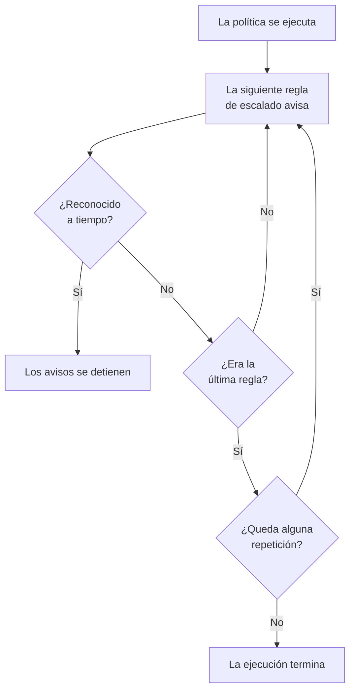

# Políticas de guardia

Una política de guardia decide a quién se avisa por un incidente o una alerta, y quién es el siguiente si nadie lo reconoce. Sus reglas de escalado son sus niveles, y la ejecutan los incidentes, las alertas y los episodios que la usan. Esta página explica cómo crear una política, qué la ejecuta, qué muestran sus páginas y cómo se registra cada ejecución.

:::cards
- [Crear una política](#crear-una-política): Un nombre y a quién se avisa primero.
- [Qué ejecuta una política](#qué-ejecuta-una-política): Reglas, plantillas, monitores, chat y tú.
- [Registros de ejecución](#registros-de-ejecución): Cada ejecución, regla a regla, y por qué se detuvo.
- [Archivar o eliminar una política](#archivar-o-eliminar-una-política): Retirar una política del servicio.
:::

## Crear una política

:::steps
1. Ve a **Guardia → Políticas de guardia** y haz clic en **Crear política de guardia**.
2. Escribe un **Nombre**, por ejemplo «Pagos principal».
3. En **¿A quién se avisa primero?**, haz clic en **Añadir destinatario** y elige las programaciones de guardia, los equipos y las personas a los que avisar primero.
4. Haz clic en **Crear política de guardia**. La política se abre en su página **Reglas de escalado**, con **Level 1** ya creado.
:::

**¿A quién se avisa primero?** es opcional y solo se pregunta a quien puede añadir reglas de escalado: si se deja vacío, la política no avisa a nadie hasta que tenga una regla. **Descripción** y **Etiquetas** esperan en **Más campos**. Para añadir los niveles siguientes, consulta [Reglas de escalado](/docs/on-call/escalation-rules).

El formulario también pregunta **Activarla con cada nuevo incidente y cada nueva alerta** a quien puede añadir reglas de guardia. Añade una regla en **Incidentes → Reglas → Reglas de guardia** y otra en **Alertas → Reglas → Reglas de guardia**, que coinciden con todo y ejecutan esta política. Empieza activado para la primera política de un proyecto, mientras el proyecto no tenga ninguna política de guardia ni ninguna regla de guardia, y desactivado para las siguientes: activar dos políticas con cada nuevo incidente y cada nueva alerta es una decisión que hay que tomar. Si se deja desactivado, la política no avisa a nadie hasta que una regla, un monitor o una persona la ejecute.

Para que te guíen paso a paso, desde tu teléfono hasta un aviso de prueba, haz clic en **Configuración guiada**: en la lista vacía de **Políticas de guardia** o en **Cómo funciona**. Consulta [Recibir avisos por llamada, SMS o push](/docs/guides/paging).

La lista **Políticas de guardia** muestra de cada política su **Nombre**, **Descripción**, **Etiquetas** y **Propietarios**. Selecciona políticas para **Añadir etiquetas**, **Quitar etiquetas**, **Añadir propietario**, **Quitar propietario**, **Archivar**, **Exportar JSON** o eliminarlas. **Importar JSON** crea políticas a partir de una exportación: una exportación contiene los ajustes propios de una política, no sus reglas de escalado ni sus propietarios.

## Qué ejecuta una política

Una política no avisa a nadie hasta que algo la ejecuta. Cada incidente, alerta y episodio ejecuta las políticas que tiene en cuanto se crea:

| Qué | Cómo añade la política | Más información |
| --- | --- | --- |
| El propio registro | El campo **Política de guardia** al crear un incidente o una alerta, una plantilla de incidente, o la sección plegada **Guardia** de los criterios de un monitor | [Declarar un incidente](/docs/incidents/declaring-incidents) |
| Reglas de guardia | **Incidentes → Reglas → Reglas de guardia** y **Alertas → Reglas → Reglas de guardia** añaden las políticas de cada regla que coincide | [Reglas de guardia de incidentes](/docs/incidents/settings#reglas-de-guardia-de-incidentes) |
| Reglas de agrupación | Una regla de agrupación ejecuta sus políticas cuando abre un episodio | [Episodios de alertas y reglas de agrupación](/docs/alerts/episodes) |
| A mano | **Ejecutar política de guardia**, en el menú **Acciones** de un feed, o en un mensaje de Slack o Microsoft Teams | [El feed del incidente](/docs/incidents/notes-owners-and-feed#el-feed-del-incidente) |
| Chat y workflows | `/oneuptime page` en Slack o Microsoft Teams, y el paso **Page an On-Call Policy** de un workflow | [Paging](/docs/workflows/components#paging) |

Una política que añaden varias reglas se ejecuta una sola vez. Una gravedad nunca ejecuta una política por sí misma: lo hace una regla de guardia que coincide con esa gravedad. Un incidente o una alerta creada ya reconocida o resuelta no ejecuta ninguna de sus políticas. Una regla de guardia configurada como **Solo en horario laboral** hace esperar las políticas que añade hasta que empieza ese horario.

## Las páginas de una política

Abre una política desde la lista. Su menú lateral contiene todo lo relativo a ella:

| Sección | Páginas |
| --- | --- |
| **Básico** | **Vista general**, **Reglas de escalado** y **Propietarios** |
| **Registros** | **Registros de ejecución** y **Registros de notificación** |
| **Desarrolladores** | **Terraform**, **API**, **CLI** y **Asistentes de IA** |
| **Avanzado** | **Sustituciones de usuarios**, **Campos personalizados**, **Ajustes**, **Registros de auditoría** y **Eliminar política** |

**Básico** está abierta; las demás secciones empiezan plegadas hasta que haces clic en ellas.

- **Vista general** muestra los **Detalles de la política de guardia** y luego **La política de un vistazo**: cuántos niveles y respondedores tiene la política, cuánto falta hasta su último nivel y cuántas veces se repite. **Preparación de los respondedores** dice si cada persona a la que puede avisar es localizable ahora, y **Feed de la política de guardia** enumera lo que cambió: personas, equipos y programaciones añadidos o quitados, sustituciones y relevos. Sus reglas de Slack, Microsoft Teams y Mattermost los publican en tus canales, un relevo en una línea: consulta [Mensajes de guardia](/docs/workspace-connections/slack#mensajes-de-guardia).
- Los **Propietarios** son las personas y los equipos responsables de la política. Cuando un aviso que envía no encuentra regla para alguien, o no se puede entregar, reciben un correo; una política sin propietarios escribe en su lugar a los Propietarios del proyecto.
- **Registros de notificación** enumera cada mensaje que envió la política, con una pestaña por canal.
- **Sustituciones de usuarios** cubre a personas solo en esta política. Consulta [Sustituciones de usuarios](/docs/on-call/user-overrides).
- **Ajustes** tiene **Exportar Política de guardia** y la tarjeta que archiva la política.

**Qué activa esta política**, en la **Vista general**, lista las reglas de guardia, los monitores cuyos criterios activan la política, las plantillas y otras reglas que la activan, y los flujos de trabajo que lo hacen, cada uno con un enlace. Una regla desactivada dice **Desactivado**. Si nada activa la política, la tarjeta lo dice: no avisa a nadie hasta que algo la activa. Eliminar o archivar la política lo dice primero. Lo que no puedes abrir se cuenta, pero no se nombra.

## Repetir una política

Cuando la espera del último nivel termina sin que nadie lo reconozca, una política se detiene, salvo que se repita. Para elegirlo, abre la página **Reglas de escalado** de la política y haz clic en **Editar** en la tarjeta **Política de repetición** bajo las reglas. **Editar repetición de la política** pregunta **Si nadie lo reconoce después del último nivel**:

| Respuesta | Qué hace |
| --- | --- |
| **Dejar de avisar** | No se avisa a nadie más, así que la política se ejecuta una sola vez. Una política nueva empieza con esta respuesta. |
| **Empezar de nuevo desde Level 1** | Se avisa de nuevo a cada nivel, en orden. **¿Cuántas veces más?** dice cuántas: 1 o más. |

Una política que empieza de nuevo tres veces más recorre sus niveles cuatro veces en total. Una pasada en la que ningún nivel tenía a nadie a quien avisar no se repite: otra tampoco avisaría a nadie, así que la política se detiene. La fila **Después del último nivel** de la tarjeta dice lo que hace la política, y **La política de un vistazo** en la **Vista general** dice lo mismo con palabras.

## Volver a avisar si no se resuelve

Reconocer detiene los avisos de una política para siempre, aunque después nadie resuelva el incidente o la alerta. En su lugar, una política puede volver a avisar: abre su página **Reglas de escalado**, abre **Más ajustes** abajo y haz clic en **Editar** en la tarjeta **Tiempo límite tras el reconocimiento**. **Editar tiempo límite tras el reconocimiento** pregunta **Si se reconoce pero no se resuelve**:

| Respuesta | Qué hace |
| --- | --- |
| **No volver a avisar** | Reconocerlo detiene los avisos para siempre. Una política nueva empieza con esta respuesta. |
| **Volver a avisar** | Avisa a quien lo reconoció y a quien está de guardia ahora. **¿Después de cuántos minutos?** indica cuándo: de 5 a 1440, 30 al principio. |

Los minutos se cuentan desde cada reconocimiento, y una política vuelve a avisar como máximo 5 veces por un mismo incidente, alerta o episodio. Un nuevo aviso empieza en el nivel que estaba avisando cuando se reconoció, avisa a quien está de guardia ahora en ese nivel y sigue por los niveles como la primera ejecución. El incidente o la alerta sigue reconocido: el nuevo aviso es una ejecución propia, en su feed y en los registros de ejecución de la política, donde su **Estado** dice «Avisado de nuevo (1 de 5)».

Quien recibe el nuevo aviso lo reconoce desde su mensaje, o con **Reconocer de nuevo** en la página del incidente o de la alerta, y los minutos empiezan de nuevo; **Escalar** lo pasa al siguiente nivel. Resolver o eliminar el incidente o la alerta, archivar o eliminar la política, o elegir **No volver a avisar** lo detiene. La fila **Después de un reconocimiento** de la tarjeta dice qué hace la política, y **Más ajustes** muestra los minutos mientras está plegado. **La política de un vistazo** en la **Vista general** y el **Resumen del escalado** dicen lo mismo con palabras.

## Cuando avisan varias políticas

Un incidente, una alerta o un episodio ejecuta cada una de sus políticas por separado, al mismo tiempo.

- Quien está de guardia en dos de ellas recibe un solo aviso. Cuando el nivel de una política llega a alguien a quien otra política ya está avisando por lo mismo, no vuelve a avisarle: su registro de ejecución lo muestra como **Ya avisado**, y el feed del incidente y el mensaje de Slack y Microsoft Teams de la política nombran la política que le está avisando. El nivel espera igualmente sus minutos antes de pasar al siguiente, como hace con cualquiera a quien avisó. Responder a ese único aviso vale para ambas políticas. Dentro de una política, alguien a quien un nivel nombra dos veces, en persona y a través de un equipo o una programación, recibe un solo aviso.
- Un aviso enviado directamente a personas también cuenta. Cuando el nivel de una política llega a alguien a quien un aviso desde Slack o Microsoft Teams, o el bloque de aviso de un flujo de trabajo, ya está avisando por lo mismo, no vuelve a avisarle: su registro de ejecución nombra a quien envió ese aviso, o el flujo de trabajo. El bloque de aviso de un flujo de trabajo tampoco vuelve a avisar a alguien a quien una política u otro aviso ya está avisando.
- Reconocer el incidente o la alerta detiene en menos de un minuto todas las políticas que se ejecutan por él, se reconozca donde se reconozca: desde cualquier aviso sobre él, en su propia página, en la aplicación móvil o en Slack o Microsoft Teams. No se avisa a ningún nivel siguiente, y no se envía ninguna llamada ni ningún SMS que aún estuviera pendiente. Las notificaciones ya enviadas siguen enviadas.

Nadie se pierde un aviso por recibir uno solo. Ese único aviso puede terminar sin respuesta: la persona lo escala desde uno de sus mensajes, lo que solo escala ese aviso, el aviso no se puede enviar, o se detiene. Entonces la otra política, o el bloque del flujo de trabajo, le avisa por su cuenta en menos de un minuto, sin volver a enviar lo que ya le llegó. **Escalar** en la página del incidente o en la aplicación móvil escala ambas. Un nuevo aviso, una política iniciada a mano y un aviso que alguien envió desde Slack o Microsoft Teams siempre avisan por su cuenta a su gente, incluso a alguien a quien otra política está avisando. El aviso a un observador y el aviso a un respondedor nunca se juntan.

Algunos avisos siguen después del reconocimiento, hasta que responde alguien a quien avisaron o se resuelve: un nuevo aviso, un aviso a observadores, un aviso que alguien envió a personas desde Slack o Microsoft Teams y una política iniciada a mano.

Una política iniciada a mano es la que se inicia con **Ejecutar política de guardia**, o con un aviso desde Slack o Microsoft Teams que la nombra. Avisa nivel por nivel como cualquier ejecución, con llamadas y notificaciones push repetidas incluidas, y que otra persona reconozca el incidente no la detiene: así se avisa a otro equipo para un incidente del que ya se ocupa alguien. Quien recibió su aviso responde desde el mensaje del aviso, una llamada o un SMS, o reconociendo el incidente en persona; cuando el incidente ya está reconocido, su página le ofrece **Reconocer de nuevo**. **Escalar** la pasa al siguiente nivel. En un incidente, una alerta o un episodio resuelto no se inicia nada, y se te explica por qué: el panel desactiva **Ejecutar política de guardia** y muestra el motivo. Sus notificaciones dicen quién inició qué política e incluyen el mensaje enviado con un aviso desde Slack o Microsoft Teams.

## Probar una política

**Probar esta política**, en las reglas de escalado de una política, avisa a su primer nivel como prueba, sin ningún incidente detrás: cada mensaje dice TEST, y no se informa a ninguna página de estado, suscriptor ni canal. Activa **Recorrer cada nivel de escalado** para avisar a cada nivel por turno, con 2 minutos de separación como mucho, hasta que alguien lo reconozca. Antes de enviar nada, el diálogo indica a quién avisa la prueba y cómo, y cuánto cuesta en OneUptime Cloud.

**Enviar aviso de prueba** sigue desactivado mientras la prueba no llegaría a nadie: cada persona a la que avisa se dio de baja de esa gravedad, no tiene ninguna regla para ella ni nada a lo que recurrir, o solo tiene métodos sin verificar o desactivados en el proyecto. Una línea debajo de la lista indica por qué. Cuando solo se puede llegar a un nivel posterior, la línea ofrece **Recorrer cada nivel de escalado** con un clic.

Quien recibe el aviso reconoce la prueba desde cualquiera de sus mensajes: el enlace de un correo, de un SMS o de un mensaje de chat, el 1 de una llamada, o su notificación push en la app OneUptime On-Call, en versiones posteriores a la 1.6.0. Una política se puede probar una vez cada 5 minutos, y un proyecto envía como mucho 20 pruebas por hora.

### Hacer un simulacro en un monitor

**Hacer un simulacro**, en la tarjeta **Cuando falla** de un monitor, ensaya uno de sus fallos: un incidente o una alerta que abre uno de sus criterios, o el incidente que una regla de incidentes de alertas declara a partir de esa alerta. Prueba cada política de guardia a la que avisaría ese fallo, cada una como la prueba **Probar esta política**, y no ocurre nada público: no se crea ningún incidente ni alerta, y no se informa a ninguna página de estado, suscriptor ni canal. Antes de enviar nada, el diálogo nombra el fallo, cada política y a quién avisa ahora esa política. Para un incidente declarado, nombra también la regla y cuánto tiempo sigue abierta la alerta antes: el simulacro prueba las políticas del incidente al momento, sin esa espera.

Un simulacro avisa al primer nivel de cada política. En **Más campos**, activa **Recorrer cada nivel de escalado** para avisar a los niveles de cada política por turno, con 2 minutos de separación como mucho, hasta que alguien lo reconozca: el diálogo muestra entonces cada nivel al que llega cada política y lo que cuesta el recorrido como mucho. Cuando no se puede llegar a nadie de los primeros niveles pero sí a un nivel posterior, la línea bajo la lista ofrece **Recorrer cada nivel de escalado** con un clic.

**Iniciar simulacro** sigue desactivado mientras una de esas políticas sea una que no puedes probar, porque no puedes editarla, o mientras no se pueda llegar a nadie de los que avisan. Cada política de un simulacro cuenta como una prueba propia: una política probada en los últimos 5 minutos detiene todo el simulacro, y un simulacro de tres políticas ocupa tres de las 20 pruebas por hora del proyecto.

Una vez cerrado el diálogo, **Último simulacro** en la tarjeta dice qué fallo ensayó el último simulacro del monitor, cuándo y quién lo inició, y cuántas de sus pruebas se reconocieron. **Mostrar detalles** muestra la prueba de cada política: si se reconoció, quién, por qué medio y con qué rapidez. Cada prueba queda en los registros de ejecución de su política, marcada como simulacro del monitor. Los resultados de un simulacro los ve quien puede leer el monitor y cada uno de esos registros de ejecución.

## Registros de ejecución

Cada vez que una política se ejecuta, escribe un registro de ejecución, y el registro pasa por sus estados a medida que avanza la ejecución:

| Estado | Qué significa |
| --- | --- |
| **Esperando** | Una regla de guardia configurada como **Solo en horario laboral** hace esperar la ejecución hasta que empieza ese horario: dice cuándo empiezan los avisos, y hasta entonces no avisa a nadie. Termina sin avisar si el incidente o la alerta se reconoce o se resuelve antes. Empieza a avisar en ese momento si el incidente o la alerta cambia y ahora coincide con una regla de guardia que avisa de inmediato. |
| **Programado**, **Iniciado** | La ejecución se está preparando. Una que sigue aquí al cabo de 5 minutos no terminó de iniciarse: pasa a **Ejecutándose** y avisa desde donde se detuvo su inicio. Un aviso directo o un aviso de prueba que sigue aquí se detiene como **Error**. |
| **Ejecutándose** | La ejecución está avisando. OneUptime la hace avanzar cada minuto. Un paso que falla un momento, por ejemplo porque no se pudo llegar a la base de datos, se vuelve a intentar un minuto después, luego a los 2 y a los 4 minutos, y después cada 5 minutos. |
| **Ejecución completada** | Alguien lo reconoció, el incidente o la alerta se resolvió, se usaron todas las reglas y repeticiones, o la política se archivó. |
| **Ejecución completada - no se notificó a nadie** | La ejecución recorrió todas las reglas sin avisar a nadie: normalmente una programación sin nadie de guardia, o un nivel sin destinatarios. |
| **Error** | La ejecución falló: un paso falló de una forma que un nuevo intento no puede arreglar, como una regla de escalado eliminada, o falló 10 intentos seguidos, durante unos 37 minutos. **Ver mensaje de estado** dice por qué. |

Encontrarás registros de ejecución en tres lugares:

- en los propios **Registros de ejecución** de la política, en **Registros**;
- en **Guardia → Avanzado → Registros de ejecución**, para todas las políticas, donde los avisos directos desde workflows y chat aparecen como **Aviso directo**;
- en la página **Ejecuciones de guardia** de un incidente o de una alerta.

Cada fila muestra qué desencadenó la ejecución, cuándo, su **Estado** y quién la reconoció. **Ver cronología** abre su **Cronología de ejecución**: cada regla de escalado, a quién avisó, a través de qué programación y cómo terminó cada aviso. **Notificado por** muestra cómo llegó cada aviso a su persona: llamada telefónica, SMS, correo electrónico, notificación push, etc. Una programación sin nadie de guardia muestra **Nadie estaba de guardia** en lugar de una persona. Un nivel que no avisó a nadie dice por qué, con **Continuó sin esperar** debajo: la política no lo esperó. Alguien a quien otra política, o un aviso enviado directamente, ya estaba avisando muestra **Ya avisado**: consulta [Cuando avisan varias políticas](#cuando-avisan-varias-políticas). En OneUptime Cloud, los registros de ejecución necesitan el plan **Growth**.

## Archivar o eliminar una política

Archivar retira una política del servicio y lo conserva todo: abre los **Ajustes** de la política y haz clic en **Archivar** en su tarjeta de archivo, o selecciona políticas en la lista y elige **Archivar**.

- Una política archivada no avisa a nadie. Los incidentes y las alertas que la usan la omiten, y una ejecución que aún esté escalando se detiene en su siguiente paso.
- Sale de la lista **Políticas de guardia** y pasa a **Guardia → Avanzado → Políticas archivadas**, donde **Desarchivar** la vuelve a poner en servicio.

**Eliminar política**, en **Avanzado**, elimina la política junto con sus reglas de escalado y sus sustituciones de usuarios. Eliminar desde la lista pide confirmación y sugiere archivar en su lugar.

## Quién puede cambiar una política

**Propietario del proyecto**, **Administrador del proyecto**, **Miembro del proyecto**, **Administrador de guardias** y **Miembro de guardias** pueden crear, cambiar y eliminar políticas; **Visor** y **Visor de guardias** pueden verlas. En un rol personalizado, los permisos son **Create On-Call Policy**, **Edit On-Call Policy**, **Delete On-Call Policy** y **Read On-Call Policy**, y un rol limitado a algunas etiquetas solo llega a las políticas que las llevan. Añadir propietarios y campos personalizados necesita el plan **Growth** en OneUptime Cloud.

## API y Terraform

Las políticas de guardia son el recurso `/api/on-call-duty-policy`, y el recurso `oneuptime_on_call_policy` en Terraform:

| Ajuste | Campo de la API |
| --- | --- |
| **Nombre** | `name` |
| **Descripción** | `description` |
| **Si nadie lo reconoce después del último nivel** | `repeatPolicyIfNoOneAcknowledges` |
| **¿Cuántas veces más?** | `repeatPolicyIfNoOneAcknowledgesNoOfTimes` |
| **¿Después de cuántos minutos?** | `acknowledgementTimeoutInMinutes` |
| Archivada | `isArchived` |

`repeatPolicyIfNoOneAcknowledges` es `false` para **Dejar de avisar** y `true` para **Empezar de nuevo desde Level 1**. Con `true`, `repeatPolicyIfNoOneAcknowledgesNoOfTimes` debe ser un número entero de 1 o más: OneUptime rechaza `0`. Una política antigua guardada con `0` nunca se repite, y el panel la muestra como **Dejar de avisar**.

`acknowledgementTimeoutInMinutes` es `null` para **No volver a avisar**, y un número entero de minutos de 5 a 1440 para **Volver a avisar**. OneUptime rechaza cualquier otro valor.

Para crear una política con su primer nivel en una sola petición, consulta [Crear reglas con la API o Terraform](/docs/on-call/escalation-rules#crear-reglas-con-la-api-o-terraform).

## Solución de problemas

:::details Una política se ejecutó, pero no se avisó a nadie
Su ejecución dice **Ejecución completada - no se notificó a nadie**. Abre **Ver cronología**: una fila con **Nadie estaba de guardia** señala una programación con un hueco, y el mensaje de estado de una fila **Omitido** dice por qué, por ejemplo alguien ausente sin nadie que lo cubra. **Guardia → Preparación** muestra a quién no se pudo localizar.
:::

:::details El siguiente nivel recibió el aviso un minuto después de su espera
OneUptime hace avanzar las políticas en curso una vez por minuto, así que un nivel avisa en la primera comprobación tras terminar su espera.
:::

:::details El siguiente nivel recibió el aviso de inmediato, sin esperar
El nivel anterior no tenía a nadie a quien avisar: ningún destinatario, nadie de guardia en sus programaciones o nadie a quien se pudiera localizar. Un nivel que no avisa a nadie no tiene espera, así que se avisa al siguiente nivel en cuanto la política llega a él. **Ver cronología** muestra por qué ese nivel no avisó a nadie.
:::

:::details Un incidente muestra una política que no avisó a nadie
La política está archivada: una política archivada sigue en los incidentes y las alertas que la usan, no avisa a nadie, y su registro de ejecución dice que no se ejecutó. Desarchívala en **Guardia → Avanzado → Políticas archivadas**.
:::

:::details Alguien recibió dos avisos por un mismo incidente
Quien está de guardia en dos de las políticas que ejecuta el incidente recibe un solo aviso: el de la primera política que llega a esa persona, igual que alguien a quien llegan tanto una política como un aviso desde Slack, Microsoft Teams o un flujo de trabajo. La segunda también le avisa cuando se trata de un nuevo aviso, una política iniciada a mano, un aviso enviado desde Slack o Microsoft Teams o un aviso a observadores, que avisan por su cuenta a su gente, o cuando su primer aviso ya había terminado antes de que la segunda llegara a ella: la persona lo había escalado, o se había detenido. **Ver cronología** del segundo aviso muestra **Ya avisado** para alguien a quien no volvió a avisar.
:::

:::details Una política siguió avisando después de que se reconociera el incidente
Se inició a mano, o es un nuevo aviso: sigue hasta que responde alguien a quien avisó o se resuelve el incidente. Consulta [Cuando avisan varias políticas](#cuando-avisan-varias-políticas).
:::

## Próximos pasos

:::cards
- [Reglas de escalado](/docs/on-call/escalation-rules): Añadir los niveles a los que avisa una política, y cuánto espera cada uno.
- [Sustituciones de usuarios](/docs/on-call/user-overrides): Enviar los avisos de alguien a un compañero mientras está ausente.
- [Preparación e informes](/docs/on-call/readiness): Comprobar que cada persona a la que avisa una política es localizable.
:::
