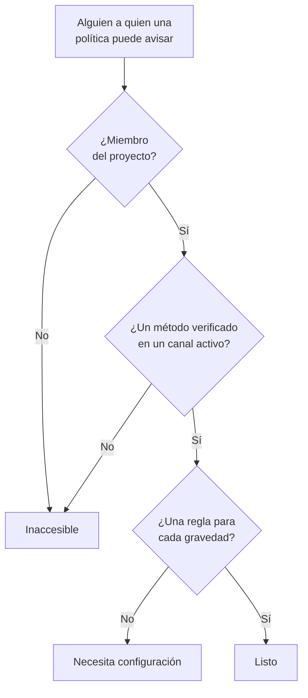

# Preparación e informes

La preparación responde a una pregunta antes de que lo haga un incidente: si algo saltara ahora mismo, ¿llegaría el aviso de verdad a cada persona a la que avisan tus políticas de guardia? Enumera a cada respondedor del proyecto, dice quién está listo y quién no, y te permite recordar a las personas que terminen su configuración. El informe **Tiempo de guardia del usuario** muestra después cuánto tiempo estuvo de guardia cada persona.

:::cards
- [Cómo se determina un estado](#cómo-se-determina-un-estado): Listo, Necesita configuración o Inaccesible, y por qué.
- [La página Preparación](#la-página-preparación): Cada respondedor del proyecto, en una lista.
- [Recordar a las personas que terminen su configuración](#recordar-a-las-personas-que-terminen-su-configuración): Un correo que nombra lo que falta.
- [Tiempo de guardia del usuario](#tiempo-de-guardia-del-usuario): Cuánto tiempo estuvo de guardia cada persona.
:::

## Cómo se determina un estado

Un respondedor es cualquiera a quien una política de guardia puede avisar: una persona nombrada en una regla de escalado, un miembro de un equipo al que avisa una regla, alguien en una capa de una programación a la que avisa una regla, y quien cubre en una sustitución de usuario que no ha terminado. Una programación a la que no avisa ninguna política no añade a nadie.

| Estado | Qué significa |
| --- | --- |
| **Listo** | Tiene un método verificado en un canal que el proyecto tiene activado, y una regla para cada gravedad, en cada pestaña de sus reglas de guardia. |
| **Necesita configuración** | Se le puede localizar, pero algunas gravedades no tienen regla. La fila cuenta estos huecos. |
| **Inaccesible** | Nada le llega: no tiene ningún método verificado, cada método verificado está en un canal que el proyecto ha desactivado, o no es miembro del proyecto. |

Un hueco es una gravedad sin regla, en la pestaña de incidentes, episodios de incidentes, alertas o episodios de alertas. Una regla que desactiva una gravedad a propósito no es un hueco. Un aviso que encuentra un hueco llega igualmente a la persona por sus métodos verificados, salvo que el proyecto haya desactivado esa alternativa: consulta [Cuando ninguna regla coincide](/docs/notifications/index#cuando-ninguna-regla-coincide).

## La página Preparación

Abre **Guardia → Preparación**. La tarjeta **Preparación de las guardias** enumera a cada persona a la que puede llegar una política de guardia del proyecto, primero las que necesitan algo. Cualquier persona del proyecto puede abrirla.

Encima de la lista, los mosaicos cuentan **Respondedores**, **Listo**, **Necesita configuración** e **Inaccesible**. Haz clic en **Listo**, **Necesita configuración** o **Inaccesible** para ver solo esos respondedores, y vuelve a hacer clic para ver a todos.

| Columna | Qué muestra |
| --- | --- |
| **Respondedor** | La persona, con su dirección de correo. |
| **Estado** | **Listo**, **Inaccesible** o cuántos huecos tiene. |
| **Canales** | Un segmento por canal: lleno para un método verificado, hueco para uno que aún no está verificado. |
| **Cobertura** | Cuántas gravedades tienen regla, en cada pestaña, sobre el total. |
| **Se llega a través de** | Cómo le llegan las políticas: cada equipo que le avisa mediante una regla de escalado, por su nombre, o **Directo**, **Programación** o **Sustitución**. |

**Cobertura** en una fila muestra los métodos de notificación de la persona, por qué tiene su estado y una cuadrícula de cada gravedad con o sin regla. El embudo filtra la lista por **Respondedor**, **Estado**, **Equipo** o **Se llega a través de**. La respuesta puede tener un minuto: **Actualizar** la vuelve a calcular.

## Recordar a las personas que terminen su configuración

Solo la propia persona puede añadir y verificar sus métodos de notificación y sus reglas, así que la solución es pedírselo.

:::steps
1. En la página Preparación, marca los respondedores a los que quieres recordárselo. Los respondedores listos no se pueden marcar: no hay nada que recordarles.
2. Haz clic en **Enviar recordatorio de configuración**. La confirmación nombra a cada persona a la que va a escribir.
3. Confirma. Cada persona recibe un correo que nombra lo que falta en su propia configuración, con un enlace a la página que lo arregla.
:::

Después, un aviso indica cuántos recordatorios se enviaron, se omitieron o fallaron, y por qué en cada uno que no se envió. A nadie se le recuerda más de una vez cada 24 horas, y un envío llega como máximo a 250 personas. Enviar recordatorios requiere **Propietario del proyecto**, **Administrador del proyecto** u **Administrador de guardias**, o **Edit On-Call Duty Policy** en un rol personalizado.

## La preparación en otras páginas

- En la **Vista general** de una política, **Preparación de los respondedores** enumera a cada persona a la que esa política puede avisar y que necesita atención, y **Volver a comprobar** lo lee de nuevo. Tu propia fila tiene un botón a la página que lo arregla; la de otra persona abre un correo para ella en tu propio programa de correo, con la solución dentro.
- En las **Reglas de escalado** de una política, un nivel cuyos respondedores no se pueden avisar a todos lo indica en su tarjeta. Consulta [El resumen de escalado](/docs/on-call/escalation-rules#el-resumen-de-escalado).
- En **Usuarios**, abre un miembro y luego **Preparación** en la sección **De guardia**: su estado, sus métodos y su cuadrícula de cobertura.
- Para tu propia configuración, **Ajustes de usuario → Lista de configuración** te guía. Consulta [La lista de configuración](/docs/notifications/index#la-lista-de-configuración).

## El correo semanal de preparación

Una vez por semana, OneUptime revisa cada proyecto que tiene una política de guardia. Cuando alguien en él está **Inaccesible** o **Necesita configuración**, los propietarios del proyecto reciben un correo que enumera a esas personas en dos grupos, quienes no pueden recibir ningún aviso y quienes son localizables con huecos, hasta 20 nombres cada uno, con un enlace a la página Preparación.

Una semana en la que todos están listos no envía nada, así que el correo siempre significa que hay algo que arreglar. Cuando alguien no puede recibir ningún aviso, su asunto empieza por `[Action Required]`.

## Tiempo de guardia del usuario

**Guardia → Informes → Tiempo de guardia del usuario** muestra cuánto tiempo estuvo de guardia cada persona, en un periodo que eliges: **Último mes** al principio.

| Columna | Qué muestra |
| --- | --- |
| **Usuario** | La persona. |
| **Tiempo que el usuario estuvo de guardia** | Su tiempo de guardia en el periodo, en horas y minutos. |

El tiempo se registra a medida que las personas entran y salen de la guardia: desde que una programación a la que avisa una regla les pasa un turno, o se las añade a una regla directamente o mediante un equipo, hasta el relevo o hasta que se las quita. Estar de guardia por dos políticas a la vez cuenta una sola vez, y el tiempo que aún sigue en curso cuenta hasta ahora.

La **Cronología de la programación** y los feeds de calendario muestran los turnos pasados según la rotación tal como está configurada hoy. Este informe se escribe a medida que ocurre, así que úsalo para revisar el reparto y para pagar las guardias.

> [!NOTE]
> En OneUptime Cloud, el informe necesita el plan **Growth**, y el tiempo que terminó hace más de 200 días se elimina. Una instalación autoalojada lo conserva todo.

## Solución de problemas

:::details Alguien está inaccesible, pero tiene un número de teléfono verificado
Puede que todos sus métodos estén en canales que el proyecto ha desactivado: SMS, llamadas, WhatsApp y Telegram empiezan desactivados en un proyecto nuevo. Consulta [Activa un canal para tu proyecto](/docs/notifications/notification-methods#activa-un-canal-para-tu-proyecto).
:::

:::details Falta alguien en la lista
La lista solo contiene a personas a las que una política de guardia puede avisar. Quedan fuera un miembro de equipo que no ha aceptado su invitación, alguien en una programación a la que no avisa ninguna política y quien cubría en una sustitución que ya terminó.
:::

:::details Los propietarios nunca reciben el correo semanal
Solo se envía en una semana en la que alguien está **Inaccesible** o **Necesita configuración**, y solo a los propietarios del proyecto.
:::

## Próximos pasos

:::cards
- [Cómo te contacta OneUptime](/docs/notifications/index): Los métodos, las reglas y la alternativa detrás de cada estado.
- [Métodos de notificación](/docs/notifications/notification-methods): Añadir y verificar las formas en que OneUptime llega a alguien.
- [Reglas de guardia personales](/docs/notifications/on-call-rules): Cerrar los huecos, gravedad a gravedad.
:::
