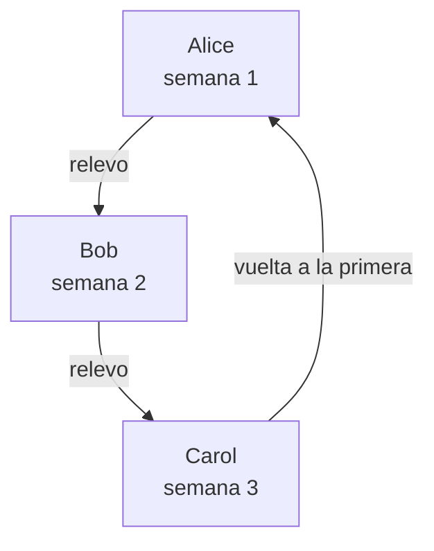
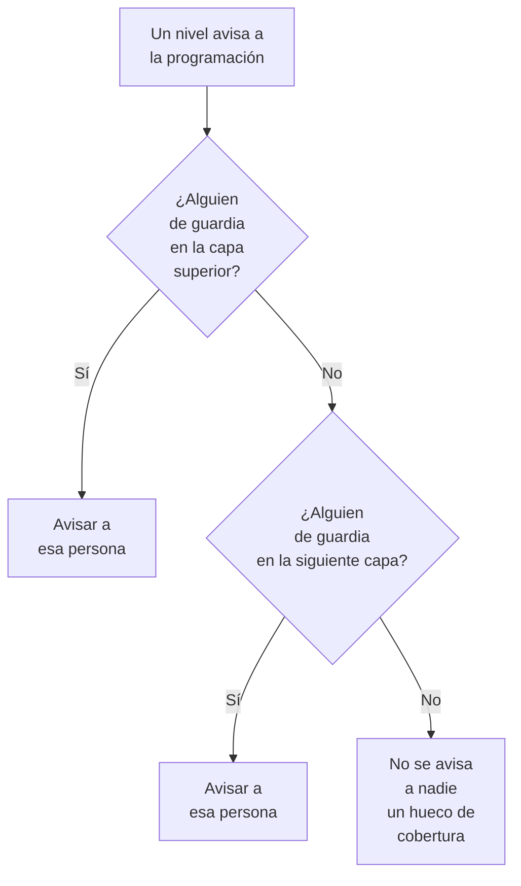

# Programaciones de guardia

Una programación de guardia decide quién está de guardia en cada momento. Las personas se turnan en ella: cada una está de guardia durante un tiempo y luego toma el relevo la siguiente. Añade una programación a las reglas de escalado de una política de guardia, y la política avisa a quien esté de guardia en ella cuando se ejecuta ese nivel.

> [!NOTE]
> En OneUptime Cloud, las programaciones de guardia están en el plan **Growth** y superiores. Una programación que un proyecto aún tiene sigue avisando a las personas que contiene, a través de las reglas de escalado que la nombran, después de que termine una prueba de Growth o baje el plan. Por eso, por debajo de **Growth**, la página **Programaciones de guardia** muestra la nota del plan con las programaciones que siguen configuradas debajo, donde puedes eliminarlas. Crear o cambiar una programación necesita **Growth**.

:::cards
- [Quiénes se turnan](#quiénes-se-turnan): Crea una programación con su primera rotación.
- [Capas](#capas): Apila rotaciones, limita las horas de guardia y añade cobertura de respaldo.
- [Cuando alguien está ausente](#cuando-alguien-está-ausente): Omitir a alguien en la rotación hasta que vuelva.
- [API y Terraform](#crear-programaciones-con-la-api-o-terraform): Crea programaciones y sus rotaciones como código.
:::

## Quiénes se turnan

Cuando creas una programación en la página **Programaciones de guardia**, el formulario pide su **Nombre** y **¿Quiénes se turnan?**. Las personas que elijas forman la primera capa de la programación, **Layer 1**, de guardia las 24 horas.

:::steps
1. Ve a **Guardia** > **Programaciones de guardia** y haz clic en **Crear programación de guardia**.
2. Escribe un **Nombre**. Se rechaza un nombre que ya tenga otra programación del proyecto, sin importar mayúsculas, minúsculas ni espacios, para que todo selector distinga las programaciones.
3. En **¿Quiénes se turnan?**, haz clic en **Añadir usuario** y elige a las personas, en el orden en que se turnan.
4. Si quieres, abre **Más campos** para cambiar cuánto dura cada turno, la zona horaria, la descripción o las etiquetas.
5. Haz clic en **Crear programación de guardia**. La nueva programación se abre después en su página **Capas**, donde puedes cambiar la rotación o añadir más capas.
:::

Las personas se turnan de una en una, y la primera está de guardia en cuanto se crea la programación:



**¿Quiénes se turnan?** es opcional. Si lo dejas vacío, la programación empieza sin capas: no pone a nadie de guardia hasta que añadas una capa en su página **Capas**. La pregunta solo se hace a quienes pueden añadir capas.

Todo lo demás espera en **Más campos**, plegado hasta que lo abras:

| Campo | Qué hace |
| --- | --- |
| **Cada turno dura** | **1 día**, **1 semana**, **2 semanas** o **1 mes**, y **1 semana** si no lo cambias. Se pregunta en cuanto alguien se turna. Cada persona está de guardia ese tiempo y luego toma el relevo la siguiente, a la hora del día en que se creó la programación. |
| **Zona horaria** | La zona horaria en la que se guardan las horas de relevo y las horas de guardia. Empieza con la tuya. Cada zona horaria sigue las reglas actuales de su región: America/Vancouver (Columbia Británica) se queda en UTC-7 todo el año desde 2026. |
| **Descripción** | Notas sobre la programación. |
| **Etiquetas** | Etiquetas para encontrar y agrupar la programación. |

Mientras alguien se turna y no se cambia nada en **Más campos**, su encabezado plegado dice lo que pasará: cada persona está de guardia una semana y luego toma el relevo la siguiente.

Alguien invitado al proyecto que aún no se ha unido también puede turnarse, pero nada le avisa hasta que acepta su invitación, y no se le dice nada. Su turno es un hueco de cobertura, y los canales y el feed de cada política de guardia que avisa a la programación lo dicen, nombrándole por el nombre escrito con su invitación, nunca por su dirección de correo: "⚠️ Nobody is paged for Payments through schedule Primary until tomorrow at 5:50 PM, when @bob takes over: Ivy is on call but hasn't joined the project yet." `/oneuptime oncall` en Slack y `oncall` en Microsoft Teams también lo dicen. Cuando se une, los avisos le llegan, se le dice qué políticas de guardia le avisan ahora, y los canales oyen "📞 Ivy has joined the project and is now on call for Payments until tomorrow at 5:50 PM, then @bob." Hasta entonces, [Preparación e informes](/docs/on-call/readiness) lo muestra, con lo que hay que hacer.

## Capas

La rotación de una programación se compone de capas, en su página **Capas**. Las capas se leen de arriba abajo: la capa más alta con alguien de guardia es la que avisa, así que pon la rotación principal arriba y la cobertura de respaldo debajo.



**Añadir capa** añade una capa que empieza como la primera: de guardia desde ahora, cada persona durante una semana, las 24 horas. Despliega una capa para añadirle personas y para cambiar cuándo empieza, cada cuánto hace el relevo, cuándo hace el primer relevo y las horas en que está de guardia:

| Campo | Qué define |
| --- | --- |
| **Nombre de la capa** | Lo que cubre la capa, por ejemplo «Principal entre semana». |
| **La rotación empieza el** | La fecha y hora en que empieza la rotación de la capa. |
| **Rotar cada** | Cada cuánto pasa la guardia a la siguiente persona de la capa. |
| **Hora del primer relevo** | El primer relevo a la siguiente persona, en el inicio o después. Los relevos posteriores siguen cada intervalo de rotación. |
| **Restricciones** | Las horas en que la capa está de guardia: **Sin restricciones**, **Horas específicas del día** u **Horas específicas de la semana**, en la zona horaria de la programación. Fuera de ellas, toman el relevo las capas inferiores. |

Para cambiar qué capa va primero, usa las flechas de la tarjeta de una capa: **Subir capa (mayor prioridad)** o **Bajar capa (menor prioridad)**.

Los cambios en quién se turna esperan a que los guardes, así que puedes hacer varios y revisarlos antes de que cambie el turno de nadie. Arrastra personas a un nuevo orden, añade o quita personas, sube o baja una capa o elimina una, y la página muestra cada cambio antes de guardarlo:

- Quien añadiste aparece marcado como **Nuevo**, y quien arrastraste a otro lugar, como **Movido**. Las personas que quitaste aparecen en **Se quitan al guardar**, cada una con **Deshacer**.
- Una capa que eliminas indica que se eliminará al guardar, con **Deshacer**.
- Cada capa y la programación final muestran la rotación como quedará. La programación final aparece marcada con **Incluye cambios sin guardar**.
- Una barra al pie de la página enumera los cambios, con **Guardar cambios** y **Descartar**.

**Guardar cambios** guarda todos los cambios a la vez. Quién está de guardia se calcula entonces una sola vez, para las capas tal como quedan guardadas: quien entra o sale de guardia, o es el siguiente, recibe el aviso una vez, no una por cada cambio. **Descartar** devuelve las capas a como estaban la última vez que se guardaron. Salir de la página antes de guardar te pregunta primero: **Guardar cambios** guarda y luego sale, **Seguir editando** te deja en ella, y **Descartar cambios** sale sin guardar.

Si otra persona cambió las capas después de que abrieras la página, tus cambios no se guardan encima de los suyos. La barra lo indica, y **Recargar capas** muestra las capas como están ahora, para que vuelvas a hacer tus cambios. **Añadir capa** añade su capa al momento, y los ajustes de una capa se guardan con su propio botón **Guardar capa**.

Cada persona conserva un mismo color en todas partes, para que puedas seguirla de un vistazo: en cada capa, en la programación final y sus sustituciones, y en la **Cronología de la programación**.

## Cuando alguien está ausente

Cuando alguien se va de vacaciones, omítelo hasta que vuelva. En la página **Capas** de la programación, despliega una capa y haz clic en **Omitir hasta…** junto a su nombre. Se abre el formulario de ausencias con esa persona en **¿Quién está ausente?**, **Siguiente persona de la rotación** en **¿Quién cubre?** y **Empieza** desde ahora: pon en **Finaliza** cuándo vuelve y guárdalo. Si ya tiene una ausencia a esas horas, el formulario lo dice junto a las horas mientras las eliges, con **Editar esa sustitución** para cambiar esa en su lugar.

Mientras está ausente:

- Cada uno de sus turnos pasa a la siguiente persona de la capa que no esté ausente, en cada programación en la que esté. Los turnos de los demás no se mueven, y los suyos vuelven a ser suyos en cuanto vuelve.
- Si todos en una capa están ausentes, la capa no tiene a nadie de guardia y las capas de debajo toman el relevo. La capa muestra **Todos en esta capa están ausentes ahora mismo**.
- Las reglas de escalado que la avisan directamente, o a través de un equipo, la omiten. La ejecución de la política indica que está ausente y hasta cuándo.
- Su fila en la capa indica hasta cuándo está ausente, y la programación final y la **Cronología de la programación** muestran quién tiene cada uno de sus turnos.

Si eliges a alguien en **¿Quién cubre?**, esa persona recibe todos sus avisos, de cada programación y cada política, en lugar de que la rotación se quede con sus turnos.

Una ausencia añadida así se aplica a todas las políticas de guardia, por lo que requiere el permiso de sustituciones sobre todo el proyecto. Si el rol de tu equipo está limitado a sus propias políticas o a algunas etiquetas, se añade en su lugar en las políticas de esta programación en las que puedes añadir sustituciones, con una sustitución por política, que aparece en la página **Sustituciones de usuarios** de cada política; si son varias, las marcas en **Políticas de guardia**. **Omitir hasta…** solo está bloqueado y dice por qué donde no puedes en ninguna. Aparece en **Guardia** > **Programaciones** > **Sustituciones de usuarios**, y entre las sustituciones de usuarios de la programación en su página **Capas**, donde **Terminar ahora** hace que vuelva antes. Para omitir a alguien en una sola política, añade la sustitución en la página **Sustituciones de usuarios** de esa política y deja **¿Quién cubre?** como está. Consulta [Sustituciones de usuarios](/docs/on-call/user-overrides).

Con la API, una sustitución de usuario (`/api/on-call-duty-policy-user-override`) creada sin `routeAlertsToUserId` omite a la persona de `overrideUserId` desde `startsAt` hasta `endsAt`.

La **Vista general** de una programación tiene una tarjeta **Usado por**: las políticas de guardia cuyas reglas de escalado avisan a quien está de guardia, con las reglas que lo hacen. Si ninguna lo hace, lo dice y enlaza a las políticas de guardia. Eliminar la programación, en su página o desde la lista, dice primero qué políticas avisan a través de ella. Las políticas que no puedes abrir se cuentan, pero no se nombran. Una programación que tiene el mismo nombre que otra programación, de cuando los nombres no tenían que ser distintos, aparece marcada como **Mismo nombre que otra programación** en la lista **Programaciones de guardia**, que indica cuántas hay: compara sus capas y luego cambia el nombre de una con **Cambiar nombre** en su fila.

## Crear programaciones con la API o Terraform

Las programaciones de guardia son el recurso `/api/on-call-duty-policy-schedule`; sus capas y las personas que contienen son los recursos `/api/on-call-duty-schedule-layer` y `/api/on-call-duty-schedule-layer-user`.

- Crear una programación con `firstLayerUsers` (una lista de identificadores de usuario, en el orden en que se turnan) en sus `miscDataProps` le da su primera capa, como hace el panel: **Layer 1**, de guardia desde ahora, las 24 horas. `firstLayerRotation` indica cuánto dura cada turno, como una rotación del tipo `{"_type": "Recurring", "value": {"intervalType": "Week", "intervalCount": 1}}`; sin ella, una semana. Cada usuario debe ser miembro del proyecto y quien llama debe poder crear capas; si no, la programación no se crea.
- Una programación creada sin ellos no tiene capas, como antes; el recurso de programaciones de Terraform no los envía.
- Una capa creada sin `rotation` hace el relevo a diario, como siempre.
- Un cambio en las capas de una programación y en las personas que contienen, hecho con la API o Terraform, se avisa como un solo cambio: quién está de guardia se calcula cuando las capas llevan medio minuto sin cambios, y quien entra o sale de guardia, o es el siguiente, recibe el aviso una vez, no una por cada capa o persona escrita. Las alertas van a quien las capas ponen de guardia en cuanto se guarda cada cambio.
- Para cambiar de una vez quién hace turnos en las capas de una programación, como hace **Guardar cambios** en la página **Capas**, lee las capas con `GET /api/on-call-duty-policy-schedule/<schedule-id>/layers` y devuélvelas, cambiadas, a `POST /api/on-call-duty-policy-schedule/<schedule-id>/save-layers`. Enumeran cada capa que la programación conserva, la de mayor prioridad primero, cada una con sus personas en el orden de sus turnos: quien ya está en una capa, por su `layerUserId`; quien se añade, solo por su `userId`. `deletedLayerIds` enumera las capas que se eliminan.
- Un guardado se escribe entero o no se escribe, y quién está de guardia se calcula una sola vez, en el acto. Uno hecho después de que otra persona cambiara las capas se rechaza con 409, porque su `basedOnVersion` ya no es el de las capas: vuelve a leer las capas y haz el cambio sobre lo que hay ahora. El recurso de Terraform `oneuptime_on_call_schedule_layers` guarda así las capas de una programación.

```bash
curl -X POST https://oneuptime.com/api/on-call-duty-policy-schedule \
  -H "apikey: $ONEUPTIME_API_KEY" \
  -H "Content-Type: application/json" \
  -d '{
    "data": {
      "projectId": "<project-id>",
      "name": "Primary on-call",
      "timezone": "Europe/Berlin"
    },
    "miscDataProps": {
      "firstLayerUsers": ["<user-id-1>", "<user-id-2>", "<user-id-3>"],
      "firstLayerRotation": {"_type": "Recurring", "value": {"intervalType": "Week", "intervalCount": 1}}
    }
  }'
```

```bash
curl https://oneuptime.com/api/on-call-duty-policy-schedule/<schedule-id>/layers \
  -H "apikey: $ONEUPTIME_API_KEY"

curl -X POST https://oneuptime.com/api/on-call-duty-policy-schedule/<schedule-id>/save-layers \
  -H "apikey: $ONEUPTIME_API_KEY" \
  -H "Content-Type: application/json" \
  -d '{
    "basedOnVersion": "<the version the read answered>",
    "layers": [
      {
        "layerId": "<layer-id>",
        "users": [
          {"layerUserId": "<row-of-user-2>", "userId": "<user-id-2>"},
          {"layerUserId": "<row-of-user-1>", "userId": "<user-id-1>"},
          {"userId": "<user-id-4>"}
        ]
      }
    ],
    "deletedLayerIds": []
  }'
```

## Próximos pasos

:::cards
- [Reglas de escalado](/docs/on-call/escalation-rules): Haz que un nivel de una política de guardia avise a esta programación.
- [Línea de tiempo de guardias](/docs/on-call/schedule-timeline): Ve todas las programaciones lado a lado, con sus huecos de cobertura.
- [Feeds de calendario](/docs/on-call/calendar-feeds): Lleva los turnos a Google Calendar, Outlook o el Calendario de Apple.
- [Cómo contactarme](/docs/notifications/on-call-rules): Decide cómo te llega un aviso mientras estás de guardia.
:::
