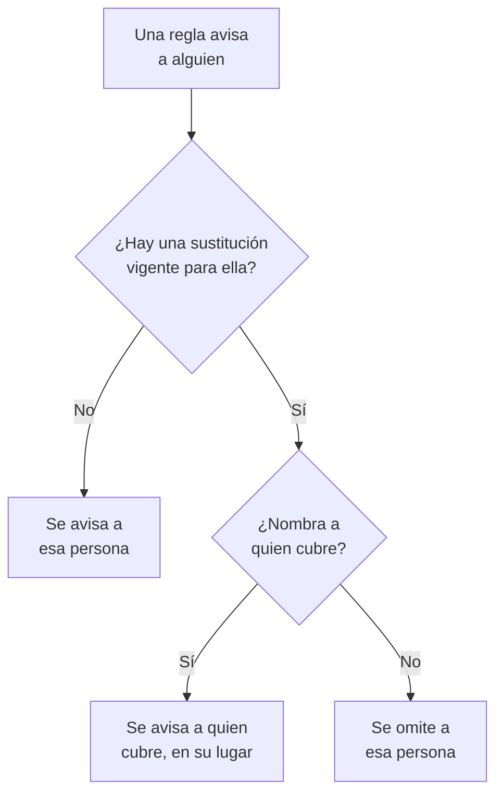

# Sustituciones de usuarios

Mientras alguien está ausente, una sustitución de usuario envía los avisos que le llegarían a la persona que lo cubre, durante un tiempo fijado. Si no se nombra a nadie para cubrirlo, en su lugar lo omite: cada uno de sus turnos en una programación de guardia pasa a la siguiente persona de la rotación. Úsala para unas vacaciones, una baja por enfermedad o un turno intercambiado.

:::cards
- [Cómo cambia un aviso una sustitución](#cómo-cambia-un-aviso-una-sustitución): A quién se avisa en su lugar, y cuándo.
- [Añadir una sustitución](#añadir-una-sustitución): Quién está ausente, quién cubre, desde cuándo y hasta cuándo.
- [Todas las políticas, o una](#todas-las-políticas-o-una): Dónde añadir una sustitución, y cuál gana.
- [Otras formas de añadir una](#otras-formas-de-añadir-una): Desde una programación y desde tus próximos turnos.
:::

## Cómo cambia un aviso una sustitución



Mientras una sustitución está vigente, desde su inicio hasta su fin:

- Con alguien en **¿Quién cubre?**, esa persona recibe todos los avisos de la persona ausente, de cada programación, equipo y regla a los que se aplica la sustitución. El aviso le llega según sus propias reglas de guardia personales.
- Sin nadie que cubra, se omite a la persona. En una programación de guardia, cada uno de sus turnos pasa a la siguiente persona de la rotación que no esté ausente; si todos en una capa están ausentes, toman el relevo las capas de debajo. Una regla que la nombra directamente, o mediante un equipo, no la avisa, y la ejecución de la política dice que está ausente, y hasta cuándo.
- Las sustituciones no se encadenan. Si quien cubre también está ausente, sigue siendo a quien se avisa por la persona que cubre.

Cuando termina la sustitución, los avisos vuelven a ser suyos. La **Cronología de la programación**, las capas de una programación y los feeds de calendario muestran quién tiene cada turno cubierto.

## Añadir una sustitución

:::steps
### Abrir las sustituciones

Ve a **Guardia → Avanzado → Sustituciones de usuarios** para cubrir a alguien en todas las políticas de guardia, o a la página **Sustituciones de usuarios** de una política, en **Avanzado**, para cubrirlo solo en esa política. Haz clic en **Añadir Sustitución de usuario**.

### Indicar quién está ausente

**¿Quién está ausente?** empieza contigo, porque registrar tu propia ausencia es el caso más habitual. Elige a otra persona para organizar su cobertura.

### Indicar quién cubre

Deja **¿Quién cubre?** en **Siguiente persona de la rotación** para omitir a la persona, o elige al compañero que se queda con todos sus avisos. La persona ausente no aparece en la lista.

### Fijar el horario

**Empieza** es ahora, salvo que elijas otra hora. Pon **Finaliza** en el momento de su regreso: tiene que ser posterior al inicio. Haz clic en **Añadir Sustitución de usuario**.
:::

Cada sustitución es una fila: **Ausente**, **Cubierto por**, **Empieza** y **Finaliza**, que se puede filtrar por inicio y por fin. **Cubierto por** muestra **Siguiente persona de la rotación** en una omisión. Una sustitución no se puede editar: elimínala y añade una nueva, o elimínala para que alguien vuelva antes.

## Todas las políticas, o una

| Añadida en | Tarjeta | Se aplica a |
| --- | --- | --- |
| **Guardia → Avanzado → Sustituciones de usuarios** | **Sustituciones globales de usuarios** | Todas las políticas de guardia del proyecto |
| **Sustituciones de usuarios** de una política | **Sustituciones de usuarios de la política de guardia** | Solo esa política |

Cuando dos sustituciones de la misma persona se solapan, la de la propia política gana a una global, y la que nombra a quien cubre gana a una omisión. Un aviso enviado sin política, desde un workflow o desde el chat, solo sigue las sustituciones globales.

## Otras formas de añadir una

- Desde una programación: en la página **Capas** de una programación, despliega una capa y haz clic en **Omitir hasta…** junto a una persona. Se abre el mismo formulario con esa persona ausente y la rotación cubriendo, como sustitución global. Consulta [Cuando alguien está ausente](/docs/on-call/schedules#cuando-alguien-está-ausente).
- Desde tus próximos turnos: **Buscar cobertura** en uno de tus turnos, en **Ajustes de usuario → Calendario → Feed de calendario**, abre el formulario contigo ausente durante las horas de ese turno, de modo que solo queda **¿Quién cubre?**. Consulta [Próximos turnos y cobertura](/docs/on-call/calendar-feeds#próximos-turnos-y-cobertura).

Cuando alguien deja el proyecto, se elimina cada sustitución que lo nombra y que aún no ha terminado, en cualquiera de los dos lados.

## Quién puede añadir sustituciones

**Propietario del proyecto**, **Administrador del proyecto**, **Miembro del proyecto**, **Administrador de guardias** y **Miembro de guardias** pueden añadir y eliminar sustituciones; **Visor** y **Visor de guardias** pueden verlas. En un rol personalizado, los permisos son **Create On-Call Duty Policy User Override**, **Delete On-Call Duty Policy User Override** y **Read On-Call Duty Policy User Override**. En la **Cronología de la programación**, solo quien puede leer sustituciones ve qué turno se está cubriendo.

En OneUptime Cloud, las sustituciones de usuarios necesitan el plan **Growth**.

## API

Las sustituciones de usuarios son el recurso `/api/on-call-duty-policy-user-override`:

| Campo | Qué contiene |
| --- | --- |
| `overrideUserId` | La persona ausente. Obligatorio. |
| `routeAlertsToUserId` | La persona que cubre. Omítelo para omitir a la persona en su lugar. |
| `startsAt`, `endsAt` | Cuándo empieza y termina la sustitución. Ambos son obligatorios, y el fin va después del inicio. |
| `onCallDutyPolicyId` | La política a la que se aplica. Omítelo para una sustitución global. |

```bash
curl -X POST https://oneuptime.com/api/on-call-duty-policy-user-override \
  -H "apikey: $ONEUPTIME_API_KEY" \
  -H "Content-Type: application/json" \
  -d '{
    "data": {
      "projectId": "<project-id>",
      "overrideUserId": "<away-user-id>",
      "routeAlertsToUserId": "<cover-user-id>",
      "startsAt": "2026-12-22T09:00:00Z",
      "endsAt": "2027-01-05T09:00:00Z"
    }
  }'
```

Se rechaza una sustitución cuya persona ausente y cuya cobertura son la misma persona, y también una que termina antes de empezar.

## Solución de problemas

:::details La persona de vacaciones recibió avisos igualmente
Comprueba dónde se añadió la sustitución. Una en la página **Sustituciones de usuarios** de una política cubre solo esa política, y las demás políticas siguen avisándola: añádela en **Guardia → Avanzado → Sustituciones de usuarios** para cubrir todas las políticas. Comprueba también **Empieza** y **Finaliza**: las horas se muestran en tu zona horaria.
:::

:::details Tampoco se avisó a quien cubría
Se le avisa según sus propias reglas de guardia personales y sus métodos verificados. Búscalo en **Guardia → Preparación** y revisa la ejecución en los **Registros de ejecución** de la política.
:::

:::details No puedo añadir una sustitución
Hace falta uno de los roles anteriores y, en OneUptime Cloud, el plan **Growth**.
:::

## Próximos pasos

:::cards
- [Programaciones de guardia](/docs/on-call/schedules): Rotaciones, capas y cómo omitir a alguien en una capa.
- [Línea de tiempo de guardias](/docs/on-call/schedule-timeline): Ver cada turno cubierto en todas las programaciones.
- [Feeds de calendario](/docs/on-call/calendar-feeds): Buscar cobertura para uno de tus propios turnos.
:::
