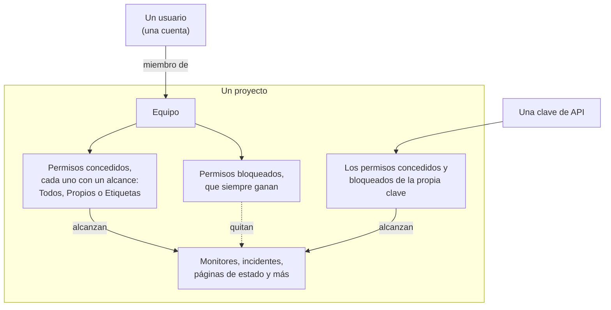
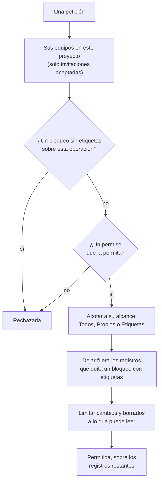

# Usuarios, equipos y permisos

Todo en OneUptime vive dentro de un **proyecto**. Quién puede hacer qué dentro de ese proyecto se reduce a tres cosas: los **usuarios** que hay en él, los **equipos** a los que pertenecen y los **permisos** concedidos a esos equipos.

> [!IMPORTANT]
> **Los usuarios nunca tienen permisos directamente.** El acceso de un usuario es la unión de los permisos de todos los equipos a los que pertenece en ese proyecto. Si quiere cambiar lo que alguien puede hacer, cambie su pertenencia a un equipo o cambie los permisos de ese equipo.

Los **propietarios** son otra idea. Un propietario es quien se responsabiliza de un recurso concreto: un monitor, un incidente, un panel. A los propietarios se les notifica sobre sus recursos, y los permisos pueden acotarse opcionalmente a «solo lo que me pertenece».

## Cómo funciona el acceso

| Concepto | Qué es |
| --- | --- |
| Usuario | Una sola cuenta de OneUptime. Un inicio de sesión, cualquier número de proyectos. |
| Proyecto | El límite del inquilino. Monitores, incidentes, equipos y datos pertenecen a exactamente un proyecto. |
| Equipo | Un grupo con nombre dentro de un proyecto que lleva permisos. |
| Miembro de equipo | Un usuario al que se ha invitado a un equipo y que ha aceptado. |
| Permiso | Una capacidad concreta, p. ej. `CreateProjectMonitor`, o un rol que agrupa muchas, p. ej. `MonitorAdmin`. |
| Alcance | Hasta dónde llega un permiso concedido: todos los recursos, solo los propios o solo los etiquetados. |
| Propietario | Un usuario o equipo marcado como responsable de un recurso concreto. |
| Etiqueta | Una marca que pone en los recursos, usada para restringir permisos y para organizar. |

## Usuarios

Una cuenta de usuario es global a la instancia de OneUptime: el mismo inicio de sesión funciona en todos los proyectos a los que se le haya invitado.

Un usuario está «en» un proyecto cuando es miembro de **al menos un equipo** de ese proyecto. No hay un paso separado de «añadir usuario al proyecto»: invitar a alguien a un proyecto es invitarlo a un equipo.

:::steps
1. Abra **Usuarios** desde el menú **Productos**, en **Ajustes**, y haga clic en **Invitar usuario**. La lista muestra a todas las personas del proyecto y su estado de invitación.
2. Escriba su **Correo electrónico**. A quien aún no tiene una cuenta de OneUptime se le pide también un **Nombre**.
3. Elija su **Equipo**, que decide lo que puede hacer, y haga clic en **Invitar**.
4. La persona acepta desde la campana de arriba a la derecha, en **Invitaciones del proyecto**, y desde entonces forma parte del proyecto.
:::

- Las invitaciones crean un miembro de equipo pendiente. El usuario solo cuenta como miembro del proyecto —y solo obtiene algún permiso— **después de aceptar la invitación.**
- **Invitar usuario** empieza en el equipo de miembros del proyecto: el equipo que tiene `ProjectMember` para todo el proyecto, que es **Members** salvo que lo haya renombrado. Elija otro equipo para dar a la persona más o menos acceso. No hay nada elegido cuando usted no podría invitar a ese equipo —invitar a alguien le transmite los permisos del equipo, y solo puede transmitir permisos que usted tiene— o cuando el proyecto no tiene un equipo así. El panel de administración empieza en el mismo equipo siempre que un administrador de la instancia añade a alguien a un proyecto: **Invitar usuario** en un proyecto, **Añadir al proyecto** en un usuario y en varios usuarios a la vez, y los proyectos asociados a un [proveedor de SSO global](/docs/identity/global-sso).
- Quitar a un usuario de todos los equipos de un proyecto le retira el acceso a ese proyecto, desde su siguiente petición, incluso mientras tiene la sesión iniciada. Su cuenta y sus otros proyectos no se ven afectados. Se le quita de los calendarios de guardia, las reglas de escalado y las sustituciones del proyecto, de los roles de sus incidentes y episodios abiertos y de los propietarios de sus recursos; los incidentes resueltos conservan el registro de quién los tenía y los dirigió.
- Quien deja un proyecto deja de recibir sus notificaciones. Sus propios métodos, reglas y ajustes de notificación del proyecto se eliminan con su último equipo — correo, SMS, llamada, WhatsApp, Telegram, push, webhook, Slack y Microsoft Teams, su resumen por correo y el correo aún sin enviar, su número para llamadas entrantes y sus recordatorios de turno —, así que si vuelve a unirse empieza con los valores predeterminados. Lo que todavía lo nombra, como el usuario al que llama una regla de llamadas entrantes o un propietario que se conserva en un incidente resuelto, ya no lo notifica: no se envía nada en nombre de un proyecto a quien no es miembro, y una invitación pendiente todavía no es membresía. Esos lugares muestran **Ya no es miembro** junto a su nombre, para que pueda poner a otra persona. Quien está invitado y aún no ha aceptado muestra en su lugar **Invitación aún no aceptada**. Si una sustitución envía los avisos de alguien a una persona que ha dejado el proyecto, se avisa en su lugar a la persona a la que cubre. Dejar el proyecto también desconecta los clientes MCP que la persona conectó al proyecto, y su enlace personal al calendario de guardias muestra desde entonces un calendario vacío. En OneUptime Cloud, quien vuelve mediante el inicio de sesión único (SSO) del proyecto lo confirma de nuevo desde su correo.
- Si su proyecto exige SSO y un usuario aún no se ha autenticado con el proveedor de identidad, se le trata como usuario SSO no autorizado y no ve nada hasta que lo haga. Consulte [SSO](/docs/identity/sso).
- Con SCIM configurado, su proveedor de identidad puede crear, actualizar y eliminar usuarios y sus pertenencias a equipos automáticamente. Consulte [SCIM](/docs/identity/scim).

## Equipos

Los equipos son el camino por el que los permisos llegan a las personas. Todo proyecto nuevo empieza con tres:

| Equipo | Permiso que tiene | Editable |
| --- | --- | --- |
| Owners | `ProjectOwner` | No. Siempre tiene al menos un miembro. |
| Admin | `ProjectAdmin` | No |
| Members | `ProjectMember` | Sí: este es un punto de partida, cámbielo libremente |

Los equipos **Owners** y **Admin** están bloqueados a propósito: sus permisos no se pueden editar y los equipos no se pueden eliminar ni renombrar. Eso es lo que evita que un proyecto se quede accidentalmente sin acceso. El equipo Owners debe mantener siempre al menos un miembro.

`ProjectOwner` es el nivel de acceso más alto: facturación, eliminar el proyecto y todo lo que puede hacer un administrador. `ProjectAdmin` cubre todo excepto la facturación y la eliminación del proyecto.

Encender o apagar SMS, llamadas telefónicas, WhatsApp o Telegram para el proyecto cuenta como facturación, porque cada mensaje cuesta dinero. Solo `ProjectOwner`, el rol `BillingAdmin` (**Billing Admin**) y el permiso `ManageProjectBilling` (**Manage Billing**) pueden cambiar esos interruptores, en **Ajustes del proyecto > Notificaciones > Ajustes de notificaciones**; `ProjectAdmin` no puede.

Recargar los saldos prepagados del proyecto también cuenta como facturación. En OneUptime Cloud, los SMS, las llamadas telefónicas, WhatsApp y Telegram se pagan con el saldo de **Ajustes del proyecto > Notificaciones > Ajustes de notificaciones**, y la IA con los créditos de IA de **Ajustes del proyecto > IA > Créditos de IA**. Solo el propietario del proyecto o alguien con **Manage Billing** puede recargarlos o cambiar su **Recarga automática**; un administrador del proyecto no puede. Un mensaje sobre un saldo que se está agotando dice quién puede recargarlo, y solo esas personas tienen un botón **Recargar saldo** que funciona o un enlace a la página.

Cree tantos equipos adicionales como quiera —«Guardia de Frontend», «Soporte», «Auditores de solo lectura»— y dé a cada uno los permisos que necesite. En OneUptime Cloud, crear un equipo y cambiar sus permisos requiere el plan Scale.

**Crear un equipo** pide un nombre y su **Acceso**, es decir, lo que pueden hacer los miembros del equipo:

| Acceso | Lo que pueden hacer los miembros del equipo |
| --- | --- |
| Administrador del proyecto | Crear, cambiar y eliminar cualquier cosa del proyecto, incluidos sus ajustes. No la facturación, ni eliminar el proyecto. |
| Miembro del proyecto | Crear, cambiar y eliminar monitores, incidentes, páginas de estado y los demás recursos del proyecto. |
| Visor | Leer todo en el proyecto y no cambiar nada. |
| Elegir los permisos más tarde | Nada todavía. Elegido de inicio. |

:::steps
1. Abra **Equipos** desde el menú **Productos**, en **Ajustes**, y haga clic en **Crear equipo**.
2. Escriba el **Nombre** del equipo y elija su **Acceso**. La descripción está en **Más campos**.
3. Cree el equipo. Un equipo con un rol se abre en su página **Miembros**, listo para invitar a personas; con **Elegir los permisos más tarde** se abre en su página **Permisos**, donde añade un rol más estrecho como `IncidentMember`, o permisos sueltos.
:::

El rol que elija pasa a ser el primer permiso del equipo, para todos los recursos del proyecto, en cuanto el equipo existe, exactamente como si lo hubiera añadido con **Añadir rol** en la página Permisos del equipo. Solo se le ofrecen los roles que usted mismo tiene, porque todos los que invite al equipo reciben sus permisos, y a quien puede crear equipos pero no cambiar lo que pueden hacer no se le pregunta. Si el rol no se puede añadir, el equipo se crea igualmente y un aviso sobre la lista enlaza a él.

Dónde encontrarlo: abra un equipo desde **Equipos** para llegar a **Miembros** y **Permisos**; **Bloquear permisos** está en **Más ajustes**, al final de la página Permisos, cuyo encabezado plegado muestra cuántos tiene el equipo.

## Permisos

Un permiso es una capacidad concreta. Hay dos formas de repartirlos, y ambas están en la pestaña **Permisos** del equipo.

### Roles

Un rol agrupa toda un área del producto en uno de tres niveles:

- **Admin** — lo que hace el Member, más la configuración propia del área, como las severidades y los estados de incidentes y alertas, los estados de los monitores y los estados de mantenimiento.
- **Member** — el trabajo diario: crear, cambiar y eliminar los recursos del área, con sus notas, propietarios y plantillas. En las páginas de estado y las guardias, el Member hace todo lo que hace el Admin.
- **Viewer** — solo lectura.

`MonitorAdmin`, `IncidentMember`, `StatusPageViewer`, etc. Los roles son lo que se necesita casi siempre: siguen siendo correctos a medida que OneUptime añade funciones, porque una nueva tabla relacionada con los monitores se añade a los roles de monitor existentes en lugar de requerir una nueva concesión suya.

Los flujos de trabajo y los runbooks son la excepción. Ambos ejecutan código en su proyecto —un flujo de trabajo sus pasos, un runbook sus scripts en sus Runners—, así que `WorkflowMember` abre los flujos de trabajo y sus ejecuciones y los ejecuta a mano, y `RunbookMember` abre los runbooks y sus ejecuciones y los ejecuta: inicia una ejecución, completa u omite sus pasos y la cancela. Ninguno de los dos crea, cambia ni elimina lo que ejecuta; `WorkflowAdmin` y `RunbookAdmin` los construyen. Un rol solo ejecuta los runbooks que alcanza su alcance, así que un `RunbookMember` limitado a algunas etiquetas ejecuta los runbooks que las llevan. Consulte [Permisos de los flujos de trabajo](/docs/workflows/configuration#permisos) y [Permisos de los runbooks](/docs/runbooks/configuration#permisos).

Las reglas de un área (reglas de etiquetas, de propietarios, de guardia, de agrupación y de recordatorio), los campos personalizados, los SLA y los secretos son configuración del proyecto: requieren `ProjectAdmin`, tenga quien tenga el rol del área. Lo mismo ocurre con las claves de API, los equipos y sus permisos, las etiquetas, el SSO y los dominios: los roles Settings se ocupan de los servicios, sondas, infraestructura e integraciones del proyecto, no de quién puede hacer qué.

La facturación tiene tres roles propios. `BillingViewer` lee la facturación del proyecto —el plan y la suscripción, las facturas, el uso, los saldos, los créditos de IA, los métodos de pago y los datos de contacto de facturación— y no cambia nada. `BillingMember` además descarga facturas y cambia los datos de contacto de facturación. `BillingAdmin` hace lo que hace `BillingMember` y enciende y apaga SMS, llamadas telefónicas, WhatsApp y Telegram. Cambiar el plan, los métodos de pago o los saldos, y pagar facturas, requiere `ProjectOwner` o **Manage Billing**; en las páginas de facturación esos botones están bloqueados para todos los demás e indican quién puede usarlos.

Los {{PERMISSION_ROLE_COUNT}} roles aparecen en la [Referencia de permisos](/docs/permissions/reference).

### Permisos granulares

Cada capacidad individual también se puede asignar por separado: `CreateProjectMonitor`, `ReadProjectIncident`, `DeleteProjectStatusPage` y {{PERMISSION_TOTAL_COUNT}} más. Úselos cuando un rol sea demasiado amplio y necesite conceder exactamente una cosa.

Un permiso para cambiar o eliminar algo solo alcanza lo que usted también puede leer, así que conceda con él el permiso de lectura correspondiente: `EditProjectIncident` no cambia ningún incidente sin `ReadProjectIncident`. Un registro que se lee a través de otro, como la nota de un incidente, necesita además un permiso para leer ese otro registro: `ReadIncidentInternalNote` no alcanza ninguna nota sin un permiso para leer incidentes, y `CreateIncidentInternalNote` añade una nota solo a un incidente que usted puede leer. Los roles ya incluyen ambos.

Estas son también las claves que usa al crear claves de API, y las que esperan la API y el proveedor de Terraform.

La lista completa está en la [Referencia de permisos](/docs/permissions/reference).

### Permitir y bloquear

Cada equipo tiene dos listas:

- **Permisos** (permitir) — lo que este equipo puede hacer.
- **Bloquear permisos** — lo que este equipo nunca puede hacer, sin importar ninguna entrada de permitir.

Ambas están en la página **Permisos** del equipo. Pocos equipos necesitan un bloqueo, así que los permisos bloqueados están plegados en **Más ajustes**, al final de la página.

> [!WARNING]
> **El bloqueo siempre gana.** Una entrada de bloqueo sin etiquetas retira esa capacidad por completo al equipo. Una entrada de bloqueo con etiquetas la retira solo para los recursos que lleven esas etiquetas: útil para «este equipo puede editar monitores, salvo los etiquetados como Production».

Un permiso no puede llevar etiquetas de restricción en ambas listas a la vez; OneUptime rechaza la segunda con una explicación.

Los permisos concedidos a un usuario se suman entre todos sus equipos, pero un bloqueo se aplica a todo lo que hace el usuario: un bloqueo sin etiquetas en un equipo retira la capacidad aunque otro equipo la conceda, y una entrada de bloqueo nunca concede nada. Si alguien tiene menos acceso del que espera, busque un bloqueo en cada uno de sus equipos; si tiene más, busque un permiso concedido en cada uno.

### Cambiar un estado

Un incidente, una alerta, un episodio de alertas o de incidentes y un mantenimiento programado cambian de estado, y un monitor cambia de estado, con una fila nueva en su línea de tiempo de estados. **Reconocer**, **Resolver**, **Cambiar estado**, la página **Cronología de estados**, la API y los flujos de trabajo añaden todos una. Añadirla requiere el permiso de creación de esa línea de tiempo, junto con un permiso para leer el registro que cambia:

| Para cambiar el estado de | Se necesita |
| --- | --- |
| Un incidente | **Create Incident State Timeline** |
| Una alerta | **Create Alert State Timeline** |
| Un episodio de alertas | **Create Alert Episode State Timeline** |
| Un episodio de incidentes | **Create Incident Episode State Timeline** |
| Un mantenimiento programado | **Create Scheduled Maintenance State Timeline** |
| Un monitor (su estado) | **Create Monitor Status Timeline** |

Después, el registro recibe el nuevo estado de la propia OneUptime, con lo que lo acompaña, como cuándo se resolvió un episodio o cuándo un mantenimiento vuelve a avisar a sus suscriptores. Así que un cambio no requiere además un permiso para editar el registro: un rol personalizado con **Create Incident State Timeline** pero sin **Edit Incident** cambia el estado de un incidente. Para impedir que un equipo cambie estados, bloquee el permiso de creación de la línea de tiempo; un bloqueo de **Edit Incident** no afecta a los cambios de estado. Las etiquetas, los propietarios y los registros privados acotan el permiso de creación de la línea de tiempo como acotan cualquier otro, a través del registro cuyo estado cambia: consulte las reglas de alcance más abajo.

Solo el estado se escribe por usted. Una nota publicada con un cambio se publica en su nombre y requiere el permiso propio de la nota, como se describe en [Avisar a los suscriptores de la página de estado de un cambio de estado](/docs/incidents/states-and-severities#avisar-a-los-suscriptores-de-la-página-de-estado-de-un-cambio-de-estado). Reconocer las alertas de un incidente mientras lo declara requiere lo mismo que reconocer cada una en su propia página: **Create Alert State Timeline**, acotado a través de cada alerta, y no **Edit Alert**. Consulte [Reconocer las alertas al declarar](/docs/incidents/linked-alerts#reconocer-las-alertas-al-declarar).

## Alcance: hasta dónde llega un permiso concedido

Todo permiso concedido lleva un alcance, elegido en **Alcance** al añadirlo:

| Alcance | Significado |
| --- | --- |
| Todos los recursos del proyecto | El valor predeterminado. El permiso se aplica a todos los recursos que coincidan. |
| Propiedad de este equipo o de sus miembros | El permiso solo se aplica a los recursos en los que este equipo, o el usuario que actúa, figura como propietario. |
| Restringir por etiquetas (avanzado) | El permiso solo se aplica a los recursos que llevan al menos una de las etiquetas elegidas. |

**Propios** es la forma más sencilla de montar un modelo de «cada uno cuida de sus propios servicios»: dé a un equipo `MonitorAdmin` con alcance Propios y haga a ese equipo propietario de los monitores de los que se encarga. Solo acota los recursos que realmente pueden tener propietarios: monitores, incidentes, paneles, servicios y similares. La configuración del proyecto (estados de incidentes, etiquetas, los propios equipos) no tiene propietario, así que un rol con alcance Propios se comporta ahí con normalidad.

**Etiquetas** es la versión más manual de la misma idea: marque los recursos y luego conceda permisos restringidos a esas marcas.

**Actuar sobre todo el proyecto requiere un permiso que lo alcance.** **Ejecutar ahora** de una regla aplica la regla a cada recurso del proyecto, y las reglas de asignación de sitio, de etiqueta de dispositivo y de importación automática de una red a cada dispositivo de red o escaneo, así que requiere permisos con alcance sobre todos los recursos del proyecto: un permiso restringido a etiquetas o a recursos propios no basta, y un bloqueo con etiquetas sobre los recursos que cambia una ejecución rechaza la ejecución, porque también cambiaría los recursos que llevan esas etiquetas.

Algunos roles son de proyecto completo por definición y no ofrecen alcance alguno, porque acotarlos no significaría nada: «Billing Admin, pero solo para la facturación que me pertenece» no describe nada:

{{PERMISSION_SCOPE_EXEMPT_ROLES}}

## Propietarios

Un propietario es un usuario o un equipo asociado a un recurso concreto. La mayoría de los recursos que representan algo que usted opera —monitores, incidentes, alertas, mantenimientos programados, políticas de guardia, paneles, servicios, páginas de estado, flujos de trabajo, runbooks y SLO— tienen una pestaña **Propietarios**.

Los propietarios cumplen dos funciones:

1. **Notificación.** Los propietarios son a quienes OneUptime avisa cuando le pasa algo al recurso: un monitor cae, se crea un incidente, un SLO empieza a consumir su presupuesto de error.
2. **Acceso, cuando usted lo pide.** La propiedad es contra lo que se resuelve el alcance de permisos `Owned` (Propios). Un usuario encaja si es propietario personalmente, o si lo es alguno de los equipos a los que pertenece.

La propiedad por sí sola no concede nada. Ser propietario de un monitor no le permite editarlo salvo que algún equipo suyo tenga además un permiso sobre monitores. La propiedad acota el acceso; nunca lo amplía.

Quién es propietario de un recurso se lee a través del recurso. Los propietarios de un monitor o de cualquier otro recurso solo los lista, lee, añade y elimina alguien que puede leer ese recurso, y un permiso solo sobre los propietarios no alcanza a los propietarios de ningún recurso que usted no pueda leer.

## Etiquetas

Las etiquetas son marcas de todo el proyecto que pone en los recursos. Sirven para dos cosas: filtrar y agrupar en el panel, y restringir permisos como se describe arriba.

Una restricción por etiquetas se cumple si el recurso lleva **al menos una** de las etiquetas del permiso. Un recurso sin ninguna etiqueta no cumple ningún permiso restringido por etiquetas.

Un registro sin etiquetas propias, como la nota de un incidente, un anuncio de una página de estado o un insight de IA sobre un servicio, lleva las etiquetas de los registros a los que pertenece o de los que trata. Un permiso restringido a etiquetas lo alcanza cuando uno de esos registros lleva una de las etiquetas del permiso, y un bloqueo con etiquetas lo quita cuando uno de ellos lleva una etiqueta bloqueada, para leer, cambiar y eliminar por igual. Un registro que no trata de ninguno de ellos, como un insight de IA sobre ningún servicio, pertenece al proyecto: una restricción por etiquetas no lo acota y un bloqueo con etiquetas no lo quita.

Dónde encontrarlo: **Ajustes del proyecto > Básico > Etiquetas**. El color de una etiqueta nueva ya está elegido cuando se abre su formulario, uno que las etiquetas de la página aún no usan; elija otro si quiere. En OneUptime Cloud, crear y cambiar etiquetas requiere el plan Growth.

## Telemetría

Los logs, las trazas, las métricas, las excepciones, los perfiles y las reproducciones de sesión pertenecen al recurso que los envió: un servicio, un host, un clúster de Kubernetes, un monitor, una aplicación RUM y similares. Un permiso de telemetría lee hasta donde llega su alcance:

- **Todos los recursos** lee la telemetría de todos los recursos del proyecto.
- **Propios** lee la telemetría de los recursos que usted o uno de sus equipos poseen, y la telemetría que no nombra ningún recurso.
- **Etiquetas** lee la telemetría de los recursos que llevan una de las etiquetas del permiso.

Un bloqueo con etiquetas sobre un permiso de telemetría deja fuera la telemetría de los recursos que llevan esas etiquetas, tenga lo que tenga además. Esto vale dondequiera que se lea la telemetría: los exploradores y sus gráficos, filtros y listas de atributos, las exportaciones, las reproducciones de sesión y lo que el asistente de IA lee por usted. La lista de nombres de métricas muestra las métricas que informa un servicio que usted puede leer, y las métricas que no informa ningún servicio, como las de hosts y clústeres. Si también puede leer la telemetría de otros tipos de recursos, como hosts o clústeres, muestra todos los nombres de métricas.

Eliminar telemetría se ciñe a los mismos recursos: una eliminación alcanza las filas de los recursos que alcanzan a la vez su permiso para leer la señal y su permiso para eliminarla, menos las que quita un bloqueo con etiquetas sobre cualquiera de los dos, y se hace en un proyecto a la vez.

Los logs de los monitores, el historial de SLO, los flujos de red y las asignaciones de costes de Kubernetes se leen igual, a través del monitor, el SLO, el dispositivo de red o el clúster al que pertenecen: Propios y Etiquetas alcanzan las filas de los registros que puede leer, y un bloqueo con etiquetas deja fuera las filas de los registros que llevan esas etiquetas. El registro de auditoría y los indicadores de inteligencia de amenazas los lee en todo el proyecto quien pueda leerlos.

## Claves de API

A las claves de API se les conceden permisos directamente, en la propia clave: no pertenecen a equipos ni se ven afectadas por la pertenencia a ellos.

- Asigne los mismos permisos granulares y roles que daría a un equipo.
- Las claves admiten **permisos bloqueados** y **restricciones por etiquetas**, igual que los equipos.
- Las claves **no** admiten el alcance Propios. La propiedad se resuelve contra un usuario, y una clave no es un usuario, así que conceda a las claves el acceso que necesiten de forma explícita.

**Crear una clave** pide un nombre y su **Acceso**:

| Acceso | Lo que puede hacer la clave |
| --- | --- |
| Administrador del proyecto | Crear, cambiar y eliminar cualquier cosa del proyecto, incluidos sus ajustes. No la facturación, ni eliminar el proyecto. |
| Miembro del proyecto | Crear, cambiar y eliminar monitores, incidentes, páginas de estado y los demás recursos del proyecto, como puede un miembro del proyecto. |
| Visor | Leer todo en el proyecto y no cambiar nada. |
| Elegir los permisos más tarde | Nada todavía. Elegido de inicio. |

:::steps
1. Abra **Ajustes del proyecto > Avanzado > Claves de API** y haga clic en **Crear Clave de API**. En OneUptime Cloud, las claves de API requieren el plan Growth.
2. Escriba el **Nombre** de la clave y elija su **Acceso**. La descripción y la fecha de caducidad están en **Más campos**; una clave caduca un año después del día en que se crea, salvo que elija otra fecha, y la sección plegada lo indica.
3. Cree la clave. Se abre en su página, donde la copia.
:::

El rol que elija pasa a ser el primer permiso de la clave en cuanto la clave existe, exactamente como si lo hubiera añadido en la página de la clave. Solo se le ofrecen los roles que usted mismo tiene —una clave nunca puede recibir más de lo que tiene quien se la da—, y a quien puede crear claves pero no cambiar lo que pueden hacer no se le pregunta.

En la página de una clave, **Añadir rol** añade un rol de la misma lista que ofrece la pestaña Permisos de un equipo, y **Añadir permiso** (en el menú **⋯** de la tarjeta) añade un permiso granular. **Bloquear permisos** está en **Más ajustes**, al final de la página, cuyo encabezado plegado muestra cuántos tiene la clave.

> [!TIP]
> Dé a cada integración su propia clave con el conjunto de permisos más estrecho que funcione, para poder revocar una sin afectar a las demás.

## Cómo decide OneUptime si una petición está permitida

Para un usuario que ha iniciado sesión, en orden:

1. Encontrar los equipos a los que pertenece el usuario en este proyecto, contando solo invitaciones aceptadas. Una petición solo alcanza los registros de este proyecto: un registro de otro proyecto, nombrado por su id o en un filtro, se trata como si no existiera.
2. Reunir todas las filas de permisos de esos equipos —permitir y bloquear—, cada una con sus etiquetas y su alcance.
3. Comprobar primero la lista de bloqueo. Un bloqueo sin etiquetas sobre cualquier permiso que la tabla de destino acepte para esa operación rechaza la petición de inmediato, sea cual sea el equipo en que esté.
4. Comprobar la lista de permitidos. La petición necesita al menos un permiso que la tabla de destino acepte para esa operación. En un recurso operativo —un monitor, un incidente, un panel y similares— también cuenta el permiso **All Operational Resources** correspondiente (Create, Read, Edit o Delete), salvo que esté bloqueado.
5. Aplicar el alcance. Las concesiones con alcance Propios acotan la consulta a los recursos propios; las de etiquetas la acotan a las etiquetas que coincidan. Si cualquier otra concesión para la misma operación es más amplia, gana la más amplia. Un registro sin etiquetas propias, como una nota de un incidente, cumple una concesión por etiquetas cuando uno de los registros a los que pertenece lleva una de sus etiquetas. Un permiso **All Operational Resources** restringido a etiquetas acota de la misma forma: alcanza los recursos operativos que llevan una de sus etiquetas, como lo haría el propio permiso del recurso restringido a esas etiquetas. Una creación se acota de la misma forma: un permiso para crear páginas de estado restringido a etiquetas crea solo páginas de estado que llevan una de sus etiquetas, y un permiso para crear notas de incidentes restringido a etiquetas añade notas solo a incidentes que llevan una, salvo que otro permiso para la creación alcance todo el proyecto; una creación fuera de ellas se rechaza con un mensaje que indica las etiquetas que permite. Un permiso para crear con el alcance Propios crea un recurso con propietarios propios, como un monitor o una página de estado, solo para una persona, que pasa a ser su propietaria, y una nota solo en un incidente del que usted o uno de sus equipos son propietarios. Un cambio de las etiquetas que lleva un registro se acota de la misma forma: con un permiso para cambiarlo restringido a etiquetas, el registro conserva al menos una de ellas, salvo que otro permiso para cambiarlo alcance todo el proyecto, y un cambio que quita la última se rechaza con un mensaje que nombra las etiquetas permitidas. Cuando su permiso para crear un tipo de registro solo alcanza lo que es suyo, usted pasa a ser propietario de lo que crea antes de que le ocurra cualquier otra cosa, y si no puede serlo, la creación se rechaza sin dejar nada atrás.
6. Aplicar los bloqueos por etiquetas. Un bloqueo con etiquetas rechaza la petición si el recurso de destino lleva una de ellas. Un bloqueo con etiquetas sobre un permiso **All Operational Resources** retira los recursos que llevan esas etiquetas de lo que ese permiso concede. Cuando un registro no tiene etiquetas propias, como una nota de un incidente o un anuncio de una página de estado, un bloqueo con etiquetas lo deja fuera de las lecturas, los cambios y los borrados si un registro al que pertenece lleva una de esas etiquetas. Una lista de registros de todos sus proyectos a la vez, como los incidentes de su página de inicio, acota los registros de cada proyecto con sus bloqueos y concesiones en ese proyecto. Un bloqueo con etiquetas sobre un permiso para crear rechaza un registro nuevo que lleva una de sus etiquetas o, si no tiene etiquetas propias, que pertenece a un registro que lleva una. Un bloqueo con etiquetas sobre un permiso para cambiar le impide dar a un registro una de sus etiquetas o, si el registro no tiene etiquetas propias, apuntarlo a un registro que lleva una.
7. Limitar los cambios y los borrados a lo que puede leer. Un cambio o un borrado se acota con sus permisos de lectura además de con el permiso para el cambio: un registro que no puede leer —fuera de sus etiquetas o propietarios, o con una etiqueta que un bloqueo de lectura quita— no es uno que pueda cambiar o borrar, y un bloqueo sin etiquetas sobre la lectura de un tipo de registro quita también cambiarlo y borrarlo. Un registro que se lee a través de otro, como una nota de un incidente o un anuncio de una página de estado, solo se alcanza a través de un registro que puede leer: sin permiso para leer incidentes, un permiso sobre las notas no alcanza ninguna nota, un bloqueo con etiquetas sobre la lectura de incidentes deja fuera las notas de los incidentes que las llevan, y cuando su permiso para leer incidentes tiene el alcance Propios, un permiso sobre las notas alcanza solo las notas de los incidentes de los que usted o uno de sus equipos son propietarios. Un registro así también se crea solo bajo un registro que puede leer: una nota solo en un incidente que puede leer, y un anuncio solo en páginas de estado que puede leer, cada una de ellas; indicar uno que no puede leer se rechaza como si no existiera. Un cambio sigue la misma regla: un registro que se mueve bajo otro, como un anuncio que se pone en otra página de estado, solo va bajo un registro que puede leer, y aquello bajo lo que ya está se queda como está. Los registros que una creación o un cambio enumera, como los monitores de un incidente o los servicios de una alerta, se atienen a su permiso para leerlos cuando tiene uno, y siempre a un bloqueo con etiquetas sobre su lectura: uno fuera de ellos se rechaza como si no existiera, mientras que uno que el registro ya enumera se mantiene. El único registro que una creación o un cambio nombra en un campo propio, como el monitor de una alerta o el monitor que muestra una página de estado, sigue la misma regla, y también los registros que rellena una plantilla, como los monitores y las páginas de estado que una plantilla de incidente añade a un incidente declarado a partir de ella; las sondas globales y los agentes de IA de OneUptime siguen abiertos a todos los proyectos. Un cambio o un borrado de un registro, indicado por su ID, que no alcanza nada se responde como si el registro no existiera (`404`) cuando no puede leerlo, y se rechaza cuando puede leerlo pero no cambiarlo. Una lectura de un registro por su ID responde `404` de la misma forma cuando el registro no existe o usted no puede leerlo.

Cada campo de un registro se lee con el permiso de lectura del propio registro: un permiso de otro tipo de registro nunca lo abre. Algunos campos son más restringidos a propósito. Los secretos solo los leen las personas que pueden editar o administrar el registro al que pertenecen, como las claves de solicitudes entrantes y de correo entrante de un monitor y la clave de su agente de servidor, o las claves de webhook y de correo entrante de un flujo de trabajo. Ver la grabación de una reproducción de sesión requiere **Watch Session Replays**, no solo **List Session Replays**. La telemetría se lee señal por señal: **Read Telemetry Service Log** lee los logs, **Read Telemetry Service Traces** lee las trazas y **Read Telemetry Service Metrics** lee las métricas, incluidos los gráficos de métricas.

Los campos siguen la misma regla. Un bloqueo sin etiquetas sobre el permiso de un campo retira ese campo, y en un recurso operativo el permiso **All Operational Resources** correspondiente abre cada campo que puede abrir cualquiera que pueda leer o modificar el registro, pero no un campo más restringido a propósito, como una clave secreta.

Una configuración que contiene credenciales solo la nombra quien puede leerla. Una creación o un cambio nombra un servidor SMTP, un proveedor de llamadas y SMS, una credencial de runbook, credenciales SNMP, una conexión de videollamada o una clave de API —como el servidor SMTP con el que una página de estado envía correos, o la credencial con la que se ejecuta un paso de runbook— solo cuando usted puede leer ese tipo de configuración; una que no puede leer se rechaza como si no existiera, mientras que un registro conserva la que ya nombra. Buscar números para comprar en un proveedor de llamadas y SMS, o listar los números que posee, requiere la misma lectura. Aprobar un plan de comandos de IA con un comando SSH, que se ejecuta con una credencial de runbook que OneUptime AI eligió entre las de su Runner, requiere la lectura de las credenciales de runbook (**Read Runbook Credential**; los propietarios y administradores del proyecto pueden), y también guardar una regla de remediación automática que deja a OneUptime AI ejecutar sus comandos sin preguntar, cuando el guardado activa eso o añade patrones de la lista de permitidos o Runners, activar **Ejecuta comandos de remediación con IA** para un Runner que tiene credenciales SSH, o asignar una credencial SSH a un Runner que ejecuta los comandos de OneUptime AI. Un paso de flujo de trabajo actúa como administrador del proyecto, pero nunca se le presta la lectura de una configuración que contiene credenciales: no nombra ninguna ni hace ninguno de estos cambios; tiene que hacerlo una persona que pueda leerlas.

La misma regla decide todo lo demás que pregunta si tiene un permiso: las acciones que no son una simple lectura o escritura —añadir crédito de SMS, llamadas o IA, pagar una factura o probar una regla de notificación— y los botones que muestra OneUptime. Un botón que no puede usar aparece bloqueado y dice por qué; cuando el motivo es un bloqueo en uno de sus equipos, nombra el permiso bloqueado.

Las actualizaciones en vivo siguen la misma regla. Cuando se crea, cambia o elimina un registro, OneUptime avisa a las páginas abiertas de las personas que pueden leer ese registro, y a nadie más. Lo que limita lo que puede leer limita también sus actualizaciones en vivo: etiquetas, propietarios, un bloqueo con etiquetas, un incidente privado o la conversación de IA de otra persona. Cuando un cambio le quita el acceso a un registro, por ejemplo al hacerlo privado, también se avisa a sus páginas abiertas para que dejen de mostrarlo. Un cambio en sus permisos, un bloqueo o dejar de ser administrador maestro llega a sus páginas abiertas de inmediato.

Las actualizaciones en vivo también terminan con el inicio de sesión que las abrió. Cerrar sesión, cambiar su contraseña o ser bloqueado detiene de inmediato las actualizaciones en vivo de sus páginas abiertas. Una página abierta renueva su inicio de sesión cada 15 minutos y retoma sus actualizaciones en vivo; cuando no puede renovarlo, le lleva a la página de inicio de sesión. Un proyecto que exige SSO solo envía actualizaciones en vivo a las páginas que iniciaron sesión con SSO, igual que con todo lo demás.

Todo usuario con sesión iniciada tiene además un pequeño conjunto de permisos automáticos que cubren cosas como leer su propio perfil y sus propias reglas de notificación. No son permisos de administración y no dan acceso a los datos de nadie más.

Los permisos resueltos se almacenan en caché por usuario y proyecto, y se refrescan cuando cambia la pertenencia a equipos o los permisos de equipo. Si cambia permisos y un usuario no ve el cambio de inmediato, pídale que recargue.

## Recetas

**Un equipo que solo observa.** Cree el equipo con **Visor** en **Acceso**. Para solo algunas áreas, elija **Elegir los permisos más tarde** y añada los roles `*Viewer` por área que deba ver.

**Ingenieros de guardia que gestionan sus propios servicios.** Dé al equipo `MonitorAdmin`, `IncidentMember` y `OnCallMember` con alcance **Propios**, y luego añada al equipo como propietario de los monitores que opera.

**Colaboradores externos alejados de producción.** Dé al equipo los roles que necesite con alcance **Todos** y añada después un **permiso bloqueado** (en **Más ajustes**, en la página Permisos del equipo) para las capacidades sensibles, restringido a la etiqueta `Production`.

**Un pipeline de CI que solo informa de despliegues.** Cree una clave de API con **Elegir los permisos más tarde** y añada después en su página solo los permisos granulares que necesite, sin roles.

**Alguien que no debe cambiar la facturación ni ver las facturas.** Dele `ProjectMember`, no `ProjectAdmin`: un administrador del proyecto no puede cambiar el plan, los métodos de pago ni los saldos, pero lee y descarga las facturas. Para que alguien lea las páginas de facturación sin cambiar nada, dele `BillingViewer`.

Cuando el acceso no es el que espera:

:::details Alguien no puede ver o cambiar algo que debería
Compruebe que haya aceptado la invitación: un miembro de equipo pendiente no tiene permisos. Después abra cada uno de sus equipos: un bloqueo sin etiquetas en cualquier equipo retira la capacidad, y un alcance Propios o por etiquetas solo alcanza los recursos propios o etiquetados. Un botón bloqueado nombra el permiso que necesita, o el bloqueo que lo rechaza.
:::

:::details Alguien puede hacer más de lo que espera
Su acceso es la unión de todos los equipos en los que está, así que busque un permiso concedido en cada equipo, incluidos **Admin** y **Owners**. Para quitar una capacidad, concedan lo que concedan sus equipos, añada un permiso bloqueado en uno de sus equipos.
:::

## Siguientes pasos

:::cards
- [Referencia de permisos](/docs/permissions/reference): Cada rol y cada permiso granular, generados desde el código fuente de OneUptime.
- [SSO](/docs/identity/sso): Deje que las personas inicien sesión con su proveedor de identidad.
- [SCIM](/docs/identity/scim): Cree usuarios y pertenencias a equipos desde su proveedor de identidad.
- [Referencia de la API](/docs/api-reference/api-reference): Llame a la API con una clave de API y sus permisos.
:::
