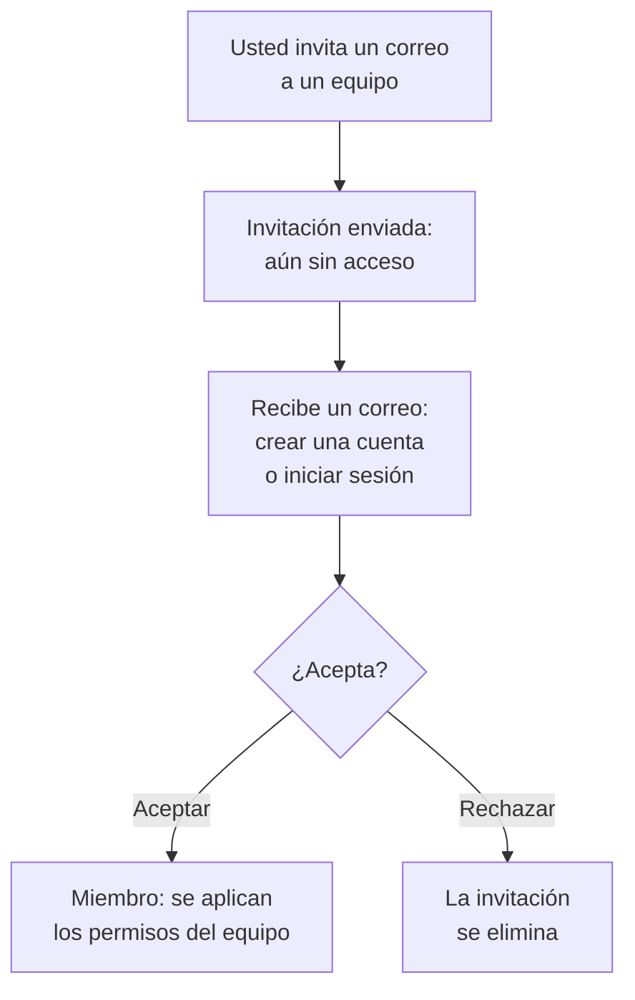

# Invitar a personas

Las personas entran en un proyecto por invitación. Usted invita la dirección de correo de una persona a un equipo, la persona acepta y, desde entonces, su equipo decide qué puede hacer. Esta página muestra cómo invitar a personas, qué ven y cómo cambiar o retirar su acceso más adelante.

:::cards
- [Invitar a alguien](#invitar-a-alguien): Una dirección de correo y un equipo.
- [Aceptar una invitación](#aceptar-una-invitación): Lo que ve y hace la persona invitada.
- [Cambiar los equipos de alguien](#cambiar-los-equipos-de-alguien): Darle más acceso, o menos.
- [Quitar a alguien](#quitar-a-alguien-del-proyecto): Lo que se lleva salir del proyecto.
:::

## Cómo funciona una invitación

- **Su equipo decide qué puede hacer.** Nadie tiene permisos propios: una persona puede hacer lo que permiten los equipos de los que forma parte. Consulte [Usuarios, equipos y permisos](/docs/permissions/index).
- **No se concede nada hasta que acepta.** Una invitación pendiente aparece como **Invitación enviada** y no da acceso al proyecto.
- **Una aceptación vale para todo el proyecto.** Aceptar una invitación acepta todas las demás invitaciones que la persona tenga en el mismo proyecto. Un miembro al que añade después a otro equipo está en él al instante, sin nada que aceptar.

## Antes de empezar

- **Un rol que pueda invitar.** Project Owner, Project Admin o un rol con el permiso **Invite New Members**. Solo puede invitar a personas a un equipo cuyos permisos usted mismo tenga, porque una invitación les da el acceso del equipo. Un Project Admin sin ningún bloqueo cuenta, a estos efectos, con todo lo que Project Admin ya puede hacer: puede invitar a personas a **Members** o a un equipo con cualquier rol más limitado, pero no a un equipo que tenga Project Owner, un permiso de facturación, **Delete Project**, **Edit Project**, **Edit Team** o **Invite New Members**.
- **En OneUptime Cloud, espacio en su plan.** Cada persona del proyecto es un asiento en su factura desde el momento en que se la invita. El plan Free tiene espacio para una persona. Consulte [Facturación y uso](/docs/configuration/billing#su-plan-y-sus-asientos).
- **Sin SCIM Push Groups.** Mientras su proveedor de identidad gestione los equipos del proyecto mediante SCIM Push Groups, las personas se invitan y se quitan allí, no en OneUptime.

## Invitar a alguien

:::steps
### Abrir Usuarios

Vaya a **Productos → Ajustes → Usuarios**. La lista **Usuarios** muestra a todas las personas del proyecto, sus equipos y si ya se unieron.

### Hacer clic en Invitar usuario

Haga clic en **Invitar usuario**. Se abre el diálogo **Invitar a un nuevo usuario**.

### Escribir su dirección de correo

Escriba su dirección en **Correo electrónico**. Si ninguna cuenta de OneUptime la usa todavía, el diálogo también pide un **Nombre**, con el que empieza su nueva cuenta.

### Elegir su equipo

**Equipo** empieza en el equipo de miembros del proyecto: el equipo que tiene Project Member para todo el proyecto, o si no, el llamado Members. Elija otro equipo para darle más acceso, o menos. **Equipo** queda vacío cuando el proyecto no tiene ese equipo, o cuando usted no podría invitar a nadie a él.

### Enviar la invitación

Haga clic en **Invitar**. OneUptime envía la invitación por correo y abre la página de la persona. Aparece como **Invitación enviada** hasta que acepta.
:::

> [!TIP]
> Invite a las personas al equipo más restringido que les permita hacer su trabajo. Puede añadirlas a más equipos después, y cada equipo al que se unen amplía lo que pueden hacer.

## Aceptar una invitación

El correo de invitación nombra el proyecto. Su botón es **Create Your Account** para quien aún no tiene cuenta de OneUptime y **Sign In to OneUptime** para quien ya tiene una. Una vez que inicia sesión, acepta en uno de dos lugares:

| Dónde está | Qué ve | En qué hace clic |
| --- | --- | --- |
| Aún en ningún proyecto | La invitación, en la página a la que llega tras iniciar sesión | **Aceptar y unirse**, o **Rechazar** |
| Ya en otro proyecto | La invitación pendiente en la campana de arriba a la derecha, que abre **Invitaciones del proyecto** | **Aceptar**, o **Rechazar** |

Al aceptar entra en el proyecto al instante, con los permisos de su equipo y la configuración de notificaciones con la que empieza cada miembro: consulte [Con qué empieza](/docs/notifications/index#con-qué-empiezas). Rechazar elimina la invitación, así que para unirse más tarde hace falta una nueva.

## Ver quién está en el proyecto

**Usuarios** tiene una fila por persona:

| Columna | Qué muestra |
| --- | --- |
| **Usuario** | Su nombre y su dirección de correo. |
| **Equipos** | Cada equipo del proyecto del que forma parte, o al que está invitada. |
| **Estado** | **Miembro** una vez que se unió, con el número de invitaciones a otros equipos que aún no aceptó. **Invitación enviada** hasta entonces. |

Filtre la lista por **Usuario**, **Estado** o **Equipo**. Haga clic en una fila para abrir la página de la persona:

| Página | Para qué sirve |
| --- | --- |
| **Perfil** | Su nombre, su dirección de correo, su foto y su ID de usuario. |
| **Equipos** | Los equipos de los que forma parte. Añada o quite un equipo aquí. |
| **Preparación**, **Métodos de notificación**, **Reglas de guardia** | Si se le puede avisar de una guardia, y cómo. Lo ven los Project Owners, los Project Admins, la propia persona y quien pueda leer las reglas de notificación de los demás. Consulte [Preparación e informes](/docs/on-call/readiness). |
| **Campos personalizados** | Los campos personalizados del proyecto para personas, si los tiene. |
| **Eliminar del proyecto** | Sacarla del proyecto. |

## Cambiar los equipos de alguien

:::steps
### Abrir su página Equipos

En **Usuarios**, haga clic en la persona y luego en **Equipos**.

### Añadirla a un equipo

Haga clic en **Invitar**, elija el **Equipo** y haga clic en **Invitar** en el diálogo. Un miembro está en el nuevo equipo al instante. Quien aún no se unió recibe una invitación más, y aceptar cualquiera de las dos acepta ambas.

### Quitarla de un equipo

Haga clic en **Eliminar** en la fila del equipo. Si es el último equipo al que se unió, quitarlo la saca del proyecto, y el diálogo lo dice antes de que cambie nada.
:::

El equipo Owners conserva siempre al menos un miembro que se unió, para que un proyecto nunca pierda a su último propietario.

## Quitar a alguien del proyecto

En **Usuarios**, abra el menú de la fila de la persona, **⋯**, y haga clic en **Eliminar del proyecto**. O abra a la persona y elija **Eliminar del proyecto** en su menú lateral. Para quitar a varias personas a la vez, seleccione sus filas y elimine la selección: cada una se quita de la misma forma.

Quitar a alguien lo saca de cada equipo del proyecto. Pierde el acceso al instante, aunque tenga la sesión iniciada, se le quita de los calendarios de guardia y de las reglas de escalado, y deja de recibir las notificaciones del proyecto. Su cuenta de OneUptime no se elimina, y puede volver a invitarlo. [Usuarios, equipos y permisos](/docs/permissions/index#usuarios) enumera todo lo que se lleva salir de un proyecto.

## Otras formas de unirse

- **Inicio de sesión único.** Quien inicia sesión por primera vez con el proveedor de identidad del proyecto se une a los equipos que nombra el proveedor. Consulte [Roles y equipos para usuarios de SSO](/docs/identity/sso#roles-y-equipos-de-los-usuarios-de-sso).
- **SCIM.** Su proveedor de identidad crea a las personas y las añade a los equipos predeterminados de la conexión. Consulte [SCIM](/docs/identity/scim#cómo-se-aprovisiona-un-usuario-de-proyecto).
- **El Admin Dashboard.** En una instalación autoalojada, un administrador maestro puede añadir a alguien a un proyecto y aceptar la invitación por esa persona. Consulte [Usuarios, equipos y permisos](/docs/permissions/index#usuarios).

## Solución de problemas

:::details "This user has already been invited to this team"
Ya está en ese equipo, como miembro o con una invitación que no aceptó. Ábrala en **Usuarios** para ver sus equipos, o invítela a otro equipo.
:::

:::details "You have reached the user limit for the free plan"
En OneUptime Cloud, un proyecto en el plan Free tiene espacio para una persona. Cambie el plan y vuelva a invitar. Consulte [Cambiar el plan](/docs/configuration/billing#cambiar-el-plan).
:::

:::details "Too many invitations were sent to this email address in the last hour"
A una dirección se le pueden enviar 10 invitaciones por hora, a proyectos y páginas de estado privadas en conjunto, las envíe quien las envíe. Espera una hora y vuelve a invitar a la persona.
:::

:::details El correo de invitación no llegó, o su enlace caducó
La invitación no depende del correo. Pídale que se registre con la dirección invitada: OneUptime envía a esa dirección un enlace nuevo para terminar de crear la cuenta. Quien ya tiene una cuenta inicia sesión y encuentra la invitación esperándole.
:::

:::details Invitar usuario dice que los usuarios se gestionan con SCIM Push Groups
Su proveedor de identidad gestiona los equipos del proyecto. Invite o quite a las personas en el proveedor de identidad, o desactive Push Groups en **Ajustes del proyecto → Seguridad → SCIM** para gestionarlas aquí.
:::

## Próximos pasos

:::cards
- [Usuarios, equipos y permisos](/docs/permissions/index): Decidir qué puede hacer cada equipo.
- [Ajustes del proyecto](/docs/configuration/project-settings): Todo lo que se aplica al proyecto entero.
- [Su cuenta](/docs/introduction/your-account): Inicio de sesión, perfil y los proyectos a los que pertenece.
- [SCIM](/docs/identity/scim): Dejar que su proveedor de identidad gestione personas y equipos.
:::
