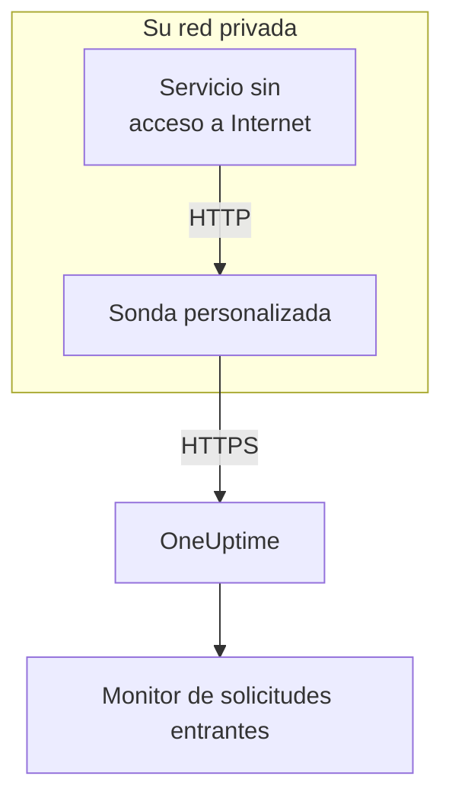

# Ingress de solicitudes entrantes

Un servicio sin acceso a Internet puede igualmente enviar heartbeats a un [monitor de solicitudes entrantes](/docs/monitor/incoming-request-monitor). En su lugar, los envía a una [sonda personalizada](/docs/probe/custom-probe) de su propia red, y la sonda los reenvía a OneUptime.

:::cards
- [Cómo funciona](#cómo-funciona): De su servicio al monitor, pasando por la sonda.
- [Activar el escuchador](#activar-el-escuchador): Un solo ajuste en la sonda, para Docker, Docker Compose o Kubernetes.
- [Enviar solicitudes a la sonda](#enviar-solicitudes-a-la-sonda): Cambiar la URL a la que envía su servicio, y nada más.
- [Solución de problemas](#solución-de-problemas): Qué registra la sonda cuando una solicitud no llega.
:::

## Cómo funciona



1. **Su servicio envía la solicitud a la sonda.** El mismo `GET` o `POST`, con la misma clave secreta, que enviaría a OneUptime, a un puerto en el que escucha la sonda.
2. **La sonda responde al instante.** Responde `200` antes de reenviar la solicitud, así que su servicio nunca espera a OneUptime.
3. **La sonda la reenvía.** Envía la solicitud a OneUptime con su método, sus cabeceras y su cuerpo, y añade una cabecera `OneUptime-Probe-Id` que identifica a la sonda.
4. **OneUptime la lee como siempre.** Los criterios del monitor ven la solicitud como si el servicio la hubiera enviado directamente.

El escuchador funciona en un puerto propio, aparte de las comprobaciones de salud de la sonda, así que puede abrirlo a su red privada sin abrir nada más.

## Cuándo usarlo

Use el escuchador cuando:

- Sus servicios se ejecutan en un segmento de red aislado sin acceso HTTPS saliente
- Necesita mantener todo el tráfico de monitorización dentro de su VPC o de su red local
- Quiere un único punto de salida, la sonda, autorizado a llegar a OneUptime
- Ya desplegó una [sonda personalizada](/docs/probe/custom-probe) y quiere reutilizarla para heartbeats entrantes

Si sus servicios ya pueden llegar directamente a `https://oneuptime.com` (o a su URL autoalojada), **no** necesita esta función: llame a la URL de heartbeat directamente desde el servicio.

## Antes de empezar

- **Una sonda personalizada en marcha.** Su **Estado** dice **Conectado**. Vea [Sondas personalizadas](/docs/probe/custom-probe) para instalar una.
- **Un monitor de solicitudes entrantes.** Su URL de heartbeat contiene la clave secreta que envía su servicio: vea [Monitor de solicitudes entrantes](/docs/monitor/incoming-request-monitor).
- **Un puerto del host de la sonda al que lleguen sus servicios.** Los ejemplos usan `3875`.

## Activar el escuchador

Establezca `PROBE_INGRESS_PORT` en el puerto que debe usar el escuchador. Cualquier valor mayor que `0` lo activa; sin definir, o en `0`, lo deja desactivado.

:::tabs
@tab Docker
```bash
docker run --name oneuptime-probe --network host \
  -e PROBE_KEY=<probe-key> \
  -e PROBE_ID=<probe-id> \
  -e ONEUPTIME_URL=https://oneuptime.com \
  -e PROBE_INGRESS_PORT=3875 \
  -d oneuptime/probe:release
```

Sin `--network host`, publique el puerto con `-p 3875:3875`.
@tab Docker Compose
```yaml title="docker-compose.yml"
services:
  oneuptime-probe:
    image: oneuptime/probe:release
    container_name: oneuptime-probe
    environment:
      - PROBE_KEY=<probe-key>
      - PROBE_ID=<probe-id>
      - ONEUPTIME_URL=https://oneuptime.com
      - PROBE_INGRESS_PORT=3875
    network_mode: host
    restart: always
```

Sin `network_mode: host`, publique el puerto bajo `ports:` como `"3875:3875"`.
@tab Kubernetes
```yaml title="oneuptime-probe.yaml"
apiVersion: apps/v1
kind: Deployment
metadata:
  name: oneuptime-probe
spec:
  selector:
    matchLabels:
      app: oneuptime-probe
  template:
    metadata:
      labels:
        app: oneuptime-probe
    spec:
      containers:
        - name: oneuptime-probe
          image: oneuptime/probe:release
          env:
            - name: PROBE_KEY
              value: "<probe-key>"
            - name: PROBE_ID
              value: "<probe-id>"
            - name: ONEUPTIME_URL
              value: "https://oneuptime.com"
            - name: PROBE_INGRESS_PORT
              value: "3875"
          ports:
            - name: ingress
              containerPort: 3875
---
apiVersion: v1
kind: Service
metadata:
  name: oneuptime-probe-ingress
spec:
  selector:
    app: oneuptime-probe
  ports:
    - name: ingress
      port: 3875
      targetPort: 3875
  type: ClusterIP
```

Los servicios del clúster envían entonces a `http://oneuptime-probe-ingress.<namespace>.svc.cluster.local:3875/heartbeat/<secret-key>`.
:::

Cuando el escuchador está en marcha, el registro de la sonda dice `Probe ingress listener started on port 3875 (heartbeat / incoming-request endpoints)`.

## Enviar solicitudes a la sonda

Su servicio envía a la sonda en lugar de a OneUptime. Sustituya la URL pública de heartbeat:

```text
https://oneuptime.com/heartbeat/<secret-key>
```

por la URL de ingress de la sonda:

```text
http://<probe-host>:<PROBE_INGRESS_PORT>/heartbeat/<secret-key>
```

La ruta, el método, el cuerpo y las cabeceras son por lo demás idénticos, así que cualquier código cliente existente solo necesita cambiar la URL base. La sonda también acepta `/incoming-request/<secret-key>`, que funciona igual.

```bash
# GET heartbeat
curl http://probe.internal:3875/heartbeat/YOUR_SECRET_KEY

# POST heartbeat with JSON body
curl -X POST http://probe.internal:3875/heartbeat/YOUR_SECRET_KEY \
  -H "Content-Type: application/json" \
  -d '{"status": "healthy", "version": "1.2.3"}'

# Cron job
*/5 * * * * curl -s http://probe.internal:3875/heartbeat/YOUR_SECRET_KEY > /dev/null
```

## Cómo se reenvían las solicitudes

| Qué | Cómo lo trata la sonda |
| --- | --- |
| La respuesta | `200` con un objeto JSON vacío (`{}`), enviada antes de reenviar la solicitud. Como en OneUptime, se envía pase lo que pase después: una clave secreta equivocada también la recibe. |
| Los métodos | `POST` se reenvía como `POST`. `GET`, y `HEAD`, se reenvían como `GET`. Los demás métodos reciben un `404` de la sonda. |
| Las cabeceras | Todas salvo las de salto a salto (`Host`, `Connection`, `Content-Length`, `Transfer-Encoding`, `Keep-Alive`, `Proxy-Authenticate`, `Proxy-Authorization`, `TE`, `Trailer`, `Upgrade`). La sonda añade `OneUptime-Probe-Id`. |
| El cuerpo | Los cuerpos JSON y de formulario de hasta 50 MB, como cuando envía directamente a OneUptime. Como allí, cualquier otro cuerpo llega vacío al monitor. |
| Los reintentos | Cuando un reenvío falla, la sonda lo reintenta hasta `PROBE_INGRESS_FORWARD_RETRY_LIMIT` veces, esperando 2 s, luego 4 s, luego 8 s, y nunca más de 15 s. Después registra el fallo y descarta la solicitud. |
| Los proxies | El reenvío pasa por el proxy de la sonda cuando `HTTP_PROXY_URL` o `HTTPS_PROXY_URL` está definida. |
| A dónde va | `ONEUPTIME_URL` seguida de `/incoming-request-ingest/incoming-request/<secret-key>`. |

## Variables de entorno

| Variable | Predeterminado | Qué hace |
| --- | --- | --- |
| `PROBE_INGRESS_PORT` | sin definir (desactivado) | El puerto que usa el escuchador. Cualquier valor mayor que `0` lo activa. |
| `PROBE_INGRESS_FORWARD_TIMEOUT_MS` | `10000` | Cuánto puede tardar cada reenvío a OneUptime, en milisegundos. Un valor menor que `1000` vuelve al valor predeterminado. |
| `PROBE_INGRESS_FORWARD_RETRY_LIMIT` | `3` | Cuántas veces se reintenta un reenvío fallido. `0` desactiva los reintentos. |

Las variables habituales de la sonda (`PROBE_KEY`, `PROBE_ID`, `ONEUPTIME_URL` y las variables de proxy) se aplican todas: vea [Sondas personalizadas](/docs/probe/custom-probe) para la lista completa.

## Consideraciones de seguridad

- **El endpoint no tiene autenticación, a propósito**: la clave secreta en la ruta de la URL *es* la autenticación, igual que en el endpoint público `oneuptime.com`. Trate la clave secreta como una credencial.
- **Mantenga el escuchador en su red privada.** No debe ser accesible desde Internet. Use una network policy, una regla de cortafuegos o un servicio `ClusterIP` para limitar quién puede llegar a él.
- **Ponga TLS delante si necesita cifrado en su red.** El escuchador habla HTTP sin cifrar. Póngalo detrás de un balanceador de carga interno o un controlador de ingress para tener TLS en ese tramo. El reenvío de la sonda a OneUptime usa HTTPS cuando `ONEUPTIME_URL` empieza por `https://`.
- **Limite usted mismo el tamaño del cuerpo si 50 MB es demasiado.** Ponga delante del escuchador un proxy inverso con un límite más bajo.

## Solución de problemas

:::details El registro de la sonda nunca dice que el escuchador arrancó
`PROBE_INGRESS_PORT` no está definida, vale `0` o no es un número. Establézcala en un número de puerto y reinicie la sonda. La línea de registro es `Probe ingress listener started on port <port> (heartbeat / incoming-request endpoints)`.
:::

:::details La sonda registra `Probe ingress: failed to forward to <url> after N attempts`
La sonda no pudo llegar a OneUptime, ni siquiera tras sus reintentos. Revise la conectividad saliente de la sonda, sus ajustes de proxy y el valor de `ONEUPTIME_URL`. Si la sonda también muestra **Desconectado**, vea [Sondas personalizadas](/docs/probe/custom-probe) para encontrar dónde se detienen sus solicitudes.
:::

:::details La sonda registra `Probe ingress: probe ID not available, forwarding without it`
La sonda aún no ha terminado de conectarse a OneUptime, así que reenvía la solicitud sin la cabecera `OneUptime-Probe-Id`. La solicitud llega igualmente al monitor.
:::

:::details El monitor recibe las solicitudes, pero no a través de la sonda
Su servicio sigue enviando a la URL pública. Compruebe que envía a `http://<probe-host>:<port>/...`: un nombre DNS o una entrada de `/etc/hosts` que apunta a otro sitio es la causa habitual.
:::

:::details El monitor no recibe nada y la sonda no registra nada
La solicitud nunca llegó a la sonda. Compruebe que el servicio llega al host de la sonda en el puerto: una regla de cortafuegos, un puerto sin publicar o un Service de Kubernetes que no selecciona el pod de la sonda.
:::

## Próximos pasos

:::cards
- [Monitor de solicitudes entrantes](/docs/monitor/incoming-request-monitor): Decidir qué cuenta como un heartbeat sano.
- [Sondas personalizadas](/docs/probe/custom-probe): Instalar la sonda, y cada ajuste que lee.
:::
