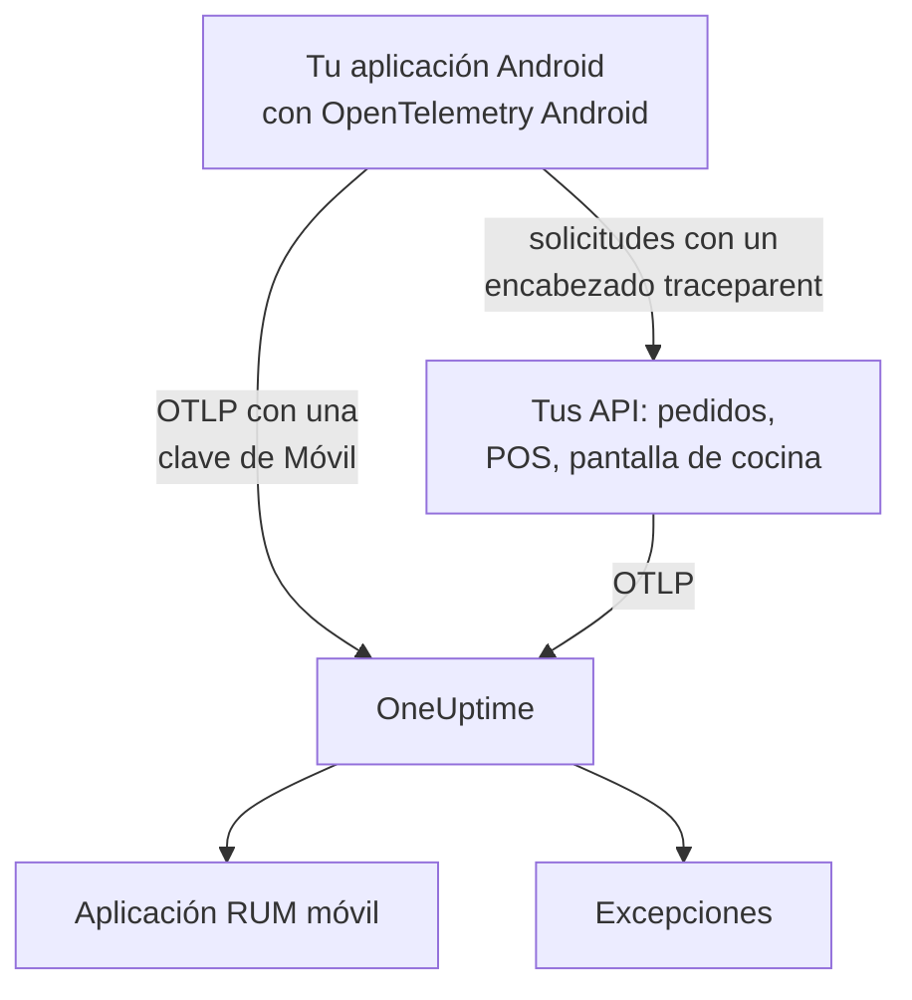

# Configuración para Android

Instrumenta una aplicación Android nativa con OpenTelemetry Android para que se informe a OneUptime como aplicación RUM móvil: sus fallos y ANR, los fotogramas lentos y congelados, los inicios de la aplicación, las pantallas, las sesiones y las solicitudes de red, trazados hasta tu backend.

:::cards
- [Añadir OpenTelemetry Android](#añadir-opentelemetry-android): Una dependencia de Gradle y unas pocas líneas al iniciar la aplicación.
- [Qué informa el agente](#qué-informa-el-agente): Fallos, ANR, fotogramas congelados, inicios y sesiones, y adónde llega cada uno.
- [Trazar las solicitudes hasta tu backend](#trazar-las-solicitudes-hasta-tu-backend): Un span por cada llamada de OkHttp, y un `traceparent` en ella.
- [Trazar tus propios flujos de trabajo](#trazar-tus-propios-flujos-de-trabajo): Un pedido desde el menú hasta la cocina, un terminal de pago, una impresora.
- [Quioscos y otros dispositivos propios](#quioscos-y-otros-dispositivos-propios): Nombrar cada dispositivo, configurarlo desde tu MDM, conservar los datos sin conexión.
:::

## Cómo funciona

OpenTelemetry Android se ejecuta dentro de tu aplicación. Envía trazas, registros y métricas a OneUptime por OTLP con una clave de ingesta de **Móvil**, fijada a tu aplicación, y añade un encabezado W3C `traceparent` a las solicitudes que hace tu aplicación, para que los spans de tu backend se unan a las trazas de la aplicación.



## Antes de empezar

- Una aplicación Android cuyo `minSdk` sea 23 o superior, compilada con `compileSdk` 34 o superior. Con un `minSdk` inferior a 26, activa la [expansión de sintaxis de la biblioteca principal](https://developer.android.com/studio/write/java8-support#library-desugaring), con Android Gradle Plugin 8.3.0 o posterior y `android.useFullClasspathForDexingTransform=true` en `gradle.properties`.
- Una clave de ingesta de **Móvil**, creada en **Ajustes del proyecto → Telemetría y APM → Claves de ingesta** con **Crear clave de ingesta**, con el `service.name` de tu aplicación en **Nombre de servicio fijado**. Una clave de **Navegador** se rechaza desde una aplicación: se comprueba contra el encabezado `Origin`, que una aplicación no envía.
- Estos ajustes de OTLP. Si alojas OneUptime tú mismo, sustituye `https://oneuptime.com` por tu propio host.

| Ajuste | Valor |
| --- | --- |
| Endpoint de OTLP | `https://oneuptime.com/otlp` |
| Encabezado | `x-oneuptime-token: YOUR_TELEMETRY_INGESTION_TOKEN` |

> [!WARNING]
> La clave viaja dentro de tu aplicación, y una aplicación se puede desempaquetar, así que da por hecho que alguien la copiará. En la página de la clave, define un **Nombre de servicio fijado**, un **Límite de solicitudes por minuto** y una fecha en **Caduca el**, y rota la clave con cada versión.

## Añadir OpenTelemetry Android

:::steps
### Añadir la dependencia

```kotlin title="app/build.gradle.kts"
dependencies {
    implementation("io.opentelemetry.android:android-agent:1.8.1")
}
```

El agente trae consigo la instrumentación de fallos, ANR, renderizado lento, actividades, fragmentos, red y sesiones. Consulta [sus versiones](https://github.com/open-telemetry/opentelemetry-android/releases) por si hay una más reciente.

### Iniciar el agente con la aplicación

```kotlin title="KioskApplication.kt"
import android.app.Application
import io.opentelemetry.android.OpenTelemetryRum
import io.opentelemetry.android.agent.OpenTelemetryRumInitializer

class KioskApplication : Application() {
    lateinit var otelRum: OpenTelemetryRum

    override fun onCreate() {
        super.onCreate()

        otelRum = OpenTelemetryRumInitializer.initialize(this) {
            httpExport {
                baseUrl = "https://oneuptime.com/otlp"
                baseHeaders = mapOf("x-oneuptime-token" to BuildConfig.ONEUPTIME_TOKEN)
            }
            resource {
                put("service.name", "kiosk-ordering")
                put("deployment.environment.name", "production")
            }
        }
    }
}
```

`baseUrl` es el endpoint sin señal: el agente le añade `/v1/traces`, `/v1/logs` y `/v1/metrics`. Define `service.name`, o la aplicación tomará el nombre de su etiqueta en el launcher. Ese nombre es la identidad de la aplicación en OneUptime, así que mantenlo igual de una versión a otra.

Indica la clase en el `android:name` del elemento `<application>` de tu manifiesto. `BuildConfig.ONEUPTIME_TOKEN` representa el lugar donde tu build guarda la clave; una flota puede recibirla de su MDM en su lugar, como muestra [Quioscos y otros dispositivos propios](#quioscos-y-otros-dispositivos-propios).

### Iniciar la aplicación y comprobar que llega

```bash
curl -i https://oneuptime.com/otlp/v1/validate \
  -H "x-oneuptime-token: YOUR_TELEMETRY_INGESTION_TOKEN"
```

`200` con `"valid": true` significa que la clave se acepta. Después inicia la aplicación y úsala un momento: aparece en **Productos → Recursos → Monitoreo de usuarios reales**, con el nombre de su `service.name`. El agente escribe la telemetría en disco antes de enviarla, así que el primer lote puede tardar un minuto en llegar.
:::

## Qué informa el agente

OpenTelemetry Android registra todo esto por su cuenta. Los atributos de dispositivo que define, `device.model.identifier`, `device.model.name` y `device.manufacturer`, archivan la aplicación como aplicación RUM móvil y llenan su página **Clientes**. También define `os.name`, `os.version` y un `app.installation.id` por cada instalación, y ningún `device.id`.

| Qué | Cómo lo envía el agente | Dónde aparece en OneUptime |
| --- | --- | --- |
| Fallos | Un evento `app.crash` con el tipo, el mensaje y el stack trace de la excepción | **Excepciones**, como no controlados |
| ANR | Un evento `device.anr` con la pila del hilo principal, cuando la aplicación deja de responder durante unos 5 segundos | **Excepciones**, como no controlados, con el tipo `ANR` |
| Fotogramas lentos y congelados | Un evento `app.jank` con `app.jank.frame_count`, los fotogramas más lentos que 16 ms (`app.jank.threshold` es `0.016`) o 700 ms (`0.7`) | **Registros**, con `@event.name:app.jank` |
| Inicios de la aplicación | Un span `AppStart`, con `start.type` definido como `cold`, `warm` o `hot` | **Trazas** |
| Pantallas | Un span por cada paso del ciclo de vida de una actividad o un fragmento, y `app.screen.name` en cada span y registro | **Trazas** |
| Sesiones | `session.id` en cada span y registro, y los eventos `session.start` y `session.end` | **Trazas** y **Registros**, buscados con `@session.id:` |
| Cambios de red | Un evento `network.change`, y `network.connection.type` en cada span y registro | **Registros** |

Los fallos y los ANR llegan a **Excepciones** como no controlados, agrupados por su stack trace, con la sesión en la que ocurrieron. El agente guarda un fallo en disco mientras la aplicación muere y lo envía desde ahí, así que un fallo que ocurre sin conexión llega igualmente cuando la aplicación vuelve a ejecutarse con red.

La **Vista general** de la aplicación te los resume: **Sesiones**, **Sesiones sin fallos**, **Fallos**, **ANR**, **Inicios de la aplicación**, **Inicio en frío (p95)** y **Fotogramas congelados**, y cada uno abre las excepciones, los spans o los eventos que cuenta. Mientras la aplicación no envíe inicios ni fotogramas, sus gráficos indican qué los activa. Sus **Recomendaciones** ofrecen monitores para fallos, ANR, inicios en frío lentos, fotogramas congelados, y una aplicación o uno de sus dispositivos que deja de informar.

En **Sesiones sin fallos**, la línea indica la misma proporción para las instalaciones: el `app.installation.id` que OpenTelemetry Android 1.1 y posteriores definen en cada span y registro, un identificador que se conserva mientras la aplicación siga instalada, así que representa a sus usuarios. Para una aplicación con cientos de sesiones por hora, en la que un fallo al día es normal, **App Crash Rate** y **App ANR Rate** alertan sobre la proporción de las sesiones de una hora que tuvieron un fallo o se bloquearon, por encima del 1,09 % y el 0,47 % de Android vitals, en lugar de alertar cada vez. **Daily Crash Rate** y **Daily ANR Rate** alertan sobre la proporción de las instalaciones de un día que tuvieron un fallo o se bloquearon, por encima del mismo 1,09 % y 0,47 % con al menos 250 instalaciones: las tasas percibidas por el usuario que evalúa Android vitals y que muestra Play Console.

Una sesión termina tras 15 minutos en segundo plano, o tras 4 horas. Una aplicación que nunca pasa a segundo plano, como un quiosco, mantiene una misma sesión durante 4 horas, así que traza la visita de cada cliente como un span propio, como muestra [Trazar tus propios flujos de trabajo](#trazar-tus-propios-flujos-de-trabajo).

Las propias llamadas a `android.util.Log` de tu aplicación también se convierten en registros cuando añades `android-log-library` y `android-log-agent` junto a los módulos de OkHttp de abajo: la etiqueta de cada llamada va en `android.log.tag`, y una llamada con un throwable es una excepción en **Excepciones**. OpenTelemetry Android no lee Logcat.

## Trazar las solicitudes hasta tu backend

Añade la instrumentación de OkHttp y el plugin de ByteBuddy con el que se compila:

```kotlin title="app/build.gradle.kts"
plugins {
    // ...the plugins your app already applies, then:
    id("net.bytebuddy.byte-buddy-gradle-plugin") version "1.18.15"
}

dependencies {
    implementation("io.opentelemetry.android:android-agent:1.8.1")
    implementation("io.opentelemetry.android.instrumentation:okhttp3-library:1.8.1-alpha")
    byteBuddy("io.opentelemetry.android.instrumentation:okhttp3-agent:1.8.1-alpha")
}
```

El plugin instrumenta la propia clase `OkHttpClient`, así que se traza cada cliente de la aplicación, también los que crean las bibliotecas. Cada solicitud se convierte en un span de cliente con el nombre de su método, con su URL, su código de estado y su duración, y lleva un encabezado W3C `traceparent`. Un backend instrumentado con [OpenTelemetry](/docs/telemetry/open-telemetry) continúa la traza desde ese encabezado, así que la API de pedidos, el puente con el POS y el servicio de la pantalla de cocina añaden sus spans a la misma traza que el toque en el quiosco.

- `HttpURLConnection` tiene el mismo par de módulos: `httpurlconnection-library` y `httpurlconnection-agent`.
- Sin el plugin, envuelve tú un cliente: `OkHttpTelemetry.builder(otelRum.openTelemetry).build().createCallFactory(client)`, de `io.opentelemetry.instrumentation:opentelemetry-okhttp-3.0`.
- Un span abierto en tu código, como en la siguiente sección, es el padre de las solicitudes hechas dentro de él.

## Trazar tus propios flujos de trabajo

Obtén un tracer del agente y crea un span para el pedido de un cliente, con un span hijo para cada uno de sus pasos. Así cada paso tiene su propia duración y sus propios errores, y el pedido dice cómo terminó:

```kotlin title="OrderTrace.kt"
import io.opentelemetry.api.trace.Span
import io.opentelemetry.api.trace.StatusCode
import io.opentelemetry.api.trace.Tracer
import io.opentelemetry.context.Context

class OrderTrace(private val tracer: Tracer) {
    // order.session: from the first tap to the order reaching the kitchen.
    private val order: Span = tracer.spanBuilder("order.session").startSpan()
    private val parent: Context = Context.current().with(order)

    // One step: menu.browse, cart.customize, payment.process, pos.inject.
    fun <T> step(name: String, block: (Span) -> T): T {
        val span = tracer.spanBuilder(name).setParent(parent).startSpan()
        return try {
            span.makeCurrent().use { block(span) }
        } catch (error: Throwable) {
            span.recordException(error)
            span.setStatus(StatusCode.ERROR)
            throw error
        } finally {
            span.end()
        }
    }

    fun complete() = finish("completed")

    fun abandon(reason: String) {
        order.setAttribute("order.abandon_reason", reason)
        finish("abandoned")
    }

    private fun finish(outcome: String) {
        order.setAttribute("order.outcome", outcome)
        order.end()
    }
}
```

```kotlin title="CheckoutFlow.kt"
val order = OrderTrace(otelRum.openTelemetry.getTracer("kiosk.ordering"))

order.step("cart.customize") { span ->
    span.setAttribute("cart.items", cart.size.toLong())
}
order.step("payment.process") { terminal.charge(cart.total) }
order.step("pos.inject") { posApi.submit(cart) } // its OkHttp span is a child
order.complete()
```

Envuelve del mismo modo cada llamada al SDK de un terminal de pago, una impresora, un escáner o un lector NFC, e indica qué dispositivo era, para que un dispositivo lento o que falla sea un span lento o que falla:

```kotlin title="ReceiptPrinter.kt"
order.step("printer.print") { span ->
    span.setAttribute("peripheral.type", "printer")
    span.setAttribute("peripheral.model", printer.model)
    span.setAttribute("peripheral.connection", "usb")
    printer.print(receipt, timeoutMillis = 10_000)
}
```

Los nombres de los atributos los eliges tú: mantenlos iguales en todas las aplicaciones, para que un solo filtro encuentre todas las impresoras. Da a cada llamada un tiempo de espera, porque un span solo termina cuando su llamada regresa. Un paso que abarca varias pantallas, como recorrer el menú, es un span que inicias cuando se abre la pantalla y terminas cuando se cierra, con el mismo padre. Para un hecho sin duración, como una impresora que se queda sin papel, envía un evento: `otelRum.emitEvent("printer.paper_low")`.

En **Trazas**, filtra por el nombre de un paso para ver cuánto tarda y con qué frecuencia falla, y por `@order.outcome:abandoned` para encontrar los pedidos que nunca se terminaron.

## Quioscos y otros dispositivos propios

### Nombrar cada dispositivo

OneUptime archiva una aplicación móvil por aplicación, nunca por dispositivo, así que una aplicación instalada en miles de teléfonos nunca lista los teléfonos de sus usuarios. En los dispositivos que son tuyos, nombra cada uno en `host.name`. Cada dispositivo aparece entonces en **Inventario** como host, junto a tus otras máquinas, con la marca, el modelo y la versión del sistema operativo que informa el agente, lo que añadas abajo y cuándo se vio por última vez:

```kotlin title="KioskApplication.kt"
resource {
    put("service.name", "kiosk-ordering")
    put("host.name", deviceName)
    put("host.serial_number", serialNumber)
    put("device.type", "kiosk")
    put("device.location", "Store 0412")
}
```

La telemetría de la aplicación se queda con su aplicación RUM, y el dispositivo no se convierte en un host en **Hosts**: una aplicación no informa métricas de host, así que no habría nada que mostrar ahí. La página del dispositivo en **Inventario** muestra sus propios registros, trazas y excepciones, y `@resource.host.name:` los encuentra en **Trazas** y **Registros**. Un dispositivo que no envía nada durante 30 días sale de **Inventario**. Para ver el propio dispositivo, su memoria, su almacenamiento y sus reinicios, y los fallos de todas las aplicaciones instaladas en él, añade el [Agente de Android](/docs/telemetry/android-agent) y dale el mismo nombre en su `device_name`: el dispositivo es entonces también un host en **Hosts**, y sigue siendo un único elemento en **Inventario**.

### Recibir un aviso cuando un dispositivo se queda en silencio

Las **Recomendaciones** de la aplicación ofrecen **Device Stopped Reporting**: una alerta por cada dispositivo que no envía spans durante una hora después de haber enviado alguno en la última semana, distinguidos por el `app.installation.id` que define el agente. La alerta de cada dispositivo lo nombra por el `host.name` que llevaban sus últimos spans, como en [Nombrar cada dispositivo](#nombrar-cada-dispositivo), y por su modelo, con su instalación al lado; un dispositivo que no envía ningún `host.name` se nombra solo por su instalación. Cambiar el nombre de un dispositivo solo cambia lo que dice su alerta: sigue siendo un solo dispositivo, con una sola alerta, que se resuelve cuando el dispositivo vuelve a informar. Cuando todos los dispositivos se quedan en silencio a la vez, por ejemplo cuando cae la red de una tienda, ningún dispositivo alerta: **App Stopped Reporting** lo informa una sola vez para toda la aplicación.

Un quiosco que se queda en una pantalla no envía nada hasta que alguien lo usa. Envía un span cada pocos minutos mientras la aplicación se ejecuta, para que un quiosco inactivo no se confunda con uno en silencio:

```kotlin title="KioskHeartbeat.kt"
import android.os.Handler
import android.os.Looper
import io.opentelemetry.api.trace.Tracer

class KioskHeartbeat(private val tracer: Tracer) {
    private val handler = Handler(Looper.getMainLooper())

    private val beat = object : Runnable {
        override fun run() {
            tracer.spanBuilder("kiosk.heartbeat").startSpan().end()
            handler.postDelayed(this, 5 * 60 * 1000L)
        }
    }

    fun start() = handler.post(beat)

    fun stop() = handler.removeCallbacks(beat)
}
```

Inícialo cuando el agente haya arrancado, con `KioskHeartbeat(otelRum.openTelemetry.getTracer("kiosk.heartbeat")).start()`. Con un span cada cinco minutos, un quiosco que funciona queda muy por debajo de la hora.

### Configurar la flota desde tu MDM

Una aplicación puede leer las configuraciones gestionadas de Android, que todo servicio de gestión de dispositivos envía a sus dispositivos. Lee de ellas la clave y el nombre del dispositivo, en lugar de incluirlos en la aplicación:

```kotlin title="KioskApplication.kt"
import android.content.RestrictionsManager

val restrictions = (getSystemService(RESTRICTIONS_SERVICE) as RestrictionsManager)
    .applicationRestrictions
val token = restrictions.getString("oneuptime_token").orEmpty()
val deviceName = restrictions.getString("device_name") ?: android.os.Build.MODEL
val serialNumber = restrictions.getString("device_serial").orEmpty()
```

Después pasa `token` a `baseHeaders` en lugar de `BuildConfig.ONEUPTIME_TOKEN`, y `deviceName` y `serialNumber` al recurso de arriba. En Esper, pega la configuración de abajo en la **Managed Configuration** de la aplicación, dentro de un blueprint. Esper rellena los marcadores de posición en cada dispositivo, con Esper Agent 8.00.0764 o posterior:

```json title="Managed configuration"
{
  "oneuptime_token": "YOUR_TELEMETRY_INGESTION_TOKEN",
  "device_name": "${esper.deviceName}",
  "device_serial": "${esper.serialNumber}"
}
```

Tras un cambio, haz Converge en los dispositivos para que lean los nuevos valores. Declara las mismas claves en un `app_restrictions.xml` si tu MDM pide un esquema. Esper rechaza un APK que no tenga firma v1, así que firma la versión con el esquema v1 además de v2 o v3.

### Importar la flota desde Esper

Conecta tu tenant de Esper al inventario y todos los dispositivos que inscribe Esper aparecerán en la lista, incluidos aquellos cuya aplicación nunca se inició, con lo que solo Esper sabe: su grupo, su versión de Android, su nivel de parche de seguridad, su número de serie, su batería, su almacenamiento, sus aplicaciones instaladas y su último contacto. Un dispositivo que deja de contactar con Esper aparece sin conexión, con cuánto hace de su último contacto. Consulta [Importar dispositivos desde Esper](/docs/inventory/overview#importar-dispositivos-desde-esper).

Un dispositivo al que su aplicación nombra como se indica arriba es un solo elemento con lo que envía la aplicación: `host.name` es su nombre en Esper. OneUptime encuentra el elemento de un dispositivo por `host.name` y luego por `host.serial_number`, así que da a cada dispositivo el mismo nombre y el mismo número de serie en todas las aplicaciones que informan desde él, y en los ajustes `device_name` y `device_serial` del Agente de Android.

### Conservar lo que se registra sin conexión

El agente escribe cada span, registro y métrica en disco antes de enviarlo. Mientras la red está caída los guarda ahí, y los envía cuando vuelve, hasta 18 horas después. Guarda 10 MB; auméntalo para un dispositivo que suele estar sin conexión:

```kotlin title="KioskApplication.kt"
diskBuffering {
    maxCacheSize = 50 * 1024 * 1024
}
```

## Solución de problemas

:::details La aplicación aparece en Servicios en lugar de en Monitoreo de usuarios reales
OpenTelemetry Android define `device.model.identifier` por sí mismo, así que la aplicación se configuró con otro SDK, o su recurso se sustituyó con `resource(Resource)`, que descarta los atributos propios del agente. Usa el bloque `resource { }`, que se suma a ellos. El servicio ya creado no se convierte en una aplicación RUM, así que elimínalo en **Productos → Servicios** cuando llegue la telemetría RUM.
:::

:::details No llega nada, o la clave se rechaza
Ejecuta la comprobación de la clave de [Añadir OpenTelemetry Android](#añadir-opentelemetry-android). Un `401` significa que la clave es desconocida, se revocó, se desactivó o caducó. Una clave de **Navegador** se rechaza desde una aplicación: usa una clave de **Móvil**. Comprueba que `baseUrl` termina en `/otlp`, sin `/v1/traces`: el agente añade la ruta por su cuenta.
:::

:::details Un fallo o un ANR no está en Excepciones
Un fallo se guarda mientras la aplicación muere, y un ANR cuando el hilo principal lleva unos 5 segundos bloqueado. Ambos esperan en disco hasta que el dispositivo puede enviarlos, así que vuelve a mirar cuando la aplicación lleve un minuto ejecutándose con red. Inicia el agente al principio del `onCreate` de tu `Application`, antes de cualquier cosa que pueda fallar, para que su gestor de fallos esté listo primero.
:::

:::details Falta un dispositivo en Inventario
Solo se lista un dispositivo cuya aplicación define `host.name`. Comprueba el valor en los atributos de recurso de un span: un valor vacío no nombra ningún dispositivo, y dos dispositivos con el mismo nombre son una sola fila.
:::

## Próximos pasos

:::cards
- [Configuración para móviles](/docs/rum/mobile-setup): iOS, React Native y las demás plataformas.
- [Agente de Android](/docs/telemetry/android-agent): Monitorear el propio dispositivo: su estado, sus reinicios, las aplicaciones instaladas y los fallos de todas las aplicaciones.
- [Excepciones](/docs/telemetry/exceptions): Clasificar los fallos y ANR que informa tu aplicación.
- [Explorador de trazas](/docs/telemetry/traces-explorer): Seguir un pedido desde el quiosco hasta la cocina.
- [Gestionar aplicaciones](/docs/rum/applications): Nombres, etiquetas, propietarios y retención.
:::
