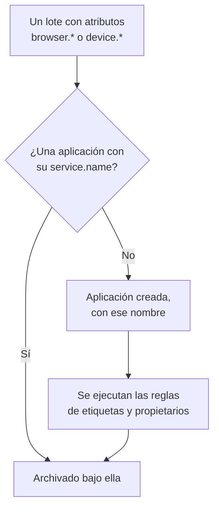

# Gestionar aplicaciones

OneUptime crea una aplicación RUM la primera vez que llega la telemetría de tu aplicación. Esta página cubre lo que gestionas a partir de ahí: el nombre de la aplicación, sus etiquetas y propietarios, cuánto tiempo se conservan sus datos, el archivado, quién puede verla y las alertas.

:::cards
- [Cómo se crea una aplicación](#cómo-se-crea-una-aplicación): Se reconoce por su `service.name` y se crea con su primer lote.
- [Etiquetas](#etiquetas): Agrupa aplicaciones y decide quién puede acceder a ellas.
- [Retención](#retención): Cuánto tiempo se conservan la telemetría y las grabaciones.
- [Permisos](#permisos): Quién puede ver las aplicaciones y quién puede ver las grabaciones.
:::

## Cómo se crea una aplicación

No tienes que crear una aplicación RUM. Cuando llega un lote de telemetría con atributos de navegador o de dispositivo y un `service.name`, OneUptime lo archiva bajo la aplicación con ese `service.name`, y crea la aplicación si el proyecto no tiene ninguna.



- El `service.name` es la identidad de la aplicación y se compara sin distinguir mayúsculas y minúsculas: `Storefront-Web` y `storefront-web` son una sola aplicación.
- Un `service.name` nuevo inicia una aplicación nueva. La antigua conserva su historial y pasa a **Desconectado**, la nueva empieza vacía, y las dos nunca se fusionan.
- Usa un `service.name` por aplicación, no uno por entorno. Distingue los entornos con una etiqueta como `oneuptime.label.env=production`, para que compartan una aplicación y un historial.

### Cambiar el nombre de una aplicación

El **Nombre para mostrar** empieza siendo el `service.name`. Para cambiarlo, abre la página **Ajustes** de la aplicación y haz clic en **Editar detalles** en la tarjeta **Detalles de la aplicación**, donde también editas su descripción y sus etiquetas. La telemetría se asocia por el **Nombre de la aplicación (service.name)**, que la tarjeta muestra y que nunca cambia, así que cambiar el nombre es seguro.

### Añadir una aplicación tú mismo

Crea una aplicación tú mismo cuando quieras que sus etiquetas, propietarios o política de reproducción estén listos antes de que llegue el primer visitante.

:::steps
#### Abrir la lista de aplicaciones

Ve a **Productos → Recursos → Monitoreo de usuarios reales** y haz clic en **Crear Aplicación RUM**.

#### Introducir el nombre de la aplicación

Rellena **Nombre de la aplicación (service.name)** con el `service.name` que tu aplicación va a enviar, exactamente como lo envía.

#### Ponerle nombre y guardar

La aplicación lleva el nombre de su aplicación, igual que una descubierta. Para mostrar otro nombre, abre **Más campos** y escribe un **Nombre para mostrar**; la descripción y las etiquetas también están ahí. Después guarda el formulario.
:::

A continuación, su guía de configuración se abre sola, con el nombre de la aplicación como `service.name` del fragmento de código. Su último paso, **Esperar a que se conecte**, indica cuándo llegan los primeros datos.

Si el proyecto ya tiene una aplicación con ese `service.name`, descubierta, añadida antes o archivada, el formulario lo indica en lugar de crear una segunda.

## Estado de la conexión

Una aplicación muestra **Conectado** mientras llega telemetría y **Desconectado** tras 15 minutos sin ninguna. Cuentan tanto la telemetría de OpenTelemetry como el tráfico de reproducción de sesiones.

**Visto por última vez** se actualiza cada pocos minutos en lugar de con cada lote, así que puede ir hasta unos cinco minutos por detrás del tráfico real, y los 15 minutos dejan margen para ello. El tiempo en que el propio OneUptime estaba caído o poniéndose al día con su cola de ingesta no cuenta.

**Desconectado** no es un error por sí solo: una herramienta interna sin visitantes por la noche está realmente desconectada. Si hay personas usando la aplicación, consulta [Solución de problemas de RUM](/docs/rum/troubleshooting).

## Etiquetas

Las etiquetas agrupan las aplicaciones en listas y filtros. También deciden a qué puede acceder un miembro restringido a algunas etiquetas: ese miembro solo ve las aplicaciones que llevan una de esas etiquetas. Una aplicación obtiene sus etiquetas de tres maneras:

| Cómo | Dónde |
| --- | --- |
| A mano | En el formulario de creación, bajo **Más campos**, o más tarde con **Editar detalles** en la tarjeta **Detalles de la aplicación** de la página **Ajustes** de la aplicación. Para varias a la vez, selecciónalas en la lista y elige **Añadir etiquetas** en **Acciones masivas**. |
| Desde la telemetría | Un atributo de recurso llamado `oneuptime.label.<name>` añade la etiqueta `<name>:<value>`, como se muestra abajo. |
| Desde una regla de etiquetas | Una regla añade etiquetas a cada aplicación nueva que coincide con ella. Consulta [Reglas de etiquetas y reglas de propietarios](#reglas-de-etiquetas-y-reglas-de-propietarios). |

Define los atributos en el mismo recurso que `service.name`, por ejemplo en el archivo `src/telemetry.ts` de la [Configuración para navegadores](/docs/rum/browser-setup):

```ts
const resource = defaultResource().merge(
  resourceFromAttributes({
    [ATTR_SERVICE_NAME]: "storefront-web",
    "oneuptime.label.team": "payments",
    "oneuptime.label.env": "production",
  }),
);
```

Esto añade las etiquetas `team:payments` y `env:production`, y las crea en el proyecto si no existen. Escribir el nombre del atributo en la etiqueta mantiene separados `oneuptime.label.team=prod` y `oneuptime.label.env=prod`. Una etiqueta de más de 100 caracteres se recorta a 100, y un valor vacío o que no sea una cadena no añade nada.

## Reglas de etiquetas y reglas de propietarios

Una regla añade etiquetas o propietarios a cada aplicación nueva que coincide con ella. Abre **Monitoreo de usuarios reales → Ajustes → Reglas de etiquetas**, o **Reglas del propietario**, y crea la regla en dos pasos:

1. En **Coincidencia**, **Todas las aplicaciones RUM**, donde empieza una regla nueva, coincide con todas las aplicaciones. Para acotarla, elige **Solo las aplicaciones RUM que cumplen las condiciones** y añade condiciones sobre **Etiquetas de la aplicación** (tiene alguna, todas o ninguna de las etiquetas que elijas), **Nombre de la aplicación** o **Descripción de la aplicación** (es igual a, contiene, empieza por, termina en o coincide con un patrón).
2. En **Etiquetas**, o **Propietarios** para una regla de propietarios, elige lo que añade la regla. Una regla nueva tiene que añadir al menos una etiqueta o un propietario. El **Nombre** se rellena a partir de lo que eliges, como _Add team:payments_ o _Add Payments as owners_, hasta que escribas un nombre propio. La **Descripción**, y **Notificar a los propietarios** en una regla de propietarios, esperan bajo **Más campos**.

Las reglas se ejecutan cuando se crea una aplicación, incluidas las descubiertas. Para aplicar una regla a las aplicaciones que ya tienes, abre el menú **⋯** de su fila y elige **Ejecutar ahora**: consulta [Ejecutar reglas sobre recursos existentes](/docs/configuration/run-rules-now). Una regla a la que una edición dejó sin nada que añadir aparece marcada con **No añade nada** en la lista. [Reglas de etiquetas y propietarios](/docs/configuration/label-and-owner-rules) cubre los formularios completos.

### Propietarios

Los propietarios son las personas y los equipos responsables de una aplicación. Las reglas de propietarios los añaden a las aplicaciones nuevas. Para añadirlos o quitarlos a mano, selecciona aplicaciones en la lista y elige **Añadir propietario** o **Quitar propietario** en **Acciones masivas**; la API los añade mediante `/rum-application-owner-user` y `/rum-application-owner-team`. Con **Notificar a los propietarios** activado, que es el valor predeterminado, se avisa a cada propietario que añade una regla. Desactívalo antes de ejecutar una regla sobre muchas aplicaciones si no hay que notificar a nadie.

## Retención

La telemetría de una aplicación y sus grabaciones se conservan durante tiempos distintos:

| Datos | Se conservan | Se ajusta en |
| --- | --- | --- |
| Registros, métricas, trazas y perfiles | La retención del proyecto, salvo que la aplicación la anule | La página **Ajustes** de la aplicación |
| Grabaciones de reproducción de sesiones | 7 días por defecto, o 1, 14, 30 o 90 días | **Política de reproducción**, con **Editar política → Límites** |

### Retención de la telemetría

Por defecto, la telemetría de una aplicación se conserva durante la retención del proyecto, que se ajusta en **Ajustes del proyecto → Telemetría y APM → Retención de datos**. Dos tarjetas de la página **Ajustes** de la aplicación, plegadas en **Más ajustes**, la anulan:

- **Retención de datos de telemetría** contiene **Conservar datos de telemetría durante (días)**, un valor para toda la telemetría de la aplicación. Déjalo vacío para usar la retención del proyecto.
- **Retención por tipo de telemetría** contiene un valor predeterminado para registros, trazas, métricas y perfiles, y para los registros por gravedad y las trazas por estado. Un valor que se deja vacío recurre al valor de la aplicación y, después, al del proyecto.

Las anulaciones de retención forman parte de la [Edición Enterprise](/docs/self-hosted/enterprise), y del plan Scale y superiores en OneUptime Cloud. Sin ellas, las tarjetas muestran lo que añade el plan, y la aplicación conserva la retención del proyecto.

En un plan de Cloud inferior, una anulación que dejó una prueba sigue aplicándose a la telemetría nueva. La página **Ajustes** la muestra en una tarjeta **Anulación de retención** con un botón **Quitar anulación**, que funciona en todos los planes: a partir de entonces la aplicación conserva la retención del proyecto, y lo que ya está almacenado conserva la retención con la que se almacenó. Volver a definir una anulación requiere el plan Scale.

### Retención de la reproducción de sesiones

Las grabaciones tienen su propia retención, que se ajusta en la página **Política de reproducción** de la aplicación con **Editar política → Límites**: 7 días por defecto, o 1, 14, 30 o 90 días. Es corta a propósito, porque una grabación es mucho más sensible, y mucho más grande, que un span. La tarjeta **Retención de la reproducción de sesiones**, en **Más ajustes** de la página **Ajustes**, la muestra (_Session replays are kept for 7 days._), y su botón **Editar en Política de reproducción** abre la política.

Una retención de telemetría más larga no conserva las grabaciones durante más tiempo. Los recuentos, las señales y el dispositivo de una sesión caducan con sus imágenes; solo los registros, los spans y las excepciones de la sesión siguen la retención de la telemetría. Consulta [Retención y eliminación](/docs/telemetry/session-replay#retención-y-borrado).

> [!TIP]
> RUM suele ser la telemetría más voluminosa de un proyecto, porque crece con tus usuarios y no con tus servidores. Una retención más corta aquí, y una más larga en tus servicios de backend, es una configuración habitual.

## Archivado y eliminación

**Archivar** oculta una aplicación de **Todas las aplicaciones** mientras sigue recogiendo telemetría. Archiva una aplicación que ya no vigilas pero cuyo historial quieres conservar.

- Haz clic en **Archivar** en la página **Ajustes** de la aplicación, o selecciona varias aplicaciones en la lista y archívalas juntas.
- Las aplicaciones archivadas están en **Monitoreo de usuarios reales → Avanzado → Archivado**. **Avanzado** empieza plegado en el menú lateral: haz clic en él para mostrar **Archivado**. Usa **Desarchivar** allí con una aplicación, o con varias a la vez.

**Eliminar aplicación**, en la sección **Avanzado** del menú lateral de la aplicación, elimina la aplicación de forma definitiva. Si la aplicación todavía envía telemetría, su siguiente lote vuelve a crear la aplicación, sin ninguno de sus ajustes, así que detén primero la instrumentación.

Para borrar los datos de una persona en lugar de toda una aplicación, presenta una solicitud de borrado: consulta [Borrar sesiones](/docs/telemetry/session-replay#borrar-sesiones).

## Permisos

Cualquiera con el rol Viewer del proyecto puede ver las aplicaciones RUM y su telemetría. La reproducción de sesiones no forma parte de ese rol a propósito: listar grabaciones, ver una y leer quién la vio son permisos distintos. Los propietarios y administradores del proyecto los tienen todos. Los selectores de permisos muestran cada permiso por su título, que aquí aparece en cursiva.

| Permiso | Permite a un miembro |
| --- | --- |
| `ReadRumApplication` (_Read RUM Application_) | Ver las aplicaciones y sus páginas de telemetría. |
| `CreateRumApplication`, `EditRumApplication`, `DeleteRumApplication` | Añadir, editar y eliminar aplicaciones. |
| `ReadRumSessionReplay` (_List Session Replays_) | Listar las sesiones grabadas y sus detalles, sin reproducirlas ni saber quién era el usuario. |
| `ReadRumSessionReplayPayload` (_Watch Session Replays_) | Reproducir grabaciones y leer la referencia y los atributos del usuario identificado. |
| `ReadRumSessionReplayAudit` (_Read Session Replay Audit_) | Leer el **Registro de acceso a las reproducciones**: quién vio qué grabación. |
| `DeleteRumSessionReplay` (_Delete Session Replays_) | Eliminar grabaciones. |
| `CreateRumSessionErasureRequest`, `ReadRumSessionErasureRequest` | Presentar solicitudes de borrado y seguirlas. |
| `ReadRumApplicationLabelRule`, `ReadRumApplicationOwnerRule` (y sus Create, Edit y Delete) | Gestionar las reglas de etiquetas y las reglas de propietarios. |
| `ReadRumApplicationOwnerUser`, `ReadRumApplicationOwnerTeam` (y sus Create, Edit y Delete) | Añadir y quitar propietarios mediante la API. |

Un reparto útil: da a un ingeniero de soporte `ReadRumApplication` y `ReadRumSessionReplay`. Podrá ver qué sesiones tuvieron errores sin ver la pantalla de nadie ni saber quién era el usuario. Da `ReadRumSessionReplayPayload` solo a las personas que lo necesiten; los miembros con `ReadRumSessionReplayAudit` verán entonces cada reproducción en la página **Registro de acceso a las reproducciones** de la aplicación. [Quién puede ver una grabación](/docs/telemetry/session-replay#quién-puede-ver-una-grabación) muestra qué desbloquea cada permiso en la lista de sesiones y en el reproductor.

## Alertas sobre datos RUM

La telemetría RUM son registros, métricas y trazas normales, así que no hay un monitor RUM aparte: los monitores habituales funcionan con ella. La forma más rápida de empezar es la página **Recomendaciones** de la aplicación, que ofrece monitores ya limitados a la aplicación:

| Grupo | Recomendaciones |
| --- | --- |
| Core Web Vitals | Poor Largest Contentful Paint, Poor Interaction to Next Paint, Poor Cumulative Layout Shift, Slow First Contentful Paint y Slow Time to First Byte. Consulta [Core Web Vitals](/docs/rum/web-vitals). |
| Errores | Failed User Operations y Unhandled Browser Exceptions. |
| Reproducción de sesiones | Las cuatro [alertas de presupuesto de almacenamiento](/docs/telemetry/session-replay#alertas-de-presupuesto-de-almacenamiento), que avisan antes de que se agote el límite diario del proyecto o el presupuesto mensual de la aplicación. Se ofrecen en cuanto la aplicación ha grabado una reproducción, y el par mensual cuando además tiene un presupuesto mensual. |

Para crear tu propio monitor, elige el que lee la señal:

- [Monitor de métricas](/docs/monitor/metrics-monitor): una Core Web Vital, o cualquier métrica que envíe tu aplicación.
- [Monitor de trazas](/docs/monitor/traces-monitor): la tasa de errores o la latencia del lado del cliente.
- [Monitor de registros](/docs/monitor/logs-monitor): un patrón en los registros del navegador.
- [Monitor de excepciones](/docs/monitor/exceptions-monitor): excepciones del lado del cliente nuevas o que se disparan.

Limita a la aplicación el monitor que crees, para que no lo dispare un servicio de backend con una firma parecida.

## Próximos pasos

:::cards
- [Reproducción de sesiones](/docs/telemetry/session-replay): Graba lo que vieron los usuarios, con su propia política y retención.
- [Reglas de etiquetas y propietarios](/docs/configuration/label-and-owner-rules): Los dos formularios de regla, paso a paso.
- [Ejecutar reglas sobre recursos existentes](/docs/configuration/run-rules-now): Aplica una regla nueva a las aplicaciones que ya tienes.
- [Solución de problemas de RUM](/docs/rum/troubleshooting): Cuando una aplicación falta, está vacía o aparece Desconectado.
:::
